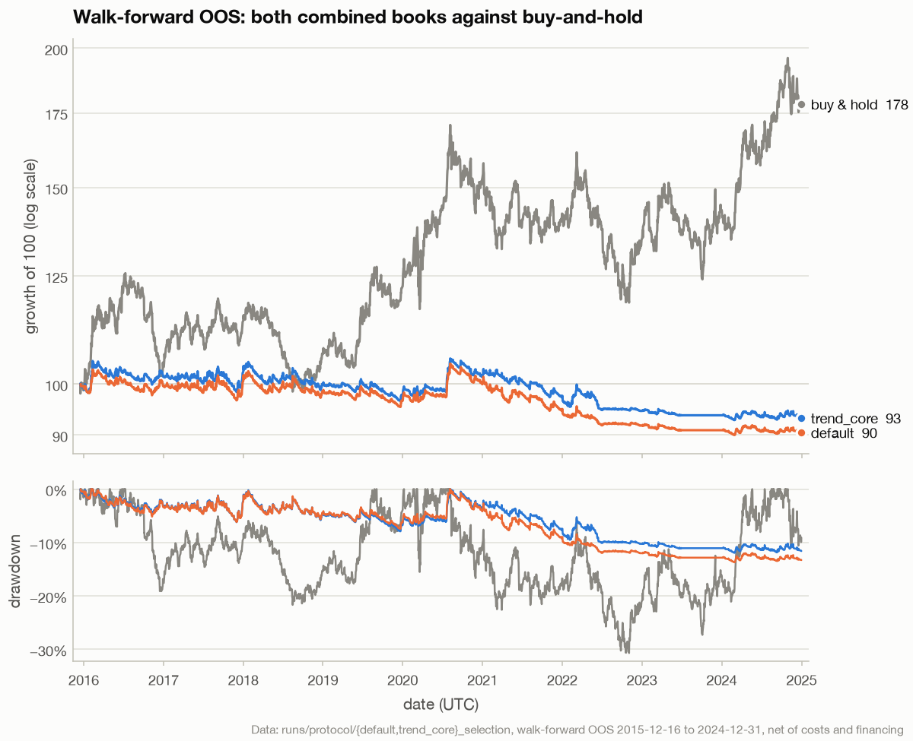
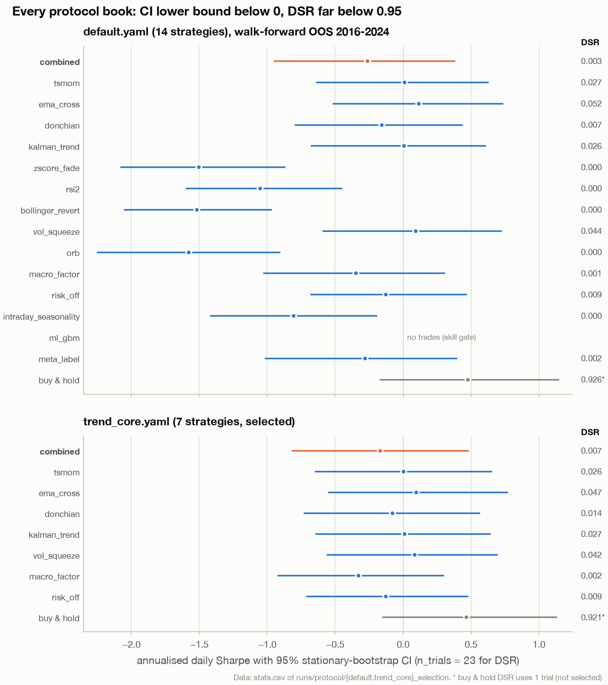
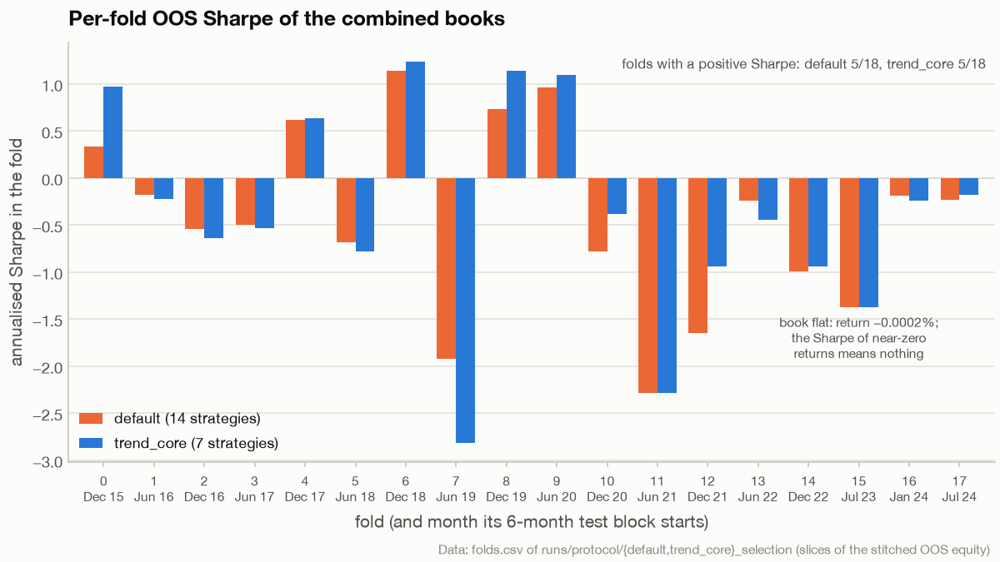
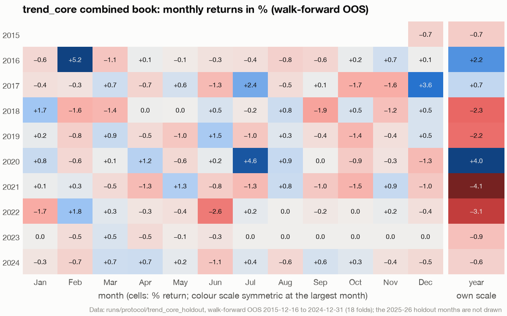
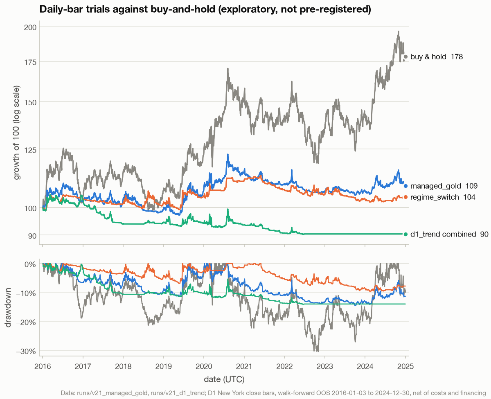
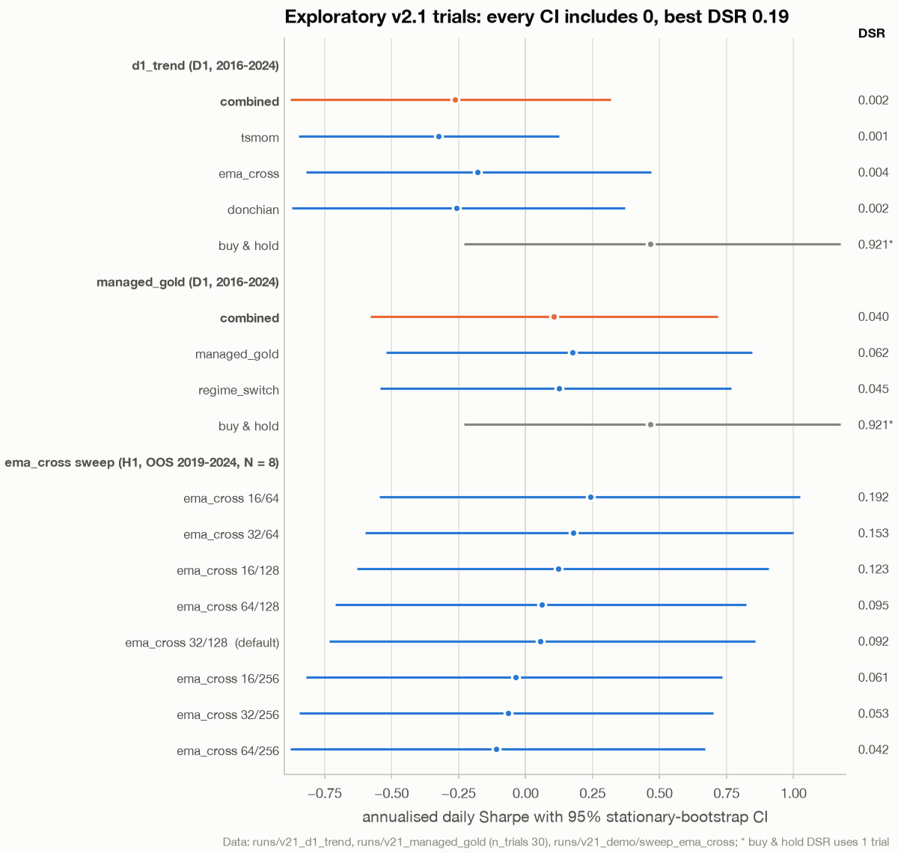

# Research results: pre-registered walk-forward, 2026-09-27

This document follows [RESEARCH_PROTOCOL.md](RESEARCH_PROTOCOL.md), which was written before
any full run. Every number in the pre-registered part comes from `aurum walkforward` on
real Dukascopy XAUUSD H1 data and can be reproduced (see [Reproduce](#reproduce)). The
short version: no strategy or combined book cleared the protocol's bar, so Aurum ships as a
research and paper-trading platform. The exploratory trials added in v2.1, run afterwards
on data that ends 2024-12-31, do not change that.

**On this page**

- [Setup](#setup)
- [Walk-forward OOS, 2016 → 2024](#walk-forward-oos-2016--2024): both configurations,
  every book with its confidence interval, fold by fold
- [Selection and holdout](#selection-and-holdout)
- [Verdict under the protocol](#verdict-under-the-protocol)
- [What the evidence says](#what-the-evidence-says)
- [Research directions](#research-directions-each-is-a-new-trial-and-must-be-counted-in-dsr)
- [Additional trials (exploratory, v2.1)](#additional-trials-exploratory-v21)
- [Reproduce](#reproduce)

How to read the statistics (bootstrap CI, PSR, DSR, PBO) is explained on
[research.md](research.md#statistics). The charts on this page are drawn by
[tools/figures/fig_results.py](../tools/figures/fig_results.py) from the run directories;
they show the walk-forward research period only and never the 2025–26 holdout, whose
numbers are in the holdout table below.

**Provenance.** Git `02eace1`, data hash `8f57cab74e3e` (through 2024) and `b05d27bf5688`
(through 2026-09-25), pandas 3.0.6, numpy 2.5.3.

## Setup

| | |
|---|---|
| Data | XAUUSD H1 mid prices with recorded bid/ask spreads, 2013-01 → 2026-09 (81,587 bars) |
| Walk-forward | Rolling 3-year train / 6-month test, 18 folds, embargo 24 bars. OOS runs 2015-12 → 2024-12 (53k bars). |
| Holdout | 2025-01-01 → 2026-09-25. Excluded from all folds and evaluated **once**, for the selected configuration only. |
| Costs | Recorded spread (min USD 0.10), USD 0.02 plus 2% of bar range slippage, and financing at Fed funds (point-in-time) + 2.5% |
| Sizing | 10% annualised vol target, 2x max leverage, drawdown de-risking |
| Combiner | `sharpe_shrink`, scored **net of costs** on earlier folds' OOS forecasts only |
| Statistics | Daily Sharpe; stationary-bootstrap 95% CI; PSR; DSR with n_trials = 23; PBO via CSCV |

The fold plan, the purge and embargo gaps and the out-of-sample combiner fit are drawn with
these runs' real folds on [research.md](research.md#the-walk-forward-protocol).

## Walk-forward OOS, 2016 → 2024

Both combined books lost a little money after costs over the nine OOS years, while gold
itself nearly doubled. The books ran at about a quarter of gold's volatility, so the
drawdowns were also much smaller.

<picture>
  <source media="(prefers-color-scheme: dark)" srcset="_assets/figures/results/equity-vs-buy-and-hold-dark.png">
  
</picture>

*Buy and hold turned 100 into 178 with a −31.4% drawdown; the `trend_core` and `default` combined books ended at 93 and 90 with drawdowns of −12.3% and −13.9%, and both stood flat through the second half of 2023 (fold 15). Data: runs/protocol/default_selection and runs/protocol/trend_core_selection, walk-forward OOS 2015-12-16 to 2024-12-31 (18 folds), net of costs and financing.*

### Configuration `default` (14 strategies)

| Book | Sharpe | 95% CI | DSR | CAGR | Vol | Max DD | Trades |
|---|---|---|---|---|---|---|---|
| **Combined** | **−0.26** | [−0.95, 0.38] | 0.003 | −1.1% | 3.8% | −13.9% | 956 |
| tsmom | 0.01 | [−0.64, 0.63] | 0.027 | −0.1% | 5.0% | −15.0% | 1229 |
| ema_cross | 0.11 | [−0.52, 0.73] | 0.052 | 0.5% | 5.4% | −12.7% | 489 |
| donchian | −0.16 | [−0.80, 0.44] | 0.007 | −0.9% | 4.6% | −15.8% | 379 |
| kalman_trend | 0.01 | [−0.68, 0.61] | 0.026 | −0.1% | 5.1% | −13.6% | 1165 |
| zscore_fade | −1.51 | [−2.08, −0.87] | 0.000 | −2.5% | 1.6% | −20.5% | 1341 |
| rsi2 | −1.06 | [−1.60, −0.45] | 0.000 | −2.1% | 1.9% | −17.6% | 2334 |
| bollinger_revert | −1.52 | [−2.06, −0.97] | 0.000 | −3.3% | 2.2% | −27.3% | 1301 |
| vol_squeeze | 0.09 | [−0.60, 0.73] | 0.044 | 0.2% | 2.9% | −9.9% | 636 |
| orb | −1.58 | [−2.25, −0.91] | 0.000 | −2.7% | 1.7% | −22.3% | 3496 |
| macro_factor | −0.35 | [−1.03, 0.31] | 0.001 | −1.5% | 3.9% | −17.1% | 299 |
| risk_off | −0.13 | [−0.69, 0.47] | 0.009 | −0.3% | 2.2% | −8.8% | 37 |
| intraday_seasonality | −0.81 | [−1.42, −0.19] | 0.000 | −0.1% | 0.2% | −1.2% | 26 |
| ml_gbm | n/a | | | 0.0% | 0.0% | 0.0% | 0 |
| meta_label | −0.28 | [−1.02, 0.40] | 0.002 | −0.8% | 2.6% | −10.9% | 434 |
| *Buy & hold (with financing)* | *0.48* | *[−0.17, 1.15]* | *0.926* | *6.8%* | *16.2%* | *−31.4%* | |

`ml_gbm` failed its validation skill gate in every fold (validation AUC 0.43–0.57, never
significantly above 0.5), so it made no trades. The whole-set PBO is 0.41. The probability
that the in-sample best strategy loses OOS is 0.81.

### Configuration `trend_core` (7 strategies)

| Book | Sharpe | 95% CI | DSR | CAGR | Vol | Max DD | Trades |
|---|---|---|---|---|---|---|---|
| **Combined** | **−0.17** | [−0.82, 0.48] | 0.007 | −0.8% | 4.0% | −12.3% | 875 |
| tsmom | 0.00 | [−0.65, 0.66] | 0.026 | −0.1% | 5.0% | −15.1% | 1230 |
| ema_cross | 0.09 | [−0.55, 0.77] | 0.047 | 0.4% | 5.3% | −13.2% | 491 |
| donchian | −0.08 | [−0.73, 0.57] | 0.014 | −0.6% | 5.6% | −13.6% | 379 |
| kalman_trend | 0.01 | [−0.65, 0.64] | 0.027 | −0.1% | 5.1% | −13.7% | 1165 |
| vol_squeeze | 0.08 | [−0.56, 0.70] | 0.042 | 0.2% | 2.9% | −9.8% | 637 |
| macro_factor | −0.33 | [−0.93, 0.30] | 0.002 | −1.4% | 3.9% | −17.1% | 301 |
| risk_off | −0.13 | [−0.72, 0.48] | 0.009 | −0.3% | 2.2% | −8.8% | 38 |
| *Buy & hold (with financing)* | *0.46* | *[−0.15, 1.13]* | *0.921* | *6.6%* | *16.2%* | *−31.4%* | |

The same strategies score slightly differently here than in the `default` table, although
their forecasts are identical. Without the ML strategies' 24-bar label horizon there is no
purge, so the stitched OOS backtest starts 24 bars earlier (2015-12-16 instead of
2015-12-17). The equity-dependent sizer (rebalance band, drawdown de-risking) then follows a
different path; donchian moves most. PBO is 0.90, and the probability that the in-sample best
strategy loses OOS is 0.84.

### Every book at a glance

Each line below is a book's Sharpe with its 95% stationary-bootstrap interval, and the
number on the right is its DSR (the probability that the true Sharpe is positive after
deflating for 23 trials). An edge would need a whole interval to the right of zero and a
DSR near 0.95.

<picture>
  <source media="(prefers-color-scheme: dark)" srcset="_assets/figures/results/forest-protocol-dark.png">
  
</picture>

*No interval lies to the right of zero: the trend books straddle zero (DSR 0.007 to 0.052), the hourly mean-reversion, opening-range and intraday-seasonality books lie entirely below it, and buy and hold reaches 0.48 with DSR 0.926 on a single trial. Data: stats.csv of runs/protocol/default_selection and runs/protocol/trend_core_selection, walk-forward OOS 2015-12-16 to 2024-12-31 (18 folds).*

### Fold by fold

<picture>
  <source media="(prefers-color-scheme: dark)" srcset="_assets/figures/results/fold-sharpe-dark.png">
  
</picture>

*Five of 18 folds were positive for each configuration (folds 0, 4, 6, 8 and 9), and the two books moved together; fold 15's −1.38 is the Sharpe of flat books whose returns were −0.0006% and −0.0002%, so it carries no information. Data: folds.csv of runs/protocol/default_selection and runs/protocol/trend_core_selection, walk-forward OOS 2015-12-16 to 2024-12-31 (18 folds).*

## Selection and holdout

By the pre-registered rule (higher walk-forward DSR), **`trend_core` was selected**
(0.007 vs 0.003). Only `trend_core` was run on the holdout.

### Final holdout, 2025-01-01 → 2026-09-25, evaluated once

| Book | Sharpe | 95% CI | CAGR | Vol | Max DD |
|---|---|---|---|---|---|
| **Combined (trend_core)** | **1.34** | [−0.08, 2.78] | 9.5% | 6.8% | −8.4% |
| tsmom | 1.43 | [0.07, 2.88] | 10.8% | 7.1% | −8.6% |
| ema_cross | 1.16 | [−0.21, 2.58] | 7.9% | 6.5% | −7.3% |
| donchian | 0.98 | [−0.47, 2.51] | 7.0% | 6.9% | −9.1% |
| kalman_trend | 1.50 | [0.12, 3.01] | 11.1% | 6.9% | −7.4% |
| vol_squeeze | 0.78 | [−0.67, 1.96] | 2.2% | 2.8% | −2.5% |
| macro_factor | 0.00 | [−1.35, 1.45] | −0.2% | 5.6% | −6.8% |
| risk_off | 0.37 | [−1.24, 1.56] | 0.9% | 2.4% | −4.8% |
| *Buy & hold* | *0.94* | *[−0.50, 2.51]* | *24.6%* | *26.4%* | *−32.5%* |

The holdout run read its own ledger (`runs/protocol/holdout_ledger.jsonl`), so the earlier
`fast.yaml` smoke look at 2026-01 → 2026-09 disclosed in
[RESEARCH_PROTOCOL.md](RESEARCH_PROTOCOL.md) was not added to `n_trials` automatically.
Counting it (`n_trials` = 24) lowers the combined book's holdout DSR from 0.43 to 0.42 and
changes nothing else in this document.

### The selected configuration month by month

The holdout run (`runs/protocol/trend_core_holdout`) repeats the selection run's research
folds exactly and then adds the holdout. Its research-period book, month by month:

<picture>
  <source media="(prefers-color-scheme: dark)" srcset="_assets/figures/results/monthly-returns-dark.png">
  
</picture>

*83 of the 109 months sit within ±1%; the gains come in a few trending months (+5.2% in February 2016, +4.6% in July 2020, +3.6% in December 2017), and 2018, 2019, 2021 and 2022 each lost 2.2% to 4.1%; the 2025–26 holdout months are deliberately not drawn. Data: runs/protocol/trend_core_holdout, walk-forward OOS 2015-12-16 to 2024-12-31 (18 folds).*

## Verdict under the protocol

| Criterion (all required for live use) | Result | |
|---|---|---|
| Walk-forward DSR > 0.95 | 0.007 | **fail** |
| Bootstrap Sharpe CI lower bound > 0 | −0.82 | **fail** |
| Holdout Sharpe > 0 | 1.34 | pass |

**No strategy or book has a demonstrated edge.** Aurum v2 therefore ships as a research and
paper-trading platform. Real-money trading is not recommended on this evidence.

## What the evidence says

1. **Hourly mean reversion and opening-range breakouts lose reliably after costs.** z-score
   fade, RSI(2), Bollinger reversion and the London/New York opening-range breakout all have
   95% CIs entirely below zero (so does intraday seasonality, at tiny size). Flipping the sign
   does not help: z-score fade, Bollinger reversion and the ORB lost money even before costs,
   but by less than the spread and slippage a flipped version would pay again.
2. **Trend following is regime-dependent.** It was flat to slightly negative through the
   choppy 2016–2024 sample and strongly positive in the 2025–26 trend. That matches the
   literature: trend following is a *crisis-alpha / convexity* return stream, not a steady
   one. In the holdout the combined book ran at about a quarter of buy-and-hold's volatility
   and drawdown, and earned well under half its return (9.5% vs 24.6% a year). About 21
   months is still not enough to separate skill from regime.
3. **Costs decide everything.** Before spread, slippage and financing the four trend
   strategies each made money in the 2016–2024 walk-forward (tsmom +22.9k USD gross on
   100k USD); after them three of the four lost money (tsmom −0.7k USD). The net-of-cost
   combiner holds risk back when nothing clears costs: in fold 15 the whole book stood flat.
4. **ML earns its keep by abstaining.** The skill-gated GBM refused to trade on
   coin-flip validation AUC. That is the right behaviour, and it is why it shows zero rather
   than a loss.
5. **Gold's own drift dominated this period.** Buy-and-hold beat every active book on raw
   return (6.8%/yr walk-forward, 24.6%/yr holdout), at about 4x the combined books'
   volatility and 2–4x their drawdown.

## Research directions (each is a new trial and must be counted in DSR)

- Daily-bar (NY-close) trend following with the classic monthly TSMOM horizons, which is
  lower turnover.
- A **long-biased**, vol-targeted gold allocation with a trend overlay, aiming to keep the
  drift while cutting drawdowns. This is the institutional "managed gold exposure" product,
  not an alpha claim.
- Better macro data: consensus and surprise economic calendars, TIPS real yields at
  intraday frequency, CFTC positioning, ETF flows.
- Broker-specific cost calibration from your own fills (TCA), fed back into `CostModel`.

The first two were tried in v2.1 as exploratory trials; the results are in the next
section.

## Additional trials (exploratory, v2.1)

> [!IMPORTANT]
> Everything in this section is **exploratory** and **not pre-registered**. These runs came
> after the protocol results above were published, they reuse the 2016–2024 walk-forward
> span the protocol had already evaluated, and they stop at 2024-12-31 with the holdout
> disabled: the used-up 2025–26 holdout was not touched and no ledger entry was written.
> Every new strategy configuration is counted as a further trial: DSR uses `n_trials` = 30
> (the 23 pre-registered, five new strategy configurations and two combined books), see the
> [protocol addendum](RESEARCH_PROTOCOL.md#addendum-v21-unreleased).

**Setup.** Real Dukascopy XAUUSD D1 bars on the New York close (22:00 UTC sessions), loaded
from 2013-01-01 to the 2024-12-31 session; walk-forward 3Y train / 6M test (774 / 129 daily
bars), 18 folds, embargo 1 bar; OOS from the 2016-01-04 session to the 2024-12-31 session
(2,322 bars). Costs, financing (Fed funds + 2.5%), sizing (10% vol target), combiner and
research risk limits are those of the protocol (`configs/d1_trend.yaml` extends
`default.yaml`). The new strategies, `managed_gold` and `regime_switch`, are described on
[strategies.md](strategies.md). Daily statistics date each equity mark by its bar's close:
one return per session, 2,322 in all and five in 444 of the 470 weeks. The first v2.1 runs
dated these 22:00 UTC bars by their open, which merged the Sunday and Monday bars (1,862
returns, mostly four a week) and made the Sharpes 10–13% too large in magnitude; v2.1 fixed
the walk-forward statistics and re-ran both configs. **Provenance:** git `ec0a0f4` plus the
uncommitted v2.1 working tree (`git_dirty: true`), D1 data hash `b13ae1067193`, pandas 3.0.6,
numpy 2.5.3.

### Daily trend following: `d1_trend`

`tsmom` with the 1, 3, 6 and 12-month horizons (21/63/126/252 days), `ema_cross` 16/64 and
a 55/20-day `donchian` channel.

| Book | Sharpe | 95% CI | DSR | CAGR | Vol | Max DD | Trades |
|---|---|---|---|---|---|---|---|
| **Combined** | **−0.26** | [−0.88, 0.32] | 0.002 | −1.1% | 3.9% | −14.1% | 60 |
| tsmom | −0.32 | [−0.85, 0.13] | 0.001 | −1.5% | 4.4% | −17.1% | 128 |
| ema_cross | −0.18 | [−0.82, 0.47] | 0.004 | −1.0% | 4.8% | −15.7% | 43 |
| donchian | −0.26 | [−0.87, 0.37] | 0.002 | −1.2% | 4.1% | −16.5% | 37 |
| *Buy & hold (with financing)* | *0.47* | *[−0.23, 1.17]* | *0.921* | *6.6%* | *16.3%* | *−30.5%* | |

PBO is 0.61, and the probability that the in-sample best strategy loses OOS is 0.93. In 6
of the 18 folds (4 and 13 to 17) no strategy had a positive net Sharpe on the earlier OOS
history, so the combiner held the whole book flat; the combined book also had 2 research
risk-halt episodes (the daily-loss limit, in the 2020-02-28 and 2020-08-11 sessions). Daily monthly-horizon
trend following lost money after costs over 2016–2024, like the H1 trend rules.

### Managed gold exposure: `managed_gold`

`managed_gold` (a 0.5 base long plus a 0.5 trend tilt, cut to zero by a latched de-risk
switch), `regime_switch` (daily `tsmom` scaled by a two-state HMM's probability of the calm
regime) and the same daily `tsmom` as a control.

| Book | Sharpe | 95% CI | DSR | CAGR | Vol | Max DD | Trades |
|---|---|---|---|---|---|---|---|
| **Combined** | **0.11** | [−0.58, 0.72] | 0.040 | 0.4% | 4.5% | −10.7% | 79 |
| managed_gold | 0.17 | [−0.52, 0.84] | 0.062 | 0.9% | 6.4% | −14.5% | 24 |
| regime_switch | 0.12 | [−0.54, 0.77] | 0.045 | 0.5% | 4.3% | −9.7% | 289 |
| tsmom (daily, as above) | −0.32 | [−0.85, 0.13] | 0.001 | −1.5% | 4.4% | −17.1% | 128 |
| *Buy & hold (with financing)* | *0.47* | *[−0.23, 1.17]* | *0.921* | *6.6%* | *16.3%* | *−30.5%* | |

PBO is 0.84; the probability that the in-sample best strategy loses OOS is 0.40.

- `managed_gold` held an average forecast of 0.62 and was de-risked on 3.2% of the OOS days
  (5.4% over all of 2013–2024, mostly in 2014, 2015, 2018 and 2022). It did **not** beat
  buy and hold on a risk-adjusted basis: Sharpe 0.17 against 0.47, and a drawdown of 2.3
  times its volatility against 1.9 times for buy and hold.
- The HMM filter turned daily `tsmom` from −0.32 to +0.12 and cut its maximum drawdown from
  −17.1% to −9.7%, at 2.4 times the trading costs (7.0k against 3.0k USD).

<picture>
  <source media="(prefers-color-scheme: dark)" srcset="_assets/figures/results/exploratory-equity-dark.png">
  
</picture>

*`managed_gold` kept some of gold's drift (100 to 109) with half of buy and hold's drawdown, but buy and hold reached 178; `regime_switch` ended at 104 and the `d1_trend` combined book at 90, flat from July 2022 (folds 13 to 17) once the combiner gave every strategy zero weight. Data: runs/v21_managed_gold and runs/v21_d1_trend, XAUUSD D1 (New York close) walk-forward OOS 2016-01-03 to 2024-12-30 (bar opens), net of costs and financing; exploratory.*

### EMA crossover parameter sweep

An `aurum sweep` of `ema_cross` on the `trend_core` configuration: every grid point is a
full walk-forward of a standalone single-strategy book, out of sample and net of costs
(how sweeps work: [analytics.md](analytics.md)). Research window 2016-01-03 to 2024-12-31
(53,233 H1 bars), OOS 2019-01-03 to 2024-12-31 (1,555 days). Annualised OOS Sharpe:

| fast \ slow | 64 | 128 | 256 |
|---|---|---|---|
| 16 | **0.241** | 0.123 | −0.037 |
| 32 | 0.177 | 0.054 (default) | −0.066 |
| 64 | invalid (fast must be below slow) | 0.061 | −0.110 |

- The best point, 16/64, has Sharpe 0.241 with a 95% CI of [−0.545, 1.025], PSR 0.727 and
  DSR 0.192 with `n_trials` = 8 (the eight valid grid points; `dsr_xs` 0.563).
- Its three grid neighbours keep only 49% of its Sharpe (plateau ratio 0.489, below the 0.5
  knife-edge threshold), and it sits on the edge of the grid for both parameters, so the
  optimum may lie outside the searched range: extending the grid would be another search.
- PBO across the grid is 0.514 (probability that the in-sample best loses OOS 0.49). The
  default 32/128 point scores 0.054. Maximum drawdowns are −12.1% to −13.2% everywhere;
  trades fall from 680 (16/64) to 171 (64/256) and costs from 10.1k to 3.0k USD.

The sweep counted only its own grid points. Counting the 30 trials before it as well
(`N` = 38), the best point's DSR falls to 0.056:

```python
import pandas as pd
from aurum.research.stats import sharpe_summary

r = pd.read_csv("runs/v21_demo/sweep_ema_cross/returns.csv", index_col=0)["fast=16,slow=64"].dropna()
for n in (8, 38):                     # the sweep's own count; plus the 30 trials before it
    s = sharpe_summary(r.to_numpy(), 252.0, n_trials=n, bootstrap=False)
    print(f"n_trials {n:>2}: Sharpe {s['sharpe']:.3f}  SR0 {s['sr0']:.3f}  DSR {s['dsr']:.3f}")
```

```text
n_trials  8: Sharpe 0.241  SR0 0.588  DSR 0.192
n_trials 38: Sharpe 0.241  SR0 0.873  DSR 0.056
```

### Stress test of the selected book

`aurum stress` on the `trend_core` selection run's combined book: a stationary block
bootstrap of its 2,346 daily OOS returns (Sharpe −0.170; automatic mean block length 1
day), 10,000 paths of 504 days (two years), seed 0 ([analytics.md](analytics.md)).

| Quantity | Result |
|---|---|
| CAGR, 5% / 50% / 95% quantiles | −5.2% / −0.8% / +4.1% |
| Maximum drawdown, 5% / 50% / 95% quantiles | −12.3% / −6.5% / −3.3% |
| P(drawdown deeper than 10%) / 15% | 0.149 / 0.011 |
| P(touching −10% from the start) / −20% | 0.0875 / 0.0003 |
| P(losing money over two years) | 0.609 |
| Paths that do not recover from their maximum drawdown within two years | 75.8% |
| Time to recover, median / 95% (recovered paths) | 99 / 259 days |
| Longest underwater stretch, median | 351 days |
| Worst historical 1 / 21 / 63-day windows | −1.3% (2016-06-03) / −2.9% (2022-05-19 to 06-16) / −4.7% (2017-09-06 to 12-01) |

These numbers assume the future is a reshuffle of the 2016–2024 past, with the sizing and
costs already inside the returns.

### All exploratory trials at a glance

<picture>
  <source media="(prefers-color-scheme: dark)" srcset="_assets/figures/results/forest-exploratory-dark.png">
  
</picture>

*Every interval includes zero; the best DSR is the sweep's 16/64 point at 0.192 with only its own 8 trials counted (0.056 with all 38), and the best daily book is `managed_gold` at 0.062. Data: stats.csv of runs/v21_d1_trend and runs/v21_managed_gold (n_trials 30), sweep.csv and returns.csv of runs/v21_demo/sweep_ema_cross (DSR recomputed with N = 8, matching its sweep.json); exploratory.*

### Verdict on the additional trials

Unchanged. No exploratory book comes close to the protocol's bar: every DSR is far below
0.95 and every bootstrap CI lower bound is below 0. The best risk-adjusted idea,
`managed_gold`, is an allocation product that kept part of gold's drift at a lower
drawdown, not an edge, and it still lagged buy and hold on Sharpe.

## Reproduce

```bash
aurum data download --end 2026-09-25                 # ~130 MB Dukascopy + macro
aurum walkforward -c configs/default.yaml    --set data.end=2024-12-31T23:59:59Z --set walkforward.holdout_start=null --out runs/protocol/default_selection
aurum walkforward -c configs/trend_core.yaml --set data.end=2024-12-31T23:59:59Z --set walkforward.holdout_start=null --out runs/protocol/trend_core_selection
aurum walkforward -c configs/trend_core.yaml --out runs/protocol/trend_core_holdout   # includes the one-time holdout
```

The runs are deterministic: re-running the last command on the same data reproduces the
tables above exactly. Compare the data hashes in each run's `provenance.json` with the ones
at the top, since Dukascopy and FRED can revise history.

Every holdout evaluation is appended to `holdout_ledger.jsonl` next to the run directories.
When a *different* configuration later evaluates an overlapping holdout window, the run
warns and adds it to `n_trials`. `runs/` is git-ignored, so a fresh clone starts with an
empty ledger and cannot know about the looks recorded here. Anyone re-running this should
treat the 2025–26 holdout as **already used** ([research.md](research.md#the-holdout-and-the-ledger)).

The exploratory v2.1 runs were produced by these commands (the first two as recorded in each
run's `provenance.json`, the other two from the v2.1 change notes). None of them reaches the
holdout: the D1 configs end on the 2024-12-31 session, and the sweep and stress commands
work on 2016–2024 data and on the selection run.

```bash
aurum walkforward -c configs/d1_trend.yaml     --set walkforward.holdout_start=null --out runs/v21_d1_trend
aurum walkforward -c configs/managed_gold.yaml --set walkforward.holdout_start=null --out runs/v21_managed_gold
aurum sweep -c configs/trend_core.yaml --strategy ema_cross --grid fast=16,32,64 --grid slow=64,128,256 \
  --set data.start=2016-01-01 --set data.end=2024-12-31 --set walkforward.holdout_start=null \
  --end 2024-12-31 --out runs/v21_demo/sweep_ema_cross
aurum stress --run runs/protocol/trend_core_selection --out runs/v21_demo/stress_trend_core
```

See also [research.md](research.md) (the methods), [analytics.md](analytics.md) (sweeps,
stress, attribution), [strategies.md](strategies.md) and [models.md](models.md) (what the
strategies and models do), [portfolio-and-risk.md](portfolio-and-risk.md) and
[execution-and-costs.md](execution-and-costs.md) (combiner, sizing and costs),
[configuration.md](configuration.md) and [cli.md](cli.md), and the [index](index.md).
