# Robustness, stress and explainability

A walk-forward run answers one question: what would this configuration have earned out of
sample, net of costs? This page covers the questions you ask next. Is the best parameter set a
broad plateau or a knife edge that was fitted to noise (`aurum sweep`)? What else could the
same return stream have produced, and how deep could the drawdown get (`aurum stress`)? Why
did the book hold what it held at a given bar, and which strategy earned or lost what
(`aurum explain`)? The last section covers the interactive HTML dashboard of a run
(`aurum dashboard`). All four tools read data that already exists. A sweep runs new
walk-forwards, but only on research data and with every grid point counted as a trial. The
other three only read a run directory. None of them can evaluate the holdout: a sweep cuts it
away before anything runs, and `stress` and `explain` only read a holdout that a walk-forward
already evaluated (`--phase holdout`). The code labels every sweep result EXPLORATORY. Every
chart on this page was drawn by aurum's own code from real gold data or existing run outputs,
unless its caption says "synthetic".

**On this page**

- [The four tools at a glance](#the-four-tools-at-a-glance)
- [Parameter sweeps](#parameter-sweeps)
  - [What one grid point is](#what-one-grid-point-is)
  - [Searching costs trials: n_trials and the DSR](#searching-costs-trials-n_trials-and-the-dsr)
  - [Plateau or knife edge](#plateau-or-knife-edge)
  - [The ema_cross sweep on real data](#the-ema_cross-sweep-on-real-data)
  - [PBO across the grid](#pbo-across-the-grid)
  - [The holdout guard and the sweep ledger](#the-holdout-guard-and-the-sweep-ledger)
  - [Sweeps in code](#sweeps-in-code)
  - [Sweep pitfalls and design choices](#sweep-pitfalls-and-design-choices)
- [Monte Carlo and stress](#monte-carlo-and-stress)
  - [The stationary bootstrap](#the-stationary-bootstrap)
  - [Choosing the block length](#choosing-the-block-length)
  - [From paths to risk numbers](#from-paths-to-risk-numbers)
  - [Deterministic stress](#deterministic-stress)
  - [Stress in code](#stress-in-code)
  - [Stress pitfalls and design choices](#stress-pitfalls-and-design-choices)
- [Explainability](#explainability)
  - [Contributions: from forecasts to the combined forecast](#contributions-from-forecasts-to-the-combined-forecast)
  - [Replaying the sizing chain](#replaying-the-sizing-chain)
  - [Live and paper decisions: the desk step](#live-and-paper-decisions-the-desk-step)
  - [PnL attribution](#pnl-attribution)
  - [Desk journal summary](#desk-journal-summary)
  - [Attribution accessors on walk-forward reports](#attribution-accessors-on-walk-forward-reports)
  - [Explain in code](#explain-in-code)
  - [Explainability pitfalls and design choices](#explainability-pitfalls-and-design-choices)
- [Interactive dashboard](#interactive-dashboard)
- [Plotting API in light and dark](#plotting-api-in-light-and-dark)
- [Reproducing the figures](#reproducing-the-figures)
- [See also](#see-also)

## The four tools at a glance

| Command | Question | Reads | Writes (default) | Module |
|---|---|---|---|---|
| `aurum sweep` | Is the best parameter set robust, and is it significant after the search? | a config and its data (research bars only) | `output.dir/sweep_<strategy>_<utc>/` plus `sweep_ledger.jsonl` next to it | [aurum/research/sweep.py](../aurum/research/sweep.py) |
| `aurum stress` | What else could this book's return stream have produced? What would the worst historical episodes cost? | `books/<book>/timeseries.parquet` (+ the run's bars) | `<run>/analysis/stress/` | [aurum/research/montecarlo.py](../aurum/research/montecarlo.py) |
| `aurum explain` | Why this position at this bar? Which strategy earned what? What did the LLM desk do? | `oos_forecasts.parquet`, `weights.csv`, the book, `config.yaml`, desk journals, or a live `decisions.jsonl` | `<run>/analysis/explain/` (`runs/analysis/explain_live/` for `--live`) | [aurum/research/attribution.py](../aurum/research/attribution.py) |
| `aurum dashboard` | All of a run on one interactive page | the run directory (+ a desk journal) | `<run>/dashboard.html` | [aurum/viz/dashboard.py](../aurum/viz/dashboard.py) |

The commands are registered by [aurum/cli_ext.py](../aurum/cli_ext.py) (`aurum dashboard` by
[aurum/viz/cli.py](../aurum/viz/cli.py)), and every flag is listed in [cli.md](cli.md).
`aurum sweep` validates its config strictly before loading data, like every command that takes
`-c`. The other three read a run directory and need no config. The examples on this page pass
`--out` with a scratch directory, so nothing is written into `runs/protocol/`.

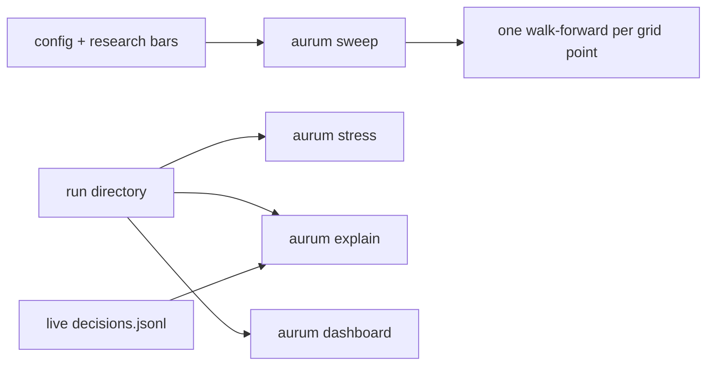

## Parameter sweeps

**Intuition.** Every strategy has parameters: how many bars a moving average looks back, how
strongly a signal must move before it counts. Try enough values and one of them will look
good by chance alone. A sweep makes that search explicit and checks the winner three ways.
First, is its Sharpe ratio still significant once you account for how many settings were
tried? Second, do its neighbours on the grid also do well (a plateau), or does performance
collapse one step away (a knife edge)? Third, does picking the in-sample winner work at all
out of sample? A real edge usually survives small parameter changes. A fitted one does not.

### What one grid point is

[`run_sweep`](../aurum/research/sweep.py) expands the grid into its cartesian product
([`parse_grid`](../aurum/research/sweep.py) accepts `p=v1,v2,...` or an inclusive range
`p=a:b:step`, then sorts and de-duplicates numeric values, so grid neighbours are value
neighbours). It turns each point into a standalone single-strategy configuration
(`_point_config`):

- one strategy with the point's parameters on top of its config parameters, and weight 1;
- `combiner.method: fixed`, so the forecast diversification multiplier is
  $1/\sqrt{w^\top H w} = 1$ and the combined forecast equals the strategy forecast;
- `walkforward.holdout_start: null`, no strategy sub-books, no benchmark, nothing saved.

Each point then runs through the full walk-forward
([`run_walk_forward`](../aurum/research/walkforward.py)): the same fold geometry, costs,
financing, sizer and research risk limits as any other run. Every number in the table is out
of sample and net of costs. A point the strategy rejects (for example `fast >= slow` for
`ema_cross`) is recorded with `status="invalid"` and is not a trial. Points run in parallel
(`executor: auto` uses processes from 20,000 bars, threads below). Each point's walk-forward
runs serially, so the results do not depend on the executor.

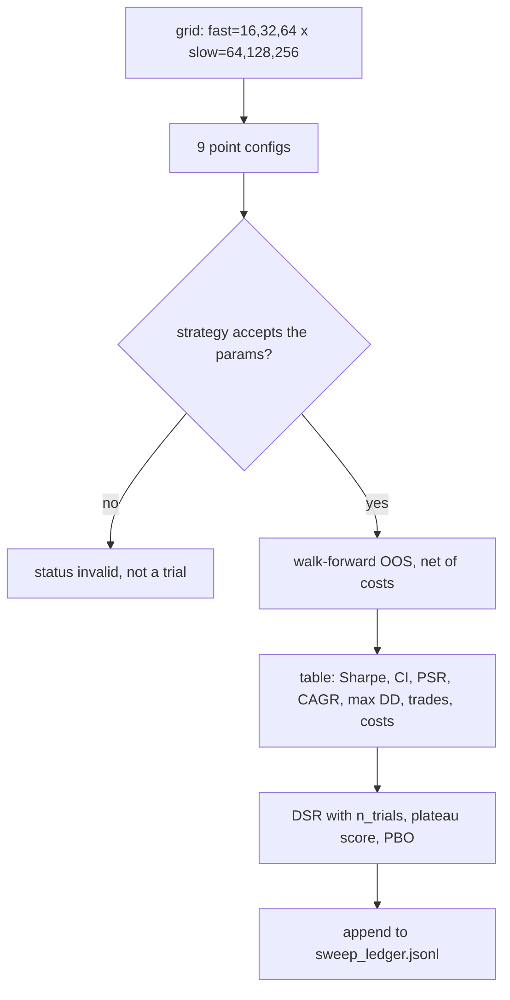

### Searching costs trials: n_trials and the DSR

**Intuition.** If you test $N$ strategies that have no skill at all, the best of them still
shows a positive Sharpe ratio, and the bigger $N$ is, the higher that best value is. The
Deflated Sharpe Ratio (Bailey and López de Prado 2014) asks how likely the true Sharpe ratio
of the winner is to exceed the best Sharpe you would expect from $N$ skill-less trials. So the
sweep must count its trials honestly, including earlier searches on the same data.

**The math.** The number of trials is

```math
N = \max\bigl(1,\; N_{\mathrm{valid}} + N_{\mathrm{ledger}} + N_{\mathrm{prior}}\bigr)
```

where

- $N_{\mathrm{valid}}$ is the number of valid grid points of this sweep,
- $N_{\mathrm{ledger}}$ is the number of distinct point configurations (config hashes) of
  earlier sweeps in `sweep_ledger.jsonl` for the same symbol whose window overlaps this one,
  excluding the configurations this sweep evaluates itself,
- $N_{\mathrm{prior}}$ is `prior_trials` (default 0), for searches that are in no ledger.

The best point's Deflated Sharpe Ratio is the Probabilistic Sharpe Ratio measured against the
expected maximum Sharpe of $N$ skill-less trials:

```math
SR_0 = \sqrt{V}\left[(1-\gamma)\,\Phi^{-1}\!\left(1-\frac{1}{N}\right) + \gamma\,\Phi^{-1}\!\left(1-\frac{1}{N e}\right)\right],
\qquad V = \frac{1}{T-1}
```

```math
\mathrm{PSR}(SR^\ast) = \Phi\!\left(\frac{(\widehat{SR}-SR^\ast)\,\sqrt{T-1}}{\sqrt{1-\hat\gamma_3\,\widehat{SR}+\frac{\hat\gamma_4-1}{4}\,\widehat{SR}^{2}}}\right),
\qquad \mathrm{DSR} = \mathrm{PSR}(SR_0)
```

where

- $\widehat{SR}$ is the best point's Sharpe ratio per day (its daily OOS returns, the
  annualised value divided by $\sqrt{252}$) and $T$ the number of those daily returns,
- $\hat\gamma_3$ is their skewness and $\hat\gamma_4$ their Pearson kurtosis (3 for a normal
  distribution),
- $\gamma \approx 0.5772$ is the Euler-Mascheroni constant and $\Phi$ the standard normal CDF,
- $V = 1/(T-1)$ is the sampling variance of a Sharpe estimate whose true value is 0, so
  $SR_0$ is "the best of $N$ pure-noise strategies"; with $N \le 1$, $SR_0 = 0$ and the DSR
  equals the PSR.

`dsr_xs` repeats the test with $V$ equal to the cross-sectional variance (ddof 1) of the grid's
per-day Sharpe ratios, and $N$ is the larger of `n_trials` and the number of valid points.
That is the paper's parameter-sweep setting. Neighbouring grid points of one strategy trade
almost the same signal, so their Sharpe ratios are far less dispersed than independent noise
and `dsr_xs` comes out higher (0.563 against a DSR of 0.192 on the sweep below). The DSR with
$V = 1/(T-1)$ is the headline number. The formulas are `expected_max_sharpe`,
`probabilistic_sharpe` and `deflated_sharpe` in
[aurum/research/stats.py](../aurum/research/stats.py), and [research.md](research.md) covers
them in depth.

<picture>
  <source media="(prefers-color-scheme: dark)" srcset="_assets/figures/analytics/dsr-vs-trials-dark.png">
  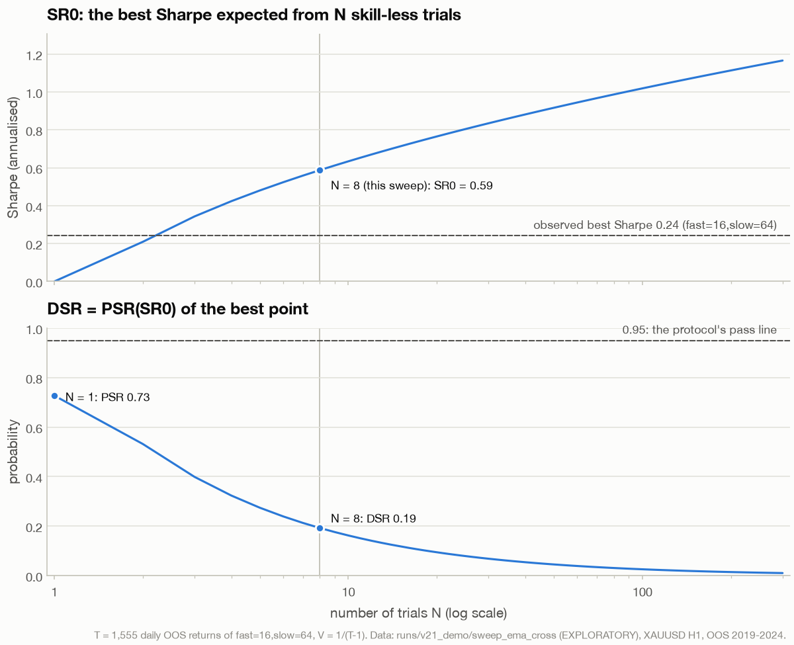
</picture>

*With one trial the best point's PSR is 0.73. At the sweep's 8 trials, eight skill-less configurations would be expected to reach a Sharpe of 0.59, more than twice the observed 0.24, and the DSR falls to 0.19, far from the protocol's 0.95. Data: runs/v21_demo/sweep_ema_cross (EXPLORATORY), 1,555 daily OOS returns of fast=16,slow=64, XAUUSD H1, OOS 2019-01-03 to 2024-12-31.*

### Plateau or knife edge

**Intuition.** Look at the best cell's neighbours on the grid. If they score almost as well,
the strategy is insensitive to its exact parameters: a plateau. If they score far worse, the
optimum is an isolated spike, and a spike in a noisy backtest is more likely luck than
structure. The plateau ratio puts a number on this, and the plateau centre is the setting to
prefer when you have to pick one.

**The math.** Give each grid point $j$ its index vector $i(j)$ (position of each parameter's
value in its sorted grid). With $b$ the best valid point and $m$ the ranking metric:

```math
\mathcal{N}(b) = \{\, j \ \text{valid} : \max_k \lvert i_k(j) - i_k(b) \rvert = 1 \,\}
```

```math
\rho =
\begin{cases}
\bar m_{\mathcal N} / m_b & \text{maximised metric with } m_b > 0 \\
m_b / \bar m_{\mathcal N} & \text{minimised metric with } m_b, \bar m_{\mathcal N} > 0, \text{ or max drawdown with } m_b, \bar m_{\mathcal N} < 0 \\
\text{undefined} & \text{otherwise (e.g. the best Sharpe is not positive)}
\end{cases}
```

```math
\mathrm{drop\_sd} = \frac{s_b - \bar s_{\mathcal N}}{\operatorname{sd}(s)},
\qquad
c^\ast = \arg\max_{j} \ \frac{1}{\lvert \{j\} \cup \mathcal N(j) \rvert} \sum_{i \in \{j\} \cup \mathcal N(j)} s_i
```

where

- $\mathcal{N}(b)$ holds the valid points at Chebyshev distance 1 in index space (up to
  $3^d - 1$ cells for $d$ parameters, fewer at the edge of the grid),
- $\bar m_{\mathcal N}$ is the mean metric over $\mathcal{N}(b)$,
- $s = m$ for a maximised metric and $s = -m$ for a minimised one
  (`LOWER_IS_BETTER`: `total_costs`, `cost_drag_ann`, `turnover_lots_per_year`, `n_trades`,
  `ann_vol`, `min_trl_years`, `sharpe_se`, `n_halt_episodes`, `n_risk_events`), so "higher is
  better" in both formulas,
- $\operatorname{sd}(s)$ is the standard deviation (ddof 1) over all valid points (needs at
  least 3),
- $c^\ast$ is the plateau centre (`robust_best`), the point whose own-plus-neighbours mean is
  highest.

The verdict is `knife-edge` when $\rho$ < `knife_edge_ratio` (default 0.5), `robust plateau`
when $\rho \ge$ `plateau_ratio` (default 0.75), `moderate` in between and `undefined` when
$\rho$ is. `edge_params` lists the parameters whose best value is the first or last value of
their grid: the true optimum may lie outside the searched range. The code is
[`plateau_score`](../aurum/research/sweep.py).

<picture>
  <source media="(prefers-color-scheme: dark)" srcset="_assets/figures/analytics/plateau-vs-knife-edge-dark.png">
  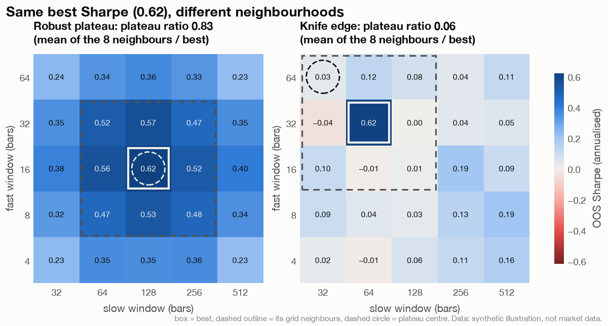
</picture>

*Both grids peak at 0.62. On the left the eight neighbours keep 83% of it (robust plateau). On the right they keep 6% (knife edge), and the plateau centre (circle) lands on a corner cell whose small neighbourhood still contains the spike: smoothing cannot rescue an isolated peak. Ratios computed by `plateau_score`. Data: synthetic illustration (numpy seeds 21 and 5), not market data.*

### The ema_cross sweep on real data

This sweep is EXPLORATORY: an additional trial on 2016-2024 data, not part of the
pre-registered protocol (see [RESULTS.md](RESULTS.md) and
[RESEARCH_PROTOCOL.md](RESEARCH_PROTOCOL.md)). It searched the `ema_cross` spans of the
`trend_core` configuration on 53,233 H1 bars from 2016-01-03 to 2024-12-31 (3-year train,
6-month test, rolling), so the OOS window is 2019-01-03 to 2024-12-31. Re-running the command
below into a scratch directory reproduced `runs/v21_demo/sweep_ema_cross` exactly:

```bash
aurum sweep -c configs/trend_core.yaml --strategy ema_cross --grid fast=16,32,64 --grid slow=64,128,256 \
  --set data.start=2016-01-01 --set data.end=2024-12-31 --set walkforward.holdout_start=null \
  --end 2024-12-31 --out <scratch>/sweep_ema_cross
```

```text
loaded 53233 H1 bars 2016-01-03 23:00:00+00:00 -> 2024-12-31 21:00:00+00:00 (0.1s)
== sweep (EXPLORATORY: every grid point is a trial): ema_cross  9 point(s)  metric sharpe  walk-forward OOS
research window 2016-01-03 23:00:00+00:00 -> 2024-12-31 21:00:00+00:00 (53233 bars); OOS 2019-01-03 12:00:00+00:00 -> 2024-12-31 21:00:00+00:00

fast  slow   status  sharpe   cagr  max_drawdown  n_trades  turnover_lots_per_year  total_costs  seconds
--------------------------------------------------------------------------------------------------------
  16    64       ok   0.241  +1.2%        -13.0%       680                  57.239       10,070    2.568
  32    64       ok   0.177  +0.9%        -13.2%       464                  42.611        7,505    2.532
  16   128       ok   0.123  +0.5%        -12.4%       460                  41.148        7,294    2.622
  64   128       ok   0.061  +0.2%        -12.4%       236                  20.655        3,640    2.064
  32   128       ok   0.054  +0.2%        -12.4%       345                  30.673        5,448    2.428
  16   256       ok  -0.037  -0.3%        -13.0%       320                  27.473        4,948    2.653
  32   256       ok  -0.066  -0.4%        -12.1%       232                  21.035        3,758    2.182
  64   256       ok  -0.110  -0.6%        -12.9%       171                  16.466        2,990    1.865
  64    64  invalid       -      -             -         -                       -            -        -

best: fast=16,slow=64  sharpe=0.241  Sharpe 0.241 [-0.545, 1.025]  PSR 0.727  DSR 0.192 (n_trials 8)  DSR_xs 0.563
plateau: knife-edge  ratio 0.489 over 3 neighbour(s) (mean 0.118, min 0.054);  plateau centre fast=16,slow=64 (sharpe 0.241)
PBO across grid points: 0.514  (P[OOS loss of IS-best] 0.493)
note: KNIFE-EDGE optimum: its grid neighbours keep only 49% of the best sharpe; the best point is also the best-smoothed one, but treat its level as fragile
note: the best point lies on the edge of the grid for ['fast', 'slow']: the optimum may be outside the searched range (extending the grid is another search: more trials)
skipped fast=64,slow=64: invalid (strategies[0] (ema_cross): need 1 <= fast < slow)

timing: evaluate 5.711s, total 6.316s (process x8)
outputs: <scratch>/sweep_ema_cross/sweep.csv, sweep.json, sweep.png
```

<picture>
  <source media="(prefers-color-scheme: dark)" srcset="_assets/figures/analytics/ema-sweep-heatmap-dark.png">
  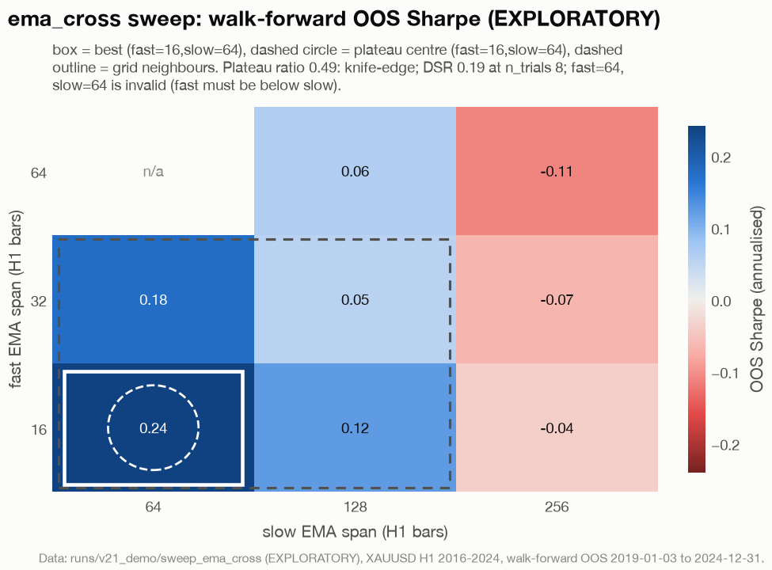
</picture>

*The best cell (16/64, Sharpe 0.24) sits in a corner of the grid, its three neighbours keep 49% of it (knife edge), the whole slow-256 column is negative, and the strategy's default 32/128 scores 0.05. Drawn by `plot_sweep` in each mode. Data: runs/v21_demo/sweep_ema_cross (EXPLORATORY), XAUUSD H1 2016-2024, walk-forward OOS 2019-01-03 to 2024-12-31.*

How to read it: the best Sharpe of 0.241 has a 95% confidence interval of [-0.545, 1.025],
and its DSR is 0.192 at 8 trials. The optimum is a knife edge (ratio 0.489, `drop_sd` 1.007)
that sits on the edge of the grid for both parameters. Extending the grid to look past it
would be another search, so more trials. The verdict is no robust edge, which matches the
protocol's conclusion for the trend family ([RESULTS.md](RESULTS.md)).

### PBO across the grid

**Intuition.** The Probability of Backtest Overfitting (Bailey, Borwein, López de Prado and Zhu
2017) checks the selection procedure itself. Split the history into blocks, pick the best
grid point on half of them, and see where that winner ranks on the other half. If the
in-sample winner lands in the bottom half out of sample about as often as in the top half,
picking the winner has no skill.

**The math.** The sweep keeps the $T \times N$ matrix of daily OOS returns of its $N$ valid
points (`returns.csv`), cuts the rows into $S$ contiguous blocks and evaluates all
$C = \binom{S}{S/2}$ ways to call half the blocks in-sample:

```math
w_c = \frac{\operatorname{rank}_c(n^\ast_c)}{N+1}, \qquad
\lambda_c = \ln\frac{w_c}{1-w_c}, \qquad
\mathrm{PBO} = \frac{1}{C}\sum_{c=1}^{C}\mathbf{1}\left[\lambda_c \le 0\right]
```

where

- $n^\ast_c$ is the point with the best in-sample Sharpe in split $c$,
- $\operatorname{rank}_c$ is its out-of-sample rank among the $N$ points (1 = worst, $N$ =
  best, ties averaged), so $\lambda_c \le 0$ means "at or below the OOS median",
- $S$ is `walkforward.pbo_splits` (16), lowered by 2 until the matrix has at least $2S$ rows
  (`_grid_pbo` calls `pbo_cscv` in [aurum/research/stats.py](../aurum/research/stats.py)).

<picture>
  <source media="(prefers-color-scheme: dark)" srcset="_assets/figures/analytics/sweep-pbo-dark.png">
  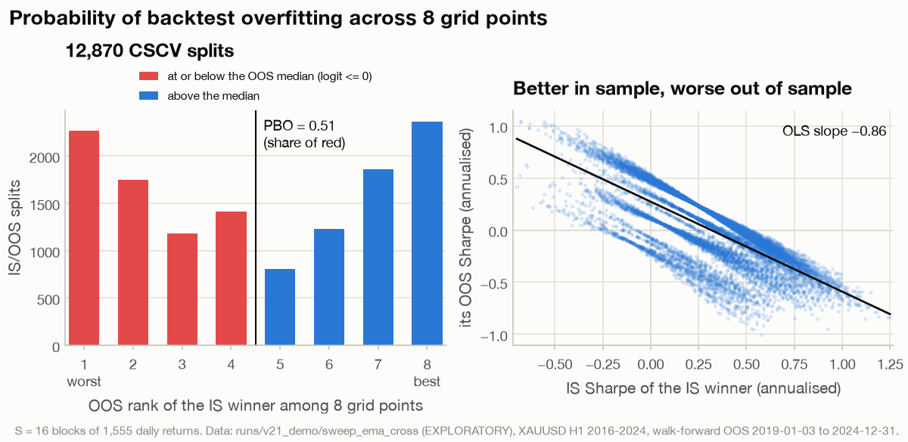
</picture>

*Over 12,870 splits the in-sample winner was at or below the out-of-sample median 51% of the time (PBO 0.51): picking the winner on this grid has no skill. Read the scatter with care: each parallel band is one grid point, and because the in-sample and out-of-sample halves split the same 1,555 days, a point's two Sharpe ratios move in opposite directions from split to split, so much of the slope of -0.86 is mechanical. The PBO on the left is the test. Data: runs/v21_demo/sweep_ema_cross (EXPLORATORY), S = 16 blocks of 1,555 daily OOS returns, XAUUSD H1, OOS 2019-01-03 to 2024-12-31.*

### The holdout guard and the sweep ledger

A sweep can never see the holdout. [`research_window`](../aurum/research/sweep.py) cuts the
data before anything runs, and every cut is listed in `SweepResult.notes`:

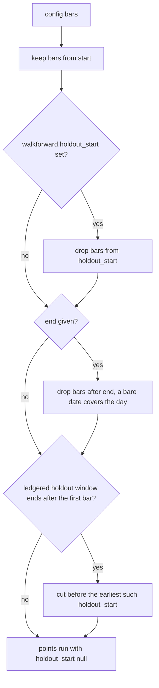

The ledgers read are `holdout_ledger.jsonl` in `output.dir` and in its immediate
subdirectories (for example `runs/protocol/`), for the same symbol
(`respect_holdout_ledgers=False` switches this off; never do that for real research). Because
every point configuration has `holdout_start: null` and runs with `holdout_ledger=False`, no
point can evaluate a holdout or write a holdout-ledger entry. The holdout ledger itself is
described in [RESEARCH_PROTOCOL.md](RESEARCH_PROTOCOL.md).

The sweep ledger is the sweep's own memory. Each sweep appends one fsynced line to
`sweep_ledger.jsonl`, in the parent of its output directory (`--no-ledger` turns this off),
with its strategy, symbol, timeframe, window, metric, grid, `n_points`, `n_valid`, `n_trials`,
the config hash of every valid point and the best point. Here is what that does to
`n_trials`, using a synthetic demo config saved outside the repository (`<repo>` and
`<scratch>` stand for the absolute paths):

```yaml
# Docs example: a synthetic H1 series (no data_store, no holdout), short walk-forward windows.
extends: <repo>/configs/default.yaml
name: docs_synthetic
data:
  start: null
  macro: false
  events: none
  synthetic: {n: 12000, model: trend, seed: 2}
costs:
  financing: {mode: fixed}
strategies:
  - {name: ema_cross}
walkforward:
  train: 6M
  test: 2M
  holdout_start: null
  n_boot: 200
output:
  dir: <scratch>/cli/runs
```

The first sweep, run from `<scratch>/cli`:

```bash
aurum sweep -c synthetic_sweep.yaml --strategy ema_cross --grid fast=8,16,32 --grid slow=64,128,256 --out runs/sweep_demo
```

```text
loaded 12000 H1 bars 2020-01-06 00:00:00+00:00 -> 2021-12-10 03:00:00+00:00 (0.0s)
== sweep (EXPLORATORY: every grid point is a trial): ema_cross  9 point(s)  metric sharpe  walk-forward OOS
research window 2020-01-06 00:00:00+00:00 -> 2021-12-10 03:00:00+00:00 (12000 bars); OOS 2020-07-07 18:00:00+00:00 -> 2021-12-10 03:00:00+00:00

fast  slow  status  sharpe   cagr  max_drawdown  n_trades  turnover_lots_per_year  total_costs  seconds
-------------------------------------------------------------------------------------------------------
  32   256      ok   0.848  +6.1%         -4.9%        55                  18.228      831.401    0.444
   8   256      ok   0.684  +4.8%         -5.5%       104                  34.646        1,592    3.239
  16   256      ok   0.675  +4.7%         -5.5%        77                  25.437        1,173    3.235
   8   128      ok   0.461  +3.0%         -6.0%       136                  49.652        2,282    3.222
  32   128      ok   0.390  +2.5%         -5.7%        70                  26.616        1,218    3.221
  16   128      ok   0.285  +1.8%         -6.0%       109                  36.829        1,688    3.228
   8    64      ok   0.263  +1.6%         -6.0%       216                  71.355        3,258    3.238
  16    64      ok   0.158  +0.9%         -6.2%       160                  51.442        2,346    3.284
  32    64      ok   0.139  +0.7%         -6.5%       119                  36.779        1,681    3.221

best: fast=32,slow=256  sharpe=0.848  Sharpe 0.848 [-0.845, 2.291]  PSR 0.851  DSR 0.311 (n_trials 9)  DSR_xs 0.715
plateau: moderate  ratio 0.530 over 3 neighbour(s) (mean 0.450, min 0.285);  plateau centre fast=16,slow=256 (sharpe 0.675)
PBO across grid points: 0.333  (P[OOS loss of IS-best] 0.261)
note: the best point lies on the edge of the grid for ['fast', 'slow']: the optimum may be outside the searched range (extending the grid is another search: more trials)
```

The best point is on the edge of the grid, so the obvious next step is to extend the grid past
it. That second sweep over the same window is charged for the first one:

```bash
aurum sweep -c synthetic_sweep.yaml --strategy ema_cross --grid fast=16,32,64 --grid slow=128,256,512 --out runs/sweep_demo2
```

```text
best: fast=64,slow=512  sharpe=1.017  Sharpe 1.017 [-0.612, 2.650]  PSR 0.894  DSR 0.307 (n_trials 14)  DSR_xs 0.751
plateau: robust plateau  ratio 0.885 over 3 neighbour(s) (mean 0.900, min 0.848);  plateau centre fast=64,slow=512 (sharpe 1.017)
PBO across grid points: 0.539  (P[OOS loss of IS-best] 0.199)
note: 5 distinct configuration(s) from 1 earlier sweep(s) over an overlapping window are added to n_trials (ledger runs/sweep_ledger.jsonl)
note: the best point lies on the edge of the grid for ['fast', 'slow']: the optimum may be outside the searched range (extending the grid is another search: more trials)
```

The two grids share four points (16 and 32 with 128 and 256), so the first sweep's other five
configurations are added: $N = 9 + 5 = 14$. The higher Sharpe of 1.017 buys almost no DSR
(0.307 against 0.311), and the "robust plateau" is again on the edge of the grid. Re-running an
identical sweep adds nothing, because its configurations are its own.

### Sweeps in code

The parameters of [`run_sweep`](../aurum/research/sweep.py) (the CLI flag is given where one
exists):

| Parameter | Default | Meaning |
|---|---|---|
| `strategy_name` (`--strategy`) | required | a config strategy id or name (its params become the base) or a registry name (registry defaults) |
| `grid` (`--grid`, repeatable) | required | `{param: [values]}` or CLI specs `p=v1,v2` / `p=a:b:step` |
| `metric` (`--metric`) | `"sharpe"` | the stats column that ranks the points (`sharpe`, `cagr`, `calmar`, `max_drawdown`, ...) |
| `maximize` | `None` | `False` only for `LOWER_IS_BETTER` columns |
| `walkforward` (`--single-split` sets False) | `True` | full walk-forward per point; False: one train/test split (in-sample unless `start` is given, noted) |
| `start`, `end` (`--start`, `--end`) | `None` | research window, `end` inclusive (a bare date covers the whole day) |
| `n_jobs` (`--jobs`), `executor` (`--executor`) | `0`, `"auto"` | point-level parallelism; `0` = `min(cpu, 8)`; `auto` = processes from 20,000 bars |
| `out_dir` (`--out`), `write` | `None` | default `output.dir/sweep_<strategy>_<utc>`; written when `output.save_results` |
| `ledger` (`--no-ledger` sets False) | `None` | `<out_dir>/../sweep_ledger.jsonl` when writing |
| `holdout_ledgers`, `respect_holdout_ledgers` | `None`, `True` | holdout ledgers read by the guard (default: found under `output.dir`) |
| `prior_trials` | `0` | extra trials for searches that are in no ledger |
| `knife_edge_ratio` | `0.5` | threshold of the knife-edge flag (`plateau_score` also takes `plateau_ratio=0.75`) |
| `n_boot`, `seed` | `None` | bootstrap settings of the best point's CI (default `walkforward.n_boot`, `seed`) |

`SweepResult` holds `table`, `returns` (daily OOS returns per valid point), `best` (with
`sharpe`, `ci_lower`, `ci_upper`, `psr`, `dsr`, `sr0`, `dsr_xs`, ...), `plateau`, `n_trials`,
`prior`, `pbo`, `window`, `notes`, `timing` and `settings`. Its `label` is always
`"exploratory"`. `.save(dir)` writes `sweep.csv`, `returns.csv`, `sweep.json` and `sweep.png`
(plus `sharpe.png` when the metric is not the Sharpe), and `.plot(mode=...)` returns the
heatmap.

The plateau numbers of the first synthetic sweep above, recomputed from its table:

```python
import pandas as pd

from aurum.research.sweep import plateau_score

# OOS Sharpe of the synthetic demo sweep above (rows fast, columns slow)
sharpe = {8: [0.263, 0.461, 0.684], 16: [0.158, 0.285, 0.675], 32: [0.139, 0.390, 0.848]}
grid = {"fast": [8, 16, 32], "slow": [64, 128, 256]}
table = pd.DataFrame([{"fast": f, "slow": s, "status": "ok", "sharpe": v}
                      for f, row in sharpe.items() for s, v in zip(grid["slow"], row)])
p = plateau_score(table, grid, "sharpe")
for k in ("best", "best_value", "n_neighbours", "neighbour_mean", "plateau_ratio", "drop_sd", "verdict",
          "edge_params", "robust_best", "robust_best_smoothed"):
    v = p[k]
    print(f"{k:22s} {v:.3f}" if isinstance(v, float) else f"{k:22s} {v}")
```

```text
best                   fast=32,slow=256
best_value             0.848
n_neighbours           3
neighbour_mean         0.450
plateau_ratio          0.531
drop_sd                1.577
verdict                moderate
edge_params            ['fast', 'slow']
robust_best            fast=16,slow=256
robust_best_smoothed   0.557
```

And the DSR of the real sweep's best point as the number of trials grows, from the values in
its `sweep.json`:

```python
import math

from aurum.research.stats import deflated_sharpe, expected_max_sharpe, probabilistic_sharpe

# best point of the EXPLORATORY ema_cross sweep (runs/v21_demo/sweep_ema_cross/sweep.json)
sr_ann, T, skew, kurt = 0.24111, 1555, 1.3702, 9.3975
sr = sr_ann / math.sqrt(252)                         # per-period (daily) Sharpe
for n_trials in (1, 8, 30):
    sr0 = expected_max_sharpe(n_trials, 1.0 / (T - 1))
    print(f"N={n_trials:3d}  SR0 {sr0 * math.sqrt(252):.3f} (annualised)  "
          f"PSR(SR0) {probabilistic_sharpe(sr, T, skew, kurt, sr_star=sr0):.3f}  "
          f"deflated_sharpe {deflated_sharpe(sr, T, skew, kurt, n_trials=n_trials):.3f}")
```

```text
N=  1  SR0 0.000 (annualised)  PSR(SR0) 0.727  deflated_sharpe 0.727
N=  8  SR0 0.588 (annualised)  PSR(SR0) 0.192  deflated_sharpe 0.192
N= 30  SR0 0.835 (annualised)  PSR(SR0) 0.068  deflated_sharpe 0.068
```

### Sweep pitfalls and design choices

- **Every point is a trial, every sweep is a search.** The best point's DSR is charged for the
  whole grid, and later sweeps over an overlapping window are charged for earlier ones through
  the ledger. Deleting `sweep_ledger.jsonl` or passing `--no-ledger` hides searches from the
  statistics. Pass `prior_trials` for searches done elsewhere.
- **Edge optima invite more searching.** When the best value is at the end of a grid, the note
  says so. Extending the grid is legitimate, but it is another search (see the ledger demo).
- **A plateau is necessary, not sufficient.** A smooth surface can still be a smooth surface of
  noise. The synthetic extended grid above is a "robust plateau" with a DSR of 0.307. Read the
  plateau ratio together with the DSR, the CI and the PBO.
- **The plateau centre is a smoother, not a cure.** On a knife-edge grid it often lands next to
  the spike (the synthetic figure) or on it (the real sweep).
- **Neighbours are grid steps, not value distances.** A log-spaced grid (16, 32, 64) and a
  linear one (10, 20, 30) define "one step away" differently. Choose a spacing on which a step
  is a meaningful change.
- **Standalone books, not the portfolio.** A grid point is evaluated alone (FDM 1). How it would
  behave inside a combined book also depends on the combiner weights it would get.
- **Out of sample only.** `--single-split` without `--start` is in-sample, and the notes say so.
  Use it for a quick look, never for a decision.

## Monte Carlo and stress

**Intuition.** A backtest is one path through history. Reshuffle the same days in a different
order and the final return, the deepest drawdown and the time spent underwater all change. The
Monte Carlo resamples the book's daily returns into thousands of alternative two-year futures
and reports the distribution of what could happen. The deterministic stress asks a blunter
question: what would the worst historical windows and price gaps cost the book as it is
positioned now, and as it was positioned at its largest exposure?

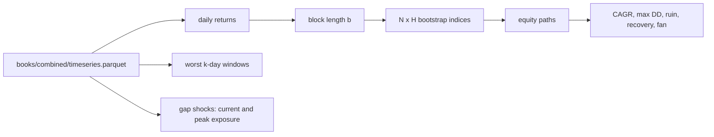

The daily returns come from [`daily_returns`](../aurum/backtest/metrics.py): the equity at
the last bar of each UTC trading day, with Saturday and Sunday bars folded into Monday, so days
without bars are absent rather than zero.

### The stationary bootstrap

**Intuition.** An ordinary bootstrap draws days independently, which destroys any clustering:
calm weeks and volatile weeks, and the serial dependence that overlapping positions create. The
stationary bootstrap (Politis and Romano 1994) copies runs of consecutive days instead. At each
step it either continues the current run or jumps to a random day and starts a new one. The run
lengths are random, which keeps the resampled series stationary.

**The math.** For path $k$ and simulated day $t$, with history length $n$ and mean block length
$b$:

```math
\mathrm{new}_{k,t} =
\begin{cases}
1 & t = 0 \\
\mathbf{1}\left[u_{k,t} < 1/b\right] & t \ge 1
\end{cases},
\qquad
I_{k,t} =
\begin{cases}
U_{k,t} & \mathrm{new}_{k,t} = 1 \\
(I_{k,t-1} + 1) \bmod n & \text{otherwise}
\end{cases}
```

where

- $u_{k,t}$ is uniform on $[0, 1)$ and $U_{k,t}$ uniform on the integers $0, \dots, n-1$,
- $I_{k,t}$ is the historical day copied to simulated day $t$; the index wraps circularly,
  so a block that runs off the end continues at day 0,
- block lengths are therefore Geometric with $P(L = \ell) = p\,(1-p)^{\ell-1}$, $p = 1/b$,
  and mean $b$.

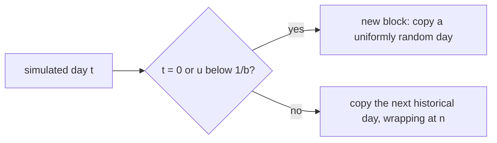

[`stationary_bootstrap_paths`](../aurum/research/montecarlo.py) vectorises this: it draws the
start flags and a candidate start for every cell, then carries the last start forward. The draw
order is that of `stationary_bootstrap_indices` in
[aurum/research/stats.py](../aurum/research/stats.py), which it reproduces bit for bit when the
horizon equals the history length. Paths are generated in chunks of 4,096 (`CHUNK_PATHS`), and
the chunking is part of the seeded random stream.

<picture>
  <source media="(prefers-color-scheme: dark)" srcset="_assets/figures/analytics/block-bootstrap-dark.png">
  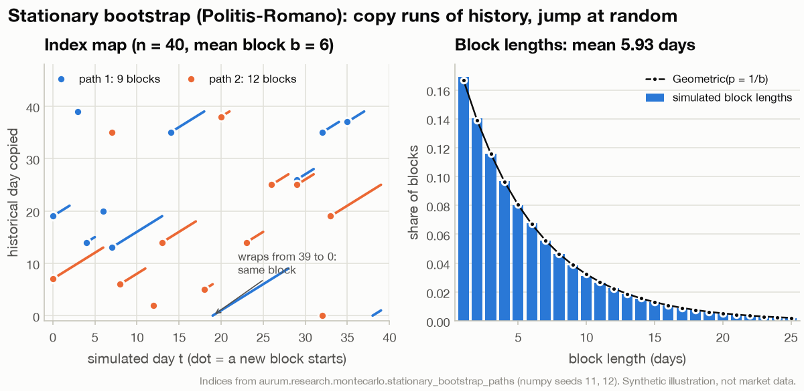
</picture>

*Each rising run is a block of consecutive historical days and each dot a new block. One block runs past day 39 and wraps to day 0 without starting a new block. On the right, the simulated block lengths follow Geometric(1/6) with a mean of 5.93 days. Data: synthetic illustration (indices from `stationary_bootstrap_paths`, numpy seeds 11 and 12), not market data.*

### Choosing the block length

**Intuition.** Blocks should be long enough to keep the dependence in the data and no longer.
Uncorrelated returns need blocks of length 1 (the ordinary bootstrap). Persistent returns need
long blocks. Politis and White (2004), with the correction of Patton, Politis and White (2009),
estimate the length from the autocorrelations.

**The math.** With $e_t = r_t - \bar r$, $R(k) = \frac{1}{n}\sum_t e_{t+k}e_t$ and
$\rho(k) = R(k)/R(0)$:

```math
\hat m = \min\left\{ m : \lvert\rho(m+j)\rvert < 2\sqrt{\log_{10} n / n}\ \text{ for } j = 1, \dots, K_n \right\},
\qquad
M = \min\left(2\hat m,\ \lceil\sqrt n\,\rceil + K_n\right)
```

```math
\hat g = R(0) + 2\sum_{k=1}^{M}\lambda\!\left(\frac{k}{M}\right) R(k),
\qquad
\hat G = 2\sum_{k=1}^{M}\lambda\!\left(\frac{k}{M}\right) k\,R(k),
\qquad
\hat b_{\mathrm{SB}} = \left(\frac{\hat G^{2}}{\hat g^{2}}\right)^{1/3} n^{1/3}
```

where

- $K_n$ is the larger of 5 and $\lceil\sqrt{\log_{10} n}\,\rceil$, and
  $\hat m = \lceil\sqrt n\,\rceil + K_n$ when no such $m$ exists,
- $\lambda(x)$ is the flat-top window: 1 for $\lvert x\rvert \le 1/2$,
  $2(1-\lvert x\rvert)$ for $1/2 < \lvert x\rvert \le 1$, 0 beyond,
- the general form divides $2\hat G^2$ by $D_{\mathrm{SB}} = 2\hat g^2$ for the stationary
  bootstrap, which simplifies to the formula above,
- the result is clipped to $[1, \lceil\min(3\sqrt n, n/3)\rceil]$, and falls back to
  $n^{1/3}$ when $\hat g \le 0$ and to 1 when $n < 8$.

This is `optimal_block_length` in [aurum/research/stats.py](../aurum/research/stats.py), and
`simulate_paths` clips the result to $[1, n]$. On the real `trend_core` combined book it gives
$b = 1.0$: daily returns of that book are serially uncorrelated, so the bootstrap is the
ordinary one. On a persistent series the blocks matter. In the snippet under
[Stress in code](#stress-in-code), AR(1) returns with coefficient 0.3 get $b = 8.93$, and an
ordinary bootstrap of the same series understates the chance of a drawdown deeper than 20% by a
factor of almost three (0.058 against 0.163).

### From paths to risk numbers

**Intuition.** Each path is compounded into an equity curve. From each curve we read the growth
rate, the deepest fall from a peak, whether the curve ever crossed a loss line measured from the
start ("ruin"), and how long it took to get back to the old high. Across 10,000 paths these
become distributions and probabilities.

**The math.** For path $k$ over $H$ trading days (column 0 is the start):

```math
E_{k,t} = E_0 \prod_{s=1}^{t}\left(1 + r_{I_{k,s}}\right),
\qquad
\mathrm{CAGR}_k = \left(\frac{E_{k,H}}{E_0}\right)^{252/H} - 1,
\qquad
\mathrm{DD}_{k,t} = \frac{E_{k,t}}{\max_{s \le t} E_{k,s}} - 1
```

```math
\mathrm{MDD}_k = \min_t \mathrm{DD}_{k,t},
\qquad
\mathrm{Ruin}(L) = \frac{1}{N}\sum_{k=1}^{N}\mathbf{1}\left[\min_t E_{k,t} \le (1-L)\,E_0\right]
```

```math
\tau_k = \arg\min_t \mathrm{DD}_{k,t},
\qquad
\mathrm{TTR}_k = \min\left\{ t > \tau_k : E_{k,t} \ge \max_{s \le \tau_k} E_{k,s} \right\} - \tau_k
```

where

- $E_0$ is 1 (`stress_run` normalises; `initial_equity` sets it in `monte_carlo`) and the
  product is computed as $\exp(\sum \ln(1+r))$; a historical return of -100% or worse is
  refused,
- $\mathrm{CAGR}_k = -1$ when the path ends at or below 0, and $H$ comes from
  [`parse_horizon`](../aurum/research/montecarlo.py) (`2Y` = 504, `6M` = 126, `4W` = 20, `30D`
  = 30 trading days),
- $P(\mathrm{MDD} > x)$ is tabulated for $x$ in `DEFAULT_DD_THRESHOLDS` (5, 10, 15, 20, 25,
  30, 40 and 50%) and $\mathrm{Ruin}(L)$ for `DEFAULT_RUIN_THRESHOLDS` (10, 20, 30 and 50%),
  together with the probability of ending the horizon below $(1-L)E_0$,
- ruin is measured from the **start**, drawdown from the running **peak**: a path that first
  gains 10% and then falls 15% from its high has a 15% drawdown but is only 6.5% below its
  start,
- $\mathrm{TTR}_k$ is NaN when the path does not regain its pre-trough peak within the horizon;
  the longest underwater stretch is the longest run of days with $\mathrm{DD} < 0$, an
  unfinished one included,
- the fan chart shows the 5, 25, 50, 75 and 95% quantiles of $E_{k,t}$ across paths at every $t$.

These are `path_metrics`, `drawdown_exceedance`, `risk_of_ruin` and `fan_bands` in
[aurum/research/montecarlo.py](../aurum/research/montecarlo.py).

<picture>
  <source media="(prefers-color-scheme: dark)" srcset="_assets/figures/analytics/equity-path-anatomy-dark.png">
  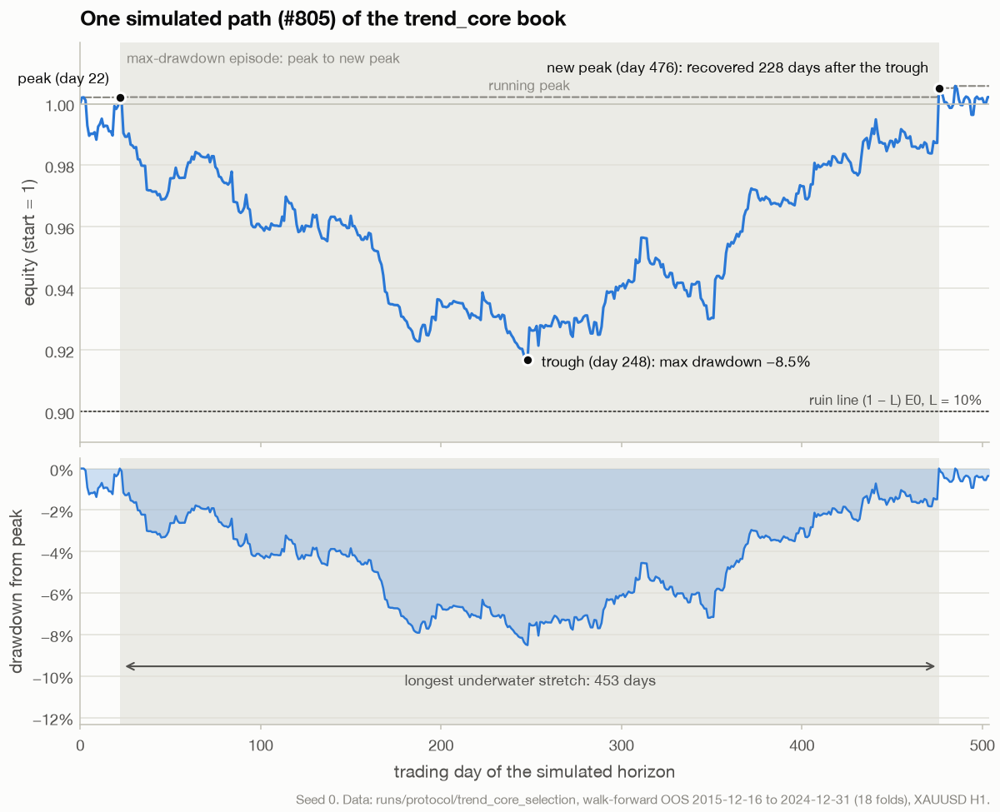
</picture>

*One simulated path: the maximum drawdown (-8.5%) is measured from the day-22 peak, the ruin line sits 10% below the start and is never touched, recovery takes 228 days after the trough, and the whole episode, 453 days underwater, is the longest stretch. Data: path 805 of the seed-0 simulation, runs/protocol/trend_core_selection, walk-forward OOS 2015-12-16 to 2024-12-31 (18 folds), XAUUSD H1.*

Applied to the combined book of `trend_core_selection` (2,346 daily returns, Sharpe -0.170),
10,000 paths of two years give:

<picture>
  <source media="(prefers-color-scheme: dark)" srcset="_assets/figures/analytics/fan-chart-dark.png">
  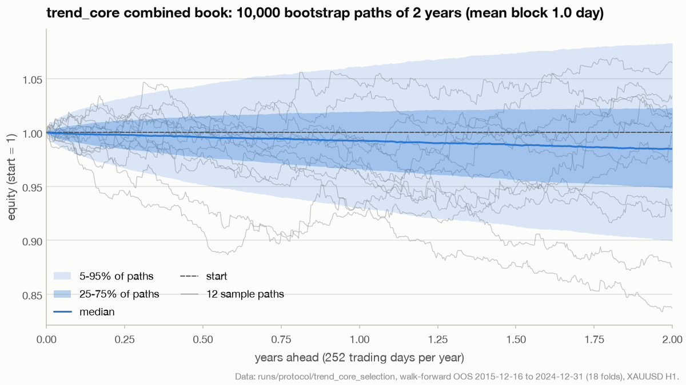
</picture>

*The median path drifts down to 0.985 after two years and the 5-95% band widens to 0.90-1.08: a book with a negative historical Sharpe is expected to lose a little, with wide dispersion either way. Drawn by `plot_fan`. Data: runs/protocol/trend_core_selection, walk-forward OOS 2015-12-16 to 2024-12-31 (18 folds), XAUUSD H1; 10,000 paths, seed 0.*

<picture>
  <source media="(prefers-color-scheme: dark)" srcset="_assets/figures/analytics/mc-distributions-dark.png">
  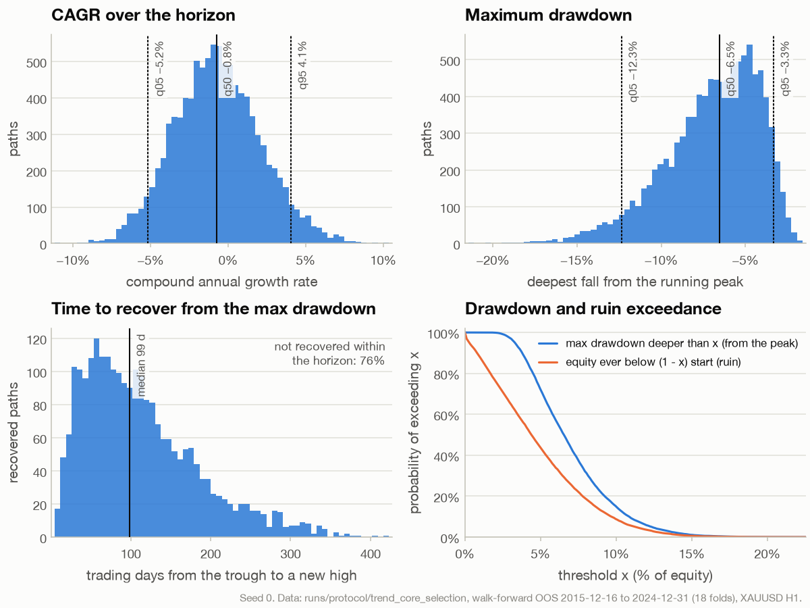
</picture>

*CAGR quantiles are -5.2/-0.8/+4.1% (q05/q50/q95) and maximum drawdown -12.3/-6.5/-3.3%. 76% of paths do not regain their pre-drawdown peak within two years. The ruin curve (loss from the start) lies below the drawdown curve (loss from the peak) at every threshold. Drawn by `plot_distributions`. Data: runs/protocol/trend_core_selection, walk-forward OOS 2015-12-16 to 2024-12-31 (18 folds), XAUUSD H1; 10,000 paths, seed 0.*

The tables behind the figures: the probability of a maximum drawdown deeper than 10% is 0.149
and deeper than 15% 0.011; the probability of touching 10% below the start is 0.087 and
of ending there 0.051; the median time to recover is 99 trading days (p95 259) and the median
longest underwater stretch 351 days.

### Deterministic stress

**Intuition.** The Monte Carlo reshuffles the book's own returns. A deterministic stress applies
specific, named shocks instead: the worst stretches the book itself lived through, instantaneous
gaps in the gold price, and gold's own worst moves. Each is applied to the current position and,
for the gaps, to the largest position the book ever held.

**The math.**

```math
W_k = \min_t\left[\exp\left(\sum_{s=t-k+1}^{t}\ln(1+r_s)\right) - 1\right],
\qquad
\mathrm{loss}_k = W_k \cdot E_{\mathrm{now}}
```

```math
\mathrm{PnL}_{\mathrm{gap}}(q, P, x) = q \cdot 100 \cdot P\,x - \lvert q\rvert \cdot 100 \cdot \frac{s}{2},
\qquad
t^\ast = \arg\max_t \frac{\lvert q_t\rvert \cdot 100 \cdot C_t}{E_t}
```

where

- $W_k$ is the worst compounded $k$-day return of the book's daily returns for $k$ in
  `DEFAULT_WINDOWS` (1, 5, 10, 21 and 63 days), with its first and last day, and
  $E_{\mathrm{now}}$ the book's last equity (`worst_windows`),
- $q$ is the signed position in lots, 100 the ounces per lot (`contract_size`), $P$ the
  price, $x$ the shock (for example -0.10) and $s$ the spread in USD/oz of the last bar (0 for
  the peak-exposure rows); this is `gap_shock` in [aurum/risk/var.py](../aurum/risk/var.py),
  applied by `stress_test` to every scenario of `DEFAULT_STRESS_SCENARIOS` (gaps of ±3, ±5
  and ±10%, the 2013-04-15 crash at about -9%, the 2011-09-23 selloff at about -6% and the
  2016-06-24 Brexit spike at about +5%) or to the `--shock` values,
- the current exposure is the position at the last bar priced at the last close; $t^\ast$
  is the bar of peak leverage ($C_t$ the close, $E_t$ the equity),
- gold's own worst moves are the worst and best $k$-day log-return changes of daily closes,
  applied to the current lots with `gap_shock` (no spread).

<picture>
  <source media="(prefers-color-scheme: dark)" srcset="_assets/figures/analytics/deterministic-stress-dark.png">
  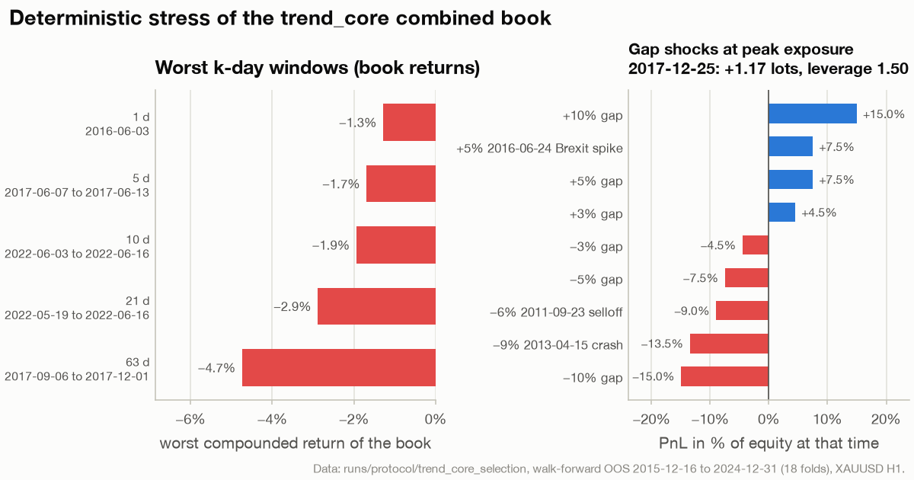
</picture>

*The book's worst 63 days cost 4.7% (2017-09-06 to 2017-12-01). At its peak exposure (2017-12-25, 1.17 lots, leverage 1.50) a 10% overnight gap down would have cost 15% of equity, three times the worst 63-day window, which is why gap risk is reported separately. Data: runs/protocol/trend_core_selection, walk-forward OOS 2015-12-16 to 2024-12-31 (18 folds), XAUUSD H1.*

At the end of 2024 the book held -0.02 lots at 2,624.53 USD/oz (leverage 0.056), so a 10% gap
up would cost 525 USD (0.6% of equity). The worst historical gold move for that short position
is the 63-day rise of 21.9% (to 2020-08-06), which would cost 1.2% of equity.

### Stress in code

```bash
aurum stress --run runs/protocol/trend_core_selection --out <scratch>/stress
```

```text
== stress: runs/protocol/trend_core_selection [research/combined]
history: 2346 daily returns, Sharpe -0.170;  Monte Carlo: 10,000 paths x 504 days, stationary bootstrap mean block 1.0 days, seed 0 (0.22s)

stat   cagr  max_drawdown  total_return  final_equity  longest_underwater_days
------------------------------------------------------------------------------
 q05  -5.2%        -12.3%        -10.1%         0.899                      134
 q25  -2.6%         -8.6%         -5.2%         0.948                      236
 q50  -0.8%         -6.5%         -1.5%         0.985                      351
 q75  +1.1%         -4.8%         +2.3%         1.023                      467
 q95  +4.1%         -3.3%         +8.3%         1.083                      503
mean  -0.7%         -7.0%         -1.3%         0.987                  342.904

P(max drawdown deeper than x)          risk of ruin (equity touches start - x)
threshold  probability                 loss_threshold  p_touch  p_end_below
----------------------                 ------------------------------------
      >5%        0.721                           -10%    0.087        0.051
     >10%        0.149                           -20%    0.000        0.000
     >15%        0.011                           -30%    0.000        0.000
     >20%        0.001                           -50%    0.000        0.000
     >25%        0.000
     >30%        0.000
     >40%        0.000
     >50%        0.000

recovery: P(not recovered from the max drawdown within the horizon) 75.8%; time to recover median 99 / p95 259 trading days; longest underwater median 351 days

worst historical k-day windows of the book (replayed on current equity):
days  worst_return       start         end  pnl_usd_at_current_equity
---------------------------------------------------------------------
   1         -1.3%  2016-06-03  2016-06-03                     -1,197
   5         -1.7%  2017-06-07  2017-06-13                     -1,576
  10         -1.9%  2022-06-03  2022-06-16                     -1,809
  21         -2.9%  2022-05-19  2022-06-16                     -2,688
  63         -4.7%  2017-09-06  2017-12-01                     -4,414

exposure at 2024-12-31 21:00:00+00:00: -0.02 lots, price 2,625 (bars (last close)), leverage 0.056
```

The output continues with the gap-shock table (current and peak exposure, the numbers in the
figure above) and gold's worst moves, and the command writes `stress.json`, `fan.png`,
`distributions.png`, `distribution.csv`, `fan_bands.csv`, `drawdown_exceedance.csv`,
`risk_of_ruin.csv`, `worst_windows.csv`, `gap_shocks.csv` and `gold_moves.csv`.

| Parameter (`stress_run` / CLI) | Default | Meaning |
|---|---|---|
| `source` (`--run`) | required | a run directory, a `BacktestResult` or an equity Series |
| `book` (`--book`) | `"combined"` | the book under `books/` |
| `phase` (`--phase`) | `"research"` | the stitched OOS book, or `holdout` (reading an already evaluated holdout is not a new look) |
| `n_paths` (`--paths`) | `10_000` | Monte Carlo paths |
| `horizon` (`--horizon`) | `"2Y"` | trading days, or `2Y`, `6M`, `4W`, `30D` (252 per year, 21 per month, 5 per week) |
| `seed` (`--seed`) | `0` | seed of the bootstrap |
| `mean_block` (`--block`) | `None` | mean block length in days (automatic when None) |
| `shocks` (`--shock=PCT`, repeatable) | `None` | gap sizes as fractions; default `DEFAULT_STRESS_SCENARIOS` |
| `windows` | `(1, 5, 10, 21, 63)` | worst-window lengths in days |
| `price`, `bars`, `load_data` (`--no-data` sets False) | `None`, `None`, `True` | price source of the gap shocks: bars, else the run's own bars, else the last fill's mid (noted as approximate) |
| `normalise` | `True` | Monte Carlo equity starts at 1.0 |

The Monte Carlo alone works on any return series. This AR(1) example shows the automatic block
length and what an ordinary bootstrap gets wrong:

```python
import numpy as np

from aurum.research.montecarlo import monte_carlo, parse_horizon
from aurum.research.stats import optimal_block_length

rng = np.random.default_rng(0)
e = rng.normal(0.0, 0.006, 2000)
r = np.empty_like(e)                                  # AR(1) daily returns: serial dependence
r[0] = e[0]
for t in range(1, r.size):
    r[t] = 0.3 * r[t - 1] + e[t]
r += 0.0002

print({k: round(v, 2) for k, v in optimal_block_length(r).items()})
print("horizons:", {h: parse_horizon(h) for h in ("2Y", "6M", "4W", "30D")})
mc = monte_carlo(r, n_paths=10_000, horizon="1Y", seed=0)
print(f"mean block {mc.mean_block:.2f} days, {mc.n_paths:,} paths x {mc.horizon} days")
print(mc.distribution()[["cagr", "max_drawdown", "longest_underwater_days"]].round(3))
print(mc.ruin.round(4).to_string(index=False))
print({k: round(v, 3) for k, v in mc.recovery().items()})

iid = monte_carlo(r, n_paths=10_000, horizon="1Y", seed=0, mean_block=1.0)   # ordinary bootstrap
for name, m in (("block b=%.1f" % mc.mean_block, mc), ("iid    b=1.0", iid)):
    s = m.summary()
    print(f"{name}: median max drawdown {s['max_drawdown_median']:.1%}, q05 {s['max_drawdown_q05']:.1%}, "
          f"P(DD > 20%) {m.dd_table.set_index('threshold').loc[0.20, 'probability']:.3f}")
```

```text
{'stationary': 8.93, 'circular': 10.22, 'm_hat': 2.0, 'bandwidth': 4.0}
horizons: {'2Y': 504, '6M': 126, '4W': 20, '30D': 30}
mean block 8.93 days, 10,000 paths x 252 days
       cagr  max_drawdown  longest_underwater_days
q05  -0.204        -0.249                   59.000
q25  -0.100        -0.178                  110.000
q50  -0.014        -0.132                  167.000
q75   0.077        -0.099                  227.000
q95   0.228        -0.066                  252.000
mean -0.005        -0.142                  164.245
 loss_threshold  p_touch  p_end_below
            0.1   0.4293       0.2503
            0.2   0.0950       0.0552
            0.3   0.0079       0.0041
            0.5   0.0000       0.0000
{'p_not_recovered': 0.719, 'ttr_median_days': 47.0, 'ttr_p75_days': 75.0, 'ttr_p95_days': 128.45, 'longest_underwater_median_days': 167.0, 'longest_underwater_p95_days': 252.0}
block b=8.9: median max drawdown -13.2%, q05 -24.9%, P(DD > 20%) 0.163
iid    b=1.0: median max drawdown -10.8%, q05 -20.5%, P(DD > 20%) 0.058
```

The gap-shock formula on the peak exposure, and on the end-2024 short position with half the
spread to exit:

```python
from aurum.risk.var import gap_shock

# peak exposure of the trend_core book (aurum stress): 1.17 lots at 1,273.68 USD/oz
print(round(gap_shock(1.17, 1273.68, -0.10), 2))               # 1.17 * 100 * 1273.68 * -0.10
print(round(gap_shock(-0.02, 2624.525, 0.10, spread=0.55), 2))  # short, plus half the spread to exit
```

```text
-14902.06
-525.46
```

### Stress pitfalls and design choices

- **The future is a reshuffle of the past.** The bootstrap keeps the mean, volatility and
  dependence of the sampled history up to the block length. It cannot produce a regime the
  history did not contain. A book with nine years of slightly negative returns will be
  simulated as slightly negative.
- **Sizing and costs are already inside the returns.** The paths replay the returns the book
  actually earned, with its sizing, de-risking, costs and financing. De-risking after a
  drawdown is captured only as it happened historically, not as it would react on a new path.
- **iid understates tail risk on persistent series.** That is why blocks are the default and
  their length is estimated (see the AR(1) numbers). With $b = 1$ the two coincide.
- **Ruin is not drawdown.** Both are reported because they answer different questions: "how far
  below my starting capital can I go" versus "how far below my best day".
- **The worst historical window is a floor, not a worst case.** Nine years of one book contain a
  handful of bad episodes. The gap shocks at the peak exposure show how much worse an
  instantaneous move could be.
- **Holdout books are read, never recomputed.** `--phase holdout` reads `holdout/books/...`
  that a walk-forward already evaluated. The figures on this page never read `holdout/`.

## Explainability

**Intuition.** A combined forecast is a weighted sum of strategy forecasts, clipped to
[-1, 1]. Because the sum is linear, every decision splits exactly into one contribution per
strategy, plus the clip. `aurum explain` shows that split for any bar of a run as a waterfall
chart, replays the sizing chain that turned the forecast into lots, and allocates the book's
PnL over the whole run to the strategies with the same arithmetic. For live and paper trading,
the runner writes the same numbers into every decision record, and the LLM desk becomes one more
step in the waterfall. Nothing is refitted and no new evaluation happens, so explaining a run
never spends the holdout.

### Contributions: from forecasts to the combined forecast

**The math.** For bar $t$ in walk-forward fold $k$:

```math
c_i(t) = w_i^{(k)}\, f_i(t)\, \mathrm{FDM}^{(k)},
\qquad
\mathrm{raw}(t) = \sum_i c_i(t),
\qquad
\hat f(t) = \operatorname{clip}\bigl(\mathrm{raw}(t), -1, 1\bigr),
\qquad
\Delta_{\mathrm{clip}}(t) = \hat f(t) - \mathrm{raw}(t)
```

where

- $f_i(t)$ is strategy $i$'s saved OOS forecast (`oos_forecasts.parquet`), clipped to
  [-1, 1] with NaN read as 0, exactly as `ForecastCombiner.combine` does,
- $w_i^{(k)}$ and $\mathrm{FDM}^{(k)}$ are the combiner weights and the forecast
  diversification multiplier of fold $k$ (`weights.csv`); how they are fitted is in
  [portfolio-and-risk.md](portfolio-and-risk.md),
- $\hat f(t)$ equals the saved `combined` column (`explain_decision` notes any difference),
  and each strategy's share of the decision is $c_i(t)/\mathrm{raw}(t)$.

This is [`contributions`](../aurum/research/attribution.py). The waterfall stacks the $c_i$
from 0 to the raw sum, draws the clip as a hatched step and ends at the combined forecast.

<picture>
  <source media="(prefers-color-scheme: dark)" srcset="_assets/figures/analytics/waterfall-research-dark.png">
  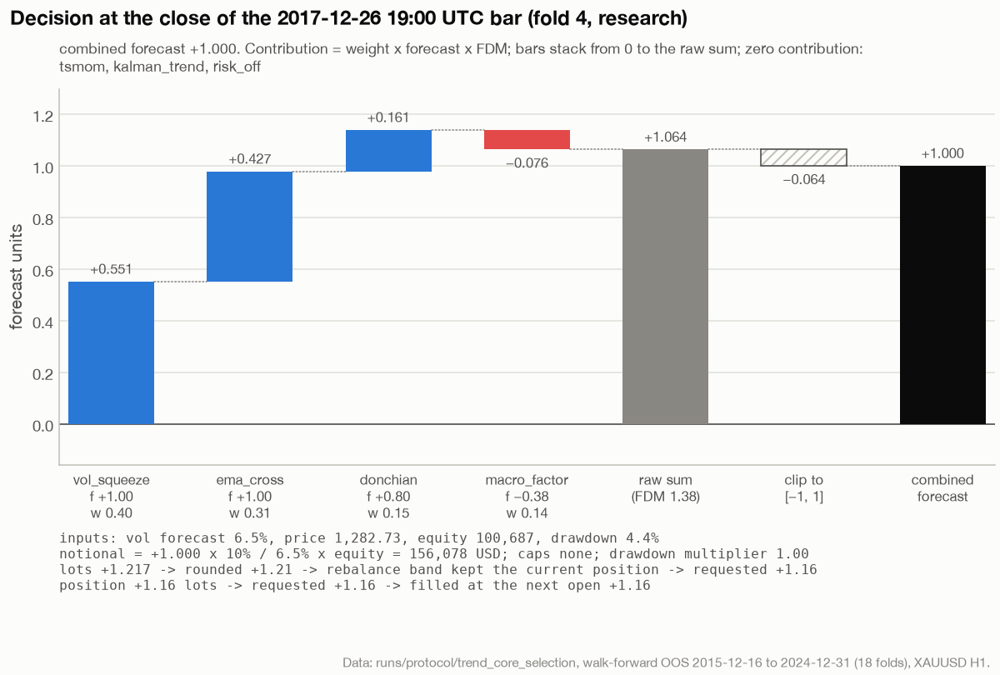
</picture>

*Four strategies contribute (three long, macro_factor short), the raw sum of 1.064 is clipped to 1.000, and the sizing chain underneath shows the rebalance band keeping the existing 1.16 lots instead of trading to 1.21. Drawn by `plot_waterfall`. Data: runs/protocol/trend_core_selection, walk-forward OOS 2015-12-16 to 2024-12-31 (18 folds), XAUUSD H1; bar 2017-12-26 19:00 UTC, fold 4.*

### Replaying the sizing chain

`explain_decision` replays the sizing with the run's own sizer
([`VolTargetSizer.breakdown`](../aurum/portfolio/sizing.py)) on the run's bars, cut at $t$, so
nothing after the decision is used:

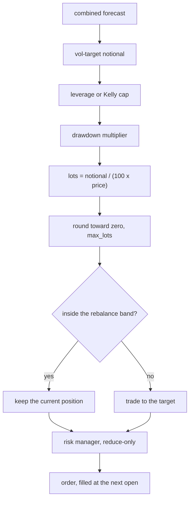

```math
N_{\mathrm{raw}} = \hat f \cdot \frac{\sigma^\ast}{\max(\hat\sigma_t, \sigma_{\min})} \cdot E_t,
\qquad
q_{\mathrm{raw}} = \frac{m(\mathrm{dd}_t)\cdot\operatorname{cap}(N_{\mathrm{raw}})}{100\, P_t},
\qquad
\mathrm{dd}_t = 1 - \frac{E_t}{\max_{s \le t} E_s}
```

where

- $\hat\sigma_t$ is the engine's causal `ewma_volatility` of the closes up to $t$
  ([models.md](models.md)), $\sigma^\ast$ the target volatility (`target_vol`, default 0.10) and
  $\sigma_{\min}$ its floor (`min_vol`, 0.02),
- $\operatorname{cap}$ limits $\lvert N\rvert$ to `max_leverage` (2.0) x equity, or to
  `kelly_cap` x equity / volatility when that is smaller,
- $m(\mathrm{dd})$ is the smallest multiplier among the `drawdown_derisk` steps whose
  threshold has been reached (default 0.5 from a 10% drawdown, 0.25 from 15%),
- $q_{\mathrm{raw}}$ is rounded toward zero onto the 0.01-lot grid; the rebalance band keeps
  the current lots $q_{\mathrm{cur}}$ when both have the same sign and
  $\lvert q - q_{\mathrm{cur}}\rvert$ < `rebalance_band` (0.10) x the larger of the two.

The chain is explained step by step in [portfolio-and-risk.md](portfolio-and-risk.md). In the
waterfall above: a combined forecast of 1.000, volatility 6.5%, price 1,282.73 and equity
100,687 give a notional of 156,078 USD (leverage 1.55, below the cap of 2) and 1.217 lots,
rounded to 1.21. The book already held 1.16 lots, and the 0.05-lot difference is inside the
band (0.10 x 1.21 = 0.121), so the request stays at 1.16 and the replay matches the saved
request. Risk-manager interventions at $t$ come from `risk_events.csv`, and the position
filled at the next open is `positions(t+1)`. Without the bars (`--no-data`) the forecast part
is still exact and the sizing block falls back to the saved values.

### Live and paper decisions: the desk step

The live runner ([aurum/live/runner.py](../aurum/live/runner.py)) writes the same arithmetic
into the `attribution` field of every `type == "decision"` record in
`<state_dir>/decisions.jsonl`:

| Field | Meaning |
|---|---|
| `method` | combiner method (`sharpe_shrink`, `equal`, ...), `equal_mean` without a combiner (weights $1/N$, FDM 1), or the combiner's class name when it exposes no weights |
| `fdm` | the forecast diversification multiplier applied |
| `strategies` | `{name: {forecast, weight, contribution}}` with contribution = weight x forecast x FDM |
| `raw_combined` | the sum of the contributions, before the clip |
| `combined` | `clip(raw_combined, -1, 1)`, equal to the record's `combined` |
| `clipped` | true when the absolute raw sum exceeds 1 |
| `unallocated` | `max(0, 1 - sum of weights)`: risk the combiner left unused |
| `exact` | the contributions reproduce `combined` within 1e-9 (false for a combiner without weights) |
| `final_forecast` | the forecast after the LLM desk (equal to `combined` without a desk) |
| `desk_delta` | `final_forecast - combined` |

[`explain_live_decision`](../aurum/research/attribution.py) turns one record into the same
waterfall with the desk's step and the final forecast, and uses the runner's logged sizing
breakdown. Reading the log is read-only. The figure uses a synthetic record in the runner's
format (the sizing block is the real `VolTargetSizer.breakdown` of its numbers):

<picture>
  <source media="(prefers-color-scheme: dark)" srcset="_assets/figures/analytics/waterfall-live-desk-dark.png">
  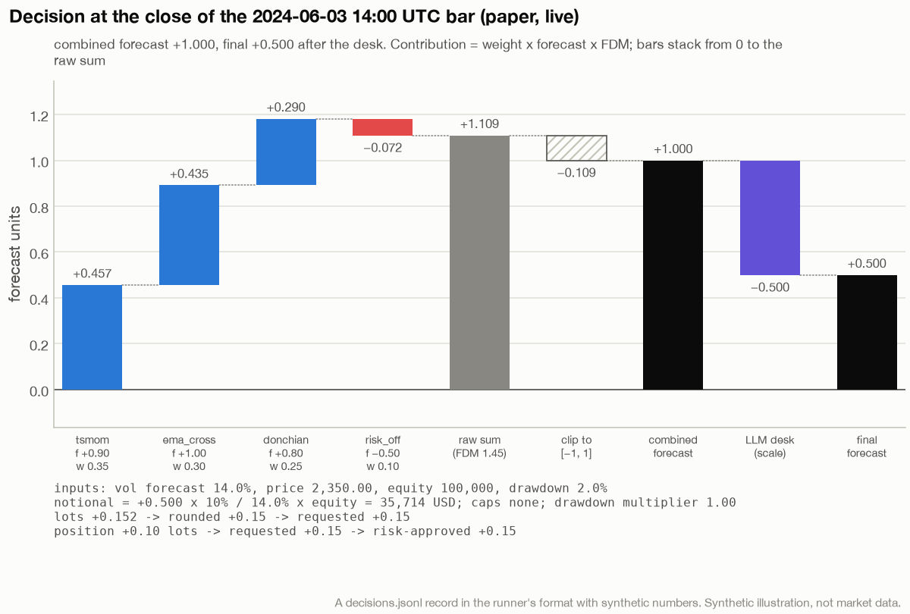
</picture>

*The clip removes 0.109, then the desk scales the combined forecast by 0.5, and the sizer works on the final 0.500: 35,714 USD notional, 0.15 lots against a current 0.10, outside the band, so the book trades. Data: synthetic illustration (a decisions.jsonl record in the runner's format with synthetic numbers), not market data.*

### PnL attribution

**Intuition.** The book's profit over the next bar comes from the position decided at the close
of this bar. Split that profit among the strategies in proportion to their contributions to the
decision. Because the shares of each decision add up to 1, the strategy totals add up to the
book's PnL exactly. The price is that the shares are **signed**: a strategy that pushed against
the net position gets a negative share.

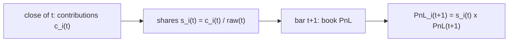

**The math.**

```math
s_i(t) =
\begin{cases}
c_i(t) / \mathrm{raw}(t) & \lvert\mathrm{raw}(t)\rvert > 10^{-12} \\
0 & \text{otherwise}
\end{cases},
\qquad
\mathrm{PnL}_i(t+1) = s_i(t)\,\mathrm{PnL}(t+1),
\qquad
U(t+1) = \mathrm{PnL}(t+1)\,\mathbf{1}\left[\textstyle\sum_i \lvert s_i(t) \rvert \le 10^{-12}\right]
```

where

- $\mathrm{PnL}(t+1)$ is the book's net PnL over bar $t+1$ (`pnl_net`), and the same shares
  split its components: price (`pnl_price`), costs (minus `pnl_costs`) and financing
  (`pnl_swap`),
- $U$ is the unattributed PnL: bars after a decision with no forecast mix (all shares 0,
  because the raw sum was 0, or no decision precedes the bar), for example the costs of
  flattening or a position kept by the rebalance band while the forecast is exactly 0,
- since $\sum_i s_i(t) = 1$ whenever $\mathrm{raw}(t) \ne 0$,
  $\sum_i \mathrm{PnL}_i + U$ equals the book's total PnL exactly; the clip rescales every
  contribution by the same factor and leaves the shares unchanged.

This is [`pnl_attribution`](../aurum/research/attribution.py) (`component="net"` by default;
`price`, `costs` and `swap` select the others, and `by_component` always has all four).

<picture>
  <source media="(prefers-color-scheme: dark)" srcset="_assets/figures/analytics/pnl-attribution-dark.png">
  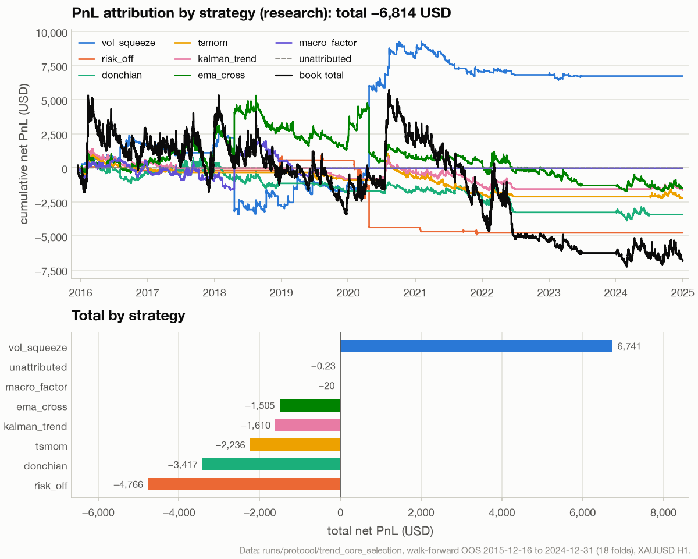
</picture>

*The book lost 6,814 USD over nine years. Attributed by signed shares, vol_squeeze is credited with +6,741 (after +9,457 in 2020 alone), risk_off with -4,766 and donchian with -3,417; the unattributed remainder is -0.23 USD. Drawn by `plot_attribution`. Data: runs/protocol/trend_core_selection, walk-forward OOS 2015-12-16 to 2024-12-31 (18 folds), XAUUSD H1.*

<picture>
  <source media="(prefers-color-scheme: dark)" srcset="_assets/figures/analytics/attribution-components-dark.png">
  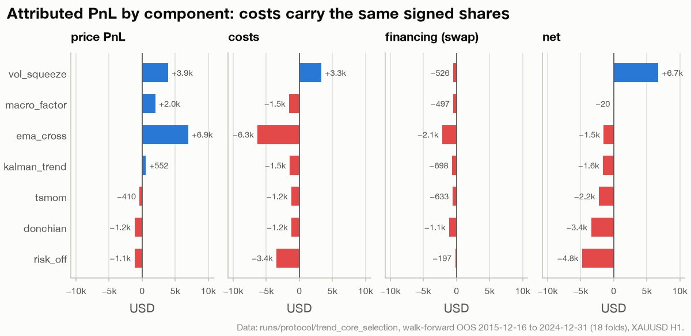
</picture>

*Costs carry the same signed shares as price PnL, so vol_squeeze shows positive costs (+3,346 USD): it often opposed the net position and is credited with the opposite sign of the book's costs. Traded alone it paid 18,707 USD of costs. ema_cross earned the most on price (+6,945) and gave nearly all of it back in costs (-6,310). Data: runs/protocol/trend_core_selection, walk-forward OOS 2015-12-16 to 2024-12-31 (18 folds), XAUUSD H1.*

Read the attribution as "which strategy's view drove the book's position", not as "what each
strategy would have earned alone". For the second question, use the standalone books in
`stats.csv`: there vol_squeeze has a Sharpe of 0.083, not a profit of the size credited above.

### Desk journal summary

[`desk_journal_summary`](../aurum/research/attribution.py) reads LLM-desk journals (a directory
of `*.jsonl` cycle files, one file, or a list; see [llm-desk.md](llm-desk.md)) and counts what
the desk did. The `totals`:

| Field | Meaning |
|---|---|
| `n_files`, `n_cycles`, `unreadable_lines` | journal files, cycles, lines that were not JSON |
| `status` | cycles by final status (`decided`, ..., `unfinished` when there is no `cycle_end`) |
| `actions` | the Chief's actions (`scale`, `hold`, ...; `none` when there was none) |
| `n_consults`, `consults_by_role` | `consult_specialist` calls, by role |
| `n_created_agents`, `created_agents` | ad-hoc agents created, by name |
| `n_tool_calls`, `tool_calls` | every tool call, by tool |
| `agent_status` | agent runs by end status |
| `n_constrained`, `n_fallback` | cycles the policy constrained, cycles that fell back |
| `total_cost_usd` | summed model cost |
| `mean_abs_quant`, `mean_abs_final` | mean absolute forecast before and after the desk |
| `median_final_over_quant` | median of final / quant over cycles with both |
| `n_direction_flips` | cycles where the final forecast has the opposite sign of the quant one |

The per-cycle table (`desk_cycles.csv`) has `cycle_id`, `file`, `now`, `quant_forecast`,
`final_forecast`, `status`, `action`, `constrained`, `used_fallback`, `n_consults`,
`n_created`, `n_tool_calls`, `cost_usd`, `duration_s` and `failure_reason`. The demo journal in
`runs/desk_demo/` holds one cycle: two consultations (macro_strategist, risk_officer), one
created agent (event_risk_analyst), 13 tool calls, a `scale` action that halved the quant
forecast from -0.300 to -0.150, and a cost of 0.09 USD (output below).

### Attribution accessors on walk-forward reports

The same contributions are available on an in-memory report, without a run directory
([aurum/research/walkforward.py](../aurum/research/walkforward.py)):

| Accessor | Returns |
|---|---|
| `WalkForwardReport.strategy_keys` | strategy columns of the stitched OOS forecasts, in combiner order |
| `WalkForwardReport.strategy_forecasts()` | bars x strategies OOS forecasts |
| `WalkForwardReport.fold_weights()` | combiner weights per fold (index `fold` as str) |
| `WalkForwardReport.fold_fdm()` | FDM per fold |
| `WalkForwardReport.bar_weights(include_fdm=True)` | the weights in force on every OOS bar, plus `fdm` |
| `WalkForwardReport.contributions(residual=False)` | per-bar $w_i f_i \mathrm{FDM}$ per strategy |
| `HoldoutReport.strategy_forecasts()`, `HoldoutReport.contributions()` | the same for an evaluated holdout |
| `forecast_contributions(forecasts, weights, *, fdm=None, residual=False)` | the function behind them |

With `residual=True` a `clip_adjustment` column (`CLIP_COLUMN`) is added, so every row sums to
the combined forecast:

```python
import pandas as pd

from aurum.research.walkforward import forecast_contributions

forecasts = pd.DataFrame({"tsmom": [0.9, -0.2], "ema_cross": [1.0, 0.4], "risk_off": [0.6, 0.0],
                          "fold": ["0", "0"]}, index=pd.to_datetime(["2024-03-01 10:00", "2024-03-01 11:00"], utc=True))
weights = pd.DataFrame({"tsmom": [0.4], "ema_cross": [0.4], "risk_off": [0.2], "fdm": [1.3]}, index=["0"])
c = forecast_contributions(forecasts, weights, residual=True)
print(c.round(4))
print("row sums:", c.sum(axis=1).round(4).tolist())
```

```text
                           tsmom  ema_cross  risk_off  clip_adjustment
2024-03-01 10:00:00+00:00  0.468      0.520     0.156           -0.144
2024-03-01 11:00:00+00:00 -0.104      0.208     0.000            0.000
row sums: [1.0, 0.104]
```

### Explain in code

```bash
aurum explain --run runs/protocol/trend_core_selection --at "2017-12-26 19:00" --attribution \
  --desk-journal runs/desk_demo --out <scratch>/explain
```

```text
== explain: runs/protocol/trend_core_selection [research] decision at the close of 2017-12-26 19:00:00+00:00 (fold 4), decided 2017-12-26 20:00:00+00:00

    strategy  forecast  weight    fdm  contribution   share
-----------------------------------------------------------
 vol_squeeze     1.000   0.400  1.379         0.551  +51.8%
   ema_cross     1.000   0.310  1.379         0.427  +40.2%
    donchian     0.800   0.146  1.379         0.161  +15.1%
macro_factor    -0.380   0.145  1.379        -0.076   -7.1%
       tsmom     0.335   0.000  1.379         0.000   +0.0%
kalman_trend     0.679   0.000  1.379         0.000   +0.0%
    risk_off     0.000   0.000  1.379         0.000   +0.0%

raw sum +1.0636  clip -0.0636  -> combined +1.0000 (saved +1.0000)
sizing: vol 6.5%, price 1,283, equity 100,687, drawdown 4.4% -> notional 156,078 -> caps none, drawdown x1.000 -> 1.217 lots -> requested 1.160 (rebalance band kept the current position); matches saved: True
position +1.16 -> requested 1.160 -> filled at the next open 1.160 lots

== PnL attribution (research, net); method: pnl(t+1) allocated by signed combiner contributions at the close of t: share_i = w_i * f_i * FDM / sum_j w_j * f_j * FDM
    strategy      net     price   costs      swap  share_of_total
-----------------------------------------------------------------
    risk_off   -4,766    -1,143  -3,426  -197.039          +69.9%
    donchian   -3,417    -1,153  -1,169    -1,096          +50.2%
       tsmom   -2,236  -410.240  -1,193  -633.213          +32.8%
kalman_trend   -1,610   552.330  -1,465  -697.549          +23.6%
   ema_cross   -1,505     6,945  -6,310    -2,140          +22.1%
macro_factor  -20.370     2,009  -1,532  -496.679           +0.3%
unattributed   -0.232     0.001  -0.234     0.000           +0.0%
 vol_squeeze    6,741     3,921   3,346  -526.048          -98.9%
total -6,813.97 USD = sum of the rows (-6,813.97)

== desk journal: runs/desk_demo: 1 cycle(s) in 1 file(s)
  status: {'decided': 1}
  actions: {'scale': 1}
  consults_by_role: {'macro_strategist': 1, 'risk_officer': 1}
  created_agents: {'event_risk_analyst': 1}
  tool_calls: {'get_market_snapshot': 1, 'get_quant_signals': 1, 'get_calendar': 2, 'consult_specialist': 2, 'create_specialist': 1, 'get_macro_snapshot': 1, 'get_risk_status': 1, 'submit_memo': 3, 'submit_decision': 1}
  agent_status: {'completed': 4}
  consults 2, created agents 1, tool calls 13, constrained 0, fallbacks 0, cost $0.090, median final/quant 0.500, direction flips 0
```

`share_of_total` is each strategy's share of the book's total, which is negative here, so a
strategy that lost money has a positive share. The command also writes
`decision_<ts>.png/.csv/.json`, `attribution.png`, `attribution_totals.csv`,
`attribution_by_year.csv`, `attribution_daily.csv`, `attribution.json`, `desk_summary.json`
and `desk_cycles.csv`. For a live or paper state directory, with the synthetic record of the
figure above written to `decisions.jsonl`:

```bash
aurum explain --live <scratch>/live_state --out <scratch>/explain_live
```

```text
 strategy  forecast  weight    fdm  contribution   share
--------------------------------------------------------
    tsmom     0.900   0.350  1.450         0.457  +41.2%
ema_cross     1.000   0.300  1.450         0.435  +39.2%
 donchian     0.800   0.250  1.450         0.290  +26.1%
 risk_off    -0.500   0.100  1.450        -0.072   -6.5%

raw sum +1.1093  clip -0.1093  -> combined +1.0000  -> desk scale -0.5000 -> final +0.5000
sizing: vol 14.0%, price 2,350, equity 100,000, drawdown +2.0% -> notional 35,714 -> caps none, drawdown x1.000 -> 0.152 lots -> target 0.150
position 0.100 -> target 0.150 -> risk-approved 0.150 lots

== live log summary: 1 decisions, 1 with an attribution (2024-06-03 15:00:05+00:00 -> 2024-06-03 15:00:05+00:00)
 strategy  mean_contribution  mean_abs_contribution  share_of_abs
-----------------------------------------------------------------
    tsmom              0.457                  0.457        +36.4%
ema_cross              0.435                  0.435        +34.7%
 donchian              0.290                  0.290        +23.1%
 risk_off             -0.072                  0.072         +5.8%
LLM desk changed the forecast on 1 of 1 decisions (mean |delta| 0.500)
```

It writes `decision_live_<ts>.png/.csv/.json` and `live_decisions.csv` (one row per decision,
with a `c:<strategy>` column per strategy, from
[`live_decisions`](../aurum/research/attribution.py)).

| Function / CLI | Default | Meaning |
|---|---|---|
| `explain_decision(source, at=None, *, phase="research", book="combined", md=None, load_data=True)` | last OOS bar | `source` is a run directory or a `WalkForwardReport`; `at` (`--at`) the bar open time in UTC (the last bar at or before it is used, with a note); `md` market data for the sizing replay (else the run's own data when `load_data`; `--no-data` sets it False) |
| `pnl_attribution(source, *, phase="research", component="net")` | net | `--attribution`; needs `books/combined/timeseries.parquet` |
| `desk_journal_summary(path)` | | `--desk-journal DIR` |
| `explain_live_decision(source, at=None)` | latest attributed decision | `--live STATE_DIR`; `source` is the state directory, its `decisions.jsonl` or parsed records |
| `--phase holdout` | research | explain an already evaluated holdout (reads `holdout/`, not a new look) |
| `--out` | `<run>/analysis/explain` | output directory (`runs/analysis/explain_live` for `--live`) |

### Explainability pitfalls and design choices

- **Signed shares credit the opposition.** A strategy that pushed against the net position is
  credited with the opposite sign of the book's PnL, costs included (vol_squeeze above). The
  attribution is exact as a decomposition of the book's PnL, and it is not a standalone
  backtest of each strategy.
- **The position is not linear in the forecast.** Rounding, the rebalance band (which can keep an
  older position), leverage caps, drawdown de-risking and risk-manager vetoes break the
  proportionality, yet each bar is attributed by the forecast mix of the latest decision. The
  waterfall's sizing block shows when this happened (band kept, caps hit, risk interventions).
- **Costs and financing use the same shares as price PnL.** That keeps the components additive
  per strategy, but it charges costs to the strategies driving the position, not to the one that
  caused a particular trade.
- **Point-in-time replay.** The sizing replay cuts the bars at $t$ and recomputes the volatility
  from them, so a replay that does not match the saved request (noted) means the data or the
  config differ from the run's, not that the replay looked ahead.
- **Live records with an opaque combiner are not exact.** When the combiner exposes no weights,
  `exact` is false and `explain_live_decision` says so instead of inventing contributions.

## Interactive dashboard

`aurum dashboard` builds one self-contained, interactive HTML page for a walk-forward run
directory with Plotly ([aurum/viz/dashboard.py](../aurum/viz/dashboard.py)). It needs the
optional dependency: `pip install 'aurum[viz]'` (the command exits with code 3 and says so
when plotly is missing).

```bash
aurum dashboard --run runs/protocol/trend_core_selection --cdn --out <scratch>/dashboard.html
```

```text
dashboard: <scratch>/dashboard.html (0.58 MB, plotly.js from CDN)
```

Without `--cdn` plotly.js is embedded and the page works offline: the same run with
`--journal runs/desk_journal` came to 5.44 MB.

<picture>
  <source media="(prefers-color-scheme: dark)" srcset="_assets/screenshots/dashboard-dark.png">
  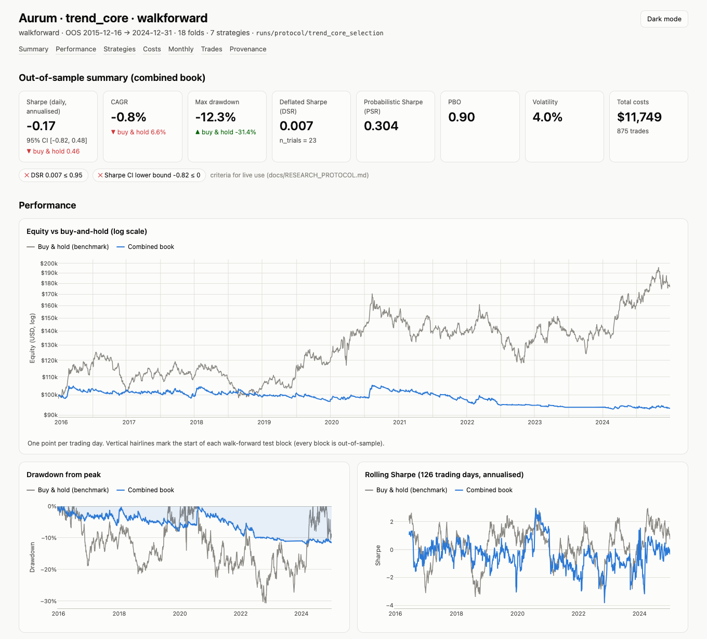
</picture>

*The top of the page for `runs/protocol/trend_core_selection` (OOS 2015-12-16 to 2024-12-31, no holdout data), in the light and dark themes. The two red badges are the protocol's live-use criteria, which this book fails. Captured with headless Chrome from `aurum dashboard --run runs/protocol/trend_core_selection` (plotly.js embedded). This is a screenshot, not a `tools/figures` figure; re-capture it by hand after changing the dashboard.*

The page has these sections, in order:

| Section | Contents |
|---|---|
| Out-of-sample summary | KPI tiles (Sharpe with its bootstrap CI, CAGR, max drawdown, DSR, PSR, PBO, volatility, costs), the buy-and-hold comparison, and badges for the protocol criteria (DSR above 0.95, Sharpe CI lower bound above 0) |
| Performance | equity vs buy-and-hold (log scale, fold boundaries), drawdown from peak, rolling Sharpe (126 trading days), OOS Sharpe per fold |
| Strategies and combiner | per-strategy OOS forecasts as small multiples, combiner weights per fold (stacked, with the unallocated share), per-book statistics |
| Cost attribution | a gross-to-net waterfall of the combined book, trading costs by book |
| Monthly returns | heatmap with a table view |
| Trades (combined book) | the most recent trades (`--max-trades`, default 500) with a filter |
| Final holdout | only when the run evaluated one |
| LLM desk timeline | only with `--journal`: quant vs final forecast per cycle, specialists per cycle, the cycle log |
| Provenance | config name and hash, data hash and bar count, git SHA, creation time, walk-forward geometry, DSR trials, the command line, run notes |

Every chart has hover tooltips. A light/dark toggle starts from the OS setting, remembers the
choice in the browser, and re-themes the charts with the palette of
[aurum/viz/style.py](../aurum/viz/style.py), so the dashboard and these static figures read as
one system. The layout works down to phone width, and text from run files (strategy names,
notes, LLM rationales) is HTML-escaped. Data is downsampled to one point per trading day.

| Flag | Default | Meaning |
|---|---|---|
| `--run DIR` | required | a walk-forward run directory (must contain `summary.json`) |
| `--journal DIR` | none | LLM-desk journal directory: adds the desk timeline |
| `--out FILE` | `<run>/dashboard.html` | output file |
| `--cdn` | off | reference plotly.js from its CDN (smaller file, viewing needs internet) |
| `--max-trades N` | 500 | most recent trades listed |
| `--title T` | `Aurum - <run name> - <kind>` | page title |

From Python: `build_dashboard(run_dir, out_html=None, *, journal_dir=None,
include_plotlyjs=True, title=None, max_trades=500, rolling_days=126)` (`include_plotlyjs` is
`True`, `"cdn"` or `False`). A panel that fails to build is replaced by a note and logged; it
never aborts the page.

## Plotting API in light and dark

Every analytics chart is drawn with the shared style of
[aurum/viz/style.py](../aurum/viz/style.py): one palette in a light and a dark mode, 2 px lines,
a recessive y-grid, no top or right spines, categorical colours in a fixed order, a diverging
blue/red scale with a gray midpoint for signed heatmaps, and text in ink colours. The plotting
functions take an optional `mode`:

| Function | Draws | `mode` |
|---|---|---|
| `plot_sweep(table, grid, metric="sharpe", *, maximize=None, x=None, y=None, best=None, robust=None, title="", subtitle="", neighbourhood=True, mode=None)` | heatmap (2-D) or line chart (1-D); best boxed, plateau centre circled, neighbours outlined | `"light"`, `"dark"` or `None` |
| `SweepResult.plot(*, x=None, y=None, metric=None, mode=None)` | the same for a sweep result | |
| `plot_fan(mc, *, n_sample_paths=12, title="", mode=None)` | fan chart | |
| `plot_distributions(mc, *, mode=None)` | CAGR, max drawdown, time to recover, drawdown and ruin exceedance | |
| `plot_waterfall(ex, *, mode=None)` and `DecisionExplanation.plot(*, mode=None)` | decision waterfall with the sizing chain | |
| `plot_attribution(att, *, top=7, mode=None)` and `PnLAttribution.plot(*, mode=None)` | cumulative attribution and totals | |

`mode=None` uses the mode of the active `use_style` block, which is light outside one, so the
CLI writes the same light PNGs under the same file names as before. Heatmap labels are white or
ink according to the luminance of the rendered cell colour, which works for both modes and for
the diverging and sequential scales alike. To render one chart in both modes, pass the palette's
mode through [`save_figure`](../aurum/viz/style.py):

```python
import numpy as np
from matplotlib.colors import to_hex

from aurum.research.montecarlo import monte_carlo, plot_fan
from aurum.viz.style import save_figure

r = np.random.default_rng(1).normal(0.0003, 0.006, 1500)        # synthetic daily returns
mc = monte_carlo(r, n_paths=2_000, horizon="1Y", seed=0)
fig = plot_fan(mc, mode="dark")                                   # one Figure, dark palette
print(type(fig).__name__, to_hex(fig.get_facecolor()))
paths = save_figure(lambda pal: plot_fan(mc, mode=pal["mode"]), "out/fan")   # both modes
print([p.name for p in paths])
```

```text
Figure #1a1a19
['fan-light.png', 'fan-dark.png']
```

The style module's helpers are `palette(mode)` and `get_palette`, `use_style(mode)` (nests and
restores the rcParams), `save_figure(fig_fn, path_stem, modes=("light", "dark"), dpi=150, *,
formats=("png",))`, `figure()` (pyplot-free), `style_axes`, `add_legend` (only for 2 or more
series), `label_line_end`, `zero_line`, `shade_span`, `percent_axis`, `categorical(n)` (at most
8), `series_color`, `sequential`, `diverging`, `sequential_cmap`, `diverging_cmap`,
`plotly_template(mode)` and `rc_params`. The chart rules are in the module docstring and in
[development.md](development.md).

The HTML tearsheet of a run ([aurum/research/report.py](../aurum/research/report.py)) renders
each chart in both modes with the same palette and shows the one matching the reader's colour
scheme. Its Sharpe confidence interval takes `n_boot` and `seed` from explicit arguments of
`write_tearsheet` / `tearsheet_html`, else from `extra["config"]` (`walkforward.n_boot`,
`seed`), else 1000 and 0. The tearsheet is described in [research.md](research.md).

## Reproducing the figures

Every chart on this page is drawn by [tools/figures/fig_analytics.py](../tools/figures/fig_analytics.py)
with the functions above, from data cut at 2024-12-31. The sweep figures read `runs/v21_demo/sweep_ema_cross`. The Monte Carlo, stress and
attribution figures read the research part of `runs/protocol/trend_core_selection` and call
`monte_carlo`, `stress_run`, `explain_decision` and `pnl_attribution` with the defaults of the
CLI (seed 0, 10,000 paths, two years). The bootstrap illustration, the plateau pair and the
live waterfall are synthetic. `runs/` and `data_store/` are not in git; without them the build
skips the real figures and keeps the committed images.

```bash
.venv/bin/python tools/figures/build.py --only analytics           # render this page's figures
.venv/bin/python tools/figures/build.py --check --only analytics   # images, embeds and orphans
```

## See also

- [research.md](research.md): the walk-forward, PSR, DSR, PBO and the holdout ledger in depth.
- [RESEARCH_PROTOCOL.md](RESEARCH_PROTOCOL.md) and [RESULTS.md](RESULTS.md): the
  pre-registered protocol, its results and the exploratory v2.1 trials.
- [portfolio-and-risk.md](portfolio-and-risk.md): the combiner, the FDM and the sizing chain.
- [models.md](models.md): the volatility models behind the sizing replay.
- [strategies.md](strategies.md): the strategies whose parameters a sweep searches.
- [execution-and-costs.md](execution-and-costs.md): the costs and financing inside every
  return.
- [llm-desk.md](llm-desk.md) and [live-trading.md](live-trading.md): the desk journals and the
  live decision log that `aurum explain` reads.
- [cli.md](cli.md) and [configuration.md](configuration.md): every flag and config key.
- [architecture.md](architecture.md), [index.md](index.md), [getting-started.md](getting-started.md),
  [data.md](data.md), [features.md](features.md), [ml-and-rl.md](ml-and-rl.md) and
  [development.md](development.md).
