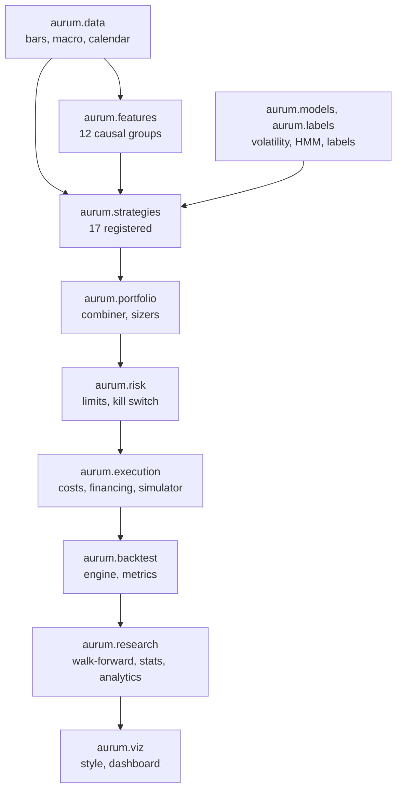
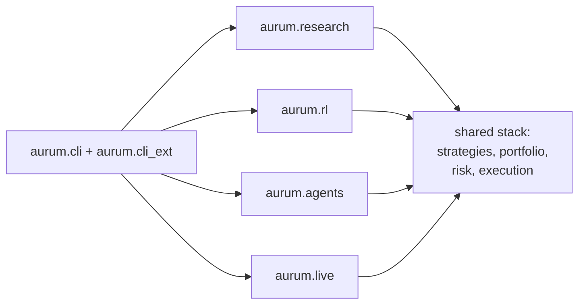
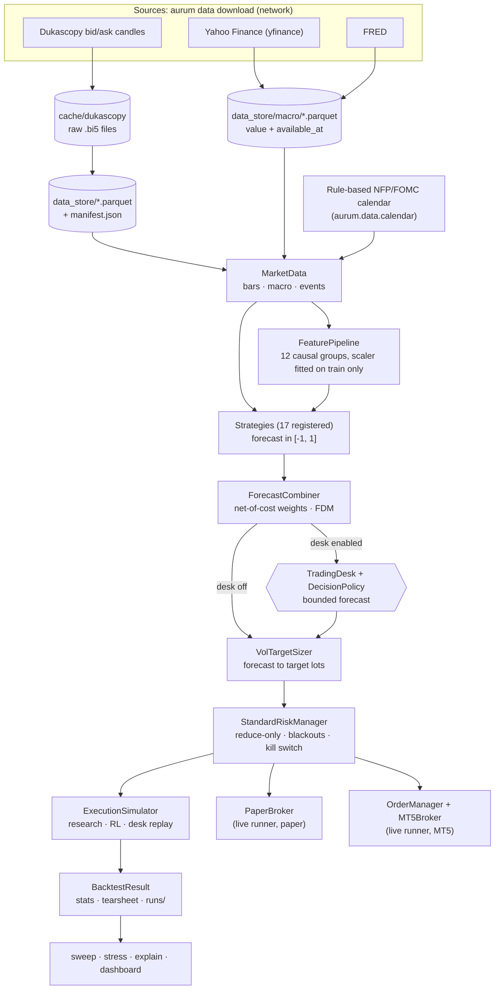
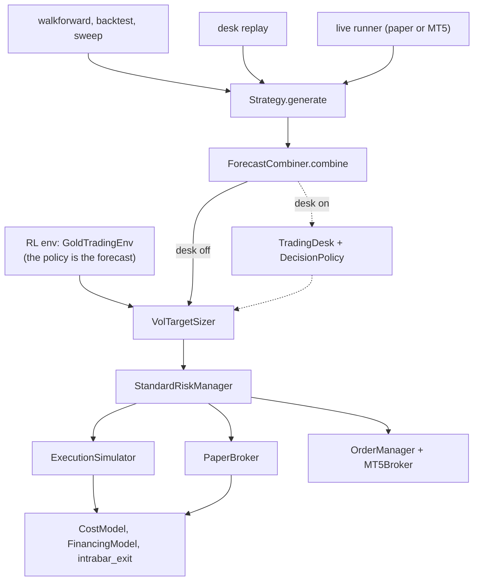
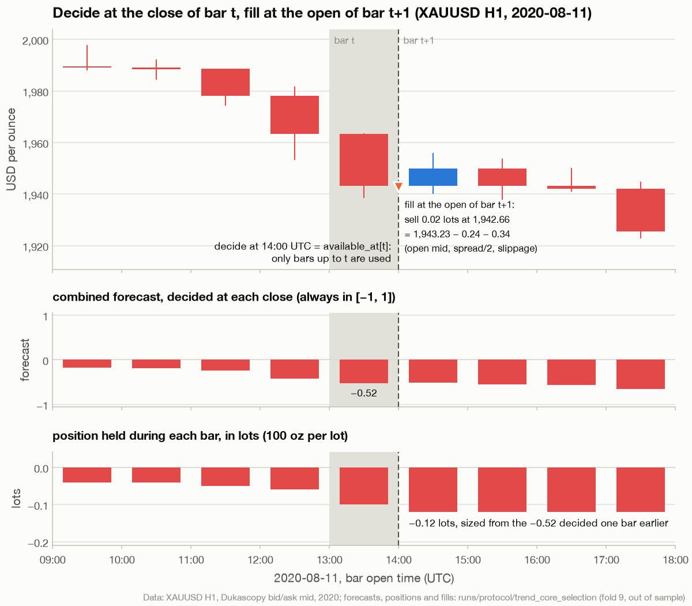
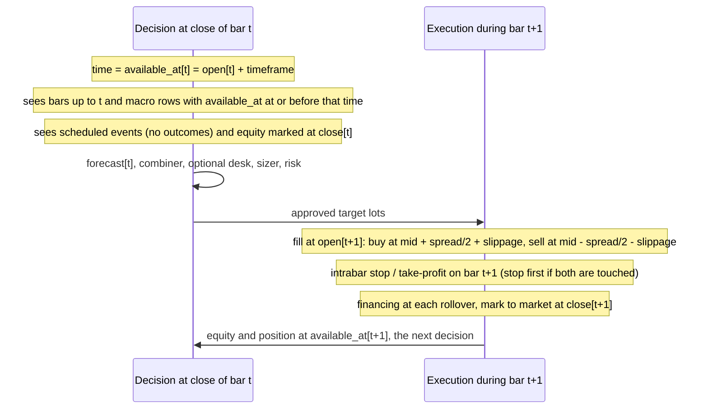
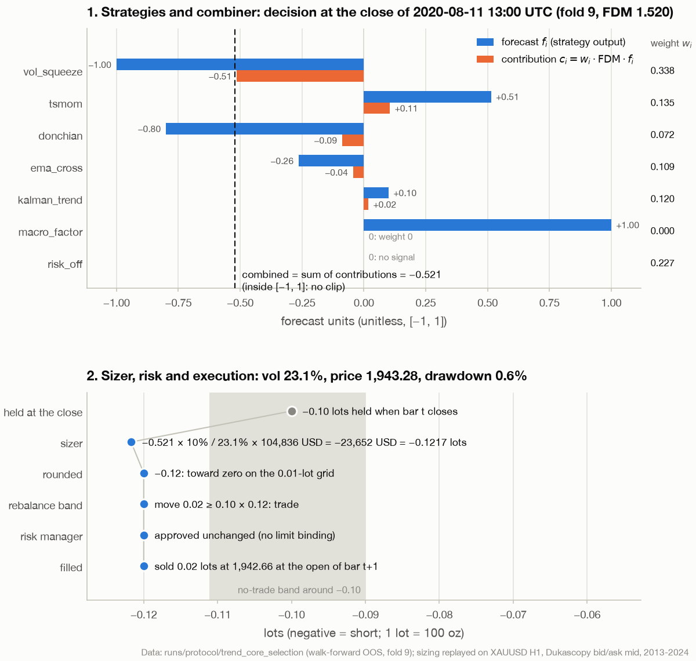
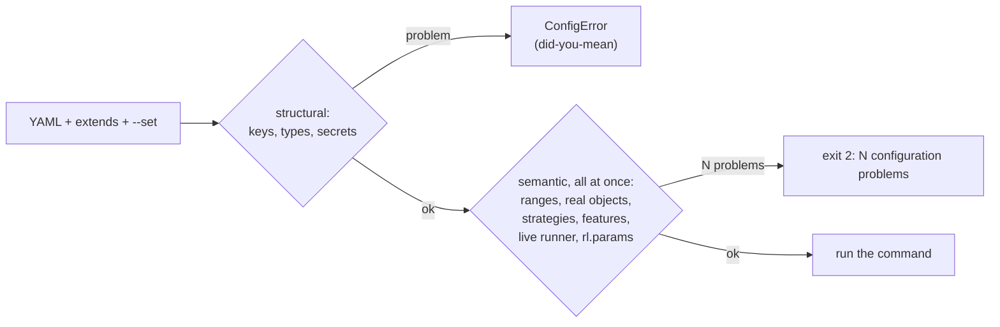

# Architecture

Aurum is a single Python package, `aurum`, organised as a pipeline. Point-in-time market data
feeds causal features and strategies. Strategies emit *forecasts*: one number in [-1, 1] per
bar, never a position. A combiner blends them, an optional LLM desk may bound the result, a
volatility-targeting sizer turns it into lots, a reduce-only risk manager approves the lots,
and an execution layer fills them at the next bar's open. The same classes run in four places:
walk-forward research (with backtests and sweeps), the reinforcement-learning environment, the
LLM-desk replay and the live/paper runner. That is how Aurum keeps "what you backtest" and
"what you trade" the same. This page shows the module map, the data flow, the one shared stack
and its entry points, the timing model, one real decision traced from seven forecasts to a
fill, the parity guarantees and the tests that enforce them, and where to plug in your own
code. [SPEC.md](../SPEC.md) is the binding contract between modules;
[INTERFACES.md](INTERFACES.md) lists the public APIs.

**On this page**

- [Design principles](#design-principles)
- [Module map](#module-map)
- [End-to-end data flow](#end-to-end-data-flow)
- [One stack, four entry points](#one-stack-four-entry-points)
- [Decision timing](#decision-timing)
- [One decision through the stack](#one-decision-through-the-stack)
- [One configuration drives every entry point](#one-configuration-drives-every-entry-point)
- [Shared components and parity guarantees](#shared-components-and-parity-guarantees)
- [Extension points](#extension-points)
- [Related pages](#related-pages)

## Design principles

| Principle | What it means | Where it is enforced |
|---|---|---|
| **Point-in-time or nothing** | A value may influence a decision at time `T` only if it was available at `T`. Every bar and every macro row carries `available_at`, and joins use `aurum.data.pit.asof_join`. | `aurum.data.schema.validate_bars` requires `available_at > open`. Future-perturbation leakage tests cover every feature group, every strategy and the whole walk-forward: `tests/test_features_leakage.py`, `tests/test_strategies_leakage.py`, `tests/test_final_e2e_leakage.py`. |
| **One simulator** | PnL is computed in one place, `aurum.execution.simulator.ExecutionSimulator`. Research, RL and the desk replay drive it directly. The paper broker reuses its cost model and intrabar exit rule and is tested to match it. | Parity tests, listed [below](#parity-guarantees-and-the-tests-that-enforce-them) |
| **Alpha ≠ sizing ≠ risk** | Strategies emit forecasts in [-1, 1], never lots. The combiner blends forecasts. The sizer turns a forecast into lots. The risk manager can only move the position toward zero, or halt. The LLM desk outputs a bounded forecast, never orders. | `Strategy._finalize` clips to [-1, 1]. The backtest engine clamps any risk approval outside `[min(0, requested), max(0, requested)]` and logs it. `DecisionPolicy` bounds the desk. `tests/test_engine_hook.py` shows a forecast hook cannot bypass a halt. |
| **Safe by default** | Live trading defaults to dry-run. Real money needs a config value *and* a CLI flag. The kill switch persists across restarts and is cleared only by a human (`aurum live reset-halt --confirm RESET`). Secrets come only from the environment. Desk failures fall back to the quant forecast by default (`agents.policy.on_failure: follow_quant`). | `aurum.live.runner`, `aurum.risk.manager`, `aurum.core.config` (rejects secrets in YAML). Tested in `tests/test_live_runner.py`, `tests/test_final_live_safety.py` and `tests/test_v21_config_cli_live_ops.py`. |
| **Deterministic and reproducible** | Stochastic components take a `seed`. Every run writes its resolved config, config hash, data hashes, git SHA and package versions (`provenance.json`). Walk-forward results do not depend on the executor (process, thread or serial). | `aurum.core.config.AurumConfig.config_hash`, `aurum.research.walkforward.provenance` |
| **Every decision can be explained** | The combiner is linear before its clip, so each strategy's share of a decision is exact. `aurum explain` replays a research decision from the run's files; the live runner writes the same arithmetic into every decision record. | `aurum.research.attribution` (`tests/test_v21_analytics_attribution.py`), the `attribution` field of `decisions.jsonl` (`tests/test_v21_live_runner.py`) |

Each module also ships tests that run offline on `aurum.data.synthetic` data. See
[development.md](development.md).

## Module map

The packages form a chain from data to results (first diagram), and four drivers call the same
middle of that chain (second diagram). An arrow points from the package that produces
something to the package that consumes it.





`aurum.core` (configuration, value types, the instrument and the protocols) is used by every
package and is left out of the diagrams. Its `AurumConfig` builds the downstream objects
lazily, which is how one YAML file configures all four drivers.

| Package | Responsibility | Key names |
|---|---|---|
| `aurum.core` | Shared vocabulary: timeframes, the instrument specification, value types, protocols and the typed configuration | `Timeframe`, `get_timeframe`, `nominal_bars_per_year`; `Instrument`, `XAUUSD`; `MarketData`, `Order`, `Fill`, `Trade`, `Side`; `PositionSizer`, `RiskManager`, `RiskContext`, `RiskDecision` (`interfaces.py`); `AurumConfig`, `load_config`, `ConfigError`, `ValidationReport` |
| `aurum.data` | Canonical bar schema, point-in-time joins, resampling, the Dukascopy downloader, MT5/CSV loaders, Yahoo/FRED macro, the NFP/FOMC calendar, synthetic data, the parquet store | `make_bars`, `validate_bars`, `asof_join`, `resample_bars`, `download_dukascopy`, `prefetch_cache`, `build_dataset`, `load_mt5_csv`, `fetch_yahoo_daily`, `fetch_fred`, `load_macro_dir`, `generate_rule_based_calendar`, `make_synthetic_bars`, `load_bars`, `save_bars`, `frame_hash` |
| `aurum.features` | 12 causal feature groups and the train-only-fitted scaler pipeline | `register_feature`, `FeatureSpec`, `list_features`; `FeaturePipeline` (`compute`, `fit`, `transform`, `save`/`load`, `parity_report`) |
| `aurum.models` | Volatility forecasters and a causal regime model | `ewma_volatility`, `Garch11`, `HarRV`, `blend_vol`; `GaussianHMM` |
| `aurum.labels` | Supervised-learning targets | `triple_barrier_labels`, `meta_labels`, `uniqueness_weights` |
| `aurum.strategies` | 17 registered alpha models and the registry | `Strategy`, `register_strategy`, `get_strategy`, `list_strategies`; for example `TimeSeriesMomentum` (`tsmom`), `MLGBMStrategy` (`ml_gbm`), `RLPolicyStrategy` (`rl_ppo`), and the v2.1 `managed_gold` (`allocation.py`) and `regime_switch` (`regime.py`) |
| `aurum.portfolio` | Forecast combination and position sizing | `ForecastCombiner`; `VolTargetSizer` (`target_lots`, `breakdown`), `FixedFractionalSizer` |
| `aurum.risk` | The reduce-only pre-trade risk manager; VaR, ES and stress tests | `RiskLimits`, `StandardRiskManager` (`evaluate`, `on_bar`, `halt`, `reset_halt`); `var_es`, `stress_test`, `risk_report` |
| `aurum.execution` | The cost and financing model and the execution simulator | `CostModel`, `FinancingModel`, `RateCurve`; `ExecutionSimulator`, `StepResult`, `intrabar_exit` |
| `aurum.backtest` | The thin engine (forecast, sizer, risk, simulator), the result container and metrics | `run_backtest`, `run_target_lots`, `buy_and_hold_benchmark`; `BacktestResult`; `compute_metrics`, `daily_returns` |
| `aurum.research` | Leak-free splits, overfitting statistics, the walk-forward protocol, tearsheets and the v2.1 analytics (sweeps, Monte Carlo stress, explanations) | `walk_forward_splits`, `purged_kfold`, `cpcv_splits`; `sharpe_summary`, `deflated_sharpe`, `pbo_cscv`, `stationary_bootstrap`; `run_walk_forward`, `run_single_backtest`, `fit_quant_book`, `forecast_contributions`; `write_tearsheet`; `run_sweep`; `monte_carlo`, `stress_run`; `explain_decision`, `pnl_attribution` |
| `aurum.rl` | A Gymnasium environment on the shared execution stack, and PPO training | `GoldTradingEnv`, `EnvConfig`, `rollout`; `RLTrainConfig`, `rl_config_from_aurum`, `train_ppo` |
| `aurum.agents` | The LLM trading desk: Chief Investment Officer, specialists, ad-hoc agents, policy, journal and cost ledger | `TradingDesk`, `DecisionPolicy`, `DeskConfig`, `DeskDataProvider`, `HistoricalDeskDataProvider`, `StaticDeskDataProvider`, `CycleJournal`, `UsageLedger`, `demo`; `testing.FakeAnthropicClient` |
| `aurum.live` | The production path: broker protocol, paper and MT5 brokers, the idempotent OMS, the bar-close runner, monitoring and atomic state files | `Broker`, `Clock`, `SimulatedClock`; `PaperBroker`, `ReplayFeed`, `BrokerDataFeed`; `MT5Broker`; `OrderManager`; `LiveRunner`, `LiveConfig`, `save_artifact`, `load_artifact`; `DriftMonitor`, `AlertManager`, `heartbeat_max_age`, `check_heartbeat` |
| `aurum.viz` | The shared chart style (matplotlib and Plotly) and the interactive run dashboard | `style` (`palette`, `use_style`, `figure`, `save_figure`, `add_legend`, `label_line_end`, ...); `dashboard.build_dashboard` (needs the `viz` extra) |
| `aurum.cli`, `aurum.cli_ext` | The `aurum` command (also `python -m aurum`). `cli_ext.register_all` adds `sweep`, `stress`, `explain` and `dashboard`. | `main`, `build_parser`. See [cli.md](cli.md). |

Optional dependencies load lazily. `aurum.strategies.rl` does not import torch until a policy is
used, `aurum.agents` does not import `anthropic` until a desk is built without a client, and
`aurum.viz.dashboard` imports plotly only when a dashboard is built. So the core install can
import every package.

## End-to-end data flow



Step by step, for one bar close:

1. **Data.** `AurumConfig.data.load()` returns a `MarketData` bundle. It holds the bars (mid
   OHLC, the recorded bid/ask `spread`, `volume` and `available_at`, indexed by bar **open**
   time in UTC), macro frames (each row carries its publication time as `available_at`) and
   scheduled events. The live runner builds the same bundle from `broker.latest_bars`, which
   returns closed bars only. See [data.md](data.md).
2. **Features.** Registered feature groups compute causal columns on the full history. A
   `FeaturePipeline` scales them with statistics fitted on training rows only. With the
   default `features.enabled: auto`, no strategy receives the shared pipeline. Rule-based
   strategies compute their own indicators from the bars, and `ml_gbm` and `meta_label` build
   and fit their own pipelines on each fold's training slice. A strategy that declares
   `uses_features = True` gets the shared, per-fold-fitted pipeline. See
   [features.md](features.md).
3. **Strategies.** Each `Strategy.generate` returns `forecast[t]` in [-1, 1], decided at the
   close of bar `t`. Trainable strategies are fitted on training data only. See
   [strategies.md](strategies.md), [models.md](models.md) and [ml-and-rl.md](ml-and-rl.md).
4. **Combiner.** `ForecastCombiner` weights strategies by net-of-cost performance (fitted in
   research on earlier folds' out-of-sample forecasts) and applies a forecast diversification
   multiplier. See [portfolio-and-risk.md](portfolio-and-risk.md).
5. **LLM desk (optional).** `TradingDesk.run_cycle` returns a final forecast. With the default
   `overlay` policy, it can only scale the quant forecast toward zero or veto it. See
   [llm-desk.md](llm-desk.md).
6. **Sizing.** `VolTargetSizer.target_lots` computes
   `notional = forecast × target_vol / vol_ann × equity`, caps it at `max_leverage`, applies
   drawdown de-risking, rounds to the lot grid and applies a rebalance band.
7. **Risk.** `StandardRiskManager.evaluate` applies pre-trade limits (leverage, margin, lots,
   spread, trades per day, stale data), event blackouts, and the daily-loss and max-drawdown
   kill switch. It returns approved lots that are never further from zero than requested.
8. **Execution.** The simulator (or the paper broker, or the OMS against MT5) trades to the
   approved lots at the next open, with spread, slippage, commission and financing. See
   [execution-and-costs.md](execution-and-costs.md) and [live-trading.md](live-trading.md).
9. **Analysis.** A walk-forward run directory feeds the v2.1 analytics: `aurum sweep`,
   `aurum stress`, `aurum explain` and `aurum dashboard`. They read what the run wrote and never
   refit. See [analytics.md](analytics.md).

The same chain as runnable code, on synthetic data (a random walk, so no edge is expected):

```python
import pandas as pd

from aurum.backtest.engine import run_backtest
from aurum.core.types import MarketData
from aurum.data.synthetic import make_synthetic_bars, make_synthetic_events, make_synthetic_macro
from aurum.execution.costs import CostModel
from aurum.portfolio.combiner import ForecastCombiner
from aurum.portfolio.sizing import VolTargetSizer
from aurum.risk.manager import RiskLimits, StandardRiskManager
from aurum.strategies.base import get_strategy

# 1. point-in-time market data (a random walk: no edge by construction)
bars = make_synthetic_bars(6000, "H1", seed=1)
md = MarketData(bars=bars, macro=make_synthetic_macro(bars, seed=1),
                events=make_synthetic_events(bars.index[0], bars.index[-1]))

# 2. alpha: causal forecasts in [-1, 1], decided at the close of each bar
forecasts = pd.DataFrame({n: get_strategy(n).generate(md) for n in ("tsmom", "ema_cross", "donchian")})

# 3. combiner: fitted on the first half only, then applied row by row
split = bars.index[3000]
train = forecasts.index < split
combiner = ForecastCombiner(method="equal").fit(forecasts[train], bars["close"][train])
combined = combiner.combine(forecasts)

# 4. sizing -> risk -> execution, on the second half, through the one simulator
res = run_backtest(md, combined, sizer=VolTargetSizer(target_vol=0.10),
                   risk=StandardRiskManager(RiskLimits(max_drawdown=None, daily_loss_persistent=False)),
                   costs=CostModel(), start=split)
print({k: round(float(res.metrics[k]), 3) for k in ("sharpe", "max_drawdown", "total_costs", "n_trades")})
print("PnL identity holds:", abs(res.reconcile()["residual"]) < 1e-6)
```

```text
rate financing: no 'fedfunds' series supplied (md.macro / rates=); every rollover uses fallback_rate=0.0300
{'sharpe': -0.762, 'max_drawdown': -0.053, 'total_costs': 547.953, 'n_trades': 41.0}
PnL identity holds: True
```

The first line is a logged warning. The synthetic macro set has no `fedfunds` series, so
rate-based financing uses its fallback rate. `reconcile()` checks the accounting identity
*equity change = price PnL − costs + swap*. The walk-forward engine
(`aurum.research.walkforward`) does the same things at scale: per-fold refits, stitched
out-of-sample forecasts, and one continuous backtest per book. See [research.md](research.md).

## One stack, four entry points

**Intuition.** A backtest is only worth something if the code that produced it is the code
that trades. Aurum therefore has no "research version" and "live version" of the money path.
There are four *drivers* (the walk-forward and its relatives, the RL environment, the desk
replay and the live runner) and one set of components they all call: the strategies, the
combiner, the sizer, the risk manager, and one cost and execution model. The drivers differ
only in where the bars come from and where the orders go.



The walk-forward, the single-split backtest, every sweep grid point and the desk replay all
end in `run_backtest`, which drives `ExecutionSimulator`. The RL environment drives the same
simulator directly. The paper broker is a separate object (it keeps positions the way a broker
does) but shares `CostModel`, `FinancingModel` and `intrabar_exit`, and the parity tests below
hold it to the simulator's equity path. Only MT5 fills are not simulated. The table below says
which configuration section each driver reads.

### Who uses what

| Component | Walk-forward / backtest / sweep | RL environment | Desk replay | Live runner |
|---|---|---|---|---|
| Market data | `cfg.data.load()` | `cfg.data.load()`, split by `rl.train_end` / `rl.val_end` | `cfg.data.load()` | `broker.latest_bars` (closed bars only), `macro_dir`, rule-based calendar |
| Features | `FeaturePipeline` fitted per fold (for strategies that use it) | `FeaturePipeline` (`RLTrainConfig.feature_groups`) | as research (`fit_quant_book`) | pipeline loaded from the artifact, computed on `3 × max_lookback` bars of history (at least 300) unless `live.history_bars` is set |
| Strategies and combiner | cloned and refitted per fold; combiner fitted on earlier OOS folds (a sweep point is one strategy with weight 1) | the PPO policy is the strategy | fitted once before the replay window | pickled in the artifact by `train-final` |
| Sizer | `VolTargetSizer` from `sizing` | `VolTargetSizer` from `sizing`, unless `rl.params.env.sizer` is set | `VolTargetSizer` from `sizing` | `VolTargetSizer` from the artifact's sizer settings (from `sizing`) |
| Risk | `StandardRiskManager`, research limits | `StandardRiskManager`, research limits (`risk.research` over `RESEARCH_RISK_DEFAULTS`), unless `rl.params.env.risk` is set | `StandardRiskManager`, research limits | `StandardRiskManager`, `risk.live` limits, state in `state_dir` |
| Execution | `ExecutionSimulator` via `run_backtest` | `ExecutionSimulator` | `ExecutionSimulator` via `run_backtest(forecast_hook=...)` | `PaperBroker` (same `CostModel`, `FinancingModel` and `intrabar_exit`) or `OrderManager` + `MT5Broker` |
| Costs and instrument | `CostModel` from `costs`, `instrument` | `costs` and `instrument`, unless `rl.params.env.costs` / `.instrument` are set | `CostModel` from `costs` | `CostModel` from `costs` |

Since v2.1, `aurum rl train` builds the environment from the top-level sections with
`aurum.rl.train.rl_config_from_aurum`: `env.costs` from `costs` (financing included),
`env.sizer` from `sizing` (vol targeting only), `env.risk` from `risk.research` over
`RESEARCH_RISK_DEFAULTS`, `env.instrument` from `instrument` and `env.initial_equity` from
`backtest.initial_equity`. Keys under `rl.params.env` replace these entries one key at a time,
and the command prints which source each part came from. The research limits have no
max-drawdown kill, so a training episode ends only on ruin or at its length unless you set
`rl.params.env.risk`. See [ml-and-rl.md](ml-and-rl.md).

**Pitfalls and design choices.**

- A second PnL loop is the classic way backtests drift away from trading. SPEC §0 forbids
  it, and the parity tests below fail if the paper broker, the RL environment or the engine
  disagree by more than 1e-6 USD of equity.
- The runner computes features and forecasts on a sliding window, not on the full history.
  That is a deliberate difference with a tested bound, described under
  [where they deliberately differ](#where-they-deliberately-differ).
- Research and live use different *risk limits* on purpose (research must be able to report
  drawdowns). The parity tests pin identical limits on both sides.

## Decision timing

**Intuition.** Most backtest leaks are timing bugs: a decision that "sees" the close it is
trading at, a daily macro print used on its observation date instead of its publication time,
a higher-timeframe bar used before it has finished. Aurum avoids them with one rule applied
everywhere: a decision is made at the instant a bar closes, using only data available at that
instant, and it is filled at the next tradeable price, the open of the following bar.

**The rule.** All timestamps are tz-aware UTC and a bar is indexed by its **open** time:

```math
\text{available\_at}_t = \text{open}_t + \Delta, \qquad
\text{decision}_t = \text{available\_at}_t, \qquad
\text{fill}_t = \text{open}_{t+1} \pm \left(\tfrac{s^{\mathrm{eff}}_{t+1}}{2} + \text{slip}_{t+1}\right)
```

where

- $\Delta$ is the bar length (1 hour on H1), so `available_at` is the bar's close;
- the decision at $\text{decision}_t$ may use bars $0..t$ and macro rows whose own
  `available_at` is at or before that instant;
- $s^{\mathrm{eff}}_{t+1}$ is the effective spread of bar $t+1$ in USD/oz,
  `max(spread × spread_multiplier, min_spread)` from the recorded bid/ask spread (defaults
  1.0 and 0.10, `CostModel.effective_spread`);
- $\text{slip}_{t+1}$ is `slippage_fixed + slippage_range_frac × (high − low)` of bar $t+1$
  (defaults 0.02 and 0.02, plus an `impact_coef` square-root term that is 0 by default,
  `CostModel.slippage`);
- a buy pays $+$, a sell receives $-$; the position is then marked to market at
  $\text{close}_{t+1}$, the next decision instant.

**The picture.** The figure follows one real decision of the pre-registered `trend_core`
walk-forward through that timeline, on gold's sharp sell-off of 2020-08-11. The forecast
decided inside bar *t* (13:00 to 14:00 UTC) shows up as a position one bar later
([figure code](../tools/figures/fig_platform.py)).

<picture>
  <source media="(prefers-color-scheme: dark)" srcset="_assets/figures/architecture/decision-timeline-dark.png">
  
</picture>

*The forecast of −0.52 decided at the 14:00 close of bar t becomes the −0.12-lot position held during bar t+1, filled at 1,942.66: the 1,943.23 open mid minus half the 0.47 spread and 0.34 of slippage. Every position bar is the forecast bar before it, sized. Data: XAUUSD H1, Dukascopy bid/ask mid, 2020-08-11; forecasts, positions and fills from `runs/protocol/trend_core_selection` (fold 9, out of sample).*

The same sequence as a diagram:



The rules behind the diagram:

- **Bars.** A decision at `available_at[t]` may use bars `0..t`. `ExecutionSimulator.step` is
  called at that close. It uses bar `t+1` only to settle the order: the fill price, the
  high-low range for the slippage term, the intrabar exit check and the mark-to-market at
  `close[t+1]`.
- **Higher timeframes.** H4 and D1 bars built from H1 are emitted only once their bucket is
  complete, and are aligned with the same `available_at` rule. Since v2.1 `resample_bars`
  also drops a partial *first* bucket, so resampling a slice of history never produces a bar
  that differs from the full-history one. See [data.md](data.md).
- **Macro.** A daily print counts only from its publication time. Yahoo cash indices become
  available at date + 21:30 UTC, Yahoo futures and ICE at date + 22:30 UTC, and FRED series at
  21:30 UTC on the next US business day.
- **Events.** Scheduled release times are public in advance, so they may be used before the
  event. Outcome columns are stripped from upcoming events.
- **Financing.** Rollovers fall at `Instrument.rollover_hour_utc` (21 for XAUUSD) on weekdays,
  with three nights charged on `triple_swap_weekday` (Wednesday). In rate mode the benchmark
  rate is read as of the rollover instant.
- **Live.** The runner decides at `available_at`. It sends orders `bar_close_delay_seconds`
  later (default 5 s), so the venue has published the bar. If the market is closed, it retries
  the same decision when quotes return, which reproduces the simulator's "fill at the next
  open". See [live-trading.md](live-trading.md).

Timing and point-in-time joins, shown with code:

```python
import pandas as pd

from aurum.data.synthetic import make_synthetic_bars
from aurum.execution.costs import CostModel
from aurum.execution.simulator import ExecutionSimulator

pd.set_option("display.width", 120)
bars = make_synthetic_bars(3, "H1", seed=0)
print(bars[["open", "close", "spread", "available_at"]].round({"open": 3, "close": 3, "spread": 3}))

# Decide at the close of bar 0 (available_at[0]); the simulator fills at the OPEN of bar 1.
costs = CostModel(slippage_fixed=0.02, slippage_range_frac=0.0, financing="none")
sim = ExecutionSimulator(bars, costs=costs)
step = sim.step(1.0)                        # target: +1 lot, decided at 01:00 UTC
buy = bars["open"].iloc[1] + costs.effective_spread(bars["spread"].iloc[1]) / 2 + 0.02
print("filled in bar opening at", step.time, "at", round(step.fills[0].price, 4))
print("open[1] + spread/2 + slippage =", round(buy, 4))
```

```text
                               open     close  spread              available_at
time                                                                           
2020-01-06 00:00:00+00:00  1800.000  1800.384   0.303 2020-01-06 01:00:00+00:00
2020-01-06 01:00:00+00:00  1800.400  1799.975   0.168 2020-01-06 02:00:00+00:00
2020-01-06 02:00:00+00:00  1799.893  1801.944   0.284 2020-01-06 03:00:00+00:00
filled in bar opening at 2020-01-06 01:00:00+00:00 at 1800.5042
open[1] + spread/2 + slippage = 1800.5042
```

```python
import pandas as pd

from aurum.data.pit import asof_join
from aurum.data.synthetic import make_synthetic_bars

bars = make_synthetic_bars(48, "H1", seed=0, weekend_gaps=False)   # H1 bars from Mon 2020-01-06 00:00 UTC

# A daily series: observed on a date, usable only once published (``available_at``).
rate = pd.DataFrame(
    {"value": [1.55, 1.54],
     "available_at": pd.to_datetime(["2020-01-06 21:30", "2020-01-07 21:30"], utc=True)},
    index=pd.to_datetime(["2020-01-03", "2020-01-06"], utc=True),   # observation dates
)
seen = asof_join(bars["available_at"], rate, columns=["value"])     # one row per bar
for t in ["2020-01-06 20:00", "2020-01-06 21:00", "2020-01-07 21:00"]:
    t = pd.Timestamp(t, tz="UTC")
    print(t, "decided at", bars.loc[t, "available_at"], "sees", seen.loc[t, "value"])
```

```text
2020-01-06 20:00:00+00:00 decided at 2020-01-06 21:00:00+00:00 sees nan
2020-01-06 21:00:00+00:00 decided at 2020-01-06 22:00:00+00:00 sees 1.55
2020-01-07 21:00:00+00:00 decided at 2020-01-07 22:00:00+00:00 sees 1.54
```

Friday's print was published on Monday at 21:30 UTC. The bar that closes at 21:00 cannot see
it; the bar that closes at 22:00 can. Missing values stay `NaN`: `asof_join` never
back-fills.

**Pitfalls and design choices.**

- *Filling at the decision bar's close.* It looks harmless and adds a spurious edge to every
  short-term signal, because the close you trade at is the one that produced the signal.
  Aurum never fills at `close[t]`.
- *Macro on the observation date.* A FRED series dated Monday is published on Tuesday
  evening. Joining it on the date leaks a day; the leakage harness has a negative control for
  exactly this mistake.
- *Weekend gaps.* The next open after a Friday close is Sunday evening, so "fill at the next
  open" can mean a gap. The simulator and the paper broker both fill there; the live runner
  retries until quotes return.
- *Intrabar exits.* When a bar touches both the stop and the take-profit, the stop is assumed
  first. That is the conservative choice, because the order of the two touches inside the bar
  is unknown.

## One decision through the stack

**Intuition.** Every layer has a narrow contract, and the numbers change units on the way:
strategies speak in *forecasts* (unitless conviction in [-1, 1]), the combiner returns one
forecast, the sizer turns it into *lots* (100 oz each) given the volatility, equity and
price, the rebalance band suppresses trades too small to be worth their cost, the risk manager
may only move the lots toward zero, and the execution layer turns the lot change into a fill
price. Because nothing but the sizer knows about money, a strategy cannot "bet big", and
because nothing after the risk manager may add exposure, no component downstream of it can
undo a halt.

**The math.** At the close of bar $t$, in fold $k$ (research) or with the artifact's combiner
(live):

```math
c_i(t) = \mathrm{FDM}_k \, w_{k,i} \, f_i(t), \qquad
\hat f(t) = \operatorname{clip}\Big(\sum_i c_i(t),\ -1,\ 1\Big)
```

```math
N_t = \hat f(t)\, \frac{\sigma^{\star}}{\max(\sigma_t,\ \sigma_{\min})}\, E_t, \qquad
N'_t = \operatorname{sign}(N_t)\, \min\big(\lvert N_t \rvert,\ L\, E_t\big)\, m(\mathrm{DD}_t), \qquad
q^{\mathrm{raw}}_t = \frac{N'_t}{100\, P_t}
```

```math
q_t = \operatorname{sign}(q^{\mathrm{raw}}_t)\, 0.01 \left\lfloor \frac{\lvert q^{\mathrm{raw}}_t \rvert}{0.01} \right\rfloor, \qquad
q^{\mathrm{target}}_t =
\begin{cases}
q^{\mathrm{held}}_t & \text{if same sign and } \lvert q_t - q^{\mathrm{held}}_t \rvert < b \max(\lvert q_t \rvert, \lvert q^{\mathrm{held}}_t \rvert) \\
q_t & \text{otherwise}
\end{cases}
```

```math
q^{\mathrm{approved}}_t \in \big[\min(0,\ q^{\mathrm{target}}_t),\ \max(0,\ q^{\mathrm{target}}_t)\big]
```

where

- $f_i(t)$ is strategy $i$'s forecast, clipped to [-1, 1] with NaN treated as 0;
  $w_{k,i}$ its combiner weight and $\mathrm{FDM}_k$ the forecast diversification multiplier of
  fold $k$ ([portfolio-and-risk.md](portfolio-and-risk.md) explains how both are fitted);
  $c_i(t)$ is its *contribution*, and the contributions add up exactly to the pre-clip
  combined forecast;
- $\sigma^{\star}$ is `sizing.target_vol` (0.10), $\sigma_t$ the causal EWMA volatility of log
  returns up to the close of $t$ (`ewma_volatility`: half-life 48 bars, annualised with
  5,796 bars per year on H1, clipped to [0.03, 2.0]) and $\sigma_{\min}$ = `sizing.min_vol` (0.02);
- $E_t$ is the equity marked at the close, $L$ = `sizing.max_leverage` (2.0; an optional
  `kelly_cap` can lower this cap), and $m(\mathrm{DD}_t)$ the drawdown multiplier from
  `sizing.drawdown_derisk` (default `[[0.10, 0.5], [0.15, 0.25]]`: half size from a 10%
  drawdown, a quarter from 15%), where $\mathrm{DD}_t$ is one minus equity over its running
  peak;
- $P_t$ is the close in USD/oz and 100 oz is `instrument.contract_size`; the rounding is
  toward zero on `instrument.lot_step` (0.01), and sizes below `min_lot` (0.01) become 0;
- $q^{\mathrm{held}}_t$ is the position at the close and $b$ = `sizing.rebalance_band` (0.10);
  a reversal of sign, a move to or from flat, and a held size above the current leverage or
  lot cap are never inside the band (`_apply_band` in
  [aurum/portfolio/sizing.py](../aurum/portfolio/sizing.py));
- the risk manager applies its limits, blackouts and kill switch, and the engine clamps any
  approval outside the interval above (reduce-only); the fill then follows
  [decision timing](#decision-timing).

**The picture.** The same 2020-08-11 decision, stage by stage. Panel 1 is in forecast units,
panel 2 in lots ([figure code](../tools/figures/fig_platform.py)).

<picture>
  <source media="(prefers-color-scheme: dark)" srcset="_assets/figures/architecture/decision-chain-dark.png">
  
</picture>

*vol_squeeze at −1 carries 98.5% of the −0.521 combined forecast, while tsmom and kalman_trend lean the other way and macro_factor's +1 has zero weight in this fold. At 23.1% volatility the sizer asks for −0.1217 lots, rounding gives −0.12, and the 0.02 change clears the no-trade band, so 0.02 lots are sold at the next open. Data: `runs/protocol/trend_core_selection` (walk-forward OOS, fold 9), sizing replayed on XAUUSD H1, Dukascopy bid/ask mid, 2013-2024.*

**In code.** `aurum explain` replays any research decision from a run directory (it reads
the saved forecasts, weights and book, and recomputes the sizing on the bars cut at $t$; it
never refits). This is its real output for the decision above, written to a scratch directory
with `--out` so the run directory is not touched:

```bash
aurum explain --run runs/protocol/trend_core_selection --at "2020-08-11 13:00" --out /tmp/explain
```

```text
== explain: runs/protocol/trend_core_selection [research] decision at the close of 2020-08-11 13:00:00+00:00 (fold 9), decided 2020-08-11 14:00:00+00:00

    strategy  forecast  weight    fdm  contribution   share
-----------------------------------------------------------
 vol_squeeze    -1.000   0.338  1.520        -0.514  +98.5%
       tsmom     0.514   0.135  1.520         0.105  -20.2%
    donchian    -0.800   0.072  1.520        -0.088  +16.8%
   ema_cross    -0.263   0.109  1.520        -0.044   +8.4%
kalman_trend     0.100   0.120  1.520         0.018   -3.5%
macro_factor     1.000   0.000  1.520         0.000   +0.0%
    risk_off     0.000   0.227  1.520         0.000   +0.0%

raw sum -0.5215  clip +0.0000  -> combined -0.5215 (saved -0.5215)
sizing: vol 23.1%, price 1,943, equity 104,836, drawdown 0.6% -> notional -23,652 -> caps none, drawdown x1.000 -> -0.122 lots -> requested -0.120; matches saved: True
position -0.10 -> requested -0.120 -> filled at the next open -0.120 lots
```

`share` is $c_i / \sum_j c_j$: tsmom's −20.2% means it pulled against the short. The command
also writes `decision_<time>.json`, `.csv` and a waterfall chart; with `--attribution` it
splits the whole run's PnL by strategy. See [analytics.md](analytics.md).

The arithmetic needs no run directory. This snippet feeds the forecasts and fold-9 weights
printed above through the library functions the run used (`forecast_contributions` is the
combiner's arithmetic, `VolTargetSizer.breakdown` the sizer's audit trail):

```python
import pandas as pd

from aurum.core.instrument import XAUUSD
from aurum.portfolio.sizing import VolTargetSizer
from aurum.research.walkforward import forecast_contributions

# The 2020-08-11 13:00 UTC decision of runs/protocol/trend_core_selection (fold 9), as printed by
# `aurum explain`: each strategy's forecast and its fold-9 combiner weight, and FDM = 1.519689.
forecasts = pd.DataFrame(
    {"vol_squeeze": [-1.0], "tsmom": [0.514131], "donchian": [-0.8], "ema_cross": [-0.263437],
     "kalman_trend": [0.099852], "macro_factor": [1.0], "risk_off": [0.0]},
    index=pd.DatetimeIndex(["2020-08-11 13:00"], tz="UTC"))
weights = {"vol_squeeze": 0.338044, "tsmom": 0.134798, "donchian": 0.072076, "ema_cross": 0.108860,
           "kalman_trend": 0.119665, "macro_factor": 0.0, "risk_off": 0.226556}

c = forecast_contributions(forecasts, weights, fdm=1.519689, residual=True)
print(c.round(4).T.rename(columns=lambda t: "contribution").to_string())
combined = float(c.sum(axis=1).iloc[0])               # rows sum to clip(FDM * sum w_i f_i, -1, 1)
print(f"combined forecast {combined:+.4f}")

# Sizer: vol 23.11% (causal EWMA at the close), price 1943.28, equity 104,836, held -0.10 lots
sizer = VolTargetSizer(target_vol=0.10, max_leverage=2.0, rebalance_band=0.10)
bd = sizer.breakdown(combined, 0.231132, 104_836.15, 1943.28, XAUUSD, current_lots=-0.10, drawdown=0.00569)
print(f"notional {bd.raw_notional:,.0f} USD -> {bd.raw_lots:+.4f} lots -> rounded {bd.rounded_lots:+.2f}"
      f" -> kept by the band: {bd.kept_current} -> target {bd.final_lots:+.2f} lots")
```

```text
                 contribution
vol_squeeze           -0.5137
tsmom                  0.1053
donchian              -0.0876
ema_cross             -0.0436
kalman_trend           0.0182
macro_factor           0.0000
risk_off               0.0000
clip_adjustment        0.0000
combined forecast -0.5215
notional -23,652 USD -> -0.1217 lots -> rounded -0.12 -> kept by the band: False -> target -0.12 lots
```

The stages, their contracts and the values of this decision:

| Stage | Contract (input → output) | This decision |
|---|---|---|
| Strategies | bars (and macro, features) up to $t$ → $f_i \in [-1, 1]$ | 7 forecasts from −1.000 (vol_squeeze) to +1.000 (macro_factor) |
| Combiner | forecasts → `clip(FDM × Σ w_i f_i, −1, 1)` | FDM 1.520, combined −0.5215, no clip |
| LLM desk | optional; bounded by `DecisionPolicy` (default `overlay`: scale toward 0 or veto) | not used in research runs |
| Sizer | forecast, vol, equity, price → lots | vol 23.1%, equity 104,836 USD → −23,652 USD → −0.1217 lots → −0.12 |
| Rebalance band | keep the held lots if the change is under 10% of the larger size | change 0.02 ≥ 0.012: trade |
| Risk manager | requested lots → approved lots, never further from 0 | approved −0.12 (no limit binding, no halt) |
| Execution | lot change → fill at the next open ± half spread ± slippage | sold 0.02 lots at 1,942.66 at the 14:00 open |

Sizing parameters used above (`sizing` section; full reference in
[configuration.md](configuration.md)):

| Parameter | Default | Meaning |
|---|---|---|
| `target_vol` | 0.10 | annualised volatility of the book for a forecast of ±1 |
| `max_leverage` | 2.0 | notional cap as a multiple of equity |
| `rebalance_band` | 0.10 | relative no-trade band around the held position |
| `drawdown_derisk` | `[[0.10, 0.5], [0.15, 0.25]]` | (drawdown, multiplier) steps, cumulative, never re-levering |
| `min_vol` | 0.02 | floor on the volatility forecast |
| `kelly_cap` | `null` | optional extra notional cap `kelly_cap × equity / vol` |
| `max_lots` | `null` | optional hard cap in lots (always capped by `instrument.max_lot`, 50) |

**Pitfalls and design choices.**

- *Attribution is exact for the forecast, approximate for PnL.* The contributions add up to
  the combined forecast exactly. Splitting PnL by strategy uses the same shares, but the
  position is not linear in the forecast (rounding, the band, caps, risk vetoes), so a
  strategy can be credited for a position the band kept from an older decision.
  [analytics.md](analytics.md) lists these approximations.
- *Opposing strategies.* A strategy that leans against the net position (tsmom here) gets a
  negative share and is credited with the opposite sign of the book's PnL.
- *Small positions.* At 23% volatility a −0.52 forecast is only 0.12 lots on a 105k USD
  account, and the 0.01-lot grid rounds toward zero, so small books are coarse.
- *The band trades less, not later.* It skips trades smaller than 10% of the position. That
  saves spread and slippage on noise, at the price of a position that lags the forecast a
  little.

## One configuration drives every entry point

Every command builds one `AurumConfig` from YAML via `load_config`. YAML files can
`extends:` other files (deep merge, lists replaced), and `--set key.path=value` overrides
are applied on top. Validation runs in two stages, and every command runs it strictly before
it loads any data:



The semantic stage collects every problem before it reports: instrument ranges, the feature
pipeline (unknown groups and override parameters, with did-you-mean), every `strategies[]`
entry (unknown parameters are errors, an unknown name is an error under strict validation),
`live.use_desk` without `agents.enabled`, the live runner's `LiveConfig` and unknown
`live.options` keys, and `rl.params` through `rl_config_from_aurum`. `aurum config validate`
prints what it checked; [getting-started.md](getting-started.md#check-a-configuration) shows a
real run and [configuration.md](configuration.md) the full list.

- **Research** (`walkforward`, `backtest`, `sweep`, `train-final`) uses `costs`, `sizing`,
  `combiner`, `backtest` and `risk.research`. `risk.research` is layered over
  `RESEARCH_RISK_DEFAULTS`: daily-loss halts last one day and there is no max-drawdown kill.
- **The desk replay** uses the same research objects plus the `agents` section, and needs
  `agents.enabled: true` (except with `--fake`).
- **The RL environment** uses `costs`, `sizing`, `risk.research`, `instrument` and
  `backtest.initial_equity`, overridable key by key under `rl.params.env`.
- **The live runner** receives `AurumConfig.live_runner_mapping()`: the same `costs`, the
  research sizer settings and `risk.live`, the conservative live limits with a persistent kill
  switch. `live.options` may only *add* runner settings. It cannot override `dry_run`,
  `allow_live_real`, `broker`, `magic`, or the risk, sizer and cost sections. The live runner
  implements only volatility targeting, so `train-final`, `live artifact` and `live run` refuse
  a config whose `sizing.method` is not `vol_target`.
- **Secrets** never live in YAML. `ANTHROPIC_API_KEY`, `MT5_PASSWORD`,
  `AURUM_ALERT_WEBHOOK_URL` and `AURUM_ARTIFACT_KEY` are read from the environment and excluded
  from saved configs and from the hash.
- **`config_hash()`** is the SHA-256 of every field that can change results. The output
  section, the run name, execution knobs such as `walkforward.n_jobs`, and secrets are
  excluded. It names run directories, keys the holdout ledger, and links a trading artifact
  to the walk-forward that validated it (`train-final --from-run` refuses a different hash
  without `--allow-config-mismatch`).

## Shared components and parity guarantees

### Parity guarantees and the tests that enforce them

| Guarantee | Test |
|---|---|
| The live runner on the paper broker reproduces `run_backtest` equity bar for bar, within 1e-6 USD | `tests/test_live_runner.py::test_paper_run_matches_backtest_and_logs_everything` |
| The same, with rate-based financing read from the runner's `macro_dir` | `tests/test_integrator_wave3.py::test_paper_run_uses_macro_dir_rates_and_matches_the_engine` |
| The live post-stop re-entry cooldown matches the engine's | `tests/test_live_runner.py::test_stop_cooldown_matches_the_backtest_engine` |
| `PaperBroker` equals `ExecutionSimulator`: identical equity at every decision (within 1e-6) and identical fill prices, with and without stops; identical swap over rollovers | `tests/test_live_paper.py::test_paper_equals_simulator`, `::test_paper_swap_matches_simulator_over_rollovers` |
| Rate financing is identical in the simulator, the paper broker, the RL environment and the engine; `intrabar_exit` is one shared function | `tests/test_financing_parity.py` |
| An RL evaluation rollout reproduces `run_backtest` equity (within 1e-8) and positions for the same forecasts, including through kill-switch halts | `tests/test_rl_env.py::test_rollout_equity_matches_run_backtest`, `::test_rollout_matches_engine_through_kill_switch`, `tests/test_integrator_wave3.py::test_rl_evaluation_env_reads_macro_rates_and_matches_the_engine` |
| The RL environment built from the config uses the research backtest's objects and trades the configured instrument | `tests/test_v21_core_fixes_rl_config.py::test_defaults_match_the_research_backtest_objects`, `::test_env_trades_the_configured_instrument_in_parity_with_the_rl_backtest` |
| The desk-replay hook changes nothing when absent or when it returns the input, and cannot bypass a risk halt or the kill switch | `tests/test_engine_hook.py` |
| Features computed on the live runner's history window equal full-history features on the decision row | `tests/test_stability_regime.py::test_sliding_window_parity_every_default_column`, `::test_pipeline_live_history_parity` |
| Rule-strategy forecasts on the live history window match full-history forecasts within 0.05 | `tests/test_strategies_rules.py::test_live_history_parity` |
| The attribution logged by the live runner rebuilds the combined forecast it traded | `tests/test_v21_integration.py::test_live_decisions_table_reproduces_the_runner_arithmetic` |
| Perturbing the future leaves every earlier walk-forward output bit-identical: forecasts, weights, lots, equity | `tests/test_final_e2e_leakage.py` |

To run the parity subset yourself:

```bash
pytest tests/test_live_runner.py tests/test_live_paper.py tests/test_rl_env.py \
       tests/test_financing_parity.py tests/test_engine_hook.py tests/test_integrator_wave3.py \
       tests/test_v21_core_fixes_rl_config.py tests/test_v21_integration.py
```

### Where they deliberately differ

- **Risk limits.** Research uses `risk.research` (a daily-loss halt lasts one day, no
  permanent drawdown kill, so research can report drawdowns). Live uses `risk.live`, with a
  persistent kill switch that needs a human reset (`aurum live reset-halt --confirm RESET`,
  which calls `reset_halt(confirm="RESET")`). The parity tests pin identical limits on both
  sides.
- **History length.** The live runner computes features and forecasts on a sliding window
  (`history_multiple = 3` × the artifact's maximum lookback), not the full history. The
  sliding-window tests above bound the difference. For rule strategies the bound is a
  tolerance (0.05 on the forecast), not bit equality. Path-dependent states (the
  `managed_gold` de-risk latch, the `regime_switch` HMM filter) converge to the full-history
  value after their first latch exit or a few dozen observations; see
  [strategies.md](strategies.md).
- **The paper broker is not the simulator object.** It keeps positions the way a broker does
  (executed prices, commission booked to the balance, swap accrued on the position). It uses
  the same `CostModel` arithmetic, `FinancingModel` and `intrabar_exit`, and the tests above
  hold it to the simulator's equity path.
- **Real venues.** MT5 fills, partial fills, requotes and broker-side stops are not simulated.
  The simulator has no partial fills, liquidity limits or margin stop-out model. See
  [execution-and-costs.md](execution-and-costs.md) for its known limitations.

## Extension points

### Registries

Strategies and feature groups register themselves with decorators. Configs refer to them
by name.

```python
import numpy as np
import pandas as pd

from aurum.core.interfaces import PositionSizer, RiskManager
from aurum.core.types import MarketData
from aurum.data.synthetic import make_synthetic_bars
from aurum.features.base import register_feature
from aurum.features.pipeline import FeaturePipeline
from aurum.portfolio.sizing import VolTargetSizer
from aurum.risk.manager import StandardRiskManager
from aurum.strategies.base import Strategy, get_strategy, register_strategy


@register_feature("my_drift", family="my_drift", lookback=48)
def my_drift(md: MarketData, n: int = 48) -> pd.DataFrame:
    """Rolling mean of log returns (causal: trailing window only)."""
    r = np.log(md.bars["close"]).diff()
    return pd.DataFrame({f"my_drift_mean_{n}": r.rolling(n).mean()}, index=md.bars.index)


@register_strategy
class SignOfDrift(Strategy):
    name = "sign_of_drift"
    description = "Toy example: sign of the trailing mean log return."

    @classmethod
    def default_params(cls):
        return {"n": 48}

    @property
    def warmup_bars(self) -> int:
        return self.params["n"]

    def generate(self, md, features=None):
        r = np.log(md.bars["close"]).diff()
        return self._finalize(np.sign(r.rolling(self.params["n"]).mean()), md.bars.index)


md = MarketData(bars=make_synthetic_bars(500, "H1", seed=3))
f = get_strategy("sign_of_drift", n=24).generate(md)
print(f.name, f.between(-1, 1).all(), (f.iloc[:24] == 0).all())
X = FeaturePipeline(groups=["my_drift"]).compute(md)
print(list(X.columns), int(X.iloc[:, 0].isna().sum()))
print(isinstance(VolTargetSizer(), PositionSizer), isinstance(StandardRiskManager(), RiskManager))
```

```text
sign_of_drift True True
['my_drift_mean_48'] 48
True True
```

The contracts, from `aurum/strategies/base.py` and `aurum/features/base.py`:

- **Strategy.** `generate(md, features=None)` must be causal: `forecast[t]` may use only data
  available at the close of `t`. Return it through `self._finalize(...)`, which aligns the
  series, clips it to [-1, 1], zeroes the warm-up and replaces NaN/inf with 0. Anything learned
  in `fit(md, features=None)` must be stored on `self`. Set `trainable = True` if `fit` learns
  from data, so the walk-forward refits the strategy per fold. Declare label or holding
  horizons as parameters (for example `label_horizon`, `max_holding`) so `walkforward.purge:
  auto` can purge them. Since v2.1 every `strategies[]` entry is built when the config is
  validated, so an unknown parameter name is an error that lists the valid ones.
- **Feature group.** Return a frame indexed exactly like `md.bars.index`, with columns prefixed
  by the family. Row `t` may use only information available at `available_at[t]`. No
  `shift(-k)`, centred windows, `bfill` or full-sample statistics; warm-up rows are NaN.
  Declare `requires_macro` / `requires_events` when you need them.
- **Discovery.** `list_strategies()` and `list_features()` import a fixed list of modules
  (`_ensure_loaded`). For strategies it is `trend`, `mean_reversion`, `breakout`, `macro`,
  `seasonal`, `ml`, `rl`, `allocation` and `regime`. For a new strategy to be usable from YAML
  configs and the CLI, put it in a module under `aurum/strategies/`, add that module to the
  list in `aurum/strategies/base.py`, and add it to `tests/test_strategies_leakage.py` so the
  leakage harness runs on it. Add it to the random-walk no-edge cases in
  `tests/test_strategies_rules_randomwalk.py` too. Feature modules are listed in
  `aurum/features/base.py`. [development.md](development.md#adding-a-strategy) walks through
  it.

### Protocols

`aurum/core/interfaces.py` defines the two structural interfaces that the backtest engine,
the RL environment and the live runner all drive. Any object with the right methods works;
the protocols are `runtime_checkable`.

| Protocol | Method(s) | Built-in implementation |
|---|---|---|
| `PositionSizer` | `target_lots(forecast, vol_ann, equity, price, instrument, *, current_lots=0.0, drawdown=0.0) -> float`: signed lots, already rounded with `instrument.round_lots` | `VolTargetSizer`, `FixedFractionalSizer` |
| `RiskManager` | `evaluate(ctx: RiskContext) -> RiskDecision` and `on_bar(time, equity)`. The engine calls `on_bar`, then `evaluate`, at every close. | `StandardRiskManager` |

`RiskContext` carries the decision time (`available_at[t]`), equity, current and target lots,
price, spread, annualised vol, optional data age (live), upcoming and recent events, and
extras. `RiskDecision` returns `approved_lots`, `halted` and `reasons`. However a custom risk
manager behaves, the engine enforces reduce-only: approvals outside `[min(0, requested),
max(0, requested)]` are clamped and logged. Keep in mind that the live runner itself builds
`VolTargetSizer` and `StandardRiskManager`. Custom implementations plug into
`run_backtest` and your own loops, not into `aurum live run`.

Other protocols live next to their consumers:

| Protocol | Module | Purpose |
|---|---|---|
| `Broker` | `aurum/live/broker.py` | Venue interface for the OMS and runner: account, positions filtered by symbol **and** magic, orders, closed bars only, demo flag, server time, quotes, deal lookup |
| `Clock` | `aurum/live/broker.py` | Time source. `SimulatedClock` replays hundreds of bars instantly; `SystemClock` is the wall clock. |
| `BarFeed` | `aurum/live/paper.py` | Market data for `PaperBroker` (`ReplayFeed`, `BrokerDataFeed`) |
| `DeskDataProvider` | `aurum/agents/providers.py` | JSON snapshots for the LLM desk: market, quant signals, risk, macro, calendar, backtest stats, positions |
| `AlertSink` | `aurum/live/monitor.py` | Alert destinations: log, JSONL, webhook |

### Other seams

- **Combiner methods.** `combiner.method` is `sharpe_shrink`, `equal`, `inverse_vol`, `hrp` or
  `fixed` (weights from `strategies[].weight`).
- **Costs.** `CostModel` (spread multiplier, minimum spread, slippage, impact, commission) and
  `FinancingModel` (`rate`, `fixed` or `none`) are configured under `costs`.
- **Data.** `aurum.data.loaders.load_mt5_csv` and `load_csv` produce the canonical bars schema
  from your own files. Point `data.bars_path` at a parquet file written with
  `aurum.data.store.save_bars` (it can be a daily file: `configs/d1_trend.yaml` points at
  `data_store/xauusd_D1_nyclose.parquet`).
- **CLI commands.** `aurum.cli_ext.register_all(subparsers)` runs when the parser is built and
  adds commands without touching `aurum/cli.py`. It refuses to replace a core command, and if
  it fails the extensions are removed and a warning is logged, so the core CLI keeps working.
  See [development.md](development.md#other-extension-points).
- **Figures.** Documentation charts are `@register`-ed functions in `tools/figures/`, drawn
  with `aurum.viz.style`. See [development.md](development.md#figures-and-visual-style).

## Related pages

- [getting-started.md](getting-started.md): install, the first 15 minutes, data and first runs
- [data.md](data.md), [features.md](features.md), [strategies.md](strategies.md),
  [models.md](models.md), [ml-and-rl.md](ml-and-rl.md): the research building blocks in depth
- [portfolio-and-risk.md](portfolio-and-risk.md),
  [execution-and-costs.md](execution-and-costs.md): sizing, limits, fills, financing
- [research.md](research.md), [analytics.md](analytics.md),
  [RESEARCH_PROTOCOL.md](RESEARCH_PROTOCOL.md), [RESULTS.md](RESULTS.md): methodology,
  analytics and results
- [llm-desk.md](llm-desk.md), [live-trading.md](live-trading.md): the desk and the production path
- [configuration.md](configuration.md), [cli.md](cli.md), [development.md](development.md)
- [SPEC.md](../SPEC.md) and [INTERFACES.md](INTERFACES.md): the contract and the API map
