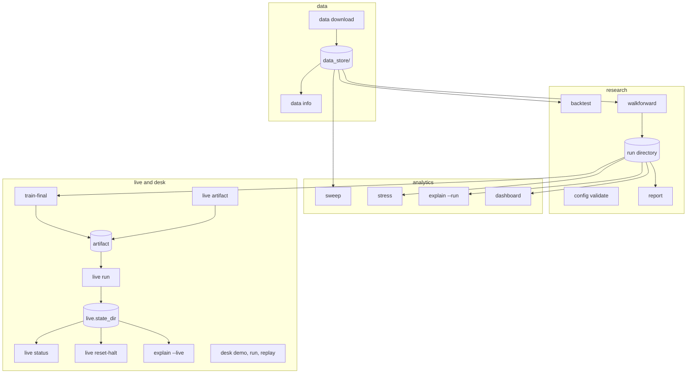
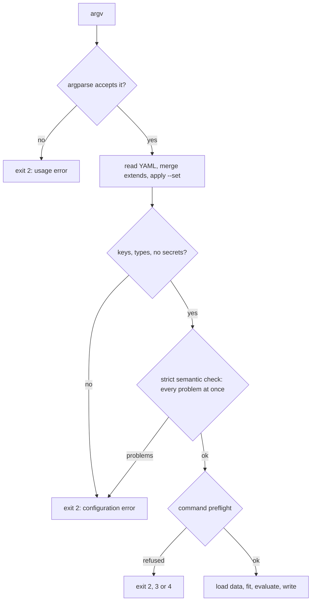
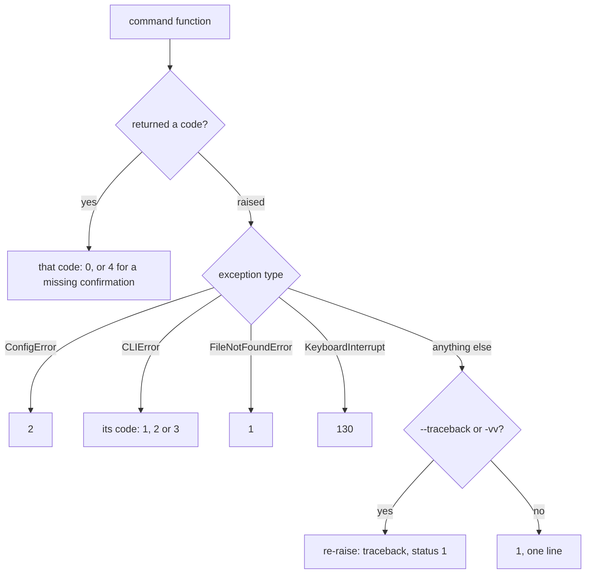
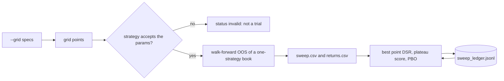
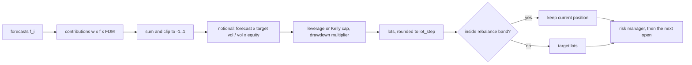
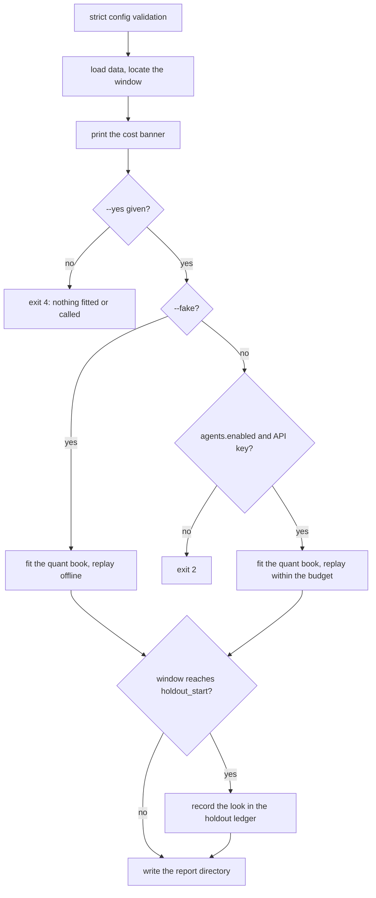
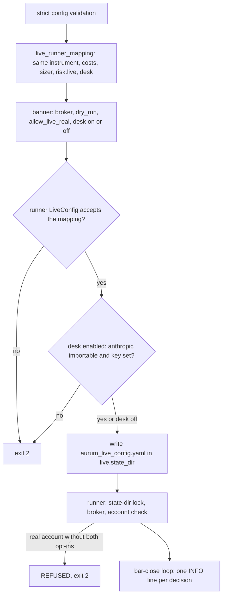
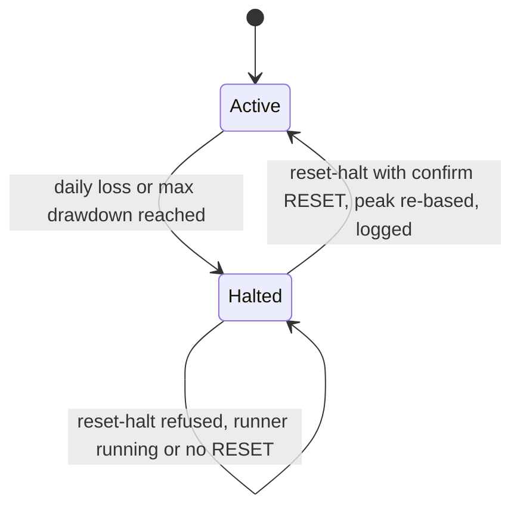
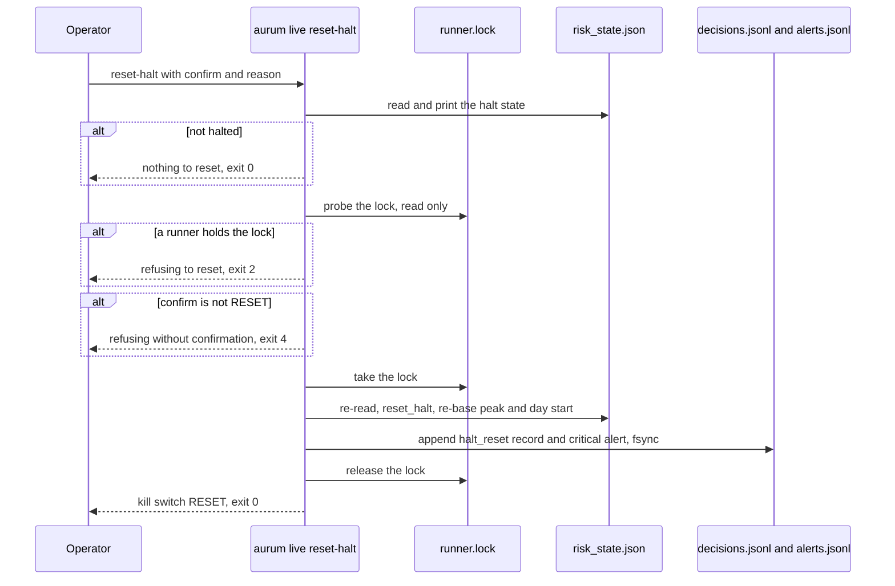

# CLI reference

Everything Aurum does from the shell goes through one command, `aurum`. Fifteen top-level
commands cover the whole workflow: getting and checking data, validating a configuration,
research runs (`backtest`, `walkforward`, `report`), research analytics (`sweep`, `stress`,
`explain`, `dashboard`), production fits (`train-final`, `live artifact`), the LLM desk
(`desk demo`, `desk run`, `desk replay`), RL training and live operations (`live run`,
`live status`, `live reset-halt`). This page explains what each command does and in which
order it does it, lists every option exactly as the argparse parser defines it (checked
against `aurum <command> --help` and [aurum/cli.py](../aurum/cli.py),
[aurum/cli_ext.py](../aurum/cli_ext.py) and [aurum/viz/cli.py](../aurum/viz/cli.py)), and
shows what it prints, what it writes and how it exits. Every example output on this page was
captured from a real run, almost all of them on synthetic data (see
[Research commands](#research-commands)).

**On this page**

- [Command map](#command-map): every command by workflow, and what flows between them
- [Invocation and global options](#invocation-and-global-options)
- [What a command does before it touches data](#what-a-command-does-before-it-touches-data)
- [Exit codes and error output](#exit-codes-and-error-output)
- [`--config` and `--set`](#--config-and---set)
- [data](#data): [download](#aurum-data-download), [info](#aurum-data-info)
- [config](#aurum-config)
- [Research commands](#research-commands): [backtest](#aurum-backtest), [walkforward](#aurum-walkforward), [report](#aurum-report)
- [Research analytics](#research-analytics): [sweep](#aurum-sweep), [stress](#aurum-stress), [explain](#aurum-explain), [dashboard](#aurum-dashboard)
- [train-final](#aurum-train-final)
- [Registries](#registries): [strategies list](#aurum-strategies-list), [features list](#aurum-features-list)
- [desk](#desk): [demo](#aurum-desk-demo), [run](#aurum-desk-run), [replay](#aurum-desk-replay)
- [rl train](#aurum-rl-train)
- [live](#live): [artifact](#aurum-live-artifact), [run](#aurum-live-run), [status](#aurum-live-status), [reset-halt](#aurum-live-reset-halt)
- [Extension commands](#extension-commands)
- [Environment variables](#environment-variables)
- [Where the CLI writes](#where-the-cli-writes)
- [A typical session](#a-typical-session)

## Command map

The commands form a pipeline. Data goes into `data_store/`; research commands turn a config
and that data into a **run directory**; the analytics commands only read run directories;
`train-final` turns a validated config into a trading **artifact**; `live run` trades that
artifact and keeps its state in `live.state_dir`, which `live status`, `live reset-halt` and
`explain --live` read.



| Command | What it does | Network | Paid API | Writes |
|---|---|---|---|---|
| `data download` | Dukascopy bid/ask bars and Yahoo/FRED macro into the data store | yes | no | `data_store/`, `cache/` |
| `data info` | Summarise bar files and macro series, verify stored hashes | no | no | nothing |
| `config show` / `config validate` | Strictly validate a config (every problem at once); print it and its hash | no | no | nothing |
| `backtest` | One train/test split (fit before `--start`, evaluate after); IN-SAMPLE without `--start` | no | no | run directory |
| `walkforward` | Walk-forward research run with DSR/PBO and an optional holdout | no | no | run directory, holdout ledger |
| `report` | Print the summary of a run directory | no | no | nothing |
| `sweep` | Parameter grid of one strategy, walk-forward OOS per point, DSR, plateau score, PBO | no | no | sweep directory, sweep ledger |
| `stress` | Monte Carlo (stationary bootstrap) and historical stress of a run's book | no | no | `<run>/analysis/stress` |
| `explain` | Forecast waterfall and sizing replay of one decision; PnL attribution; desk-journal summary | no | no | `<run>/analysis/explain` |
| `dashboard` | Interactive HTML dashboard of a run directory (needs the `viz` extra) | no | no | `<run>/dashboard.html` |
| `train-final` | Production artifact fitted on all data up to a cutoff | no | no | artifact (+ walk-forward run) |
| `strategies list` / `features list` | Registry listings | no | no | nothing |
| `desk demo` | One offline desk cycle with a scripted fake client | no | no | optional journal |
| `desk run` | **One** real Claude desk cycle on the latest bar (needs `agents.enabled`) | yes | **yes** | desk journal |
| `desk replay` | Desk over a historical window through the same sizer/risk | yes (unless `--fake`) | **yes** (unless `--fake`) | replay directory, journal, holdout ledger |
| `rl train` | PPO training (needs the `rl` extra) | no | no | `rl.out_dir` |
| `live artifact` | Fit strategies and combiner on the latest data into an artifact | no | no | artifact |
| `live run` | The bar-close live loop, **dry-run by default** | broker-dependent | only with `live.use_desk` | `live.state_dir` |
| `live status` | Read-only snapshot of the runner, kill switch, OMS and paper book | no | no | nothing |
| `live reset-halt` | Clear the kill switch: runner stopped, `--confirm RESET`, logged | no | no | `decisions.jsonl`, `alerts.jsonl`, `risk_state.json` |

The table shows what the CLI itself does. `live run` with `live.broker: mt5` talks to a
MetaTrader 5 terminal; with `live.use_desk: true` it calls Claude at every decision. The
methods behind the commands are explained on their own pages: [data.md](data.md),
[research.md](research.md), [analytics.md](analytics.md), [llm-desk.md](llm-desk.md),
[ml-and-rl.md](ml-and-rl.md) and [live-trading.md](live-trading.md).

## Invocation and global options

The `aurum` console script (`[project.scripts] aurum = "aurum.cli:main"` in
`pyproject.toml`) and `python -m aurum` are the same entry point:

```bash
aurum --help
python -m aurum --help          # identical; the program name is still "aurum"
aurum --version
```

```text
aurum 2.0.0
```

`--version` prints `aurum.__version__`: the installed distribution's version
(`importlib.metadata`), else the `[project] version` of the adjacent `pyproject.toml`, else
`0+unknown` ([aurum/\_\_init\_\_.py](../aurum/__init__.py)).

Relative paths in configs and defaults (`data_store/`, `cache/`, `runs/`, `artifacts/`)
resolve against the **current working directory**. Run the CLI from the repository root
unless you have pointed those paths somewhere else.

Global options go **before** the command. `aurum strategies list -v` fails with
`aurum: error: unrecognized arguments: -v` (exit 2); `aurum -v strategies list` works.

| Option | Type | Default | Meaning |
|---|---|---|---|
| `-h`, `--help` | flag | | Show help and exit 0. Every command and subcommand has its own `--help`. |
| `--version` | flag | | Print `aurum <version>` and exit 0. |
| `-v`, `--verbose` | counter | 0 | Logging level: none = WARNING, `-v` = INFO, `-vv` = DEBUG. `-vv` also shows full tracebacks, like `--traceback`. |
| `--traceback` | flag | off | Re-raise unexpected errors so Python prints the full traceback. |

Log records go to stderr as `YYYY-MM-DD HH:MM:SS,mmm LEVEL logger: message`; command results
go to stdout. `aurum live run` is the one command that raises a logger on its own: it shows
the runner's INFO records (one line per bar decision) at the default verbosity, without
`-v` (see [`live run`](#aurum-live-run)).

The same `main(argv)` function can be called from Python. It returns the exit code instead
of calling `sys.exit`, which is how `tests/test_cli.py` drives the CLI:

```python
from aurum.cli import main

code = main(["config", "validate", "-c", "configs/fast.yaml", "--set", "walkforward.test=3M"])
print("exit code:", code)
```

```text
# checked: data, costs (CostModel), combiner (ForecastCombiner), sizing, risk.research, risk.live, backtest, walkforward, agents.policy (DecisionPolicy), agents.desk (DeskConfig), instrument (Instrument + ranges), features (FeaturePipeline, 12 groups), strategies (7 of 7 built from the registry), live runner settings (aurum.live.runner.LiveConfig), rl.params + env (rl_config_from_aurum)
# config OK: configs/fast.yaml  hash 7a6a811479f59e42e4b38a7f540b0b222ea5e0974dfabc03c6b00012e1824e85
exit code: 0
```

## What a command does before it touches data

**Intuition.** A research run can take minutes and a live runner can place orders, so a
typo must never surface halfway through. Every command that takes `--config` therefore
loads and validates the whole configuration **strictly** first (`load_config(...,
strict=True)` in `_load_cfg`): every strategy is built from the registry with its params,
the feature pipeline, the instrument ranges, the live runner's own settings and `rl.params`
are checked, and **all** problems are reported at once with exit 2. Only then does the
command run its own cheap preflight checks (an existing output directory, the desk opt-in, a
missing API key), and only then does it load data and fit anything.



| Preflight (before any data is loaded) | Command | Exit |
|---|---|---|
| An existing `--out` without `--overwrite` | `train-final`, `live artifact` | 2 |
| The live sizer must be `vol_target` | `train-final`, `live artifact`, `live run` | 2 |
| `aurum.live.runner` importable | `train-final`, `live artifact`, `live run` | 3 |
| `--from-run` holds `oos_forecasts.parquet` | `live artifact` | 2 |
| `agents.enabled: true` and `ANTHROPIC_API_KEY` set | `desk run` | 2 |
| `rl.params` and the env mapping build | `rl train` | 2 |
| The runner's `LiveConfig` accepts the mapping; desk prerequisites | `live run` | 2 |
| At least one `--grid` | `sweep` | 2 |

Exceptions to the "validate strictly first" rule, by design:

- `config show|validate` builds the config with keys and types only, then runs
  `AurumConfig.check(strict=True)` itself so that it can print warnings and skipped checks.
- `live status` and `live reset-halt` load the config with **keys and types only**
  (`validate=False`): you must be able to inspect and clear a kill switch even while the
  config has a semantic problem.
- `data download`, `report`, `strategies list`, `features list`, `desk demo`, `stress`,
  `explain` and `dashboard` take no config. `stress` and `explain` read the
  `config.yaml` saved in the run directory.
- `desk replay` loads the data first, because its cost banner needs the number of bars in the
  window; the desk opt-in and the key are checked after the banner (see
  [`desk replay`](#aurum-desk-replay)).
- `sweep` checks that its `--strategy` resolves only after loading the data (an unknown name
  ends with `no valid grid point for strategy ...`, exit 2).

## Exit codes and error output

[aurum/cli.py](../aurum/cli.py) defines the exit codes, and the epilogue of `aurum --help`
repeats them:

| Code | Name in code | When |
|---|---|---|
| 0 | `EXIT_OK` | Success, including `--help` and `--version`. Also `live reset-halt` when the kill switch is not engaged (nothing to reset, nothing logged). |
| 1 | `EXIT_ERROR` | Runtime error: a missing input file (`FileNotFoundError`: no bars file, a `stress` run directory that does not exist, a run without `oos_forecasts.parquet` for `explain`, a missing `summary.json` or journal for `dashboard`), an unparseable timestamp, or any other unexpected exception. |
| 2 | `EXIT_USAGE` | Usage or configuration error: argparse errors; any `ConfigError` (unknown key, bad value, unknown strategy or parameter, unknown `live.options` key, secret in YAML or `--set`, a missing config file); a missing run or data directory (`report`, `data info`); a refused holdout or budget argument; the desk not enabled or `ANTHROPIC_API_KEY` missing; an existing `--out`; the live runner rejecting the configuration or the desk prerequisites; a real-money account refused by the runner. **A refused `live reset-halt`** (a runner holds `runner.lock`, no state directory, no `risk_state.json`). `sweep` without `--grid`; `explain` with both `--run` and `--live` or with neither; an extension subcommand that sets no function. |
| 3 | `EXIT_UNAVAILABLE` | An optional component is missing: `aurum.live.runner` cannot be imported, the RL extras are not installed, `dashboard` without plotly. |
| 4 | `EXIT_CONFIRM` | Confirmation required: `desk replay` without `--yes`; **`live reset-halt` without `--confirm RESET`**. |
| 130 | | Interrupted with Ctrl-C (`KeyboardInterrupt`). The `live run` loop is the exception: while it runs, the runner traps SIGINT/SIGTERM, finishes the current cycle and exits normally. |

How `main()` turns an outcome into a code:



Errors are printed to stderr with an `aurum:` prefix. Three real examples (the last two from
the synthetic workspace described under [Research commands](#research-commands)):

```text
aurum: configuration error: walkforward.tset: unknown key (did you mean 'test'?); valid keys: ['anchored', 'combiner_fit', 'combiner_min_obs', 'embargo', 'executor', 'history_bars', 'holdout_start', 'min_test_bars', 'min_train_bars', 'n_boot', 'n_jobs', 'n_trials', 'on_strategy_error', 'pbo_splits', 'purge', 'regenerate_per_fold', 'step', 'strategy_backtests', 'test', 'train']
aurum: bars file nowhere/xauusd_H1.parquet not found (run `aurum data download` or set data.bars_path)
aurum: error: DateParseError: Unknown datetime string format, unable to parse: garbage (use --traceback for details)
```

With `--traceback` or `-vv`, an unexpected exception (the last kind above) is re-raised.
Python then prints the traceback and exits with status 1. Configuration errors, `CLIError`s
and missing files are always reported as one line (or one line per problem).

## `--config` and `--set`

Every command that reads a configuration takes these two options. They are required for
`backtest`, `walkforward`, `train-final`, `sweep`, `desk run`, `desk replay`, `rl train`,
`live artifact`, `live run`, `live status` and `live reset-halt`, and optional for `config`
and `data info`.

| Option | Type | Default | Meaning |
|---|---|---|---|
| `--config`, `-c` | path | required (optional for `config`, `data info`) | YAML config file (see `configs/`; `extends:` inheritance allowed). Without it, `config` and `data info` use the built-in defaults. |
| `--set KEY=VALUE` | string, repeatable | none | Override one value by dotted path. Applied after `extends:` inheritance and before validation. |

How `--set` works (`aurum.core.config.apply_overrides`):

- The value is parsed as YAML, so `3M` is a string, `7` an integer, `null` (or an empty
  value) is `None`, and `[...]`/`{...}` are lists and mappings.
- Missing intermediate mappings are created: `--set live.options.paper.warmup_bars=11000`
  works even if `live.options` is empty.
- A list is replaced wholesale; lists cannot be indexed.
- Secrets cannot be set this way. `--set agents.api_key=...` fails with
  `secrets cannot be overridden; set $ANTHROPIC_API_KEY`.
- The resulting config goes through the same strict validation as a file. Unknown keys get
  a "did you mean" hint, and every problem is reported at once (exit 2).

```bash
# shorter test windows
aurum config validate -c configs/fast.yaml --set walkforward.test=3M --set seed=7

# replace the strategy list
aurum config show -c configs/fast.yaml \
  --set 'strategies=[{name: tsmom}, {name: ema_cross, params: {fast: 16, slow: 64}}]'

# stay out of the 2025-26 holdout, as the protocol's selection runs did
aurum walkforward -c configs/trend_core.yaml \
  --set data.end=2024-12-31T23:59:59Z --set walkforward.holdout_start=null
```

Timestamps on the command line (`--start`, `--end`, `--at`, `--cutoff`, `--until`) are read
by pandas. A value without a time zone is taken as UTC. For `backtest --end`,
`desk replay --end` and `sweep --end`, a date-only value (10 characters or fewer) includes
that whole day.

The full list of keys, and everything the validation checks, is in
[configuration.md](configuration.md).

## data

### `aurum data download`

Downloads Dukascopy bid/ask history and the macro series into the data store. **This
command uses the network.** The free Dukascopy feed is heavily rate-limited, so a first
full download takes an hour or more. Re-running it resumes from the cache. See
[data.md](data.md) for the data layer itself.

```text
usage: aurum data download [-h] [--out DIR] [--symbol SYMBOL] [--start DATE] [--end DATE]
                           [--timeframes TIMEFRAMES] [--cache DIR] [--workers N]
                           [--time-budget SECONDS] [--offline] [--no-bars] [--no-macro]
                           [--macro-start DATE] [--macro-cache DIR]
```

| Option | Type | Default | Meaning |
|---|---|---|---|
| `--out` | path | `data_store` | Data store directory, created if missing. |
| `--symbol` | string | `XAUUSD` | Dukascopy symbol. Bar files are named `{symbol.lower()}_{TF}.parquet`. |
| `--start` | date | `2012-01-01` | First day of bar data. |
| `--end` | date | yesterday (UTC) | Last day, inclusive. Also the macro end date. |
| `--timeframes` | string | `all` | `all` builds M15, H1, H4, D1 and D1_nyclose with a `manifest.json` (hashes and a quality report). A comma list (for example `H1,H4`) downloads each timeframe separately, with no manifest. Valid names: M1, M5, M15, M30, H1, H4, D1. |
| `--cache` | path | `cache/dukascopy` | Raw Dukascopy file cache. |
| `--workers` | int | `4` | Download concurrency. |
| `--time-budget` | float (seconds) | none | Time limit for the prefetch pass (only with `--timeframes all`). When it is reached, the command says so; re-run to resume. |
| `--offline` | flag | off | Build the bars from the local cache only (no prefetch, no Dukascopy requests). Macro is still fetched unless you also pass `--no-macro`. |
| `--no-bars` | flag | off | Skip the bar data. |
| `--no-macro` | flag | off | Skip the Yahoo/FRED macro series. |
| `--macro-start` | date | `2011-01-01` | First day of macro data. |
| `--macro-cache` | path | `cache/macro` | Macro download cache. |

Behaviour:

- With `--timeframes all` and no `--offline`, a newest-first prefetch pass fills the cache
  first and prints `prefetch: N fetched, N cached, N failed, N not attempted in Ns`. The
  dataset is then built, one line per file with its row count, range and short sha256.
- The build aggregates every file from the minute data only when the minute cache covers
  the whole range. Otherwise, for example after a time-budgeted prefetch, H1/H4/D1 come
  from Dukascopy's monthly hour files and M15 covers only the contiguous cached minute
  span. `manifest.json` records which path was used (`build_path`). See [data.md](data.md).
- Macro series go to `<out>/macro/`. The Yahoo series (dxy, us10y, vix, spx, silver,
  gold_fut, oil) need the `data` extra (`pip install 'aurum[data]'`). Without it the
  command prints a warning and skips them unless they are already cached. `macro_factor`
  and `risk_off` need those series. The FRED series (real10y, breakeven10y, fedfunds) do
  not need the extra.
- **`--offline` covers only the bars.** The macro step still reads from its cache when
  that exact date range was fetched before, and downloads otherwise. For a fully offline
  rebuild, add `--no-macro`.

```bash
aurum data download                                   # full store, 2012 -> yesterday
aurum data download --time-budget 1200                # prefetch for 20 min, then build; re-run to resume
aurum data download --offline --no-macro              # rebuild parquet files from cache/dukascopy only
aurum data download --timeframes H1 --start 2024-01-01 --no-macro --out /tmp/aurum_h1
```

### `aurum data info`

Summarises the bar files and macro series in a data store. It checks each file's stored
hash and prints the manifest line if `manifest.json` exists. It never uses the network.

```text
usage: aurum data info [-h] [--dir DIR] [--config PATH] [--set KEY=VALUE]
```

| Option | Type | Default | Meaning |
|---|---|---|---|
| `--dir` | path | `data_store` | Data store to inspect. Macro is read from `<dir>/macro`. Ignored when `--config` is given. |
| `--config`, `-c` | path | none (`--dir` is used) | Use the config's `data.dir` and macro directory (`data.macro_dir` or `<data.dir>/macro`) instead. The `--help` text says "default: the built-in defaults", but without `--config` the command reads `--dir`. |
| `--set` | `KEY=VALUE` | none | Config overrides (see above); only used together with `--config`. |

A file whose content does not match its stored hash is still listed, with
`HASH MISMATCH (...)` in the `check` column. A missing directory exits with code 2. On a
synthetic store:

```text
file               timeframe   rows                      first                       last  median_spread          hash  check
-----------------------------------------------------------------------------------------------------------------------------
xauusd_H1.parquet         H1  12000  2019-01-07 00:00:00+00:00  2020-12-11 03:00:00+00:00          0.299  6408134e4b0d     ok

macro:
series   rows       first        last          last_available_at
----------------------------------------------------------------
dxy       505  2019-01-07  2020-12-11  2020-12-11 21:30:00+00:00
...
```

## `aurum config`

Loads a config, applies `--set`, validates it **strictly**, and prints the resolved YAML
(`show`) or only the status lines (`validate`). This is the fastest way to check a config
before a long run: it builds every object the config describes and lists every problem in
one go.

```text
usage: aurum config [-h] [--config PATH] [--set KEY=VALUE] {show,validate}
```

| Argument | Type | Default | Meaning |
|---|---|---|---|
| `show` / `validate` | positional | required | `show` prints the full resolved config as YAML, then the status lines. `validate` prints only the status lines. |
| `--config`, `-c` | path | built-in defaults | Config file. |
| `--set` | `KEY=VALUE` | none | Overrides. |

The status lines, in order (`cmd_config` in [aurum/cli.py](../aurum/cli.py)):

| Line | When | Meaning |
|---|---|---|
| `# warning: ...` | any warning | Not an error: for example a strategy whose RL artifact does not exist yet. |
| `# skipped: ...` | a check could not run | An optional component (such as the RL stack) is not installed; the line says why. |
| `# checked: ...` | config valid | What was built from the config. |
| `# config OK: <source>  hash <sha256>` | config valid | The config hash (see [configuration.md](configuration.md#the-config-hash)). |

On problems both actions exit 2 with `N configuration problems:` and the list, and `show`
prints **no** YAML for an invalid config. A valid config:

```bash
aurum config validate -c configs/managed_gold.yaml
```

```text
# checked: data, costs (CostModel), combiner (ForecastCombiner), sizing, risk.research, risk.live, backtest, walkforward, agents.policy (DecisionPolicy), agents.desk (DeskConfig), instrument (Instrument + ranges), features (FeaturePipeline, 12 groups), strategies (3 of 3 built from the registry), live runner settings (aurum.live.runner.LiveConfig), rl.params + env (rl_config_from_aurum)
# config OK: configs/managed_gold.yaml  hash 5119c270ec73cd1ed25ea5aff18a2ad732123a639017d58afd7eacd011c22d23
```

A valid config with a warning (a scratch file extending `trend_core.yaml` with an `rl_ppo`
entry whose artifact has not been trained yet):

```text
# warning: strategies[1] (rl_ppo): FileNotFoundError: RL artifact runs/rl/not_trained_yet is missing ['policy.zip', 'pipeline.json', 'config.json'] (commands that build this strategy fail until the file exists)
# checked: data, costs (CostModel), combiner (ForecastCombiner), sizing, risk.research, risk.live, backtest, walkforward, agents.policy (DecisionPolicy), agents.desk (DeskConfig), instrument (Instrument + ranges), features (FeaturePipeline, 12 groups), strategies (1 of 2 built from the registry), live runner settings (aurum.live.runner.LiveConfig), rl.params + env (rl_config_from_aurum)
# config OK: with_warning.yaml  hash 47b1b6a32be12153c538d832595ae14edda2542dfdeb658a412c61bc4a34aa00
```

A deliberately broken config with nine problems, all reported at once with did-you-mean
hints, is shown in [configuration.md](configuration.md#validation). The hash is the SHA-256
of every field that can change results; secrets, the `output` section, `name` and pure
execution settings such as `walkforward.n_jobs` are excluded. `show` never prints secrets.

## Research commands

These commands need a data store (or a config with `data.synthetic`). See
[research.md](research.md) for the methodology and [RESULTS.md](RESULTS.md) for the
pre-registered results. **Do not read performance into the example output below: it was
produced on a synthetic random walk, where every Sharpe ratio is noise.**

The examples in this section, and in the analytics, `desk`, `rl` and `live` sections below,
ran in an empty scratch directory holding a synthetic store built by this script, with
`configs/` linked to the checkout's config directory. Nothing was evaluated on real market
data, and nothing was written into the repository's `runs/`. **Run the script only in an
empty directory, never in the repository root:** it writes `data_store/xauusd_H1.parquet`
and `data_store/macro/` relative to the working directory and would replace your real
bars. `data_store/` is not in git, so a replaced file cannot be checked out again (it can
be rebuilt from `cache/` with `aurum data download --offline`). The guard on the first lines
refuses to run where a data store already exists.

```python
from pathlib import Path

from aurum.data.macro import save_macro_dir
from aurum.data.store import save_bars
from aurum.data.synthetic import make_synthetic_bars, make_synthetic_macro

if Path("data_store").exists():                                   # never overwrite real data
    raise SystemExit("run this in an empty scratch directory: data_store/ already exists here")
bars = make_synthetic_bars(12_000, "H1", seed=1, model="gbm", start="2019-01-07")   # random walk
save_bars(bars, "data_store/xauusd_H1.parquet")
save_macro_dir(make_synthetic_macro(bars, seed=1), "data_store/macro")
print(len(bars), bars.index[0], bars.index[-1])
```

```text
12000 2019-01-07 00:00:00+00:00 2020-12-11 03:00:00+00:00
```

The synthetic macro set has no `fedfunds` series, so rate financing falls back to
`costs.financing.fallback_rate` and logs a WARNING about it; those lines are left out of
the outputs below.

### `aurum backtest`

A single train/test split. Strategies and combiner are fitted on all bars before `--start`
(minus purge and embargo), then evaluated on `[--start, --end]`. Without `--start` (and
without `backtest.start` in the config) everything is fitted and evaluated **in sample**:
the command then prints an `IN-SAMPLE` banner before loading data, the report header says
`IN-SAMPLE` and a note repeats it. Use `walkforward` for honest estimates.

```text
usage: aurum backtest [-h] --config PATH [--set KEY=VALUE] [--strategy ID] [--start TS] [--end TS]
                      [--out DIR] [--jobs N] [--include-holdout] [--no-write] [--no-tearsheet]
```

| Option | Type | Default | Meaning |
|---|---|---|---|
| `--strategy ID` | string, repeatable | all enabled | Restrict the run to these strategy ids or names. They must be in the config's `strategies` list (exit 2 otherwise). |
| `--start` | timestamp | `backtest.start` | Evaluation start. Fitting uses earlier data and needs at least `walkforward.min_train_bars` bars. Omitted = IN-SAMPLE. |
| `--end` | timestamp | `backtest.end` | Evaluation end. A date-only value includes the whole day. |
| `--out` | path | `output.dir/backtest_<UTC>_<hash8>` | Report directory. |
| `--jobs` | int | `walkforward.n_jobs` | Parallel workers (0 = auto). |
| `--include-holdout` | flag | off | Also evaluate bars from `walkforward.holdout_start` on. This spends the holdout and records the look in the holdout ledger. |
| `--no-write` | flag | off | Do not write the report directory (`output.save_results: false`). |
| `--no-tearsheet` | flag | off | Skip `tearsheet.html` (`output.tearsheet: false`). |

Bars from `walkforward.holdout_start` on are dropped unless you pass `--include-holdout`. A
`--start` inside the holdout is refused with exit 2.

```bash
aurum backtest -c configs/fast.yaml --strategy tsmom --strategy macro_factor --no-write
```

```text
2026-11-09 15:21:53,857 WARNING aurum.research.walkforward: backtest without --start: IN-SAMPLE evaluation
== IN-SAMPLE backtest: no --start (and no backtest.start), so strategies and combiner are fitted and evaluated on the SAME bars. The numbers below are not an estimate of future performance; pass --start or run `aurum walkforward`.
loaded 12000 H1 bars 2019-01-07 00:00:00+00:00 -> 2020-12-11 03:00:00+00:00 (0.1s)
== backtest (IN-SAMPLE: fitted and evaluated on the same bars): fast  config c78e62604b52  data 6408134e4b0d
OOS 2019-01-07 00:00:00+00:00 -> 2020-12-11 03:00:00+00:00  (12000 bars, 1 fold(s), train 12000 / test 12000 bars, purge 0, embargo 24, n_trials 23)

book          sharpe  ci_lower  ci_upper    psr    dsr    cagr  ann_vol  max_drawdown  n_trades  total_costs  n_halt_episodes
-----------------------------------------------------------------------------------------------------------------------------
combined       0.361    -1.084     1.643  0.695  0.073   0.020    0.057        -0.058       131        1,965                0
tsmom         -0.159    -1.521     1.238  0.412  0.015  -0.010    0.053        -0.066       235        3,465                0
macro_factor   0.689    -0.861     1.926  0.834  0.163   0.044    0.063        -0.058        39        1,029                0
benchmark     -1.297    -2.473     0.083  0.034  0.034  -0.207    0.162        -0.385         1       18.973                0

PBO (CSCV, 16 splits, 2 strategies): 0.142  prob OOS loss of IS-best 0.211

notes:
  - IN-SAMPLE: strategies and combiner were fitted on the evaluated period; use `aurum walkforward` for out-of-sample estimates
  - fold in_sample combiner: max_weight 0.4 infeasible with 2 active strategies; relaxed to 0.5000

timing: features 0.0s, strategies 0.0s, combine 0.0s, backtests 1.3s, stats 0.0s, wall 1.4s
```

### `aurum walkforward`

The main research command. It refits every trainable piece per fold, stitches the
out-of-sample forecasts, runs one continuous backtest on them, and reports the statistics
with DSR and PBO. If `walkforward.holdout_start` is set, it evaluates the final holdout
once at the end.

```text
usage: aurum walkforward [-h] --config PATH [--set KEY=VALUE] [--out DIR] [--jobs N]
                         [--executor {auto,process,thread,serial}] [--no-write] [--no-tearsheet]
```

| Option | Type | Default | Meaning |
|---|---|---|---|
| `--out` | path | `output.dir/walkforward_<UTC>_<hash8>` (or `output.dir/<output.run_name>`) | Run directory. |
| `--jobs` | int | `walkforward.n_jobs` (config default 0) | Parallel workers. 0 = auto: `min(cpu_count, 8)`, capped by the number of tasks. |
| `--executor` | `auto`, `process`, `thread`, `serial` | `walkforward.executor` (`auto`) | Worker pool. `auto` runs serially with one worker, uses processes on large samples or heavy ML fits, and threads otherwise. Results do not depend on the executor. |
| `--no-write` | flag | off | Do not write the run directory (a holdout look is still recorded in the ledger). |
| `--no-tearsheet` | flag | off | Skip `tearsheet.html`. |

`--jobs` and `--executor` do not change the config hash.

**Holdout ledger.** Every holdout evaluation is appended to `holdout_ledger.jsonl`. It sits
next to the run directory, so default runs use `output.dir/holdout_ledger.jsonl`. With
`--no-write` the look is still recorded, in `output.dir/holdout_ledger.jsonl`, because a
human still saw the result. If a *different* config evaluated an overlapping window before,
the run warns and raises the DSR `n_trials`. Both shipped H1 research configs evaluate the
2025–26 holdout, which [RESULTS.md](RESULTS.md) has already spent. To stay out of it, pass
`--set data.end=2024-12-31T23:59:59Z --set walkforward.holdout_start=null`. The ledger is
described in [RESEARCH_PROTOCOL.md](RESEARCH_PROTOCOL.md).

A written run directory contains `summary.json`, `stats.csv`, `folds.csv`, `weights.csv`,
`fold_sharpe.csv`, `costs.csv`, `oos_forecasts.parquet`, `config.yaml`, `provenance.json`
(config hash, data hashes, git SHA and dirty flag, package versions), `books/`,
`tearsheet.html` unless `--no-tearsheet`, and `holdout/` when a holdout was evaluated. This
directory is what `report`, `stress`, `explain`, `dashboard` and `train-final --from-run`
read.

```bash
aurum walkforward -c configs/fast.yaml \
  --set walkforward.train=4000 --set walkforward.test=2000 --set walkforward.holdout_start=null \
  --no-tearsheet --out runs/wf_fast
```

Output, trimmed (`...`):

```text
loaded 12000 H1 bars 2019-01-07 00:00:00+00:00 -> 2020-12-11 03:00:00+00:00 (0.1s); 7 strategies
== walkforward: fast  config 2ebac749e954  data 6408134e4b0d
OOS 2019-08-30 01:00:00+00:00 -> 2020-12-11 03:00:00+00:00  (7976 bars, 4 fold(s), train 4000 / test 2000 bars, purge 0, embargo 24, n_trials 23)

book                  sharpe  ci_lower  ci_upper    psr    dsr    cagr  ann_vol  max_drawdown  n_trades  total_costs  n_halt_episodes
-------------------------------------------------------------------------------------------------------------------------------------
combined               0.550    -1.057     2.281  0.736  0.093   0.029    0.053        -0.041       175        2,475                0
tsmom                  0.187    -1.414     1.750  0.586  0.040   0.009    0.057        -0.054       188        2,690                0
...
benchmark             -1.477    -3.068     0.271  0.045  0.045  -0.225    0.158        -0.322         1       13.416                0

PBO (CSCV, 16 splits, 7 strategies): 0.342  prob OOS loss of IS-best 0.306

notes:
  - fold 0 combiner: inactive in train (zero weight): ['intraday_seasonality']
  ...
  - 1 fold(s) used equal combiner weights (not enough earlier OOS history)

timing: features 0.0s, strategies 0.0s, combine 0.0s, backtests 2.2s, stats 0.1s, write 0.1s, wall 2.5s

report dir: runs/wf_fast
```

Columns: `sharpe` is the daily Sharpe and `ci_lower`/`ci_upper` its stationary-bootstrap
95% interval. `psr`/`dsr` are the probabilistic and deflated Sharpe ratios. `n_halt_episodes`
counts risk-manager halts. Statistic definitions are in [research.md](research.md).

### `aurum report`

Prints the summary of an existing run directory, meaning any directory with a
`summary.json` written by `walkforward` or `backtest`.

```text
usage: aurum report [-h] --run DIR [--json]
```

| Option | Type | Default | Meaning |
|---|---|---|---|
| `--run` | path | required | Run directory (contains `summary.json`). |
| `--json` | flag | off | Print the raw `summary.json` (keys include `stats`, `settings`, `folds`, `weights`, `pbo`, `holdout`, `provenance`, `notes`, `timing`) instead of the table. |

A directory without `summary.json` exits with code 2:
`aurum: <dir>/summary.json not found (is <dir> a walkforward/backtest run directory?)`.

## Research analytics

Four commands analyse research output after the fact. `sweep` is the only one that runs new
walk-forwards (one per grid point); `stress`, `explain` and `dashboard` only **read** a run
directory and write their own files next to it (or to `--out`). None of them ever evaluates
the holdout: `sweep` cuts it away, and the other three can at most re-read a holdout that a
walk-forward already evaluated (`stress` and `explain` with `--phase holdout`, and the
dashboard's holdout section). The methods (bootstrap, DSR, plateau
score, attribution) are derived in full, with figures on real gold data, in
[analytics.md](analytics.md). These commands are registered by the extension hook described
in [Extension commands](#extension-commands).

### `aurum sweep`

**Intuition.** A backtest result for one parameter setting says little: was it the best of
twenty tries, and do its neighbours work too? `sweep` evaluates one strategy at every point
of a parameter grid, each point a full walk-forward of a standalone single-strategy book
(out of sample, net of costs), then answers three questions: how good is the best point
after deflating for the number of tries (DSR with `n_trials`), is it on a plateau or a
knife edge (plateau score), and how likely is the in-sample winner to lose out of sample
(PBO across the grid). Every result is labelled **EXPLORATORY**.



The two numbers that decide the verdict
([aurum/research/sweep.py](../aurum/research/sweep.py)):

```math
n_{\text{trials}} = \max\left(1,\; n_{\text{valid}} + n_{\text{prior}} + n_{\text{extra}}\right),
\qquad
\rho = \frac{\bar m_{\mathcal N(b)}}{m_b}
```

where

- $n_{\text{valid}}$ is the number of grid points with status `ok` (points the strategy rejects, such as `fast >= slow`, are `invalid` and do not count),
- $n_{\text{prior}}$ is the number of distinct configurations from earlier sweeps in `sweep_ledger.jsonl` over an overlapping window (same symbol), and $n_{\text{extra}}$ is `prior_trials` (Python API only, default 0),
- $m_b$ is the metric of the best point, and $\bar m_{\mathcal N(b)}$ the mean metric over its valid neighbours at Chebyshev distance 1 in grid-index space,
- $\rho$ is the plateau ratio for a maximised metric with a positive best (the minimised and non-positive cases use the inverse, and the ratio is undefined otherwise); $\rho < 0.5$ is flagged **knife-edge** and $\rho \ge 0.75$ a **robust plateau**.

```text
usage: aurum sweep [-h] --config CONFIG [--set KEY=VALUE] --strategy STRATEGY
                   [--grid PARAM=V1,V2,...] [--metric METRIC] [--start START] [--end END]
                   [--out OUT] [--jobs JOBS] [--executor {auto,process,thread,serial}]
                   [--single-split] [--no-ledger]
```

| Option | Type | Default | Meaning |
|---|---|---|---|
| `--config`, `-c` | path | required | YAML config: costs, sizing, research risk limits, walk-forward geometry, and the base params of the strategy when it is in `strategies`. |
| `--set` | `KEY=VALUE`, repeatable | none | Config overrides, for example `--set data.start=2016-01-01`. |
| `--strategy` | string | required | A config strategy id or name (its `params` are the base) or a registry name (registry defaults). |
| `--grid` | `PARAM=V1,V2,...`, repeatable | none (at least one required, exit 2) | Grid values of one parameter, YAML-parsed. A range `a:b:step` expands inclusively when `b` falls on the step (`fast=10:40:10` is 10, 20, 30, 40). Numeric lists are sorted and de-duplicated. |
| `--metric` | string | `sharpe` | Ranking metric: any stats column (`sharpe`, `cagr`, `calmar`, `max_drawdown`, ...). Lower is better only for the `LOWER_IS_BETTER` columns. |
| `--start` | timestamp | first bar | Research window start (inclusive). With `--single-split` it is the evaluation start instead. |
| `--end` | timestamp | last bar | Research window end (inclusive; a date means the whole day). |
| `--out` | path | `output.dir/sweep_<strategy>_<utc>` | Output directory. |
| `--jobs` | int | 0 (auto: `min(cpu, 8)`) | Grid points evaluated in parallel. |
| `--executor` | `auto`, `process`, `thread`, `serial` | `auto` | How grid points run in parallel (`auto` = processes for 20k bars or more, threads otherwise). Each point runs its walk-forward serially, so results are identical across executors. |
| `--single-split` | flag | off | One train/test split per point instead of the walk-forward (in-sample without `--start`; noted). |
| `--no-ledger` | flag | off | Do not read or append the sweep ledger. |

The holdout is never swept: the research window is cut at `walkforward.holdout_start`, at
`--end`, and before the earliest window recorded in any `holdout_ledger.jsonl` in
`output.dir` or its immediate subdirectories; every point config gets
`holdout_start: null`. Output: `sweep.csv` (one row per point), `returns.csv` (daily OOS
returns per point, the input of PBO), `sweep.json` (the summary) and `sweep.png` (the
heatmap), plus one line appended to `<out>/../sweep_ledger.jsonl`.

```bash
aurum sweep -c configs/fast.yaml --strategy ema_cross --grid fast=16,32,64 --grid slow=64,128 \
  --set walkforward.train=4000 --set walkforward.test=2000 --set walkforward.holdout_start=null \
  --out runs/sweep_demo
```

```text
loaded 12000 H1 bars 2019-01-07 00:00:00+00:00 -> 2020-12-11 03:00:00+00:00 (0.1s)
== sweep (EXPLORATORY: every grid point is a trial): ema_cross  6 point(s)  metric sharpe  walk-forward OOS
research window 2019-01-07 00:00:00+00:00 -> 2020-12-11 03:00:00+00:00 (12000 bars); OOS 2019-08-30 01:00:00+00:00 -> 2020-12-11 03:00:00+00:00

fast  slow   status  sharpe   cagr  max_drawdown  n_trades  turnover_lots_per_year  total_costs  seconds
--------------------------------------------------------------------------------------------------------
  64   128       ok   0.445  +2.4%         -4.6%        50                  22.939      837.814    1.939
  32   128       ok  -0.201  -1.3%         -6.0%        75                  32.392        1,182    1.943
  16   128       ok  -0.654  -3.7%         -6.8%       109                  45.605        1,665    1.943
  32    64       ok  -0.969  -5.3%         -7.8%       111                  45.566        1,660    1.946
  16    64       ok  -1.442  -7.7%        -10.3%       178                  64.713        2,352    1.944
  64    64  invalid       -      -             -         -                       -            -        -

best: fast=64,slow=128  sharpe=0.445  Sharpe 0.445 [-1.137, 2.426]  PSR 0.696  DSR 0.248 (n_trials 5)  DSR_xs 0.315
plateau: knife-edge  ratio -1.316 over 2 neighbour(s) (mean -0.585, min -0.969);  plateau centre fast=64,slow=128 (sharpe 0.445)
PBO across grid points: 0.000  (P[OOS loss of IS-best] 0.315)
note: KNIFE-EDGE optimum: its grid neighbours keep only -132% of the best sharpe; the best point is also the best-smoothed one, but treat its level as fragile
note: the best point lies on the edge of the grid for ['fast', 'slow']: the optimum may be outside the searched range (extending the grid is another search: more trials)
skipped fast=64,slow=64: invalid (strategies[0] (ema_cross): need 1 <= fast < slow)

timing: evaluate 1.95s, total 2.581s (thread x5)
outputs: runs/sweep_demo/sweep.csv, sweep.json, sweep.png
```

Read it like this: five valid points make `n_trials 5`, so the best Sharpe of 0.445 deflates
to a DSR of 0.248; its two neighbours average −0.585, a plateau ratio of −1.32, far below the
0.5 knife-edge line; and the best point sits on the edge of the grid for both parameters. On
this random walk that is exactly the right verdict. A real-data sweep (`ema_cross` on
trend_core, OOS 2019–2024) is discussed in [RESULTS.md](RESULTS.md) and
[analytics.md](analytics.md).

**Pitfalls.** Every grid point is a trial: a sweep you run, look at and then widen is a
second search, and the ledger counts it (`n_prior`). `--no-ledger` exists for throwaway
experiments and makes the DSR too optimistic if you then act on the result. A sweep is a
robustness check of a strategy you already believe in, not a way to find one.

### `aurum stress`

**Intuition.** A single backtest is one path through history. `stress` asks how bad the
next two years could plausibly be if the future looks like a reshuffle of the book's own
past: it resamples the book's daily returns in random blocks (a stationary bootstrap, which
keeps short-range dependence), builds 10,000 equity paths, and reports the distribution of
CAGR, maximum drawdown, time to recover and the probability of ruin. It then adds
deterministic stress: the book's worst historical k-day windows, gap shocks on the current
and the peak position, and gold's worst k-day moves applied to the current position.

```math
E_t = E_0 \prod_{s=1}^{t} \left(1 + r_{\pi(s)}\right),
\qquad
\mathrm{CAGR} = \left(\frac{E_H}{E_0}\right)^{252/H} - 1,
\qquad
\mathrm{MDD} = \min_{t \le H} \left(\frac{E_t}{\max_{u \le t} E_u} - 1\right),
\qquad
\mathrm{Ruin}(L) = \Pr\left[\min_{t \le H} E_t \le (1-L)\, E_0\right]
```

where

- $r$ are the book's daily returns (net of costs, sizing already inside them) and $\pi(s)$ the bootstrap index of day $s$: a new block starts with probability $1/b$ at a uniform index, then the index advances by one and wraps circularly,
- $b$ is `--block`, or chosen automatically (Politis-White with the Patton-Politis-White correction) when omitted,
- $H$ is `--horizon` in trading days (`Y` = 252, `M` = 21, `W` = 5, `D` = 1),
- $L$ is a loss level (10%, 20%, 30% and 50% in the table): ruin is measured from the **start**, drawdown from the running peak (`p_end_below` is the share of paths that also end below that level).

```text
usage: aurum stress [-h] --run RUN [--book BOOK] [--phase {research,holdout}] [--paths PATHS]
                    [--horizon HORIZON] [--seed SEED] [--block BLOCK] [--shock PCT] [--no-data]
                    [--out OUT]
```

| Option | Type | Default | Meaning |
|---|---|---|---|
| `--run` | path | required | Walk-forward or backtest run directory. A missing directory exits 1. |
| `--book` | string | `combined` | Book under `books/`. |
| `--phase` | `research`, `holdout` | `research` | The stitched walk-forward OOS book, or the already-evaluated holdout (read only; the run must contain `holdout/`). |
| `--paths` | int | `10000` | Monte Carlo paths. |
| `--horizon` | string | `2Y` | Trading days, or `2Y` / `6M` / `4W` / `30D`. |
| `--seed` | int | `0` | Seed of the bootstrap (paths are drawn in chunks of 4,096, part of the seeded stream). |
| `--block` | float (days) | automatic | Mean block length. |
| `--shock` | fraction, repeatable | the default scenario set | Gap shock, for example `--shock=-0.05` (write it with `=` so the minus sign is not read as an option). |
| `--no-data` | flag | off | Do not load the run's bars: the price comes from the last fill. |
| `--out` | path | `<run>/analysis/stress` | Output directory. |

Output files: `stress.json`, `fan.png`, `distributions.png`, `distribution.csv`,
`fan_bands.csv`, `drawdown_exceedance.csv`, `risk_of_ruin.csv`, `worst_windows.csv`,
`gap_shocks.csv` and `gold_moves.csv`. The two PNGs are drawn by `plot_fan` and
`plot_distributions` with the shared `aurum.viz.style` palette in its light mode; the same
functions take `mode="dark"`, which is how the documentation renders both themes (see
[analytics.md](analytics.md#plotting-api-in-light-and-dark)).

```bash
aurum stress --run runs/wf_fast --horizon 1Y
```

Output, trimmed (`...`; the full output also prints the peak-exposure rows of the gap-shock
table and the worst gold moves):

```text
== stress: runs/wf_fast [research/combined]
history: 336 daily returns, Sharpe 0.550;  Monte Carlo: 10,000 paths x 252 days, stationary bootstrap mean block 1.0 days, seed 0 (0.11s)

stat    cagr  max_drawdown  total_return  final_equity  longest_underwater_days
-------------------------------------------------------------------------------
 q05   -5.7%         -9.2%         -5.7%         0.943                       46
 q25   -0.8%         -6.1%         -0.8%         0.992                       80
 q50   +2.8%         -4.6%         +2.8%         1.028                      122
 q75   +6.5%         -3.5%         +6.5%         1.065                      182
 q95  +12.2%         -2.4%        +12.2%         1.122                      246
mean   +2.9%         -5.0%         +2.9%         1.029                  132.686

P(max drawdown deeper than x)          risk of ruin (equity touches start - x)
threshold  probability                 loss_threshold  p_touch  p_end_below
----------------------                 ------------------------------------
      >5%        0.416                           -10%    0.013        0.005
     >10%        0.029                           -20%    0.000        0.000
     >15%        0.001                           -30%    0.000        0.000
...

recovery: P(not recovered from the max drawdown within the horizon) 56.0%; time to recover median 44 / p95 117 trading days; longest underwater median 122 days

worst historical k-day windows of the book (replayed on current equity):
days  worst_return       start         end  pnl_usd_at_current_equity
---------------------------------------------------------------------
   1         -1.3%  2020-06-01  2020-06-01                     -1,356
   5         -1.9%  2020-04-23  2020-04-29                     -1,927
...

exposure at 2020-12-11 03:00:00+00:00: +0.09 lots, price 1,315 (bars (last close)), leverage 0.114
         exposure                              scenario  shock_pct   pnl_usd  pnl_pct_equity
--------------------------------------------------------------------------------------------
          current                        gap_down_10pct     -10.0%    -1,185           -1.1%
          current         2013-04-15 crash (approx -9%)      -9.0%    -1,067           -1.0%
...
outputs: runs/wf_fast/analysis/stress/stress.json, fan.png, distributions.png, *.csv
```

**Pitfalls.** The bootstrap can only reshuffle what the book has already lived through: a
regime it never saw (a 2013-style crash in a book that started in 2016) is not in the
distribution, which is why the deterministic stress section exists. The returns already
contain sizing, costs and the risk manager's halts, so do not add them again. A short
history (336 days here) makes the tails noisy.

### `aurum explain`

**Intuition.** "Why was the book short 0.27 lots at that bar?" `explain` answers it in two
steps. The forecast waterfall decomposes the combined forecast into each strategy's
contribution (forecast × fold weight × FDM), shows the clip to [−1, 1], and then replays the
sizing chain point-in-time from the run's own bars (vol target, caps, drawdown multiplier,
lot rounding, rebalance band) and checks the result against the size the backtest actually
requested. `--attribution` then splits the book's whole PnL among the strategies by their
signed contribution shares, so the rows add up exactly to the book's PnL.

```math
c_i(t) = w_{k(t),i}\, f_i(t)\, \mathrm{FDM}_{k(t)},
\qquad
\hat f(t) = \operatorname{clip}\left(\sum_i c_i(t),\ -1,\ 1\right),
\qquad
\mathrm{PnL}_i(t+1) = \frac{c_i(t)}{\sum_j c_j(t)}\, \mathrm{PnL}(t+1)
```

where $f_i(t)$ is strategy $i$'s forecast at the close of bar $t$, $k(t)$ the walk-forward
fold that bar belongs to, $w_{k,i}$ and $\mathrm{FDM}_k$ that fold's combiner weight and
forecast diversification multiplier, and $\mathrm{PnL}(t+1)$ the book's PnL over the next
bar (price, costs and swap each split by the same shares; a bar with a zero raw sum goes to
`unattributed`).



```text
usage: aurum explain [-h] [--run RUN] [--live STATE_DIR] [--at AT] [--phase {research,holdout}]
                     [--attribution] [--desk-journal DESK_JOURNAL] [--no-data] [--out OUT]
```

| Option | Type | Default | Meaning |
|---|---|---|---|
| `--run` | path | none | Walk-forward or backtest run directory (needs `oos_forecasts.parquet` and `weights.csv`, so not a `--no-write` run). |
| `--live` | path | none | A live or paper runner's `live.state_dir` (or its `decisions.jsonl`): explain a decision from the runner's log instead. Read-only. Not together with `--run`. |
| `--at` | timestamp | last OOS bar (or last live decision) | Bar open time (UTC) to explain. |
| `--phase` | `research`, `holdout` | `research` | The stitched walk-forward OOS, or the already-evaluated holdout. |
| `--attribution` | flag | off | Also attribute the combined book's PnL. |
| `--desk-journal` | path | none | Desk journal directory or file to summarise. |
| `--no-data` | flag | off | Do not load the run's bars (no sizing replay). |
| `--out` | path | `<run>/analysis/explain`; `runs/analysis/explain_live` for `--live`; `runs/analysis/explain` for `--desk-journal` alone | Output directory. |

At least one of `--run`, `--live` or `--desk-journal` is required (exit 2 otherwise).
Outputs: `decision_<ts>.png/.csv/.json`; with `--attribution` also `attribution.png`,
`attribution_totals.csv`, `attribution_by_year.csv`, `attribution_daily.csv` and
`attribution.json`; with `--desk-journal` `desk_summary.json` and `desk_cycles.csv`.

```bash
aurum explain --run runs/wf_fast --at "2020-06-01 14:00" --attribution
```

```text
== explain: runs/wf_fast [research] decision at the close of 2020-06-01 14:00:00+00:00 (fold 2), decided 2020-06-01 15:00:00+00:00

            strategy  forecast  weight    fdm  contribution   share
-------------------------------------------------------------------
        macro_factor     0.911   0.253  1.474         0.340  +49.4%
         zscore_fade     0.596   0.339  1.474         0.297  +43.2%
           ema_cross     0.344   0.109  1.474         0.055   +8.0%
               tsmom    -0.020   0.163  1.474        -0.005   -0.7%
            donchian     0.000   0.136  1.474         0.000   +0.0%
                rsi2     0.000   0.000  1.474         0.000   +0.0%
intraday_seasonality     0.000   0.000  1.474         0.000   +0.0%

raw sum +0.6874  clip +0.0000  -> combined +0.6874 (saved +0.6874)
sizing: vol 16.6%, price 1,580, equity 101,292, drawdown 2.7% -> notional 41,940 -> caps none, drawdown x1.000 -> 0.265 lots -> requested 0.270 (rebalance band kept the current position); matches saved: True
position +0.27 -> requested 0.270 -> filled at the next open 0.270 lots

== PnL attribution (research, net); method: pnl(t+1) allocated by signed combiner contributions at the close of t: share_i = w_i * f_i * FDM / sum_j w_j * f_j * FDM
            strategy       net     price     costs      swap  share_of_total
----------------------------------------------------------------------------
            donchian    -1,441  -490.166  -868.501   -82.686          -38.4%
           ema_cross    -1,174  -145.452  -908.644  -120.109          -31.3%
                rsi2  -425.721   -30.861  -378.932   -15.928          -11.4%
intraday_seasonality     0.000     0.000     0.000     0.000           +0.0%
        unattributed     0.000     0.000     0.000     0.000           +0.0%
               tsmom   731.805     1,271  -456.774   -82.642          +19.5%
         zscore_fade     2,016     1,664   382.310   -30.326          +53.7%
        macro_factor     4,044     4,593  -244.038  -304.803         +107.8%
total 3,749.87 USD = sum of the rows (3,749.87)

outputs: runs/wf_fast/analysis/explain/decision_20200601T1400.json, decision_20200601T1400.csv, decision_20200601T1400.png, attribution.png, attribution_totals.csv, attribution_by_year.csv, attribution_daily.csv, attribution.json
```

Check the first row by hand: 0.911 × 0.253 × 1.474 = 0.340. Note `zscore_fade`'s
**positive** costs (+382 USD): shares are signed, so a strategy that opposes the net position
is credited with the opposite sign of the book's PnL, costs included. That is the price of an
attribution that sums exactly.

`--live` reads the per-decision `attribution` record the live runner writes to
`decisions.jsonl` and adds the LLM-desk step to the waterfall
(`final = combined + desk_delta`). It never writes into the runner's state directory. On
the paper replay from the [`live run`](#aurum-live-run) example:

```bash
aurum explain --live runs/live --out runs/explain_live
```

```text
== explain (live log): runs/live [DRY-RUN PAPER] decision at the close of 2020-10-01 02:00:00+00:00, decided 2020-10-01 03:00:00+00:00

            strategy  forecast  weight    fdm  contribution   share
-------------------------------------------------------------------
               tsmom    -1.000   0.167  1.487        -0.248  +32.7%
        macro_factor    -0.806   0.167  1.487        -0.200  +26.3%
            donchian    -0.800   0.167  1.487        -0.198  +26.1%
           ema_cross    -0.752   0.167  1.487        -0.186  +24.6%
         zscore_fade     0.295   0.167  1.487         0.073   -9.6%
                rsi2     0.000   0.167  1.487         0.000   +0.0%
intraday_seasonality     0.000   0.000  1.487         0.000   +0.0%

raw sum -0.7592  clip +0.0000  -> combined -0.7592  -> desk off +0.0000 -> final -0.7592
sizing: vol 15.3%, price 1,339, equity 100,000, drawdown +0.0% -> notional -49,706 -> caps none, drawdown x1.000 -> -0.371 lots -> target -0.370
position 0.000 -> target -0.370 -> risk-approved -0.370 lots (orders: dry_run)
note: decision status: dry_run

== live log summary: 4 decisions, 4 with an attribution (2020-10-01 00:00:00+00:00 -> 2020-10-01 03:00:00+00:00)
...
LLM desk changed the forecast on 0 of 4 decisions (mean |delta| 0.000)

outputs: runs/explain_live/decision_live_20201001T0200.json, decision_live_20201001T0200.csv, decision_live_20201001T0200.png, live_decisions.csv
```

`--desk-journal` summarises desk cycles. On the journal of an offline `aurum desk demo`:

```text
== desk journal: runs/desk_journal_demo: 1 cycle(s) in 1 file(s)
  status: {'decided': 1}
  actions: {'scale': 1}
  consults_by_role: {'macro_strategist': 1, 'risk_officer': 1}
  created_agents: {'event_risk_analyst': 1}
  tool_calls: {'get_market_snapshot': 1, 'get_quant_signals': 1, 'get_calendar': 2, 'consult_specialist': 2, 'create_specialist': 1, 'get_risk_status': 1, 'get_macro_snapshot': 1, 'submit_memo': 3, 'submit_decision': 1}
  agent_status: {'completed': 4}
  consults 2, created agents 1, tool calls 13, constrained 0, fallbacks 0, cost $0.090, median final/quant 0.500, direction flips 0

outputs: runs/desk_summary/desk_summary.json, desk_cycles.csv
```

**Pitfalls.** The sizing replay is exact only up to what the backtest itself did: lot
rounding, the rebalance band keeping an older position, caps and risk vetoes all separate
the forecast from the filled size, and the output says which one acted. The attribution is
an accounting identity, not a causal claim: removing a strategy would also change the
combiner weights and the FDM.

### `aurum dashboard`

Builds one self-contained interactive HTML page from a run directory: KPI tiles with
pass/fail badges (DSR above 0.95, CI lower bound above 0), equity against the benchmark on a
log axis with fold boundaries, drawdown, rolling Sharpe, per-fold Sharpe, forecast small
multiples, stacked combiner weights with the unallocated share, per-book statistics, the
gross-to-net cost waterfall, a monthly heatmap with a table view, a filterable trade list,
the holdout, an optional desk timeline and the provenance. It has a light/dark toggle and
works down to 375 px wide. It needs plotly (`pip install 'aurum[viz]'`, exit 3 without it).

```text
usage: aurum dashboard [-h] --run RUN [--journal JOURNAL] [--out OUT] [--cdn]
                       [--max-trades MAX_TRADES] [--title TITLE]
```

| Option | Type | Default | Meaning |
|---|---|---|---|
| `--run` | path | required | Walk-forward run directory (contains `summary.json`; exit 1 if missing). |
| `--journal` | path | none | LLM desk journal directory (`*.jsonl`): adds the desk timeline (exit 1 if missing). |
| `--out` | path | `<run>/dashboard.html` | Output HTML file. |
| `--cdn` | flag | off | Reference plotly.js from its CDN instead of embedding it (about 4.8 MB smaller; viewing then needs internet). |
| `--max-trades` | int | `500` | Most recent trades listed (must be 0 or more, exit 2 otherwise). |
| `--title` | string | none | Page title. |

```bash
aurum dashboard --run runs/wf_fast --journal runs/desk_journal_demo
aurum dashboard --run runs/wf_fast --cdn --out runs/wf_fast/dashboard_cdn.html
```

```text
dashboard: runs/wf_fast/dashboard.html (5.09 MB)
dashboard: runs/wf_fast/dashboard_cdn.html (0.25 MB, plotly.js from CDN)
```

`python -m aurum.viz.cli --run DIR ...` runs the same command on its own. The Python entry
point is `aurum.viz.dashboard.build_dashboard(run_dir, out_html=None, *, journal_dir=None,
include_plotlyjs=True, title=None, max_trades=500, rolling_days=126)`.

## `aurum train-final`

Builds the production trading artifact that [`live run`](#aurum-live-run) loads. Everything
is fitted on **all** bars closed at or before `--cutoff`. The combiner weights come from
**out-of-sample** walk-forward forecasts, never from in-sample ones. This is the recommended
way to produce a live artifact. See [live-trading.md](live-trading.md).

```text
usage: aurum train-final [-h] --config PATH [--set KEY=VALUE] --out DIR [--cutoff TS]
                         [--from-run WF_DIR] [--allow-config-mismatch] [--overwrite] [--jobs N]
                         [--executor {auto,process,thread,serial}] [--no-write] [--no-tearsheet]
```

| Option | Type | Default | Meaning |
|---|---|---|---|
| `--out` | path | required | Artifact directory, loadable by `aurum.live.runner.load_artifact`. |
| `--cutoff` | timestamp | last bar | Use only bars closed (`available_at`) at or before this UTC time, and macro rows published by then. |
| `--from-run` | path | none | Walk-forward run directory whose OOS forecasts (research folds plus `holdout/` if present) give the combiner weights. Without it, a walk-forward is run now on the same data. |
| `--allow-config-mismatch` | flag | off | Accept a `--from-run` produced by a different config hash (prints a warning). |
| `--overwrite` | flag | off | Replace an existing `--out`. Without it an existing directory is refused with exit 2, before any data is loaded. |
| `--jobs` | int | `walkforward.n_jobs` | Workers for the in-process walk-forward (0 = auto). |
| `--executor` | `auto`, `process`, `thread`, `serial` | `walkforward.executor` | Executor for the in-process walk-forward. |
| `--no-write` | flag | off | Do not write the in-process walk-forward's run directory. |
| `--no-tearsheet` | flag | off | No tearsheet for the in-process walk-forward. |

Behaviour:

- **With `--from-run`**, the run's config hash must equal this config's hash (exit 2
  otherwise, unless `--allow-config-mismatch`).
- **Without `--from-run`**, the walk-forward is run and written like `aurum walkforward`,
  including a holdout evaluation and its ledger entry. If the cutoff falls before
  `walkforward.holdout_start`, that walk-forward runs without a holdout. With
  `live_paper.yaml` (14 strategies) this takes a few minutes.
- The pipeline scaler and trainable strategies are fitted on the training window that ends
  at the cutoff. Its length follows `walkforward.train`/`anchored`, with no purge and no
  holdout held back. The combiner is fitted on the stitched OOS history under the same fold
  rule, net of costs. It falls back to equal weights, with a warning, when the history is
  shorter than `walkforward.combiner_min_obs`.
  `walkforward.combiner_fit: train` is ignored here (a note says so).
- The artifact holds the fitted strategies (`strategies.pkl`, `strategies.json`), the
  combiner (`combiner.pkl`) and the OOS statistics (`backtest.json`). When strategies use the
  shared feature pipeline it also holds `pipeline.json` and `feature_reference.json`, the
  PSI reference for the live drift monitor. `manifest.json` records file hashes, package
  versions, the git SHA and a `training` block with the cutoff, the fit window, the resolved
  config and the provenance.
- Other exit-2 cases: fewer than two bars before the cutoff, OOS forecasts missing a
  configured strategy, and a sizer the live runner cannot reproduce.

```bash
aurum train-final -c configs/fast.yaml \
  --set walkforward.train=4000 --set walkforward.test=2000 --set walkforward.holdout_start=null \
  --from-run runs/wf_fast --out artifacts/fast
```

```text
train-final: 12000 H1 bars 2019-01-07 00:00:00+00:00 -> 2020-12-11 03:00:00+00:00 (last close 2020-12-11 04:00:00+00:00); 7 strategies

artifact: artifacts/fast
  fit window 2020-04-21 03:00:00+00:00 -> 2020-12-11 03:00:00+00:00; combiner oos_history(4000 bars) [net of estimated costs c_t=(spread_eff/2+slippage+commission)/(close*vol)]
  weights: tsmom=0.00, ema_cross=0.00, donchian=0.00, zscore_fade=0.40, rsi2=0.00, macro_factor=0.40, intraday_seasonality=0.00  (sum 0.80, fdm 1.41)
  feature reference: 0 columns; OOS source: runs/wf_fast
```

No strategy in `fast.yaml` uses the shared pipeline, so this artifact has no
`pipeline.json` and no feature reference. **The artifact contains pickles: load only
artifacts you produced yourself.** Set `AURUM_ARTIFACT_KEY` to HMAC-sign them (see
[SECURITY.md](../SECURITY.md)).

## Registries

### `aurum strategies list`

```text
usage: aurum strategies list [-h] [--json]
```

| Option | Type | Default | Meaning |
|---|---|---|---|
| `--json` | flag | off | Print `{name: {trainable, warmup_bars, description, params}}`, where `params` holds the default parameters. |

```text
strategy              trainable  warmup_bars                                                                                 description
----------------------------------------------------------------------------------------------------------------------------------------
bollinger_revert          False           49  Bollinger(48, 2) reversion: enter when price closes back inside a band, target the middle
donchian                  False          241  Turtle-style Donchian breakout (120-bar entry, 60-bar exit channel, 2.5 ATR stop on H1); s
...
managed_gold              False         5797  Managed gold exposure: long-biased base weight 0.5 + multi-horizon trend tilt, cut to a fl
...
regime_switch              True         1441  Trend forecast (tsmom) scaled by a 2-state Gaussian HMM's causal filtered P(calm) on daily
...
tsmom                     False         1441  Multi-horizon time-series momentum (1w/1m/3m on H1): vol-normalised past returns, Carver-s
vol_squeeze               False           67  TTM-style squeeze: when Bollinger(20,2) exits Keltner(20,1.5 ATR) after a compression, tra
zscore_fade               False           50  Fade |z| > 2 of log price vs its 48-bar mean, only when Kaufman's efficiency ratio says th
```

Seventeen strategies are registered, including `managed_gold` and `regime_switch` (new in
v2.1). Descriptions are cut at 90 characters. See [strategies.md](strategies.md) and
[ml-and-rl.md](ml-and-rl.md).

### `aurum features list`

```text
usage: aurum features list [-h] [--json]
```

| Option | Type | Default | Meaning |
|---|---|---|---|
| `--json` | flag | off | Print `{group: {family, lookback, requires, doc}}`. |

```text
group                   family  lookback    requires                                                                               doc
--------------------------------------------------------------------------------------------------------------------------------------
returns                returns        49           -                                              Vol-normalised trailing log returns.
...
macro                    macro      2136  macro(any)           Per-series changes & level z-scores, and rolling gold correlation/beta.
calendar              calendar         0      events        Event-proximity features for events with ``importance >= min_importance``.
regime                  regime      5820           -                                 Causal, sliding-window-stable regime descriptors.
```

Groups are listed in the pipeline's canonical order. `lookback` is the registered warm-up
in bars. `requires` shows the declared inputs: named macro series, `events`, or
`macro(any)` for the `macro` group, which reads whatever `md.macro` holds and needs no
particular series (it returns no columns when macro data is missing). See
[features.md](features.md).

## desk

The LLM trading desk is described in [llm-desk.md](llm-desk.md). `desk run` and
`desk replay` (without `--fake`) **call the paid Claude API with your own
`ANTHROPIC_API_KEY`**, so both are opt-in twice: the config must say
`agents.enabled: true` (`configs/desk_overlay.yaml` does) and the key must be set in the
environment. Both conditions are reported in one message, with exit 2:

```text
aurum: the desk cannot run:
  - agents.enabled is false in this config: the LLM desk is opt-in because it calls the paid Claude API. Use a config that enables it (configs/desk_overlay.yaml sets agents.enabled: true with an overlay policy and a per-cycle budget) or pass --set agents.enabled=true
  - ANTHROPIC_API_KEY is not set: the desk needs Claude API credentials (export ANTHROPIC_API_KEY=...; never put keys in config files)
```

`desk run` checks both before loading data; `desk replay` checks them after its cost banner
and the `--yes` confirmation, before anything is fitted or called. Without `--from-run`, both
print `WARNING: desk run: the combiner fell back to EQUAL weights (...)` (or `desk replay`),
because there is no out-of-sample forecast history to fit combiner weights on.

### `aurum desk demo`

One complete desk cycle, fully offline. It uses synthetic anonymised data and a scripted
fake Claude client: the Chief consults two specialists, creates an ad-hoc agent and scales
the quant forecast by 0.5. It needs no key, no `anthropic` package and no
`agents.enabled`.

```text
usage: aurum desk demo [-h] [--journal-dir DIR]
```

| Option | Type | Default | Meaning |
|---|---|---|---|
| `--journal-dir` | path | none (no journal) | Write the cycle's JSONL journal here. |

```text
LLM desk demo (offline scripted client, synthetic anonymised data)
status:          decided
decision time:   2020-02-10 05:00:00+00:00
quant forecast:  -0.300
decision:        action=scale scale=0.5 forecast=-0.1497952633636686 confidence=0.55 horizon=24 bars
rationale:       Mixed specialist views and upcoming event risk: halve exposure.
key risks:       event risk
final forecast:  -0.150  (policy overlay: scale)
memos:           3 adhoc:event_risk_analyst=neutral, macro_strategist=bearish, risk_officer=neutral
cost:            $0.0900  tokens in=9000 out=1800 cache_read=0
journal:         runs/desk_journal_demo/20200210T050000Z_d07fb1d7540d.jsonl
```

The `cost` line is computed from the scripted client's made-up token counts. Nothing is
billed.

### `aurum desk run`

**One paid desk cycle** on the latest bar close, or on `--at`. It fits the quant book on the
data up to that time, runs one Chief/specialist cycle on **non-anonymised** data, and prints
the decision and the size the vol-target sizer would take at `backtest.initial_equity`,
before risk checks. It is analysis only: no orders and no positions.

```text
usage: aurum desk run [-h] --config PATH [--set KEY=VALUE] [--at TS] [--journal-dir DIR]
                      [--from-run WF_DIR]
```

| Option | Type | Default | Meaning |
|---|---|---|---|
| `--at` | timestamp | latest bar close | Decision time (UTC). Only bars closed at or before it are used. Exit 2 if there are none. |
| `--journal-dir` | path | `agents.journal_dir` (`runs/desk_journal`) | Where the cycle's JSONL journal goes. |
| `--from-run` | path | none | Walk-forward run directory: combiner weights from its OOS forecasts. Without it the combiner uses equal weights (a WARNING says so). |

The per-cycle budget cap is `agents.desk.max_cost_usd_per_cycle`: 2.0 USD in
`configs/desk_overlay.yaml`, and the `DeskConfig` default of 3.0 USD when unset.

```bash
export ANTHROPIC_API_KEY=...               # your own key; never in YAML
aurum desk run -c configs/desk_overlay.yaml
```

### `aurum desk replay`

Replays the desk over a historical window through **the same sizer, risk manager and
simulator** as a backtest. It also backtests the quant-only book on the same window for
comparison. The quant book is fitted on data ending before `--start`, minus purge and
embargo. Between desk cycles the last decision is re-applied by the `DecisionPolicy` to the
current quant forecast at every bar.



```text
usage: aurum desk replay [-h] --config PATH [--set KEY=VALUE] --start TS --end TS [--every N]
                         [--max-cost USD] [--yes] [--fake] [--journal-dir DIR] [--from-run WF_DIR]
                         [--out DIR]
```

| Option | Type | Default | Meaning |
|---|---|---|---|
| `--start` | timestamp | required | First decision bar. |
| `--end` | timestamp | required | Last bar. A date-only value includes the whole day. The window needs at least two bars (exit 2). |
| `--every` | int ≥ 1 | `agents.replay_every` (24) | Consult the desk every N bars. |
| `--max-cost` | float (USD) > 0 | `agents.replay_max_cost_usd` (25.0) | Hard budget for the whole replay. |
| `--yes` | flag | off | Confirm the printed cost estimate and start. Without it the command exits with code 4. |
| `--fake` | flag | off | Use an offline scripted client that always halves the quant forecast. No API calls, no key and no `agents.enabled` needed; for testing the plumbing. |
| `--journal-dir` | path | `agents.journal_dir` | JSONL journal directory (one file per cycle). |
| `--from-run` | path | none | Walk-forward run directory: combiner weights from its OOS forecasts. |
| `--out` | path | `output.dir/desk_replay_<UTC>_<hash8>` | Replay report directory. |

Before anything is fitted or called, the command prints a banner with the number of cycles,
`n_cycles × agents.expected_cost_per_cycle_usd` as the estimate, the worst case and the hard
budget, plus a `NOTE` if `agents.enabled` is false. It then stops unless `--yes` is given.
This is free to run (`fast.yaml`, synthetic workspace):

```text
$ aurum desk replay -c configs/fast.yaml --start 2020-10-01 --end 2020-12-10 --every 48
==============================================================================
LLM DESK REPLAY - THIS CALLS THE PAID CLAUDE API
window 2020-10-01 00:00:00+00:00 -> 2020-12-10 23:00:00+00:00: 1214 bars, one desk cycle every 48 bars = 26 cycles
estimated cost ~$15.60 (at ~$0.60/cycle); worst case $25.00 (per-cycle cap $3.0, capped by the budget)
hard budget for this replay: $25.00 - every cycle may only spend what is left of it (an API call already in flight can overshoot by its own cost); once it is spent the desk is no longer called and the quant forecast is used for the remaining bars
NOTE: agents.enabled is false in this config: the replay will refuse to start (see configs/desk_overlay.yaml)
==============================================================================
refusing to start without --yes
```

Budget and safety rules:

- Each cycle may spend at most the smaller of the per-cycle cap and what is left of
  `--max-cost`. An API call already in flight can overshoot by its own cost.
- Once the budget is spent, the desk is no longer called and the quant forecast is used for
  the remaining bars. The summary records `budget_hit_at`.
- **A window that reaches `walkforward.holdout_start` is a look at the holdout.** The command
  warns before the banner and, once the replay has run, records the look in
  `<out>/../holdout_ledger.jsonl` (`output.dir` by default) with `kind: desk_replay` and the
  config hash suffixed `:desk` (`:desk-fake` for `--fake`). A later walk-forward that reads
  that ledger counts the desk as a separate trial in its DSR `n_trials`.
- Replay uses `agents.anonymise` (true in the shipped configs: dates shifted, prices
  rebased). LLMs may still have memorised history. Treat replays as illustrative, not as
  evidence.

A fake replay into a (synthetic) holdout, showing the ledger entry:

```bash
aurum desk replay -c configs/fast.yaml --set walkforward.holdout_start=2020-11-02 \
  --start 2020-11-02 --end 2020-11-13 --every 24 --fake --yes \
  --journal-dir runs/desk_journal_fake --out runs/desk_replay_fake
```

```text
WARNING: the replay window reaches into the walk-forward holdout (from 2020-11-02); evaluating the desk there spends the holdout (the look is recorded in the holdout ledger next to the report directory and counts as a separate trial in later walk-forwards)
==============================================================================
LLM DESK REPLAY (OFFLINE FAKE CLIENT - no API calls)
window 2020-11-02 00:00:00+00:00 -> 2020-11-13 20:00:00+00:00: 236 bars, one desk cycle every 24 bars = 10 cycles
==============================================================================
note: agents.enabled is false; allowed for this --fake replay only (offline, no API calls)
WARNING: desk replay: the combiner fell back to EQUAL weights (equal (OOS history 0 < 500 bars)): no --from-run was given, so there is no out-of-sample forecast history to fit weights on. Pass --from-run <walk-forward run dir> (or use `aurum train-final`) for weights fitted out of sample.
quant book fitted on 2019-01-07 00:00:00+00:00 -> 2020-10-29 22:00:00+00:00 (OOS from 2020-11-02 00:00:00+00:00)
  10/10 cycles, spent $0.10

replay done in 0.0s: 10 desk cycles, total cost $0.1000
book         sharpe  ci_lower  ci_upper    psr    dsr    cagr  ann_vol  max_drawdown  n_trades  total_costs  n_halt_episodes
----------------------------------------------------------------------------------------------------------------------------
desk        -13.464   -25.587    -6.299  0.001  0.001  -0.145    0.009        -0.005         8       49.226                0
quant_only  -12.899   -26.156    -4.921  0.003  0.003  -0.268    0.020        -0.010         6       94.480                0
holdout look recorded in runs/holdout_ledger.jsonl

report dir: runs/desk_replay_fake
```

The ledger line (selected fields) reads
`{'config_hash': '467759ce...:desk-fake', 'kind': 'desk_replay', 'fake_client': True, 'n_desk_cycles': 10, ...}`.
The two-week Sharpe ratios above are meaningless; the example only shows the plumbing.

Output: a `desk` versus `quant_only` statistics table, then the report directory. The
directory holds `desk_decisions.csv`, `books/desk/`, `books/quant_only/`, `summary.json`
(cycles, cost, budget, window, stats, provenance, `holdout_look`) and `tearsheet.html` when
`output.tearsheet` is true. The replay always writes this directory. `--no-write` does not
exist here; use `--set output.tearsheet=false` to skip only the tearsheet.

## `aurum rl train`

Trains a PPO policy on the shared simulator using the config's `rl` section. It needs the
`rl` extra (`pip install 'aurum[rl]'`: torch, gymnasium, stable-baselines3; exit 3 without
it). See [ml-and-rl.md](ml-and-rl.md).

```text
usage: aurum rl train [-h] --config PATH [--set KEY=VALUE]
```

**The environment comes from the top-level config.** `aurum.rl.train.rl_config_from_aurum`
builds the training environment from the same sections the research backtests use, so the
policy trains on the contract, costs, sizing and risk limits it will be evaluated with:

| `EnvConfig` entry | Comes from |
|---|---|
| `env.costs` | `costs` (every field, including `costs.financing`) |
| `env.sizer` | `sizing` (`vol_target` only: `target_vol`, `max_leverage`, `max_lots`, `rebalance_band`, `kelly_cap`, `drawdown_derisk`, `min_vol`) |
| `env.risk` | `risk.research` layered over `RESEARCH_RISK_DEFAULTS` (no max-drawdown kill); none when `risk.enabled` is false |
| `env.instrument` | `instrument` |
| `env.initial_equity` | `backtest.initial_equity` |

Keys under `rl.params.env` **replace** a mapped entry one key at a time (`env.sizer` replaces
the whole sizer mapping, it is not merged field by field). The command prints where each part
came from before it trains:

```bash
aurum rl train -c configs/fast.yaml --set rl.train_start=null --set rl.out_dir=runs/rl_demo2 \
  --set 'rl.params={total_timesteps: 1024, n_envs: 1, n_steps: 512, batch_size: 128, n_epochs: 1, eval_freq: 512}'
```

```text
env: sizer from config (target_vol 0.1, max_leverage 2.0), risk limits from config, costs from config
PPO training: train 2019-01-07 00:00:00+00:00 -> 2019-12-31 23:00:00+00:00 (6117 bars), validation 2020-01-01 00:00:00+00:00 -> 2020-12-11 03:00:00+00:00 (5883 bars) -> runs/rl_demo2
artifact: runs/rl_demo2
```

With `rl.params.env: {sizer: {target_vol: 0.05}}` the first line becomes
`env: sizer from rl.params.env (target_vol 0.05, max_leverage None), risk limits from config, costs from config; rl.params.env overrides ['sizer']`:
the override replaced the whole sizer, so `max_leverage` fell back to the `VolTargetSizer`
default. After training, the numeric validation metrics are printed as JSON.

| Config key | Default (`configs/default.yaml`) | Meaning |
|---|---|---|
| `rl.train_start` | `"2013-01-01"` | Training data starts here (null = first bar). |
| `rl.train_end` | `"2019-12-31"` | Last training day, inclusive. |
| `rl.val_end` | `"2021-12-31"` | Validation runs from the day after `train_end` through this day. |
| `rl.out_dir` | `runs/rl/ppo` | Artifact directory. |
| `rl.params` | `{total_timesteps: 200000, n_envs: 4}` | `aurum.rl.train.RLTrainConfig` fields. `seed` defaults to the config's `seed`. |

Exit codes: 3 if the RL extras cannot be imported. 2 if `rl.params` or the environment
mapping is invalid (checked before any data is loaded, for example
`aurum: configuration error: rl.params: unknown RLTrainConfig keys: ['n_env']`), or if there
are fewer than 1,000 training or 100 validation bars
(`rl: too little data (train N bars, validation N bars)`).

## live

The live stack is described in [live-trading.md](live-trading.md). Read the safety model
there and in [SECURITY.md](../SECURITY.md) before pointing it at a broker.

### `aurum live artifact`

Fits the enabled strategies and the combiner on the latest data (or up to `--at`) and writes
a trading artifact. It is quicker than `train-final` but weaker. **Without `--from-run`, and
with `walkforward.combiner_fit: oos` (the default), the combiner has no OOS history and falls
back to equal weights**, and the command prints a WARNING saying so. For a production
artifact, prefer `train-final`.

```text
usage: aurum live artifact [-h] --config PATH [--set KEY=VALUE] [--out DIR] [--at TS]
                           [--from-run WF_DIR] [--overwrite]
```

| Option | Type | Default | Meaning |
|---|---|---|---|
| `--out` | path | `live.artifact_dir` (`artifacts/live`) | Artifact directory. |
| `--at` | timestamp | last bar | Fit on bars closed at or before this UTC time. Exit 2 if there is no such bar. |
| `--from-run` | path | none | Walk-forward run directory: combiner weights from its OOS forecasts, and its OOS statistics are embedded. Checked before data is loaded. Unlike `train-final`, the config hash is not checked. |
| `--overwrite` | flag | off | Replace an existing artifact. Without it an existing directory is refused with **exit 2, before any data is loaded or anything is fitted**. |

```bash
aurum live artifact -c configs/fast.yaml --out artifacts/la --at 2020-09-30
```

```text
fitting 7 strategies + combiner on data up to 2020-09-29 23:00:00+00:00 ...
WARNING: live artifact: the combiner fell back to EQUAL weights (equal (OOS history 0 < 500 bars)): no --from-run was given, so there is no out-of-sample forecast history to fit weights on. Pass --from-run <walk-forward run dir> (or use `aurum train-final`) for weights fitted out of sample.
artifact: artifacts/la  (train 2019-01-07 00:00:00+00:00 -> 2020-09-29 23:00:00+00:00, fdm 1.49)
weights: tsmom=0.17, ema_cross=0.17, donchian=0.17, zscore_fade=0.17, rsi2=0.17, macro_factor=0.17, intraday_seasonality=0.00
```

Running the same command again, without `--overwrite`, fails in under a second without
loading the bars:

```text
aurum: artifact artifacts/la already exists (pass --overwrite to replace it)
```

### `aurum live run`

Runs the bar-close live loop (`aurum.live.runner`). At each bar it goes artifact →
strategies → combiner → optional desk → sizer → risk manager → OMS → broker. **It is a dry
run by default**: orders are planned and logged, never sent.

```text
usage: aurum live run [-h] --config PATH [--set KEY=VALUE] [--i-understand-real-money]
                      [--max-cycles N] [--until TS]
```

| Option | Type | Default | Meaning |
|---|---|---|---|
| `--i-understand-real-money` | flag | off | Second opt-in, required **together with** `live.allow_live_real: true`, to trade a non-demo account. On its own it has no effect (a note says so). |
| `--max-cycles` | int | unlimited | Stop after this many bar decisions. |
| `--until` | timestamp (ISO) | end of replay data (paper replay); otherwise run until stopped | Stop at this broker time (UTC). |

What happens, in order (nothing is written and no broker is touched until step 5):



1. The config is validated strictly and translated into the runner's settings
   (`AurumConfig.live_runner_mapping`), using the **same** instrument, costs, sizer, live
   risk limits and desk settings as research. This fails with exit 2 if the sizer cannot be
   reproduced live, or if `live.options` tries to override a typed or safety field or holds
   credentials:

   ```text
   aurum: configuration error: live.options.dry_run: overrides a value the typed config already sets (True); set it in its own config field instead
   ```

2. It prints `live: broker=... dry_run=... allow_live_real=... magic=... artifact=... desk=on|off`.
   Here `allow_live_real` is true only when both opt-ins are present.
3. The runner's own `LiveConfig.from_mapping` must accept the mapping (exit 2:
   `live runner rejected the configuration: ...`).
4. With the desk enabled (`live.use_desk`), `check_desk_prerequisites` requires the
   `anthropic` package and a non-empty `ANTHROPIC_API_KEY` (exit 2:
   `live runner cannot start: ...`). The state directory is not even created.
5. The resolved settings, without secrets, are written to
   `<live.state_dir>/aurum_live_config.yaml`, and `aurum.live.runner.main` is called with
   that file plus `--i-understand-real-money`, `--max-cycles` and `--until` as given.
6. The runner takes the state-directory lock and checks the account. A non-demo account
   without both opt-ins is refused (`REFUSED: ...` on stderr, exit 2), including an account
   that turns non-demo mid-run.

The desk check of step 4, on `desk_overlay.yaml` without a key:

```text
live: broker=paper dry_run=True allow_live_real=False magic=20260926 artifact=artifacts/la desk=on
aurum: live runner cannot start: the LLM desk is enabled (live.use_desk / desk.enabled) but ANTHROPIC_API_KEY is not set; export it in the runner's environment or disable the desk
```

`dry_run` and `allow_live_real` come only from the typed `live` section. Nothing on the
command line turns dry-run off: set `live.dry_run: false` in the config, or pass
`--set live.dry_run=false`, to fill on the paper broker.

State lives in `live.state_dir`: `decisions.jsonl`, `heartbeat.json`, `risk_state.json`,
`runner_state.json`, `runner.lock`, `alerts.jsonl` and, for the paper broker,
`paper_broker.json`. A second run with the same `state_dir` resumes after the last processed
bar. Use a fresh `state_dir` to start over. Two runners cannot share one state directory.
SIGINT/SIGTERM finish the current cycle and stop cleanly.

A dry run on a paper replay that starts the day after the artifact's fit window ends (the
artifact from the [`live artifact`](#aurum-live-artifact) example, fitted on data up to
2020-09-29), so these four decisions are out of sample:

```bash
aurum live run -c configs/live_paper.yaml --set live.artifact_dir=artifacts/la \
  --set live.state_dir=runs/live --set live.options.paper.start=2020-10-01 --max-cycles 4
```

```text
live: broker=paper dry_run=True allow_live_real=False magic=20260926 artifact=artifacts/la desk=off
resolved runner config: runs/live/aurum_live_config.yaml
2026-11-09 15:23:10,074 WARNING aurum.execution.costs: PaperBroker: rate financing without a 'fedfunds' series; using fallback_rate=0.0300 (pass rates=md.macro or call set_rates)
2026-11-09 15:23:10,076 INFO aurum.live.runner: artifact artifacts/la loaded: ['donchian', 'ema_cross', 'intraday_seasonality', 'macro_factor', 'rsi2', 'tsmom', 'zscore_fade'] on XAUUSD H1, lookback 1441
2026-11-09 15:23:10,076 INFO aurum.live.runner: LiveRunner started [DRY-RUN PAPER] XAUUSD H1 magic=20260926 history=4323 bars (warm-up 1442)
aurum live runner [DRY-RUN PAPER] XAUUSD H1 magic=20260926 state=runs/live
2026-11-09 15:23:10,079 INFO aurum.live.runner: macro data reloaded from data_store/macro (5 series)
2026-11-09 15:23:10,102 INFO aurum.live.runner: decision 2020-10-01T00:00:00+00:00 XAUUSD [DRY-RUN PAPER]: combined -0.773 desk off final -0.773 target -0.38 approved -0.38 held +0.00 orders planned open SELL 0.38 status=dry_run
2026-11-09 15:23:10,116 INFO aurum.live.runner: decision 2020-10-01T01:00:00+00:00 XAUUSD [DRY-RUN PAPER]: combined -0.773 desk off final -0.773 target -0.38 approved -0.38 held +0.00 orders planned open SELL 0.38 status=dry_run
2026-11-09 15:23:10,129 INFO aurum.live.runner: decision 2020-10-01T02:00:00+00:00 XAUUSD [DRY-RUN PAPER]: combined -0.791 desk off final -0.791 target -0.39 approved -0.39 held +0.00 orders planned open SELL 0.39 status=dry_run
2026-11-09 15:23:10,143 INFO aurum.live.runner: decision 2020-10-01T03:00:00+00:00 XAUUSD [DRY-RUN PAPER]: combined -0.759 desk off final -0.759 target -0.37 approved -0.37 held +0.00 orders planned open SELL 0.37 status=dry_run
2026-11-09 15:23:10,143 INFO aurum.live.runner: LiveRunner stopped (stopped) after 4 decisions
```

The `decision` line is the operator's view of the loop:
`decision <time> <symbol> [<mode>]: combined .. desk <action> final .. target <lots> approved <lots> held <lots> orders <summary> status=..`.
`aurum live run` shows the `aurum.live.runner` logger's INFO records at the default
verbosity (only that logger is raised, the root stays at WARNING). The WARNING appears
because the synthetic data store has no `fedfunds` series. See
[live-trading.md](live-trading.md) for out-of-sample paper replays with
`train-final --cutoff`.

### `aurum live status`

**Read-only** snapshot of everything in `live.state_dir`: whether a runner holds the lock,
the heartbeat, the risk manager (active or **HALTED**, with the reason and a reset hint), the
OMS, the paper book, the last decision, the last kill-switch reset and the last five alerts.
It never creates or writes a file (the lock is probed with a non-blocking `flock` on a
read-only handle and released at once), and it loads the config with keys and types only, so
it works even while the config has a semantic problem. Unreadable state files are reported
with what the runner will do about them (an unreadable `risk_state.json`: the runner starts
HALTED; an unreadable OMS state: the OMS refuses to trade).

```text
usage: aurum live status [-h] --config PATH [--set KEY=VALUE] [--json]
```

| Option | Type | Default | Meaning |
|---|---|---|---|
| `--json` | flag | off | Machine-readable JSON instead of the text summary. |

After the four-decision paper replay above:

```bash
aurum live status -c configs/live_paper.yaml --set live.state_dir=runs/live
```

```text
live status: runs/live  (config configs/live_paper.yaml)
  config:      broker=paper dry_run=True allow_live_real=False magic=20260926 symbol=XAUUSD desk=off
  runner:      not running, last pid 26365
  heartbeat:   stopped at 2026-11-09T15:23:10.143416+00:00 (age 6.8 s), mode DRY-RUN PAPER, last bar 2020-10-01T02:00:00+00:00, 4 decisions
  risk:        active
               equity 100,000 / peak 100,000 (drawdown 0.000), day return 0.000, trades today 4, as of 2020-10-01T03:00:00+00:00
  oms:         no OMS state file
  last bar:    2020-10-01T02:00:00+00:00 (4 decisions), previous final forecast -0.759
  decision:    2020-10-01T03:00:00+00:00 status=dry_run combined -0.759 final -0.759 -> approved -0.370 lots (current 0.000), equity 100,000
```

A state directory that does not exist yet prints the config line and
`(state directory does not exist: no runner has used it yet)`, exit 0. `runner:` reads
`RUNNING (lock held)`, `not running` or `unknown` (Windows, or an unreadable lock file); the
pid is the last holder's, which the runner does not clear on exit.

The JSON has the top-level keys `config`, `state_dir`, `state_dir_exists`, `live`, `now`,
`runner_lock`, `heartbeat`, `risk`, `runner`, `oms`, `last_decision` (when a decision was
logged), `paper_broker` (when `paper_broker.json` exists), `last_halt_reset` and
`recent_alerts`. Its `heartbeat` block is the runner's `heartbeat.json` plus `age_seconds`:

```text
{
 "broker_time": "2020-10-01T03:00:05+00:00",
 "halted": false,
 "heartbeat_every_s": 30.0,
 "last_bar": "2020-10-01T02:00:00+00:00",
 "mode": "DRY-RUN PAPER",
 "n_decisions": 4,
 "pending": null,
 "pid": 26365,
 "status": "stopped",
 "time": "2026-11-09T15:23:10.143416+00:00",
 "age_seconds": 7.2
}
```

### `aurum live reset-halt`

**Intuition.** The live risk manager's kill switch (a daily-loss or max-drawdown halt with
`daily_loss_persistent: true`) is deliberately sticky: it survives restarts and only a human
can clear it. `reset-halt` is the **only** CLI path that does, and it makes the act
deliberate and auditable: it refuses while a runner is running, needs the literal word
`RESET`, takes the runner's own lock so no runner can start mid-reset, re-reads the state
under that lock, re-bases the equity peak and the day start to the last equity (otherwise
the same drawdown would trip the switch again at once), and appends who, when, from where
and why to the state directory's logs. It sends no webhook.





```text
usage: aurum live reset-halt [-h] --config PATH [--set KEY=VALUE] [--confirm RESET]
                             [--reason TEXT]
```

| Option | Type | Default | Meaning |
|---|---|---|---|
| `--confirm` | string | none | Must be the literal word `RESET`; without it the halt state is shown and nothing changes (exit 4). |
| `--reason` | string | `no reason given` | Why the halt is being cleared, written to the state directory's logs. |

| Exit | When |
|---|---|
| 0 | The kill switch was reset, or it was not engaged (nothing logged). |
| 2 | A runner holds `runner.lock`; `live.state_dir` does not exist; there is no `risk_state.json` (with a hint when runner or OMS state exists: the runner will start HALTED because the kill-switch state is unknown). |
| 3 | `aurum.live.runner` cannot be imported to take its lock. |
| 4 | `--confirm` is not `RESET`. |

The whole flow on a scratch state directory, where the live risk manager itself recorded a
real daily-loss kill (equity 100,000 to 96,000 within one day against a 3% limit). Status
first:

```text
live status: runs/live_halted  (config configs/live_paper.yaml)
  config:      broker=paper dry_run=True allow_live_real=False magic=20260926 symbol=XAUUSD desk=off
  runner:      not running, last pid 26365
  heartbeat:   stopped at 2026-11-09T15:23:10.143416+00:00 (age 33.0 s), mode DRY-RUN PAPER, last bar 2020-10-01T02:00:00+00:00, 4 decisions
  risk:        HALTED [daily_loss] daily loss 4.00% vs day start 100,000.00 reached max_daily_loss 3.00% since 2020-10-01T05:00:00+00:00
               equity 96,000 / peak 100,000 (drawdown 0.040), day return -0.040, trades today 0, as of 2020-10-01T05:00:00+00:00
               clear it (runner stopped) with: aurum live reset-halt -c CONFIG --confirm RESET --reason '...'
  oms:         no OMS state file
  last bar:    2020-10-01T02:00:00+00:00 (4 decisions), previous final forecast -0.759
  decision:    2020-10-01T03:00:00+00:00 status=dry_run combined -0.759 final -0.759 -> approved -0.370 lots (current 0.000), equity 100,000
```

Without the confirmation (exit 4):

```text
$ aurum live reset-halt -c configs/live_paper.yaml --set live.state_dir=runs/live_halted
risk state runs/live_halted/risk_state.json:
  halted:      True [daily_loss]
  reason:      daily loss 4.00% vs day start 100,000.00 reached max_daily_loss 3.00%
  halted at:   2020-10-01T05:00:00+00:00
  equity:      last 96,000, peak 100,000, drawdown 0.040
refusing to reset without the literal confirmation: re-run with --confirm RESET (and --reason '...' for the log)
```

While another process holds the runner lock (exit 2):

```text
risk state runs/live_halted/risk_state.json:
  ...
aurum: refusing to reset: a runner holds runs/live_halted/runner.lock (pid 26688). A running runner keeps its own risk state and rewrites the file every bar; stop it first
```

With the runner stopped and the confirmation (exit 0; the user and host names are replaced
by `<user>` and `<host>`):

```text
$ aurum live reset-halt -c configs/live_paper.yaml --set live.state_dir=runs/live_halted \
    --confirm RESET --reason "daily-loss halt reviewed: synthetic test"
risk state runs/live_halted/risk_state.json:
  halted:      True [daily_loss]
  reason:      daily loss 4.00% vs day start 100,000.00 reached max_daily_loss 3.00%
  halted at:   2020-10-01T05:00:00+00:00
  equity:      last 96,000, peak 100,000, drawdown 0.040
2026-11-09 15:24:14,610 WARNING aurum.risk.manager: Risk state restored HALTED from runs/live_halted/risk_state.json: daily loss 4.00% vs day start 100,000.00 reached max_daily_loss 3.00%
2026-11-09 15:24:14,610 WARNING aurum.risk.manager: Risk halt reset by operator (was: daily loss 4.00% vs day start 100,000.00 reached max_daily_loss 3.00%); peak/day start re-based to 96000.0
kill switch RESET by <user>: daily-loss halt reviewed: synthetic test
  peak / day-start equity re-based to 96,000; logged to runs/live_halted/decisions.jsonl and runs/live_halted/alerts.jsonl
  the runner resumes trading at its next start (still dry-run unless the config says otherwise)
```

The audit record appended to `decisions.jsonl` (an alert with `level: critical`,
`kind: halt_reset` and the same record under `data` goes to `alerts.jsonl`; both are
fsynced):

```text
{"type": "halt_reset", "time": "2026-11-09T15:24:14.610743+00:00", "user": "<user>", "host": "<host>", "pid": 26719, "reason": "daily-loss halt reviewed: synthetic test", "config": "configs/live_paper.yaml", "previous": {"halt_kind": "daily_loss", "halt_reason": "daily loss 4.00% vs day start 100,000.00 reached max_daily_loss 3.00%", "halted_at": "2020-10-01T05:00:00+00:00", "peak_equity": 100000.0, "last_equity": 96000.0, "drawdown": 0.04}, "rebased_equity": 96000.0}
```

`live status` then shows `risk: active`, `equity 96,000 / peak 96,000`, a `last reset:` line
and the `critical halt_reset` alert. A second `reset-halt` prints the state and
`the risk manager is not halted: nothing to reset` (exit 0). An unreadable `risk_state.json`
can be reset too; it is rewritten with a fresh state.

**Design choice.** Re-basing the peak is what makes a reset meaningful but also what makes
it dangerous: after a reset, the max-drawdown limit is measured from the lower equity. That
is why the reset is a logged, human, offline act and never something the runner or the LLM
desk can do.

## Extension commands

`sweep`, `stress`, `explain` and `dashboard` are not defined in `aurum/cli.py`. At parser
build, `aurum.cli.build_parser` calls `aurum.cli_ext.register_all(subparsers)`, which adds
the three analytics commands and, when `aurum.viz.cli` imports, `dashboard`
(`aurum.viz.cli.register`). The hook is guarded so that an extension can never break the
core CLI:

- `register_all` receives a proxy over the real sub-parsers action. Attribute access is
  delegated, but `add_parser` refuses any name that already exists (a core command cannot be
  replaced), and every parser it adds is remembered.
- If the module is missing, nothing happens. If importing or registering raises, every parser
  it added is removed again and one WARNING is logged:
  `aurum CLI extensions (aurum.cli_ext) failed to load and were skipped: ...`.
- A subcommand registered without `set_defaults(func=...)` exits 2 with
  `aurum: command '<name>' has nothing to run`.

`python -m aurum.cli_ext ...` runs the full `aurum` CLI with the extensions registered, and
`python -m aurum.viz.cli --run DIR ...` runs `dashboard` alone.

## Environment variables

Secrets are read **only** from the environment. YAML files and `--set` cannot hold them.
Aurum does not read `.env` files itself; see [SECURITY.md](../SECURITY.md) and
`.env.example`.

| Variable | Used by |
|---|---|
| `ANTHROPIC_API_KEY` | `desk run`, `desk replay` (not with `--fake`), `live run` with `live.use_desk: true` (checked before anything is written) |
| `MT5_LOGIN`, `MT5_PASSWORD`, `MT5_SERVER`, `MT5_PATH` | `live run` with `live.broker: mt5` or `paper.data: mt5` (Windows, `mt5` extra) |
| `AURUM_ALERT_WEBHOOK_URL`, `AURUM_ALERT_TELEGRAM_CHAT_ID` | optional live alert sinks |
| `AURUM_ARTIFACT_KEY` | HMAC signing and verification of pickled live artifacts |

No other config value can be overridden from the environment, so a run is fully described
by its YAML plus `--set` overrides.

## Where the CLI writes

All of these locations are git-ignored.

| Path (default) | Written by | Set with |
|---|---|---|
| `data_store/` | `data download` | `--out`, `data.dir` |
| `cache/dukascopy/`, `cache/macro/` | `data download` | `--cache`, `--macro-cache` |
| `runs/walkforward_<UTC>_<hash8>/`, `runs/backtest_<UTC>_<hash8>/` | `walkforward`, `backtest`, `train-final` (its walk-forward) | `--out`, `output.dir`, `output.run_name` |
| `runs/holdout_ledger.jsonl` | any holdout evaluation, `backtest --include-holdout`, a `desk replay` that reaches the holdout | next to the run (or replay) directory |
| `runs/sweep_<strategy>_<UTC>/`, `runs/sweep_ledger.jsonl` | `sweep` | `--out` (the ledger goes to its parent), `output.dir` |
| `<run>/analysis/stress/` | `stress` | `--out` |
| `<run>/analysis/explain/`, `runs/analysis/explain_live/` | `explain --run`, `explain --live` | `--out` |
| `<run>/dashboard.html` | `dashboard` | `--out` |
| `runs/desk_journal/` | `desk run`, `desk replay` | `--journal-dir`, `agents.journal_dir` |
| `runs/desk_replay_<UTC>_<hash8>/` | `desk replay` | `--out`, `output.dir` |
| `runs/rl/ppo/` | `rl train` | `rl.out_dir` |
| `artifacts/live/` | `live artifact` | `--out`, `live.artifact_dir` |
| `runs/live/` (`runs/live/paper` in `live_paper.yaml`) | `live run`; `live reset-halt` appends to its `decisions.jsonl` and `alerts.jsonl` and rewrites `risk_state.json` | `live.state_dir` |

`config`, `report`, `data info`, `strategies list`, `features list` and `live status` write
nothing.

## A typical session

```bash
aurum data download                                    # once; resumable
aurum data info
aurum config validate -c configs/trend_core.yaml       # every problem at once, before any run
aurum walkforward -c configs/trend_core.yaml \
  --set data.end=2024-12-31T23:59:59Z --set walkforward.holdout_start=null
aurum report    --run runs/walkforward_<utc>_<hash>
aurum stress    --run runs/walkforward_<utc>_<hash>    # how bad could the next two years be?
aurum explain   --run runs/walkforward_<utc>_<hash> --attribution
aurum dashboard --run runs/walkforward_<utc>_<hash>
aurum desk demo                                        # free, offline
aurum train-final -c configs/live_paper.yaml --out artifacts/live_paper   # runs its own walk-forward
aurum live run    -c configs/live_paper.yaml --max-cycles 24   # dry run on the paper broker
aurum live status -c configs/live_paper.yaml
```

Without `--from-run`, `train-final` runs a walk-forward that evaluates the configured
holdout and records the look in the ledger (see [`train-final`](#aurum-train-final)).

Next: [getting-started.md](getting-started.md) walks through a first install,
[configuration.md](configuration.md) lists every config key and everything the validation
checks, [architecture.md](architecture.md) shows how the modules fit together, and
[development.md](development.md) covers tests and contributing.
