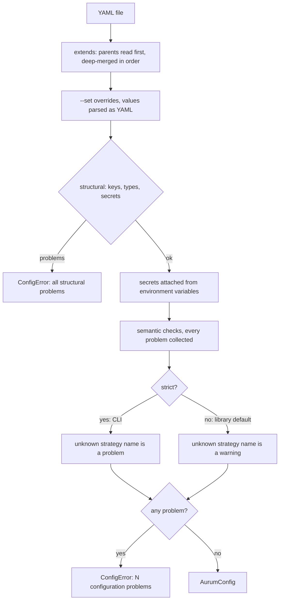
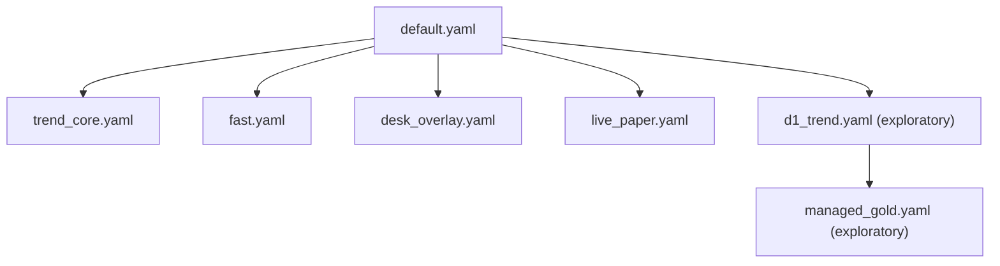
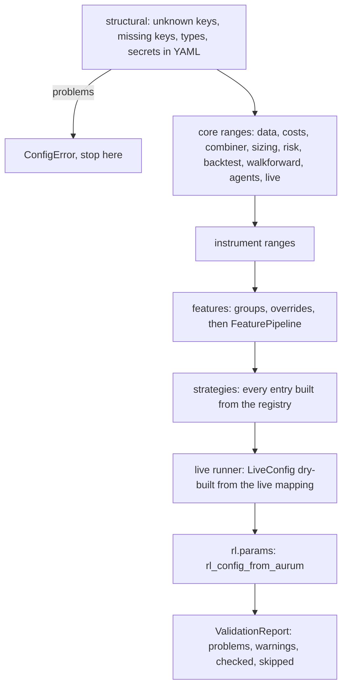
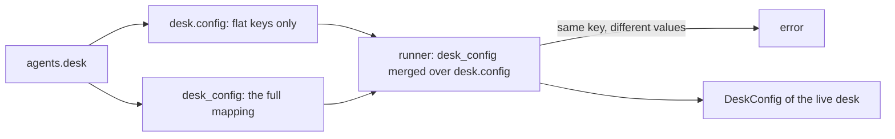
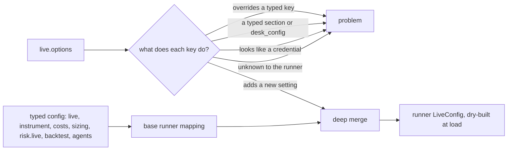
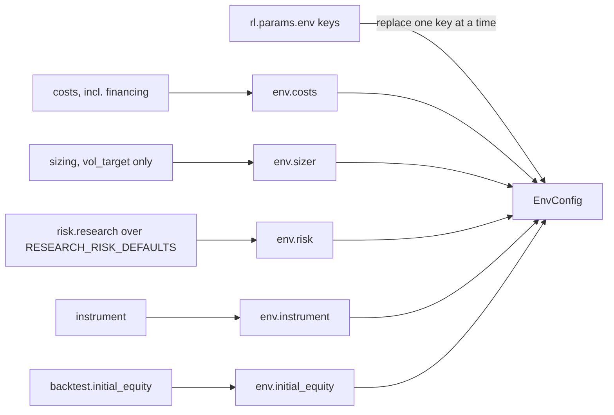

# Configuration

One YAML file drives every Aurum entry point: research backtests, walk-forward runs,
parameter sweeps, the LLM desk, RL training and the live runner. Research, the desk replay,
RL training and the live runner all build their contract, cost model, sizer and risk limits
from the same typed tree, so research and live cannot silently diverge. This page is the
reference for that file. It explains how a file becomes a validated `AurumConfig`
(`extends` inheritance, deep merge, `--set` overrides, structural checks, then semantic checks
that report every problem at once), exactly what is validated and what still fails later,
how secrets are kept out of YAML, what the config hash covers, how the seven shipped configs
differ, and every section and key with its type, default, meaning and validation. It is
written from the dataclasses in [aurum/core/config.py](../aurum/core/config.py) and the
downstream classes they build, and every example on this page was validated with
`aurum config validate` against the current code.

**On this page**

- [How a configuration is loaded](#how-a-configuration-is-loaded): the lifecycle, step by step
- [Inheritance with `extends`](#inheritance-with-extends)
- [Command-line overrides with `--set`](#command-line-overrides-with---set)
- [Validation](#validation): stages, what is checked, strict versus lenient, a broken config, `ValidationReport`, what is still checked later
- [Secrets and environment variables](#secrets-and-environment-variables)
- [The config hash](#the-config-hash)
- [Shipped configs](#shipped-configs), including the exploratory `d1_trend.yaml` and `managed_gold.yaml`
- [Reference](#reference): [top level](#top-level), [`data`](#data), [`instrument`](#instrument),
  [`costs`](#costs), [`features`](#features), [`strategies`](#strategies),
  [`combiner`](#combiner), [`sizing`](#sizing), [`risk`](#risk), [`backtest`](#backtest),
  [`walkforward`](#walkforward), [`agents`](#agents), [`live`](#live), [`rl`](#rl),
  [`output`](#output)
- [Durations](#durations)
- [Examples](#examples)
- [Python API](#python-api)
- [Limitations](#limitations)
- [See also](#see-also)

## How a configuration is loaded

**Intuition.** A config passes through two very different kinds of check. The structural
stage asks "is this a well-formed config?": no unknown keys, the right types, no secrets.
The semantic stage asks "can every object this config describes actually be built?": it
builds the instrument, the cost model, the feature pipeline, every strategy, the combiner,
the sizer, both risk limit sets, the desk policy and configuration, the live runner's own
settings and the RL training config, and collects every error instead of stopping at the
first. The command line then decides whether a strategy name the registry does not know is
an error (strict, every CLI command) or a warning (lenient, the library default).



In code: `load_config(source, *, overrides=(), env=None, validate=True, strict=False)` reads
the file and applies the overrides, `config_from_dict(...)` builds the tree (`_build`
collects the structural problems), attaches the secrets, and calls
`AurumConfig.validate(strict=...)`, which runs `AurumConfig.check(strict=...)` and raises if
the resulting `ValidationReport` has problems. Every CLI command calls
`load_config(..., strict=True)` before it loads any data (see
[cli.md](cli.md#what-a-command-does-before-it-touches-data)).

Relative paths inside the config (`data.dir`, `output.dir`, `live.state_dir`, ...) resolve
against the **current working directory**, so run the CLI from the repository root. Two
commands inspect a configuration without running anything:

```bash
aurum config validate -c configs/trend_core.yaml     # checks it and prints the hash
aurum config show -c configs/trend_core.yaml         # prints the resolved YAML (no secrets), then the same lines
```

```text
# checked: data, costs (CostModel), combiner (ForecastCombiner), sizing, risk.research, risk.live, backtest, walkforward, agents.policy (DecisionPolicy), agents.desk (DeskConfig), instrument (Instrument + ranges), features (FeaturePipeline, 12 groups), strategies (7 of 7 built from the registry), live runner settings (aurum.live.runner.LiveConfig), rl.params + env (rl_config_from_aurum)
# config OK: configs/trend_core.yaml  hash 06a2fca027fc67d5b33bcc96fef2be2ac902a4938cadd6020b270943fbc97064
```

Without `--config`, `aurum config show` prints the built-in defaults. Hashes change between
code versions whenever a field is added or a default changes, so yours may differ from the
ones on this page.

## Inheritance with `extends`

A file may start with `extends:` naming one parent or a list of parents. Relative paths are
resolved against the directory of the file that contains them. The rules (`_read_yaml` and
`_deep_merge`):

1. Parents are read first (recursively, so a parent may extend another file), and merged
   in the order listed: a later parent wins over an earlier one.
2. The file's own keys are then merged on top.
3. **Mappings merge key by key, recursively. Lists and scalars replace wholesale.** A child
   that sets `strategies:` replaces the whole strategy list; a child that sets
   `walkforward: {test: 3M}` changes only `test`.
4. `null` replaces a value. That works for optional keys (`walkforward: {holdout_start: null}`);
   setting a whole section to `null` is an error (`data: expected a mapping, got NoneType`).
   There is no way to delete a key that a parent set inside a free-form mapping such as
   `risk.research`; set it to the value you want instead.
5. A circular chain is an error (`circular 'extends' chain: ...`); a missing parent is an
   error (`config file not found: ...`).

`--set` overrides are applied after the whole chain is merged. `extends` only works in
files: a mapping passed to `load_config()` has its `extends` key ignored.

The shipped configs form this family tree:



A three-level example, checked with `load_config`: a child extending
`[base.yaml, a.yaml, b.yaml]`, where `a.yaml` sets `walkforward.test: 3M` and `embargo: 48`
and `b.yaml` sets `walkforward.test: 1Y`, ends up with `test: 1Y` (the later parent wins),
`embargo: 48`, and `train` from `base.yaml`; a `--set walkforward.embargo=12` then gives
`embargo: 12`.

## Command-line overrides with `--set`

`--set KEY.PATH=VALUE` is repeatable and accepted by every command that takes `--config`.

- The key is a dotted path into the merged YAML. Missing intermediate mappings are created
  (`--set data.synthetic.n=30000` works although `data.synthetic` is absent from
  `default.yaml`).
- The value is parsed as YAML, so types come out as in a file: `48` is an integer, `3M` a
  string, `null` (or an empty value, `--set walkforward.holdout_start=`) is null, `true` a
  boolean, `2025-01-01` a date (accepted wherever a string is expected), and
  `[{name: tsmom}]` a list. Quote the argument for your shell when it contains spaces,
  brackets or braces.
- The text is split at the **first** `=`, so values may contain `=`.
- Lists cannot be indexed. `--set strategies.0.params.fast=16` fails with
  `'strategies' is not a mapping`; replace the whole list instead.
- Secret keys cannot be set: `--set agents.api_key=...` fails with
  `agents.api_key: secrets cannot be overridden; set $ANTHROPIC_API_KEY`.
- Overrides are part of the resolved config: they change the config hash (unless the key is
  unhashed) and are written to each run's `config.yaml`.

```bash
aurum config show -c configs/trend_core.yaml --set walkforward.test=3M \
  --set 'strategies=[{name: tsmom}, {name: donchian}]'

# exclude the 2025-26 holdout entirely (how the protocol's selection runs were made)
aurum walkforward -c configs/default.yaml \
  --set data.end=2024-12-31T23:59:59Z --set walkforward.holdout_start=null
```

## Validation

### The stages

Validation runs in two stages, and a config is only usable when both pass:



1. **Structural** (while the dataclass tree is built). Unknown keys are rejected with a
   "did you mean" hint and the list of valid keys, required keys must be present, and scalar
   types are checked (a YAML date is accepted where a string is expected; a string such as
   `"1e-3"` is accepted where a number is expected). A secret given in a file is rejected.
   If this stage finds problems, they are all reported and the semantic stage does not run.
2. **Semantic** (`AurumConfig.check`). Every check below runs and every problem is
   collected. Most checks build the real downstream object, so the rule enforced is the
   object's own rule, not a copy of it.

The "did you mean" hints come from `difflib.get_close_matches` (cutoff 0.6): the candidate
with the highest similarity ratio

```math
\mathrm{ratio}(a, b) = \frac{2M}{\lvert a\rvert + \lvert b\rvert}
```

where $M$ is the number of characters in the matching blocks of the two strings and
$\lvert a\rvert$, $\lvert b\rvert$ their lengths. `tset` against `test` scores 2·3/8 = 0.75
and is suggested; `volatilty` against `volatility` scores 2·9/19 = 0.947. Keys, feature groups
and parameters get one suggestion; strategy names get up to three.

### What is checked, all at once

| Area | Checks (problem unless marked *warning*) |
|---|---|
| `data` | `timeframe` is a known timeframe; `events` is `rule_based`, `none` or a `.csv` path; `start`/`end` parse and `start < end`; `synthetic.model` and `synthetic.n >= 50`. |
| `instrument` | `Instrument(...)` builds; `symbol` non-empty; `contract_size`, `tick_size`, `lot_step`, `max_lot` positive; `margin_rate` in (0, 1]; `0 <= min_lot <= max_lot`; `commission_per_lot >= 0`; swaps finite; **`triple_swap_weekday` in 0..4** (Monday..Friday) and **`rollover_hour_utc` in 0..23**. |
| `costs` | `CostModel(...)` and its `FinancingModel` build. |
| `features` | `enabled` is `true`, `false` or `auto`; `scaler`, `clip`; duplicate or unknown `groups` (did-you-mean); an override for an unknown group or for a group not in `features.groups`; unknown override parameter names, checked against the feature function's signature (did-you-mean); `warmup >= 0`; then the real `FeaturePipeline(...)`. |
| `strategies` | Duplicate ids; `weight` only with `combiner.method: fixed`. **Every entry, enabled or not**, through the registry: an unknown parameter is a problem with a did-you-mean hint and the list of valid parameters; a constructor `ValueError`/`TypeError` is a problem; a missing file (`OSError`, for example an `rl_ppo` artifact not trained yet) is a *warning*; an unknown strategy **name** is a problem with `strict` and a *warning* otherwise. |
| `combiner`, `sizing`, `risk` | `ForecastCombiner(...)`, the selected sizer, and `RiskLimits` for both `risk.research` and `risk.live` build (unknown risk keys list the valid ones). |
| `backtest`, `walkforward` | Ranges and enumerations (durations parse, `pbo_splits` even and >= 2, `n_boot >= 100`, ...); see the reference tables. |
| `agents` | `DecisionPolicy(...)` and `DeskConfig(...)` build; `replay_every >= 1`, `replay_max_cost_usd > 0`, `lookback_bars >= 2`. |
| `live` | `live.use_desk: true` requires `agents.enabled: true`; `broker`, `magic`, `poll_seconds`, `history_bars`; `allow_live_real` with the paper broker; `live.options` may only **add** runner settings (no typed field, no typed section, no credentials; see [`live`](#live)). |
| live runner | **Unknown `live.options` keys are problems** (with the list of keys you may add); the runner's own `LiveConfig` is dry-built from the mapping `aurum live run` would hand it, and a value it refuses (for example `heartbeat_seconds: 0` or `desk.on_error: ignore`) is a problem with `strict` and a *warning* otherwise. |
| `rl` | `train_start < train_end < val_end`; `rl.params` and the environment mapping through `aurum.rl.train.rl_config_from_aurum` (when `sizing.method` is not `vol_target` and `rl.params.env.sizer` is not given, only `RLTrainConfig.from_dict(rl.params)` is checked). *Skipped*, and listed as skipped, when the RL stack cannot be imported. |

### Strict versus lenient

`strict` changes exactly two outcomes; everything else is a problem in both modes:

| Finding | `strict=False` (library default) | `strict=True` (every CLI command, `aurum config validate`) |
|---|---|---|
| A strategy name the registry does not know | warning (user code may register a custom strategy after loading the config; building it still fails clearly) | problem |
| A value the live runner's `LiveConfig` refuses | warning (the runner refuses it again when it starts) | problem |

### A broken config, every problem at once

This file makes nine different mistakes (it was validated from a scratch copy whose
`extends:` pointed at `configs/trend_core.yaml`):

```yaml
# deliberately broken: every problem below is reported in ONE run
extends: trend_core.yaml
name: broken_example

instrument:
  triple_swap_weekday: 6          # Sunday: must be 0..4
  margin_rate: 2.0                # a fraction of notional, in (0, 1]

features:
  groups: [returns, volatilty, macro]   # typo
  overrides:
    macro: {windw: 20}                  # unknown parameter

strategies:
  - {name: tsmom, params: {horizon: [24, 120]}}   # typo: horizons
  - {name: ema_cros}                              # typo: ema_cross
  - {name: ema_cross, params: {fast: 128, slow: 32}}

live:
  options:
    heartbeat_secs: 30            # typo: heartbeat_seconds
    desk: {on_error: ignore}      # follow_quant | flat | hold
```

```bash
aurum config validate -c broken.yaml
```

```text
aurum: configuration error: 9 configuration problems:
  - instrument.margin_rate is the margin as a fraction of notional, in (0, 1] (0.01 = 1:100 leverage), got 2.0
  - instrument.triple_swap_weekday must be 0..4 (Monday..Friday: the weekday whose rollover is charged three nights, 2 = Wednesday), got 6
  - features.groups: unknown feature group 'volatilty' (did you mean 'volatility'?); registered: ['calendar', 'macro', 'meanrev', 'microstructure', 'momentum', 'mtf', 'range', 'regime', 'returns', 'session', 'trend', 'volatility']
  - features.overrides.macro.windw: unknown parameter of feature group 'macro' (did you mean 'z_window'?); valid: ['beta_series', 'change_days', 'corr_min_periods', 'corr_window', 'daily_anchor_hour_utc', 'series', 'stale_days', 'yield_series', 'z_min_periods', 'z_window']
  - strategies[0].params (tsmom): unknown parameter(s) ['horizon'] for strategy 'tsmom' (did you mean 'horizon' -> 'horizons'?); valid: ['horizons', 'response', 'vol_halflife', 'vol_min_periods', 'weights']
  - strategies[1].name: unknown strategy 'ema_cros'; did you mean ['ema_cross']? (registered: ['bollinger_revert', 'donchian', 'ema_cross', 'intraday_seasonality', 'kalman_trend', 'macro_factor', 'managed_gold', 'meta_label', 'ml_gbm', 'orb', 'regime_switch', 'risk_off', 'rl_ppo', 'rsi2', 'tsmom', 'vol_squeeze', 'zscore_fade'])
  - strategies[2] (ema_cross): need 1 <= fast < slow
  - live.options.heartbeat_secs: unknown live-runner setting (did you mean 'heartbeat_seconds'?); valid keys: ['bar_close_delay_seconds', 'desk', 'flatten_on_shutdown', 'heartbeat_seconds', 'history_multiple', 'macro_max_age_days', 'macro_refresh_hours', 'max_bar_age_seconds', 'max_defer_seconds', 'min_history_bars', 'monitor', 'mt5', 'oms', 'on_error', 'paper', 'retry_poll_max_seconds', 'spread_source']
  - live (runner settings): desk.on_error must be one of ['follow_quant', 'flat', 'hold'], got 'ignore'
```

The exit code is 2, and `aurum config show` would print no YAML. Before v2.1 most of these
surfaced only later, one at a time: the strategy typos when a command built the strategies,
the feature typos when the pipeline was built, `triple_swap_weekday: 6` at the first
backtest, and `heartbeat_secs` when `aurum live run` started. Structural problems are reported first and on their own; for
example a misspelt section key stops before any of the semantic checks:

```text
$ aurum config validate -c configs/default.yaml --set walkforward.tset=3M
aurum: configuration error: walkforward.tset: unknown key (did you mean 'test'?); valid keys: ['anchored', 'combiner_fit', 'combiner_min_obs', 'embargo', 'executor', 'history_bars', 'holdout_start', 'min_test_bars', 'min_train_bars', 'n_boot', 'n_jobs', 'n_trials', 'on_strategy_error', 'pbo_splits', 'purge', 'regenerate_per_fold', 'step', 'strategy_backtests', 'test', 'train']

$ aurum config validate -c configs/default.yaml --set walkforward.train=3parsecs --set walkforward.pbo_splits=5
aurum: configuration error: 2 configuration problems:
  - walkforward.train: unknown duration unit 'parsecs' in '3parsecs' (Y, M, W, D, h, min or bars)
  - walkforward.pbo_splits must be an even integer >= 2
```

A valid config can still print warnings and skipped checks. A config with an `rl_ppo` entry
whose artifact does not exist yet:

```text
# warning: strategies[1] (rl_ppo): FileNotFoundError: RL artifact runs/rl/not_trained_yet is missing ['policy.zip', 'pipeline.json', 'config.json'] (commands that build this strategy fail until the file exists)
# checked: data, costs (CostModel), combiner (ForecastCombiner), sizing, risk.research, risk.live, backtest, walkforward, agents.policy (DecisionPolicy), agents.desk (DeskConfig), instrument (Instrument + ranges), features (FeaturePipeline, 12 groups), strategies (1 of 2 built from the registry), live runner settings (aurum.live.runner.LiveConfig), rl.params + env (rl_config_from_aurum)
# config OK: with_warning.yaml  hash 47b1b6a32be12153c538d832595ae14edda2542dfdeb658a412c61bc4a34aa00
```

### `ValidationReport` in Python

`AurumConfig.check(*, strict=False)` returns a `ValidationReport` without raising:

| Field or method | Meaning |
|---|---|
| `problems: list[str]` | Findings that make the config invalid. |
| `warnings: list[str]` | Findings that do not (an RL artifact that does not exist yet; in lenient mode an unknown strategy name or a value the runner refuses). |
| `checked: list[str]` | What was built from the config (the `# checked:` line). |
| `skipped: list[str]` | Checks that could not run and why (an optional component is not installed). |
| `.ok` | `True` when there are no problems. |
| `.raise_if_problems()` | Raises `ConfigError` with every problem; returns the report otherwise. |

`AurumConfig.validate(*, strict=False)` runs `check`, logs each warning and raises on
problems. On the broken file above:

```python
from aurum.core.config import ConfigError, load_config

cfg = load_config("broken.yaml", validate=False)       # keys and types only
lenient = cfg.check()                                  # strict=False: what a library load does
strict = cfg.check(strict=True)                        # what every CLI command does
print("lenient:", lenient.ok, len(lenient.problems), "problems,", len(lenient.warnings), "warnings")
print("strict: ", strict.ok, len(strict.problems), "problems,", len(strict.warnings), "warnings")
for w in lenient.warnings:
    print("  warning:", w[:96])
try:
    strict.raise_if_problems()
except ConfigError as exc:
    print("ConfigError with", len(exc.problems), "problems")
```

```text
lenient: False 7 problems, 2 warnings
strict:  False 9 problems, 0 warnings
  warning: strategies[1].name: unknown strategy 'ema_cros'; did you mean ['ema_cross']? (registered: ['boll
  warning: live (runner settings): desk.on_error must be one of ['follow_quant', 'flat', 'hold'], got 'igno
ConfigError with 9 problems
```

### What is still checked later

Validation cannot check what depends on the data, the environment or a broker. These are
checked when the object that needs them is built:

| Checked when | What |
|---|---|
| Data is loaded (start of every data command) | The bars file exists and matches its stored hash (`data.verify_hash`); at least two bars in `[data.start, data.end]`. A missing macro directory is a warning. |
| Fold planning (start of `walkforward`, of every `sweep` point, and of the walk-forward `train-final` runs without `--from-run`) | Resolved `step >= test`, resolved `train >= min_train_bars`, at least one fold, a non-empty holdout. |
| `desk run`, `desk replay` without `--fake` | `agents.enabled: true` and `ANTHROPIC_API_KEY` set (exit 2). |
| `aurum live run`, before anything is written | The desk prerequisites when `live.use_desk` is on: the `anthropic` package and `ANTHROPIC_API_KEY`. |
| The MT5 broker is constructed (`live run` with `broker: mt5` or `paper.data: mt5`) | The values inside `live.options.mt5` (for example `server_tz_fallback` must be a time-zone spec and needs `server_tz: auto`). `aurum config validate` does not build the broker. |
| The runner starts | The account check (a real-money account needs both opt-ins), the state-directory lock, the artifact. |

## Secrets and environment variables

Secrets never live in YAML. Four config fields are secrets, and each is read **only** from
its environment variable (`SECRET_ENV`):

| Field | Environment variable | Used by |
|---|---|---|
| `agents.api_key` | `ANTHROPIC_API_KEY` | The LLM desk (`aurum desk run`, `aurum desk replay` without `--fake`, `aurum live run` with `live.use_desk`). |
| `live.mt5_password` | `MT5_PASSWORD` | The MetaTrader 5 broker. |
| `live.alert_webhook` | `AURUM_ALERT_WEBHOOK_URL` | Live monitoring alerts. |
| `live.artifact_key` | `AURUM_ARTIFACT_KEY` | The HMAC key of trading artifacts. |

- A file that gives any of them a non-null value is rejected:
  `agents.api_key: secrets must not be stored in config files; set $ANTHROPIC_API_KEY instead`.
  `null` is allowed.
- `--set` cannot set them either (see above).
- Inside `live.options`, keys that look like credentials are rejected at any depth: names
  such as `password`, `passwd`, `pass`, `secret`, `token`, `api_key`, `credential(s)`,
  `login` (also with a prefix, like `mt5_password`), a key named `env`, and a `webhook` key
  with a string value.
- The loaded value is wrapped in a `Secret` whose `repr` is masked
  (`Secret(<set from $ANTHROPIC_API_KEY>)`). Secrets are left out of `to_dict()`,
  `to_yaml()`, `aurum config show`, saved `config.yaml` files and the config hash. An empty
  environment variable counts as unset.
- The MT5 broker also reads `MT5_LOGIN`, `MT5_SERVER` and `MT5_PATH` itself; they are not
  config fields.
- **No other field can be set from the environment.** A run is fully described by its YAML
  and its `--set` overrides.

## The config hash

`AurumConfig.config_hash()` fingerprints every field that can change results:

```math
h = \mathrm{SHA256}\left(\mathrm{JSON}_{\text{sorted keys, compact}}\left(\texttt{to\_dict(for\_hash=True)}\right)\right)
```

where `to_dict(for_hash=True)` is the resolved, secret-free tree with the unhashed fields
removed, serialised with sorted keys and compact separators. The hash is printed by
`aurum config`, used as the `<hash8>` suffix of run directories, stored in `summary.json`,
`provenance.json` and the [holdout ledger](RESEARCH_PROTOCOL.md), and compared by
`aurum train-final --from-run`, which refuses a walk-forward made with a different hash
unless `--allow-config-mismatch` is given. The holdout ledger and the sweep ledger use it to
count distinct trials, and a desk replay that reaches the holdout records it with a `:desk`
(or `:desk-fake`) suffix so the desk counts as a separate trial.

**Not hashed:** `name`, `source`, the whole `output` section, `walkforward.n_jobs`,
`walkforward.executor`, `agents.journal_dir`, and the four secrets.

**Hashed:** everything else, including sections that do not affect research results
(`live`, `agents` and `rl`) and paths such as `data.dir` and `data.bars_path`. What that
implies:

| Change | Hash |
|---|---|
| Reordering keys inside a mapping | Unchanged |
| `100000` versus `100000.0` for a float field | Unchanged (values are coerced to the field type first) |
| `name`, `output.dir`, `--jobs`, `--executor`, `--no-tearsheet` | Unchanged |
| Reordering the `strategies` list | **Changed** (lists are ordered) |
| `embargo: 24` versus `embargo: "24bars"`; `train: 3Y` versus `train: 36M` | **Changed**, although they resolve to the same bars |
| `live.state_dir`, `data.dir`, any `agents` or `rl` setting | **Changed**, although research results are the same |

Because of the last row, `desk_overlay.yaml` and `live_paper.yaml` have hashes different
from `default.yaml` even though their research settings are identical. For the holdout
ledger they are different configurations: evaluating the holdout with one of them (for
example `aurum train-final -c configs/live_paper.yaml` without `--from-run`) counts as a new
trial for later runs. The hash describes the configuration, not the code: compare
`git_sha` in `provenance.json` as well.

## Shipped configs

| File | Extends | Purpose |
|---|---|---|
| [`default.yaml`](../configs/default.yaml) | (none) | The research default: H1 bars from 2013, the full 14-strategy rule-based and ML set, research and live risk limits, 3Y/6M walk-forward with a 24-bar embargo, the 2025-01-01 holdout and the pre-registered `n_trials: 23`. LLM desk disabled. |
| [`trend_core.yaml`](../configs/trend_core.yaml) | `default.yaml` | The pre-registered alternative: 7 trend, breakout and macro strategies. |
| [`fast.yaml`](../configs/fast.yaml) | `default.yaml` | Smoke/CI: 7 strategies on data from 2019, a 2Y training window, a 2026 holdout. A smoke test, never evidence. |
| [`desk_overlay.yaml`](../configs/desk_overlay.yaml) | `default.yaml` | The LLM desk as an overlay on the quant book (`aurum desk run`/`replay`, and the live runner). Sets `agents.enabled: true` and `live.use_desk: true`. Needs `ANTHROPIC_API_KEY`. |
| [`live_paper.yaml`](../configs/live_paper.yaml) | `default.yaml` | Paper trading through the live runner: paper broker, dry run, its own state and artifact directories. |
| [`d1_trend.yaml`](../configs/d1_trend.yaml) | `default.yaml` | **Exploratory, not pre-registered.** Daily New-York-close bars (`data_store/xauusd_D1_nyclose.parquet` with `timeframe: D1`), monthly-horizon `tsmom`, `ema_cross` 16/64 and Turtle-style `donchian` 55/20, data ending with the 2024-12-31 session, **holdout disabled**, `n_trials: 30`. |
| [`managed_gold.yaml`](../configs/managed_gold.yaml) | `d1_trend.yaml` | **Exploratory, not pre-registered.** `managed_gold` (long-biased allocation with a trend tilt and a de-risk latch), `regime_switch` (daily `tsmom` scaled by an HMM's P(calm)) and plain daily `tsmom`. Inherits the daily data, the 2024-12-31 end, the disabled holdout and `n_trials: 30`. |

`default.yaml` against the built-in defaults (the resolved values that differ):

| Key | Built-in | `default.yaml` |
|---|---|---|
| `name` | `aurum` | `default` |
| `seed` | `0` | `7` |
| `data.start` | `null` | `"2013-01-01"` (2012 Dukascopy data has zero spreads and flat bars) |
| `strategies` | `[]` | `tsmom`, `ema_cross`, `donchian`, `kalman_trend`, `zscore_fade`, `rsi2`, `bollinger_revert`, `vol_squeeze`, `orb`, `macro_factor`, `risk_off`, `intraday_seasonality`, `ml_gbm`, `meta_label` |
| `risk.research` | `{}` | `max_daily_loss: 0.03`, `daily_loss_persistent: false`, `max_drawdown: null`, `max_leverage: 3.0`, `max_spread: 2.0`, `blackout_mode: no_new_risk` |
| `risk.live` | `{}` | `max_daily_loss: 0.03`, `daily_loss_persistent: true`, `max_drawdown: 0.20`, `max_leverage: 3.0`, `max_spread: 1.5`, `stale_data_seconds: 7200`, `blackout_mode: no_new_risk` |
| `walkforward.embargo` | `0` | `24` |
| `walkforward.holdout_start` | `null` | `"2025-01-01"` |
| `walkforward.n_trials` | `null` | `23` |
| `rl.train_start` | `null` | `"2013-01-01"` |
| `rl.params` | `{}` | `{total_timesteps: 200000, n_envs: 4}` |

The other files against their parent:

| File | Differences |
|---|---|
| `trend_core.yaml` | `name`; `strategies`: `tsmom`, `ema_cross`, `donchian`, `kalman_trend`, `vol_squeeze`, `macro_factor`, `risk_off`; restates `walkforward.n_trials: 23`. No trainable strategy, so `purge: auto` resolves to 0. |
| `fast.yaml` | `name`; `data.start: "2019-01-01"`; `strategies`: `tsmom`, `ema_cross`, `donchian`, `zscore_fade`, `rsi2`, `macro_factor`, `intraday_seasonality`; `walkforward.train: 2Y`, `holdout_start: "2026-01-01"`, `n_boot: 300`. It inherits `n_trials: 23`. Its holdout overlaps the protocol's 2025–26 holdout, so running it into the same output directory as protocol runs adds a prior look for them. |
| `desk_overlay.yaml` | `name`; `agents.enabled: true`; `agents.desk`: `chief: {effort: high, max_turns: 8}`, `specialist: {effort: medium, max_turns: 5}`, `max_specialists_per_cycle: 4`, `max_parallel_agents: 4`, `max_cost_usd_per_cycle: 2.0`, `cache_ttl: 1h`; `live.use_desk: true`. It also restates the default `agents` policy and replay values. |
| `live_paper.yaml` | `name`; `live.state_dir: runs/live/paper`; `live.artifact_dir: artifacts/live_paper`; `live.options`: `bar_close_delay_seconds: 5.0`, `on_error: hold`, `paper: {data: replay, bars_path: data_store/xauusd_H1.parquet, warmup_bars: 6000, initial_equity: 100000}`. It also restates the default `live` values and `agents.enabled: false`. |
| `d1_trend.yaml` (vs `default.yaml`) | `name`; `data.timeframe: D1`, `data.bars_path: data_store/xauusd_D1_nyclose.parquet`, `data.start: "2013-01-01"`, `data.end: "2024-12-31T21:59:59Z"` (the last bar is the 2024-12-31 session, which opens 2024-12-30 22:00 UTC); `strategies`: `tsmom` (`horizons: [21, 63, 126, 252]`, `vol_halflife: 30`, `vol_min_periods: 20`), `ema_cross` (`fast: 16`, `slow: 64`, same vol settings), `donchian` (`entry_n: 55`, `exit_n: 20`, `atr_n: 20`, `stop_atr: 2.0`); `walkforward`: `train: 3Y`, `test: 6M`, `embargo: 1` (one trading day on D1), `holdout_start: null`, `n_trials: 30`. |
| `managed_gold.yaml` (vs `d1_trend.yaml`) | `name`; `strategies`: `managed_gold` (`base_weight: 0.5`, `tilt_weight: 0.5`, `horizons: [21, 63, 126, 252]`, `trend_halflife: 69`, `vol_fast_halflife: 5`, `vol_slow_halflife: 126`, `vol_enter: 1.25`, `vol_exit: 1.0`, `floor: 0.0`, `vol_halflife: 30`, `vol_min_periods: 20`), `regime_switch` (`base: tsmom` with the daily `tsmom` params, `returns: bar`, `p_flat: 0.5`, `p_full: 0.9`), and the daily `tsmom`. |

`fast.yaml`, `desk_overlay.yaml` and `live_paper.yaml` also restate
`costs.financing.mode: rate`, which is the default and changes nothing. To see the
differences yourself, compare `aurum config show` outputs.

**Why the two exploratory configs end on 2024-12-31 with no holdout.** The 2025–26 holdout
was spent by the pre-registered protocol ([RESULTS.md](RESULTS.md)). Every strategy in
`d1_trend.yaml` and `managed_gold.yaml` is a new trial on data the protocol already used, so
the data stops at the 2024-12-31 New York close and `walkforward.holdout_start: null` makes
it impossible to spend the holdout again by running them as shipped. `n_trials: 30` counts the
23 pre-registered trials, the five new strategy configurations of these two files and their
two combined books, so the DSR of their runs is deflated for the whole search. Their results
are reported as additional trials in [RESULTS.md](RESULTS.md); the strategies are explained
in [strategies.md](strategies.md) and the HMM in [models.md](models.md).

## Reference

Types use Python notation: `int | str` means either is accepted, `null` means the YAML null.
"Validation" lists the checks made at load time (every one of them runs in
`aurum config validate`) unless it says otherwise. The **Hash** column is omitted; see
[The config hash](#the-config-hash) for the few unhashed fields.

### Top level

| Key | Type | Default | Meaning and validation |
|---|---|---|---|
| `extends` | `str \| list[str]` | none | Parent file(s), see [Inheritance](#inheritance-with-extends). Removed after merging. |
| `name` | `str` | `aurum` | Label used in run titles, the tearsheet and the ledger. Not hashed. |
| `seed` | `int` | `0` | Seed for the bootstrap confidence intervals, for strategies whose parameters include a `seed` (`ml_gbm`, `meta_label`, `regime_switch`) unless their `params` set one, and default `rl.params.seed`. |
| `source` | `str \| null` | `null` | Set by the loader to the file path; a value given in a file is replaced. Not hashed. |
| `data`, `instrument`, `costs`, `features`, `strategies`, `combiner`, `sizing`, `risk`, `backtest`, `walkforward`, `agents`, `live`, `rl`, `output` | sections | | Described below. Any other top-level key is an error. |

### `data`

Where the bars, macro series and event calendar come from. Details on the store and file
formats: [data.md](data.md).

| Key | Type | Default | Meaning and validation |
|---|---|---|---|
| `dir` | `str` | `data_store` | Data store directory (created by `aurum data download`). |
| `symbol` | `str` | `XAUUSD` | Part of the default bar file name; recorded in the holdout and sweep ledgers. |
| `timeframe` | `str` | `H1` | One of `M1`, `M5`, `M15`, `M30`, `H1`, `H4`, `D1` (case-insensitive). The live runner trades this timeframe. |
| `bars_path` | `str \| null` | `null` | Explicit bar file. Default: `{dir}/{symbol in lower case}_{TIMEFRAME}.parquet`, e.g. `data_store/xauusd_H1.parquet`. Set it to `data_store/xauusd_D1_nyclose.parquet` with `timeframe: D1` for daily bars that close at the New York close (22:00 UTC), as `d1_trend.yaml` does; the UTC-midnight `xauusd_D1.parquet` has short Sunday bars that distort daily returns and volatility. |
| `macro` | `bool` | `true` | Load the macro series. `false` means no macro data at all: `macro_factor` and `risk_off` lose their inputs, and rate-based financing falls back to `costs.financing.fallback_rate`. |
| `macro_dir` | `str \| null` | `null` | Default `{dir}/macro`. A missing directory logs a warning and runs without macro data. |
| `events` | `str` | `rule_based` | `rule_based` (the NFP/FOMC schedule), `none`, or a path ending in `.csv` (an event calendar file). Anything else is an error. |
| `start` | `str \| null` | `null` | Drop bars before this timestamp (inclusive; naive timestamps are UTC). |
| `end` | `str \| null` | `null` | Drop bars after this timestamp. A date-only value (10 characters or fewer) includes that whole day. `start` must be before `end`. |
| `verify_hash` | `bool` | `true` | Check the bar file against the content hash stored in it; a mismatch is an error. |
| `synthetic` | mapping `\| null` | `null` | Generate bars instead of reading files (below). `data.start`/`end` still apply. |

`data.synthetic` (generator: `aurum.data.synthetic.make_synthetic_bars`, see
[data.md](data.md)):

| Key | Type | Default | Meaning and validation |
|---|---|---|---|
| `n` | `int` | `5000` | Number of bars, `>= 50`. |
| `model` | `str` | `gbm` | `gbm` (driftless random walk by default), `trend`, `mean_revert`, `regime` or `jump`. |
| `seed` | `int` | `0` | Generator seed (independent of the top-level `seed`). |
| `start` | `str` | `2020-01-06` | First bar. |
| `annual_vol` | `float` | `0.16` | Annualised volatility of the generated returns. |
| `drift` | `float` | `0.0` | Per-bar log-return drift. |
| `spread` | `float` | `0.30` | Typical spread in USD/oz (randomised per bar). |
| `start_price` | `float` | `1800.0` | Starting price. |
| `regime_params` | mapping `\| null` | `null` | Model parameters: `phi` (trend), `kappa` (mean_revert), `p_stay`, `vol_mult`, `drifts` (regime), `jump_prob`, `jump_sigma` (jump). |
| `macro` | `bool` | `true` | Also generate daily macro series (only when `data.macro` is true). They contain no `fedfunds` series, so rate financing uses `fallback_rate`. |
| `events` | `bool` | `true` | Also generate an event calendar (unless `data.events: none`). |

A run on `data.synthetic` records `data_source: synthetic` in the holdout ledger, so a
synthetic smoke test never counts as a look at the real holdout.

### `instrument`

The contract specification, passed to `aurum.core.instrument.Instrument`. The defaults
describe a typical XAUUSD CFD. All ranges below are checked at load time.

| Key | Type | Default | Meaning and validation |
|---|---|---|---|
| `symbol` | `str` | `XAUUSD` | Instrument symbol; also the default broker symbol for `live`. Non-empty. |
| `contract_size` | `float` | `100.0` | Ounces per lot. Positive. |
| `tick_size` | `float` | `0.01` | Minimum price increment, USD/oz. Positive. |
| `lot_step` | `float` | `0.01` | Lot granularity. Positive. |
| `min_lot` | `float` | `0.01` | Smaller sizes round to zero (never up into risk). `0 <= min_lot <= max_lot`. |
| `max_lot` | `float` | `50.0` | Hard cap on lots. Positive. |
| `margin_rate` | `float` | `0.01` | Margin as a fraction of notional (0.01 = 1:100). In `(0, 1]`. |
| `commission_per_lot` | `float` | `0.0` | USD per lot per side, unless `costs.commission_per_lot` overrides it. `>= 0`. |
| `swap_long_per_lot` | `float` | `-45.0` | USD per lot per night held long. Used only by `costs.financing.mode: fixed`. Finite. |
| `swap_short_per_lot` | `float` | `15.0` | USD per lot per night held short. Used only by `mode: fixed`. Finite. |
| `triple_swap_weekday` | `int` | `2` | Weekday (0 = Monday) whose rollover charges three nights. `0` to `4`. |
| `rollover_hour_utc` | `int` | `21` | Hour of the daily rollover in UTC. `0` to `23`. |

### `costs`

The execution cost model (`aurum.execution.costs.CostModel`). Formulas and the financing
model: [execution-and-costs.md](execution-and-costs.md).

| Key | Type | Default | Meaning and validation |
|---|---|---|---|
| `spread_multiplier` | `float` | `1.0` | Multiplies each bar's recorded spread (use 1.5 to 2 to stress-test). Finite, `>= 0`. |
| `min_spread` | `float` | `0.10` | Floor on the effective spread, USD/oz. Finite, `>= 0`. |
| `slippage_fixed` | `float` | `0.02` | Adverse slippage per fill, USD/oz. Finite, `>= 0`. |
| `slippage_range_frac` | `float` | `0.02` | Plus this fraction of the execution bar's high-low range. Finite, `>= 0`. On D1 bars this charges 2% of the daily range per fill, which is conservative. |
| `impact_coef` | `float` | `0.0` | Square-root impact, USD/oz per sqrt(lot). Finite, `>= 0`. |
| `commission_per_lot` | `float \| null` | `null` | USD per lot per side; `null` uses `instrument.commission_per_lot`. `>= 0`. |
| `financing` | mapping | see below | Overnight financing at each rollover. |

`costs.financing` (`FinancingModel`, see [execution-and-costs.md](execution-and-costs.md)):

| Key | Type | Default | Meaning and validation |
|---|---|---|---|
| `mode` | `str` | `rate` | `rate` (benchmark rate plus or minus a markup on notional), `fixed` (the instrument's per-lot swaps) or `none`. |
| `markup_long` | `float` | `0.025` | Annual markup a long pays on top of the benchmark. In `[0, 1)`. |
| `markup_short` | `float` | `0.025` | Annual markup deducted from what a short receives. In `[0, 1)`. |
| `lease_rate` | `float` | `0.0` | Annual gold lease rate earned by longs. In `(-1, 1)`. |
| `rate_series` | `str` | `fedfunds` | Name of the benchmark series in the macro data, read point-in-time at each rollover. Non-empty. |
| `rate_unit` | `str` | `percent` | Unit of that series: `percent`, `fraction` or `bps`. |
| `fallback_rate` | `float` | `0.03` | Annual benchmark used before the series starts or without macro data. In `(-1, 1)`. |
| `day_count` | `float` | `360.0` | Days per year of the rate convention. Positive. |

### `features`

Settings of the shared `FeaturePipeline` ([features.md](features.md)). Groups, overrides,
override parameters and the warm-up are all checked at load time, and the real pipeline is
built.

| Key | Type | Default | Meaning and validation |
|---|---|---|---|
| `enabled` | `bool \| str` | `auto` | `true`, `false` or `auto`. With `auto`, only strategies that declare `uses_features = True` receive the pipeline's features; no registered strategy declares it, so the shared pipeline is not computed (`ml_gbm` and `meta_label` build and fit their own pipeline per fold). With `true`, every trainable strategy receives them. With `false`, none does. |
| `groups` | `list[str] \| null` | `null` | Feature groups to compute; `null` means all registered groups (`aurum features list`). Unknown names (with a did-you-mean hint) and duplicates are errors. |
| `overrides` | mapping | `{}` | `{group: {param: value}}` passed to a group's function. Every group named must be registered and in the pipeline, and every parameter must be one the group's function accepts (checked against its signature, with a did-you-mean hint). |
| `scaler` | `str` | `robust` | `robust` (median and IQR), `standard` or `none`. Fitted on training rows only. |
| `clip` | `float \| null` | `5.0` | Clip scaled values to `[-clip, clip]`; positive, or `null` for no clipping. |
| `warmup` | `int \| null` | `null` | Explicit warm-up in bars instead of the pipeline's estimate. `>= 0`. |

### `strategies`

A list of strategy entries. The list replaces the parent's list wholesale. The registry
(17 strategies) and each strategy's parameters: [strategies.md](strategies.md),
[ml-and-rl.md](ml-and-rl.md) and `aurum strategies list --json`.

| Key | Type | Default | Meaning and validation |
|---|---|---|---|
| `name` | `str` | required | Registry name, for example `tsmom`. An unknown name is an error under `strict` (every CLI command) and a warning in a lenient library load; up to three did-you-mean suggestions. |
| `params` | mapping | `{}` | Constructor parameters. Every entry, **enabled or not**, is built at load time: a parameter the strategy does not declare in its `default_params` is an error (with a did-you-mean hint and the valid list), and so is a value the constructor rejects. A missing file (an `rl_ppo` artifact not trained yet) is a warning. |
| `id` | `str \| null` | `null` | Unique key; defaults to `name`. It names the forecast column, the book directory and the row in `stats.csv`, so one strategy can appear several times with different `params`. Duplicate keys are an error. Error messages use the index into `strategies[]`. |
| `weight` | `float \| null` | `null` | Only allowed with `combiner.method: fixed` (any other method makes it an error). `>= 0`. |
| `enabled` | `bool` | `true` | `false` keeps the entry in the file but skips it in runs (it is still validated). `aurum backtest --strategy ID` can still select it. |

An empty list loads, but every command that evaluates strategies then fails with
`no enabled strategies to evaluate`.

### `combiner`

The `ForecastCombiner` ([portfolio-and-risk.md](portfolio-and-risk.md)). In research, how
and on what it is fitted is set by `walkforward.combiner_fit`.

| Key | Type | Default | Meaning and validation |
|---|---|---|---|
| `method` | `str` | `sharpe_shrink` | `sharpe_shrink`, `equal`, `inverse_vol`, `hrp`, or `fixed` (normalised `strategies[].weight` values, with a missing weight counting as 1; at least one must be positive; `max_weight` is not applied). |
| `shrinkage` | `float` | `0.5` | For `sharpe_shrink`: 1 ignores Sharpe differences. In `[0, 1]`. |
| `max_weight` | `float` | `0.4` | Per-strategy weight cap. In `(0, 1]`. |
| `fdm_cap` | `float` | `2.5` | Cap on the forecast diversification multiplier. `>= 1`. |
| `vol_halflife` | `float` | `48.0` | Half-life in bars of the EWMA volatility used to normalise strategy returns. |
| `min_periods` | `int` | `20` | Warm-up bars for that volatility. |
| `corr_floor` | `float` | `0.0` | Floor on pairwise correlations in the FDM. |
| `allow_unallocated` | `bool` | `true` | Strategies with a non-positive **net** Sharpe get no weight and the cap never forces weight onto them, so weights may sum to less than 1. `false` restores sum-to-one weights. |
| `cost_multiplier` | `float` | `1.0` | Scales the estimated turnover cost the combiner scores strategies net of (0 scores gross). Finite, `>= 0`. |

When a command has no out-of-sample forecast history to fit the combiner on (`live artifact`,
`desk run` or `desk replay` without `--from-run`), it falls back to equal weights and prints
`WARNING: ...: the combiner fell back to EQUAL weights (...)`.

### `sizing`

The position sizer ([portfolio-and-risk.md](portfolio-and-risk.md)). The live runner,
`aurum train-final` and the RL environment support only `vol_target`; the first two refuse a
config that uses another method, because live positions would then not match the research
backtests (`aurum rl train` accepts it only with an explicit `rl.params.env.sizer`).

| Key | Type | Default | Meaning and validation |
|---|---|---|---|
| `method` | `str` | `vol_target` | `vol_target` or `fixed_fractional`. |
| `target_vol` | `float` | `0.10` | Annualised volatility for a forecast of ±1 (`vol_target`). Positive. |
| `max_leverage` | `float` | `2.0` | Cap on notional / equity. Positive. |
| `max_lots` | `float \| null` | `null` | Absolute cap on lots (the instrument's `max_lot` also applies). Positive or `null`. |
| `rebalance_band` | `float` | `0.10` | Ignore position changes smaller than this fraction. In `[0, 1)`. |
| `kelly_cap` | `float \| null` | `null` | Cap on the position's ex-ante volatility as a fraction of equity (`vol_target`). Positive or `null`. |
| `drawdown_derisk` | `list[list[float]] \| null` | `[[0.10, 0.5], [0.15, 0.25]]` | `[drawdown threshold, exposure multiplier]` pairs; the lowest multiplier whose threshold is reached applies. Thresholds in `(0, 1)`, multipliers in `[0, 1]`. `null` or `[]` turns it off. |
| `min_vol` | `float` | `0.02` | Floor on the volatility forecast used for sizing (`vol_target`). Positive. |
| `risk_per_trade` | `float` | `0.005` | Fraction of equity risked per trade (`fixed_fractional` only). In `(0, 0.2)`. |
| `stop_atr` | `float` | `2.0` | Stop distance in ATRs (`fixed_fractional` only). Positive. The stop is external: the sizer assumes it but never places one; set `backtest.stop_atr_mult` to place it. |

Only the selected sizer is built during validation, so the `fixed_fractional` keys are
range-checked only when that method is selected, and vice versa.

### `risk`

Risk limits for research backtests and for live trading, given as keyword arguments of
`RiskLimits` ([portfolio-and-risk.md](portfolio-and-risk.md)).

| Key | Type | Default | Meaning and validation |
|---|---|---|---|
| `enabled` | `bool` | `true` | `false` removes the risk manager from research backtests (walk-forward, backtest and desk-replay books) and from the RL environment. The live runner always applies `risk.live`. |
| `research` | mapping | `{}` | Research limits, layered over `RESEARCH_RISK_DEFAULTS` (`daily_loss_persistent: false`, `max_drawdown: null`), which are layered over the `RiskLimits` defaults. Also the RL environment's limits. |
| `live` | mapping | `{}` | Live limits, layered directly over the (conservative) `RiskLimits` defaults. |

Keys accepted in `risk.research` and `risk.live` (anything else is an error that lists the
valid keys):

| Key | `RiskLimits` default | Meaning and validation |
|---|---|---|
| `max_lots` | `null` | Cap on the absolute position in lots. Positive or `null`. |
| `max_leverage` | `3.0` | Cap on notional / equity. Positive or `null`. |
| `max_daily_loss` | `0.03` | Halt when equity falls this fraction below the day's start. In `(0, 1)` or `null`. |
| `max_drawdown` | `0.20` | Kill switch when equity falls this fraction below its peak. In `(0, 1)` or `null`. `null` in research by default. |
| `max_spread` | `null` | Block new risk when the spread (USD/oz) exceeds this. Positive or `null`. |
| `event_blackout_before_min` | `30.0` | Minutes before a scheduled event with blackout. `>= 0`. |
| `event_blackout_after_min` | `30.0` | Minutes after it. `>= 0`. |
| `event_min_importance` | `3` | Events with at least this importance trigger the blackout. |
| `blackout_mode` | `no_new_risk` | `no_new_risk` or `flatten`. |
| `max_trades_per_day` | `null` | After this many position changes in a day, only reductions. `>= 0` or `null`. |
| `stale_data_seconds` | `null` | Block new risk when the data is older than this. Positive or `null`. |
| `max_margin_utilisation` | `0.5` | Cap on required margin / equity. Positive or `null`. |
| `daily_reset` | `utc` | When the trading day starts: `utc` (midnight) or `rollover` (`instrument.rollover_hour_utc`). |
| `daily_loss_persistent` | `true` | `true`: a daily-loss halt is a hard kill that needs a human reset (`aurum live reset-halt`). `false`: it clears the next day. `false` in research by default. |
| `event_lookahead_min` | `0.0` | Extra minutes added before each event. `>= 0`. |

`default.yaml` sets both mappings explicitly; see [Shipped configs](#shipped-configs).

### `backtest`

Settings of the backtest engine (`run_backtest`), shared by every research book and, for
the stop settings, the live runner.

| Key | Type | Default | Meaning and validation |
|---|---|---|---|
| `initial_equity` | `float` | `100000.0` | Starting equity in USD (also the RL environment's). Positive. |
| `stop_atr_mult` | `float \| null` | `null` | Protective stop at `entry ∓ k × ATR` when a position is opened or reversed. Positive or `null` (no stop). Not reproduced in the RL environment (a warning says so). |
| `take_profit_atr_mult` | `float \| null` | `null` | Take-profit at `entry ± k × ATR`. Positive or `null`. |
| `atr_period` | `int` | `14` | ATR period for the two settings above. `>= 1`. |
| `stop_cooldown_bars` | `int` | `0` | After a stop-out, block re-entry in the same direction for this many decisions. `>= 0`. |
| `event_horizon_hours` | `float` | `24.0` | How far before and after each decision the event calendar is shown to the risk manager. |
| `start` | `str \| null` | `null` | Default `--start` of `aurum backtest` (the evaluation start). Not used by the walk-forward. Without it and without `--start`, `aurum backtest` is in-sample and says so. |
| `end` | `str \| null` | `null` | Default `--end` of `aurum backtest`. `start` must be before `end`. |
| `benchmark` | `bool` | `true` | Add a buy-and-hold benchmark book to research runs. |

### `walkforward`

The research protocol. How each setting is used: [research.md](research.md).

| Key | Type | Default | Meaning and validation |
|---|---|---|---|
| `train` | `int \| str` | `3Y` | Training window, in bars or as a [duration](#durations). With `anchored: true` it is the first window's length. |
| `test` | `int \| str` | `6M` | Test window. |
| `step` | `int \| str \| null` | `null` | Distance between test starts; `null` = `test`. A resolved `step` below `test` fails at fold planning; above `test`, the bars in between are traded flat. |
| `anchored` | `bool` | `false` | `true`: expanding training windows from the first bar, and the combiner uses all earlier OOS history. |
| `purge` | `int \| str` | `auto` | Gap for label overlap: `auto` (the largest label horizon of the trainable strategies), bars (`>= 0`) or a duration. Never below that horizon. |
| `embargo` | `int \| str` | `0` | Additional gap before each test block: bars or a duration. `0` means none. |
| `holdout_start` | `str \| null` | `null` | Every bar from this timestamp on is excluded from all folds and evaluated once at the end, and recorded in the holdout ledger. Must parse as a timestamp. A sweep never evaluates it; a desk replay that reaches it records a look. |
| `min_train_bars` | `int` | `500` | Minimum resolved training length (also for the holdout fit, `aurum backtest` and the quant book fits). `>= 30`. |
| `min_test_bars` | `int` | `20` | A truncated last test block is kept only if it has this many bars. `>= 1`. |
| `history_bars` | `int \| null` | `null` | Cap on the history before each training window given to per-fold strategies for warm-up; `null` = everything from the first bar. `>= 0` or `null`. |
| `regenerate_per_fold` | `bool` | `false` | Also regenerate non-trainable strategies per fold (identical results, slower). |
| `combiner_fit` | `str` | `oos` | `oos`: fit fold k's combiner on earlier folds' OOS forecasts. `train`: fit it on the training-window forecasts (in-sample for trainable strategies; noted in the report). |
| `combiner_min_obs` | `int` | `500` | OOS bars needed before `oos` weights replace equal weights. `>= 30`. |
| `n_trials` | `int \| null` | `null` | Number of trials for the Deflated Sharpe Ratio; `null` = the number of strategies in the run. The ledger adds prior looks by other configs. `>= 1` or `null`. |
| `pbo_splits` | `int` | `16` | CSCV blocks for PBO. Even, `>= 2`; reduced automatically on short samples. |
| `n_boot` | `int` | `1000` | Stationary-bootstrap resamples for the Sharpe confidence intervals (also the tearsheet's default). `>= 100`. |
| `strategy_backtests` | `bool` | `true` | Also backtest every strategy on its own. Needed for per-strategy statistics and PBO. |
| `on_strategy_error` | `str` | `raise` | `raise` aborts the run when a strategy fails; `drop` removes it and records it under `dropped`. |
| `n_jobs` | `int` | `0` | Parallel workers; `0` = `min(cpu_count, 8)`. `>= 0`. Not hashed. CLI: `--jobs`. |
| `executor` | `str` | `auto` | `auto`, `process`, `thread` or `serial`. Not hashed. CLI: `--executor`. |

### `agents`

The LLM trading desk. Its behaviour, safety model and costs: [llm-desk.md](llm-desk.md).

| Key | Type | Default | Meaning and validation |
|---|---|---|---|
| `enabled` | `bool` | `false` | **The desk opt-in.** The paid commands `aurum desk run` and `aurum desk replay` (without `--fake`) refuse to start unless it is `true` (exit 2, pointing to `configs/desk_overlay.yaml` and `--set agents.enabled=true`), and `live.use_desk: true` is a validation error unless it is `true`. `desk demo` and `desk replay --fake` run regardless. Hashed. |
| `policy` | mapping | see below | The `DecisionPolicy` that bounds the desk's output. |
| `desk` | mapping | `{}` | `DeskConfig` keyword arguments (below). Unknown keys are an error. |
| `journal_dir` | `str` | `runs/desk_journal` | Where desk cycles are journaled (`--journal-dir` overrides). Not hashed. |
| `anonymise` | `bool` | `true` | Replays shift dates and rebase prices to reduce the model's memorisation of history. |
| `lookback_bars` | `int` | `250` | Bars of history the desk's data tools show. `>= 2`. |
| `replay_every` | `int` | `24` | A desk cycle every N bars in `aurum desk replay` (`--every` overrides). `>= 1`. |
| `replay_max_cost_usd` | `float` | `25.0` | Hard budget of a replay in USD (`--max-cost` overrides). Positive. |
| `expected_cost_per_cycle_usd` | `float` | `0.60` | Planning estimate used for the cost preview a replay prints before asking for `--yes`. |
| `api_key` | secret | `null` | From `ANTHROPIC_API_KEY` only. |

`agents.policy`:

| Key | Type | Default | Meaning and validation |
|---|---|---|---|
| `mode` | `str` | `overlay` | `overlay` (scale toward zero or veto only), `advisory` (log only) or `discretionary` (a bounded forecast). |
| `max_abs_forecast` | `float` | `1.0` | Bound on the forecast the desk may set. In `(0, 1]`. |
| `on_failure` | `str` | `follow_quant` | What happens on an API failure, refusal, invalid or low-confidence decision: `follow_quant`, `veto` or `hold`. |
| `min_confidence` | `float` | `0.0` | Decisions below this confidence are treated as failures. In `[0, 1]`. |

`agents.desk` accepts the `DeskConfig` fields: `chief` and `specialist` (each a mapping of
`model`, `effort`, `max_tokens`, `thinking`, `fallbacks`, `max_turns`), `role_models`
(per-role overrides of the same shape), `max_specialists_per_cycle` (default 6),
`max_parallel_agents` (4), `max_cost_usd_per_cycle` (3.0), `max_tokens_per_cycle`,
`soft_budget_fraction`, `chief_budget_reserve`, `max_cycle_seconds`, `prompt_caching`,
`cache_ttl` (`5m` or `1h`), `request_timeout_s`, `tool_result_max_chars`,
`journal_max_chars`, `max_text_field_chars`, `adhoc_tool_whitelist`, `prices` and
`skip_llm_when_outcome_fixed`. Defaults, ranges and meanings are in
[llm-desk.md](llm-desk.md).

**How the live runner gets the desk configuration.** `AurumConfig.live_runner_mapping()`
passes `agents.desk` to the runner twice: the flat (non-mapping) keys under `desk.config`
(kept for backward compatibility) and the **full** mapping, nested `chief`, `specialist`,
`role_models` and `prices` included, as `desk_config`. The runner merges `desk_config` over
`desk.config` and builds its `DeskConfig` from the result at load time; a key given in both
with different values is an error. So the live desk uses exactly the models, efforts and
prices that `desk run` and `desk replay` use.



### `live`

Live and paper trading through `aurum live run` ([live-trading.md](live-trading.md)). The
runner receives these fields plus the same instrument, costs, sizing (`vol_target` only),
live risk limits and desk settings the research runs use, plus the timeframe
(`data.timeframe`), stop settings (`backtest`), macro directory (`data`, when `data.macro`
is true) and calendar (`data.events`).

| Key | Type | Default | Meaning and validation |
|---|---|---|---|
| `broker` | `str` | `paper` | `paper` or `mt5`. |
| `dry_run` | `bool` | `true` | Plan and log orders without sending them. |
| `allow_live_real` | `bool` | `false` | Needed, together with the CLI flag `--i-understand-real-money`, to trade a real-money account. Setting it with the `paper` broker is an error. |
| `magic` | `int` | `20260926` | MT5 magic number identifying this system's orders. `0 < magic < 2**31`. |
| `poll_seconds` | `float` | `30.0` | Retry poll interval while the market is closed (the runner's `retry_poll_seconds`), and the default heartbeat period while it sleeps. Positive. |
| `symbol` | `str \| null` | `null` | Broker symbol; `null` = `instrument.symbol`. |
| `history_bars` | `int \| null` | `null` | Bars of history the runner fetches; `null` lets the runner choose (3x the artifact's lookback, at least 300). `>= 100` or `null`. |
| `state_dir` | `str` | `runs/live` | Runner, OMS and kill-switch state (`runner_state.json`, `oms_state.json`, `risk_state.json`), the logs (`decisions.jsonl`, `alerts.jsonl`), the heartbeat, the runner lock and the resolved runner config (`aurum_live_config.yaml`). Read by `aurum live status`, `live reset-halt` and `explain --live`. |
| `artifact_dir` | `str \| null` | `artifacts/live` | The trading artifact the runner loads, and the default output of `aurum live artifact`. |
| `use_desk` | `bool` | `false` | Put the LLM desk between the quant forecast and the sizer. Requires `agents.enabled: true` (validation error otherwise); `aurum live run` also requires the `anthropic` package and `ANTHROPIC_API_KEY` before it writes anything. |
| `options` | mapping | `{}` | Extra runner settings (below). |
| `mt5_password`, `alert_webhook`, `artifact_key` | secret | `null` | From `MT5_PASSWORD`, `AURUM_ALERT_WEBHOOK_URL` and `AURUM_ARTIFACT_KEY` only. |

**`live.options` may add runner settings but never override one the typed config sets.**



At load time it rejects:

- the sections `risk`, `sizer`, `costs` and `desk_config` (set `risk.live`, `sizing`,
  `costs` and `agents.desk` instead), and `desk.config` inside `desk` (set `agents.desk`);
- any key the typed config already provides: `allow_live_real`, `artifact_dir`,
  `atr_period`, `broker`, `calendar`, `calendar_csv`, `dry_run`, `history_bars`,
  `macro_dir`, `magic`, `retry_poll_seconds`, `state_dir`, `stop_atr_mult`,
  `stop_cooldown_bars`, `symbol`, `take_profit_atr_mult` and `timeframe`, even when its
  value is `null`. Inside the `desk` mapping the check is per key: `enabled`,
  `max_abs_forecast`, `min_confidence` and `mode` and `on_failure` are rejected (they come
  from `live.use_desk` and `agents.policy`);
- credential-looking keys (see [Secrets](#secrets-and-environment-variables));
- **any key the runner does not know**, with a did-you-mean hint and the list below;
- a value the runner's own `LiveConfig` refuses (under `strict`).

```text
$ aurum config validate -c configs/live_paper.yaml --set live.options.dry_run=false --set live.options.risk.max_drawdown=0.5
aurum: configuration error: 2 configuration problems:
  - live.options.dry_run: overrides a value the typed config already sets (True); set it in its own config field instead
  - live.options.risk: set these values in 'risk.live' (the SAME settings the research runs use), not in live.options

$ aurum config validate -c configs/live_paper.yaml --set live.options.desk_config.max_turns=3 --set live.options.desk.config.cache_ttl=1h
aurum: configuration error: 2 configuration problems:
  - live.options.desk_config: set these values in 'agents.desk' (the SAME settings the research runs use), not in live.options
  - live.options.desk.config: set these values in 'agents.desk' (the SAME settings the research runs use), not in live.options

$ aurum config validate -c configs/default.yaml --set live.use_desk=true
aurum: configuration error: live.use_desk: true requires agents.enabled: true (the LLM desk is opt-in and calls the paid Claude API; start from configs/desk_overlay.yaml, which enables both)
```

The keys `live.options` can add, with the runner's defaults
(`aurum.live.runner.LiveConfig`):

| Key | Default | Meaning |
|---|---|---|
| `bar_close_delay_seconds` | `5.0` | Wait after the bar close before deciding. In `[0, 600]`. |
| `heartbeat_seconds` | `null` (= `live.poll_seconds`, 30 s) | **New in v2.1.** How often `heartbeat.json` is rewritten while the runner sleeps between bars. Positive or `null`. A watchdog should allow `periods × heartbeat_every_s + grace` (`aurum.live.monitor.heartbeat_max_age`, default 3 × 30 + 120 = 210 s), with a grace that covers the longest decision cycle. |
| `history_multiple` | `3.0` | History fetched as a multiple of the artifact's lookback. `>= 1`. |
| `min_history_bars` | `300` | Floor on that history. |
| `max_bar_age_seconds` | `null` | A new bar older than this is skipped. |
| `retry_poll_max_seconds` | `300.0` | Cap of the exponentially backed-off retry poll (`retry_poll_seconds × 2^attempts`). |
| `max_defer_seconds` | `null` | A deferred order that would add risk and is older than this is dropped. |
| `spread_source` | `bar` | `bar` or `quote`. |
| `on_error` | `hold` | Strategy or feature error: `hold` or `flatten`. |
| `flatten_on_shutdown` | `false` | Must be a real boolean. |
| `macro_refresh_hours` | `24.0` | How often the macro directory is reloaded. |
| `macro_max_age_days` | `7.0` | A `macro_stale` warning alert (once a day) when the newest macro observation is older than this. |
| `desk` | | The one runner setting that may be added here is `on_error`: what the runner does when the LLM desk **raises**. **Strictly** one of `follow_quant` (default), `flat`, `hold`; anything else is a configuration error. Other keys in this mapping are not read. (`desk.enabled`, set from `live.use_desk`, must be a real boolean: a quoted `"false"` no longer enables the desk.) |
| `monitor` | | Drift and alert settings (`webhook_style`, `drift_every`, `drift_window`, `psi_warn`, `psi_alert`, `z_warn`, `z_alert`, `alert_cooldown_seconds`). |
| `paper` | | Paper broker: `data` (`replay` or `mt5`), `bars_path`, `start`, `end`, `warmup_bars`, `initial_equity`, `hedging`. |
| `mt5` | | `MT5Broker` keyword arguments, below. |
| `oms` | | `OrderManager` keyword arguments (`dry_run`, `magic`, `symbol`, `state_path`, `sleep`, `broker`, `instrument`, `hedging` are reserved). |

`live.options.mt5` (`aurum.live.mt5.MT5Broker`; checked when the broker is constructed, not
by `aurum config validate`):

| Key | Default | Meaning |
|---|---|---|
| `server_tz` | `auto` | `auto` detects the server's UTC offset from a fresh tick; or any time-zone spec such as `NY+7` (New-York-close servers: UTC+2 winter, UTC+3 US summer). |
| `server_tz_fallback` | `null` | **New in v2.1**, only with `server_tz: auto`: the zone to assume, UNCONFIRMED, when no fresh tick arrives and no zone was persisted. |
| `tz_state_path` | `<state_dir>/mt5_server_tz.json` | **New in v2.1.** Where every fresh detection is persisted (zone, offset, account server); read back as the first fallback. |
| `tz_reprobe_seconds` | `60.0` | **New in v2.1.** Minimum wall time between the re-probes `latest_bars` makes while the zone is unconfirmed. `>= 0`. |
| `deviation_points` | `20` | Maximum accepted slippage for market orders, in points. |
| `price_basis` | `bid` | MT5 bars are bid bars; `bid` converts to mid with `+spread/2`. `bid` or `mid`. |
| `requote_retries` | `3` | Fresh-tick retries on a requote. |

With `server_tz: auto` and no fresh tick (market closed), the broker falls back to the zone
persisted for the same account server, else to `server_tz_fallback`, and marks it
UNCONFIRMED: bars and quotes use the provisional zone, and every order first probes for a
fresh tick and is deferred (`market_closed`, retcode `server_tz_unconfirmed`) until one
confirms the offset. It only fails when neither the file nor the fallback exists. The state
machine is drawn in [live-trading.md](live-trading.md).

### `rl`

`aurum rl train`: PPO training with a date-based train/validation split
([ml-and-rl.md](ml-and-rl.md)).

| Key | Type | Default | Meaning and validation |
|---|---|---|---|
| `train_start` | `str \| null` | `null` | First training day; `null` = the first loaded bar. |
| `train_end` | `str` | `2019-12-31` | Last training day (inclusive). Must be after `train_start`. |
| `val_end` | `str` | `2021-12-31` | Last validation day (inclusive); validation starts the day after `train_end`. Must be after `train_end`. The command needs at least 1,000 training and 100 validation bars. |
| `out_dir` | `str` | `runs/rl/ppo` | Where the trained policy artifact is written. |
| `params` | mapping | `{}` | `RLTrainConfig` keyword arguments (PPO hyper-parameters, environment settings, feature groups, early stopping). `seed` defaults to the top-level `seed`. Checked at load time through `rl_config_from_aurum` when the RL stack imports (skipped and listed otherwise); importing it does not need torch. |

**The RL environment takes its settings from the top-level config**
(`aurum.rl.train.rl_config_from_aurum`), so the policy trains on the contract, costs, sizing
and limits that `rl_ppo` is later backtested with:



Two consequences. Research limits have no max-drawdown kill (`max_drawdown: null`), so
episodes end only on ruin or at their length; set `rl.params.env.risk` to train with the kill
switch. And an `rl.params.env` key replaces the mapped entry wholesale: `env: {sizer:
{target_vol: 0.05}}` drops `max_leverage` back to the `VolTargetSizer` default. With
`risk.enabled: false` the environment has no risk manager. `backtest.stop_atr_mult` and
`take_profit_atr_mult` have no counterpart in the environment (a warning says so).
`aurum rl train` prints where each part came from (see [cli.md](cli.md#aurum-rl-train)).

### `output`

Where run artefacts go. The whole section is excluded from the config hash.

| Key | Type | Default | Meaning and validation |
|---|---|---|---|
| `dir` | `str` | `runs` | Root of the run directories, and the location of the holdout ledger (`{dir}/holdout_ledger.jsonl`) and of the default sweep directories (whose ledger is `{dir}/sweep_ledger.jsonl`). |
| `run_name` | `str \| null` | `null` | Fixed run directory name (`{dir}/{run_name}`). An existing directory is reused and its files are overwritten. `null` gives `{dir}/<command>_<utc>_<hash8>`. |
| `save_results` | `bool` | `true` | Write the run directory (`--no-write` sets it to false). |
| `tearsheet` | `bool` | `true` | Write the HTML tearsheets (`--no-tearsheet` sets it to false). |
| `dark_charts` | `bool` | `true` | Also embed dark-mode renders of each chart (about twice the tearsheet size). |

## Durations

`walkforward.train`, `test`, `step`, `embargo` and `purge` accept an integer number of bars
or a string with a unit (`parse_duration`):

| Unit | Meaning | Examples |
|---|---|---|
| none, `b`, `bar`, `bars` | Bars | `500`, `"500bars"`, `"250b"` |
| `Y`, `yr`, `year`, `years` | 365.25 days | `"3Y"`, `"1.5Y"` |
| `M`, `mo`, `month`, `months` | 365.25 / 12 days. Upper-case `M` only; `m` is an error. | `"6M"` |
| `W`, `week(s)` | 7 days | `"2W"` |
| `D`, `day(s)` | 1 day | `"10D"` |
| `h`, `hour(s)` | 1/24 day | `"12h"` |
| `min`, `minute(s)` | 1/1440 day | `"90min"` |

Units other than `M` are case-insensitive, and a space between number and unit is allowed.
Durations must be positive (a zero `embargo` or `purge` is written as `0`). Day-based
durations are converted to bars with the **calendar** density of the research span
(`duration_to_bars`):

```math
n_{\text{bars}} = \max\left(1,\ \operatorname{round}(d \cdot \rho)\right),
\qquad
\rho = \frac{N - 1}{\left(t_{N-1} - t_0\right) / 1\,\text{day}}
```

where

- $d$ is the duration in days (3Y = 3 × 365.25 = 1,095.75),
- $N$ is the number of bars and $t_0$, $t_{N-1}$ the first and last bar open times, so $\rho$ is bars per **calendar** day, weekends and the daily break included in the span but not in the count,
- a duration given in bars is only rounded.

On the real H1 research span 2013-01-01 to 2024-12-31 (71,320 bars over 4,381.9 calendar
days) $\rho$ = 16.28 bars per day, so `3Y` resolves to 17,834 bars, `6M` to 2,972, `1W` to
114 and `12h` to 8 bars (not 12). Give short gaps in bars. The calendar density depends on the
trading calendar, not on prices, so it cannot leak returns. Details:
[research.md](research.md).

## Examples

The files below extend the shipped configs, so save them in `configs/` (where
`extends: default.yaml` resolves). Each was checked with `aurum config validate` (from a
scratch copy whose `extends:` pointed at the same parent).

**Several parameterisations of one strategy.** Each `id` becomes its own forecast column,
book and `stats.csv` row:

```yaml
# configs/ewmac_speeds.yaml
extends: default.yaml
name: ewmac_speeds

strategies:
  - {name: ema_cross, id: ewmac_16_64, params: {fast: 16, slow: 64}}
  - {name: ema_cross, id: ewmac_32_128}                 # the registry defaults (32/128)
  - {name: ema_cross, id: ewmac_64_256, params: {fast: 64, slow: 256}}
  - {name: donchian, enabled: false}                    # kept in the file, skipped by runs

walkforward:
  n_trials: 26          # every configuration you have evaluated on this data (see research.md)
```

The value of `n_trials` here is only an illustration: count your own trials
([research.md](research.md)). For a systematic grid over one strategy, `aurum sweep` does
the counting for you ([cli.md](cli.md#aurum-sweep)).

**Fixed weights** instead of estimated ones:

```yaml
# configs/trend_fixed.yaml
extends: trend_core.yaml
name: trend_fixed

combiner:
  method: fixed         # weights below are normalised; no Sharpe estimation at all
strategies:
  - {name: tsmom, weight: 2}
  - {name: ema_cross, weight: 1}
  - {name: donchian, weight: 1}
```

**An offline smoke test** on synthetic bars, with its own output root so its holdout looks
stay out of `runs/holdout_ledger.jsonl`:

```yaml
# configs/smoke_synthetic.yaml
extends: fast.yaml
name: smoke_synthetic

data:
  synthetic: {n: 30000, model: gbm, seed: 1}
walkforward:
  holdout_start: "2024-01-01"
output:
  dir: runs/smoke       # its own holdout ledger, away from runs/holdout_ledger.jsonl
```

`aurum walkforward -c configs/smoke_synthetic.yaml` runs end to end without `data_store/`
(7 s here, 4 folds), and its ledger entry records `data_source: synthetic`.

**Another daily trial.** `d1_trend.yaml` already sets up daily New-York-close bars, a
one-bar embargo and the disabled holdout; a child only changes what it tests and raises the
trial count:

```yaml
# configs/d1_slow.yaml
extends: d1_trend.yaml
name: d1_slow

strategies:
  - name: ema_cross
    params: {fast: 32, slow: 128, vol_halflife: 30, vol_min_periods: 20}
walkforward:
  n_trials: 31                    # one more configuration on the same data
```

Strategy look-backs are counted in bars, so horizons tuned for H1 mean something else on
D1: set them explicitly, as `d1_trend.yaml` does.

**An MT5 demo account in dry run**, with a faster heartbeat and a time-zone fallback for
starts while the market is closed:

```yaml
# configs/live_mt5_demo.yaml
extends: default.yaml
name: live_mt5_demo

live:
  broker: mt5
  dry_run: true                   # plan and log only
  state_dir: runs/live/mt5_demo
  artifact_dir: artifacts/live_mt5_demo
  options:
    heartbeat_seconds: 15         # heartbeat.json rewritten every 15 s while sleeping
    mt5:
      server_tz: auto             # detect the server's UTC offset from a fresh tick
      server_tz_fallback: NY+7    # assumed, UNCONFIRMED, when no tick and no saved zone
      tz_reprobe_seconds: 60
```

**The desk in the live loop** with an explicit failure behaviour:

```yaml
# configs/desk_live.yaml
extends: desk_overlay.yaml        # agents.enabled: true and live.use_desk: true
name: desk_live

live:
  state_dir: runs/live/desk
  options:
    desk: {on_error: hold}        # follow_quant | flat | hold
```

`aurum live run -c configs/desk_live.yaml` still refuses to start without the `anthropic`
package and `ANTHROPIC_API_KEY` ([cli.md](cli.md#aurum-live-run)).

**One-off changes from the command line:**

```bash
# stress costs (a different config hash: a new trial for the ledger)
aurum walkforward -c configs/trend_core.yaml --set costs.spread_multiplier=2 --set combiner.cost_multiplier=2

# fitted in-sample combiner weights in a single-split backtest
aurum backtest -c configs/trend_core.yaml --start 2020-01-01 --set walkforward.combiner_fit=train

# keep a scratch experiment's runs and ledger apart
aurum walkforward -c configs/fast.yaml --set output.dir=runs/scratch
```

## Python API

```python
from aurum.core.config import ConfigError, load_config

cfg = load_config("configs/trend_core.yaml", overrides=["walkforward.test=3M"])
print(cfg.walkforward.test, cfg.config_hash()[:12], [s.key for s in cfg.enabled_strategies()])

try:
    load_config("configs/default.yaml", overrides=["walkforward.tset=3M", "sizing.target_vol=high"])
except ConfigError as exc:
    for p in exc.problems:
        print("-", p[:110])

# secrets come from the environment only (a mapping is passed here instead of os.environ)
desk = load_config("configs/desk_overlay.yaml", env={"ANTHROPIC_API_KEY": "sk-ant-example"})
print(desk.agents.api_key, "api_key" in desk.to_dict()["agents"])
print(desk.config_hash() == load_config("configs/desk_overlay.yaml", env={}).config_hash())
```

```text
3M 1fcca1cc0116 ['tsmom', 'ema_cross', 'donchian', 'kalman_trend', 'vol_squeeze', 'macro_factor', 'risk_off']
- sizing.target_vol: expected a number, got 'high'
- walkforward.tset: unknown key (did you mean 'test'?); valid keys: ['anchored', 'combiner_fit', 'combiner_min_o
Secret(<set from $ANTHROPIC_API_KEY>) False
True
```

The main entry points:

| Function or method | Purpose |
|---|---|
| `load_config(source=None, *, overrides=(), env=None, validate=True, strict=False)` | Load a YAML path, a mapping or the defaults (`None`), apply overrides and secrets (from `env`, default `os.environ`), and validate. `validate=False` checks keys and types only; `strict=True` (the CLI) makes an unknown strategy name and a value the live runner refuses errors. |
| `config_from_dict(data, *, env=None, validate=True, source=None, strict=False)` | Build from an already merged mapping (`extends` is ignored). |
| `AurumConfig.check(*, strict=False)` | The full semantic validation as a `ValidationReport` (`problems`, `warnings`, `checked`, `skipped`, `.ok`, `.raise_if_problems()`), without raising. |
| `AurumConfig.validate(*, strict=False)` | `check`, log the warnings, raise `ConfigError` with every problem. |
| `apply_overrides(data, overrides)` | Apply `--set`-style strings to a raw mapping. |
| `parse_duration(value)`, `duration_to_bars(value, bars_per_day)` | The duration rules above. |
| `AurumConfig.config_hash()` | The SHA-256 described above. |
| `AurumConfig.to_dict(redact=True, for_hash=False)`, `to_yaml()`, `save(path)` | Plain, secret-free representations. A saved file loads back to the same hash. |
| `AurumConfig.enabled_strategies(only=None)`, `build_strategies(only=None)` | Strategy entries and instantiated strategies (`{id: Strategy}`); unknown names or params raise `ConfigError` with indices into `strategies[]`. |
| `DataConfig.load()` | Load `MarketData` (bars, macro, events) point-in-time, or generate synthetic data. |
| `CostsConfig.build()`, `SizingConfig.build()`, `CombinerConfig.build()`, `FeaturesConfig.build()`, `RiskConfig.build(mode)`, `PolicyConfig.build()`, `AgentsConfig.desk_config()` | The downstream objects. |
| `AurumConfig.live_sizer_kwargs()` | The live `VolTargetSizer` kwargs (raises for another sizing method). |
| `AurumConfig.live_runner_mapping()` | The secret-free mapping the live runner receives, with `desk_config`. |
| `aurum.rl.train.rl_config_from_aurum(cfg)` | The `RLTrainConfig` of `aurum rl train`, environment from the top-level sections. |

## Limitations

- **Late checks remain** for what depends on data, a broker or the environment: fold
  geometry (at the start of a walk-forward), the values inside `live.options.mt5` (when the
  MT5 broker is built), the desk prerequisites (at `aurum live run`) and the account checks
  (when the runner starts). See [What is still checked later](#what-is-still-checked-later).
- **Lenient library loads.** `load_config()` without `strict=True` only warns about an
  unknown strategy name and about values the live runner refuses; the CLI is always strict.
- **The hash is textual.** Equivalent spellings (`24` and `"24bars"`, `3Y` and `36M`) and
  reordered strategy lists hash differently, and results-neutral sections (`live`,
  `agents`, `rl`, `data.dir`) are hashed. For the holdout ledger that means over-counting
  trials, never under-counting.
- **No per-key deletion.** A child config cannot remove a key a parent set inside a
  free-form mapping; it can only override it.
- **Relative paths** resolve against the current working directory, not the config file
  (only `extends:` paths resolve against the file).

## See also

- [cli.md](cli.md): every command, its options, its preflight checks and its exit codes.
- [research.md](research.md), [RESEARCH_PROTOCOL.md](RESEARCH_PROTOCOL.md) and
  [analytics.md](analytics.md): how `walkforward`, `backtest` and `output` are used, the
  holdout and sweep ledgers, and the config hash in practice.
- [data.md](data.md), [features.md](features.md), [strategies.md](strategies.md),
  [models.md](models.md): the `data`, `features` and `strategies` sections in depth.
- [portfolio-and-risk.md](portfolio-and-risk.md) and
  [execution-and-costs.md](execution-and-costs.md): `combiner`, `sizing`, `risk`, `costs`.
- [llm-desk.md](llm-desk.md), [live-trading.md](live-trading.md),
  [ml-and-rl.md](ml-and-rl.md): `agents`, `live`, `rl`.
- [architecture.md](architecture.md) and [index.md](index.md): where the config sits in the
  system.
