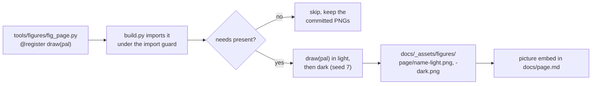
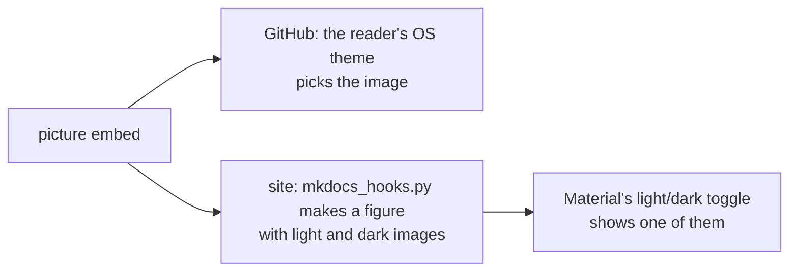
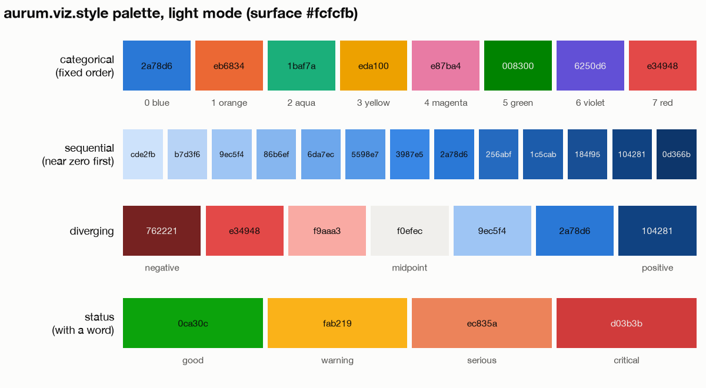
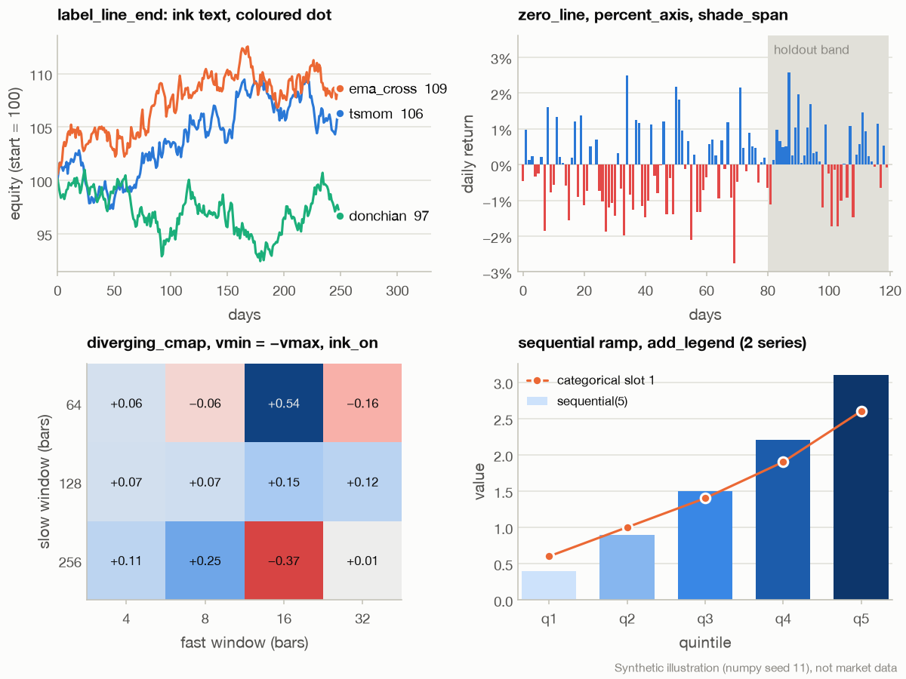

# Development guide

This page is for people changing Aurum. It covers the repository layout, a development
install, the test suite and its hermetic guards, lint, and what CI runs. It sets out the
coding rules the code relies on: [SPEC.md](../SPEC.md) principles, point-in-time discipline,
pandas 3 compatibility, logging, determinism and the registries. It then walks through
adding a strategy, a feature group or a broker adapter, including the tests each one needs.
It ends with versioning, the status of `legacy/` and `mt5_ea/`, and how to report a
security issue. A section on [figures and visual style](#figures-and-visual-style) explains
how every chart in these pages is drawn from real data by `tools/figures` with
`aurum.viz.style`, and how to add one. The rule behind all of it: a change that could leak
future information or touch the money path has to get past the leakage, random-walk and
live-safety harnesses.

**On this page**

- [Repository layout](#repository-layout)
- [Development setup](#development-setup)
- [Running the tests](#running-the-tests)
- [Lint](#lint)
- [Documentation](#documentation)
- [Figures and visual style](#figures-and-visual-style)
- [Continuous integration](#continuous-integration)
- [Coding conventions](#coding-conventions)
- [Adding a strategy](#adding-a-strategy)
- [Adding a feature group](#adding-a-feature-group)
- [Adding a broker adapter](#adding-a-broker-adapter)
- [Other extension points](#other-extension-points)
- [The safety net: leakage, random-walk and live-safety harnesses](#the-safety-net-leakage-random-walk-and-live-safety-harnesses)
- [Versioning and releases](#versioning-and-releases)
- [legacy/ and mt5_ea/](#legacy-and-mt5_ea)
- [Reporting security issues](#reporting-security-issues)

## Repository layout

```text
aurum/                  the package (about 44k lines); layer diagram in architecture.md
  core/                 timeframes, instrument spec, shared types and protocols, typed YAML config
  data/                 schema, point-in-time joins, resampling, Dukascopy, MT5/CSV loaders,
                        macro, calendar, synthetic data, parquet store
  features/             12 causal feature groups + FeaturePipeline (scaler fitted on TRAIN only)
  models/               EWMA / GARCH / HAR volatility, Gaussian HMM
  labels/               triple-barrier labels, uniqueness weights
  strategies/           Strategy base class, registry, 17 strategies (allocation.py and
                        regime.py are new in v2.1)
  portfolio/            forecast combiner, sizers
  risk/                 risk manager (limits, blackouts, persistent kill switch), VaR/ES
  execution/            cost + financing model, the one ExecutionSimulator
  backtest/             engine, metrics, result container
  research/             splits, statistics (PSR/DSR/PBO), walk-forward, tearsheet, and the
                        v2.1 analytics: sweep.py, montecarlo.py, attribution.py
  rl/                   Gymnasium env on the shared simulator, PPO training
  agents/               LLM trading desk (Claude), scripted fake client for tests
  live/                 Broker protocol, paper + MT5 brokers, OMS, runner, monitor, state files
  viz/                  style.py (one palette for matplotlib and Plotly), dashboard.py, cli.py
  cli.py, __main__.py   the `aurum` command (cli.md)
  cli_ext.py            sweep, stress, explain and dashboard, registered into the parser
tests/                  1,839 tests in 87 files, one or more test_<area>_*.py per module
                        (test_v21_<area>_*.py for v2.1); conftest.py guards
configs/                default, trend_core, fast, live_paper, desk_overlay, and the exploratory
                        d1_trend and managed_gold (configuration.md)
docs/                   this documentation, RESEARCH_PROTOCOL.md, RESULTS.md, INTERFACES.md
  _assets/              figures/ (rendered PNGs), extra.css, mathjax.js
  _hooks/               mkdocs_hooks.py: GitHub-first Markdown -> site (links, alerts, figures)
tools/figures/          build.py and fig_<page>.py: the documentation figures (README.md inside)
mkdocs.yml              the documentation site
.github/workflows/ci.yml
SPEC.md                 binding engineering contract between modules
SECURITY.md             secrets, trading safety controls, vulnerability reporting
pyproject.toml          metadata, extras, pytest markers, ruff settings
.env.example            the environment variables Aurum reads (never commit a filled copy)
legacy/                 v1 Python code, kept for reference only (not maintained)
mt5_ea/                 GoldHedgerPro v4, a standalone MQL5 EA from v1 (see the warning below)
```

Some local directories are git-ignored: `data_store/` (except `data_store/manifest.json`,
which records the sha256 of every file behind [RESULTS.md](RESULTS.md)), `cache/`, `runs/`,
`artifacts/`, `.venv/`, `.env`, and state and journal files (`*.jsonl`, `risk_state.json`,
`runner.lock`, ...). Pickles, parquet and model files are ignored everywhere. The test suite
never needs any of them.

[INTERFACES.md](INTERFACES.md) maps the public functions of each module as built.
[architecture.md](architecture.md) shows how the layers connect.

## Development setup

Python 3.10 or newer (CI tests 3.10 and 3.12). From the repository root:

```bash
python -m venv .venv && source .venv/bin/activate
pip install -e ".[dev]"            # core + pytest + ruff: enough for lint and the offline suite
pip install -e ".[all]"            # also data, rl and agents (what the all-extras CI job installs)
```

[uv](https://docs.astral.sh/uv/) works the same way (`uv venv`, then
`uv pip install -e ".[dev]"`). CI uses it for the minimum-versions job.

| Extra | Installs | Needed for |
|---|---|---|
| (core) | numpy, pandas ≥ 2.1, scipy, scikit-learn, pyyaml, pyarrow, matplotlib, requests | everything else, including the FRED macro download and `desk demo` |
| `data` | yfinance | Yahoo macro series in `aurum data download` |
| `rl` | torch, gymnasium, stable-baselines3 | `aurum rl train`, the `rl_ppo` strategy |
| `agents` | anthropic | live Claude calls (`desk run`, `desk replay` without `--fake`) |
| `mt5` | MetaTrader5 (Windows only) | the MT5 broker adapter |
| `viz` | plotly ≥ 5.20 | `aurum dashboard` and its tests (`aurum.viz.style` and the docs figures need only matplotlib) |
| `dev` | pytest ≥ 8, ruff ≥ 0.13 | tests and lint |
| `docs` | mkdocs ≥ 1.6, mkdocs-material ≥ 9.5 | building these pages as a site (see [Documentation](#documentation)) |
| `all` | `data` + `rl` + `agents` + `dev` + `viz` | the full suite (not `mt5` or `docs`) |

On Linux, the default torch wheel pulls in CUDA libraries. The all-extras CI job installs
the CPU wheel first:

```bash
pip install torch --index-url https://download.pytorch.org/whl/cpu
pip install -e ".[all]"
```

No credentials, no market data and no network are needed to develop or to run the default
test selection. For end-to-end CLI checks on your own machine, see
[getting-started.md](getting-started.md) and [cli.md](cli.md).

## Running the tests

pytest is configured in `pyproject.toml`: `testpaths = ["tests"]`,
`addopts = "-q --strict-markers"`, and two markers.

| Marker | Meaning | Default behaviour |
|---|---|---|
| `network` | the test really hits the internet (Dukascopy, FRED/Yahoo); 2 tests | runs unless deselected; the conftest guard allows its connections |
| `slow` | long end-to-end audits in `tests/test_final_e2e_leakage.py`; 5 tests | **skipped** unless the `-m` expression selects `slow` or `AURUM_SLOW_TESTS=1` is set |

```bash
python -m pytest -m "not network and not slow"   # what CI runs: offline, no slow audits
python -m pytest -m "not network"                # same tests; the slow ones show as skipped
python -m pytest -m slow                         # the slow audits
python -m pytest -m network                      # the two live-endpoint tests (needs internet)
python -m pytest tests/test_strategies_leakage.py -k tsmom   # one area while iterating
```

The suite collects 1,839 tests in 87 files (`pytest --collect-only -q`); `-m "not network
and not slow"` selects 1,832 of them and deselects the 2 network and 5 slow tests. v2.1 added
381 tests, most of them in the `tests/test_v21_<area>_*.py` files named after the area they
cover (`analytics`, `config_cli`, `core_fixes`, `live`, `strategies`, `viz`, plus
`test_v21_integration.py`), and `tests/test_docs_assets.py` for the documentation. The timings
below were measured on a 10-core Apple Silicon Mac with all extras installed: the first row on
the v2.1 tree (2026-11-09, `-p no:cacheprovider`), the others on the v2.0 tree (1,458 tests),
with other jobs running at the same time. Expect different numbers on your machine.

| Selection | Result | Wall time |
|---|---|---|
| `-m "not network and not slow"` (v2.1 tree) | 1,832 passed, 7 deselected | ~6 min |
| `-m "not network and not slow"` (v2.0 tree) | 1,451 passed, 7 deselected | ~14 min |
| `-m slow` (v2.0 tree) | 4 passed, 1 skipped (the real-data audit) | ~3 min 45 s |
| `-m network` | not run here (the INTERFACES notes put them at about 25 s, throttling included) | |

The heaviest pieces are the setup of the end-to-end leakage audit (about 2.5 minutes), the
ML strategy tests and the CLI walk-forward tests. `--durations=15`, as CI uses, shows the
current list.

Opt-in environment variables:

| Variable | Effect |
|---|---|
| `AURUM_SLOW_TESTS=1` | Run the `slow` tests even when `-m` does not select them. |
| `AURUM_REAL_DATA_AUDIT=1` | Together with `slow`, also run the leakage audit on the real `data_store/` (bars through 2024-12-31 only; the skip reason puts it at about 10 min). |
| `AURUM_TEST_KEEP_SECRETS=1` | Do not scrub credentials from the environment (for a hand-run `-m network` check). |

### How `tests/conftest.py` keeps the suite hermetic

- **Secrets are scrubbed for the whole session**, in `pytest_configure`, before any fixture
  runs. The scrubbed variables are `ANTHROPIC_API_KEY`, `ANTHROPIC_AUTH_TOKEN`,
  `ANTHROPIC_BASE_URL`, `MT5_LOGIN`, `MT5_PASSWORD`, `MT5_SERVER`, `MT5_PATH`,
  `AURUM_ALERT_WEBHOOK_URL`, `AURUM_ALERT_TELEGRAM_CHAT_ID` and `AURUM_ARTIFACT_KEY`. A
  real key in your shell never reaches a test. A test that needs a value sets it with
  `monkeypatch.setenv`.
- **The network is blocked unless a test is marked `@pytest.mark.network`.**
  `socket.socket.connect` and `connect_ex` are patched to refuse TCP/UDP connections to
  non-loopback addresses, and an unresolved host name counts as remote. The block covers a
  test's setup too, so module-scoped fixtures are guarded. A test that *tried* to connect
  fails even if the library caught the error and fell back silently. Loopback and Unix
  sockets still work, so local servers and process pools are fine.
- **Headless plotting**: `MPLBACKEND=Agg` unless you set a backend.
- **Optional dependencies** (torch, gymnasium, stable-baselines3, anthropic, yfinance,
  plotly) are handled per test with `pytest.importorskip`. The core-only install skips those
  tests instead of failing.

### Writing tests

- Put a module's tests in `tests/test_<module>.py` or an existing `tests/test_<area>_*.py`.
  SPEC §0.6 asks for under 60 s per module.
- Use `aurum.data.synthetic` for data: `make_synthetic_bars` (models `gbm`, `trend`,
  `mean_revert`, `regime`, `jump`), `make_synthetic_macro` (point-in-time) and
  `make_synthetic_events`. Never depend on `data_store/`, `cache/` or `runs/`.
- Use `tmp_path` for anything written: state files, artifacts, run directories, journals.
- The LLM desk is tested against `aurum.agents.testing.FakeAnthropicClient`, the MT5
  adapter against a fake `MetaTrader5` module (`FakeMT5` in `tests/test_live_mt5.py`), and
  the CLI through `aurum.cli.main(argv)` on a temporary synthetic data store
  (`tests/test_cli.py`).
- If a test registers something temporary, remove it afterwards. The patterns are the
  `temp_strategy` and `temp_feature` fixtures (they pop the name from `_STRATEGIES` or
  `_REGISTRY`) and `aurum.features.base.unregister_feature`.

## Lint

```bash
ruff check aurum tests          # exactly what CI runs
ruff check aurum tests --fix    # apply the safe autofixes
ruff check tools                # the documentation figure modules (not run by CI)
```

Settings (`pyproject.toml`): line length 110, target `py310`, rules `E`, `F`, `W`, `I`
(import sorting), `B` (bugbear) and `UP` (pyupgrade), with `E501` ignored. You need
**ruff 0.13 or newer**: older versions still enforce the removed rule UP038 and fail on
this tree. CI runs no formatter check. `legacy/` is not linted.

## Documentation

The pages in `docs/` are plain GitHub-flavoured Markdown, readable on GitHub as they are.
[`mkdocs.yml`](../mkdocs.yml) at the repository root also builds them into a searchable site
with the Material theme:

```bash
pip install -e ".[docs]"
mkdocs serve                              # live preview at http://127.0.0.1:8000
mkdocs build --strict --site-dir /tmp/aurum-site   # what to run before committing doc changes
```

The built site is not committed. Links from a page to files outside `docs/` (the source
code, `SPEC.md`, `SECURITY.md`, the configs) are written as relative paths so they work on
GitHub. A build hook, `docs/_hooks/mkdocs_hooks.py`, adapts the GitHub-first Markdown for the
site without changing the files: it rewrites those links to GitHub URLs, renders GitHub alert
blocks (`> [!WARNING]`) as admonitions and `<details>` blocks as collapsible sections, turns
each theme-aware `<picture>` figure into a Material figure that follows the light/dark toggle,
and escapes currency dollars so they are not typeset as math. Conventions for changes:

- Document only what the code does. Take flags from `aurum <command> --help` and defaults
  from the dataclasses and `default_params()`, not from memory.
- Every code block fenced as `python` must run as shown against the current code, offline
  (use `aurum.data.synthetic` for data), and the `text` block after it must be its real
  output. Signatures that are not runnable go in `text` blocks.
- Do not restate research numbers outside [RESULTS.md](RESULTS.md): link to it. (A figure
  or worked example may show one decision or one run's output, with its source in the
  caption.)
- Equations go in ` ```math ` fences (LaTeX), with every symbol defined in a "where" list
  below; inline `$...$` only for short symbols. Never write a currency amount with a dollar
  sign: write `USD 5` or `105k USD`. Diagrams are ` ```mermaid ` fences without style or
  colour directives, so they follow the reader's theme.
  [tools/figures/README.md](../tools/figures/README.md) has the full writer guide.
- Charts follow [Figures and visual style](#figures-and-visual-style).
- Add a new page to the `nav` in `mkdocs.yml` and to the cards in [index.md](index.md).

Before committing documentation changes, run the same checks the reviewers will:

```bash
python tools/figures/build.py --check          # PNGs, embeds and orphans
python -m pytest tests/test_docs_assets.py -q  # the same checks plus every relative link and anchor
mkdocs build --strict --site-dir /tmp/aurum-site
```

## Figures and visual style

Every chart in these pages is drawn by the real aurum code, from real data where the caption
says so, by a Python function in `tools/figures/`. Each is rendered twice, once per theme, and
embedded in a block that shows the light image on a light page and the dark image on a dark
one, on GitHub and on the site. The same style module also draws the tearsheet charts, the
PNGs that `aurum stress`, `aurum explain` and `aurum sweep` write, and (through
`plotly_template`) the interactive dashboard, so a chart reads the same everywhere. The
complete writer guide, with a two-figure module template, is
[tools/figures/README.md](../tools/figures/README.md); this section is the summary a
contributor needs.

### How tools/figures works

**Intuition.** A documentation chart is code, not a picture: it is reviewed, re-rendered when
the code or the data changes, and checked by tests, like everything else. A figure is a
function `draw(pal)` registered with a decorator. `build.py` finds it, renders it in both
themes and writes two PNGs; a checker makes sure every PNG is embedded correctly and nothing is
orphaned.





| File | Role |
|---|---|
| [tools/figures/build.py](../tools/figures/build.py) | Discovers `fig_*.py`, renders (`--only PAGE`, `--name NAME`, `--jobs N`), lists (`--list`) and checks (`--check`). Exit 0 OK, 1 a render or check failed, 2 bad arguments. |
| [tools/figures/_common.py](../tools/figures/_common.py) | The registry (`register`), the data loaders cut at 2024-12-31 (`bars`, `macro`, `market_data`, `run_table`, `run_json`), source labels for captions, and layout helpers (`panels`, `source_note`, `ink_on`, `signed`, the `FIGSIZE_*` constants) |
| [tools/figures/_docscan.py](../tools/figures/_docscan.py) | Parses the Markdown for images, links, heading anchors and `<picture>` embeds (shared by `--check` and the tests) |
| `tools/figures/fig_<page>.py` | One module per page, or one module for a group of pages such as [fig_platform.py](../tools/figures/fig_platform.py) (index, architecture, development) |
| [tests/test_docs_assets.py](../tests/test_docs_assets.py) | The same checks as `--check`, plus every relative link and `#anchor` in `docs/*.md` and `README.md`; it needs no `data_store/` |
| [docs/_hooks/mkdocs_hooks.py](../docs/_hooks/mkdocs_hooks.py), `docs/_assets/extra.css` | Turn each embed into a Material figure with a caption on the site |

The rules `build.py` and the loaders enforce:

| Rule | Why |
|---|---|
| **Cutoff 2024-12-31.** Every loader keeps only rows with `available_at` at or before 2025-01-01 00:00 UTC; `bars(..., end=...)` past it, or any `runs/.../holdout/...` path, raises `FigureDataError`. | 2025 onward is the research holdout. A figure must not become a second, unrecorded look at it. |
| **No data at import time.** `build.py` imports modules under a guard that raises if `bars()`, `macro()` or `run_dir()` is called. | Discovery, `--list` and the tests stay fast and work on a clone without data. |
| **Declare `needs`.** `needs=("data_store",)` for real bars or macro, `needs=("runs/<name>",)` per run directory. A missing entry skips the figure and keeps the committed PNGs. | `data_store/` and `runs/` are gitignored. A figure that silently fell back to synthetic data under a real caption would lie, so an undeclared fallback is an error. |
| **Deterministic.** `random` and `numpy.random` are reseeded with 7 before each mode; PNG metadata is pinned, and a byte-identical render is not rewritten (`[same]`). | Re-rendering an unchanged figure produces no diff. Bytes depend on the local matplotlib and fonts, so commit renders made on one machine. |
| **Under about 30 s per figure.** Never run a walk-forward or backtest inside a figure: read the run outputs. | Re-rendering stays quick enough to do on every change; `build.py` prints a note above 30 s. |
| **Never commit synthetic renders over real ones.** `--synthetic` forces the synthetic fallback and only works with `--out DIR` outside `docs/_assets/figures`. | Preview a fresh clone without overwriting the real PNGs. |

```bash
python tools/figures/build.py --list --only index architecture development
```

```text
figure                                           pngs     needs                                        doc
architecture/decision-chain                      both     data_store, runs/protocol/trend_core_selection One real decision through the stack: 7 forecasts -> combiner -> sizer -> band -> risk -> fill.
architecture/decision-timeline                   both     data_store, runs/protocol/trend_core_selection Decide at the close of bar t, fill at the open of bar t+1 (real H1 bars and run decisions).
development/style-helpers                        both     -                                            Synthetic illustration of the aurum.viz.style helpers in a 2x2 grid.
development/style-palette                        both     -                                            The aurum.viz.style palette for one mode: categorical, sequential, diverging and status.
index/gold-research-timeline                     both     data_store, runs/protocol/trend_core_selection Gold 2012-2024 (log scale) with the 18 walk-forward folds and the untouched 2025+ holdout.

5 figures in 1 modules
```

### aurum.viz.style: one palette, two modes

**Intuition.** Good charts are mostly the absence of noise: a few colours used for identity,
thin lines, quiet gridlines, text in ink colours, and the same colour meaning the same thing in
every chart. [aurum/viz/style.py](../aurum/viz/style.py) encodes those choices once, for
matplotlib (`rc_params`, `use_style`) and for Plotly (`plotly_template`). The dark mode is not
an inverted light mode: each hue is stepped for the dark surface, and the sequential ramp runs
dark to light so that values near zero recede into the background. Both figures below are
drawn by [fig_platform.py](../tools/figures/fig_platform.py).

<picture>
  <source media="(prefers-color-scheme: dark)" srcset="_assets/figures/development/style-palette-dark.png">
  
</picture>

*The palette as `palette(mode)` returns it. Compare the light and dark variants of this image: the categorical hues shift for the dark surface, the sequential ramp reverses, and the diverging scale puts its strongest colours at the ends in both. Data: none (the colour values in `aurum.viz.style`).*

The rules, all from the module docstring:

- **Lines are 2 px** (`LINE_WIDTH_PT` 1.5 pt; matplotlib sizes are points and 1 CSS px is
  0.75 pt) with round caps; markers are 8 px with a 2 px ring in the surface colour.
- **Recessive chrome:** hairline (0.75 pt) y-grid only, no top or right spine, muted axis
  lines, no tick marks on the value axis. Titles are left-aligned, 12 pt.
- **Never two y-axes.** Two measures of different scale go in stacked panels (`panels()` in
  `_common`) or are indexed to a common base.
- **A legend only for 2 or more series** (`add_legend` draws nothing otherwise), and direct
  end labels (`label_line_end`) are preferred for up to 4 series.
- **Text wears ink colours** (`text`, `text_secondary`, `text_muted`), never a series colour.
- **Categorical colours in fixed order, never cycled:** `categorical(9)` raises. Fold the tail
  into "Other" or use small multiples. In light mode the aqua, yellow and magenta slots are
  below 3:1 contrast on the surface, so give those series a direct label.
- **Sequential is one hue; diverging is red (negative) and blue (positive) around a gray
  midpoint**, with symmetric limits (`vmin = -vmax`). Heatmaps call `style_axes(ax, grid=None)`.
- **Status colours are reserved** for good, warning, serious and critical, always with a word.

<picture>
  <source media="(prefers-color-scheme: dark)" srcset="_assets/figures/development/style-helpers-dark.png">
  
</picture>

*What each helper draws: `label_line_end` (top left), `zero_line`, `percent_axis` and `shade_span` (top right), `diverging_cmap` with symmetric limits and `ink_on` cell text (bottom left), and a `sequential(5)` ramp with `add_legend` for two series (bottom right). Data: synthetic illustration (numpy seed 11), not market data.*

| Name | Signature (defaults) | What it does |
|---|---|---|
| `palette` / `get_palette` | `palette(mode=None)` | The colour roles of a mode as a plain dict (`mode surface page text text_secondary text_muted grid axis border delta_good categorical sequential diverging diverging_mid status`) or a frozen `Palette`. `mode=None` means the active `use_style` mode. |
| `use_style` | `use_style(mode="light")` | Context manager: applies `rc_params(mode)` with `matplotlib.rc_context` and yields `palette(mode)`. Nests and restores the previous settings. |
| `save_figure` | `save_figure(fig_fn, path_stem, modes=("light", "dark"), dpi=150, *, formats=("png",), **savefig_kw)` | Calls `fig_fn(pal)` (or `fig_fn()`) once per mode inside `use_style` and writes `<stem>-<mode>.<fmt>`. `fig_fn` may return a Figure, an Axes, an array of Axes or `None` (the current pyplot figure). Returns the written paths. |
| `figure` | `figure(nrows=1, ncols=1, *, figsize=None, sharex=False, sharey=False, squeeze=True, **subplot_kw)` | A styled `Figure` and its axes, without pyplot (safe on headless servers) |
| `style_axes` | `style_axes(ax, mode=None, *, grid="y")` | Re-applies the chrome to an axes; `grid` is `"y"`, `"x"`, `"both"` or `None` |
| `add_legend` | `add_legend(ax, *, mode=None, min_series=2, **kwargs)` | A frameless legend in ink colours, only when at least `min_series` labelled artists exist |
| `label_line_end` | `label_line_end(ax, line, text=None, *, mode=None, dx_points=6.0, fmt="{:,.2f}", dot=True)` | Direct label at the right end of a line, in ink, with a coloured end-dot |
| `zero_line` | `zero_line(ax, *, mode=None, axis="y")` | A hairline baseline at 0 in the axis colour |
| `shade_span` | `shade_span(ax, start, end, label=None, *, mode=None, axis="x", alpha=1.0)` | A recessive band (holdout, regime, fold) in the gridline colour, with an optional muted label |
| `percent_axis` | `percent_axis(ax, axis="y", *, decimals=0, xmax=1.0)` | Formats an axis as percentages (`xmax` is the value meaning 100%) |
| `categorical`, `series_color` | `categorical(n, mode=None)`, `series_color(i, mode=None)` | The first `n` (at most 8) categorical colours / slot `i` (0 to 7) |
| `sequential`, `diverging` | `sequential(n=None, mode=None)`, `diverging(n=7, mode=None)` | `n` steps of the blue ramp, near zero first; `n` (odd) colours from red through gray to blue |
| `sequential_cmap`, `diverging_cmap` | `sequential_cmap(mode=None)`, `diverging_cmap(mode=None)` | The matching matplotlib colormaps (`aurum_sequential_<mode>`, `aurum_diverging_<mode>`) |
| `plotly_template`, `rc_params` | `plotly_template(mode=None)`, `rc_params(mode=None)` | The same style as a Plotly layout template (used by `aurum.viz.dashboard`) and as matplotlib `rcParams` |

In code (writes two PNGs to a temporary directory):

```python
import tempfile
from pathlib import Path

import numpy as np

from aurum.viz.style import add_legend, categorical, palette, save_figure, zero_line
from aurum.viz.style import figure as styled_figure


def draw(pal):                                   # pal = palette(mode) of the mode being rendered
    rng = np.random.default_rng(0)
    fig, ax = styled_figure(figsize=(8, 4.5))
    for i, name in enumerate(["tsmom", "ema_cross"]):
        ax.plot(np.cumsum(rng.normal(0, 1, 200)), color=pal["categorical"][i], label=name)
    zero_line(ax)
    add_legend(ax)                               # drawn: there are 2 labelled series
    ax.set_title("Two series")
    ax.set_xlabel("bars")
    ax.set_ylabel("cumulative return (synthetic)")
    return fig


paths = save_figure(draw, Path(tempfile.mkdtemp()) / "example")
print([p.name for p in paths])
print(palette("light")["categorical"][:3], palette("dark")["categorical"][:3])
print(categorical(2, "dark"))
try:
    categorical(9)
except ValueError as exc:
    print("ValueError:", str(exc)[:60], "...")
```

```text
['example-light.png', 'example-dark.png']
['#2a78d6', '#eb6834', '#1baf7a'] ['#3987e5', '#d95926', '#199e70']
['#3987e5', '#d95926']
ValueError: 9 categorical series requested; the palette has 8 fixed slot ...
```

**Pitfalls and design choices.**

- *Create the figure inside `draw`.* rcParams are read when artists are created, so a figure
  built outside `use_style` (or reused across modes) keeps the wrong colours.
- *Library plots take a mode.* `plot_fan`, `plot_distributions`, `plot_sweep` (and
  `SweepResult.plot`), `plot_waterfall` and `plot_attribution` draw with this module and take
  `mode="light"` or `"dark"` (default: the active `use_style` mode). In a docs figure, call
  them inside `draw(pal)` or redraw from the data they return; never copy a PNG from `runs/`
  into `docs/_assets/figures/`, because `--check` refuses files no registered figure
  produces.
- *Colour is not the only channel.* Every categorical series also gets a label or a legend
  entry, and status colours always come with a word, so the charts survive colour-vision
  deficiency and greyscale printing.

### Adding a figure

1. **Pick the page and the module.** Figures for `docs/<page>.md` live in
   `docs/_assets/figures/<page-slug>/`, where the slug is the file stem in lowercase with `_`
   replaced by `-`. Copy [tools/figures/_template.py](../tools/figures/_template.py) to
   `tools/figures/fig_<page>.py` (the template is not discovered because its name does not
   start with `fig_`) and set `PAGE`.
2. **Write `draw(pal)`.** Load data inside it with the `_common` loaders, create the figure
   with `aurum.viz.style.figure()` or `_common.panels()`, follow the rules above, give it a
   title and axis labels with units, add `source_note(fig, "Data: " + source_label(...), pal)`
   and return the figure.
3. **Register it** with `@register(PAGE, "my-figure", needs=(...))`. Names are lowercase
   slugs. Do not call the decorator `figure`: that is the style helper.
4. **Render and look.** `python tools/figures/build.py --only <page>` prints one line per
   figure (`[ok  ]` written, `[same]` unchanged, `[skip]` needs missing, `[FAIL]`). Open both
   PNGs and fix overlapping or clipped labels, unreadable legends, empty panels and wrong
   scales before you embed them.
5. **Embed it** with the canonical block: one blank line before `<picture>`, the four lines
   below, one blank line, then a one-line italic caption that says what to look at and ends
   with `Data: <source>, <period>.` Alt text is plain words, without math or Markdown. Link
   the code that draws it in the paragraph *before* the figure: the site hook copies the
   caption into a `<figcaption>` without rewriting links that leave `docs/`, so a
   `../tools/...` link inside a caption breaks `mkdocs build --strict`.

   ```html
   The figure below ([figure code](../tools/figures/fig_<page>.py)) shows ...

   <picture>
     <source media="(prefers-color-scheme: dark)" srcset="_assets/figures/<page>/my-figure-dark.png">
     /my-figure-light.png" alt="What is drawn, in plain words">
   </picture>

   *What to look at. Data: XAUUSD H1, Dukascopy bid/ask mid, 2012-2024.*
   ```

6. **Check** with `python tools/figures/build.py --check --only <page>`,
   `python -m pytest tests/test_docs_assets.py -q`, `mkdocs build --strict` and
   `ruff check tools`. `--check` fails on a registered figure without both PNGs, a missing
   image, a malformed `<picture>` block, a PNG that no registered figure produces, and a PNG
   no page references.

Images that cannot be drawn (a screenshot) go in `docs/_assets/static/` and are embedded the
same way; everything under `docs/_assets/figures/` must come from a registered figure.

## Continuous integration

`.github/workflows/ci.yml` runs on pushes to `main`, `master` and `aurum-v2`, on every pull
request, and on manual dispatch. It has read-only repository permissions, and a newer run on
the same ref cancels the older one. It sets `MPLBACKEND=Agg`. No job needs secrets, market
data or the internet beyond package installation.

| Job | Python | Steps |
|---|---|---|
| `core` (45 min timeout) | 3.10, 3.12 | `pip install -e ".[dev]"` (no optional extras) → `ruff check aurum tests` → **import check** → **CLI smoke** → `pytest -m "not network and not slow" -ra --durations=15` |
| `all-extras` (60 min timeout) | 3.10, 3.12 | CPU-only torch → `pip install -e ".[all]"` → the same pytest selection |
| `min-deps` (45 min timeout) | 3.10 | `uv pip install --system --resolution lowest-direct -e ".[dev]"` (the lowest versions `pyproject.toml` allows, for example pandas 2.1) → prints the numpy/pandas/scipy/scikit-learn versions → the same pytest selection |

The **import check** in `core` imports `aurum.agents`, `aurum.cli`, `aurum.live`,
`aurum.research.walkforward` and `aurum.strategies` without the extras installed. It
asserts that at least 15 strategies are registered, `rl_ppo` among them, and that none of
torch, gymnasium, stable_baselines3, anthropic or yfinance was imported along the way.
Keep optional imports lazy, inside the function that needs them. The **CLI smoke** step
runs `aurum --help`, `aurum strategies list` and `aurum desk demo`.

Before you push, run the same things locally:

```bash
ruff check aurum tests && python -m pytest -m "not network and not slow"
```

## Coding conventions

### SPEC principles

[SPEC.md](../SPEC.md) is the binding contract between modules. If code and SPEC disagree,
fix one of them **in the same change**. Its six principles (§0):

1. **Point-in-time or nothing.** A value may influence a decision at time `T` only if it
   was available at `T`. Every frame joined onto bars carries `available_at` and is aligned
   with `aurum.data.pit.asof_join`.
2. **One simulator.** Research, the RL environment, paper trading and the desk replay all
   use `aurum.execution.simulator.ExecutionSimulator` and the same sizer and risk objects.
   Do not write a second PnL loop.
3. **Alpha ≠ sizing ≠ risk.** Strategies emit forecasts in [-1, 1]. The combiner blends
   them, the sizer turns a forecast into lots, and the risk manager can only reduce risk or
   halt. Nothing downstream of risk may increase exposure.
4. **Deterministic and reproducible.** Every stochastic component takes a `seed`. Every
   run writes its config, data hash and git SHA next to its results.
5. **Safe by default.** Live trading defaults to dry-run. Real accounts need an explicit
   config value *and* a CLI flag. LLM agents can never bypass the risk manager.
6. **Tested.** Each module ships tests. No network without `@pytest.mark.network`. Under
   60 s per module. Synthetic data.

### Point-in-time rules in practice

- Timestamps are tz-aware UTC. Bars are indexed by **open** time, and
  `available_at = open + timeframe`. A decision at the close of bar `t` fills at the open of
  `t+1`.
- Features (`aurum/features/base.py`): row `t` may use only `bars[:t+1]` and macro rows
  with `available_at <= available_at[t]`. No `shift(-k)`, no centred windows, no `bfill`,
  no full-sample statistics. Use rolling, expanding or EWM windows. Warm-up rows are NaN.
  Prefix output columns with the family.
- Strategies (`aurum/strategies/base.py`): `generate` must be causal. `fit` receives
  **only training data** and stores what it learns on `self`. The walk-forward already
  truncates macro to rows published by the last training bar's close (`_train_md`).
  `tests/test_strategies_leakage.py` also checks that `fit` ignores later macro rows by
  itself, so correctness does not rest on that truncation alone.
- Macro and calendar data: macro frames carry publication times, so join them on
  `available_at`, never on the observation date. Scheduled event *times* are public in
  advance. Event *outcomes* may only be used from their release time on (SPEC §3.5).
- Scalers and combiners are fitted on training windows only. The walk-forward refits them
  per fold, and the default combiner fit uses earlier folds' OOS forecasts.

See [data.md](data.md), [features.md](features.md) and [research.md](research.md).

### pandas 3 compatibility

The code must run on pandas ≥ 2.1 **and** 3.x. The development venv behind this page uses
pandas 3.0.6, and the `min-deps` CI job tests the lowest allowed versions. Rules taken from
SPEC.md and from the fixes already in the code:

- Do not use removed APIs such as `fillna(method=...)`: call `.ffill()` directly (and never
  `bfill` in feature code). Use the offset aliases `'h'` and `'min'`, not `'H'` and `'T'`.
- `to_numpy()` can return a read-only view under copy-on-write. Pass `copy=True` before
  mutating, as `aurum/backtest/engine.py` does.
- pandas 3 defaults datetimes to microsecond resolution, pandas 2 to nanoseconds. Do not
  compare raw integers (`asi8`, `Timedelta.value`); compare `Timedelta`s
  (`aurum/data/synthetic.py` fixed a weekend-detection bug this way). `frame_hash` is
  resolution-independent.
- In pandas 3, `"1D"` is a calendar-day offset and `resample()` silently ignores `offset=`
  for it. `aurum/data/resample.py` buckets with fixed-length `Timedelta` rules so the D1/H4
  anchor holds. Reuse `resample_bars` instead of calling `resample` yourself.

### Logging and output

- Library code uses `logger = logging.getLogger(__name__)` and never `print`. Only the CLI
  prints.
- Never log credentials. Secrets are wrapped in `aurum.core.config.Secret`, whose `repr` is
  masked. Journals and decision logs truncate tool payloads.
- Log a warning when something degrades silently: a missing macro series, a fallback rate,
  an equal-weight combiner fallback. Existing modules show the pattern.

### Determinism and provenance

- Take a `seed` wherever there is randomness. Configs carry a top-level `seed`.
- Results must not depend on execution settings. The walk-forward is deterministic whatever
  the executor (`process`, `thread` or `serial`) and `n_jobs`. Those fields and the `output`
  section are excluded from `config_hash()`.
- Every run records provenance (`aurum.research.walkforward.provenance`): config hash,
  bar/macro/event data hashes, git SHA and dirty flag, Python and package versions, argv.
- `tests/test_strategies_leakage.py::test_output_contract` requires `generate` to be
  deterministic and `clone()` to leave the forecast unchanged.

### Configuration

The configuration is a tree of dataclasses in `aurum/core/config.py`. Loading is strict:
unknown keys are errors, and semantic validation builds the real downstream objects. When
you add an option:

- Add a field with a default to the right dataclass.
- If it cannot change results, give it `metadata=_NOHASH` so it stays out of the config
  hash.
- Never add a credential field that YAML can set. Secrets come only from the variables in
  `SECRET_ENV`.
- Add validation to `_semantic_problems` when the value has a range, and add tests in
  `tests/test_config.py`. [configuration.md](configuration.md) documents the keys.

### Registries

Strategies register with `@register_strategy` and feature groups with
`@register_feature(...)`. Registering a second strategy class, or any second feature
function, under an existing name raises `KeyError`. The registries
fill lazily: `list_strategies()`/`get_strategy()` and `list_features()`/`get_feature()`
import a **fixed list of modules** (`_ensure_loaded` in `aurum/strategies/base.py` and
`aurum/features/base.py`). A decorator in a new module does nothing until that module is
added to the list.

## Adding a strategy

1. **Write the class** in the right family module (`trend.py`, `mean_reversion.py`,
   `breakout.py`, `macro.py`, `seasonal.py`, `ml.py`, `rl.py`), or in a new module. Set
   `name`, `description` and `trainable`. Implement `default_params()`, `warmup_bars` and
   `generate()`. End `generate()` with `self._finalize(...)`, which clips to [-1, 1], zeroes
   the warm-up and replaces NaN/inf with 0. Document the economic rationale in the
   docstring (SPEC §6).
2. **Trainable strategies** also implement `fit(md, features=None)`, store what they learn
   on `self`, and set `self.is_fitted = True`. If the strategy uses a label or holding
   horizon, expose it as a `label_horizon` attribute or a parameter named `horizon`,
   `max_holding`, `vertical_barrier`, ... (`HORIZON_PARAMS` in
   `aurum/research/walkforward.py`), so `purge: auto` covers it. If `fit` needs extra
   history for feature warm-up, override `fit_history_bars`. Set `uses_features = True` if
   it should receive the fold's shared pipeline features.
3. **Register it** with `@register_strategy`. For a **new module**, add it to
   `_ensure_loaded` in `aurum/strategies/base.py`.

A minimal, runnable example (registered in-process only):

```python
import numpy as np
import pandas as pd

from aurum.core.types import MarketData
from aurum.data.synthetic import make_synthetic_bars
from aurum.strategies.base import Strategy, get_strategy, register_strategy


@register_strategy
class ChannelPosition(Strategy):
    """Where the close sits inside its trailing high/low channel.

    Rationale (state it for every strategy): ... Forecast = (close - channel mid) / half
    the channel width, in [-1, 1]; zero during the warm-up.
    """

    name = "channel_position"
    description = "Close vs trailing N-bar channel midpoint, scaled by half the channel width."

    @classmethod
    def default_params(cls) -> dict:
        return {"n": 96}

    @property
    def warmup_bars(self) -> int:
        return int(self.params["n"])

    def generate(self, md: MarketData, features: pd.DataFrame | None = None) -> pd.Series:
        n = int(self.params["n"])
        bars = md.bars
        hi = bars["high"].rolling(n, min_periods=n).max()     # trailing windows only
        lo = bars["low"].rolling(n, min_periods=n).min()
        raw = (bars["close"] - (hi + lo) / 2) / ((hi - lo) / 2)
        return self._finalize(raw, bars.index)                # clip, zero warm-up, NaN -> 0


bars = make_synthetic_bars(2000, "H1", seed=0, model="gbm")
md = MarketData(bars=bars)
strat = get_strategy("channel_position", n=48)
f = strat.generate(md)

# the leakage harness in one line: a prefix of history must give the same forecasts
t = 1500
g = strat.generate(MarketData(bars=bars.iloc[: t + 1]))
print(f.name, len(f), float(f.abs().max()) <= 1.0, np.array_equal(f.iloc[: t + 1].to_numpy(), g.to_numpy()))
```

```text
channel_position 2000 True True
```

**Tests you must add or update:**

| File | What to do |
|---|---|
| `tests/test_strategies_leakage.py` | Runs automatically for every strategy registered by the modules it imports. For a **new module**, add it to `OWNED_MODULES` (rule-based) or `OTHER_MODULES`. For a rule-based strategy, also add the name to `OWNED`: owned strategies fail loudly when they cannot be built or when a check is vacuous, and they also get the M15 point-in-time test. Others are skipped in those cases. If the default forecast is identically 0 on synthetic data (skill gates, rare triggers), add a `TEST_PARAMS` entry, or the "not vacuous" check cannot run. If the forecast depends only on the clock, add it to `TIME_ONLY`. |
| `tests/test_strategies_rules_randomwalk.py` | Not automatic. Add the name to `RULES` for the no-edge null on random walks. Add a positive control if the rule has a natural synthetic model (`trend`, `mean_revert`). |
| `tests/test_strategies_rules.py` (or `test_strategies_ml.py`) | Unit tests on hand-built scenarios: parameter validation, the sign and scale of the forecast, exits and warm-up. |
| `tests/test_fit_history.py` | Worth a look if you override `fit_history_bars`: fit slices must never include a bar at or after the fold's test start. |

To use the strategy, add it to a config (`strategies: [{name: channel_position, params:
{n: 48}}]`). Leave the shipped research configs alone. `configs/default.yaml` and
`configs/trend_core.yaml` are the pre-registered configurations of
[RESEARCH_PROTOCOL.md](RESEARCH_PROTOCOL.md), and `tests/test_final_e2e_leakage.py` pins
the default strategy list. Put new strategies in a new config and report them under the
protocol's rules, with DSR `n_trials` counting every configuration you tried. See
[strategies.md](strategies.md).

## Adding a feature group

1. Write a function `fn(md, **params) -> DataFrame`, indexed exactly like `md.bars.index`,
   with every column prefixed by the group name or family and NaN during warm-up.
2. Register it with `@register_feature(name, family=..., lookback=...)`. Pass
   `requires_macro=(...)`/`requires_events=True` when it needs those inputs.
3. **Attach a `lookback_fn(params, bar_minutes) -> int`** that computes the warm-up from the
   *effective* parameters (defaults plus overrides). `FeaturePipeline.max_lookback` uses it.
   `tests/test_features_pipeline.py::test_registered_lookback_matches_lookback_fn_at_h1`
   requires every registered group to have one, and requires it to equal the registered
   `lookback` at H1.
4. For a new module, add it to `_ensure_loaded` in `aurum/features/base.py`.

```python
from collections.abc import Mapping
from typing import Any

import pandas as pd

from aurum.core.types import MarketData
from aurum.data.synthetic import make_synthetic_bars
from aurum.features.base import get_feature, register_feature
from aurum.features.pipeline import FeaturePipeline


def spreadz_lookback(p: Mapping[str, Any], bar_minutes: float = 60.0) -> int:
    """Warm-up in bars for the EFFECTIVE parameters (defaults + overrides)."""
    return int(p.get("n", 96))


@register_feature("spreadz", family="spreadz", lookback=spreadz_lookback({}))
def spread_z_features(md: MarketData, *, n: int = 96) -> pd.DataFrame:
    """Spread z-score against its trailing n-bar mean and standard deviation."""
    s = md.bars["spread"]
    roll = s.rolling(n, min_periods=n)                 # trailing window only
    z = (s - roll.mean()) / roll.std()
    return pd.DataFrame({f"spreadz_{n}": z}, index=md.bars.index)   # NaN during warm-up


spread_z_features.lookback_fn = spreadz_lookback      # required for in-tree groups


md = MarketData(bars=make_synthetic_bars(1000, "H1", seed=0))
spec = get_feature("spreadz")
full = spec.compute(md)
t = 700
cut = spec.compute(MarketData(bars=md.bars.iloc[: t + 1]))
print(list(full.columns), int(full.iloc[:, 0].isna().sum()), full.iloc[: t + 1].equals(cut))
print(FeaturePipeline(groups=["spreadz"], overrides={"spreadz": {"n": 48}}).max_lookback)
```

```text
['spreadz_96'] 95 True
48
```

A registered group also becomes part of every `FeaturePipeline` built with `groups=None`,
which includes configs with `features.groups: null`. It is placed after the canonical SPEC
groups, sorted by name. That changes those pipelines' columns. The ML strategies use their
own explicit group list (`DEFAULT_PRICE_GROUPS` in `aurum/strategies/ml.py`).

**Tests you must add or update:**

| File | What to do |
|---|---|
| `tests/test_features_leakage.py` | Runs automatically on every registered group: perturbed and truncated futures at four cutoffs, bit-identical prefixes, columns populated before the last cutoff, a reaction to the perturbation. If the default warm-up exceeds the 2,400-bar test history, add a `GROUP_TEST_PARAMS` override (as for `regime`). If the group depends only on timestamps or the schedule, add it to `TIME_ONLY_GROUPS`. Calendar-sensitive groups belong in `CALENDAR_SENSITIVE` (boundary cutoffs on H1 and M30). |
| `tests/test_features_randomwalk.py` | Automatic: every column of the default pipeline must be uncorrelated with the next bar's return on a random walk (Bonferroni, 1% family-wise). |
| `tests/test_features_pipeline.py` | The `lookback_fn` consistency check above is automatic. Add pipeline tests if the group needs special scaling. |
| `tests/test_features_<module>.py` | Value tests on hand-checkable inputs. |

## Adding a broker adapter

The live runner and the OMS talk to venues only through the `Broker` protocol in
`aurum/live/broker.py` (runtime-checkable). `PaperBroker` and `MT5Broker` both satisfy it.
A new adapter must implement:

| Method | Contract |
|---|---|
| `account()` | `AccountInfo` snapshot (equity, margin, `is_demo`, `hedging`, ...). |
| `positions(symbol, magic)` | Open positions filtered by symbol **and** magic. Lots are signed. |
| `place_order(order)` | Market order from an `OrderRequest`. Returns an `OrderResult` with a normalised `OrderStatusCode` and a `retryable` flag. Outcomes are data, not exceptions. `unknown` means the order may have executed and must be verified before any resend. |
| `close_position(ticket, *, magic, lots=None, client_id="")` | Close by an opposite deal. **Refuse tickets with a different magic.** |
| `close_all(symbol, magic)` | Close only this symbol's and this magic's positions. |
| `latest_bars(symbol, timeframe, n)` | The last `n` **closed** bars in the canonical schema: UTC open-time index, mid prices, `spread` in price units, `available_at`. Never the forming bar. |
| `is_demo()`, `is_hedging()` | Real-money guard input and account mode. Anything that is not a genuine `True` is treated as real money or netting. |
| `server_time()` | Venue "now" in UTC. |
| `quote(symbol)` | Executable quote, or `None` when the market is closed. |
| `find_deals(client_id, *, symbol, magic, since=None)` | Executed deals whose comment is the idempotency key. Used to verify uncertain outcomes after a crash or timeout. |

The runner also uses these optional attributes when they exist: `clock`, `costs`,
`instrument` (the venue's lot grid, used for risk caps and order splitting), `reconnect()`
(after repeated broker errors), `shutdown()` and `set_rates()` (paper financing).

Wiring: add the venue name to the `broker` check in `aurum.live.runner.LiveConfig`
(`"paper" | "mt5"` today) and in `_semantic_problems` in `aurum/core/config.py`
(`live.broker`), and construct the adapter in `aurum.live.runner._build_broker`. Import any
vendor SDK lazily, inside the adapter, so the CI import check stays green. Read credentials
from environment variables only, never from YAML (the config loader rejects credential-like
keys in `live.options`).

**Tests you must add** (no real venue, no network; follow `tests/test_live_mt5.py`, which
injects a fake `MetaTrader5` module through `sys.modules`):

- a stateful fake of the vendor API. Test fills, partial fills, requotes and rejects, the
  mapping of every status code, server time to UTC, closed-bars-only `latest_bars`, and
  `find_deals` matching the client id;
- magic-number isolation: another magic's or another symbol's positions are never returned,
  modified or closed (see `test_mt5_adapter_refuses_foreign_tickets` and the
  leaky-adapter tests in `tests/test_final_live_safety.py`);
- real-money guard: unknown or garbled demo flags count as real money, so the runner
  refuses without both opt-ins;
- OMS idempotency across a crash or restart against your fake (`tests/test_live_oms.py`,
  `tests/test_final_live_safety.py`);
- if the adapter simulates fills, parity with `ExecutionSimulator`, as
  `tests/test_live_paper.py` and
  `tests/test_live_runner.py::test_paper_run_matches_backtest_and_logs_everything` require
  for the paper broker (equity equal to the backtest within 1e-6).

See [live-trading.md](live-trading.md) for the runtime side.

## Other extension points

- **CLI commands**: add a `cmd_*` function and a subparser in `aurum/cli.py`, or, for a
  command that should stay outside the core file, an `_add_<name>(subparsers)` function in
  `aurum/cli_ext.py` that `register_all(subparsers)` calls (that is how `sweep`, `stress`,
  `explain` and, through `aurum.viz.cli.register`, `dashboard` are added). `register_all`
  refuses to replace a core command, and if it raises, the added parsers are removed and a
  warning `aurum CLI extensions (aurum.cli_ext) failed to load and were skipped` is logged, so
  the core CLI keeps working. A subcommand without `set_defaults(func=...)` exits 2 ("has
  nothing to run"). Raise `CLIError(message, code)` with one of the `EXIT_*` codes for
  user-facing failures. Import heavy or optional modules inside the command. Add a test that
  calls `main([...])` on the synthetic data store fixture (`tests/test_cli.py`,
  `tests/test_v21_analytics_cli.py`), and document the command in [cli.md](cli.md).
- **Desk agents and tools**: see [llm-desk.md](llm-desk.md). Tests run against
  `FakeAnthropicClient` (`tests/test_agents_*.py`). The policy and the risk bounds are
  covered adversarially in `tests/test_final_live_safety.py`.

## The safety net: leakage, random-walk and live-safety harnesses

These tests exist so that a contributor does not have to *remember* every point-in-time
rule: a leak fails the build. Each harness has **negative controls**: deliberately leaky
features or strategies that the harness must flag. They prove the checks have teeth.

| Harness | What it proves |
|---|---|
| `tests/test_features_leakage.py` | Every registered feature group gives bit-identical rows up to `t` when everything after `t` is replaced by an unrelated path (bars and not-yet-published macro rows) or removed. Negative controls: `shift(-1)`, full-sample z-score, centred window, `bfill`, and macro joined on observation date. There are also boundary cutoffs on H1 and M30, and tiny histories. |
| `tests/test_features_randomwalk.py` | No feature column correlates with the next bar's return on a driftless random walk. |
| `tests/test_strategies_leakage.py` | Every registered strategy meets its output contract (index, finite, [-1, 1], zero warm-up, deterministic, clone-stable) and is point-in-time on H1, and the rule-based ones also on M15. `fit` must ignore macro rows published after training ends. Leaky negative controls must be caught. |
| `tests/test_strategies_rules_randomwalk.py` | On random walks, the gross per-bar return `f[t]·r[t+1]` has a mean t-stat under 2 over five seeds, and every seed stays under 4 (a look-ahead bug produces t-stats in the tens). Positive controls show trend and mean-reversion rules earn on the matching synthetic process. |
| `tests/test_final_e2e_leakage.py` | The full `configs/default.yaml` walk-forward (14 strategies, ML included) with the future after a cutoff perturbed (bars, macro, events). Every forecast, weight, position and equity value up to the cutoff must be bit-identical, and outputs after it must differ. Perturbing only the holdout must leave research outputs unchanged. Slow variants: the random-walk no-edge check on the combined book (three seeds), deleting future bars, and the real-data audit. |
| `tests/test_fit_history.py`, `tests/test_research_walkforward.py` | Fold geometry: no overlap, purge and embargo respected, stitched OOS strictly increasing and holdout-free, and fit slices never reaching the test start. |
| `tests/test_final_live_safety.py` | The money path under attack: both real-money opt-ins, dry-run never sending, magic isolation, crash/restart without double sends, a kill switch that survives restarts and corruption, a desk that cannot exceed its policy, a single runner per state dir, and lot and leverage caps. |

If one of these fails after your change, treat it as a bug in the change, not in the test.
Adjusting a harness (a `TEST_PARAMS` entry, a `TIME_ONLY` classification) is fine when you
can explain why the check was vacuous. Weakening a comparison is not.

## Versioning and releases

- The package version is `version = "2.0.0"` in `pyproject.toml`; the v2.1 changes are
  listed under an unreleased `[2.1.0]` heading in [CHANGELOG.md](../CHANGELOG.md).
  `aurum.__version__` resolves it on first import: `importlib.metadata.version("aurum")` for
  an installed package, else the `[project] version` of the adjacent `pyproject.toml`, else
  `"0+unknown"`. `aurum --version` prints it (`aurum 2.0.0`). Run provenance and artifact
  manifests record `importlib.metadata.version("aurum")`.
- There is no automated release process: no tags and no publishing workflow. Changes are
  recorded by hand in [CHANGELOG.md](../CHANGELOG.md). `main` is the default branch of the public repository and holds
  Aurum v2 (the `aurum-v2` branch it was developed on is merged into it). Results are tied to commits rather than to version numbers.
  [RESULTS.md](RESULTS.md) quotes the git SHA and data hashes it was produced with, and
  every run's `provenance.json` records the git SHA and whether the tree was dirty.
- On-disk formats carry version numbers. Live artifacts use
  `ARTIFACT_FORMAT = "aurum.live.artifact"` and `ARTIFACT_VERSION = 1` in
  `aurum/live/runner.py`, and the loader refuses newer versions. `FeaturePipeline` JSON
  uses `FORMAT_VERSION = 1` in `aurum/features/pipeline.py`. Bump the version when you
  change a format incompatibly.
- Artifacts pickle strategy and combiner objects, and pickles refer to classes by module
  path. Renaming or moving a strategy class, or changing its state, can break loading of
  older artifacts. Refit with `aurum train-final` after such changes.
- Changing a result-affecting field of a shipped config changes its config hash.
  `train-final --from-run` then refuses older walk-forward runs (unless
  `--allow-config-mismatch`), and [RESULTS.md](RESULTS.md) no longer describes that
  configuration.

## legacy/ and mt5_ea/

**`legacy/`** is the v1 Python code (Dreamer/PPO agents, MetaAPI and MT5 live scripts,
Colab notebooks, and `requirements_v1.txt`), kept for reference only. It is not
maintained, not packaged (`setuptools` only includes `aurum*`), not linted by CI and not
tested. An audit found that nothing in v1 could produce trustworthy numbers. Among other
problems, higher-timeframe and macro features leaked the future, the scaler was fitted on
the full sample, and the backtester fed random noise to a mock agent. Do not import from
it or build on it. Its README is `legacy/README_v1.md`. The v1 performance claims were
removed from the main README.

**`mt5_ea/GoldHedgerPro_v4.mq5`** (with its `.set` file) is a standalone MQL5 Expert
Advisor from v1: a grid/martingale-style hedger. **It is not part of Aurum and is not
tested.** The audit found that its rolling grid has effectively **unbounded tail risk**
and that its risk state resets on restart. We do not recommend running it with real money.
Aurum's own MetaTrader 5 path is the Python adapter `aurum/live/mt5.py`, used by
`aurum live run` with `live.broker: mt5`.

## Reporting security issues

Report vulnerabilities **privately** through GitHub's "Report a vulnerability" (security
advisories) on the repository, not in a public issue. [SECURITY.md](../SECURITY.md)
describes the secrets policy (environment variables only, never YAML), the historic v1
credential exposure (a MetaAPI token in early public commits that must be treated as
compromised and revoked), the pickle risk of live artifacts
(`AURUM_ARTIFACT_KEY` for HMAC signing), and the trading safety controls. Never commit a
filled `.env`. `.gitignore` already excludes `.env`, `.env.*` (except `.env.example`),
`*.key`, `*.pem` and `credentials.json`.

Next: [cli.md](cli.md) for the command reference, [architecture.md](architecture.md) for how
the layers fit together, [research.md](research.md) for the methodology the tests protect,
and [analytics.md](analytics.md) for the v2.1 analysis tools.
