# Execution, costs and backtesting

This page explains how Aurum turns an approved position into profit and loss: when an order
fills, at what price, what happens inside a bar that touches a stop, what an overnight position
pays in financing, and how all of that adds up in a real walk-forward. One bar-level simulator,
[`ExecutionSimulator`](../aurum/execution/simulator.py), is the single source of truth for P&L.
Research backtests, the RL environment and the LLM-desk replay drive it directly. The paper
broker keeps broker-style books but reuses the same [`CostModel`](../aurum/execution/costs.py)
arithmetic, the same financing model and the same intrabar exit rule, and a test holds its
equity path to the simulator's, so the economics of a strategy cannot differ between research
and trading. Every chart below is drawn by that code on real XAUUSD bars and real fed funds
data up to 2024-12-31 ([figure code](../tools/figures/fig_execution.py)), and every example
output was produced by running it.

**On this page**

- [Timing: decide at the close, fill at the next open](#timing-decide-at-the-close-fill-at-the-next-open)
- [ExecutionSimulator](#executionsimulator)
- [Fill prices: mid, half spread, slippage](#fill-prices-mid-half-spread-slippage)
- [Intrabar stops and take-profits: stop first](#intrabar-stops-and-take-profits-stop-first)
- [Overnight financing](#overnight-financing)
- [From gross to net in a real walk-forward](#from-gross-to-net-in-a-real-walk-forward)
- [Paper broker parity](#paper-broker-parity)
- [Backtest engine](#backtest-engine)
- [BacktestResult](#backtestresult)
- [Metrics](#metrics)
- [Limitations](#limitations)
- [See also](#see-also)

## Timing: decide at the close, fill at the next open

**Intuition.** A backtest cheats most easily on timing: if a rule sees a bar's close and also
trades at that close, it trades on information nobody had in time. Aurum separates the two
moments. A decision is taken when bar `t` has closed and is published, using bars up to `t`
only. The order it produces fills at the open of the next bar, `t+1`. Bar `t+1` is then used
only to settle that order: its open is the fill, its range sets the slippage and triggers
protective exits, and its close marks the position.

**The math.** Bars are indexed by their open time $T_t$ (UTC) and become available one bar
length later. OHLC are mid prices.

```math
A_t = T_t + \Delta, \qquad
\text{decision}_t = f\left(\text{bars } 0..t,\ \text{macro with } a \le A_t\right), \qquad
\text{fill price} = O_{t+1} \pm \left(\tfrac{1}{2}s^{\mathrm{eff}}_{t+1} + \mathrm{slip}_{t+1}\right)
```

Over the simulated bar the equity changes by exactly

```math
E_{t+1} - E_t = q_t K\,(O_{t+1} - C_t) + q'_{t+1} K\,(C_{t+1} - O_{t+1})
 - C^{\mathrm{spread}}_{t+1} - C^{\mathrm{slip}}_{t+1} - C^{\mathrm{comm}}_{t+1} + S_{t+1}
```

where

- $A_t$ is `available_at`, $\Delta$ the bar length (1 hour on H1);
- $O, C$ are the mid open and close, $K$ = `contract_size` = 100 oz per lot;
- $q_t$ is the position held before the fill and $q'_{t+1}$ the position right after it
  (when a stop or take-profit fires at mid level $X$ inside the bar, the second term becomes
  $q'_{t+1} K (X - O_{t+1})$ and the position is flat at the close);
- the three $C$ terms are the positive USD costs of every fill in the bar (next sections) and
  $S_{t+1}$ is the signed financing of rollovers in the gap and inside the bar
  ([financing](#overnight-financing)).

Positions are marked from the mid and costs are booked separately, so this identity holds to
the cent on every bar (`BacktestResult.reconcile()` checks it).

**The picture.**

<picture>
  <source media="(prefers-color-scheme: dark)" srcset="_assets/figures/execution-and-costs/timing-dark.png">
  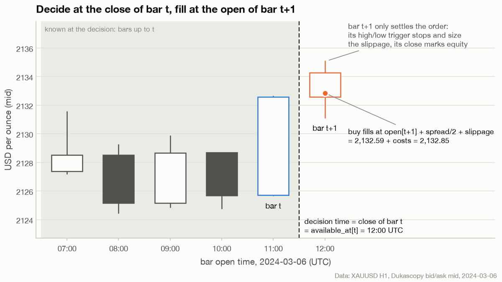
</picture>

*The decision at 12:00 UTC sees only the shaded bars; the buy fills at the 12:00 open of 2,132.59 plus half the spread and slippage (2,132.85), and bar t+1 only settles the order. Data: XAUUSD H1, Dukascopy bid/ask mid, 2024-03-06.*

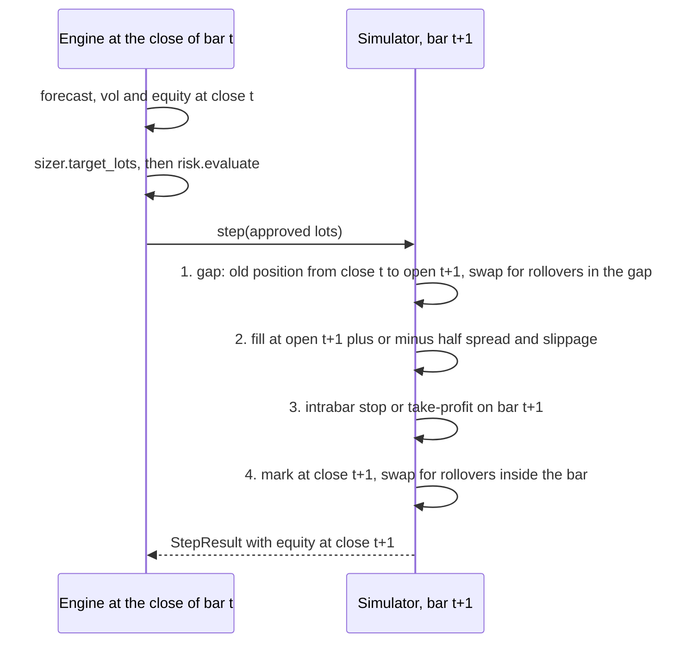

**Pitfalls and design choices.**

- *Same-bar fills are look-ahead.* Filling at `close[t]` a decision computed from `close[t]`
  assumes a zero-latency trader who already knew the close. Aurum always fills at the next open.
- *The execution bar is not information.* The range of bar `t+1` feeds the slippage term and
  the stop check, but it is consumed inside `step()`, after the decision. Nothing from `t+1`
  reaches a forecast, a sizer or a risk check.
- *Gaps are real costs.* A position held over a weekend is marked from Friday's close to
  Sunday's open in the gap segment, and an order decided on Friday fills at the reopen, gap
  included. The live runner reproduces this by deferring the order when the market is closed
  ([live-trading.md](live-trading.md)).

## ExecutionSimulator

```text
ExecutionSimulator(bars, instrument=XAUUSD, costs=None, initial_equity=100_000.0, *,
                   validate=True, rates=None)
```

| Argument | Meaning |
|---|---|
| `bars` | Canonical bars frame (mid OHLC, `spread`, `available_at`), validated unless `validate=False` |
| `instrument` | Contract spec: lot grid, contract size (100 oz), rollover hour (21 UTC), triple-swap weekday (Wednesday) |
| `costs` | [`CostModel`](#fill-prices-mid-half-spread-slippage). `None` means `CostModel()` defaults, including rate financing. |
| `initial_equity` | Starting equity in USD |
| `rates` | Benchmark-rate source for rate financing: `md.macro`, a macro frame with `available_at`, a Series indexed by availability time, or a `RateCurve`. `None` uses `fallback_rate` for every rollover (warned once). |

`reset(start=0, equity=None)` starts flat at the close of bar `start`. The state at "now" is
exposed as `index`, `equity`, `position`, `done`, `peak_equity`, `bankrupt`, `time` (open time
of the current bar), `decision_time` (its `available_at`), `price` (mid close), `spread`,
`drawdown`, `margin_used`, `free_margin` and `snapshot()`.

### What `step()` does

```text
step(target_lots, *, stop_price=None, take_profit=None, reason="signal",
     stop_distance=None, take_profit_distance=None) -> StepResult
```

`step()` is called at the close of bar `t = sim.index` and simulates bar `t+1` in four phases:

1. **Gap segment.** The old position is marked from `close[t]` to `open[t+1]`. It pays swap for
   any rollover strictly after `available_at[t]` and at or before `open[t+1]` (for example a
   daily maintenance break). Rate financing values that notional at `close[t]`.
2. **Fill at the open.** The position is traded to `round_lots(target_lots)`, rounded toward
   zero and clipped to `max_lot`. A buy fills at `open + spread_eff/2 + slippage`, a sell at
   `open - spread_eff/2 - slippage`. Spread and slippage are booked as costs, and the position
   is marked from the **mid**.
3. **Intrabar protective exits** on bar `t+1` for the position held after the fill
   ([next sections](#intrabar-stops-and-take-profits-stop-first)).
4. **Mark to market** at `close[t+1]`, plus swap for rollovers inside
   `(open[t+1], available_at[t+1]]`, charged on the position held at the close. Rate financing
   values it at `close[t+1]`.

`stop_price` / `take_profit` are absolute mid levels and protect bar `t+1` only: pass them
again on every step to keep them working. `stop_distance` / `take_profit_distance` are the
alternative for a position being *entered* at this open. The level is then anchored at the
fill (`open[t+1] - distance` for a long stop, mirrored for a short), so a gap cannot put the
stop on the wrong side of the market. The resolved levels come back in
`StepResult.stop_price` / `take_profit`. Passing both a level and a distance for the same order
raises `ValueError`. Calling `step()` when `done` is true (no next bar) raises `RuntimeError`.

`StepResult` fields: `index`, `time`, `equity`, `pnl`, `ret`, `price_pnl`, `costs`
(`spread`, `slippage`, `commission`, `swap`), `fills` (list of `aurum.core.types.Fill`),
`position` (at the close), `position_open` (right after the fill), `done`, `exit_reason`,
`stop_price`, `take_profit`.

### Example

```python
import pandas as pd

from aurum.data.schema import make_bars
from aurum.execution.costs import CostModel
from aurum.execution.simulator import ExecutionSimulator, intrabar_exit

idx = pd.date_range("2024-03-05 10:00", periods=4, freq="1h", tz="UTC")
bars = make_bars(pd.DataFrame({
    "open":  [2000.0, 2001.0, 1994.0, 1990.0],
    "high":  [2002.0, 2003.0, 1996.0, 1992.0],
    "low":   [1999.0, 1995.0, 1989.0, 1985.0],
    "close": [2001.0, 1996.0, 1990.0, 1988.0],
}, index=idx), "H1", default_spread=0.30)

sim = ExecutionSimulator(bars, costs=CostModel(financing="none"))
# decided at the close of bar 0; fills at the OPEN of bar 1 (2001.00 + 0.15 + 0.02 + 0.02 * 8.00)
r = sim.step(1.0, stop_distance=4.0)          # stop anchored at the fill: 2001.00 - 4.00 = 1997.00
print(r.fills[0].price, r.stop_price, r.exit_reason, r.position)
print({k: round(v, 2) for k, v in r.costs.items()}, round(r.pnl, 2))

# the intrabar rule on its own: long, stop 1997, bar opens BELOW it -> exit at the open
print(intrabar_exit(1.0, o=1994.0, h=1996.0, lo=1989.0, sl=1997.0, tp=2010.0))
# both levels inside the range: the stop is assumed to fill first
print(intrabar_exit(1.0, o=2000.0, h=2011.0, lo=1996.0, sl=1997.0, tp=2010.0))
print(sim.result().reconcile()["residual"])
```

Output:

```text
2001.33 1997.0 stop 0.0
{'spread': 30.0, 'slippage': 36.0, 'commission': 0.0, 'swap': 0.0} -466.0
(1994.0, 'stop', False)
(1997.0, 'stop', False)
0.0
```

The long entered at 2001.33 (mid 2001.00 plus 0.15 half spread plus 0.18 slippage, since the
bar's range is 8.00). The bar's low of 1995 hit the 1997 stop, so the position was closed in the
same bar. The P&L is −400 at mid (1997 − 2001 on 100 oz), minus 30 of spread and 36 of slippage
for the two fills.

### Trade accounting and bankruptcy

A **trade** is a round trip from flat to flat. A reversal fill is split into a closing leg and
an opening leg, with its costs split pro rata by lots. Scaling in or out stays within one trade:
`entry_price` / `exit_price` are lot-weighted averages of executed prices (including spread
and slippage), and `lots` is the largest absolute size held. Every USD of price P&L, cost
and swap is attributed to exactly one trade. A position still open at the end is closed
virtually at the last close (`exit_reason="end"`, no liquidation cost), so
`sum(trades.pnl) == equity[-1] - equity[0]`.

There is no margin stop-out model. The only guard is bankruptcy: once equity is at or below
zero, a warning is logged and every later step is forced flat with reason `"risk"`. Margin
limits belong to the risk manager ([portfolio-and-risk.md](portfolio-and-risk.md)).

<a id="cost-model"></a>

## Fill prices: mid, half spread, slippage

**Intuition.** Bars carry the mid price, halfway between the bid and the ask. Nobody trades at
the mid: a buyer lifts the ask and a seller hits the bid, so each market order pays half the
spread. On top of that the price moves while the order travels, and it moves more in a fast
market. Aurum charges a fixed slippage plus a share of the execution bar's high-low range, so
an order sent into the US payrolls hour pays more than one sent at 3 a.m.

**The math** ([`CostModel.fill_price`](../aurum/execution/costs.py)):

```math
s^{\mathrm{eff}} = \max\left(m\,s,\ s_{\min}\right), \qquad
\mathrm{slip} = a + b\,(H - L) + c\sqrt{\lvert q \rvert}
```

```math
P^{\mathrm{buy}} = M + \tfrac{1}{2}s^{\mathrm{eff}} + \mathrm{slip}, \qquad
P^{\mathrm{sell}} = M - \tfrac{1}{2}s^{\mathrm{eff}} - \mathrm{slip}
```

```math
C^{\mathrm{spread}} = \tfrac{1}{2}s^{\mathrm{eff}}\,\lvert q \rvert K, \qquad
C^{\mathrm{slip}} = \mathrm{slip}\,\lvert q \rvert K, \qquad
C^{\mathrm{comm}} = \kappa\,\lvert q \rvert
```

where

- $s$ is the quoted spread of the execution bar (full bid/ask, USD/oz); a non-finite or
  negative value counts as 0, so the floor applies;
- $m$ = `spread_multiplier` (1.0), $s_{\min}$ = `min_spread` (0.10 USD/oz);
- $a$ = `slippage_fixed` (0.02 USD/oz), $b$ = `slippage_range_frac` (0.02), $H - L$ the
  execution bar's range, $c$ = `impact_coef` (0, square-root impact per lot);
- $M$ is the mid the order executes at: the open of bar `t+1` for a decision, or the stop or
  take-profit level for a protective exit;
- $q$ is the signed size in lots, $K$ = 100 oz, $\kappa$ = commission per lot per side
  (`commission_per_lot`, `None` defers to the instrument's 0.0);
- a **limit** order (a take-profit) has $\mathrm{slip} = 0$: it pays half the spread only.

**The picture.** The same model on two real bars, and on every H1 bar of 2012-2024 by hour of day:

<picture>
  <source media="(prefers-color-scheme: dark)" srcset="_assets/figures/execution-and-costs/fill-ladder-dark.png">
  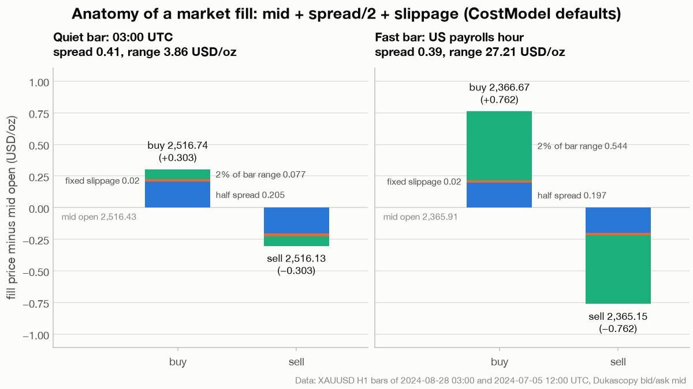
</picture>

*At 03:00 UTC a market order costs 0.303 USD/oz each way; in the payrolls hour (range 27.21) the range term alone is 0.544 and the order costs 0.762 USD/oz, 2.5 times as much. Data: XAUUSD H1 bars of 2024-08-28 03:00 and 2024-07-05 12:00 UTC, Dukascopy bid/ask mid.*

<picture>
  <source media="(prefers-color-scheme: dark)" srcset="_assets/figures/execution-and-costs/cost-by-hour-dark.png">
  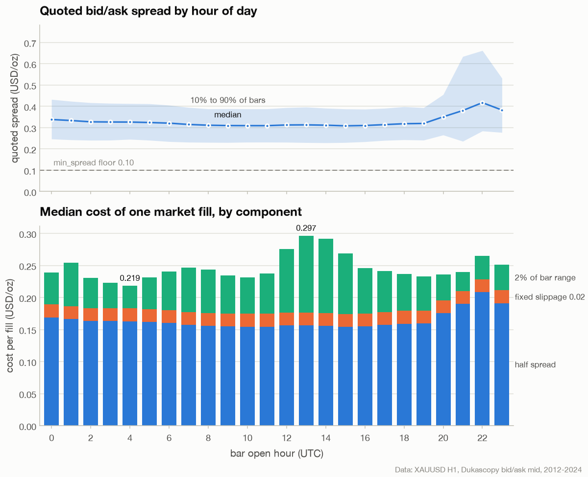
</picture>

*The quoted spread is flattest from 07:00 to 19:00 UTC (median about 0.31 USD/oz) and widest around the 22:00 UTC reopen (0.417); the full cost of one fill is lowest at 04:00 (0.219) and highest at 13:00 UTC (0.297), when the US session's ranges inflate slippage. Data: XAUUSD H1, Dukascopy bid/ask mid, 2012-2024.*

**In code.** `aurum.execution.costs.CostModel` is a frozen dataclass configured under `costs.*`
([configuration.md](configuration.md)).

| Field | Default | Units | Meaning |
|---|---|---|---|
| `spread_multiplier` | 1.0 | x | Scales the bar's quoted spread (1.5 to 2.0 to stress-test) |
| `min_spread` | 0.10 | USD/oz | Floor on the effective spread |
| `slippage_fixed` | 0.02 | USD/oz | Adverse slippage per fill |
| `slippage_range_frac` | 0.02 | fraction | Share of the execution bar's high-low range added as slippage |
| `impact_coef` | 0.0 | USD/oz per sqrt(lot) | Square-root market impact |
| `commission_per_lot` | `None` | USD per lot per side | `None` uses `instrument.commission_per_lot` (0.0 for the default XAUUSD instrument) |
| `financing` | `FinancingModel()` | | [Overnight financing](#overnight-financing). A kwargs mapping or a mode name is also accepted. |

Methods: `effective_spread(spread)`, `slippage(bar_range, lots)`,
`fill_price(side, mid, spread, bar_range, lots, *, instrument=XAUUSD, limit=False)` returning
`FillPrice(price, spread_cost, slippage_cost)`, `commission(lots)`,
`swap(lots, nights, *, price=None, rate_nights=None)`,
`swap_between(lots, start, end, *, price=None, rates=None)` and
`round_trip_cost(lots, spread, bar_range=0.0)` (open and close with market orders, excluding
swap). `CostModel.zero()` is fully frictionless (no spread, slippage, commission or financing).

```python
from aurum.execution.costs import CostModel

cm = CostModel()   # min_spread 0.10, slippage 0.02 + 2% of range, no commission, rate financing

# buy 1 lot at mid 2000.00, quoted spread 0.30, execution-bar range 5.00
fp = cm.fill_price(+1, 2000.0, 0.30, 5.0, 1.0)
print(fp)
# a take-profit (limit=True) fills at the half-spread with no slippage
print(cm.fill_price(-1, 2010.0, 0.30, 5.0, 1.0, limit=True))
# a quoted spread below the floor is charged at min_spread
print(cm.effective_spread(0.04))
print(cm.round_trip_cost(1.0, 0.30, 5.0))
```

Output:

```text
FillPrice(price=2000.27, spread_cost=15.0, slippage_cost=12.000000000000002)
FillPrice(price=2009.85, spread_cost=15.0, slippage_cost=0.0)
0.1
54.0
```

**Pitfalls and design choices.**

- *Vendor spreads flatter execution.* Dukascopy reports a bid/ask spread per bar, but a retail
  account rarely fills that tightly. The 0.10 floor and `spread_multiplier` exist for that;
  stress-test with 1.5 to 2.0.
- *Slippage scales with the market, not with a constant.* The range term makes the cost of a
  strategy that trades the US open visibly higher than one that trades in Asia (the bottom
  panel above). The range is an input of the cost model only and never reaches a decision.
- *Retail size has no impact.* `impact_coef` defaults to 0 because one lot is tiny next to the
  gold market. Raise it to study large books.
- *No tick rounding.* Fill prices are not rounded to the 0.01 grid: the error is at most
  0.005 USD/oz and leaving prices unrounded keeps the P&L identity exact.
- *Costs feed the combiner.* The [forecast combiner](portfolio-and-risk.md) uses the same
  fields to score every strategy net of costs before it weights them.

## Intrabar stops and take-profits: stop first

**Intuition.** An OHLC bar tells you the open, the high, the low and the close, but not the
order in which the high and the low happened. When a bar's range covers both a position's
stop and its take-profit, the backtest cannot know which one filled. Aurum always assumes the
worse outcome, the stop, so an ambiguous bar can only make results look worse than reality,
never better.

**The rules** ([`intrabar_exit`](../aurum/execution/simulator.py), checked in this order for a
long position; shorts are mirrored):

```math
X =
\begin{cases}
O & \text{if } O \le \ell_{\mathrm{SL}} \quad \text{gap through the stop: market exit at the open}\\
O & \text{if } O \ge \ell_{\mathrm{TP}} \quad \text{gap through the take-profit: limit exit at the open}\\
\ell_{\mathrm{SL}} & \text{if } L \le \ell_{\mathrm{SL}} \quad \text{stop: market order}\\
\ell_{\mathrm{TP}} & \text{if } H \ge \ell_{\mathrm{TP}} \quad \text{take-profit: limit order}\\
\text{no exit} & \text{otherwise}
\end{cases}
```

```math
P^{\mathrm{exit}}_{\mathrm{long}} = X - \tfrac{1}{2}s^{\mathrm{eff}} - \mathrm{slip}\ \ \text{(stop)}, \qquad
P^{\mathrm{exit}}_{\mathrm{long}} = X - \tfrac{1}{2}s^{\mathrm{eff}}\ \ \text{(take-profit)}
```

where $O, H, L$ are the mid open, high and low of the bar, $\ell_{\mathrm{SL}}$ and
$\ell_{\mathrm{TP}}$ the stop and take-profit as mid levels, and the costs are those of the
previous section (the take-profit is a limit order and does not slip). The function returns
`(X, reason, is_limit)` or `None`.

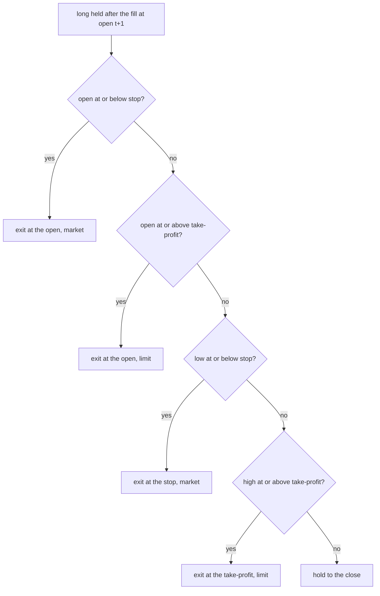

**The picture.**

<picture>
  <source media="(prefers-color-scheme: dark)" srcset="_assets/figures/execution-and-costs/intrabar-ambiguity-dark.png">
  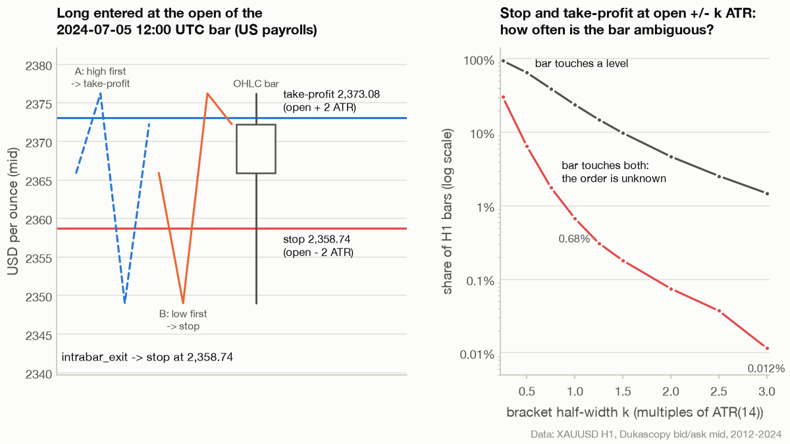
</picture>

*On the 2024-07-05 payrolls bar a bracket of 2 ATR around the open was hit on both sides, so aurum books the stop at 2,358.74 (path B). Across 2012-2024 a bracket of 1 ATR is ambiguous on 0.68% of H1 bars and one of 3 ATR on 0.012%. Data: XAUUSD H1, Dukascopy bid/ask mid, 2012-2024.*

**In code.** The simulator, the paper broker and the live runner (to recognise a broker-side
stop for the post-stop cooldown) all call the same function, so they resolve a bar the same
way. The example in [ExecutionSimulator](#example) shows both an exit at the open and the
stop-first case. Stops come from `backtest.stop_atr_mult` and `backtest.take_profit_atr_mult`
(levels at `entry ∓ k × ATR[t]`, Wilder ATR over `atr_period` = 14 bars, see
[Backtest engine](#backtest-engine)); they are off (`null`) in the shipped configs.

**Pitfalls and design choices.**

- *Why stop first is conservative.* Assuming the take-profit filled first would turn every
  ambiguous bar into a win; assuming the stop makes it a loss. If the real path went the other
  way, live results can only be better than the backtest on those bars.
- *When it matters.* The right panel shows that ambiguity needs a bracket narrower than about
  one ATR of the bar: at 1 ATR, 0.68% of all H1 bars touch both sides (2.8% of the bars that
  touch either side); at 3 ATR, 0.012%. Tight scalping brackets and long bars (H4, D1) are where
  the convention moves results.
- *Gaps exit at the open, not at the level.* A long whose stop is above the open has already
  lost more than the stop distance; filling at the stop level would understate the loss.
- *Anchoring at the fill.* `stop_distance` places the level relative to the actual entry, so a
  gap at the open cannot leave a stop on the wrong side of the market (which would enter and
  exit at once, paying the spread twice).

## Overnight financing

**Intuition.** A gold CFD held past the daily rollover is financed like a currency position:
buying XAUUSD means borrowing dollars to hold gold, so a long pays the dollar interest rate plus
the broker's markup, and a short earns the rate minus the markup. Aurum charges this from the
real federal funds rate, using only the value that had been published when each rollover
happened. The Wednesday rollover counts three nights because spot gold settles two days
later, which spans the weekend.

**The math** ([`FinancingModel.amount`](../aurum/execution/costs.py)). For every rollover
instant $R$ that falls inside a holding interval, $t_0 < R \le t_1$:

```math
S(R) = -\,q\,K\,P_R\;w(R)\;\frac{r(R) - \lambda + \mu}{D}, \qquad
\mu = \begin{cases} +\mu_{\mathrm{long}} & q > 0 \\ -\mu_{\mathrm{short}} & q < 0 \end{cases}
```

```math
r(R) = v_{j^\star}, \qquad j^\star = \max\left\lbrace j : a_j \le R \right\rbrace, \qquad
w(R) = \begin{cases} 3 & \text{Wednesday} \\ 1 & \text{Monday, Tuesday, Thursday, Friday} \\ 0 & \text{Saturday, Sunday} \end{cases}
```

where

- $S(R)$ is signed financing in USD, positive when received;
- $q$ is the signed position in lots and $K$ = 100 oz;
- $P_R$ is the mid at the rollover: the close of the bar ending at or after $R$, or the previous
  close for a rollover in a gap between bars;
- $R$ is `rollover_hour_utc` (21:00 UTC) on each day, and $w$ uses `triple_swap_weekday` = 2
  (Wednesday);
- $v_j$ are the benchmark observations (`rate_series` = `fedfunds`, FRED DFF, in percent and
  divided by 100) and $a_j$ their `available_at`; when several rows become available at the
  same instant the last one wins, and before the first observation $r$ = `fallback_rate` (0.03);
- $\lambda$ = `lease_rate` (0), $\mu_{\mathrm{long}}$ = `markup_long` (0.025),
  $\mu_{\mathrm{short}}$ = `markup_short` (0.025), $D$ = `day_count` (360).

A short therefore receives $r - \mu_{\mathrm{short}}$ and pays when that is negative, which is
what every year with near-zero rates looked like at a retail broker.

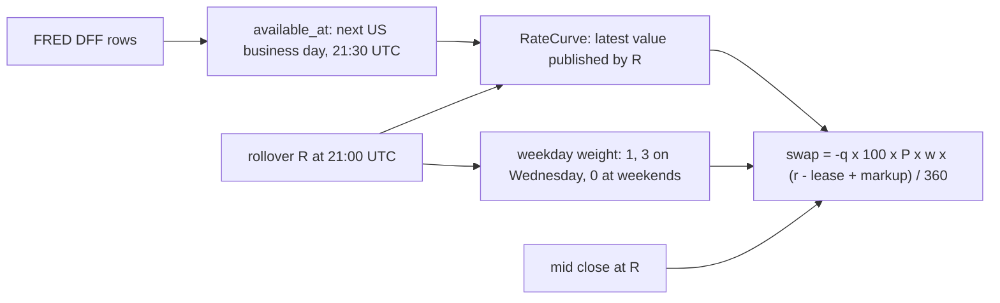

**The picture.**

<picture>
  <source media="(prefers-color-scheme: dark)" srcset="_assets/figures/execution-and-costs/financing-carry-dark.png">
  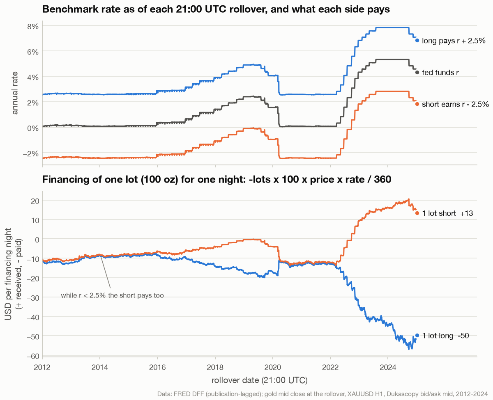
</picture>

*In June 2013 (fed funds 0.08% to 0.12%) one lot paid about 8 to 10 USD a night whichever side it was on (long 8.6 to 10.3, short 8.0 to 9.5); on 2024-12-31 (4.33%, gold 2,623) a long paid 49.8 USD a night and a short received 13.3. Data: FRED DFF (publication-lagged); XAUUSD H1, Dukascopy bid/ask mid, 2012-2024.*

<picture>
  <source media="(prefers-color-scheme: dark)" srcset="_assets/figures/execution-and-costs/triple-roll-dark.png">
  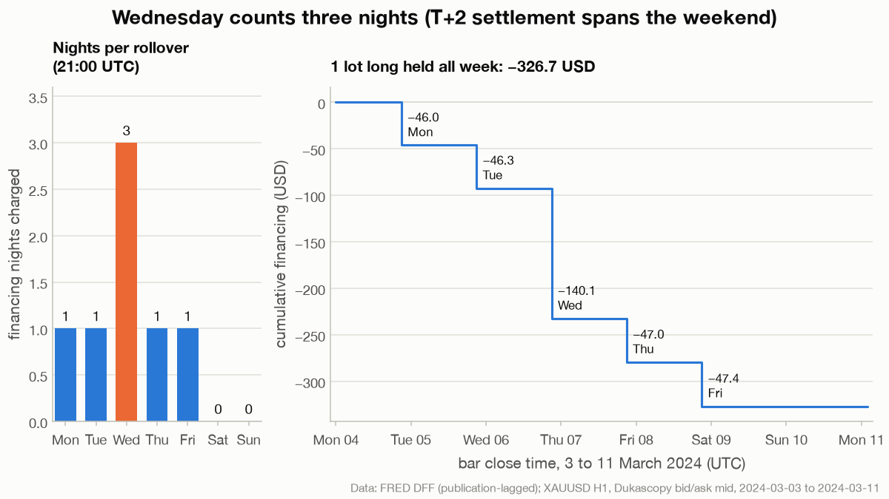
</picture>

*Holding 1 lot long from Sunday 3 to Monday 11 March 2024 cost 326.7 USD: 46 to 47 USD for each ordinary night at 5.33% fed funds, 140.1 USD on Wednesday and nothing over the weekend. Data: FRED DFF (publication-lagged); XAUUSD H1, Dukascopy bid/ask mid, 2024-03-03 to 2024-03-11.*

**In code.** The modes:

| Mode | What is charged |
|---|---|
| `rate` (default) | Interest on the notional, as above |
| `fixed` | The instrument's per-lot swap table: `instrument.swap_long_per_lot` (−45) and `swap_short_per_lot` (+15) USD per lot per night. This reproduces the pre-2026 behaviour exactly, and lets you replicate a specific broker's table. The −45/+15 defaults are roughly 9%/yr of an 1,800 USD/oz notional for a long, far above 2012–2021 benchmark rates; they are kept for backward compatibility, not as realistic values. |
| `none` | Nothing (frictionless benchmarks) |

| Field | Default | Meaning |
|---|---|---|
| `mode` | `"rate"` | `rate`, `fixed` or `none` |
| `markup_long` | 0.025 | Annual markup a long pays on top of the rate (fraction, in [0, 1)) |
| `markup_short` | 0.025 | Annual markup deducted from what a short receives |
| `lease_rate` | 0.0 | Annual gold lease rate, earned by longs and paid by shorts |
| `rate_series` | `"fedfunds"` | Name of the benchmark series in `md.macro` (FRED DFF) |
| `rate_unit` | `"percent"` | `percent`, `fraction` or `bps` |
| `fallback_rate` | 0.03 | Benchmark (fraction) before the series starts, or without it |
| `day_count` | 360.0 | USD money-market convention |

When a night is charged: a rollover `R` is charged to whoever holds the position
**immediately before** it, i.e. over an interval `(t0, t1]` when `t0 < R <= t1`. With H1 bars
the bar opening at 20:00 closes exactly at the 21:00 rollover, so the position held through
that bar pays it. A full week counts 7 nights. `rollover_nights(start, end)` and the vectorised
`rollover_nights_ns` count nights in O(1) per interval, across weekends and holidays.

`RateCurve` is the point-in-time step curve. `RateCurve.from_source()` accepts `md.macro` (it
picks `rate_series`), a macro frame with `available_at` and a `value` column, a Series indexed
by availability time, or a `RateCurve`; a frame without `available_at`, or tz-naive
availability times, is rejected. The simulator precomputes the rate for each bar interval at
construction and settles each rollover only in the step that simulates it. It logs a one-time
WARNING when there is no series (every rollover uses `fallback_rate`), when the series starts
after the first bar, or when it ends more than 14 days before the last bar (the last value is
carried forward). The provenance is in `BacktestResult.meta["financing"]`. The backtest engine
passes `md.macro` by default, and `rates=` overrides it.

```python
import pandas as pd

from aurum.execution.costs import CostModel, FinancingModel, RateCurve, rollover_nights

fin = FinancingModel()                     # rate mode: benchmark + 2.5% markup, /360
# one night, 1 lot, mid 2,000 USD/oz, benchmark 5.33%
print(round(fin.nightly(+1.0, 2_000.0, 0.0533), 2), round(fin.nightly(-1.0, 2_000.0, 0.0533), 2))

# rollovers at 21:00 UTC; Wednesday counts 3 nights, Sat/Sun none
t = lambda s: pd.Timestamp(s, tz="UTC")
print(rollover_nights(t("2024-03-05 20:00"), t("2024-03-05 21:00")))   # Tuesday
print(rollover_nights(t("2024-03-06 20:00"), t("2024-03-06 21:00")))   # Wednesday
print(rollover_nights(t("2024-03-08 20:00"), t("2024-03-11 20:00")))   # Fri 21:00 only
print(rollover_nights(t("2024-03-04 00:00"), t("2024-03-11 00:00")))   # a full week

# point-in-time benchmark: a print is only used from its available_at on
rates = pd.Series([5.33, 4.83], index=pd.DatetimeIndex(
    [t("2024-01-02 13:00"), t("2024-09-19 13:00")]))           # percent, indexed by availability
curve = RateCurve.from_source(rates, unit="percent")
print(curve)
cm = CostModel()
print(round(cm.swap_between(1.0, t("2024-09-18 20:00"), t("2024-09-18 21:00"),
                            price=2_000.0, rates=curve), 2))    # Wed: 3 nights at 5.33%
print(round(cm.swap_between(1.0, t("2024-09-19 20:00"), t("2024-09-19 21:00"),
                            price=2_000.0, rates=curve), 2))    # Thu: 1 night at 4.83%
print(cm.swap_between(1.0, t("2024-09-19 20:00"), t("2024-09-19 21:00"), price=2_000.0,
                      rates=None))                              # no series -> fallback_rate 3%
print(CostModel(financing="fixed").swap(1.0, 3.0))              # instrument table: -45 USD/lot/night
```

Output:

```text
-43.5 15.72
1.0
3.0
1.0
7.0
RateCurve('fedfunds', n=2, 2024-01-02 13:00:00+00:00 .. 2024-09-19 13:00:00+00:00)
-130.5
-40.72
-30.555555555555557
-135.0
```

The first line is the worked example: 1 lot long at 2,000 USD/oz is a 200,000 USD notional, so
one night at 5.33% plus the 2.5% markup costs 200,000 × 0.0783 / 360 = 43.50 USD, and the same
short receives 200,000 × 0.0283 / 360 = 15.72 USD. The series in this snippet is illustrative
(the real cut was published later, see below).

Configuration (`costs.financing`):

```yaml
costs:
  financing:
    mode: rate            # rate | fixed | none
    rate_series: fedfunds # data_store/macro/fedfunds (FRED DFF, %), read as of each rollover
    rate_unit: percent
    markup_long: 0.025
    markup_short: 0.025
    lease_rate: 0.0
    fallback_rate: 0.03
    day_count: 360
```

`run_backtest(..., financing=...)` and `buy_and_hold_benchmark(..., financing=...)` override
`costs.financing` with a `FinancingModel`, its kwargs, or a mode name (`"rate"`, `"fixed"`,
`"none"`). Keep the same rate source for the RL environment (`GoldTradingEnv(..., rates=)`)
and the paper broker (`PaperBroker(..., rates=)`) so they stay in parity with the engine.

**Pitfalls and design choices.**

- *Publication lag is real.* FRED publishes a day's DFF the next US business day, and aurum
  makes it available at 21:30 UTC, after that day's 21:00 rollover. The September 2024 cut is
  a real example: DFF fell from 5.33% to 4.83% on 2024-09-19, that value became available on
  Friday 2024-09-20 at 21:30, so the rollovers of 18, 19 and 20 September were charged at 5.33%
  and the first charged rollover at 4.83% was Monday 23 September. A backtest that applied the
  new rate on the 19th would use a number nobody had yet.
- *Financing dominates buy-and-hold.* Over the 2015-2024 walk-forward the 1x buy-and-hold
  benchmark paid 66.1k USD of financing on 144.2k USD of gross price gains (next section). A
  long-only CFD book that ignores swap overstates its return by that much.
- *The legacy table is unrealistic.* `fixed` mode's −45/+15 USD per lot is kept for backward
  compatibility; it charges a long about 9% a year whatever the rates were.
- *The markup is an estimate.* 2.5% approximates a retail CFD broker; prime brokers charge
  less. To replicate your broker exactly, use `mode: fixed` with its quoted per-lot swaps.
- *Fixed rollover hour.* 21:00 UTC does not move with New York daylight saving, so the
  rollover can be an hour off for about half the year (see [Limitations](#limitations)).

## From gross to net in a real walk-forward

**Intuition.** A strategy's gross trading profit is not what it earns. Every rebalance pays the
spread and slippage, and every night in the market pays financing. A fast strategy can have a
positive gross edge and still lose money net. The walk-forward books every component
separately, so the path from gross to net can be read off the results.

**The math.** Summed over the out-of-sample bars of a book:

```math
\text{net} = \sum_t \Pi^{\mathrm{price}}_t - \sum_t C^{\mathrm{spread}}_t - \sum_t C^{\mathrm{slip}}_t
 - \sum_t C^{\mathrm{comm}}_t + \sum_t S_t
```

where $\Pi^{\mathrm{price}}$ is the mark-to-mid price P&L (`pnl_price` in `timeseries.parquet`),
the $C$ terms are the positive costs (`cost_spread`, `cost_slippage`, `cost_commission`) and
$S$ the signed financing (`cost_swap`, negative when paid).

**The picture.**

<picture>
  <source media="(prefers-color-scheme: dark)" srcset="_assets/figures/execution-and-costs/cost-waterfall-dark.png">
  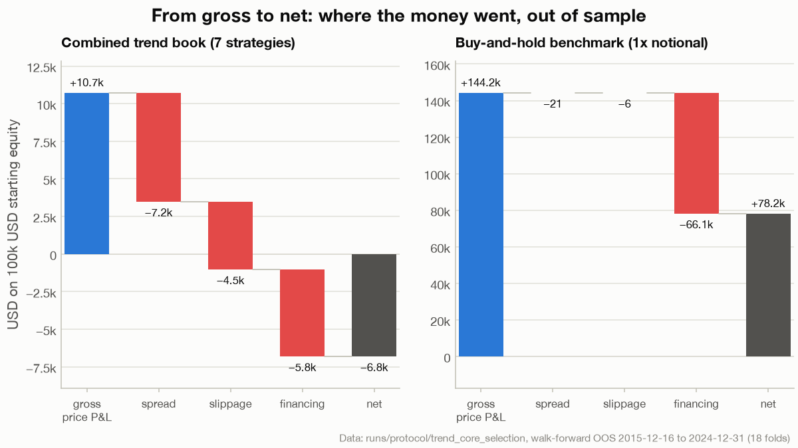
</picture>

*The combined trend book earned 10.7k USD of gross price P&L out of sample and lost 6.8k net after 7.2k of spread, 4.5k of slippage and 5.8k of financing; buy-and-hold paid only 26 USD to trade but 66.1k of financing. Data: runs/protocol/trend_core_selection, walk-forward OOS 2015-12-16 to 2024-12-31 (18 folds).*

The same totals for every book of that run (`costs.csv`; USD on 100k starting equity,
`costs / gross` is spread plus slippage plus commission over the absolute gross price P&L, the run's `costs_pct_gross`):

| Book | Gross price P&L | Spread | Slippage | Financing | Net | Costs / gross |
|---|---:|---:|---:|---:|---:|---:|
| combined | 10,721.6 | 7,238.0 | 4,511.3 | −5,786.3 | −6,814.0 | 1.10 |
| tsmom | 22,721.5 | 9,140.6 | 5,817.6 | −8,761.8 | −998.6 | 0.66 |
| ema_cross | 21,346.2 | 5,348.9 | 3,373.5 | −9,213.7 | 3,410.1 | 0.41 |
| donchian | 11,746.4 | 5,172.0 | 4,091.8 | −7,955.6 | −5,473.0 | 0.79 |
| kalman_trend | 23,568.2 | 9,195.8 | 6,316.5 | −8,722.8 | −666.8 | 0.66 |
| vol_squeeze | 22,560.8 | 11,584.6 | 7,122.8 | −1,976.2 | 1,877.3 | 0.83 |
| macro_factor | −2,532.2 | 3,329.7 | 1,436.7 | −4,717.1 | −12,015.7 | 1.88 |
| risk_off | −59.6 | 679.3 | 324.3 | −1,737.7 | −2,800.9 | 16.83 |
| benchmark | 144,242.5 | 20.5 | 5.7 | −66,052.9 | 78,163.4 | 0.00 |

Commission is 0 in every row (the default instrument charges none). These numbers describe one
research run; whether any of them is evidence of an edge is the subject of
[RESULTS.md](RESULTS.md) and [RESEARCH_PROTOCOL.md](RESEARCH_PROTOCOL.md).

**Pitfalls and design choices.**

- *Cost blindness.* Five of the seven trend strategies made more than 11k USD gross, and only
  two kept a positive net. Judging a strategy by its gross P&L, or by a backtest with
  `CostModel.zero()`, picks the strategies that trade the most.
- *Combining does not remove costs.* The combined book pays the costs of trading the blended
  position, which is why the combiner scores strategies net of costs before it weights them
  ([portfolio-and-risk.md](portfolio-and-risk.md)).
- The per-strategy split of a book's costs, and an interactive version of this waterfall, are
  in [analytics.md](analytics.md) (`aurum explain --attribution`, `aurum dashboard`).

## Paper broker parity

**Intuition.** The paper broker keeps its book the way a real broker does: each position has
an executed entry price, commission comes out of the balance, swap accrues on the position.
The simulator instead marks everything at the mid and books spread and slippage as separate
costs. The two bookkeepings are algebraically the same, so on the same orders they must agree
to floating-point precision. If they ever disagree, either the paper broker or the simulator
has a bug, and a test fails.

**The math.** A position of $q$ lots filled around the mid $M_{\mathrm{fill}}$ and marked at
mid $M_t$:

```math
P^{\mathrm{exec}} = M_{\mathrm{fill}} + \operatorname{sign}(q)\left(\tfrac{1}{2}s^{\mathrm{eff}} + \mathrm{slip}\right)
\quad\Rightarrow\quad
q K \left(M_t - P^{\mathrm{exec}}\right) = q K \left(M_t - M_{\mathrm{fill}}\right)
 - \left(\tfrac{1}{2}s^{\mathrm{eff}} + \mathrm{slip}\right)\lvert q \rvert K
```

The left side is the broker's floating P&L; the right side is the simulator's mid-marked P&L
minus its booked spread and slippage costs. Commission and financing use the same functions in
both, with the same rollover instants and the same valuation price.

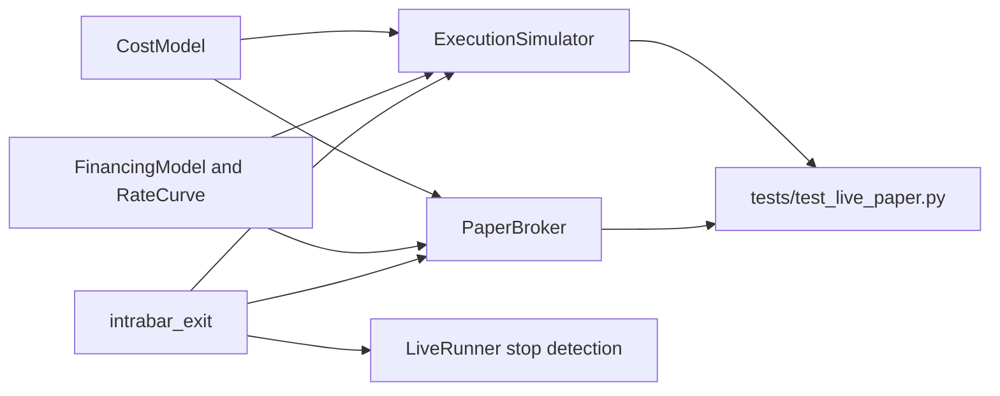

**The picture.**

<picture>
  <source media="(prefers-color-scheme: dark)" srcset="_assets/figures/execution-and-costs/paper-parity-dark.png">
  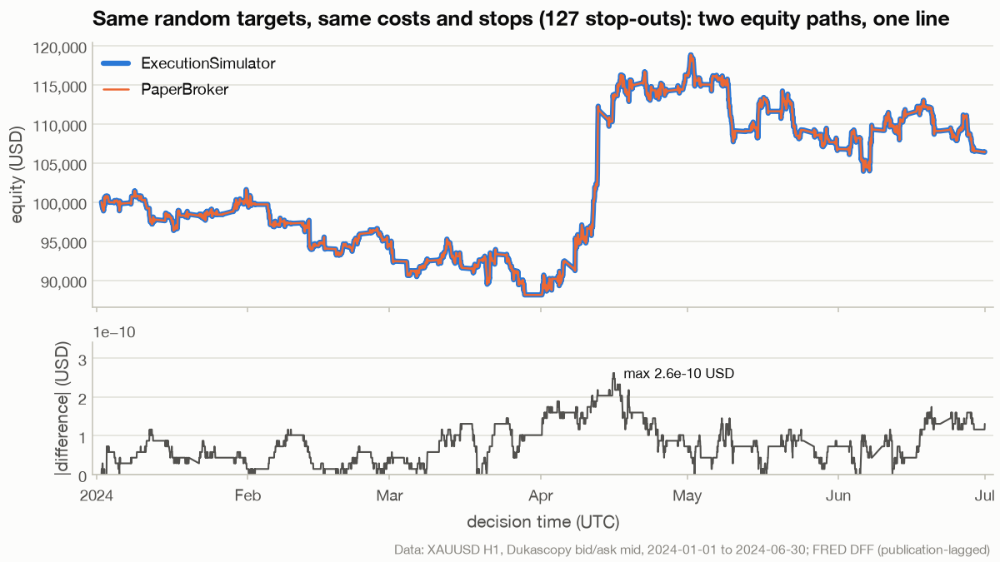
</picture>

*On 2,938 real H1 bars with random targets, 127 stop-outs, a commission of 3.5 USD per lot per side and rate financing, the two equity paths never differ by more than 2.6e-10 USD. Data: XAUUSD H1, Dukascopy bid/ask mid, 2024-01-01 to 2024-06-30; FRED DFF (publication-lagged).*

**In code.** [`aurum.live.paper.PaperBroker`](../aurum/live/paper.py) with a `ReplayFeed`
fills an order placed just after the close of bar `t` at the open of bar `t+1` (the quote is
that bar's open and spread), and rejects orders between bars with `market_closed`. The parity
is enforced by `tests/test_live_paper.py` (`test_paper_equals_simulator` with and without
stops, `test_paper_swap_matches_simulator_over_rollovers`). A minimal check:

```python
import pandas as pd

from aurum.core.types import Side
from aurum.data.synthetic import make_synthetic_bars
from aurum.execution.costs import CostModel
from aurum.execution.simulator import ExecutionSimulator
from aurum.live.broker import OrderRequest, SimulatedClock
from aurum.live.paper import PaperBroker, ReplayFeed

bars = make_synthetic_bars(120, "H1", seed=3, weekend_gaps=False)   # 5 days of H1 bars
costs = CostModel(commission_per_lot=3.5)          # no macro data: rate financing at fallback_rate
sim = ExecutionSimulator(bars, costs=costs)
clock = SimulatedClock(bars["available_at"].iloc[0] + pd.Timedelta(seconds=5))
paper = PaperBroker(ReplayFeed(bars), costs=costs, clock=clock)

# decided at the close of bar 0: buy 1 lot, which both venues fill at the open of bar 1
paper.place_order(OrderRequest(client_id="demo-0", symbol="XAUUSD", side=Side.BUY, lots=1.0,
                               time=clock.now(), magic=1))
worst = 0.0
for t in range(len(bars) - 1):
    sim.step(1.0)                                   # hold 1 lot through bar t+1
    clock.advance_to(bars["available_at"].iloc[t + 1] + pd.Timedelta(seconds=5))
    worst = max(worst, abs(paper.account().equity - sim.equity))
swap = sim.result(compute_metrics=False).costs["swap"].sum()
print(round(sim.equity, 2), round(paper.account().equity, 2), round(swap, 2), worst)
```

Output (stdout; both venues also log a one-time WARNING that no `fedfunds` series was given):

```text
97934.34 97934.34 -190.93 5.820766091346741e-11
```

**Pitfalls and design choices.**

- *Same inputs or no parity.* Pass the same `CostModel` and the same rate source to both
  (`PaperBroker(..., rates=md.macro)`); with `rates=None` both fall back to 3%, but a paper
  broker without rates next to a simulator with them will drift by the financing difference.
  The runner refreshes the paper broker's rates whenever it reloads macro data.
- *Market closed between bars.* The replay has no quote in a weekend or daily break, like an
  MT5 server (retcode 10018). The runner defers the order and retries at the reopen; the
  figure above does the same, which is why parity holds across real weekend gaps.
- *The simulator has no append API.* It works over a fixed bars frame, so the paper broker
  keeps its own incremental books with the same arithmetic.

## Backtest engine

`aurum.backtest.engine` is deliberately thin. P&L comes from the simulator, and sizing and risk
come from the same objects the live runner uses. At the close of each bar `t` of the window:

```text
risk.on_bar(available_at[t], equity)             # peak / day-start equity, kill checks
requested = sizer.target_lots(forecast[t], vol[t], equity, close[t], instrument,
                              current_lots=position, drawdown=dd)
order     = requested, or 0 while a post-stop cooldown blocks that direction
decision  = risk.evaluate(RiskContext(target_lots=order, ...))   # can only reduce, or halt
sim.step(decision.approved_lots, stop levels ...)
```

Engine rules:

- The forecast is aligned to the bars by label. Missing or NaN values become 0, and values are
  clipped to [-1, 1].
- The default `vol` is `ewma_volatility(close)`, computed on the full history so the window
  starts warmed up ([models.md](models.md)). A `vol` Series is forward-filled, and remaining
  gaps are set to 0.20.
- A non-finite requested size **holds** the current position rather than rounding to 0.
- Any approval outside `[min(0, requested), max(0, requested)]` is clamped, recorded as a risk
  event and counted in `meta["n_risk_clamped"]`. The engine enforces reduce-only even for a
  misbehaving risk manager.
- A fill is tagged `reason="risk"` when risk caused the de-risking (a halt, or a cut of the
  current position that the request did not ask for), otherwise `"signal"`.
- **Protective stops** (`stop_atr_mult`, `take_profit_atr_mult`): when a decision opens or
  reverses a position, the level is set at `entry ∓ k × ATR[t]`. `ATR[t]` is Wilder's ATR over
  bars up to `t` (`average_true_range(bars, n=atr_period)`), and the entry is the fill at the
  open of `t+1`. Levels then stay fixed for the life of the position: no trailing, and scaling
  in keeps the original levels.
- `stop_cooldown_bars`: after a stop-out, re-entry in the same direction is blocked for that
  many decisions. This is applied before the risk manager, so risk sees the order that is
  actually sent, and it is recorded as a `stop_cooldown` risk event.

### run_backtest

```text
run_backtest(md, forecast, *, sizer, risk=None, instrument=XAUUSD, costs=None,
             initial_equity=100_000.0, vol=None, stop_atr_mult=None, start=None, end=None,
             take_profit_atr_mult=None, atr_period=14, stop_cooldown_bars=0, bars_per_year=None,
             event_horizon_hours=24.0, compute_metrics=True, forecast_hook=None, hook_every=1,
             financing=None, rates=None) -> BacktestResult
```

| Argument | Default | Config key | Meaning |
|---|---|---|---|
| `md` | | | `MarketData` (bars, macro, events) or a bars DataFrame |
| `forecast` | | | Series in [-1, 1] decided at each bar's close |
| `sizer` | required | `sizing.*` | A `PositionSizer`, e.g. `VolTargetSizer()` |
| `risk` | `None` | `risk.*` | A `RiskManager`, e.g. `StandardRiskManager(...)` |
| `instrument` | `XAUUSD` | `instrument.*` | Contract spec |
| `costs` | `None` (`CostModel()`) | `costs.*` | Cost model |
| `initial_equity` | 100,000 | `backtest.initial_equity` | USD |
| `vol` | `None` | | Annualised vol per bar (Series or scalar). Default: EWMA. |
| `stop_atr_mult` / `take_profit_atr_mult` | `None` | `backtest.*` | Protective levels at `k × ATR` from the entry |
| `atr_period` | 14 | `backtest.atr_period` | Wilder ATR period |
| `stop_cooldown_bars` | 0 | `backtest.stop_cooldown_bars` | Same-side re-entry block after a stop |
| `start`, `end` | `None` | `backtest.start` / `end` | Inclusive window: bar positions (negative allowed) or timestamps. Inputs are computed on the full history first. |
| `bars_per_year` | `None` | | If given, annualises both the default EWMA vol and `sharpe_bar`. If `None`, the vol uses the nominal timeframe constant and `sharpe_bar` uses the realised bar density of the whole sample (reporting only). |
| `event_horizon_hours` | 24.0 | `backtest.event_horizon_hours` | Width of the upcoming/recent event windows handed to risk |
| `compute_metrics` | `True` | | Fill `result.metrics` |
| `forecast_hook`, `hook_every` | `None`, 1 | | Callback that may replace the forecast before sizing (LLM-desk replay) |
| `financing`, `rates` | `None` | `costs.financing` | Override the cost model's financing / the rate source (default `md.macro`) |

**Forecast hook.** `forecast_hook(bar_index, decision_time, forecast, state)` is called at the
close of every `hook_every`-th window bar. Its return value, clipped to [-1, 1] with non-finite
values mapped to 0, replaces the forecast and is held until the next call. `state` holds
`equity`, `position`, `drawdown`, `peak_equity`, `halted`, `price`, `spread`, `vol`,
`bar_time` and `window_bar`. The hook's output goes through the same sizer and risk manager,
so it can shape exposure but never bypass risk. While the risk manager is halted the approved
position is 0 whatever the hook returns. Call statistics are in `result.meta["hook"]`. See
[llm-desk.md](llm-desk.md) for how `aurum desk replay` uses it.

### run_target_lots

`run_target_lots(md, target_lots, *, risk=None, ...)` backtests a pre-sized path:
`target_lots[t]` is the signed position wanted after the fill at the open of `t+1`. `NaN`
means "no decision, hold". There is no sizer. Risk, stops, financing and every other argument
behave as in `run_backtest` (it has no `forecast_hook`). Inside the package,
`buy_and_hold_benchmark` is built on it. Use it for any externally sized path.

### buy_and_hold_benchmark

`buy_and_hold_benchmark(md, lots=None, notional=None, *, instrument=XAUUSD, costs=None,
initial_equity=100_000.0, start=None, end=None, frictionless=False, compute_metrics=True,
financing=None, rates=None)` buys at the open after the first bar of the window and holds to
the end. The size is `lots`, or `notional` USD converted at the first bar's close (default
`notional = initial_equity`, i.e. 1x leverage), rounded toward zero. It goes through the same
simulator, so by default it pays spread, slippage, commission and CFD financing: the
like-for-like comparison for a CFD strategy. `frictionless=True` removes all costs and
financing. The walk-forward adds this benchmark when `backtest.benchmark: true`.

### Example

```python
import numpy as np

from aurum.backtest.engine import buy_and_hold_benchmark, run_backtest
from aurum.core.types import MarketData
from aurum.data.synthetic import make_synthetic_bars, make_synthetic_events
from aurum.execution.costs import CostModel
from aurum.portfolio.sizing import VolTargetSizer
from aurum.risk.manager import RiskLimits, StandardRiskManager

bars = make_synthetic_bars(6000, "H1", seed=0)          # GBM: no exploitable structure
md = MarketData(bars=bars, events=make_synthetic_events(bars.index[0], bars.index[-1]))

# a toy causal forecast: sign of the trailing 48-bar log return
forecast = np.sign(np.log(bars["close"]).diff(48)).fillna(0.0)

res = run_backtest(
    md, forecast,
    sizer=VolTargetSizer(),                                   # 10% annualised vol target
    risk=StandardRiskManager(RiskLimits(max_spread=2.0, max_drawdown=None,
                                        daily_loss_persistent=False)),  # research-style limits
    costs=CostModel(),                                        # no md.macro -> fallback_rate 3%
    stop_atr_mult=3.0,                                        # optional protective stop
)
m = res.metrics
print({k: round(m[k], 3) for k in ("sharpe", "ann_vol", "max_drawdown", "exposure")})
print(m["n_trades"], round(m["total_costs"], 2), round(m["swap_total"], 2))
print(res.trades["exit_reason"].value_counts().to_dict())
print(len(res.risk_events), res.risk_events.columns.tolist())
print({k: round(v, 6) for k, v in res.reconcile().items()})

bench = buy_and_hold_benchmark(md)                            # 1x notional, same costs and financing
print(bench.meta["lots"], round(bench.metrics["total_return"], 4))
```

Output (stdout; the simulator also logs a one-time WARNING that no `fedfunds` series was
supplied):

```text
{'sharpe': -1.044, 'ann_vol': 0.096, 'max_drawdown': -0.119, 'exposure': 0.991}
393 7792.39 -1230.9
{'signal': 383, 'stop': 9, 'end': 1}
7 ['time', 'bar_time', 'bar', 'current', 'requested', 'approved', 'halted', 'reasons']
{'equity_change': -9958.403105, 'price_pnl': -935.104873, 'costs': 7792.393739, 'swap': -1230.904493, 'residual': 0.0, 'trade_pnl': -9958.403105}
0.55 -0.0774
```

On a random walk a trend rule has no edge, so the result is roughly the cost of trading it:
most of the loss is spread, slippage and financing. This is the expected behaviour, and the
project's leakage tests rely on it. The 7 risk events are event blackouts from the synthetic
calendar.

## BacktestResult

`aurum.backtest.result.BacktestResult` holds a finished backtest. Series are indexed by bar
**open** time.

| Field | Contents |
|---|---|
| `equity` | Equity (USD) marked at each bar's close |
| `returns` | Simple per-bar returns of `equity` (first bar = 0) |
| `positions` | Signed lots held **during** each bar (after the fill at its open) |
| `position_close` | Signed lots at each bar's **close** (after intrabar exits). Equals `positions` unless a stop or take-profit fired. |
| `target` | Signed lots requested at each close (from the engine: after rounding, before risk) |
| `forecast` | Forecast used at each close (`run_backtest` only; with a hook, the forecast actually used) |
| `costs` | Per bar: `spread`, `slippage`, `commission` (positive USD) and `swap` (signed, + = received) |
| `pnl` | Per bar: `price` (mark-to-market at mid), `costs`, `swap`, `net = price - costs + swap` |
| `trades` | Round trips: `entry_time`, `exit_time`, `side`, `lots`, `entry_price`, `exit_price`, `pnl`, `costs`, `swap`, `exit_reason` (`signal`, `risk`, `stop`, `take_profit`, `end`), `entry_bar`, `exit_bar`, `bars_held`, `price_pnl` |
| `fills` | Every fill: `time`, `bar`, `side`, `lots`, `price`, `mid`, `spread_cost`, `slippage_cost`, `commission`, `kind` (`open`, `stop`, `take_profit`), `reason`, `position_after` |
| `risk_events` | Every bar where risk (or the cooldown) changed the request, halted or gave a reason: `time`, `bar_time`, `bar`, `current`, `requested`, `approved`, `halted`, `reasons` |
| `metrics` | The dict from [`compute_metrics`](#metrics) |
| `meta` | Provenance: engine, sizer and risk `repr`, cost model, financing provenance, `bars_per_year`, stop settings, `n_risk_events`, `n_risk_clamped`, `bankrupt`, `timeframe`, `start`, `end`, `n_bars` |

`reconcile()` checks the P&L identity of [Timing](#timing-decide-at-the-close-fill-at-the-next-open)
and returns `equity_change`, `price_pnl`, `costs`, `swap`,
`residual = equity_change - (price_pnl - costs + swap)` and `trade_pnl` (the sum of
`trades.pnl`). The residual should be about 0 (under 1e-6 USD), and `trade_pnl` should equal
`equity_change`.

`save(directory)` writes `timeseries.parquet` (equity, returns, positions, target, forecast,
position_close, `cost_*` and `pnl_*` columns), `trades.csv`, `fills.csv`, `risk_events.csv`,
`metrics.json` and `meta.json`. `summary()` returns a short text block of headline metrics.

## Metrics

`aurum.backtest.metrics.compute_metrics(result_or_returns, *, bars_per_year=None, trades=None,
positions=None, costs=None, equity=None, fills=None, bar_duration=None)` returns plain Python
numbers (NaN when a statistic is undefined).

### Conventions

- **Headline statistics use daily returns** annualised with 252 trading days: `sharpe`,
  `ann_vol`, `sortino`, `skew`, `kurtosis`, VaR/CVaR and best/worst day. Per-bar returns are
  autocorrelated through the intraday seasonality of volatility, and annualising them with
  `sqrt(bars_per_year)` overstates precision. The per-bar Sharpe is still reported as
  `sharpe_bar`.
- **Day of an equity mark.** `equity[t]` is marked at the close of bar `t`, so each mark is
  assigned to the UTC date on which that close falls (a close at exactly 00:00 belongs to the
  previous day). The bar duration comes from `meta["timeframe"]` or the index spacing. The
  walk-forward statistics (`stats.csv` through `book_statistics`, the per-fold Sharpes, the
  DSR trial Sharpes and the PBO matrix) pass the run's bar duration too (the bars'
  timeframe, else `available_at - open`), so they use the same days as `metrics.json`. On
  H1 bars close dates and open dates are the same days; on D1 bars that open at 22:00 UTC
  they are not, and dating by the open merges the Sunday and Monday bars (see
  [Sharpe convention](research.md#sharpe-convention)). Every other daily-return path dates
  by the close in the same way: the tearsheet's daily statistics, `aurum stress`, a
  sweep's daily return matrix, the dashboard's daily equity and rolling Sharpe, and the
  validation Sharpe printed by `aurum rl train`. They take the bar duration from the run's
  timeframe through `aurum.backtest.metrics.resolve_bar_duration`, else the index spacing.
- **Weekends are folded into Monday.** Gold reopens on Sunday around 22:00 UTC. Those short
  Sunday stubs (and any Saturday bars) join the following Monday instead of counting as
  near-zero "days". Days without bars are absent, not zero-return days.
- The first day's return is measured against the initial equity.
- **Risk-free rate = 0.** CFD P&L is already an excess return, because financing is paid
  through swap.

The three headline formulas, on the daily returns $d_1..d_N$ and the equity curve $E_t$:

```math
\mathrm{Sharpe} = \frac{\bar d}{\operatorname{sd}(d)}\sqrt{252}, \qquad
\mathrm{Sortino} = \frac{\bar d}{\sqrt{\tfrac{1}{N}\sum_i \min(d_i, 0)^2}}\sqrt{252}, \qquad
\mathrm{maxDD} = \min_t \left(\frac{E_t}{\max_{u \le t} E_u} - 1\right)
```

where $\bar d$ is the mean daily return, $\operatorname{sd}$ the sample standard deviation
(ddof 1), the Sortino denominator runs over all $N$ days with target 0, and maxDD is a
negative fraction.

### Metric definitions

| Key | Definition |
|---|---|
| `total_return` | `final / initial - 1` |
| `cagr` | `(final / initial) ^ (1 / years) - 1`, with `years` the calendar span of the index (−1 if final equity ≤ 0) |
| `ann_vol` | `std(daily, ddof=1) * sqrt(252)` |
| `sharpe` | `mean(daily) / std(daily, ddof=1) * sqrt(252)` |
| `sharpe_bar` | The same on per-bar returns, annualised with `bars_per_year` |
| `sortino` | `mean(daily) / sqrt(mean(min(daily, 0)^2)) * sqrt(252)` (target 0, over all observations) |
| `max_drawdown` | Most negative `equity / cummax(equity) - 1` (a **negative** fraction) |
| `calmar` | `cagr / abs(max_drawdown)` |
| `max_dd_duration_days` | Longest calendar time from a peak until it is regained (or the sample ends) |
| `skew` | Bias-corrected skewness of daily returns (`pandas.Series.skew`) |
| `kurtosis` | Bias-corrected **excess** kurtosis of daily returns (`pandas.Series.kurt`, normal = 0) |
| `var_95_daily` | `-q5%(daily)`: historical 95% VaR, a positive loss fraction |
| `cvar_95_daily` | Minus the mean of the daily returns at or below `q5%`: expected shortfall |
| `tail_ratio` | `abs(q95%) / abs(q5%)` |
| `best_day`, `worst_day` | Max and min daily return |
| `n_trades` | Round trips, including the open one closed virtually at the end |
| `trades_per_year` | `n_trades / years` |
| `win_rate` | Share of trades with `pnl > 0` |
| `profit_factor` | `sum(winning pnl) / -sum(losing pnl)` (`inf` with no losing trade) |
| `avg_win`, `avg_loss`, `expectancy` | Mean pnl of winners, of losers, of all trades (USD) |
| `avg_hold_bars` | Mean `bars_held` |
| `exposure` | Share of bars with a non-zero position held during the bar |
| `turnover_lots_per_year` | Total lots filled per year |
| `total_costs` | Spread + slippage + commission (USD, excludes swap) |
| `cost_drag_ann` | `total_costs / mean(equity) / years` |
| `swap_total` | Net financing (USD, signed, + = received) |
| `n_bars`, `n_days`, `years`, `bars_per_year`, `final_equity` | Bookkeeping |

> **Two kurtosis conventions.** `metrics["kurtosis"]` is **excess** kurtosis (normal = 0).
> The research statistics (`aurum.research.stats.sharpe_summary`, and `book_statistics` in the
> walk-forward) report and use **Pearson** kurtosis (normal = 3), as the PSR/DSR formulas
> require. `aurum.research.stats` logs a warning when a value that can only be excess kurtosis
> is passed where Pearson is expected. Add 3 before feeding `metrics["kurtosis"]` to those
> functions. See [research.md](research.md).

Helpers in the same module: `daily_returns(equity, *, initial=None, fold_weekends=True,
bar_duration=None)`, `daily_equity(...)`, `trading_dates(...)`, `drawdown_series(equity)`,
`max_drawdown(equity)`, `max_drawdown_duration_days(equity)` and `infer_bar_duration(index)`.

Metrics describe what happened in one path. They are not evidence of an edge. The walk-forward
adds PSR, the Deflated Sharpe Ratio, bootstrap intervals and PBO ([research.md](research.md)),
the Monte Carlo and stress analyses are in [analytics.md](analytics.md), and the results live
in [RESULTS.md](RESULTS.md).

## Limitations

- **The path inside a bar is unknown.** When a bar touches both the stop and the take-profit,
  the stop is assumed to fill first. In a bar where a protective exit fired, swap is charged on
  the position at the close (flat). This is exact for M1–H1 bars that end on the rollover hour,
  and approximate for H4/D1 bars that contain it.
- **Slippage is a model.** It uses the execution bar's high−low range. That is a cost-model
  input only and never reaches a decision, but it is a proxy, not an order-book simulation.
- **No partial fills, liquidity limits, requotes or rejections**, and no margin stop-out. The
  only guard is bankruptcy at equity ≤ 0.
- **Fixed rollover hour.** The rollover is a fixed UTC hour from the instrument. It does not
  move with New York daylight saving time, so it can be an hour off for about half the year.
- **Financing is an estimate.** The benchmark-plus-markup model and its 2.5% default markup
  approximate a retail CFD broker. Your broker's swap table can differ. To replicate it, set
  `costs.financing.mode: fixed` and put your broker's quotes in
  `instrument.swap_long_per_lot` / `instrument.swap_short_per_lot`.
- **The benchmark's history matters.** Without a `fedfunds` series every rollover uses
  `fallback_rate` (3%).
- **Fixed bars frame.** The simulator works over a fixed bars frame and has no append API.
  The paper broker keeps its own incremental bookkeeping (with the same cost arithmetic).

## See also

- [index.md](index.md) and [architecture.md](architecture.md): where execution sits in the stack
- [data.md](data.md): the bars schema, `available_at`, the spread column, macro data and the event calendar
- [models.md](models.md): the EWMA and GARCH volatility models behind sizing
- [portfolio-and-risk.md](portfolio-and-risk.md): combiner (scored net of these costs), sizer, risk manager
- [strategies.md](strategies.md): the strategies whose books appear in the cost table
- [research.md](research.md) and [RESEARCH_PROTOCOL.md](RESEARCH_PROTOCOL.md): walk-forward protocol and statistics built on these backtests
- [analytics.md](analytics.md): attribution of costs per strategy, stress tests, the dashboard's cost waterfall
- [live-trading.md](live-trading.md): paper broker, MT5 venue and live runner, which reuse this arithmetic
- [llm-desk.md](llm-desk.md): the desk replay through `forecast_hook`
- [configuration.md](configuration.md): the `costs`, `instrument` and `backtest` sections
- [cli.md](cli.md): `aurum backtest` and `aurum walkforward`
- [development.md](development.md): tests (`tests/test_live_paper.py`) and how the figures on this page are built
- [INTERFACES.md](INTERFACES.md): module signatures
- [RESULTS.md](RESULTS.md): research results
