# Features

Aurum's feature library turns a [`MarketData`](data.md#marketdata) bundle into a wide frame
of causal, mostly scale-free columns: 12 registered groups (returns, trend, momentum, mean
reversion, range, volatility, microstructure, session, higher timeframes, macro, calendar
and regime), 174 columns on H1 bars with the five synthetic macro series and 194 with the
ten series `aurum data download` fetches. `FeaturePipeline` computes them, fits a robust
scaler on training rows only, transforms research, backtest and live data identically, and
persists as JSON for the live runner. Every group must pass a future-perturbation leakage
harness and a random-walk test. This page explains each family (the idea, the exact
formula, a picture on real gold data, the parameters), then the leakage test, the
correlation structure and the pipeline. The code lives in
[`aurum/features/`](../aurum/features/).

**On this page**

- [The causal contract](#the-causal-contract)
- [The registry](#the-registry)
- [Feature groups at a glance](#feature-groups-at-a-glance)
- Price families: [returns](#returns), [trend](#trend), [momentum](#momentum),
  [meanrev](#meanrev), [range](#range)
- Risk and liquidity: [volatility](#volatility), [microstructure](#microstructure)
- Context: [session](#session), [mtf](#mtf), [macro](#macro), [calendar](#calendar),
  [regime](#regime)
- [Leakage testing](#leakage-testing)
- [How the features correlate](#how-the-features-correlate)
- [FeaturePipeline](#featurepipeline): scaling, the NaN rule, [warm-up](#warm-up),
  persistence
- [Configuration](#configuration)
- [Adding a feature group](#adding-a-feature-group)
- [Live parity](#live-parity)
- [Known limitations](#known-limitations)

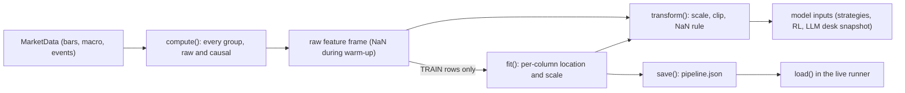

Every figure on this page is computed by the real feature code on real XAUUSD bars cut at
2024-12-31, from [tools/figures/fig_features.py](../tools/figures/fig_features.py).

## The causal contract

**Intuition.** A feature is only useful in production if it can be computed at decision
time from what is known then. The library therefore treats every feature as a function of
the past alone: row $t$ is what a live process would have computed at the close of bar $t$.

**The math.** For a feature function $F$ and market data $M$:

```math
F(M)_t = F\left(M_{\le a_t}\right)_t, \qquad
M_{\le a_t} = \left(\text{bars } 0..t,\ \text{macro rows with } a \le a_t,\ \text{scheduled event times}\right)
```

where $a_t$ is `md.bars["available_at"].iloc[t]`, the close of bar $t$. Scheduled event
*times* are public in advance and may be used; event *outcomes* may not
([Data](data.md#economic-calendar)).

The rules for implementers, from [`aurum/features/base.py`](../aurum/features/base.py) and
the leakage tests:

- no `shift(-k)`, no centred windows, no `bfill`, no full-sample statistics (mean, std or
  quantiles over the whole column): rolling, expanding and EWM operators only;
- warm-up rows are NaN (the pipeline decides what to do with them);
- output columns carry the group prefix, e.g. `trend_ema_slope_20`;
- prefer scale-free outputs (returns, ratios, z-scores, ATR-normalised distances) so models
  transfer across price levels (300 USD/oz gold in 2001 versus 2,500 USD/oz in 2024);
- the column set must depend only on the configuration and on which inputs are present,
  never on how many rows are visible (a live runner starting with a short history must get
  the same columns as research).

Annualised volatilities use a timeframe-based constant instead of the realised bar density
of the whole sample, which would use future timestamps:

```math
B = \begin{cases} 252 \cdot 1380 / m & m < 1440 \\ 252 \cdot 1440 / m & m \ge 1440 \end{cases}
```

where $m$ is the bar length in minutes (`bar_minutes`, read from `attrs["timeframe"]` or the
first 100 rows of `available_at - open`): $B$ = 5,796 for H1, 1,449 for H4 and 252 for D1
(`default_bars_per_year` in [aurum/features/volatility.py](../aurum/features/volatility.py)).

## The registry

Groups register themselves with a decorator:

```text
@register_feature(name, *, family, lookback, requires_macro=(), requires_events=False, **params)
```

This creates a `FeatureSpec(name, family, fn, lookback, requires_macro, requires_events,
params, doc)`. `get_feature(name)` returns it, `list_features()` returns all of them, and
`spec.compute(md, **overrides)` calls the function (registry `params`, then overrides) and
raises `ValueError` if the returned index does not equal `md.bars.index`. Registering a
name twice raises `KeyError`. The built-in modules are imported on first use of the
registry, so `aurum.features` stays cheap to import.

```bash
aurum features list          # add --json for machine-readable output
```

```text
group                   family  lookback    requires                                                                               doc
--------------------------------------------------------------------------------------------------------------------------------------
returns                returns        49           -                                              Vol-normalised trailing log returns.
trend                    trend       205           -                                    Trend-following state, expressed in ATR units.
momentum              momentum       481           -                                    Oscillators and time-series-momentum strength.
meanrev                meanrev       101           -             Stretch-from-equilibrium measures used by fade/mean-reversion models.
range                    range        56           -                             Position within recent ranges and single-bar anatomy.
volatility          volatility       481           -               Realised-volatility family (all annualised fractions unless noted).
microstructure  microstructure       121           -                      Spread, volume, gap and short-horizon autocorrelation state.
session                session         0           -           Clock and session features of the decision instant ``available_at[t]``.
mtf                        mtf       576           -  Higher-timeframe trend/momentum/vol + previous-day levels, point-in-time aligned
macro                    macro      2136  macro(any)           Per-series changes & level z-scores, and rolling gold correlation/beta.
calendar              calendar         0      events        Event-proximity features for events with ``importance >= min_importance``.
regime                  regime      5820           -                                 Causal, sliding-window-stable regime descriptors.
```

The `lookback` column is the registered value, computed for H1 bars and default parameters.
The pipeline recomputes warm-ups for the actual bar size and overrides (see
[Warm-up](#warm-up)).

`macro(any)` (new in v2.1) says that the `macro` group reads `md.macro` and works with
**any** series present. The requirement is recorded as metadata on the function, not in
`FeatureSpec.requires_macro`, on purpose: that field holds series *names* that the pipeline
enforces by skipping the whole group when one is missing, so declaring `("dxy", "real10y")`
there would drop every macro column for a FRED-only download.

```python
from aurum.features import get_feature
from aurum.features.macro import MACRO_DEFAULT_BETA_SERIES, MACRO_REQUIREMENT

spec = get_feature("macro")
print(spec.requires_macro, spec.fn.requires_macro, MACRO_REQUIREMENT, MACRO_DEFAULT_BETA_SERIES)
```

```text
() any any ('dxy', 'real10y')
```

## Feature groups at a glance

Overview with default parameters. "Warm-up" is the number of bars until every column of the
group is defined.

| Group | Module | Columns | Warm-up (H1 bars) | Needs | What it measures |
|---|---|---|---|---|---|
| `returns` | [technical.py](../aurum/features/technical.py) | 10 | 49 | bars | Vol-normalised trailing log returns |
| `trend` | technical.py | 24 | 205 | bars | EMA distance/slope/crosses, MACD, ADX, regression t-stats, in ATR units |
| `momentum` | technical.py | 16 | 481 | bars | RSI, stochastic, time-series momentum at five horizons |
| `meanrev` | technical.py | 6 | 101 | bars | Z-scores vs rolling means, Bollinger %B and width, streaks |
| `range` | technical.py | 13 | 56 | bars | Donchian position/width, candle anatomy, inside/outside/NR7 |
| `volatility` | [volatility.py](../aurum/features/volatility.py) | 19 | 481 | bars | Close-close and range-based estimators, vol ratios, vol of vol |
| `microstructure` | [microstructure.py](../aurum/features/microstructure.py) | 8 | 121 | bars | Spread, tick volume, gaps, return autocorrelation |
| `session` | microstructure.py | 13 | 0 | timestamps | Clock encodings and DST-aware Asia/London/New York sessions |
| `mtf` | [multi_timeframe.py](../aurum/features/multi_timeframe.py) | 20 | 576 | bars | H4/D1 trend, momentum and vol, previous-day levels |
| `macro` | [macro.py](../aurum/features/macro.py) | 4 per series, + 4 for dxy and real10y | 2,136 | `md.macro` (any series) | Changes and z-scores per series, rolling gold correlation/beta vs dxy and real10y |
| `calendar` | [calendar.py](../aurum/features/calendar.py) | 10 | 0 | `md.events` | Proximity to scheduled NFP/CPI/FOMC releases |
| `regime` | [regime.py](../aurum/features/regime.py) | 11 | 5,820 | bars | Bounded vol percentile, efficiency ratio, variance ratio, trend state |

Column counts come from the default pipeline: on `make_synthetic_bars(3000, "H1")` with
synthetic macro and events `macro` gives 24 columns (174 in total); on the real H1 file with
the ten downloaded series it gives 44 (194 in total).

Common building blocks, used by several groups (all causal):

```math
r_t = \ln C_t - \ln C_{t-1}, \qquad
\sigma_t = \sqrt{v_t}, \quad v_t = (1-\alpha)\,v_{t-1} + \alpha\, r_t^2, \quad \alpha = 1 - 2^{-1/\lambda}
```

```math
\mathrm{TR}_t = \max\left(H_t - L_t,\ \lvert H_t - C_{t-1} \rvert,\ \lvert L_t - C_{t-1} \rvert\right), \qquad
\mathrm{ATR}_t = \left(1 - \tfrac{1}{n}\right)\mathrm{ATR}_{t-1} + \tfrac{1}{n}\,\mathrm{TR}_t, \qquad
\mathrm{EMA}^{(s)}_t = \left(1-\tfrac{2}{s+1}\right)\mathrm{EMA}^{(s)}_{t-1} + \tfrac{2}{s+1}\,C_t
```

where

- $C_t, H_t, L_t, O_t$ are the mid close, high, low and open of bar $t$,
- $\sigma_t$ is the per-bar zero-mean EWMA volatility *including* bar $t$ (`ewm_bar_vol`),
  with half-life $\lambda$ = `vol_halflife` (48 bars) and `min_periods` 24,
- $\mathrm{ATR}$ is Wilder's average true range with $n$ = `atr_n` (14), seeded with the
  first value (`wilder_smooth`, `min_periods=n`), and row 0 of TR falls back to $H - L$,
- EMAs use $\alpha = 2/(s+1)$ (the MT5 convention), `adjust=False`, `min_periods=s`.

### returns

**Intuition.** A 10-dollar move means little in a volatile week and a lot in a quiet one.
`returns` divides each trailing move by the volatility that was current when it happened,
so the result reads like a t-statistic and is comparable across regimes.

**The math.**

```math
\texttt{returns\_log\_1}_t = r_t, \qquad
\texttt{returns\_z\_}h_t = \frac{\ln C_t - \ln C_{t-h}}{\sigma_t \sqrt{h}}
```

where $h$ runs over `horizons` and $\sigma_t$ is the EWMA volatility above. The same
statistic at longer horizons is `momentum_tsmom_h`, drawn in the [momentum](#momentum)
figure.

| Parameter | Default | Meaning |
|---|---|---|
| `horizons` | `(1, 2, 3, 4, 6, 8, 12, 24, 48)` | Look-back horizons in bars |
| `vol_halflife` | `48.0` | Half-life of the EWMA volatility (bars) |
| `vol_min_periods` | `24` | Minimum returns before $\sigma_t$ is defined |

### trend

**Intuition.** Trend followers ask three questions: is price above its average, is the
average rising, and is the move orderly? `trend` answers each in ATR units (multiples of a
typical bar's range), so a reading of 3 means the same thing at 1,300 USD/oz and 2,500.

**The math.**

```math
\texttt{ema\_dist\_}s = \frac{C_t - \mathrm{EMA}^{(s)}_t}{\mathrm{ATR}_t}, \quad
\texttt{ema\_slope\_}s = \frac{\mathrm{EMA}^{(s)}_t - \mathrm{EMA}^{(s)}_{t-k}}{k\,\mathrm{ATR}_t}, \quad
\texttt{ema\_cross\_}f\texttt{\_}s = \frac{\mathrm{EMA}^{(f)}_t - \mathrm{EMA}^{(s)}_t}{\mathrm{ATR}_t}
```

```math
\texttt{linreg\_t\_}n = \operatorname{sign}(\hat b)\,\sqrt{\frac{R^2 (n-2)}{1 - R^2}}, \qquad
\hat b = \frac{\sum_{j=0}^{n-1} \left(j - \tfrac{n-1}{2}\right) y_{t-n+1+j}}{S_{xx}}, \qquad
R^2 = \frac{\hat b^2 S_{xx}}{\mathrm{TSS}}
```

where

- $k$ = `slope_bars` (5); `macd`, `macd_signal` and `macd_hist` are
  $(\mathrm{EMA}^{(12)} - \mathrm{EMA}^{(26)})$, its 9-bar EMA and their difference, each
  divided by $\mathrm{ATR}$,
- `trend_adx_14` is Wilder's ADX / 100 and `trend_di_diff_14` is $(+DI - -DI)/100$,
- $y = \ln C$, $S_{xx} = \sum_j (j - \tfrac{n-1}{2})^2$, TSS is $n$ times the population
  variance of the window, and $R^2$ is clipped to $[0, 1 - 10^{-12}]$ before the t-stat.

<picture>
  <source media="(prefers-color-scheme: dark)" srcset="_assets/figures/features/trend-features-dark.png">
  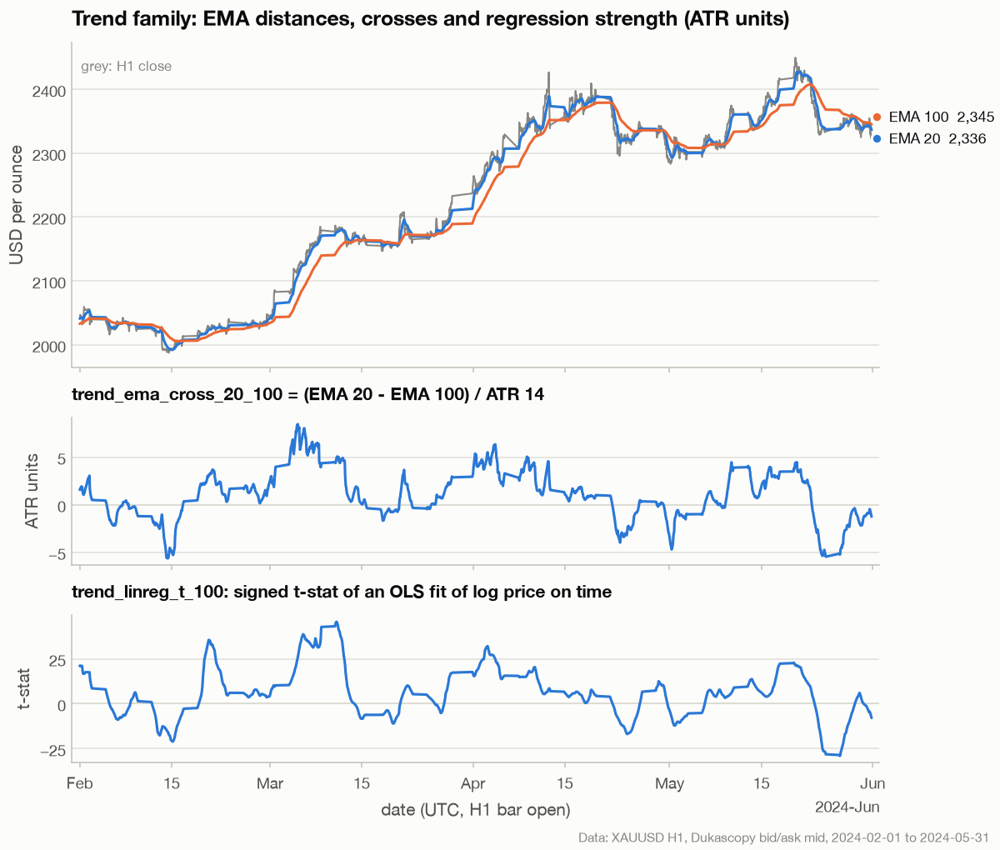
</picture>

*During the March 2024 breakout the EMA 20 sits up to about 8 ATR above the EMA 100 and the 100-bar regression t-stat exceeds 40; both turn negative in the late-May pullback. Data: XAUUSD H1, Dukascopy bid/ask mid, 2024-02-01 to 2024-05-31.*

| Parameter | Default | Meaning |
|---|---|---|
| `ema_spans` | `(10, 20, 50, 100, 200)` | Spans for `ema_dist` and `ema_slope` |
| `ema_pairs` | `((10, 50), (20, 100), (50, 200))` | Fast/slow pairs for `ema_cross` |
| `slope_bars` | `5` | Bars over which the EMA slope is measured |
| `atr_n`, `adx_n` | `14`, `14` | ATR normaliser and ADX/DMI period |
| `macd` | `(12, 26, 9)` | MACD fast, slow and signal spans |
| `linreg_windows` | `(20, 50, 100)` | OLS windows for `linreg_t` and `linreg_r2` |

**Pitfalls.** The regression t-stats are inflated by serially correlated residuals (values
above 40 are common): use them as strength scores, not for inference. EMA columns keep a
slowly decaying dependence on their first value (see [Live parity](#live-parity)).

### momentum

**Intuition.** Time-series momentum (Moskowitz, Ooi and Pedersen 2012) bets that a
vol-adjusted trailing return persists. Very stretched moves are more prone to reversal, so
Baz et al. (2015) pass the signal through a response that rises with strength up to
$z = \sqrt{2}$ and then fades. Oscillators (RSI, stochastic) add a bounded short-horizon
view.

**The math.**

```math
z_h = \frac{\ln C_t - \ln C_{t-h}}{\sigma_t \sqrt{h}}, \qquad
\varphi(z) = \frac{z\, e^{-z^2/4}}{0.89}, \qquad
\texttt{tsmom\_agg} = \frac{1}{\lvert \mathcal{H} \rvert} \sum_{h \in \mathcal{H}} \operatorname{sign}(z_h)
```

```math
\mathrm{RSI}_n = 100\,\frac{\mathrm{RMA}_n(\Delta C^{+})}{\mathrm{RMA}_n(\Delta C^{+}) + \mathrm{RMA}_n(\Delta C^{-})}, \qquad
\texttt{rsi\_}n = \frac{\mathrm{RSI}_n - 50}{50}
```

where

- `momentum_tsmom_h` $= z_h$ and `momentum_tsmom_resp_h` $= \varphi(z_h)$ for
  $h \in \mathcal{H}$ = `tsmom_horizons`; $\varphi$ peaks at $\varphi(\sqrt 2) = 0.96$,
- `momentum_tsmom_agg` is NaN until every horizon is warm,
- RMA is Wilder smoothing ($\alpha = 1/n$); a perfectly flat window gives RSI = 50; the
  stochastic %K is $100\,(C - LL_n)/(HH_n - LL_n)$ over `stoch_n` bars and %D its
  `stoch_d`-bar mean, both rescaled like the RSI,
- `momentum_up_frac_24` is the share of up bars in the last 24, minus 0.5.

<picture>
  <source media="(prefers-color-scheme: dark)" srcset="_assets/figures/features/momentum-response-dark.png">
  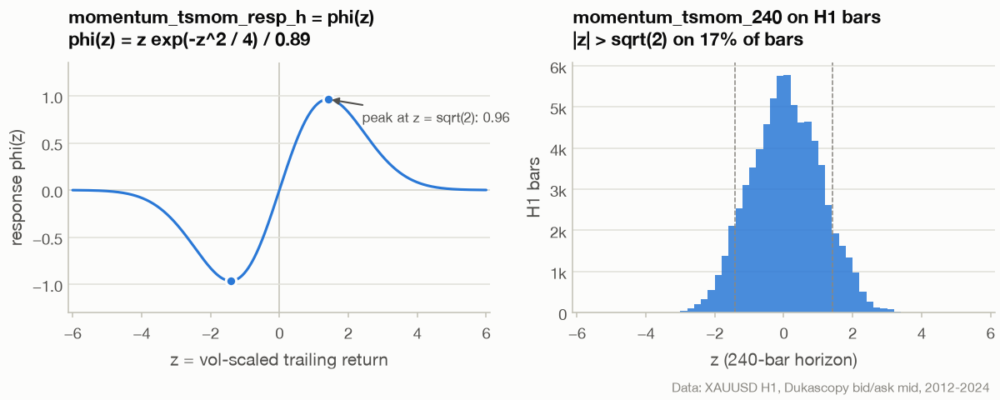
</picture>

*The response fades beyond $\lvert z \rvert = \sqrt 2$, and the 240-bar momentum of gold sits there on 17% of H1 bars. Data: XAUUSD H1, Dukascopy bid/ask mid, 2012-2024 (after the pipeline warm-up).*

| Parameter | Default | Meaning |
|---|---|---|
| `rsi_periods` | `(2, 14)` | RSI periods |
| `stoch_n`, `stoch_d` | `14`, `3` | Stochastic window and %D smoothing |
| `tsmom_horizons` | `(24, 72, 120, 240, 480)` | Momentum horizons in bars |
| `vol_halflife`, `vol_min_periods` | `48.0`, `24` | EWMA volatility for $z_h$ |
| `up_frac_window` | `24` | Window of `momentum_up_frac` |

### meanrev

**Intuition.** Mean-reversion models fade stretches: how far is the close from its recent
average, in units of recent dispersion? Bollinger %B expresses the same idea relative to
the bands, and band width detects squeezes.

**The math.**

```math
\texttt{meanrev\_z\_}n = \frac{C_t - \overline{C}_n}{s_n}, \qquad
\texttt{bb\_pctb\_20} = \frac{C_t - \overline{C}_{20}}{2k\,\sigma_{20}}, \qquad
\texttt{bb\_width\_20} = \frac{2k\,\sigma_{20}}{\overline{C}_{20}}
```

where $\overline{C}_n$ is the $n$-bar mean of the close, $s_n$ its sample standard
deviation (ddof 1), $\sigma_{20}$ the population standard deviation (ddof 0) used by the
bands and $k$ = `bb_k` (2.0). `bb_pctb_20` is %B minus 0.5: 0 on the middle band and ±0.5 on
the bands; a perfectly flat window gives 0. `meanrev_streak` is the signed count of
consecutive up or down bars (Connors).

| Parameter | Default | Meaning |
|---|---|---|
| `z_windows` | `(20, 50, 100)` | Windows of `meanrev_z_n` |
| `bb_n`, `bb_k` | `20`, `2.0` | Bollinger window and band multiplier |

### range

**Intuition.** Where does the close sit inside the recent high-low channel, and what does
the bar itself look like (body, wicks)? Channel position feeds breakout models; narrow
ranges (inside bars, NR7) often precede volatility expansion.

**The math.**

```math
\texttt{donchian\_pos\_}n = \frac{C_t - LL_n}{HH_n - LL_n} - \frac{1}{2}, \qquad
\texttt{donchian\_width\_}n = \frac{HH_n - LL_n}{\mathrm{ATR}_t}, \qquad
\texttt{clv} = \frac{(C_t - L_t) - (H_t - C_t)}{H_t - L_t}
```

where $HH_n, LL_n$ are the highest high and lowest low of the last $n$ bars (including
$t$); `range_body` $= (C-O)/(H-L)$, `range_upper_wick` $= (H - \max(O,C))/(H-L)$,
`range_lower_wick` $= (\min(O,C) - L)/(H-L)$ (all 0 on a zero-range bar),
`range_bar_atr` $= (H-L)/\mathrm{ATR}$, `range_body_atr` $= (C-O)/\mathrm{ATR}$; the flags
`range_inside_bar`, `range_outside_bar` and `range_nr7` (range is the narrowest of the last
`nr_window` bars).

<picture>
  <source media="(prefers-color-scheme: dark)" srcset="_assets/figures/features/meanrev-range-dark.png">
  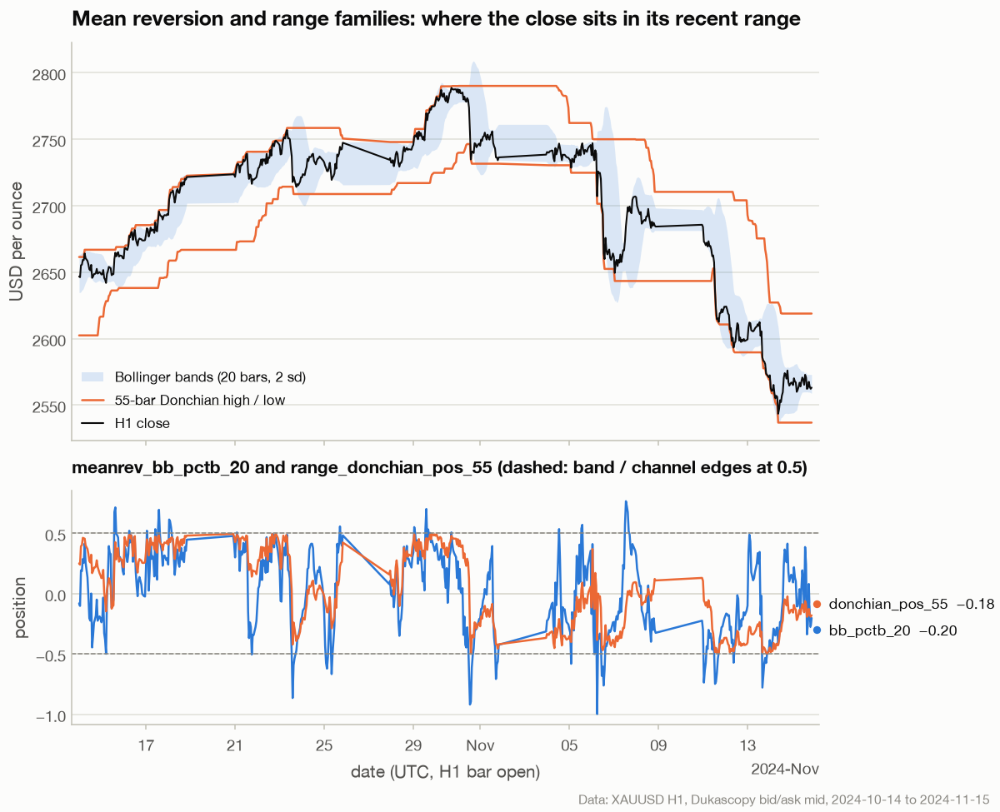
</picture>

*%B leaves the bands (beyond ±0.5) in sharp moves such as the early-November 2024 sell-off, while the slower 55-bar channel position stays within ±0.5 by construction. Data: XAUUSD H1, Dukascopy bid/ask mid, 2024-10-14 to 2024-11-15.*

| Parameter | Default | Meaning |
|---|---|---|
| `donchian` | `(20, 55)` | Channel windows |
| `atr_n` | `14` | ATR normaliser |
| `nr_window` | `7` | Window of the NR flag (`range_nr7`) |

### volatility

**Intuition.** Volatility clusters: calm follows calm, storms follow storms (Mandelbrot
1963, Engle 1982). That makes realised volatility a strong predictor of future *risk*, even
though it says little about direction. High-low ranges contain more information per bar
than closes, so the group carries several estimators; where they disagree (range-based much
larger than close-to-close) there is intrabar noise or mean reversion.

**The math.** With $B$ the bars per year from [the causal contract](#the-causal-contract),
for a window of $n$ bars ending at $t$:

```math
\sigma^{\mathrm{cc}}_n = \sqrt{B}\, \operatorname{sd}(r), \qquad
\sigma^{\mathrm{pk}}_n = \sqrt{B \cdot \overline{\frac{\ln^2(H/L)}{4 \ln 2}}}, \qquad
\sigma^{\mathrm{gk}}_n = \sqrt{B \cdot \overline{\tfrac{1}{2}\ln^2(H/L) - (2\ln 2 - 1)\ln^2(C/O)}}
```

```math
\sigma^{\mathrm{rs}}_n = \sqrt{B \cdot \overline{\ln\tfrac{H}{C}\ln\tfrac{H}{O} + \ln\tfrac{L}{C}\ln\tfrac{L}{O}}}, \qquad
\sigma^{\mathrm{yz}}_n = \sqrt{B\left(\operatorname{var}(g) + k\,\operatorname{var}(c) + (1-k)\,\overline{\mathrm{RS}}\right)}, \qquad
k = \frac{0.34}{1.34 + \frac{n+1}{n-1}}
```

where

- a bar over a symbol is the mean over the window; `sd` and `var` are sample statistics
  (ddof 1); every window has `min_periods=n` and variances are clipped at 0,
- $g_t = \ln(O_t / C_{t-1})$ is the gap (overnight) return, dominated for intraday gold by
  weekend reopens, and $c_t = \ln(C_t / O_t)$ the open-to-close return,
- `volatility_ewma` is $\sqrt{B}\,\sigma$ with an EWMA of half-life `ewma_halflife` (48)
  and `min_periods` 24, NaN during warm-up (unlike the model estimator on the
  [Models](models.md) page, which fills it),
- `volatility_logratio_yz_a_b` $= \ln(\sigma^{\mathrm{yz}}_a / \sigma^{\mathrm{yz}}_b)$ for
  consecutive windows (24/120 and 120/480), `volatility_range_cc_120`
  $= \sigma^{\mathrm{pk}}_{120} / \sigma^{\mathrm{cc}}_{120}$, `volatility_volofvol` the
  120-bar standard deviation of $\ln \sigma^{\mathrm{yz}}_{24}$, `volatility_chg_24` the
  24-bar change of $\ln \sigma^{\mathrm{yz}}_{24}$ and `volatility_atr_pct`
  $= \mathrm{ATR}_{14} / C_t$ (per bar, not annualised).

<picture>
  <source media="(prefers-color-scheme: dark)" srcset="_assets/figures/features/volatility-estimators-dark.png">
  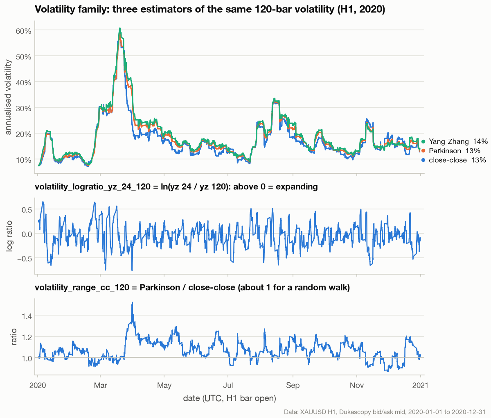
</picture>

*The three estimators agree on the level, peaking at about 60% annualised on 2020-03-19; in the March 2020 turmoil the high-low range ran up to 1.5 times the close-to-close volatility, against a median ratio of 1.03 over all H1 bars from December 2012 to 2024. Data: XAUUSD H1, Dukascopy bid/ask mid, 2020-01-01 to 2020-12-31.*

| Parameter | Default | Meaning |
|---|---|---|
| `windows` | `(24, 120)` | Windows of the five estimators |
| `long_window` | `480` | Slow baselines `volatility_cc_480`, `volatility_yz_480` |
| `ewma_halflife` | `48.0` | Half-life of `volatility_ewma` |
| `volofvol_window` | `120` | Window of `volatility_volofvol` |
| `atr_n` | `14` | ATR of `volatility_atr_pct` |
| `bars_per_year` | `None` | Annualisation; `None` uses $B$ |

The estimators are also plain functions (`atr`, `true_range`, `close_to_close_vol`,
`parkinson_vol`, `garman_klass_vol`, `rogers_satchell_vol`, `yang_zhang_vol`, `ewma_vol`)
used by strategies, sizing and risk code. Fitted volatility models (EWMA with a filled
warm-up, GARCH(1,1)) are on the [Models](models.md) page.

**Pitfalls.** Parkinson and Garman-Klass under-estimate when the true high and low are not
observed (discrete sampling) and are biased by drift; Rogers-Satchell is drift-free;
Yang-Zhang also handles opening jumps. Annualising with the realised bar density of the
whole sample would make each value depend on future timestamps, hence the constant $B$.

### microstructure

**Intuition.** For a retail XAUUSD CFD the quoted spread and the tick volume are the only
liquidity observables. They matter for *net* alpha (a signal worth 0.2 ATR is worthless
when the spread is 0.3 ATR) and flag stressed markets (spread blow-outs around news and the
daily rollover).

**The math.**

```math
\texttt{spread\_bps} = \frac{10^4\, s_t}{C_t}, \quad
\texttt{spread\_atr} = \frac{s_t}{\mathrm{ATR}_t}, \quad
\texttt{range\_spread} = \frac{H_t - L_t}{s_t}, \quad
\texttt{gap\_atr} = \frac{O_t - C_{t-1}}{\mathrm{ATR}_{t-1}}
```

```math
\texttt{autocorr\_120} = \operatorname{corr}_{120}\left(r_t,\ r_{t-1}\right)
```

where $s_t$ is the bar's spread; `microstructure_spread_z` is the rolling 120-bar z-score of
$\ln s_t$ (zero spreads give NaN), `microstructure_volume_z` the rolling z-score of
$\ln(1 + v_t)$, `microstructure_after_gap` flags a bar that opened more than 1.5 bar lengths
after the previous one (weekends, holidays, breaks), and the autocorrelation is the rolling
lag-1 correlation of log returns over 120 bars (negative values suggest bid/ask bounce,
Roll 1984).

<picture>
  <source media="(prefers-color-scheme: dark)" srcset="_assets/figures/features/microstructure-dark.png">
  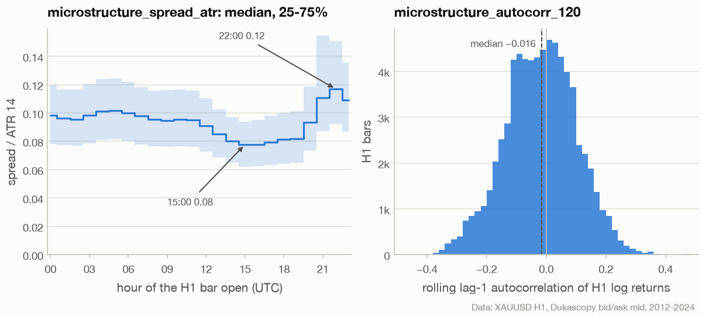
</picture>

*The spread costs 0.08 ATR at 15:00 UTC but 0.12 ATR around the 22:00 rollover; the 120-bar return autocorrelation has a median of −0.016 and is negative on 55% of bars. Data: XAUUSD H1, Dukascopy bid/ask mid, 2012-2024 (after the pipeline warm-up).*

| Parameter | Default | Meaning |
|---|---|---|
| `z_window` | `120` | Window of the spread and volume z-scores |
| `atr_n` | `14` | ATR normaliser |
| `autocorr_window` | `120` | Window of the lag-1 autocorrelation |

### session

**Intuition.** Gold is a 23-hour market whose liquidity, volatility and drift depend on
the clock: Asian physical demand, the London LBMA auctions, the US data window at 08:30
New York. Sessions are defined in *local* time and converted with `zoneinfo`, so they follow
DST in London and New York independently (the two are out of sync for about three weeks
each year).

**The math.** Every column describes the **decision instant** $a_t$ (the close of bar $t$;
the next fill is at the open of bar $t+1$, the same instant except across breaks). With
$u$ its UTC hour of day (with minutes), $w$ its UTC weekday (Monday = 0) and $u^{\mathrm{NY}},
w^{\mathrm{NY}}$ the same in New York local time:

```math
\texttt{hour\_sin} = \sin\frac{2\pi u}{24}, \quad
\texttt{how\_sin} = \sin\frac{2\pi (24w + u)}{168}, \quad
\texttt{week\_progress} = \operatorname{clip}\left(\frac{(24 w^{\mathrm{NY}} + u^{\mathrm{NY}} + 7) \bmod 168}{120},\ 0,\ 1\right)
```

where the matching `_cos` columns use $\cos$, `session_ny_hour_{sin,cos}` encode
$u^{\mathrm{NY}}$, and `week_progress` counts hours since the Sunday 17:00 New York open.
The flags `session_asia` (Tokyo 08:00-17:00), `session_london` (London 08:00-17:00) and
`session_ny` (New York 08:00-17:00) apply Monday to Friday local time; `session_overlap` is
London and New York; `session_rollover` is New York 16:00-18:00 (any weekday);
`session_friday_late` is Friday after 12:00 New York. Clock times are known in advance, so
none of this is look-ahead.

<picture>
  <source media="(prefers-color-scheme: dark)" srcset="_assets/figures/features/session-flags-dark.png">
  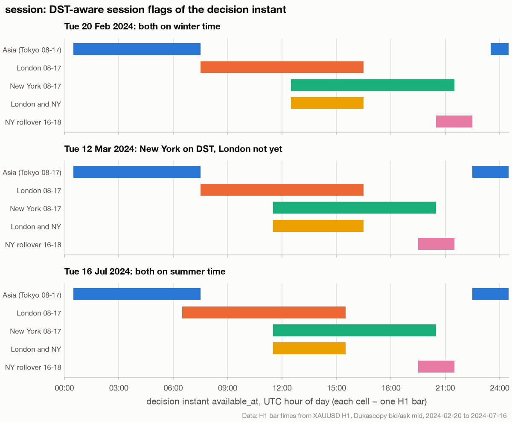
</picture>

*On 12 March 2024 New York is already on daylight time and London is not, so New York opens at 12:00 UTC while London still closes at 17:00 UTC: the overlap is five hourly decisions instead of four. Data: H1 bar times from XAUUSD H1, Dukascopy bid/ask mid, 2024-02-20 to 2024-07-16.*

| Parameter | Default | Meaning |
|---|---|---|
| `asia_hours` | `(8.0, 17.0)` | Tokyo local session (no DST) |
| `london_hours` | `(8.0, 17.0)` | London local session |
| `ny_hours` | `(8.0, 17.0)` | New York local session |
| `rollover_hours` | `(16.0, 18.0)` | New York rollover window |

### mtf

**Intuition.** Trend and volatility on H4 and daily bars carry information that is noisy to
extract from H1 bars alone, and many gold traders anchor on the previous day's high, low and
close. The trap is timing: a daily bar is only known at the day's close.

**The math.** For each higher timeframe htf (lower-cased in the column name as $h$) slower
than the base bars:

```math
\text{HTF bars} = \texttt{resample\_bars}(\text{bars}, \text{htf}, \text{anchor}=22), \qquad
x^{\mathrm{htf}}_k = f\left(\text{HTF bars } 0..k\right), \qquad
\texttt{mtf\_}h\texttt{\_}x_t = x^{\mathrm{htf}}_{k^\ast(t)},\ \ k^\ast(t) = \max\lbrace k : a^{\mathrm{htf}}_k \le a_t \rbrace
```

where $f$ computes, on the HTF series, `ret_z_{1,5,20}` (vol-scaled returns with an EWMA
half-life of 20 HTF bars), `ema_dist_20`, `ema_slope_20` (over 3 HTF bars), `rsi_14`,
`pk_vol_20` (Parkinson, annualised with the HTF's own $B$) and `donchian_pos_20`; the
mapping back is `align_htf`, the as-of join of [Data](data.md#point-in-time-alignment-asof_join).
The previous completed day's levels are `mtf_pdh_dist` $= (C_t - \mathrm{PDH})/\mathrm{ATR}_t$
(and `pdl`, `pdc` likewise, with the base-bar ATR) and `mtf_pd_pos`, the close's position
in the previous day's range minus 0.5.

<picture>
  <source media="(prefers-color-scheme: dark)" srcset="_assets/figures/features/mtf-alignment-dark.png">
  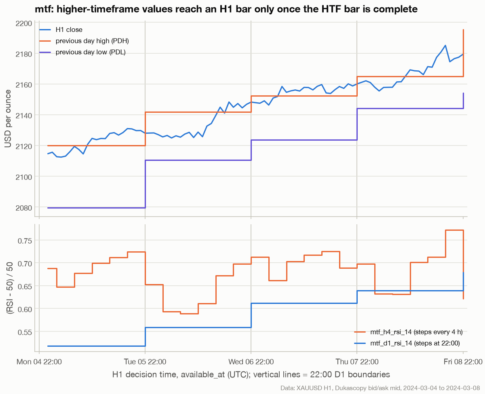
</picture>

*The previous-day high and low and the D1 RSI change only at the 22:00 UTC close, the H4 RSI every four hours; the Friday NFP-day high (2,195) reaches the H1 bars at Friday 22:00, not before. Data: XAUUSD H1, Dukascopy bid/ask mid, 2024-03-04 to 2024-03-08.*

| Parameter | Default | Meaning |
|---|---|---|
| `htfs` | `("H4", "D1")` | Higher timeframes (those not slower than the base are skipped) |
| `daily_anchor_hour_utc` | `22` | Anchor of H4/D1 buckets (New York close) |
| `prev_day` | `True` | Emit the previous-day level columns |
| `atr_n` | `14` | Base-bar ATR for the previous-day distances |
| `ret_horizons` | `(1, 5, 20)` | HTF return horizons |
| `ema_span`, `rsi_n`, `vol_window`, `donchian_n` | `20`, `14`, `20`, `20` | HTF indicator windows |

On H4 bars only the D1 block and the previous-day columns remain (12 columns); on D1 bars
the group emits no columns. `resample_anchored(bars, to, anchor_hour_utc)` makes the anchor
work on any pandas by shifting the timestamps; it equals
`resample_bars(..., daily_anchor_hour_utc=anchor)`.

**Pitfalls.** Since v2.1 `resample_bars` drops a partial first bucket
([Data](data.md#resampling-to-higher-timeframes)), so on a history that starts mid-bucket the
`mtf` warm-up ends one HTF bar later than before; in exchange, live and research values no
longer depend on where the history window starts. The v1 code forward-filled H1 bars onto
M5 bars from the bar's open, leaking 55 minutes.

### macro

**Intuition.** Gold is a zero-coupon, dollar-denominated real asset. Its main documented
drivers are the US dollar (through the numeraire), US real yields (the opportunity cost of
holding a non-yielding asset; Erb and Harvey 2013), inflation expectations and risk-off
demand. The *sign and strength* of these relations drift, so the group also carries rolling
correlations and betas.

**The math.** For each series $s$ with observations $v_j$ (its own sequence of dates):

```math
\texttt{macro\_}s\texttt{\_chg\_}k\texttt{d} =
\begin{cases} \ln v_j - \ln v_{j-k} & \text{prices} \\ 100\,(v_j - v_{j-k}) & \text{yields (bp)} \end{cases}, \qquad
\texttt{macro\_}s\texttt{\_z} = \frac{\ell_j - \overline{\ell}_{250}}{\operatorname{sd}_{250}(\ell)}
```

```math
\texttt{macro\_corr\_}s = \operatorname{corr}_{60}(g, \delta), \qquad
\texttt{macro\_beta\_}s = \frac{\operatorname{cov}_{60}(g, \delta)}{\operatorname{var}_{60}(\delta)}, \qquad
a^{\mathrm{derived}}_j = \max_{i \le j} a_i
```

where

- $\ell$ is the level (the log level for prices); the z-score uses `z_window` (250)
  observations with at least `z_min_periods` (60),
- $g$ is the daily gold log return from complete D1 bars resampled from the bars themselves
  (anchor 22:00 UTC), $\delta$ the series' one-observation change on the same trading date, over
  `corr_window` (60) days with at least `corr_min_periods` (40),
- every derived row becomes available at the running maximum of the `available_at` of its
  inputs, is mapped onto bars with `asof_join(bars.available_at, ..., tolerance=10 days)`,
  so a value older than `stale_days` (10) at decision time becomes NaN.

<picture>
  <source media="(prefers-color-scheme: dark)" srcset="_assets/figures/features/macro-correlations-dark.png">
  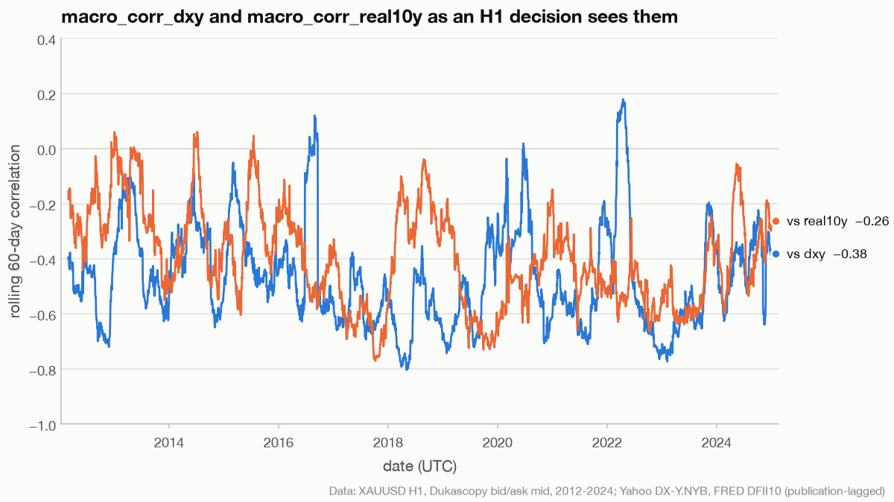
</picture>

*Gold's daily returns move against the dollar (median correlation −0.50) and against real yields (−0.43), but the strength swings between about −0.8 and 0, and the dollar link turned positive (+0.18) in April 2022. Data: XAUUSD H1, Dukascopy bid/ask mid, 2012-2024; Yahoo DX-Y.NYB, FRED DFII10 (publication-lagged).*

| Parameter | Default | Meaning |
|---|---|---|
| `series` | `None` | Series to use (`None`: every series in `md.macro`, sorted) |
| `change_days` | `(1, 5, 20)` | Change horizons in observations |
| `z_window`, `z_min_periods` | `250`, `60` | Level z-score window |
| `corr_window`, `corr_min_periods` | `60`, `40` | Rolling correlation/beta window (days) |
| `beta_series` | `("dxy", "real10y")` | Series with corr/beta columns (`MACRO_DEFAULT_BETA_SERIES`) |
| `yield_series` | `DEFAULT_YIELD_SERIES` | Names treated as yields |
| `stale_days` | `10.0` | Staleness limit (`0`/`None` disables) |
| `daily_anchor_hour_utc` | `22` | Anchor of the daily gold series |

Whether a series is a yield is decided from its **name** (`DEFAULT_YIELD_SERIES`: `us2y`,
`us5y`, `us10y`, `us30y`, `real10y`, `real5y`, `breakeven10y`, `breakeven5y`, `fedfunds`,
`t10y2y`, `sofr`) or from `frame.attrs["kind"]` (`yield`, `rate`, `level` or `spread`),
never from the values: "any value <= 0" would be a full-sample decision. A series that is
present but has no visible row yet still produces its columns (all NaN); with no macro data
at all the group returns an empty frame.

**Pitfalls.** The daily gold series comes from complete D1 bars, never from a calendar-day
`resample().last()`, which would include the forming day. The correlation figure shows why
fixed betas are fragile: the sign is stable on average but the size moves a lot.

### calendar

**Intuition.** Volatility compresses before scheduled releases and expands after them
(Andersen, Bollerslev, Diebold and Vega 2003; see the
[event study on the Data page](data.md#economic-calendar)). The group tells models how close
the next and the last high-importance event are. Release *times* are public in advance;
outcomes are not used at all.

**The math.** With $\tau_{\mathrm{next}}$ the first qualifying event time at or after $a_t$ and
$\tau_{\mathrm{last}}$ the last one before it:

```math
\texttt{hours\_to\_next} = \min\left(\frac{\tau_{\mathrm{next}} - a_t}{1\,\mathrm{h}},\ 72\right), \qquad
\texttt{hours\_since\_last} = \min\left(\frac{a_t - \tau_{\mathrm{last}}}{1\,\mathrm{h}},\ 72\right)
```

where an event exactly at $a_t$ counts as upcoming (its outcome is not known yet) and a
missing event counts as the cap. `calendar_in_30m` / `calendar_in_2h` flag an event within
±30 minutes / ±2 hours, `calendar_pre_2h` / `calendar_post_2h` the one-sided versions,
`calendar_next_{nfp,cpi,fomc}` the type of the next event (matched on the name, zero beyond
the cap) and `calendar_n_next_24h` the number of event timestamps in $[a_t, a_t + 24\,\mathrm{h})$.

<picture>
  <source media="(prefers-color-scheme: dark)" srcset="_assets/figures/features/calendar-features-dark.png">
  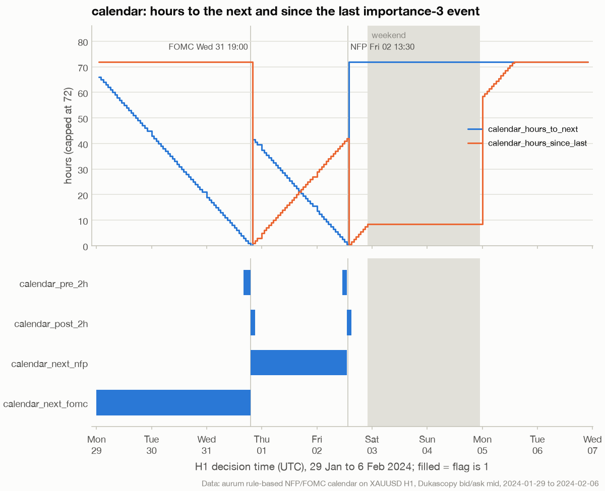
</picture>

*The countdown hits zero at the FOMC statement (31 January 19:00 UTC) and the payrolls release (2 February 13:30 UTC); after that the next importance-3 event is more than 72 hours away, so the countdown sits at the cap. Data: aurum rule-based NFP/FOMC calendar on XAUUSD H1, Dukascopy bid/ask mid, 2024-01-29 to 2024-02-06.*

| Parameter | Default | Meaning |
|---|---|---|
| `min_importance` | `3` | Minimum event importance |
| `cap_hours` | `72.0` | Cap of the hour counts |
| `currencies` | `None` | Optional currency filter |
| `near_minutes` | `30.0` | Window of `calendar_in_30m` |
| `wide_hours` | `2.0` | Window of the `_2h` flags |
| `count_horizon_hours` | `24.0` | Horizon of `calendar_n_next_24h` |

The pipeline skips the group (with an INFO log) when `md.events` is `None`.

**Pitfalls.** Unscheduled announcements (emergency FOMC cuts) appear in historical
calendars but could not have been known; flag them in an imported calendar. The rule-based
FOMC list ends with the 2027 schedule.

### regime

**Intuition.** Strategy performance is regime-dependent: trend followers need persistent,
efficient price paths, faders need noisy ones, and everything suffers in volatility
spikes. `regime` describes the current state with model-free, fully window-bounded
statistics (fitted HMMs live in `aurum.models.regime`; see [Models](models.md) and
[ML and RL](ml-and-rl.md)).

**The math.**

```math
\texttt{vol\_pctrank}_t = \operatorname{rank}_{\%}\left(\sigma^{(24)}_t \;\middle|\; \sigma^{(24)}_{t-W+1}, \ldots, \sigma^{(24)}_t\right), \qquad
\mathrm{ER}_n = \frac{\lvert C_t - C_{t-n} \rvert}{\sum_{i=t-n+1}^{t} \lvert C_i - C_{i-1} \rvert}
```

```math
\mathrm{VR}(q) = \frac{\operatorname{var}_{240}\left(\ln C_t - \ln C_{t-q}\right)}{q\,\operatorname{var}_{240}(r_t)}, \qquad
\texttt{hurst\_}q = \frac{1}{2}\left(1 + \frac{\ln \mathrm{VR}(q)}{\ln q}\right)
```

```math
\texttt{trend\_strength} = \frac{\lvert \ln C_t - \ln C_{t-n} \rvert}{\sqrt{n} \sqrt{\tfrac{1}{n}\sum_{i=t-n+1}^{t} r_i^2}}, \qquad
\texttt{trend\_state} = \begin{cases} \operatorname{sign}(\ln C_t - \ln C_{t-n}) & \text{strength} > 1 \text{ and } \mathrm{ER}_n > 0.3 \\ 0 & \text{otherwise} \end{cases}
```

where

- $\sigma^{(24)}$ is the 24-bar sample standard deviation of $r$ (`vol_window`), ranked
  (average ties) within the last $W$ values; $W$ = `rank_window` if given, else
  `rank_years` (1.0) years of bars at the bars' own size: 5,796 H1, 1,449 H4 or 252 D1 bars;
  the rank is NaN until the window is full; `regime_high_vol` / `regime_low_vol` flag ranks
  above 0.8 / below 0.2,
- `regime_er_20` and `regime_er_100` are $\mathrm{ER}_{20}$ and $\mathrm{ER}_{100}$
  (1 = straight line, about 0 = noise),
- `regime_vr_q` and `regime_hurst_q` use overlapping $q$-bar returns, $q \in \lbrace 4, 16 \rbrace$,
  over the same 240-bar window (Lo and MacKinlay 1988; above 0.5 persistent),
- the trend strength and state use $n$ = `trend_window` (120); the state's efficiency ratio
  is $\mathrm{ER}_{120}$, an internal value, not one of the columns.

<picture>
  <source media="(prefers-color-scheme: dark)" srcset="_assets/figures/features/regime-features-dark.png">
  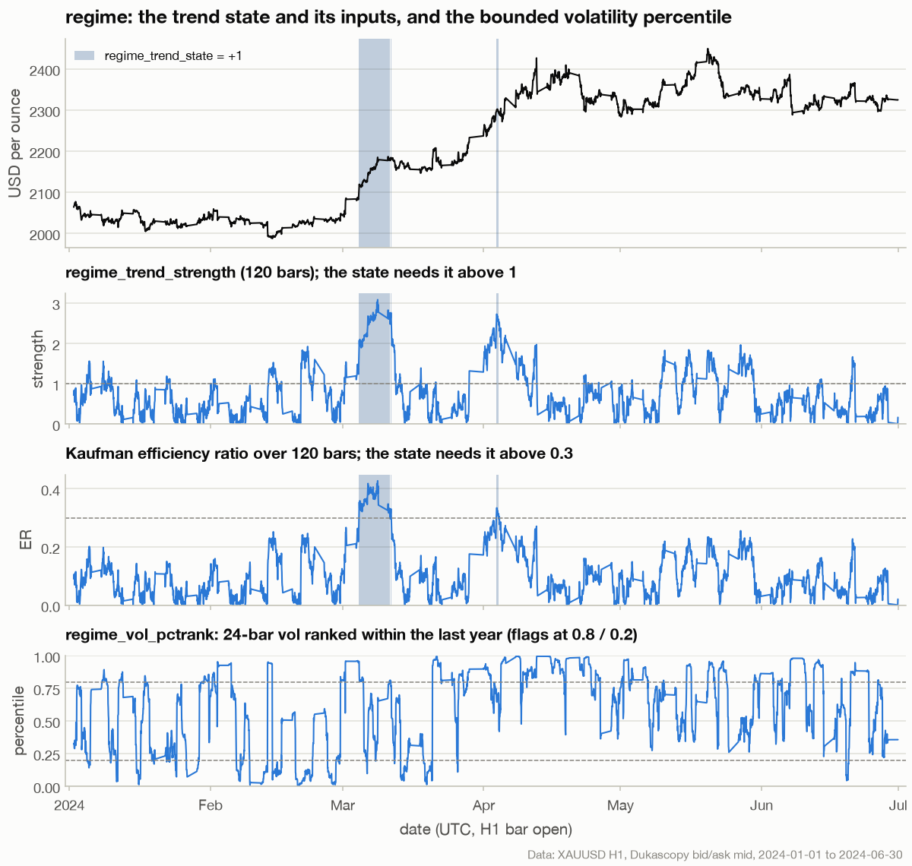
</picture>

*The trend state switches on only when both inputs agree, here during the March 2024 breakout (from 4 March) and briefly in early April; the efficiency condition is the binding one (ER above 0.3 on 2.5% of H1 bars since 2012, strength above 1 on 32%). Data: XAUUSD H1, Dukascopy bid/ask mid, 2024-01-01 to 2024-06-30.*

| Parameter | Default | Meaning |
|---|---|---|
| `vol_window` | `24` | Window of the realised vol that is ranked |
| `rank_years`, `rank_window` | `1.0`, `None` | Rank window in years of bars, or explicit bars |
| `expanding`, `rank_min_periods` | `False`, `240` | Add the legacy expanding rank `regime_vol_pctrank_exp` |
| `er_windows` | `(20, 100)` | Efficiency-ratio columns |
| `vr_qs`, `vr_window` | `(4, 16)`, `240` | Variance-ratio lags and window |
| `trend_window` | `120` | Window of the trend strength and state |
| `vol_halflife` | `None` | Restores the legacy EWMA normaliser of the trend strength |
| `strength_threshold`, `er_threshold` | `1.0`, `0.3` | Thresholds of the trend state |
| `high_vol_pct`, `low_vol_pct` | `0.8`, `0.2` | Thresholds of the vol flags |

Over 2012-2024 (after the warm-up) the trend state is +1 on 1.3% and −1 on 1.2% of H1 bars.

**Pitfalls and design choices.** A full-sample quantile is the classic regime-feature leak,
so the rank is bounded. Because every window is bounded, a value depends only on the last
`vol_window + W - 1` bars: a live runner computing on any window at least as long as the
warm-up gets the same values as research. `expanding=True` adds the legacy
`regime_vol_pctrank_exp` (a rank against *all* past values); it is causal but depends on
where the history starts, so it is off by default.

<details>
<summary>Full default column list (174 columns on H1, synthetic macro)</summary>

Generated with `FeaturePipeline().compute(md)` on `make_synthetic_bars(3000, "H1", seed=1)`
plus `make_synthetic_macro` and `make_synthetic_events`. With the ten downloaded macro series
the macro block has 44 columns (194 in total).

- **returns (10):** returns_log_1, returns_z_1, returns_z_2, returns_z_3, returns_z_4, returns_z_6, returns_z_8, returns_z_12, returns_z_24, returns_z_48
- **trend (24):** trend_ema_dist_10, trend_ema_slope_10, trend_ema_dist_20, trend_ema_slope_20, trend_ema_dist_50, trend_ema_slope_50, trend_ema_dist_100, trend_ema_slope_100, trend_ema_dist_200, trend_ema_slope_200, trend_ema_cross_10_50, trend_ema_cross_20_100, trend_ema_cross_50_200, trend_macd, trend_macd_signal, trend_macd_hist, trend_adx_14, trend_di_diff_14, trend_linreg_t_20, trend_linreg_r2_20, trend_linreg_t_50, trend_linreg_r2_50, trend_linreg_t_100, trend_linreg_r2_100
- **momentum (16):** momentum_rsi_2, momentum_rsi_14, momentum_stoch_k_14, momentum_stoch_d_14, momentum_tsmom_24, momentum_tsmom_resp_24, momentum_tsmom_72, momentum_tsmom_resp_72, momentum_tsmom_120, momentum_tsmom_resp_120, momentum_tsmom_240, momentum_tsmom_resp_240, momentum_tsmom_480, momentum_tsmom_resp_480, momentum_tsmom_agg, momentum_up_frac_24
- **meanrev (6):** meanrev_z_20, meanrev_z_50, meanrev_z_100, meanrev_bb_pctb_20, meanrev_bb_width_20, meanrev_streak
- **range (13):** range_donchian_pos_20, range_donchian_width_20, range_donchian_pos_55, range_donchian_width_55, range_body, range_upper_wick, range_lower_wick, range_clv, range_bar_atr, range_body_atr, range_inside_bar, range_outside_bar, range_nr7
- **volatility (19):** volatility_cc_24, volatility_pk_24, volatility_gk_24, volatility_rs_24, volatility_yz_24, volatility_cc_120, volatility_pk_120, volatility_gk_120, volatility_rs_120, volatility_yz_120, volatility_cc_480, volatility_yz_480, volatility_ewma, volatility_logratio_yz_24_120, volatility_logratio_yz_120_480, volatility_range_cc_120, volatility_volofvol, volatility_chg_24, volatility_atr_pct
- **microstructure (8):** microstructure_spread_bps, microstructure_spread_z, microstructure_spread_atr, microstructure_range_spread, microstructure_volume_z, microstructure_gap_atr, microstructure_after_gap, microstructure_autocorr_120
- **session (13):** session_hour_sin, session_hour_cos, session_how_sin, session_how_cos, session_ny_hour_sin, session_ny_hour_cos, session_asia, session_london, session_ny, session_overlap, session_rollover, session_week_progress, session_friday_late
- **mtf (20):** mtf_h4_ret_z_1, mtf_h4_ret_z_5, mtf_h4_ret_z_20, mtf_h4_ema_dist_20, mtf_h4_ema_slope_20, mtf_h4_rsi_14, mtf_h4_pk_vol_20, mtf_h4_donchian_pos_20, mtf_d1_ret_z_1, mtf_d1_ret_z_5, mtf_d1_ret_z_20, mtf_d1_ema_dist_20, mtf_d1_ema_slope_20, mtf_d1_rsi_14, mtf_d1_pk_vol_20, mtf_d1_donchian_pos_20, mtf_pdh_dist, mtf_pdl_dist, mtf_pdc_dist, mtf_pd_pos
- **macro (24):** macro_dxy_chg_1d, macro_dxy_chg_5d, macro_dxy_chg_20d, macro_dxy_z, macro_real10y_chg_1d, macro_real10y_chg_5d, macro_real10y_chg_20d, macro_real10y_z, macro_spx_chg_1d, macro_spx_chg_5d, macro_spx_chg_20d, macro_spx_z, macro_us10y_chg_1d, macro_us10y_chg_5d, macro_us10y_chg_20d, macro_us10y_z, macro_vix_chg_1d, macro_vix_chg_5d, macro_vix_chg_20d, macro_vix_z, macro_corr_dxy, macro_beta_dxy, macro_corr_real10y, macro_beta_real10y
- **calendar (10):** calendar_hours_to_next, calendar_hours_since_last, calendar_in_30m, calendar_in_2h, calendar_pre_2h, calendar_post_2h, calendar_next_nfp, calendar_next_cpi, calendar_next_fomc, calendar_n_next_24h
- **regime (11):** regime_vol_pctrank, regime_high_vol, regime_low_vol, regime_er_20, regime_er_100, regime_vr_4, regime_hurst_4, regime_vr_16, regime_hurst_16, regime_trend_strength, regime_trend_state

</details>

## Leakage testing

**Intuition.** The simplest test of "no peeking" is to change the future and check that the
past does not move. If a feature value at bar $t$ changes when only bars after $t$ (and
macro rows published after $a_t$) change, the feature used information it could not have
had. Deleting the future must not change the past either.

**The math.** For a cutoff bar $t$, let $M^{\mathrm{pert}}_t$ replace every bar after $t$
with an unrelated path and every macro row with $a > a_t$ with unrelated values, and let
$M^{\mathrm{trunc}}_t$ delete them. A group $F$ passes if, bit for bit (NaN equals NaN),

```math
F(M)_s = F\left(M^{\mathrm{pert}}_t\right)_s = F\left(M^{\mathrm{trunc}}_t\right)_s \qquad \text{for every row } s \le t
```

and, so that the check is not vacuous, price-driven groups must change somewhere after $t$.

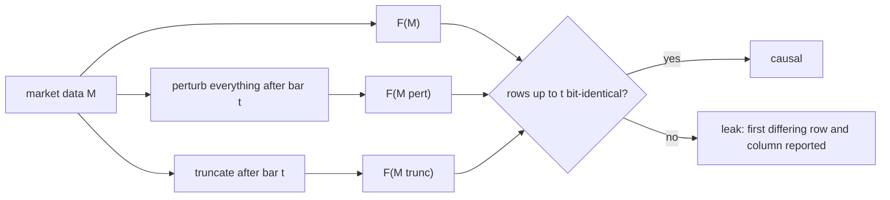

**The picture.** The same test, run on real data: the default pipeline (all 12 groups,
194 columns) on real H1 bars from 2023 to June 2024, with every bar after Wednesday
15 May 2024 12:00 rescaled onto an unrelated random path, spreads tripled, volume halved and
the not-yet-published macro rows replaced.

<picture>
  <source media="(prefers-color-scheme: dark)" srcset="_assets/figures/features/leakage-perturbation-dark.png">
  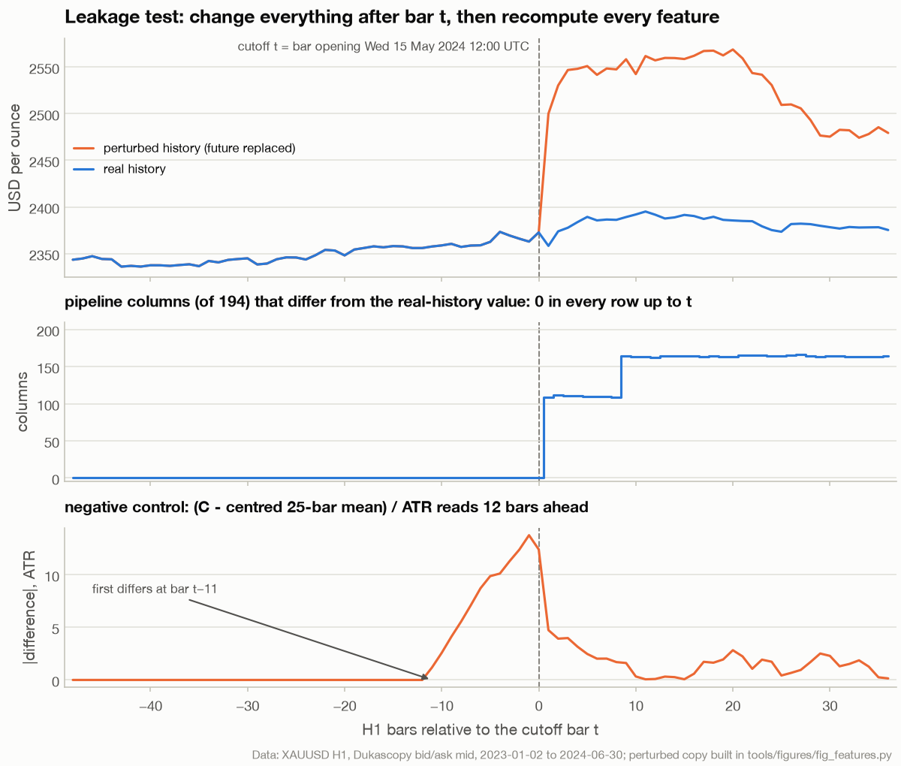
</picture>

*All 194 columns are bit-identical in the 8,086 rows up to the cutoff (also when the future is deleted instead); 109 columns change on the next bar and 164 from the first decision after the 22:00 UTC daily close, nine bars later; the 23 session and calendar columns never change. A deliberately leaky centred 25-bar mean already differs at bar t−11. Data: XAUUSD H1, Dukascopy bid/ask mid, 2023-01-02 to 2024-06-30, with a perturbed copy built in the figure code.*

**In code.** Three test files keep the feature library honest. They run on synthetic data,
offline:

```bash
pytest tests/test_features_leakage.py tests/test_features_randomwalk.py tests/test_stability_regime.py
```

**Future perturbation** ([`tests/test_features_leakage.py`](../tests/test_features_leakage.py)).
On 2,400 H1 bars from the `regime` synthetic model, with synthetic macro and events, and for
cutoffs `t` in (150, 700, 1500, 2150), every registered group is recomputed on two
alternative histories that agree with the original up to `available_at[t]`:

- *perturbed*: every bar after `t` is replaced by an unrelated `jump` path (different seed,
  a price level 1.37 times the cutoff close, 45% volatility, a 0.9 spread), and every macro
  row not yet available at the cutoff gets an unrelated value, some of them non-positive;
- *truncated*: bars after `t` and macro rows not yet available are removed.

Rows `<= t` must be bit-identical (NaN equals NaN) in all three. Scheduled event times are
public, so the calendar is not perturbed. Further checks: every column is populated before
the last cutoff and price-driven groups do react to the perturbation (so the check is not
comparing NaN with NaN); columns carry the group prefix; boundary cutoffs (the first bars,
around a weekend, at the 21:00 and 22:00 UTC closes) on H1 and on M30 bars for the
calendar-sensitive groups; and histories of 0 to 3 bars give the same columns and values as
the full history. The `regime` group runs with a 500-bar rank window there, because its
default one-year window exceeds 2,400 bars; the default window is covered in
`test_stability_regime.py`.

Negative controls register deliberately leaky features under temporary names and assert that
the checker flags each one: `shift(-1)`, a full-sample z-score, a centred rolling window, a
`bfill`, and a macro series joined on its observation date instead of `available_at`. A
positive control (a trailing moving average) must pass.

**Random walk** ([`tests/test_features_randomwalk.py`](../tests/test_features_randomwalk.py)).
On 20,000 H1 bars of driftless GBM nothing is predictable, so no feature may be correlated
with the next bar's return:

```math
\rho_j = \operatorname{Spearman}\left(x_{j,t},\ r_{t+1}\right), \qquad
\text{fail if } p_j < \frac{0.01}{J} \ \text{for any } j, \ \text{or} \ \max_j \lvert \rho_j \rvert \ge 0.04
```

where $J$ is the number of testable columns after the warm-up (at least 150 are required) and
$0.01/J$ is the Bonferroni-corrected 1% family-wise level. A negative control shows that
`shift(-1)`, a centred window and a weak leak buried in noise are all detected.

**Regime stability** ([`tests/test_stability_regime.py`](../tests/test_stability_regime.py)).
Checks that the bounded `regime` columns computed on the live runner's window (3 x warm-up)
equal the full-history values after the warm-up on M15, H1, H4 and D1 bars, that the
expanding rank does not (negative control), and that the default window is point-in-time.

The same perturbation pattern is reused for strategies in
[`tests/test_strategies_leakage.py`](../tests/test_strategies_leakage.py); see
[Strategies](strategies.md) and [Development](development.md).

**Pitfalls.** The tests prove the absence of look-ahead, not the presence of alpha. A test
that compares NaN with NaN proves nothing, hence the "must react" check and the
warm-up-aware cutoffs.

## How the features correlate

Many columns measure related things. A rank correlation matrix of 22 representative columns
on real H1 bars shows which ones are near-duplicates (useful when choosing inputs for a
model, or when interpreting feature importances).

<picture>
  <source media="(prefers-color-scheme: dark)" srcset="_assets/figures/features/correlation-heatmap-dark.png">
  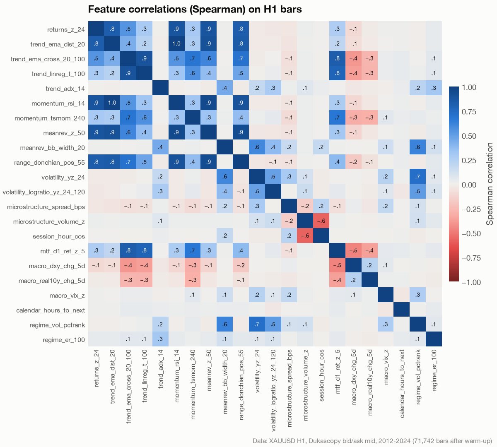
</picture>

*Short-horizon price location features are near-duplicates (EMA-20 distance vs RSI-14: 0.98; returns z-24 vs meanrev z-50: 0.88), the volatility columns form their own block (vol percentile vs Yang-Zhang 24: 0.72), and 5-day gold momentum moves against the dollar (D1 return z-5 vs dxy 5-day change: −0.46); calendar proximity is unrelated to price (0.01). Data: XAUUSD H1, Dukascopy bid/ask mid, 2012-2024 (71,742 bars after the warm-up).*

The matrix is Spearman (rank) correlation, so fat tails do not dominate it; the colour scale
is symmetric around zero (blue positive, red negative).

## FeaturePipeline

[`FeaturePipeline`](../aurum/features/pipeline.py) is the one object research, backtests,
the RL environment and the live runner use to turn `MarketData` into model inputs.

```text
FeaturePipeline(groups=None, overrides=None, scaler="robust", clip=5.0, *, warmup=None, bar_minutes=None)
```

| Parameter | Default | Meaning |
|---|---|---|
| `groups` | `None` | Registry names to compute. `None` means every registered group in canonical order (the SPEC §4 order above, then any other groups sorted by name), independent of import order. Unknown names raise `KeyError`; duplicates raise `ValueError`. |
| `overrides` | `None` | `{group: {param: value}}` forwarded to the group function. Overrides for groups not in `groups` raise `ValueError`. |
| `scaler` | `"robust"` | `"robust"` (median and IQR x 0.7413), `"standard"` (mean and std) or `"none"`. |
| `clip` | `5.0` | Clip scaled values to `[-clip, clip]`; `None` disables. |
| `warmup` | `None` | Explicit warm-up in bars; overrides the computed `max_lookback`. Must be >= 0. |
| `bar_minutes` | `None` | Bar size for day-based warm-ups. `compute` records it from the bars; H1 is assumed until then. |

The config path validates the same constraints before building the pipeline (duplicate or
unknown groups with a did-you-mean hint, overrides for unknown groups or groups not in
`features.groups`, unknown override parameter names checked against the feature function's
signature, `features.warmup >= 0`); see [Configuration](configuration.md).

### compute

`compute(md)` returns the raw (unscaled) concatenation of all groups, causal row by row,
with `inf` replaced by NaN. It records the bar size, skips groups whose declared needs are
missing (`calendar` without `md.events`) with an INFO log, and raises `ValueError` on
duplicate column names across groups. If a pipeline fitted on one bar size computes another,
it logs a warning: the fitted statistics and warm-ups are specific to one bar size. On the
real H1 file (77,562 bars, ten macro series, rule-based events) it takes well under a second.

### fit and scaling

**Intuition.** Models train best on inputs of similar scale, but financial features are
fat-tailed: a few crash bars would dominate a mean/standard-deviation scaler. The default
uses the median and the interquartile range, estimated on the training rows only, and then
clips extreme values.

**The math.**

```math
\tilde x_{t} = \operatorname{clip}\left(\frac{x_{t} - \operatorname{med}_{\mathrm{train}}(x)}{0.7413\ \operatorname{IQR}_{\mathrm{train}}(x)},\ -c,\ c\right)
```

where the median and IQR (75th minus 25th percentile) come from `raw_train` only,
$0.7413 = 1 / 1.349$ makes $0.7413\,\mathrm{IQR}$ equal to $\sigma$ for a Gaussian
(`IQR_TO_SIGMA`), and $c$ = `clip` (5). After `fit` the statistics are constants, so
`transform` is row-wise and cannot leak across time.

| Column kind | Rule | `stats["kind"]` |
|---|---|---|
| All finite training values in {-1, 0, 1} (flags, sign states) | passed through: location 0, scale 1 | `discrete` |
| `scaler="robust"` | median and `IQR x 0.7413` | `robust` |
| robust, but the IQR is degenerate while the column is not constant | falls back to the standard deviation | `robust_std` |
| `scaler="standard"` / `"none"` | mean and std / 0 and 1 | `standard` / `none` |
| constant, all-NaN or degenerate scale in train | dropped (`pipe.dropped_columns`) | |

`pipe.columns` lists the kept columns, `pipe.stats` is a frame of `loc`, `scale` and
`kind`, and `fit` raises `ValueError` if nothing is left.

### transform and the NaN rule

`transform(raw, *, strict=True)` scales with the fitted statistics, clips, and fills NaN.
For column $j$ and row $t$ (counted from the first row of the frame):

```math
\tilde x_{t,j} \text{ is NaN} \ \longrightarrow\
\begin{cases} 0 & \text{if column } j \text{ had a valid value in rows } 0..t-1, \text{ or } t \ge L \\
\text{NaN} & \text{otherwise (warm-up)} \end{cases}
```

where $L$ = `max_lookback`. The 0 is the training median after scaling, a neutral value.
Both conditions only look backward.

- It raises `FeatureSchemaError` (a `ValueError`) if a fitted column is missing, for
  example because the live process was not given macro data or events, and, with
  `strict=True`, if `raw` has columns never seen at fit time (research and live feature
  configurations have diverged).
- Drop warm-up rows with `dropna()` or skip `max_lookback` rows.
- The rule treats the first row of the frame as the start of history. For walk-forward folds
  use `transform(raw_full).iloc[test_idx]` (leak-free, because transform is row-wise), not
  `transform(raw_full.iloc[test_idx])`; the two are equal only when every column has a
  valid value in the fold's first row.

`fit_transform(raw)` is `fit(raw).transform(raw)`.

### Warm-up

`max_lookback` is the number of bars until every column of every group is defined: the
explicit `warmup` if given, else the maximum over groups of the group's warm-up. Each
built-in group attaches a `lookback_fn(params, bar_minutes)` that is evaluated on its
**effective** parameters (function defaults, then registry params, then overrides), so
overriding a window moves the warm-up while non-window parameters do not. Groups without a
`lookback_fn` fall back to their registered `lookback`, raised to the largest integer
override + 1 when overridden. `pipe.group_lookback(name)` returns one group's value.

On the real H1 file, the predicted warm-up and the first row at which every column of the
group is actually defined:

<picture>
  <source media="(prefers-color-scheme: dark)" srcset="_assets/figures/features/warmup-by-group-dark.png">
  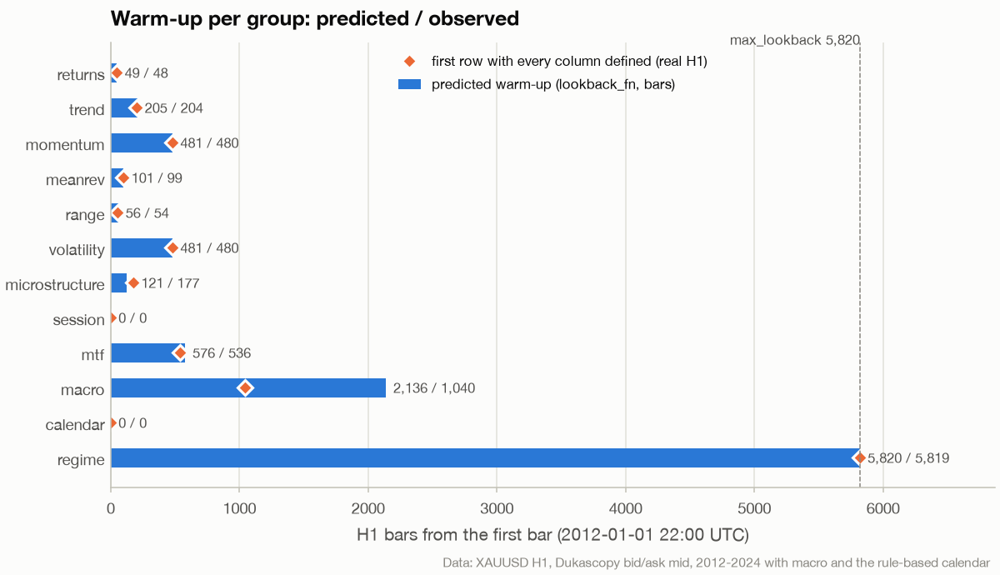
</picture>

*The predictions are tight for the price groups (within two bars); `macro` is defined after 1,040 bars instead of 2,136 because the macro history starts in 2011, a year before the bars, and `microstructure` needs 177 bars instead of 121 because early-2012 zero spreads leave NaN in the log-spread z-score window. Data: XAUUSD H1, Dukascopy bid/ask mid, 2012-2024, with macro and the rule-based calendar.*

Day-based groups need a number of days whatever the bar size, and the `regime` window is a
number of years:

```math
L_{\mathrm{macro}} = \left\lceil \left(\left\lceil \tfrac{7}{5}\, n_{\mathrm{obs}} \right\rceil + 5\right) \frac{1440}{m} \right\rceil, \qquad
n_{\mathrm{obs}} = \max\left(z_{\min},\ c_{\min} + 1,\ \max_k k + 1\right), \qquad
L_{\mathrm{regime}} = v + W
```

where $m$ is the bar length in minutes, $z_{\min}$ = 60, $c_{\min}$ = 40 and $k$ the change
horizons (so 89 days, 2,136 H1 bars), $v$ = `vol_window` (24) and $W$ the rank window
(5,796 H1 bars, so 5,820; the other windows of the group are shorter). The
`mtf` warm-up is $\lceil (N+1)\, m_{\mathrm{htf}} / m \rceil$ base bars, where
$m_{\mathrm{htf}}$ is the HTF bar length in minutes and $N$ = 23 HTF bars (so 24 D1 bars =
576 H1 bars; the `+1` covers a partial first bucket), and at least two broker days for the
previous-day levels.

| Group | M15 | H1 | H4 | D1 |
|---|---|---|---|---|
| `mtf` | 2,304 | 576 | 144 | 0 (no columns) |
| `macro` | 8,544 | 2,136 | 534 | 89 |
| `regime` | 23,208 | 5,820 | 1,473 | 276 |
| other groups | unchanged (at most 481) | 481 | 481 | 481 |
| **`max_lookback`, all groups** | **23,208** | **5,820** | **1,473** | **481** |

`max_lookback` counts bars until values are *defined*. EWM-based features (EMAs, EWMA
volatilities, the D1 EWM vol in `mtf`) keep a decaying dependence on their first value, so
their values still depend slightly on where the history starts (see
[Live parity](#live-parity)).

### Persistence

`save(path)` writes JSON (human-diffable and safe to ship to the live runner) and
`FeaturePipeline.load(path)` restores it; `to_dict()` / `from_dict()` do the same in memory.
A trimmed example for `FeaturePipeline(groups=["returns"], overrides={"returns":
{"horizons": [1, 24]}})` fitted on synthetic H1 bars:

```json
{
  "format": "aurum.features.FeaturePipeline",
  "version": 1,
  "groups": ["returns"],
  "overrides": {"returns": {"horizons": [1, 24]}},
  "scaler": "robust",
  "clip": 5.0,
  "warmup": null,
  "bar_minutes": 60.0,
  "max_lookback": 25,
  "fitted": true,
  "columns": ["returns_log_1", "returns_z_1", "returns_z_24"],
  "dropped": [],
  "stats": {
    "returns_log_1": {"loc": -5.334385236821504e-05, "scale": 0.0020505307125892615, "kind": "robust"}
  }
}
```

Loading logs a warning if the recomputed `max_lookback` differs from the saved one, which
means the feature registry has changed since the pipeline was fitted.

### Diagnostics

- `parity_report(a, b, atol=1e-8)` compares two feature frames column by column on their
  common index (NaN equals NaN) and returns `in_a`, `in_b`, `n_rows`, `max_abs_diff`,
  `n_mismatch`, `n_nan_mismatch` and `ok` per column. Use it to check live against research
  features.
- `snapshot(frame, at=None, columns=None)` returns a JSON-safe `{column: value}` dict for
  one row (default the last; NaN and inf become `None`). The LLM desk uses it to show
  features to its agents (see [LLM desk](llm-desk.md)).

### End-to-end example

```python
import pandas as pd

from aurum.core.types import MarketData
from aurum.data import make_synthetic_bars, make_synthetic_events, make_synthetic_macro
from aurum.features import FeaturePipeline

bars = make_synthetic_bars(9000, "H1", seed=7, model="regime")
md = MarketData(bars=bars, macro=make_synthetic_macro(bars, seed=7),
                events=make_synthetic_events(bars.index[0], bars.index[-1] + pd.Timedelta(days=14)))

pipe = FeaturePipeline()                       # all 12 groups, robust scaler, clip=5
raw = pipe.compute(md)                         # unscaled, causal, NaN during warm-up
print(raw.shape, "max_lookback =", pipe.max_lookback)

split = 7000                                   # train on rows [0, 7000), test after
pipe.fit(raw.iloc[:split])                     # statistics from TRAIN rows only
X = pipe.transform(raw)                        # row-wise: slicing afterwards is leak-free
X_test = X.iloc[split:]
print(len(pipe.columns), "columns kept, dropped:", pipe.dropped_columns)
print(pipe.stats["kind"].value_counts().to_dict())
print("NaN rows before warm-up:", int(X.isna().any(axis=1).sum()),
      "| NaN in test block:", int(X_test.isna().sum().sum()),
      "| max |x| =", float(X_test.abs().max().max()))
```

```text
(9000, 174) max_lookback = 5820
174 columns kept, dropped: []
{'robust': 152, 'discrete': 21, 'robust_std': 1}
NaN rows before warm-up: 5819 | NaN in test block: 0 | max |x| = 5.0
```

In the walk-forward engine the scaler is refitted per fold on that fold's training rows
(see [Research](research.md)). The ML strategies `ml_gbm` and `meta_label` build and fit their
own pipelines (see [ML and RL](ml-and-rl.md)).

## Configuration

The `features:` section of a config builds the pipeline the walk-forward engine hands to
strategies (see [Configuration](configuration.md)):

```yaml
features:
  enabled: auto        # auto | true | false
  groups: null         # null = every registered group
  overrides: {}        # e.g. {regime: {rank_years: 2.0}}
  scaler: robust
  clip: 5.0
  warmup: null         # explicit warm-up in bars
```

`enabled` decides which strategies receive the fold's pipeline features: a strategy that
declares `uses_features` gets them (or not) as declared; otherwise `true` feeds every
trainable strategy, `auto` (the default) feeds none, and `false` never computes features.
No built-in strategy declares `uses_features`, so with `auto` the ML strategies rely on
their own pipelines. Overrides can be set from the command line, for example
`--set 'features.overrides={regime: {rank_years: 2.0}}'`.

## Adding a feature group

A group is a function decorated with `@register_feature`. This example adds a
volume-weighted price deviation, attaches a warm-up function, checks causality by
truncation, and uses it in a pipeline:

```python
from collections.abc import Mapping
from typing import Any

import pandas as pd

from aurum.core.types import MarketData
from aurum.data import make_synthetic_bars
from aurum.features import FeaturePipeline, get_feature, register_feature
from aurum.features.base import unregister_feature
from aurum.features.volatility import atr, safe_div


def vwap_lookback(p: Mapping[str, Any], bar_minutes: float = 60.0) -> int:
    """Bars until every column is defined, for the EFFECTIVE parameters."""
    return max(int(p.get("n", 50)), int(p.get("atr_n", 14)))


@register_feature("vwap", family="vwap", lookback=50)
def vwap_features(md: MarketData, *, n: int = 50, atr_n: int = 14) -> pd.DataFrame:
    """Close vs its rolling n-bar volume-weighted typical price, in ATR units."""
    bars = md.bars
    typical = (bars["high"] + bars["low"] + bars["close"]) / 3.0
    vol = bars["volume"].astype(float)
    pv = (typical * vol).rolling(n, min_periods=n).sum()      # trailing window only
    vv = vol.rolling(n, min_periods=n).sum()
    vwap = pd.Series(safe_div(pv, vv), index=bars.index)
    dist = safe_div(bars["close"] - vwap, atr(bars, atr_n))   # never emits inf
    return pd.DataFrame({f"vwap_dist_{n}": dist}, index=bars.index)


vwap_features.lookback_fn = vwap_lookback   # lets FeaturePipeline.max_lookback follow overrides

# quick point-in-time check: the past must not change when the future is removed
bars = make_synthetic_bars(1000, "H1", seed=0)
spec = get_feature("vwap")
full = spec.compute(MarketData(bars=bars))
for t in (60, 500, 900):
    cut = spec.compute(MarketData(bars=bars.iloc[: t + 1]))
    assert full.iloc[: t + 1].equals(cut), f"look-ahead at t={t}"

pipe = FeaturePipeline(groups=["returns", "vwap"], overrides={"vwap": {"n": 100}})
raw = pipe.compute(MarketData(bars=bars))
print(pipe.max_lookback, list(raw.columns)[-2:], int(raw["vwap_dist_100"].isna().sum()))

unregister_feature("vwap")   # only needed in a notebook; registering a name twice raises KeyError
```

```text
100 ['returns_z_48', 'vwap_dist_100'] 99
```

The override `n=100` moved the warm-up to 100 bars, and the first 99 rows of the new column
are NaN, as the contract requires. The truncation check above is a quick sanity test, not a
substitute for the full harness.

To make a group part of Aurum itself:

1. Put it in a module under `aurum/features/` and add that module to the list in
   `_ensure_loaded()` in [`base.py`](../aurum/features/base.py). Only listed modules are
   imported automatically, so otherwise `list_features()`, `FeaturePipeline()`, the CLI and
   the leakage tests will not see the group. A group registered outside that list must be
   imported before any pipeline that names it is constructed or loaded, including in the live
   process.
2. Prefix every column with the group name (or family), return exactly `md.bars.index`,
   leave warm-up rows NaN, and return the same columns for any history length, including
   0 to 3 bars.
3. Attach a `lookback_fn(params, bar_minutes)` that returns the bars until every column is
   defined.
4. Optionally add the name to `CANONICAL_GROUP_ORDER` in
   [`pipeline.py`](../aurum/features/pipeline.py); otherwise it is ordered after the built-in
   groups, by name. Either way it joins the default `FeaturePipeline()` (`groups=None`), so
   configs with `features.groups: null` start computing it. The ML and RL strategies use
   explicit group lists and are unaffected.
5. Run the leakage tests above. Once the module is imported by `_ensure_loaded()`, the
   parametrised tests pick the new group up automatically. Its warm-up must fit in the
   harness's 2,400-bar history (or add test-only parameters to `GROUP_TEST_PARAMS`, as
   `regime` does), and a price-driven group must react when the future is perturbed.

## Live parity

The live runner recomputes features on a sliding window of closed bars and transforms them
with the pipeline fitted in research (loaded from the artifact's `pipeline.json`; see
[Live trading](live-trading.md)). Points to check:

- **History length.** Unless `history_bars` is set, the runner requests
  `max(ceil(history_multiple x max_lookback), min_history_bars, max(max_lookback + 1, 30))`
  closed bars, with `history_multiple=3.0` and `min_history_bars=300`; `max_lookback` is the
  larger of the pipeline's and the strategies' warm-ups. With every group on H1 bars that is
  3 x 5,820 = 17,460 bars; on M15 it is 3 x 23,208 = 69,624. The runner refuses to decide on
  a bar when fewer than `max(max_lookback + 1, 30)` closed bars are available, so make sure
  the broker feed can serve the history.
- **EWM seeds.** EMA and EWMA-based columns depend slightly on where the history starts. At
  3 x warm-up the difference is tiny but not zero.
- **Bounded regime rank.** The default `regime_vol_pctrank` is bit-stable once its window is
  full; do not enable `expanding=True` for a model that will trade live.
- **Higher timeframes.** Since v2.1 a live window that starts mid-day no longer produces a
  partial first D1 bar, so `mtf` values match research once warm.

The example computes a pipeline the way the live runner would (from the saved JSON, on the
last 3 x `max_lookback` bars) and compares it with the research features:

```python
import tempfile
from pathlib import Path

from aurum.core.types import MarketData
from aurum.data import make_synthetic_bars
from aurum.features import FeaturePipeline

bars = make_synthetic_bars(6000, "H1", seed=3)
pipe = FeaturePipeline(groups=["trend", "volatility", "regime"],
                       overrides={"regime": {"rank_window": 500}})
research = pipe.compute(MarketData(bars=bars))
pipe.fit(research.iloc[:4000])

with tempfile.TemporaryDirectory() as tmp:          # what ships to the live runner
    live_pipe = FeaturePipeline.load(pipe.save(Path(tmp) / "pipeline.json"))

# live recomputes on a sliding window of 3 x max_lookback closed bars
n_hist = 3 * live_pipe.max_lookback
live = live_pipe.compute(MarketData(bars=bars.iloc[-n_hist:]))
rep = live_pipe.parity_report(research.iloc[-200:], live.iloc[-200:], atol=1e-8)
print("max_lookback", live_pipe.max_lookback, "| history", n_hist, "|", int(rep["ok"].sum()), "of", len(rep), "columns ok")
print(rep.loc[~rep["ok"], ["max_abs_diff", "n_mismatch"]].sort_values("max_abs_diff").to_string())

x_live = live_pipe.transform(live)
snap = live_pipe.snapshot(x_live, columns=["regime_vol_pctrank", "trend_adx_14"])
print({k: round(v, 3) for k, v in snap.items()})
```

```text
max_lookback 524 | history 1572 | 51 of 54 columns ok
                        max_abs_diff  n_mismatch
column                                          
trend_ema_slope_200     2.580651e-08          85
trend_ema_cross_50_200  2.516651e-06         200
trend_ema_dist_200      2.516651e-06         200
{'regime_vol_pctrank': -0.358, 'trend_adx_14': -0.141}
```

Only the 200-bar EMA columns differ, by about 2.5e-6 ATR units; every `regime` and
`volatility` column matches. A longer history shrinks the gap further.

Also check:

- **Same inputs.** A pipeline fitted with macro or calendar columns raises
  `FeatureSchemaError` in live if the macro frames or events are not supplied. The live
  runner has its own macro directory, refresh and maximum-age settings and a rule-based
  calendar by default ([Live trading](live-trading.md)). A macro feed that goes stale for more
  than 10 days turns into NaN and then 0 after the warm-up, so the model silently sees a
  neutral value; monitor feed freshness.
- **Same bar size.** A pipeline fitted on H1 bars warns when it computes other bars; the
  fitted statistics do not transfer.
- **Custom groups** must be imported in the live process before the pipeline is loaded.

## Known limitations

- Feature *usefulness* is not established by any of the above: the tests prove the absence
  of look-ahead, not the presence of alpha. What the strategies built on these features
  achieved out of sample is in [RESULTS.md](RESULTS.md); attribution and stress tools are on
  the [Analytics](analytics.md) page.
- `aurum features list` shows registry warm-ups for H1; the pipeline computes the real
  warm-up for the bar size and overrides.
- For groups without a `lookback_fn`, overridden warm-ups use the largest integer override +
  1, a heuristic. Pass `warmup=` to set it exactly.
- EWM-based features are only approximately history-independent; bit-level live parity needs
  a long history and a `parity_report` check.
- The calendar group uses no outcomes, the rule-based FOMC list ends in 2027, and
  unscheduled events in an imported calendar would leak slightly.
- A macro series whose name is not in `DEFAULT_YIELD_SERIES` and that has no
  `attrs["kind"]` is treated as a price, so its non-positive prints give NaN changes.
- Many columns are strongly correlated (see the [heatmap](#how-the-features-correlate)):
  linear models need regularisation, and importances spread across near-duplicates.
- The random-walk test uses one seed and a 1% family-wise false-positive rate by
  construction.

## See also

- [Overview](index.md): how the pieces fit together.
- [Data](data.md): the inputs, `available_at`, `asof_join` and resampling.
- [Strategies](strategies.md), [Models](models.md) and [ML and RL](ml-and-rl.md): who
  consumes the features.
- [Research](research.md) and [RESEARCH_PROTOCOL.md](RESEARCH_PROTOCOL.md): per-fold fitting
  in the walk-forward engine and the holdout rules.
- [Portfolio and risk](portfolio-and-risk.md) and [Execution and costs](execution-and-costs.md):
  where volatility and spread estimates are reused.
- [Live trading](live-trading.md): the artifact, history window and macro refresh.
- [Architecture](architecture.md), [Getting started](getting-started.md),
  [CLI reference](cli.md) and [Development](development.md).
- [SPEC.md §4](../SPEC.md#4-features-aurumfeatures) is the binding contract for this layer.
