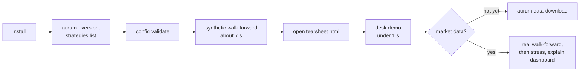

# Getting started

This page takes you from a fresh clone to working results: an install you have checked, a
configuration validated before it runs, a first walk-forward research run with its HTML
tearsheet, a local copy of the XAUUSD bid/ask history, the v2.1 analytics (stress test,
decision explanation, dashboard, parameter sweep) on a finished run, the free offline LLM-desk
demo, and a dry-run paper-trading session you can inspect with `aurum live status`. Every
output block below comes from running the command against the current code. `aurum data
download` itself was not re-run for this page, so its section is based on `--help`, the code
and the existing data store. Aurum is a research and paper-trading platform. Under its
pre-registered protocol no strategy has shown a statistically demonstrated edge (see
[RESULTS.md](RESULTS.md)), so none of these steps is a reason to trade real money.

**On this page**

- [The first 15 minutes](#the-first-15-minutes)
- [Prerequisites](#prerequisites)
- [Install](#install)
- [Check a configuration](#check-a-configuration)
- [Try it without downloading data](#try-it-without-downloading-data)
- [Download the market data](#download-the-market-data)
- [Your first walk-forward](#your-first-walk-forward)
- [Look inside a run: stress, explain, dashboard](#look-inside-a-run-stress-explain-dashboard)
- [A parameter sweep](#a-parameter-sweep)
- [The offline LLM-desk demo](#the-offline-llm-desk-demo)
- [Paper-trading quickstart](#paper-trading-quickstart)
- [When something goes wrong](#when-something-goes-wrong)
- [Where to go next](#where-to-go-next)

## The first 15 minutes

Everything on this path runs offline. The timings are wall-clock times measured for this page
on a 10-core Apple Silicon laptop; the install itself depends on your network.



1. **Install** with the test tools and the dashboard extra:

   ```bash
   python -m venv .venv && source .venv/bin/activate
   pip install -e ".[dev,viz]"
   ```

2. **Check the install** (0.9 s for the strategy list):

   ```bash
   aurum --version         # aurum 2.0.0
   aurum strategies list   # 17 strategies, with warm-up bars and a one-line description
   ```

3. **Validate a configuration** before running it (1.0 s). The output is shown
   [below](#check-a-configuration).

   ```bash
   aurum config validate -c configs/trend_core.yaml
   ```

4. **Run a whole walk-forward on generated data** (6.4 to 7.0 s), then open the tearsheet path
   it prints in a browser. The output is shown [below](#try-it-without-downloading-data).

   ```bash
   aurum walkforward -c configs/trend_core.yaml \
     --set data.synthetic.n=30000 --set walkforward.holdout_start=null
   ```

5. **Watch the LLM desk decide**, offline and free (0.8 s): `aurum desk demo`, shown
   [below](#the-offline-llm-desk-demo).

6. **Get the real data** with `aurum data download` (the first download takes an hour or more
   on Dukascopy's free feed; see [below](#download-the-market-data)), then run the real
   walk-forward outside the holdout and [look inside it](#look-inside-a-run-stress-explain-dashboard)
   with `aurum stress`, `aurum explain` and `aurum dashboard` (under 3 seconds each).

## Prerequisites

| Requirement | Notes |
|---|---|
| Python 3.10 or newer | `pyproject.toml` sets `requires-python = ">=3.10"`. CI tests 3.10 and 3.12. |
| git and a shell | Run every `aurum` command from the repository root: data and output paths in the configs (`data_store/`, `runs/`, `artifacts/`) are relative to the working directory. |
| Disk | About 130 MB for the raw Dukascopy cache (`cache/dukascopy/`) and about 20 MB for the built data store (`data_store/`). Each walk-forward run directory takes tens of MB (39 MB for `trend_core` with its holdout, 56 MB for the 14-strategy `live_paper` walk-forward). A dashboard is 5.4 MB, or 0.6 MB with `--cdn`. |
| Network | Only `aurum data download` and the paid desk commands (`aurum desk run`, `aurum desk replay`) use the network. Research, the analytics, the tests and the desk demo run offline. A dashboard built with `--cdn` needs the network to be viewed. |

**Operating systems.** Research, backtesting, RL and paper trading work on macOS, Linux and
Windows. The MetaTrader 5 adapter is Windows-only: the official `MetaTrader5` Python package
exists only for Windows, because it drives a local MT5 terminal. On macOS or Linux, use the
paper broker, which is the default.

**Linux and PyTorch.** The `[rl]` extra pulls in `torch`. On Linux, the default PyTorch wheel
downloads several GB of CUDA libraries. Unless you want GPU training, install the CPU-only
wheel *before* the extras, as the CI does:

```bash
pip install torch --index-url https://download.pytorch.org/whl/cpu
```

## Install

```bash
git clone https://github.com/zero-was-here/tradingbot.git && cd tradingbot
python -m venv .venv && source .venv/bin/activate       # Windows: .venv\Scripts\activate
pip install -e ".[dev]"                                 # core + test tools
pip install -e ".[dev,viz]"                             # ... plus the interactive dashboard
# or
pip install -e ".[all]"                                 # core + data, rl, agents, dev and viz extras
```

The core dependencies are numpy, pandas, scipy, scikit-learn, PyYAML, pyarrow, matplotlib and
requests. The optional extras, as defined in `pyproject.toml`:

| Extra | Installs | What it enables | Without it |
|---|---|---|---|
| `data` | `yfinance>=0.2.40` | Yahoo macro series (dxy, us10y, vix, spx, silver, gold_fut, oil) in `aurum data download` | The Yahoo series are skipped with a warning. FRED series still download. `macro_factor` and `risk_off` need the Yahoo series. |
| `rl` | `torch>=2.2`, `gymnasium>=0.29`, `stable-baselines3>=2.3` | `aurum rl train` and running a trained `rl_ppo` policy | `aurum rl train` exits with code 3 and an install hint. Everything else works. |
| `agents` | `anthropic>=1.8` | Live Claude calls: `aurum desk run`, `aurum desk replay`, `live.use_desk` | `aurum desk demo` still works: it uses a scripted fake client. |
| `viz` | `plotly>=5.20` | `aurum dashboard`, the interactive HTML dashboard of a run | `aurum dashboard` exits with code 3 and an install hint. `aurum.viz.style`, the tearsheet and the analytics PNGs need only matplotlib. |
| `mt5` | `MetaTrader5>=5.0.45` (Windows only) | `live.broker: mt5` | Paper broker only. **Not included in `[all]`**. Install it separately on Windows with `pip install -e ".[mt5]"`. |
| `dev` | `pytest>=8`, `ruff>=0.13` | Tests and linting (see [development.md](development.md)) | |
| `docs` | `mkdocs>=1.6`, `mkdocs-material>=9.5` | Browsing these pages as a local site with `mkdocs serve` | Read the Markdown files directly, for example on GitHub |
| `all` | `data`, `rl`, `agents`, `dev`, `viz` | Everything except `mt5` and `docs` | |

Importing `aurum` never loads the optional packages eagerly. CI checks that the CLI, the
strategy registry and the agents package import on a core-only install.

Check the install. Both commands are offline:

```bash
aurum --version         # or: python -m aurum --version
aurum strategies list   # 17 registered strategies, with warm-up bars and a one-line description
```

```text
aurum 2.0.0
```

The strategy list is `bollinger_revert`, `donchian`, `ema_cross`, `intraday_seasonality`,
`kalman_trend`, `macro_factor`, `managed_gold`, `meta_label`, `ml_gbm`, `orb`,
`regime_switch`, `risk_off`, `rl_ppo`, `rsi2`, `tsmom`, `vol_squeeze` and `zscore_fade`;
[strategies.md](strategies.md) describes each one.

## Check a configuration

Every command validates its configuration strictly before it loads any data, and reports
every problem at once rather than the first one. `aurum config validate` runs that check on
its own. On a shipped config:

```bash
aurum config validate -c configs/trend_core.yaml
```

```text
# checked: data, costs (CostModel), combiner (ForecastCombiner), sizing, risk.research, risk.live, backtest, walkforward, agents.policy (DecisionPolicy), agents.desk (DeskConfig), instrument (Instrument + ranges), features (FeaturePipeline, 12 groups), strategies (7 of 7 built from the registry), live runner settings (aurum.live.runner.LiveConfig), rl.params + env (rl_config_from_aurum)
# config OK: configs/trend_core.yaml  hash 06a2fca027fc67d5b33bcc96fef2be2ac902a4938cadd6020b270943fbc97064
```

The hash is `config_hash()`, which names run directories and keys the holdout ledger. Lines
starting with `# warning:` or `# skipped:` appear when there is something to say (for example
a missing RL artifact, or an RL stack that is not installed). Now a config with mistakes in
it, saved as `configs/my_experiment.yaml`:

```yaml
extends: trend_core.yaml
sizing:
  target_vol: 0.25
  rebalance_band: 1.5
instrument:
  triple_swap_weekday: 5
strategies:
  - {name: tsmom}
  - {name: ema_cross, params: {fast: 16, slow: 64, slwo: 3}}
  - {name: donchain}
```

```bash
aurum config validate -c configs/my_experiment.yaml     # exit code 2
```

```text
aurum: configuration error: 5 configuration problems:
  - sizing: rebalance_band must be in [0, 1)
  - instrument.triple_swap_weekday must be 0..4 (Monday..Friday: the weekday whose rollover is charged three nights, 2 = Wednesday), got 5
  - strategies[1].params (ema_cross): unknown parameter(s) ['slwo'] for strategy 'ema_cross' (did you mean 'slwo' -> 'slow'?); valid: ['fast', 'slow', 'vol_halflife', 'vol_min_periods']
  - strategies[2].name: unknown strategy 'donchain'; did you mean ['donchian']? (registered: ['bollinger_revert', 'donchian', 'ema_cross', 'intraday_seasonality', 'kalman_trend', 'macro_factor', 'managed_gold', 'meta_label', 'ml_gbm', 'orb', 'regime_switch', 'risk_off', 'rl_ppo', 'rsi2', 'tsmom', 'vol_squeeze', 'zscore_fade'])
  - rl.params: rebalance_band must be in [0, 1)
```

The band error appears twice because the RL environment is built from the same `sizing`
section. `target_vol: 0.25` is allowed (it is aggressive, not invalid). `aurum config show`
runs the same check and prints the resolved YAML only for a valid config.
[configuration.md](configuration.md) lists everything that is validated.

## Try it without downloading data

Any config can run on generated data instead of files. Setting a `data.synthetic` key replaces
the data store with `aurum.data.synthetic.make_synthetic_bars` bars, plus synthetic macro
series and events. The default model is a random walk (`gbm`), which has no edge by
construction, so this doubles as a sanity check: expect Sharpe confidence intervals that
straddle zero.

```bash
aurum walkforward -c configs/trend_core.yaml \
  --set data.synthetic.n=30000 --set walkforward.holdout_start=null
```

This runs the full walk-forward protocol (4 folds, 7 strategies, tearsheet) in 6.4 to 7.0
seconds of wall time on the machine used for this page. Rate-based financing logs a warning
once per worker process (`... WARNING: rate financing: no 'fedfunds' series supplied ...`):
the synthetic macro set has no `fedfunds` series, so every rollover uses
`costs.financing.fallback_rate` (3%). Those lines are left out below:

```text
loaded 30000 H1 bars 2020-01-06 00:00:00+00:00 -> 2024-11-04 11:00:00+00:00 (0.0s); 7 strategies
== walkforward: trend_core  config fc77c9df8a29  data 898857d3942e
OOS 2023-01-05 18:00:00+00:00 -> 2024-11-04 11:00:00+00:00  (11346 bars, 4 fold(s), train 18630 / test 3105 bars, purge 0, embargo 24, n_trials 23)

book          sharpe  ci_lower  ci_upper    psr    dsr    cagr  ann_vol  max_drawdown  n_trades  total_costs  n_halt_episodes
-----------------------------------------------------------------------------------------------------------------------------
combined      -0.809    -2.332     0.567  0.133  0.001  -0.030    0.036        -0.080       129        1,082                0
tsmom         -0.814    -2.281     0.568  0.132  0.001  -0.043    0.050        -0.118       289        2,587                0
ema_cross     -0.790    -2.275     0.510  0.140  0.001  -0.038    0.047        -0.115       121        1,358                0
donchian      -1.006    -2.424     0.357  0.085  0.000  -0.053    0.051        -0.117        84        1,159                0
kalman_trend  -0.587    -2.046     0.718  0.212  0.003  -0.029    0.047        -0.119       332        2,828                0
vol_squeeze   -0.325    -1.975     1.068  0.331  0.009  -0.012    0.033        -0.071       185        4,341                0
macro_factor  -0.208    -1.669     1.272  0.387  0.012  -0.015    0.062        -0.100        53      917.376                0
risk_off      -0.863    -2.066     0.375  0.116  0.001  -0.020    0.023        -0.042         5       55.744                0
benchmark     -0.432    -1.863     0.978  0.276  0.276  -0.082    0.160        -0.301         1       12.271                0

PBO (CSCV, 16 splits, 7 strategies): 0.761  prob OOS loss of IS-best 0.950

notes:
  - fold 1 combiner: 60.0% of the risk budget left UNALLOCATED: max_weight=0.400 cannot be met by the 1 positively scored strategies; zero weight (non-positive net/shrunk Sharpe): ['tsmom', 'ema_cross', 'donchian', 'kalman_trend', 'vol_squeeze', 'risk_off']
  - fold 2 combiner: 60.0% of the risk budget left UNALLOCATED: max_weight=0.400 cannot be met by the 1 positively scored strategies; zero weight (non-positive net/shrunk Sharpe): ['tsmom', 'ema_cross', 'donchian', 'kalman_trend', 'vol_squeeze', 'risk_off']
  - fold 3 combiner: 20.0% of the risk budget left UNALLOCATED: max_weight=0.400 cannot be met by the 2 positively scored strategies; zero weight (non-positive net/shrunk Sharpe): ['tsmom', 'donchian', 'kalman_trend', 'vol_squeeze', 'risk_off']
  - 1 fold(s) used equal combiner weights (not enough earlier OOS history)

timing: features 0.0s, strategies 2.1s, combine 0.0s, backtests 1.7s, stats 0.1s, write 1.3s, wall 5.5s

report dir: runs/walkforward_20261109T150612Z_fc77c9df
tearsheet:  runs/walkforward_20261109T150612Z_fc77c9df/tearsheet.html
```

Every confidence interval contains zero, every DSR is near zero and the PBO is high: exactly
what a random walk should give. The columns are explained [below](#your-first-walk-forward).

## Download the market data

```bash
aurum data download      # Dukascopy XAUUSD bid/ask 2012 -> yesterday (UTC) + Yahoo/FRED macro
aurum data info          # verify: row counts, ranges, median spreads, hashes
```

`aurum data download` has two passes:

1. **Bars.** A prefetch pass fills `cache/dukascopy/` with raw LZMA-compressed candle files
   from Dukascopy's free datafeed. It fetches the newest days first. Files already in the cache
   are skipped, so the pass is **resumable**. Individual failures are counted, not raised. An
   adaptive limiter reduces concurrency when the feed throttles (HTTP 429/503). A build pass
   then decodes the cache into mid-price bars with the recorded bid/ask spread. It writes
   `data_store/xauusd_{M15,H1,H4,D1,D1_nyclose}.parquet` and `data_store/manifest.json`.
2. **Macro.** Yahoo series (needs the `[data]` extra) and FRED series (`real10y`,
   `breakeven10y`, `fedfunds`) go to `data_store/macro/`. Each row is stamped with an
   `available_at` publication time, so the series can be joined point-in-time.

**Time and size.** The free feed is heavily rate-limited. The first full download takes about
an hour or more, and the full 2012–2026 minute cache is about 130 MB. If it stops early
(for example with `--time-budget`, or after Ctrl-C), run the same command again: it resumes
from the cache. Rebuilding the data store from a complete cache with `--offline` took about 11
seconds (peak memory about 1.8 GB) when the published dataset was built
([INTERFACES.md](INTERFACES.md)).

| Flag | Default | Meaning |
|---|---|---|
| `--out` | `data_store` | Output directory for the parquet files, `manifest.json` and `macro/` |
| `--symbol` | `XAUUSD` | Dukascopy symbol |
| `--start` | `2012-01-01` | First day to download |
| `--end` | yesterday (UTC) | Inclusive last day |
| `--timeframes` | `all` | `all` builds M15, H1, H4, D1 and D1_nyclose with a manifest. A list such as `H1,H4` downloads just those timeframes directly, with no prefetch pass and no manifest. |
| `--cache` | `cache/dukascopy` | Raw file cache (resumable) |
| `--workers` | `4` | Download workers. The prefetch pass caps them at 8. |
| `--time-budget` | none | Seconds for the prefetch pass. It stops cleanly when the budget runs out; re-run to resume. |
| `--offline` | off | Build the bars only from the local cache. Macro is still fetched unless you also pass `--no-macro`. |
| `--no-bars` | off | Skip the Dukascopy bars |
| `--no-macro` | off | Skip the Yahoo/FRED macro series |
| `--macro-start` | `2011-01-01` | First day of the macro series |
| `--macro-cache` | `cache/macro` | Macro download cache |

**The manifest.** `data_store/manifest.json` records, for every file, the row count, first and
last bar, a SHA-256 content hash and a data-quality report. The report covers gaps, the
zero-spread fraction, spread quantiles and median spread by year, flat bars and return outliers.
`build_path` says how the bars were built. `"M1"` means every file was aggregated from minute
candles, which is the specification's path and the one behind [RESULTS.md](RESULTS.md). If the
minute cache did not yet cover the whole range, the build falls back to monthly hour files for
H1/H4/D1 (`"build_path": "H1"`). In that case M15 covers only the contiguous cached range.
Re-run the download until `aurum data info` reports `via M1`.

The published manifest is committed to git (every other file under `data_store/` is ignored).
After a download, `git diff data_store/manifest.json` shows whether your files hash to the
same values as the ones behind the published results. With a later `--end`, the files
legitimately differ.

`aurum data info` on the data store used for this documentation:

```text
file                       timeframe    rows                      first                       last  median_spread          hash  check
--------------------------------------------------------------------------------------------------------------------------------------
xauusd_D1.parquet                 D1    4585  2012-01-01 00:00:00+00:00  2026-09-25 00:00:00+00:00          0.343  b9e5cd6df941     ok
xauusd_D1_nyclose.parquet         D1    3841  2012-01-01 22:00:00+00:00  2026-09-24 22:00:00+00:00          0.337  131df1e6ed86     ok
xauusd_H1.parquet                 H1   87829  2012-01-01 22:00:00+00:00  2026-09-25 20:00:00+00:00          0.333  a9d73169411a     ok
xauusd_H4.parquet                 H4   23581  2012-01-01 20:00:00+00:00  2026-09-25 20:00:00+00:00          0.337  2e00965f1bd5     ok
xauusd_M15.parquet               M15  349660  2012-01-01 22:45:00+00:00  2026-09-25 20:45:00+00:00          0.332  58144724438a     ok

macro:
series        rows       first        last          last_available_at
---------------------------------------------------------------------
breakeven10y  3935  2011-01-03  2026-09-25  2026-09-28 21:30:00+00:00
dxy           3957  2011-01-03  2026-09-25  2026-09-25 22:30:00+00:00
fedfunds      5746  2011-01-01  2026-09-24  2026-09-25 21:30:00+00:00
...
vix           3958  2011-01-03  2026-09-25  2026-09-25 21:30:00+00:00

manifest: built 2026-09-27T00:43:45.881797+00:00 via M1 from dukascopy datafeed
```

`check` re-verifies each file's stored hash on load. `last_available_at` is when the last row
was published, which can be later than its observation date: FRED prints become usable at
21:30 UTC on the next US business day. Timestamps are bar **open** times in UTC. Details are
in [data.md](data.md).

## Your first walk-forward

`configs/trend_core.yaml` is the pre-registered low-turnover book: `tsmom`, `ema_cross`,
`donchian`, `kalman_trend`, `vol_squeeze`, `macro_factor` and `risk_off` on H1 bars, with
everything else inherited from `configs/default.yaml`.

```bash
aurum walkforward -c configs/trend_core.yaml
```

This loads H1 bars from 2013 (`data.start`), splits them into rolling 3-year train and 6-month
test folds, and refits every trainable piece per fold on past data only. It stitches the
out-of-sample (OOS) forecasts, runs **one** continuous backtest per book through the shared
sizer, risk manager and cost model, and computes deflated statistics. The
[research page](research.md) explains the protocol, and the
[landing page](index.md#the-data-and-how-it-is-split) shows the 18 folds on a chart.

> **The holdout.** Both shipped research configs set `walkforward.holdout_start: "2025-01-01"`.
> The plain command above also evaluates the 2025–26 holdout and appends that look to
> `runs/holdout_ledger.jsonl`. The published protocol has already used this holdout (see
> [RESULTS.md](RESULTS.md)). Re-running the *same* deterministic config is not counted as a new
> trial, but a changed config is. For your own experiments, stay out of the holdout:
>
> ```bash
> aurum walkforward -c configs/trend_core.yaml \
>   --set data.end=2024-12-31T23:59:59Z --set walkforward.holdout_start=null
> ```

Output of the plain command on the data store above, abbreviated with `...`. The numbers are the
ones published in [RESULTS.md](RESULTS.md): the run is deterministic.

```text
loaded 81587 H1 bars 2013-01-01 23:00:00+00:00 -> 2026-09-25 20:00:00+00:00 (2.3s); 7 strategies
2026-09-28 10:18:42,699 WARNING aurum.portfolio.combiner: ForecastCombiner: no strategy with a positive net Sharpe in train: all weights 0, the combined book stays flat
== walkforward: trend_core  config 06a2fca027fc  data b05d27bf5688
OOS 2015-12-16 20:00:00+00:00 -> 2024-12-31 21:00:00+00:00  (53462 bars, 18 fold(s), train 17834 / test 2972 bars, purge 0, embargo 24, n_trials 23)

book          sharpe  ci_lower  ci_upper    psr    dsr    cagr  ann_vol  max_drawdown  n_trades  total_costs  n_halt_episodes
-----------------------------------------------------------------------------------------------------------------------------
combined      -0.170    -0.821     0.482  0.304  0.007  -0.008    0.040        -0.123       875       11,749                0
tsmom          0.003    -0.651     0.656  0.504  0.026  -0.001    0.050        -0.151      1230       14,958                0
...
benchmark      0.463    -0.154     1.131  0.921  0.921   0.066    0.162        -0.314         1       26.236                0

PBO (CSCV, 16 splits, 7 strategies): 0.898  prob OOS loss of IS-best 0.838

== FINAL HOLDOUT (evaluated once) 2025-01-01 23:00:00+00:00 -> 2026-09-25 20:00:00+00:00
book          sharpe  ci_lower  ci_upper    psr    dsr    cagr  ann_vol  max_drawdown  n_trades  total_costs  n_halt_episodes
...

notes:
  - fold 13 combiner: 60.0% of the risk budget left UNALLOCATED: max_weight=0.400 cannot be met by the 1 positively scored strategies; ...
  ...
  - 1 fold(s) used equal combiner weights (not enough earlier OOS history)

timing: features 0.0s, strategies 64.1s, combine 2.3s, backtests 112.1s, holdout 19.2s, stats 6.8s, write 23.7s, wall 233.0s

report dir: runs/walkforward_<utc>_06a2fca0
tearsheet:  runs/walkforward_<utc>_06a2fca0/tearsheet.html
```

How long it takes depends on your cores and how busy the machine is. The timing line above
comes from a 10-core machine under a very high load average (about 77 seconds of CPU, 233
seconds of wall time). On the same machine when idle, the command took about 12 seconds of
wall time, in line with the README's figure of about 15 seconds. Your data will also differ if
you downloaded it later: `--end` defaults to yesterday, which lengthens the holdout window. For
byte-identical data, use `aurum data download --end 2026-09-25` and compare the data hash in
`provenance.json` with the hashes at the top of [RESULTS.md](RESULTS.md).

**Reading the table.** Each row is a book: the combined portfolio, each strategy traded on its
own, and `benchmark` (buy-and-hold with the same financing costs).

| Column | Meaning |
|---|---|
| `sharpe` | Annualised Sharpe ratio of **daily** returns (UTC dates, 252 days per year) |
| `ci_lower`, `ci_upper` | 95% stationary-bootstrap confidence interval for that Sharpe |
| `psr` | Probabilistic Sharpe ratio: probability that the true Sharpe is above 0 |
| `dsr` | Deflated Sharpe ratio: the PSR against the best Sharpe expected from `n_trials` skill-less trials. The protocol's bar is 0.95. |
| `cagr`, `ann_vol`, `max_drawdown` | Fractions (`-0.123` = −12.3%) |
| `n_trades` | Round trips |
| `total_costs` | USD of spread, slippage and commission. Financing is reported separately as `swap` in `costs.csv`. |
| `n_halt_episodes` | Number of separate periods in which the risk manager kept the book halted (with the research limits, these are daily-loss halts) |

`PBO` is the probability of backtest overfitting across the strategy set (CSCV). The `notes`
flag folds where the net-of-cost combiner left risk unallocated or kept the book flat. The
[research page](research.md) covers each statistic.

**The run directory.** The default is
`runs/walkforward_<UTC timestamp>_<first 8 hex of the config hash>`. Use `--out DIR` to choose
the path.

| Path | Contents |
|---|---|
| `summary.json` | Everything the terminal shows and more (settings, folds, weights, costs, PBO, notes, timing, provenance). `aurum report --run DIR` reprints it; add `--json` for raw JSON. |
| `config.yaml` | The fully resolved config (secrets are never written) |
| `provenance.json` | Config hash, bar and macro data hashes, calendar hash, git SHA and dirty flag, Python and package versions, the command line |
| `stats.csv`, `costs.csv` | Per-book statistics and cost attribution (spread, slippage, commission, swap, gross vs net PnL) |
| `folds.csv`, `weights.csv`, `fold_sharpe.csv` | Fold windows and per-fold OOS Sharpe, combiner weights and FDM per fold, per-strategy Sharpe per fold |
| `oos_forecasts.parquet` | Stitched OOS forecast of every strategy and of `combined`, plus the `fold` id (input to `train-final --from-run` and `aurum explain`) |
| `books/<book>/` | For `combined`, each strategy and `benchmark`: `timeseries.parquet` (equity, returns, positions, target, forecast, per-bar costs and PnL), `trades.csv`, `fills.csv`, `risk_events.csv`, `metrics.json`, `meta.json` |
| `tearsheet.html` | Self-contained HTML report of the combined OOS book |
| `holdout/` | Only when a holdout was evaluated: `stats.csv`, `costs.csv`, `holdout.json`, `oos_forecasts.parquet`, `books/{combined,benchmark}/`, `tearsheet.html` |
| `analysis/` | Written later by `aurum stress` and `aurum explain` when you do not pass `--out` |
| `../holdout_ledger.jsonl` | Next to the run directories: one line per holdout evaluation |

**The tearsheet.** Open `tearsheet.html` in a browser. It is a single file with inline charts
(light and dark variants) and no external assets. Sections, top to bottom:

| Section | What to look at |
|---|---|
| Header tiles | Total return, CAGR, Sharpe (daily), max drawdown, annual vol, PSR |
| Equity | Equity versus the rebased benchmark on a log scale. Also benchmark return, Sharpe and drawdown, plus the book's daily correlation and beta to it. |
| Drawdown | Underwater curve |
| Rolling Sharpe | 6-month (126 trading-day) window |
| Monthly returns | Month-by-year return grid with yearly totals |
| Return distribution | Histogram of daily returns |
| Position & exposure | Signed lots over time with the combined forecast, time in market, long/short share |
| Cost attribution | Spread, slippage, commission and net financing, cost drag per year, PnL before and after costs |
| Trade statistics | Round-trip statistics, also broken down by exit reason |
| Statistical confidence | Sharpe with its standard error, bootstrap CI, PSR, DSR with the number of trials, minimum track record, skew and kurtosis, PBO |
| Walk-forward folds | OOS Sharpe per fold (chart and table) |
| Strategy weights | Combiner weights per fold |
| Risk-manager interventions | Bars where the risk manager changed or blocked the requested position (shown only when there were any) |
| All metrics | Every metric of the book |
| Notes & provenance | Run metadata, the full config, notes, per-strategy stats, per-fold Sharpe by strategy, costs by book |

For a larger run, `configs/default.yaml` evaluates all 14 default strategies, including the
ML models. The README quotes about 3 minutes on 8 cores for it.

## Look inside a run: stress, explain, dashboard

Three v2.1 commands read a finished run directory and never refit anything, so they cost
seconds and spend no holdout. The examples use `runs/protocol/trend_core_selection`, the
pre-registered `trend_core` walk-forward on data up to 2024-12-31. By default each command
writes under `<run>/analysis/` (the dashboard to `<run>/dashboard.html`); pass `--out` to write
elsewhere, as here, so the protocol run stays untouched. `stress` and `explain` take
`--phase holdout` to read an already evaluated holdout instead (reading it is not a new look).
[analytics.md](analytics.md) explains the methods behind each one.

**`aurum stress`** resamples the book's daily returns into 10,000 two-year futures with a
stationary block bootstrap and adds deterministic stress scenarios (1.8 s):

```bash
aurum stress --run runs/protocol/trend_core_selection --out analysis/stress
```

```text
== stress: runs/protocol/trend_core_selection [research/combined]
history: 2346 daily returns, Sharpe -0.170;  Monte Carlo: 10,000 paths x 504 days, stationary bootstrap mean block 1.0 days, seed 0 (0.28s)

stat   cagr  max_drawdown  total_return  final_equity  longest_underwater_days
------------------------------------------------------------------------------
 q05  -5.2%        -12.3%        -10.1%         0.899                      134
 q25  -2.6%         -8.6%         -5.2%         0.948                      236
 q50  -0.8%         -6.5%         -1.5%         0.985                      351
 q75  +1.1%         -4.8%         +2.3%         1.023                      467
 q95  +4.1%         -3.3%         +8.3%         1.083                      503
mean  -0.7%         -7.0%         -1.3%         0.987                  342.904

P(max drawdown deeper than x)          risk of ruin (equity touches start - x)
threshold  probability                 loss_threshold  p_touch  p_end_below
----------------------                 ------------------------------------
      >5%        0.721                           -10%    0.087        0.051
     >10%        0.149                           -20%    0.000        0.000
...

recovery: P(not recovered from the max drawdown within the horizon) 75.8%; time to recover median 99 / p95 259 trading days; longest underwater median 351 days
...
outputs: analysis/stress/stress.json, fan.png, distributions.png, *.csv
```

The elided parts are the worst historical windows of the book, gap-shock scenarios at the
current and at the peak exposure, and gold's worst historical moves applied to the current
position. Read the fan as "what the past, reshuffled, says about the next two years", not as a
forecast: sizing and costs are already inside the resampled returns.

**`aurum explain`** answers "why did the book hold this?" for one bar and, with
`--attribution`, "which strategy earned what?" over the whole run (2.7 s):

```bash
aurum explain --run runs/protocol/trend_core_selection --at "2020-03-16 14:00" --attribution --out analysis/explain
```

```text
== explain: runs/protocol/trend_core_selection [research] decision at the close of 2020-03-16 14:00:00+00:00 (fold 8), decided 2020-03-16 15:00:00+00:00

    strategy  forecast  weight    fdm  contribution    share
------------------------------------------------------------
   ema_cross    -1.000   0.211  1.544        -0.325  +100.0%
       tsmom    -0.696   0.000  1.544         0.000    +0.0%
    donchian    -0.800   0.000  1.544         0.000    +0.0%
kalman_trend    -0.987   0.000  1.544         0.000    +0.0%
 vol_squeeze     0.000   0.389  1.544         0.000    +0.0%
macro_factor    -1.000   0.000  1.544         0.000    +0.0%
    risk_off     0.000   0.400  1.544         0.000    +0.0%

raw sum -0.3250  clip +0.0000  -> combined -0.3250 (saved -0.3250)
sizing: vol 56.4%, price 1,498, equity 97,918, drawdown 7.0% -> notional -5,646 -> caps none, drawdown x1.000 -> -0.038 lots -> requested -0.030 (rebalance band kept the current position); matches saved: True
position -0.03 -> requested -0.030 -> filled at the next open -0.030 lots

== PnL attribution (research, net); method: pnl(t+1) allocated by signed combiner contributions at the close of t: share_i = w_i * f_i * FDM / sum_j w_j * f_j * FDM
    strategy      net     price   costs      swap  share_of_total
-----------------------------------------------------------------
    risk_off   -4,766    -1,143  -3,426  -197.039          +69.9%
    donchian   -3,417    -1,153  -1,169    -1,096          +50.2%
       tsmom   -2,236  -410.240  -1,193  -633.213          +32.8%
kalman_trend   -1,610   552.330  -1,465  -697.549          +23.6%
   ema_cross   -1,505     6,945  -6,310    -2,140          +22.1%
macro_factor  -20.370     2,009  -1,532  -496.679           +0.3%
unattributed   -0.232     0.001  -0.234     0.000           +0.0%
 vol_squeeze    6,741     3,921   3,346  -526.048          -98.9%
total -6,813.97 USD = sum of the rows (-6,813.97)

outputs: analysis/explain/decision_20200316T1400.json, decision_20200316T1400.csv, decision_20200316T1400.png, attribution.png, attribution_totals.csv, attribution_by_year.csv, attribution_daily.csv, attribution.json
```

In the COVID sell-off of March 2020 only ema_cross both had weight and a non-zero forecast in
fold 8, so it is 100% of the decision. Gold's volatility was 56%, so a −0.325 forecast is only
−0.038 lots, and the rebalance band kept the −0.03 already held. The attribution rows add up
exactly to the run's net PnL. vol_squeeze shows *positive* costs because its contributions
often opposed the net position, and costs are shared out with the same signed shares as price
PnL. [architecture.md](architecture.md#one-decision-through-the-stack) walks through a decision
where every stage moves.

**`aurum dashboard`** writes the whole run as one interactive HTML page (0.9 s; needs the
`viz` extra):

```bash
aurum dashboard --run runs/protocol/trend_core_selection --out trend_core_dashboard.html
```

```text
dashboard: trend_core_dashboard.html (5.40 MB)
```

The page embeds plotly.js, so it works offline; `--cdn` loads plotly.js from its CDN instead
and the same run gives 0.58 MB. It has KPI tiles with badges for DSR above 0.95 and a
confidence interval above 0, equity against the benchmark with fold boundaries, drawdown,
rolling Sharpe, per-fold Sharpe, forecast small multiples, stacked combiner weights, per-book
statistics, a gross-to-net cost waterfall, a monthly heatmap, a filterable trade list, the
holdout (when the run has one), the LLM-desk timeline (with `--journal DIR`) and provenance,
with a light/dark toggle. See [analytics.md](analytics.md#interactive-dashboard).

## A parameter sweep

`aurum sweep` evaluates a grid of parameter values, each point as its own walk-forward, so
every number is out of sample and net of costs. It labels everything EXPLORATORY and counts
every valid grid point as a trial in the deflated Sharpe. On generated data (5.3 s, 8 worker
processes; the rate-financing warning lines are left out):

```bash
aurum sweep -c configs/trend_core.yaml --strategy ema_cross --grid fast=8,16,32 --grid slow=64,128,256 \
  --set data.synthetic.n=30000 --set walkforward.holdout_start=null
```

```text
loaded 30000 H1 bars 2020-01-06 00:00:00+00:00 -> 2024-11-04 11:00:00+00:00 (0.0s)
== sweep (EXPLORATORY: every grid point is a trial): ema_cross  9 point(s)  metric sharpe  walk-forward OOS
research window 2020-01-06 00:00:00+00:00 -> 2024-11-04 11:00:00+00:00 (30000 bars); OOS 2023-01-05 18:00:00+00:00 -> 2024-11-04 11:00:00+00:00

fast  slow  status  sharpe   cagr  max_drawdown  n_trades  turnover_lots_per_year  total_costs  seconds
-------------------------------------------------------------------------------------------------------
  32   256      ok  -0.544  -2.7%        -11.3%        70                  17.287        1,036    0.788
  16   256      ok  -0.596  -3.0%        -11.6%       109                  21.417        1,288    0.820
  32    64      ok  -0.608  -3.0%        -11.8%       163                  30.926        1,852    0.902
  32   128      ok  -0.790  -3.8%        -11.5%       121                  22.815        1,358    0.850
   8   256      ok  -0.803  -3.7%        -11.8%       171                  28.910        1,723    1.017
  16   128      ok  -0.849  -4.0%        -11.9%       175                  29.156        1,736    0.947
  16    64      ok  -0.976  -4.5%        -12.2%       227                  41.588        2,472    1.019
   8   128      ok  -1.045  -4.6%        -12.7%       235                  36.776        2,208    0.944
   8    64      ok  -1.325  -5.0%        -13.3%       331                  48.099        2,867    0.748

best: fast=32,slow=256  sharpe=-0.544  Sharpe -0.544 [-1.961, 0.766]  PSR 0.227  DSR 0.012 (n_trials 9)  DSR_xs 0.102
plateau: undefined  ratio nan over 3 neighbour(s) (mean -0.745, min -0.849);  plateau centre fast=32,slow=256 (sharpe -0.544)
PBO across grid points: 0.642  (P[OOS loss of IS-best] 0.854)
note: the best point lies on the edge of the grid for ['fast', 'slow']: the optimum may be outside the searched range (extending the grid is another search: more trials)

timing: evaluate 3.778s, total 4.353s (process x8)
outputs: runs/sweep_ema_cross_20261109T150627Z/sweep.csv, sweep.json, sweep.png
```

On a random walk every point loses (costs), the plateau ratio is undefined because the best
Sharpe is negative, and the best point sits on the edge of the grid: all three are the warnings
a sweep is built to raise. Each run appends to `runs/sweep_ledger.jsonl`, and later sweeps
whose window overlaps count those configurations as extra trials. On real data a sweep cuts its
window before `walkforward.holdout_start` and before any window recorded in a holdout ledger,
so it cannot touch the holdout. The published EMA sweep and how to read a plateau are in
[analytics.md](analytics.md) and [RESULTS.md](RESULTS.md).

## The offline LLM-desk demo

```bash
aurum desk demo
```

This runs one complete desk cycle offline (0.8 s). A scripted fake Claude client plays every
agent on synthetic, anonymised data. The Chief consults two standing specialists in parallel,
creates an ad-hoc event-risk analyst, and then scales the quant forecast by 0.5 under the
default `overlay` policy. It needs no API key and no network. Real output:

```text
LLM desk demo (offline scripted client, synthetic anonymised data)
status:          decided
decision time:   2020-02-10 05:00:00+00:00
quant forecast:  -0.300
decision:        action=scale scale=0.5 forecast=-0.1497952633636686 confidence=0.55 horizon=24 bars
rationale:       Mixed specialist views and upcoming event risk: halve exposure.
key risks:       event risk
final forecast:  -0.150  (policy overlay: scale)
memos:           3 adhoc:event_risk_analyst=neutral, macro_strategist=bearish, risk_officer=neutral
cost:            $0.0900  tokens in=9000 out=1800 cache_read=0
```

The `cost` line is the desk's budget ledger at list prices, applied to the token counts the
scripted client *reports*. No API call is made and nothing is charged. Without
`--journal-dir`, the cycle journal stays in memory. Pass `--journal-dir DIR` to get the JSONL
journal of prompts, tool calls, memos, the decision and usage.

`aurum desk run` (one cycle) and `aurum desk replay` call the **paid** Claude API and need
`ANTHROPIC_API_KEY` in the environment, never in YAML. Both also need `agents.enabled: true`
in the config (`configs/desk_overlay.yaml` sets it; otherwise they exit with code 2), except
`desk replay --fake`. `desk replay` prints a cost estimate and refuses to start without
`--yes`. Read [llm-desk.md](llm-desk.md) before using either.

## Paper-trading quickstart

Two steps: fit a production artifact, then run the bar-close loop against the paper broker.

```bash
aurum train-final -c configs/live_paper.yaml --out artifacts/live_paper
aurum live run    -c configs/live_paper.yaml --max-cycles 24
```

**1. `train-final`** fits everything on the data up to `--cutoff` (default: the last bar):

- the feature scaler and the trainable strategies, on the training window that ends at the
  cutoff;
- the combiner weights, on stitched **out-of-sample** walk-forward forecasts.

Without `--from-run <walk-forward dir>`, it first runs that walk-forward itself: all 14
strategies of `live_paper.yaml`, written like `aurum walkforward`, including a holdout
evaluation that goes into the ledger. On the 10-core machine used for this page that took
about 3.5 minutes when idle; the README quotes about 3–7 minutes. Pass `--from-run` with a
walk-forward made from the same config to skip it: the command then refuses a run with a
different config hash unless you add `--allow-config-mismatch`.

For this page the artifact was fitted on data up to the end of 2024 and took its combiner
weights from the pre-registered 14-strategy walk-forward. That run was made with
`data.end`/`holdout_start` overrides, so its hash differs and the mismatch has to be accepted
explicitly (36 s; the ML skill-gate warnings at the start are left out):

```bash
aurum train-final -c configs/live_paper.yaml --set data.end=2024-12-31T23:59:59Z \
  --cutoff 2024-12-31T22:00:00Z --from-run runs/protocol/default_selection \
  --allow-config-mismatch --out artifacts/live_paper
```

```text
train-final: 71320 H1 bars 2013-01-01 23:00:00+00:00 -> 2024-12-31 21:00:00+00:00 (last close 2024-12-31 22:00:00+00:00); 14 strategies
WARNING: --from-run runs/protocol/default_selection was produced by config f6d4b7823d79, this config is c01f40b4fede: its OOS forecasts validate a different protocol

artifact: artifacts/live_paper
  fit window 2021-12-28 00:00:00+00:00 -> 2024-12-31 21:00:00+00:00; combiner oos_history(17834 bars) [net of estimated costs c_t=(spread_eff/2+slippage+commission)/(close*vol)]
  weights: tsmom=0.15, ema_cross=0.21, donchian=0.15, kalman_trend=0.17, zscore_fade=0.00, rsi2=0.00, bollinger_revert=0.00, vol_squeeze=0.00, orb=0.00, macro_factor=0.12, risk_off=0.00, intraday_seasonality=0.00, ml_gbm=0.00, meta_label=0.21  (sum 1.00, fdm 1.29)
  feature reference: 0 columns; OOS source: runs/protocol/default_selection
```

These weights are what the combiner learned from past OOS forecasts. They are not evidence of
an edge (see [RESULTS.md](RESULTS.md)). The artifact directory holds `manifest.json` (a
SHA-256 for every file, and an HMAC when `AURUM_ARTIFACT_KEY` is set), `strategies.pkl`,
`strategies.json`, `combiner.pkl` and `backtest.json`. An artifact whose strategies use the
shared feature pipeline also gets `pipeline.json` and `feature_reference.json`, which is used
for drift monitoring. `live_paper.yaml`'s strategies do not, hence `0 columns`. The artifact
contains pickles, so only load artifacts you produced yourself.

**2. `live run`** starts the runner. With `live_paper.yaml`, it is in dry-run mode on the paper
broker. The paper broker replays `data_store/xauusd_H1.parquet` on a simulated clock,
starting after `paper.warmup_bars` (6,000 bars, i.e. December 2012). `--max-cycles 3` stops
after three bar closes; `--until <UTC time>` stops at a time instead. Output (0.7 s after
start-up):

```bash
aurum live run -c configs/live_paper.yaml --max-cycles 3
```

```text
live: broker=paper dry_run=True allow_live_real=False magic=20260926 artifact=artifacts/live_paper desk=off
resolved runner config: runs/live/paper/aurum_live_config.yaml
2026-11-09 14:59:03,417 INFO aurum.live.runner: artifact artifacts/live_paper loaded: ['bollinger_revert', 'donchian', 'ema_cross', 'intraday_seasonality', 'kalman_trend', 'macro_factor', 'meta_label', 'ml_gbm', 'orb', 'risk_off', 'rsi2', 'tsmom', 'vol_squeeze', 'zscore_fade'] on XAUUSD H1, lookback 5820
2026-11-09 14:59:03,418 INFO aurum.live.runner: LiveRunner started [DRY-RUN PAPER] XAUUSD H1 magic=20260926 history=17460 bars (warm-up 5821)
aurum live runner [DRY-RUN PAPER] XAUUSD H1 magic=20260926 state=runs/live/paper
2026-11-09 14:59:03,426 INFO aurum.live.runner: macro data reloaded from data_store/macro (10 series)
2026-11-09 14:59:03,642 INFO aurum.live.runner: decision 2012-12-17T15:00:00+00:00 XAUUSD [DRY-RUN PAPER]: combined -0.316 desk off final -0.316 target -0.19 approved -0.19 held +0.00 orders planned open SELL 0.19 status=dry_run
2026-11-09 14:59:03,877 INFO aurum.live.runner: decision 2012-12-17T16:00:00+00:00 XAUUSD [DRY-RUN PAPER]: combined -0.308 desk off final -0.308 target -0.19 approved -0.19 held +0.00 orders planned open SELL 0.19 status=dry_run
2026-11-09 14:59:04,077 INFO aurum.live.runner: decision 2012-12-17T17:00:00+00:00 XAUUSD [DRY-RUN PAPER]: combined -0.295 desk off final -0.295 target -0.18 approved -0.18 held +0.00 orders planned open SELL 0.18 status=dry_run
2026-11-09 14:59:04,077 INFO aurum.live.runner: LiveRunner stopped (stopped) after 3 decisions
```

Each decision is one INFO line: the combined forecast, what the desk did (`off` here), the
final forecast, the sizer's target, the risk manager's approval, the lots held, the planned
orders and the status. `history=17460 bars` is three times the artifact's longest lookback
(5,820 bars). Everything else goes to the state directory (`live.state_dir`, here
`runs/live/paper/`):

| File | Contents |
|---|---|
| `decisions.jsonl` | A `start` record, then one record per bar: forecasts per strategy, the `attribution` of the combined forecast (weights, FDM, contributions), combined and final forecast, sizing breakdown, requested and approved lots, risk decision, planned orders and fills, equity. Ends with a `stop` record. |
| `heartbeat.json` | Status, mode, last bar, number of decisions, halted flag, the heartbeat period (`heartbeat_every_s`); rewritten while the runner sleeps between bars |
| `runner_state.json` | Last processed bar, previous final forecast, cooldown state, PnL-band data |
| `risk_state.json` | The risk manager's persistent state, including the kill switch |
| `runner.lock` | Single-runner lock for this state directory |
| `aurum_live_config.yaml` | The resolved runner config (no secrets) |
| `oms_state.json`, `paper_broker.json` | Appear only when orders are actually sent (`live.dry_run: false`) |
| `alerts.jsonl` | Appears when an alert fires (and on every halt reset) |

In dry-run mode, orders are planned and logged (`"status": "dry_run"` with the `planned` legs)
but never sent, so the paper account stays at its initial equity. Set `live.dry_run: false`,
or pass `--set live.dry_run=false`, to fill orders on the paper broker.

Before you read anything into a paper run:

- **The default replay is a plumbing test.** It starts in December 2012, inside the history the
  combiner weights were learned from, so it tests the plumbing, not the strategy. For an
  out-of-sample replay, fit with `train-final --cutoff <date>` and set
  `live.options.paper.start` to a time after that date.
- **The runner resumes.** A second `live run` with the same `state_dir` continues after the last
  processed bar. Use a fresh `live.state_dir` to start over. Deleting `risk_state.json` does
  not reset a halted book: if it is missing while the directory still holds earlier runner or
  OMS state, the runner starts halted. Only `aurum live reset-halt` (or
  `reset_halt(confirm="RESET")` in Python) clears a halt.
- **Real-time paper trading** on MT5 quotes uses `live.options.paper.data: mt5` (Windows,
  MT5 terminal). A real-money account is refused unless `live.allow_live_real: true` **and**
  `--i-understand-real-money` are both given. Given [RESULTS.md](RESULTS.md), we recommend
  against it. See [live-trading.md](live-trading.md).

### Check on a paper runner and clear a halt

`aurum live status` is read-only: it reads the state directory and never touches the runner.
Eleven minutes after the three cycles above:

```bash
aurum live status -c configs/live_paper.yaml          # add --json for the machine-readable form
```

```text
live status: runs/live/paper  (config configs/live_paper.yaml)
  config:      broker=paper dry_run=True allow_live_real=False magic=20260926 symbol=XAUUSD desk=off
  runner:      not running, last pid 14766
  heartbeat:   stopped at 2026-11-09T14:59:04.077235+00:00 (age 673.0 s), mode DRY-RUN PAPER, last bar 2012-12-17T16:00:00+00:00, 3 decisions
  risk:        active
               equity 100,000 / peak 100,000 (drawdown 0.000), day return 0.000, trades today 3, as of 2012-12-17T17:00:00+00:00
  oms:         no OMS state file
  last bar:    2012-12-17T16:00:00+00:00 (3 decisions), previous final forecast -0.295
  decision:    2012-12-17T17:00:00+00:00 status=dry_run combined -0.295 final -0.295 -> approved -0.180 lots (current 0.000), equity 100,000
```

When the live kill switch fires (a daily loss of more than 3% or, with the live limits, a 20%
drawdown), the book goes flat and stays halted across restarts. As a drill, a state directory
was halted by a 3.5% daily loss (equity 100,000 to 96,500 within one day), then inspected:

```text
live status: runs/live/paper  (config configs/live_paper.yaml)
  config:      broker=paper dry_run=True allow_live_real=False magic=20260926 symbol=XAUUSD desk=off
  runner:      not running
  risk:        HALTED [daily_loss] daily loss 3.50% vs day start 100,000.00 reached max_daily_loss 3.00% since 2024-06-03T14:00:00+00:00
               equity 96,500 / peak 100,000 (drawdown 0.035), day return -0.035, trades today 0, as of 2024-06-03T14:00:00+00:00
               clear it (runner stopped) with: aurum live reset-halt -c CONFIG --confirm RESET --reason '...'
  oms:         no OMS state file
```

`aurum live reset-halt` shows the halt and changes nothing unless you type the literal word
`RESET` (exit code 4 otherwise):

```bash
aurum live reset-halt -c configs/live_paper.yaml
```

```text
risk state runs/live/paper/risk_state.json:
  halted:      True [daily_loss]
  reason:      daily loss 3.50% vs day start 100,000.00 reached max_daily_loss 3.00%
  halted at:   2024-06-03T14:00:00+00:00
  equity:      last 96,500, peak 100,000, drawdown 0.035
refusing to reset without the literal confirmation: re-run with --confirm RESET (and --reason '...' for the log)
```

With the confirmation it takes the runner lock (it refuses with exit code 2 while a runner is
running), re-reads the state, re-bases the peak and day-start equity to the last equity so the
same loss does not re-trigger at once, and writes an audit record to `decisions.jsonl` and a
critical alert to `alerts.jsonl` (user and host shown as `<user>@<host>` here):

```bash
aurum live reset-halt -c configs/live_paper.yaml --confirm RESET --reason "daily-loss drill, positions checked by hand"
```

```text
2026-11-09 14:46:36,490 WARNING aurum.risk.manager: Risk state restored HALTED from runs/live/paper/risk_state.json: daily loss 3.50% vs day start 100,000.00 reached max_daily_loss 3.00%
2026-11-09 14:46:36,490 WARNING aurum.risk.manager: Risk halt reset by operator (was: daily loss 3.50% vs day start 100,000.00 reached max_daily_loss 3.00%); peak/day start re-based to 96500.0
risk state runs/live/paper/risk_state.json:
  halted:      True [daily_loss]
  reason:      daily loss 3.50% vs day start 100,000.00 reached max_daily_loss 3.00%
  halted at:   2024-06-03T14:00:00+00:00
  equity:      last 96,500, peak 100,000, drawdown 0.035
kill switch RESET by <user>: daily-loss drill, positions checked by hand
  peak / day-start equity re-based to 96,500; logged to runs/live/paper/decisions.jsonl and runs/live/paper/alerts.jsonl
  the runner resumes trading at its next start (still dry-run unless the config says otherwise)
```

A later `aurum live status` reports `risk: active` with equity and peak both at 96,500, plus a
`last reset:` line and the critical `halt_reset` alert. The reset sends no webhook. Do it only
after you know why the halt fired; [live-trading.md](live-trading.md) has the runbook.

## When something goes wrong

| Symptom | Cause and fix |
|---|---|
| ``aurum: bars file data_store/xauusd_H1.parquet not found (run `aurum data download` or set data.bars_path)`` | No data yet, or you are not in the repository root |
| `aurum: configuration error: N configuration problems:` (exit code 2) | Unknown key, bad value, unknown strategy or parameter, missing file. The message lists every problem, with "did you mean" hints. `aurum config validate -c FILE [--set ...]` checks a config without running it. |
| Exit code 2 from `aurum live reset-halt` | A runner holds `<state_dir>/runner.lock` (stop it first), or there is no state directory or no `risk_state.json` |
| Exit code 2 from `aurum desk run` / `desk replay` | `agents.enabled` is false: use `configs/desk_overlay.yaml` or `--set agents.enabled=true` (the message also reports a missing API key) |
| Exit code 3 | An optional component is missing, for example `aurum rl train` without the `[rl]` extra or `aurum dashboard` without `[viz]` |
| Exit code 4 | A confirmation is required: `aurum desk replay` without `--yes`, or `aurum live reset-halt` without `--confirm RESET` |
| `== IN-SAMPLE backtest: ...` | `aurum backtest` without `--start` fits and evaluates on the same bars. Pass `--start` for a train/test split, or use `aurum walkforward`. |
| `WARNING: ...: the combiner fell back to EQUAL weights` | `live artifact`, `desk run` or `desk replay` without `--from-run`: pass a walk-forward run directory for fitted weights |
| Terse one-line error | Re-run with `--traceback`, or `-v`/`-vv` for INFO/DEBUG logging |
| `macro directory data_store/macro not found: running without macro data` | Download macro (drop `--no-macro`). `macro_factor` and `risk_off` then have no input. |

## Where to go next

- [architecture.md](architecture.md): how the pieces fit together, the timing model, one
  decision traced through the stack, and how research, RL, paper and live share one
  execution path
- [analytics.md](analytics.md): the methods behind `sweep`, `stress`, `explain` and
  `dashboard`
- [configuration.md](configuration.md): every config section, validation and the `--set`
  syntax
- [cli.md](cli.md): every command and flag
- [data.md](data.md), [features.md](features.md), [strategies.md](strategies.md),
  [models.md](models.md), [ml-and-rl.md](ml-and-rl.md): the research building blocks
- [portfolio-and-risk.md](portfolio-and-risk.md) and
  [execution-and-costs.md](execution-and-costs.md): sizing, limits, fills and financing
- [research.md](research.md), [RESEARCH_PROTOCOL.md](RESEARCH_PROTOCOL.md) and
  [RESULTS.md](RESULTS.md): the methodology and what it found
- [llm-desk.md](llm-desk.md) and [live-trading.md](live-trading.md): the LLM desk and the
  production path
- [development.md](development.md): tests, linting, the figure framework and contributing
