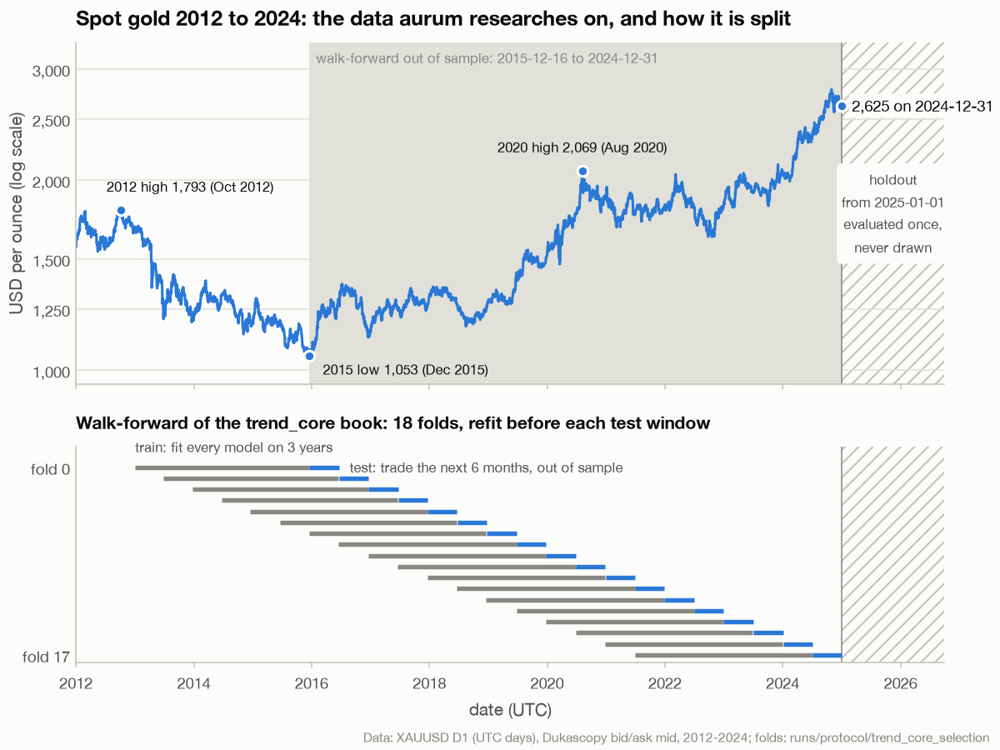
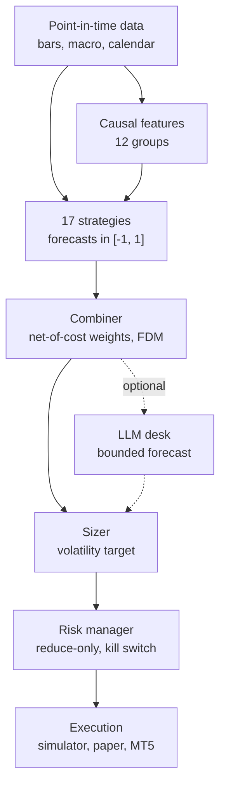
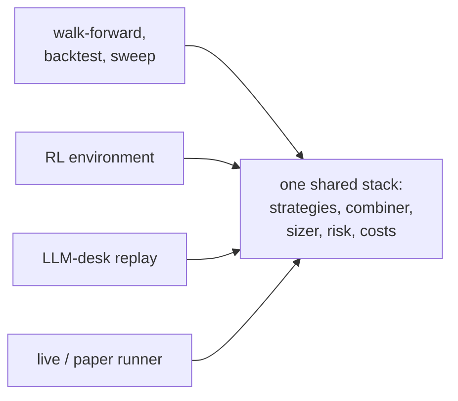
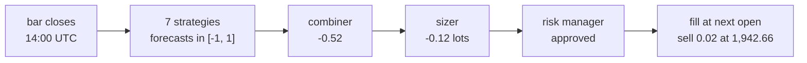

# Aurum v2 documentation

Aurum is a systematic research and trading stack for spot gold (XAUUSD), written as one
Python package, `aurum`, with one command-line tool, `aurum`. It takes point-in-time market
data (Dukascopy bid/ask history, Yahoo and FRED macro series, a rule-based NFP/FOMC
calendar) through a leakage-tested feature library and 17 registered strategies (rule-based,
allocation, regime-filtered, machine learning and reinforcement learning). A net-of-cost
combiner, a volatility-targeting sizer and a reduce-only risk manager with a persistent kill
switch sit downstream, and one bar-level simulator charges spread, slippage, commission and
rate-based financing. The same classes run in walk-forward research, the RL environment, the
LLM-desk replay and the live/paper runner. On top of a finished run, v2.1 adds parameter
sweeps, Monte Carlo stress tests, decision-level explanations and an interactive dashboard. An
optional **LLM trading desk** puts a Claude-powered Chief Investment Officer, standing
specialists and ad-hoc agents on top of the quant book. It can only return a bounded forecast
that still goes through the same sizer and risk manager.

**Honest status.** Aurum was evaluated under a protocol written before the first full run
([RESEARCH_PROTOCOL.md](RESEARCH_PROTOCOL.md)). On real bid/ask data, **no strategy or
combined book showed a statistically demonstrated edge**: none came close to the protocol's
walk-forward deflated-Sharpe bar of 0.95. The exploratory v2.1 trials (daily trend, managed
gold, the EMA sweep) did not change that verdict. The numbers, the one-time holdout and what
they do and do not mean are in [RESULTS.md](RESULTS.md), which the other pages link to rather
than reinterpret. Aurum therefore ships as a research and paper-trading platform. Live
trading is dry-run by default, and real money needs two separate opt-ins. The LLM desk has not
been evaluated under the protocol at all. Nothing in this documentation is investment advice.

**On this page**

- [A visual tour](#a-visual-tour)
  - [The data and how it is split](#the-data-and-how-it-is-split)
  - [The stack at a glance](#the-stack-at-a-glance)
  - [How one decision is made](#how-one-decision-is-made)
  - [What you can look at after a run](#what-you-can-look-at-after-a-run)
- [Pages](#pages)
- [Reading paths](#reading-paths)
- [What is new in v2.1](#what-is-new-in-v21)
- [Glossary](#glossary)
- [Conventions used in these pages](#conventions-used-in-these-pages)

## A visual tour

### The data and how it is split

Everything starts from hourly gold bars with the bid/ask spread that was actually quoted. The
pre-registered research runs fit every model on three years of history, trade the next six
months out of sample, roll forward and repeat; the out-of-sample stretches are stitched into
one track record. Everything from 2025-01-01 on was a holdout, evaluated once at the end of the
protocol. No figure in these pages draws it: every chart is cut at 2024-12-31
([figure code](../tools/figures/fig_platform.py)).

<picture>
  <source media="(prefers-color-scheme: dark)" srcset="_assets/figures/index/gold-research-timeline-dark.png">
  
</picture>

*Gold fell 41% from its 2012 high to the December 2015 low, then rose to 2,625 by the end of 2024. The 18 test windows (blue) tile 2015-12-16 to 2024-12-31 without gaps; each is traded by models refitted on the three years before it (gray). Data: XAUUSD D1 (UTC days), Dukascopy bid/ask mid, 2012-2024; folds from `runs/protocol/trend_core_selection`.*

The protocol, the fold geometry, the purge and embargo, and the statistics computed on the
stitched record (bootstrap confidence intervals, PSR, DSR, PBO) are on the
[research page](research.md).

### The stack at a glance

Data flows down through the layers; the four drivers on the right all call the same
components, which is what keeps research and trading identical.





[Architecture](architecture.md) has the module map, the data flow and the parity tests that
prove the four drivers agree.

### How one decision is made

At every bar close the same chain runs, from data to an order filled at the next bar's open.
The numbers are a real decision of the pre-registered `trend_core` walk-forward at the close
of the 2020-08-11 13:00 UTC bar, during gold's sharp sell-off that day:



1. **Strategies** see only bars that have closed and macro prints already published, and each
   returns a conviction in [-1, 1]. Here vol_squeeze said −1, tsmom +0.51, donchian −0.80.
2. **The combiner** weights them by their past net-of-cost performance and rescales for
   diversification: −0.52.
3. **The sizer** turns conviction into lots so the book runs at a 10% annual volatility
   target: with gold's volatility at 23% and 105k USD of equity, −0.12 lots of 100 oz.
4. **The risk manager** may only shrink that toward zero, or halt. Nothing was binding.
5. **Execution** fills the 0.02-lot change at the next open, paying half the spread and a
   slippage term.

[Architecture: one decision through the stack](architecture.md#one-decision-through-the-stack)
traces the same decision with the formulas and a figure, and `aurum explain` reproduces it from
the run directory.

### What you can look at after a run

| Output | What it shows | Where |
|---|---|---|
| Tearsheet (`tearsheet.html`) | Equity against buy-and-hold, drawdown, rolling Sharpe, monthly returns, costs, statistical confidence, folds and weights | written by `aurum walkforward` (unless `--no-tearsheet`); [research.md](research.md) |
| Dashboard (`aurum dashboard`) | The same run as one interactive page: KPIs, equity, per-fold Sharpe, forecasts, combiner weights, cost waterfall, trades, holdout and the desk timeline | [analytics.md](analytics.md#interactive-dashboard) |
| Stress test (`aurum stress`) | A Monte Carlo fan of 10,000 resampled futures, drawdown and ruin probabilities, worst historical windows and gap shocks | [analytics.md](analytics.md) |
| Decision explanation (`aurum explain`) | Why the book held what it held at one bar, and which strategy earned what | [analytics.md](analytics.md), [architecture.md](architecture.md#one-decision-through-the-stack) |
| Sweep (`aurum sweep`) | A parameter grid evaluated out of sample, with a deflated Sharpe, a plateau score and PBO | [analytics.md](analytics.md) |

## Pages

<div class="grid cards" markdown>

-   **[Getting started](getting-started.md)**

    ---

    Install, the first 15 minutes, a configuration check, the data download, a first
    walk-forward, the analytics commands, the offline desk demo and a dry-run paper session.

-   **[Architecture](architecture.md)**

    ---

    Design principles, the module map, one stack shared by four drivers, decision timing, one
    real decision traced from forecasts to a fill, parity tests and extension points.

-   **[Research](research.md)**

    ---

    The walk-forward protocol, per-fold refits, daily-return statistics (bootstrap CI, PSR,
    DSR, MinTRL, PBO), the holdout ledger, run directories, tearsheets and splitters.

-   **[Analytics](analytics.md)**

    ---

    Parameter sweeps with plateau scores, Monte Carlo stress tests, decision explanations and
    PnL attribution, and the interactive dashboard.

-   **[Research protocol](RESEARCH_PROTOCOL.md)**

    ---

    The pre-registered protocol: periods, configurations, statistics and the selection rule.

-   **[Results](RESULTS.md)**

    ---

    The published walk-forward and holdout results, the exploratory v2.1 trials and the
    verdict under the protocol.

-   **[Data](data.md)**

    ---

    The bars schema and `available_at`, point-in-time joins, resampling, Dukascopy, MT5/CSV
    imports, macro series and their lags, the calendar, the store and synthetic data.

-   **[Features](features.md)**

    ---

    The 12 causal feature groups, `FeaturePipeline` (fit on train only), warm-ups, adding a
    group, leakage tests and live parity.

-   **[Strategies](strategies.md)**

    ---

    The forecast contract, Carver scaling, every rule strategy, `managed_gold`,
    `regime_switch`, configuration and writing your own.

-   **[Volatility and regime models](models.md)**

    ---

    EWMA, GARCH(1,1) and HAR volatility, their blend, and the Gaussian HMM regime filter.

-   **[ML and RL](ml-and-rl.md)**

    ---

    Triple-barrier labels, `ml_gbm`, `meta_label`, the Gymnasium environment, PPO training
    and the `rl_ppo` adapter.

-   **[Portfolio and risk](portfolio-and-risk.md)**

    ---

    The net-of-cost forecast combiner and FDM, volatility-targeting sizing, the risk manager
    and kill switch, VaR, ES and stress tests.

-   **[Execution and costs](execution-and-costs.md)**

    ---

    The execution simulator, the cost model, overnight financing, the backtest engine,
    `BacktestResult` and metrics.

-   **[LLM desk](llm-desk.md)**

    ---

    The committee process, tools, the decision schema, `DecisionPolicy`, failure handling,
    budgets, journals and the prompt-injection stance.

-   **[Live and paper trading](live-trading.md)**

    ---

    Artifacts, the bar-close runner, paper and MT5 brokers, the OMS, real-money guards, state
    files, the kill switch, monitoring and an operations runbook.

-   **[CLI reference](cli.md)**

    ---

    Every `aurum` command and option, exit codes, environment variables and where each
    command writes.

-   **[Configuration](configuration.md)**

    ---

    Loading, `extends` and `--set`, strict validation, secrets, the config hash, the shipped
    configs and every key.

-   **[Development](development.md)**

    ---

    Repository layout, tests and their guards, lint, CI, coding rules, extension guides, and
    how the documentation figures are drawn.

</div>

Reference material outside the page set: [Module interfaces](INTERFACES.md) (the per-module API
map), [SPEC.md](../SPEC.md) (the binding engineering contract), [CHANGELOG.md](../CHANGELOG.md)
and [SECURITY.md](../SECURITY.md).

## Reading paths

**Researcher** (you want to test an idea without fooling yourself):

1. [Getting started](getting-started.md): install, run the synthetic walk-forward, then the
   real one outside the holdout.
2. [Architecture](architecture.md#decision-timing): the timing model every component follows.
3. [Data](data.md) and [Features](features.md): what a decision may see and when.
4. [Strategies](strategies.md), [Volatility and regime models](models.md) and, for learned
   models, [ML and RL](ml-and-rl.md).
5. [Research](research.md): how folds, DSR, PBO and the holdout ledger work, and how to run
   your own pre-registered study.
6. [Analytics](analytics.md): sweep a parameter without overfitting it, stress-test a book,
   explain a decision.
7. [RESEARCH_PROTOCOL.md](RESEARCH_PROTOCOL.md) and [RESULTS.md](RESULTS.md): what has
   already been tested and spent.
8. [Configuration](configuration.md) when you start writing your own YAML.

**Live operator** (you want to run the paper broker, or MT5, safely):

1. [Getting started](getting-started.md#paper-trading-quickstart): build an artifact, run a
   dry-run paper session and check it with `aurum live status`.
2. [RESULTS.md](RESULTS.md): the evidence, before you consider anything beyond paper.
3. [Portfolio and risk](portfolio-and-risk.md): limits, blackouts and the kill switch.
4. [Execution and costs](execution-and-costs.md): how fills and financing are modelled, and
   what is not modelled.
5. [Live and paper trading](live-trading.md): read its first section, then the real-money
   guards, the state directory, the heartbeat and the operations runbook.
6. [LLM desk](llm-desk.md), only if you set `live.use_desk: true`: failure handling and costs.
7. [CLI reference](cli.md), [Configuration](configuration.md) and
   [SECURITY.md](../SECURITY.md).

**Contributor** (you want to change the code):

1. [Architecture](architecture.md): the pipeline, the shared components and the parity tests.
2. [Development](development.md): setup, the test suite, lint, CI, the coding rules and the
   [figure framework](development.md#figures-and-visual-style).
3. [SPEC.md](../SPEC.md) and [INTERFACES.md](INTERFACES.md): the contracts between modules.
4. The extension guides:
   [adding a strategy](development.md#adding-a-strategy),
   [adding a feature group](development.md#adding-a-feature-group) and
   [adding a broker adapter](development.md#adding-a-broker-adapter).
5. [Features](features.md) (leakage testing) and
   [the safety net](development.md#the-safety-net-leakage-random-walk-and-live-safety-harnesses):
   the harnesses a change must pass.

## What is new in v2.1

The full list is in [CHANGELOG.md](../CHANGELOG.md). In short:

| Area | Change | Read |
|---|---|---|
| Configuration | Strict validation of everything at once (strategies and their parameters, feature groups, instrument ranges, live runner options, RL settings) before any data is loaded; `aurum config validate` lists warnings, skips and what was checked | [configuration.md](configuration.md), [getting started](getting-started.md#check-a-configuration) |
| Strategies | `managed_gold` (long-biased allocation with a trend tilt and a de-risk latch) and `regime_switch` (a forecast scaled by a 2-state HMM's filtered probability of the calm regime); the registry now has 17 | [strategies.md](strategies.md) |
| Analytics | `aurum sweep`, `aurum stress`, `aurum explain` and `aurum dashboard` | [analytics.md](analytics.md) |
| Live operations | `aurum live status` and `aurum live reset-halt`; heartbeats while the runner sleeps; per-decision attribution in `decisions.jsonl`; MT5 time-zone fallback with an order guard | [live-trading.md](live-trading.md) |
| Correctness | Resampling drops partial first buckets; GARCH uses the nominal annualisation; `rl_ppo` artifacts are verified and guarded against look-ahead; the RL environment is built from the top-level config | [data.md](data.md), [models.md](models.md), [ml-and-rl.md](ml-and-rl.md) |
| Visuals | `aurum.viz.style` (one palette for every chart and the dashboard) and figures drawn from real data by `tools/figures` | [development.md](development.md#figures-and-visual-style) |
| Documentation | Every algorithm explained with its intuition, the exact formula the code evaluates, a figure drawn by aurum on real gold data (light and dark), a runnable example and its pitfalls; new pages for the volatility and regime models and for the analytics commands | [models.md](models.md), [analytics.md](analytics.md), [development.md](development.md#figures-and-visual-style) |

## Glossary

| Term | Meaning |
|---|---|
| `available_at` | The UTC instant from which a row may influence a decision. For a bar it is `open + timeframe` (the bar's close); for a macro print it is its publication time. Every join is an as-of join on it. See [data.md](data.md) and [architecture.md](architecture.md#decision-timing). |
| Forecast | A strategy's output for bar `t`: one number in `[-1, 1]`, decided at the close of `t` and filled at the open of `t+1`. It expresses conviction, not a position size. See [strategies.md](strategies.md). |
| Contribution | One strategy's part of the combined forecast, `weight × FDM × forecast`. The contributions add up exactly to the combined forecast before its clip, which is what `aurum explain` and the live decision log report. See [architecture.md](architecture.md#one-decision-through-the-stack). |
| OOS (out of sample) | Data a model was not fitted or selected on. In a walk-forward each test fold is OOS for the models fitted on its training window, and the stitched test folds form the OOS track record. See [research.md](research.md). |
| Purge and embargo | Bars left out between a training window and its test block. The purge covers the longest label horizon of a trainable strategy, so no training label reaches into the test block; the embargo adds a further gap (24 bars in `default.yaml`). See [research.md](research.md). |
| PSR | Probabilistic Sharpe Ratio: the probability that the true Sharpe ratio is above zero, given the track-record length, skew and kurtosis. See [research.md](research.md). |
| DSR | Deflated Sharpe Ratio: the PSR measured against the best Sharpe expected from `n_trials` skill-less trials, which corrects for how many configurations were tried. The protocol's bar is 0.95. See [research.md](research.md). |
| PBO | Probability of Backtest Overfitting, estimated with combinatorially symmetric cross-validation (CSCV): how often the strategy that looked best in-sample is no better than the median out of sample. It describes selection among the strategies of one run, or among the points of a sweep. See [research.md](research.md). |
| FDM | Forecast diversification multiplier, `sum(w) / sqrt(w' H w)` with `H` the correlation matrix of the training forecasts (negative correlations floored at 0): rescales a weighted average of imperfectly correlated forecasts back to the average magnitude of its inputs (Carver). Used inside some strategies and by the combiner, capped at `combiner.fdm_cap` (2.5). See [portfolio-and-risk.md](portfolio-and-risk.md). |
| Holdout | The final period, from `walkforward.holdout_start` on, excluded from every fold and evaluated once (2025-01-01 in `default.yaml` and the configs that inherit it; `fast.yaml` uses 2026-01-01). The published protocol has already used the 2025–26 holdout, and no figure in these pages draws it. See [research.md](research.md). |
| Holdout ledger | `holdout_ledger.jsonl` next to the run directories: one line per holdout evaluation (walk-forwards, backtests that include the holdout, desk replays). When a different config looks at an overlapping window, the run warns and raises the DSR `n_trials`; sweeps cut their data before any ledgered window. See [research.md](research.md). |
| EXPLORATORY | The label on every sweep result and on the v2.1 additional trials: evaluated outside the pre-registered protocol, counted as extra trials, never as evidence of an edge. See [RESULTS.md](RESULTS.md). |
| Artifact | The directory `train-final` or `live artifact` writes for the live runner: fitted strategies, combiner, optional feature pipeline and OOS statistics, with a hash manifest. It contains pickles, so load only your own. See [live-trading.md](live-trading.md). |
| Dry run | The live runner's default mode: every decision, including the planned orders, is logged, but no order is sent. `aurum live run` has no flag that turns it off: set `live.dry_run: false` in the config (or `--set live.dry_run=false`). See [live-trading.md](live-trading.md). |
| Kill switch | The risk manager's halt on a daily-loss, max-drawdown or zero-equity breach (or a manual or state-file halt). While halted, every decision approves 0 lots, so the book goes flat. With the live limits the halt is persisted in `<state_dir>/risk_state.json`, survives restarts and needs a human reset: `aurum live reset-halt -c CONFIG --confirm RESET`. Research limits let a daily-loss halt clear the next day. See [portfolio-and-risk.md](portfolio-and-risk.md) and [getting-started.md](getting-started.md#check-on-a-paper-runner-and-clear-a-halt). |
| Magic number | The MetaTrader 5 tag (`live.magic`, default `20260926`) that marks this runner's orders. The broker adapter and OMS only read, modify and close positions with their own magic on their own symbol. See [live-trading.md](live-trading.md). |
| Real-money double opt-in | A non-demo account is refused unless `live.allow_live_real: true` is in the config **and** `--i-understand-real-money` is on the command line. See [live-trading.md](live-trading.md). |

## Conventions used in these pages

- Every command, flag, default and output shown was checked against the code and, where
  possible, produced by running it. Examples on synthetic data say so; synthetic numbers
  are noise by construction and are never performance claims.
- Every chart is drawn by the real aurum code from a function in `tools/figures/`, rendered in
  a light and a dark variant. Data figures are cut at 2024-12-31, so none shows the holdout,
  and each caption names its data source and period. Synthetic illustrations are labelled as
  such. See [development.md](development.md#figures-and-visual-style).
- Paths are relative to the repository root, which is also where the CLI should be run:
  `data_store/`, `runs/` and `artifacts/` resolve against the working directory.
- Times are UTC and bars are labelled by their **open** time.
- Amounts are written as `USD 5` or `105k USD`, never with a dollar sign, which the site would
  read as math.
- Links into `aurum/`, `tests/` and the files at the repository root point at the source,
  so they work when you browse the repository on GitHub.

To browse these pages locally as a site, install the `docs` extra and run MkDocs from the
repository root:

```bash
pip install -e ".[docs]"
mkdocs serve            # then open http://127.0.0.1:8000
```
