# Live and paper trading

`aurum.live` is the production execution path. It loads a trading **artifact** (fitted
strategies, feature pipeline and combiner), waits for each bar to close, and runs the same
chain as the research backtest: features, strategies, combiner, the optional LLM desk, the
volatility-targeting sizer, the risk manager with a persistent kill switch, and an idempotent
order manager (OMS) that reconciles the target position against a venue, either the **paper
broker** or **MetaTrader 5** on Windows. Everything is safe by default: the runner plans orders
without sending them unless `dry_run` is turned off, and it refuses real-money accounts unless
two separate opt-ins are given. This page explains how one bar flows through the runner, every
safety layer and the state machines behind them (orders, the MT5 server clock, the kill
switch), how the runner is monitored (heartbeat, feature drift, slippage, P&L band), how to
read and explain each decision, and how to operate it. The charts are drawn by the live code
itself on real XAUUSD data up to 2024-12-31, or are labelled illustrations
([figure code](../tools/figures/fig_live.py)); every command and snippet output was produced
by running it.

**On this page**

- [Read this first](#read-this-first)
- [Overview](#overview)
- [Quick start (offline)](#quick-start-offline)
- [The runner loop: one bar, end to end](#the-runner-loop-one-bar-end-to-end)
- [The decision line and its attribution](#the-decision-line-and-its-attribution)
- [Safety layers](#safety-layers)
- [Real money: double opt-in and guards](#real-money-double-opt-in-and-guards)
- [Brokers](#brokers)
- [Trading artifacts](#trading-artifacts)
- [Order management (OMS)](#order-management-oms)
- [LLM desk in the loop](#llm-desk-in-the-loop)
- [The state directory](#the-state-directory)
- [Kill switch](#kill-switch)
- [Monitoring and alerts](#monitoring-and-alerts)
- [Explaining a live decision](#explaining-a-live-decision)
- [Operations runbook](#operations-runbook)
- [Known residual risks](#known-residual-risks)
- [Configuration reference](#configuration-reference)

Related pages: [architecture.md](architecture.md), [portfolio-and-risk.md](portfolio-and-risk.md)
(sizer and risk limits), [execution-and-costs.md](execution-and-costs.md) (fills, costs,
financing, paper parity), [llm-desk.md](llm-desk.md), [analytics.md](analytics.md),
[configuration.md](configuration.md), [cli.md](cli.md).

---

## Read this first

> [!WARNING]
> Under the project's pre-registered protocol **no strategy has a statistically demonstrated
> edge** ([RESULTS.md](RESULTS.md)). Aurum is a research and paper-trading platform. Trading
> leveraged gold CFDs can lose more than your deposit. The maintainers recommend against
> connecting it to a real-money account.

- Move up one step at a time: **dry-run** (plan only), then **paper fills**, then an **MT5
  demo account**. Stop there unless you have your own evidence and a reviewed operating
  procedure.
- The software guards against its own failure modes (double sends, stale data, forming bars,
  runaway losses, a mis-set server clock), but it cannot guard against a strategy that simply
  loses money.
- Configs ship with `dry_run: true` and `allow_live_real: false`. Never commit a config that
  flips either.

## Overview

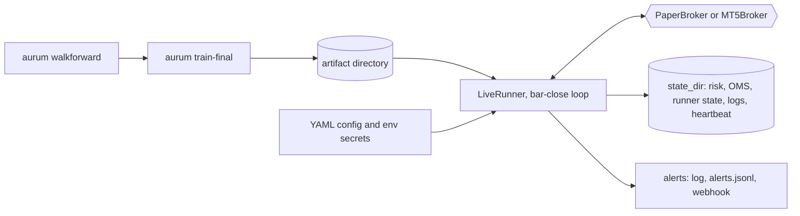

| Module | Role |
|---|---|
| [`aurum/live/runner.py`](../aurum/live/runner.py) | `LiveRunner` (bar-close loop), `LiveConfig`, artifact save/load, real-money guard, desk prerequisites, runner CLI |
| [`aurum/live/broker.py`](../aurum/live/broker.py) | `Broker` protocol, value types (`AccountInfo`, `BrokerPosition`, `OrderRequest`, `OrderResult`, `Quote`), clocks |
| [`aurum/live/paper.py`](../aurum/live/paper.py) | `PaperBroker` (simulator-identical fills), `ReplayFeed`, `BrokerDataFeed` |
| [`aurum/live/mt5.py`](../aurum/live/mt5.py) | `MT5Broker` (MetaTrader 5, imported lazily), server time-zone detection |
| [`aurum/live/oms.py`](../aurum/live/oms.py) | `OrderManager`: idempotent target-position reconciliation |
| [`aurum/live/monitor.py`](../aurum/live/monitor.py) | PSI drift, slippage, PnL band, alert sinks, heartbeat check |
| [`aurum/live/state.py`](../aurum/live/state.py) | Atomic JSON state files, JSONL logs, heartbeats |

Importing `aurum.live` needs neither `MetaTrader5` nor `anthropic`, and it loads the runner
module lazily (so `python -m aurum.live.runner` runs without a `RuntimeWarning`).

## Quick start (offline)

### From the CLI

```bash
aurum train-final -c configs/live_paper.yaml --out artifacts/live_paper   # production fit (runs a walk-forward first)
aurum live run    -c configs/live_paper.yaml --max-cycles 24             # dry-run on the paper broker
aurum live status -c configs/live_paper.yaml                             # read-only state summary
```

`configs/live_paper.yaml` replays `data_store/xauusd_H1.parquet` on a simulated clock,
starting after `paper.warmup_bars: 6000` (December 2012). An artifact fitted on all data is
therefore **in-sample** on that replay: it tests the plumbing, not the strategy. For an
out-of-sample replay, fit with `train-final --cutoff <T>` and set
`live.options.paper.start` after `T`.

Real output of a 3-bar dry run on the real data store. The artifact holds two rule strategies
(`ema_cross`, `tsmom`) and a `sharpe_shrink` combiner fitted on 2015-2022 bars; the replay
starts at 2024-11-04 14:00 UTC and is truncated at 2024-12-31. Both directories are scratch
directories (shortened to `<scratch>`), so `--set` points the config at them:

```text
$ aurum live run -c configs/live_paper.yaml --set live.artifact_dir=<scratch>/art --set live.state_dir=<scratch>/st_dry --set live.options.paper.start=2024-11-04T14:00:00Z --set live.options.paper.end=2024-12-31 --max-cycles 3
live: broker=paper dry_run=True allow_live_real=False magic=20260926 artifact=<scratch>/art desk=off
resolved runner config: <scratch>/st_dry/aurum_live_config.yaml
2026-11-09 15:01:44,115 INFO aurum.live.runner: artifact <scratch>/art loaded: ['ema_cross', 'tsmom'] on XAUUSD H1, lookback 1441
2026-11-09 15:01:44,115 INFO aurum.live.runner: LiveRunner started [DRY-RUN PAPER] XAUUSD H1 magic=20260926 history=4323 bars (warm-up 1442)
aurum live runner [DRY-RUN PAPER] XAUUSD H1 magic=20260926 state=<scratch>/st_dry
2026-11-09 15:01:44,127 INFO aurum.live.runner: macro data reloaded from data_store/macro (10 series)
2026-11-09 15:01:44,143 INFO aurum.live.runner: decision 2024-11-04T14:00:00+00:00 XAUUSD [DRY-RUN PAPER]: combined +0.367 desk off final +0.367 target +0.11 approved +0.11 held +0.00 orders planned open BUY 0.11 status=dry_run
2026-11-09 15:01:44,151 INFO aurum.live.runner: decision 2024-11-04T15:00:00+00:00 XAUUSD [DRY-RUN PAPER]: combined +0.385 desk off final +0.385 target +0.11 approved +0.11 held +0.00 orders planned open BUY 0.11 status=dry_run
2026-11-09 15:01:44,158 INFO aurum.live.runner: decision 2024-11-04T16:00:00+00:00 XAUUSD [DRY-RUN PAPER]: combined +0.356 desk off final +0.356 target +0.10 approved +0.10 held +0.00 orders planned open BUY 0.10 status=dry_run
2026-11-09 15:01:44,159 INFO aurum.live.runner: LiveRunner stopped (stopped) after 3 decisions
```

The banner shows `desk=on|off`. At the default verbosity `aurum live run` shows the runner's
INFO records: one [decision line](#the-decision-line-and-its-attribution) per bar, with
everything else in the decision log. In dry-run nothing is filled, so the position stays flat
and every bar plans the full entry again. The same summary from the decision log (pass the
state directory as the argument; it defaults to `live_paper.yaml`'s `runs/live/paper`):

```python
import sys
from aurum.live.state import read_json, read_jsonl

state = sys.argv[1] if len(sys.argv) > 1 else "runs/live/paper"
for r in read_jsonl(f"{state}/decisions.jsonl"):
    if r["type"] == "decision":
        ex = r["execution"] or {}
        print(r["time"], r["status"], f"combined={r['combined']:+.3f}",
              f"approved={r['approved_lots']:+.2f}", [(p["kind"], p["side"], p["lots"]) for p in ex.get("planned", [])])
    else:
        print(r["type"], r.get("mode", r.get("status")))
print("halted:", read_json(f"{state}/risk_state.json")["halted"])
```

```text
start DRY-RUN PAPER
2024-11-04T14:00:00+00:00 dry_run combined=+0.367 approved=+0.11 [('open', 1, 0.11)]
2024-11-04T15:00:00+00:00 dry_run combined=+0.385 approved=+0.11 [('open', 1, 0.11)]
2024-11-04T16:00:00+00:00 dry_run combined=+0.356 approved=+0.10 [('open', 1, 0.1)]
stop stopped
halted: False
```

To fill on the paper broker, set `live.dry_run: false` in the YAML (or `--set
live.dry_run=false`; `aurum live run` has no dedicated flag that turns dry-run off). The same
replay for 6 bars, decision lines only:

```text
decision 2024-11-04T14:00:00+00:00 XAUUSD [PAPER]: combined +0.367 desk off final +0.367 target +0.11 approved +0.11 held +0.00 orders open BUY 0.11 filled status=filled
decision 2024-11-04T15:00:00+00:00 XAUUSD [PAPER]: combined +0.385 desk off final +0.385 target +0.11 approved +0.11 held +0.11 orders noop status=noop
decision 2024-11-04T16:00:00+00:00 XAUUSD [PAPER]: combined +0.356 desk off final +0.356 target +0.11 approved +0.11 held +0.11 orders noop status=noop
decision 2024-11-04T17:00:00+00:00 XAUUSD [PAPER]: combined +0.324 desk off final +0.324 target +0.09 approved +0.09 held +0.11 orders close SELL 0.02 filled status=filled
decision 2024-11-04T18:00:00+00:00 XAUUSD [PAPER]: combined +0.333 desk off final +0.333 target +0.10 approved +0.10 held +0.09 orders open BUY 0.01 filled status=filled
decision 2024-11-04T19:00:00+00:00 XAUUSD [PAPER]: combined +0.320 desk off final +0.320 target +0.09 approved +0.09 held +0.10 orders close SELL 0.01 filled status=filled
```

`noop` means the sizer's rebalance band kept the position.

### From Python, fully synthetic

This runs in about a second with no data files, using two rule strategies that need no
fitting:

```python
import tempfile
from pathlib import Path

from aurum.data.synthetic import make_synthetic_bars
from aurum.live import (LiveConfig, LiveRunner, PaperBroker, ReplayFeed, SimulatedClock,
                        load_artifact, save_artifact)
from aurum.strategies.base import get_strategy

root = Path(tempfile.mkdtemp(prefix="aurum_paper_"))
bars = make_synthetic_bars(1600, "H1", seed=7, model="trend")

# 1) A tiny artifact: two rule strategies (no fitting needed), equal-weight combination.
art_dir = save_artifact(root / "artifact",
                        strategies={"ema_cross": get_strategy("ema_cross"), "donchian": get_strategy("donchian")},
                        symbol="XAUUSD", timeframe="H1", sizer_config={"target_vol": 0.10})

# 2) A paper venue replaying the bars on a simulated clock (instant), starting at bar 1300.
clock = SimulatedClock(bars["available_at"].iloc[1300])
broker = PaperBroker(ReplayFeed(bars), clock=clock, initial_equity=100_000.0)

# 3) The runner: orders are FILLED on the paper broker (dry_run=False), no calendar.
cfg = LiveConfig(artifact_dir=str(art_dir), state_dir=str(root / "state"), dry_run=False, calendar=None)
runner = LiveRunner(cfg, broker=broker, clock=clock, artifact=load_artifact(art_dir))
results = runner.run(max_cycles=5, install_signal_handlers=False)

for r in results:
    print(f"{r.time:%Y-%m-%d %H:%M} combined {r.combined:+.3f} -> approved {r.approved_lots:+.2f} lots "
          f"status={r.status}")
print("mode:", runner.mode, "| halted:", runner.risk.halted)
print(sorted(p.name for p in (root / "state").iterdir()))
```

```text
PaperBroker: rate financing without a 'fedfunds' series; using fallback_rate=0.0300 (pass rates=md.macro or call set_rates)
2020-03-20 15:00 combined +0.757 -> approved +0.32 lots status=filled
2020-03-20 16:00 combined +0.771 -> approved +0.32 lots status=noop
2020-03-20 17:00 combined +0.781 -> approved +0.32 lots status=noop
2020-03-20 18:00 combined +0.790 -> approved +0.32 lots status=noop
2020-03-20 19:00 combined +0.803 -> approved +0.32 lots status=noop
mode: PAPER | halted: False
['decisions.jsonl', 'heartbeat.json', 'oms_state.json', 'risk_state.json', 'runner.lock', 'runner_state.json']
```

The first line is a logged warning (stderr): the default cost model finances overnight
positions at a benchmark rate, and no macro data was passed. The synthetic bars' dates are
labels of a random walk, not 2020 market data.

## The runner loop: one bar, end to end

**Intuition.** The runner is a scheduler around the research pipeline. It sleeps until a bar
has closed, fetches the closed bars, recomputes features and forecasts exactly as the backtest
would at that close, lets the optional LLM desk adjust the forecast within its policy, sizes
the position, lets the risk manager cut it, and hands the target to an order manager that
compares it with what the venue actually holds. Every step is logged, and anything unusual
(a stale bar, a forming bar, a broker error) is skipped and alerted rather than guessed.

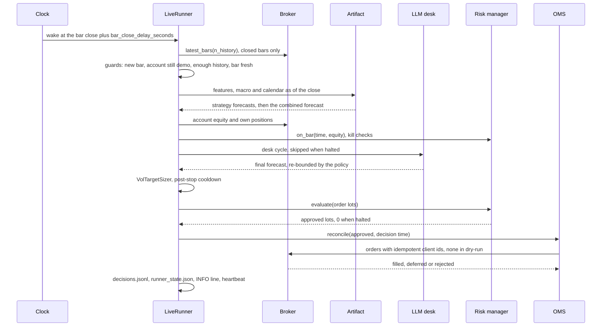

The same loop as decision logic, including what happens when there is no new bar:

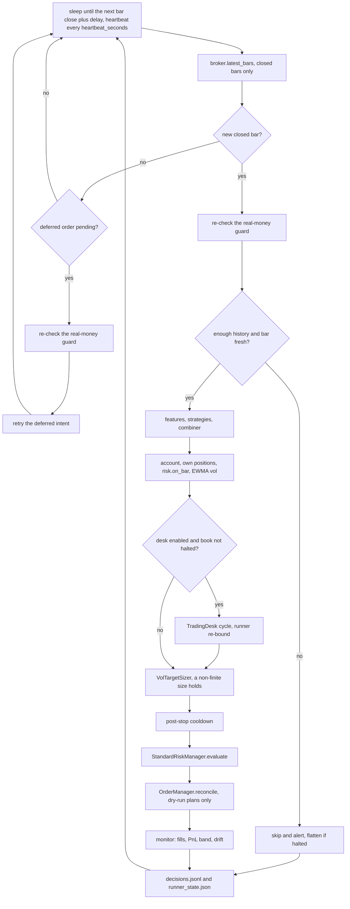

### Bar-close scheduling

The decision time of a bar is its `available_at` (open + timeframe), as in the backtest
([execution-and-costs.md](execution-and-costs.md)). The runner wakes `bar_close_delay_seconds`
(default 5 s, allowed 0 to 600) after the expected close, so the venue has published the bar,
and fetches the latest **closed** bars. If a bar newer than the last processed one exists, it
decides on the **newest bar only**. Bars missed while the runner was down are not replayed. It
remembers the last processed bar, including across restarts (`runner_state.json`). An adapter
that returns a bar with `available_at > now` has that bar dropped, with a critical
`forming_bar` alert.

### History length

The runner requests `n_history` bars:

```math
n_{\mathrm{history}} = \max\left(\left\lceil m \cdot L \right\rceil,\ n_{\min},\ \max(L + 1,\ 30)\right)
```

where $L$ is the artifact's `max_lookback`, $m$ = `history_multiple` (3.0) and $n_{\min}$ =
`min_history_bars` (300), unless `history_bars` is set. The last term is the warm-up
`min_bars`: with fewer closed bars the bar is skipped as `insufficient_history`. In the dry run
above $L$ = 1441, so the runner requested 4,323 bars with a warm-up of 1,442. EWM-based signals
depend on how much history they see, so three times the look-back keeps live values close to
the backtest's.

### Stale-data guard

A new bar whose close is older than `max_bar_age_seconds` is skipped (`stale`, warning alert).
The default is timeframe + delay + 120 s, which is 3,725 s on H1. Separately, the risk manager
blocks new risk when data is older than `stale_data_seconds`. The runner's default for that is
`max(120, 0.5 * timeframe) + delay`, and `configs/default.yaml` sets 7,200 s in `risk.live`. On
any skipped bar, a **halted** book is still flattened, so the kill switch does not depend on a
healthy feed.

### Decision pipeline

For each new bar:

1. Any deferred order from an earlier bar is superseded.
2. Guards: the account is still a demo (unless real money was authorised at start), enough
   history, and the bar is fresh.
3. **Signals.** Macro frames are filtered to rows with `available_at <= decision time`.
   Calendar outcome columns (`actual`, `surprise` and so on) are blanked for events after
   the decision time. The artifact's pipeline computes and transforms features, each
   strategy generates a forecast (last value clipped to [-1, 1]), and the combiner blends
   them. A failing strategy contributes 0 and raises a critical `strategy_error` alert. If
   every strategy fails, it is a signal error. The [attribution](#the-decision-line-and-its-attribution)
   of the combined forecast is computed here.
4. **Account and risk bookkeeping.** Equity and this magic's positions are read.
   `risk.on_bar` runs the kill checks. Drawdown and EWMA volatility are computed
   ([models.md](models.md)). With `stop_cooldown_bars > 0`, a position that vanished is
   checked against the engine's intrabar rule to detect a broker-side stop, which starts the
   cooldown.
5. **LLM desk** (optional). See [below](#llm-desk-in-the-loop).
6. **Sizing** with `VolTargetSizer.breakdown` ([portfolio-and-risk.md](portfolio-and-risk.md)).
   A non-finite size **holds** the current position instead of rounding to 0 lots, which would
   liquidate. This is the same rule as the backtest engine.
7. **Post-stop cooldown**, applied to the order before risk, as in the engine.
8. **Risk.** `StandardRiskManager.evaluate` returns the approved lots. The runner clamps the
   approval to [0, order] as defence in depth, and a halted book gets 0.
9. **Orders.** Protective SL/TP distances are computed on entries when `stop_atr_mult` or
   `take_profit_atr_mult` are set (ATR over `atr_period`, anchored at the fill). Adds keep
   the existing levels. Then `OrderManager.reconcile(approved, decision_time)` runs.
10. **Monitoring and logging.** Fills go to the slippage tracker, equity to the PnL band,
    features to the drift monitor. The full decision record is appended to `decisions.jsonl`,
    `runner_state.json` is saved, and the one INFO line is logged.

**Signal errors.** `on_error: hold` (default) keeps the position (status `error_hold`, no
order). `on_error: flatten` closes it through risk and the OMS.

### Deferred orders

When the OMS reports `deferred` (market closed, or an MT5 server clock not yet confirmed), the
runner keeps the intent and retries it every `retry_poll_seconds` (default 30, from
`live.poll_seconds`), backing off to `retry_poll_max_seconds` (300). This reproduces the
simulator's "fill at the next open". An intent that would **add** risk expires after
`max_defer_seconds` (default 1.5 bars). A **reduction never expires**, so a Friday-close
flatten fills at the reopen. If the risk manager is halted when the retry happens, the intent
is replaced by a flatten. Deferred intents survive restarts.

### Dry-run

`dry_run: true` (the default) runs the whole pipeline, including risk. The OMS then plans the
legs, logs `[DRY RUN] would ...`, and returns status `dry_run` **without sending or
recording anything**: `oms_state.json` is not written, and `flatten_on_shutdown` is ignored.
The real-money guard still applies in dry-run.

### Errors, signals and shutdown

- **Venue trouble** (`BrokerError`, `OSError`): alert (`broker_error`, warning, and critical
  from the 5th consecutive failure), heartbeat `degraded`, call `broker.reconnect()` if
  available, back off `min(retry_poll_seconds * 2^(n-1), retry_poll_max_seconds)` and continue.
- **Any other exception** stops the runner with a critical `runner_crash` alert (fail loudly).
- **SIGINT/SIGTERM**: the first signal finishes the current cycle and shuts down. A second
  one forces exit.
- **Shutdown**: if `flatten_on_shutdown: true` (default `false`) and not dry-run, the OMS
  flattens. Then a `stop` record and a final heartbeat are written, the MT5 connection is
  closed and the lock is released. **By default positions stay open when the runner stops.**

## The decision line and its attribution

**Intuition.** An operator needs two things from every bar: a one-line answer to "what did the
runner do", and, when it traded, "why". The first is the INFO line; the second is the
`attribution` block of the decision record, which splits the combined forecast into one
contribution per strategy and shows what the LLM desk changed.

**The INFO line** (one per decision, logged by `LiveRunner._decision_line`):

```text
decision <time> <symbol> [<mode>]: combined <c> desk <action> final <f> target <lots> approved <lots> held <lots> orders <summary> status=<status>
```

| Field | Meaning |
|---|---|
| `<time>` | The decision time, i.e. the bar's `available_at` (ISO, UTC) |
| `<mode>` | `DRY-RUN PAPER`, `PAPER`, `DEMO`, `REAL`, with `DRY-RUN` prepended in dry-run |
| `combined` | The combiner's forecast, clipped to [-1, 1] |
| `desk` | `off` without a desk; otherwise the desk's action or status (`skipped_halted`, ...) |
| `final` | The forecast that was sized (equals `combined` without a desk) |
| `target` | The sizer's lots after rounding (`requested_lots`) |
| `approved` | Lots approved by the risk manager |
| `held` | Lots held before the decision |
| `orders` | `none`, the OMS status when nothing was sent (`noop`, `duplicate`, `conflict`), `planned open BUY 0.11` in dry-run, or the legs sent with their outcome (`close SELL 0.02 filled`) |
| `status` | The decision status (`filled`, `noop`, `dry_run`, `deferred`, `error_hold`, `stale`, ...) |

`python -m aurum.live.runner` installs a log handler only when the root logger has none, so a
service wrapper's logging configuration is never overridden.

**The math.** With the artifact's fitted combiner (weights $w_i$ and diversification
multiplier FDM, [portfolio-and-risk.md](portfolio-and-risk.md)):

```math
c_i = w_i\,f_i\,\mathrm{FDM}, \qquad
\mathrm{raw} = \sum_i c_i, \qquad
\mathrm{combined} = \operatorname{clip}(\mathrm{raw}, -1, 1)
```

```math
\mathrm{unallocated} = \max\left(0,\ 1 - \sum_i w_i\right), \qquad
\delta_{\mathrm{desk}} = f^{\mathrm{final}} - \mathrm{combined}
```

where $f_i$ is strategy $i$'s forecast at this bar, clipped to [-1, 1] (0 if it failed).
Without a combiner the runner uses the equal-weight mean ($w_i = 1/N$, FDM = 1, method
`equal_mean`); a combiner that exposes no `weights_`/`fdm_` gets `None` weights and
`exact: false`.

**In code.** The record's `attribution` field (`null` when the signal chain failed or the bar
was skipped for data reasons; floats in the JSONL are rounded to 10 significant digits). The
first paper decision above:

```json
{
  "method": "sharpe_shrink",
  "fdm": 1.0689629781,
  "strategies": {
    "ema_cross": {
      "forecast": -0.2210825158,
      "weight": 0.5,
      "contribution": -0.1181645122
    },
    "tsmom": {
      "forecast": 0.9072236233,
      "weight": 0.5,
      "contribution": 0.4848942331
    }
  },
  "raw_combined": 0.3667297209,
  "combined": 0.3667297209,
  "clipped": false,
  "unallocated": 0.0,
  "exact": true,
  "final_forecast": 0.3667297209,
  "desk_delta": 0.0
}
```

| Field | Meaning |
|---|---|
| `method` | Combiner method (`sharpe_shrink`, `equal`, ...), `equal_mean` without a combiner, or the combiner's class name |
| `fdm` | Forecast diversification multiplier applied |
| `strategies` | Per strategy: `forecast` $f_i$, `weight` $w_i$, `contribution` $c_i$ |
| `raw_combined` | Sum of contributions, before the clip |
| `combined` | `clip(raw_combined, -1, 1)`, equal to the record's `combined` |
| `clipped` | Whether the absolute raw sum exceeded 1 |
| `unallocated` | Risk the combiner left unused |
| `exact` | The contributions reproduce `combined` within 1e-9 |
| `final_forecast`, `desk_delta` | After the LLM desk, and its change |

Here tsmom pushed the forecast up by 0.485 and ema_cross pulled it down by 0.118. On MT5 the
record also carries `venue_tz_confirmed` ([below](#metatrader-5-adapter)). A plumbing replay of
2,978 real H1 decisions (July to December 2024, two rule strategies) produced exactly one INFO
line and one attribution per decision, all with `exact: true`; rebuilding `combined` from the
logged contributions agreed within 1e-10, the JSONL rounding. That replay was a test of the
logging, not a performance evaluation. To turn one record into a waterfall with the logged sizing
replay, see [Explaining a live decision](#explaining-a-live-decision).

**Pitfalls.** The contributions explain the *forecast*, not the lots: rounding, the rebalance
band, risk caps and vetoes sit between the two and are shown separately by `aurum explain
--live`. A strategy with a negative contribution is credited with the opposite sign of the net
position.

## Safety layers

**Intuition.** A trading bot fails dangerously in a few specific ways: it trades the wrong
account, it trades twice, it trades on bad data, or it keeps losing after it should have
stopped. Aurum stacks independent checks so that no single mistake (a YAML typo, a terminal
logged into the wrong account, a second process, a dead feed) reaches the market. The layers,
in the order the runner applies them:

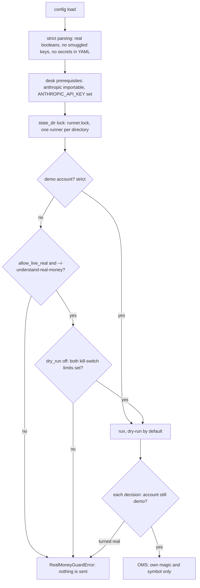

| Layer | What it stops | Where |
|---|---|---|
| Dry-run default | Any order: `dry_run: true` plans and logs only | `LiveConfig.dry_run`, `OrderManager` |
| Strict booleans | `dry_run:` left empty or `"false"` quoted silently flipping a safety switch; `desk.enabled: "yes"` | `LiveConfig.__post_init__` |
| No smuggling | A key under both `live:` and the top level; `live.options` overriding a typed field; the `oms` section setting `dry_run`, `magic`, `symbol`, `state_path`, `sleep`, `broker`, `instrument` or `hedging` | `LiveConfig.from_mapping`, `AurumConfig.live_runner_mapping` |
| Desk prerequisites | Starting with the desk enabled when no desk cycle could run (`RunnerConfigError`, exit 2), before the lock or any broker call | `check_desk_prerequisites` |
| State-dir lock | Two runners deciding every bar on one state directory | `runner.lock` (`fcntl.flock` / `msvcrt.locking`) |
| Strict demo detection | A real account mistaken for a demo: only a genuine `True` from both `broker.is_demo()` and `account().is_demo` counts; MT5 demo only when `trade_mode == ACCOUNT_TRADE_MODE_DEMO` | `LiveRunner.start` |
| Double opt-in | Real money without `live.allow_live_real: true` **and** `--i-understand-real-money` | `check_real_money_guard` |
| Kill switch required | Real-money sending with `risk.live.max_drawdown` or `max_daily_loss` disabled | `LiveRunner._start_locked` |
| Per-decision re-check | A terminal that switches or re-logs to a non-demo account mid-run: the runner stops without sending anything, not even the shutdown flatten | `LiveRunner._check_account_guard` |
| Magic isolation | Touching another EA's positions: positions are filtered by symbol and magic, foreign tickets are refused, a netting account with foreign positions on the symbol is a `conflict` | `MT5Broker`, `OrderManager` |
| Idempotent orders | Sending the same bar twice after a crash or retry | `OrderManager` ([OMS](#order-management-oms)) |
| Unconfirmed server clock | Orders decided on mis-timed MT5 bars | `MT5Broker` ([server clock](#server-clock-detection)) |
| Stale and forming bars | Deciding on old data or on a bar that has not closed | `LiveRunner._decide`, `run_once` |
| Persistent kill switch | Trading on after a drawdown or daily-loss limit, including across restarts | `StandardRiskManager` ([Kill switch](#kill-switch)) |

## Real money: double opt-in and guards

A non-demo account is traded only when **both** opt-ins are given:

1. `live.allow_live_real: true` in the YAML (a real boolean). With `broker: paper` the config
   is rejected: `live.allow_live_real is meaningless with the paper broker`.
2. `--i-understand-real-money` on the command line.

The CLI prints a note when only one of them is present. The guard and the strict parser,
offline:

```python
from aurum.live import LiveConfig, RealMoneyGuardError, check_real_money_guard

# is_demo=False: a real account with only the config opt-in
try:
    check_real_money_guard(False, allow_live_real=True, i_understand_real_money=False)
except RealMoneyGuardError as exc:
    print("refused:", exc)

# safety switches must be genuine booleans; the oms section cannot touch dry_run
for kwargs in ({"dry_run": "false"}, {"oms": {"dry_run": False}}):
    try:
        LiveConfig(**kwargs)
    except ValueError as exc:
        print("rejected:", exc)
```

```text
refused: broker account is NOT a demo account; refusing to run. Real-money trading requires CLI flag --i-understand-real-money
rejected: dry_run must be true or false (a YAML boolean), got str 'false'
rejected: oms section may not set ['dry_run']: dry_run/magic/symbol come from the live config, the state file from state_dir and the account mode (hedging) from the venue
```

The banner, logged at CRITICAL and printed at start (rendered with a sample account):

```text
!!!!!!!!!!!!!!!!!!!!!!!!!!!!!!!!!!!!!!!!!!!!!!!!!!!!!!!!!!!!!!!!!!!!!!!!!!!!!!
!!!  REAL-MONEY ACCOUNT  -- live orders will move real funds               !!!
!!!  equity 10,000.00 USD  server Broker-Live                              !!!
!!!  dry_run=False: ORDERS WILL BE SENT                                    !!!
!!!!!!!!!!!!!!!!!!!!!!!!!!!!!!!!!!!!!!!!!!!!!!!!!!!!!!!!!!!!!!!!!!!!!!!!!!!!!!
```

The per-decision re-check runs before **every** decision and every deferred retry of a runner
that started on a demo account: if the account turns non-demo, the runner raises
`RealMoneyGuardError` (critical `real_money_guard` alert) and the CLI exits with code 2.
Environment variables cannot turn on real money, and secrets are never read from YAML.

Actually sending real orders therefore needs `live.broker: mt5`, `live.dry_run: false`,
`live.allow_live_real: true`, both kill-switch limits, and `--i-understand-real-money`, on
Windows, with credentials in the environment. Again: the maintainers recommend against it.

## Brokers

Both venues implement the `Broker` protocol: `account`, `positions(symbol, magic)`,
`place_order`, `close_position`, `close_all`, `latest_bars` (closed bars only), `is_demo`,
`is_hedging`, `server_time`, `quote` and `find_deals`. The runner and the OMS depend only on
this protocol, plus optional hooks (`reconnect`, `shutdown`, `set_rates`) when a venue
provides them.

### Paper broker

`PaperBroker` never touches money. It fills market orders with the **same `CostModel`
arithmetic as the research simulator**: mid ± effective spread/2 ± slippage, commission per
side, and overnight financing per rollover with the triple-swap weekday. Its equity path
matches `ExecutionSimulator` to floating-point precision, which `tests/test_live_paper.py`
enforces; the algebra and a real-data parity chart are in
[execution-and-costs.md](execution-and-costs.md#paper-broker-parity). Broker-side SL/TP use
the simulator's own `intrabar_exit` rule (a gap through the level exits at the open, and the
stop is checked before the take-profit). `is_demo()` is always `True`.

The runner builds it from `live.options.paper` (runner key `paper`):

| Key | Default | Meaning |
|---|---|---|
| `data` | `replay` | `replay`: serve `bars_path` progressively on a `SimulatedClock` (instant). `mt5`: paper fills on live MT5 bars and quotes, on the wall clock (needs Windows and a terminal). |
| `bars_path` | (required for `replay`) | Stored bars parquet to replay. |
| `start` | none | Replay start time. Otherwise the decision time of bar `warmup_bars`. |
| `warmup_bars` | 2000 | Bars skipped before the first decision when `start` is not set. |
| `end` | none | Truncate the replayed bars. |
| `initial_equity` | 100000 | Starting balance (USD). |
| `hedging` | `false` | MT5 hedging semantics (one ticket per entry) instead of netting. |

Replay semantics. An order placed just after bar *t* closes executes at the **open of bar
*t+1*** (the simulator's fill convention). Between bars (weekends, the daily break) there is
no quote, and orders are rejected with retcode 10018 (`market_closed`), as on a real MT5
server. A CLI replay stops by itself at the end of the data. The paper book is persisted to
`<state_dir>/paper_broker.json` after every change and restored on restart. With rate-based
financing (`costs.financing.mode: rate`) and a `macro_dir`, benchmark rates are loaded from it
and refreshed with each macro reload. Otherwise the broker uses `fallback_rate` and warns
once.

### MetaTrader 5 adapter

`MT5Broker` drives a locally running MT5 terminal through the official `MetaTrader5` Python
package, which **only exists for Windows** (`pip install -e ".[mt5]"`). Elsewhere it fails
cleanly. Real output on macOS:

```text
aurum: error: MT5UnavailableError: cannot import MetaTrader5: the MetaTrader5 package is only available on Windows (it drives a local MT5 terminal); run the live runner on Windows or use the paper broker (use --traceback for details)
```

**Credentials** come from the environment only and are never logged, stored or put in
exception messages:

| Variable | Meaning |
|---|---|
| `MT5_LOGIN` | Account number (must be an integer). If unset, the adapter attaches to the account the terminal is already logged in to. |
| `MT5_PASSWORD` | Account password (used only with `MT5_LOGIN`). |
| `MT5_SERVER` | Trade server name (used only with `MT5_LOGIN`). |
| `MT5_PATH` | Path to `terminal64.exe`, if not the default. |

**On connect** the adapter selects the symbol and refuses to run (`BrokerError`) if the
venue's contract size differs from the instrument's (100 oz). Sizing would otherwise be wrong.
It refreshes the lot grid (minimum, step, maximum capped at the instrument's `max_lot`) from
`symbol_info`, and warns if AutoTrading is disabled (orders would be rejected with 10027).

**Magic-number isolation.** `positions(symbol, magic)` filters on both. Closing or modifying
a ticket of another magic or symbol is refused (`retcode="ownership"`). Every close is an
opposite deal on the specific ticket (`position=ticket`). The v1 bot filtered by symbol only
and could close other EAs' trades.

#### Server clock detection

**Intuition.** MT5 stamps bars, ticks and deals with the broker server's wall clock, not UTC.
Most gold brokers run "New York close" servers whose clock is UTC+2 in the US winter and UTC+3
in the US summer, but some follow European daylight saving, and a few use a fixed offset. If
the runner converts with the wrong offset, every bar is shifted by an hour or more and a bar
that is still forming can look closed. So the adapter measures the offset from a tick it sees
arrive, and it refuses to send orders until it has done so.

<picture>
  <source media="(prefers-color-scheme: dark)" srcset="_assets/figures/live-trading/server-tz-offsets-dark.png">
  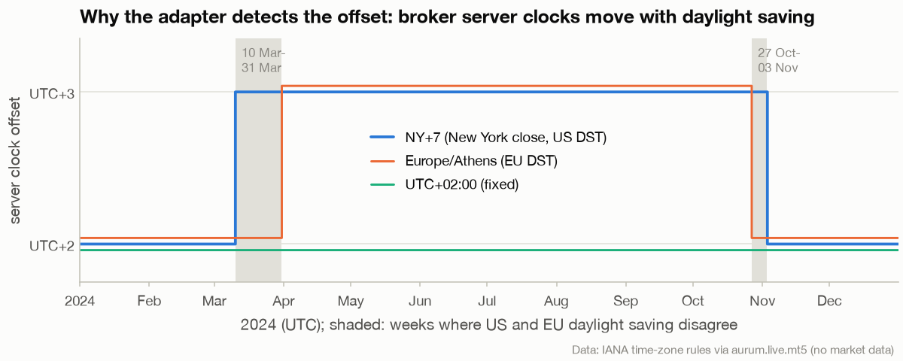
</picture>

*A New-York-close ("NY+7") server and a Europe/Athens server agree most of the year but differ by an hour from 10 to 31 March and from 27 October to 3 November 2024, and a fixed UTC+02:00 is wrong all summer. Data: IANA time-zone rules via aurum.live.mt5 (no market data).*

**The math** ([`detect_server_offset`](../aurum/live/mt5.py)). For a tick stamped $\tau$ in
server wall-clock epoch seconds, seen at UTC time $u$:

```math
\hat o = Q \cdot \operatorname{round}\left(\frac{\tau - u}{Q}\right), \qquad
\text{accepted if } \lvert \hat o \rvert \le 14\,\mathrm{h} \text{ and } -60\,\mathrm{s} \le \hat o - (\tau - u) \le 120\,\mathrm{s}
```

where $Q$ = 900 s (every real offset is a multiple of 15 minutes) and $\hat o - (\tau - u)$ is
the tick's age. The arithmetic cannot tell an old tick from a different offset (a tick 62
minutes old looks like an offset one hour smaller), so the adapter only uses a tick it sees
**arrive**: the tick's `time_msc` must change while it polls for `tz_probe_seconds` (5 s).
When $\hat o$ equals the current offset of New York time + 7 h, the DST-aware `"NY+7"` rule is
used, so a history window spanning a DST switch converts correctly; otherwise a fixed
`"UTC+hh:mm"`.

```python
import pandas as pd

from aurum.live.mt5 import detect_server_offset, server_tz_for_offset

now = pd.Timestamp("2024-07-10 12:00:00", tz="UTC")           # US summer
tick = now.timestamp() + 3 * 3600 - 2.0                       # a tick 2 s old, stamped UTC+3 wall clock
off = detect_server_offset(tick, now)
print(off, server_tz_for_offset(off, now))                    # matches New York close + 7 h
print(server_tz_for_offset(pd.Timedelta(hours=2), now))       # UTC+2 in July is not NY+7
print(detect_server_offset(now.timestamp() + 3 * 3600 - 3720, now))   # a 62-minute-old tick aliases to UTC+2
winter = pd.Timestamp("2024-01-10 12:00", tz="UTC")
print(server_tz_for_offset(pd.Timedelta(hours=2), winter))    # UTC+2 in January is NY+7
```

```text
0 days 03:00:00 NY+7
UTC+02:00
0 days 02:00:00
NY+7
```

The third line is why freshness is checked by watching the tick arrive: one timestamp alone
returned a plausible but wrong offset.

**The state machine.** With an explicit `server_tz` the configured zone is trusted (a fresh
detection that disagrees by 15 minutes or more is a fatal `BrokerError`). With `server_tz:
auto` (the default):

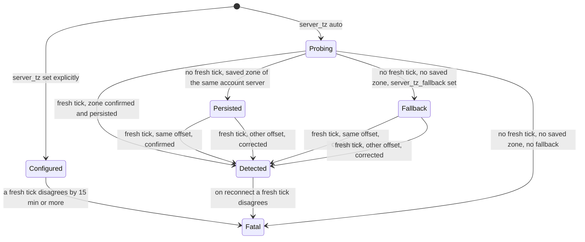

`Persisted` and `Fallback` are **unconfirmed** (`MT5Broker.tz_confirmed` is False;
`tz_status` gives `server_tz`, `source` (`config`, `detected`, `persisted` or `fallback`),
`confirmed` and `config`). While unconfirmed:

- bars and quotes are converted with the provisional zone, so dry-run decisions proceed;
- `server_time()` returns the machine clock, never a tick converted with an unconfirmed offset
  (it could look hours ahead and pass forming bars off as closed);
- `latest_bars` re-probes for a fresh tick at most every `tz_reprobe_seconds` (60), so the zone
  is usually confirmed before the first decision after the reopen;
- every order goes through a guard first:

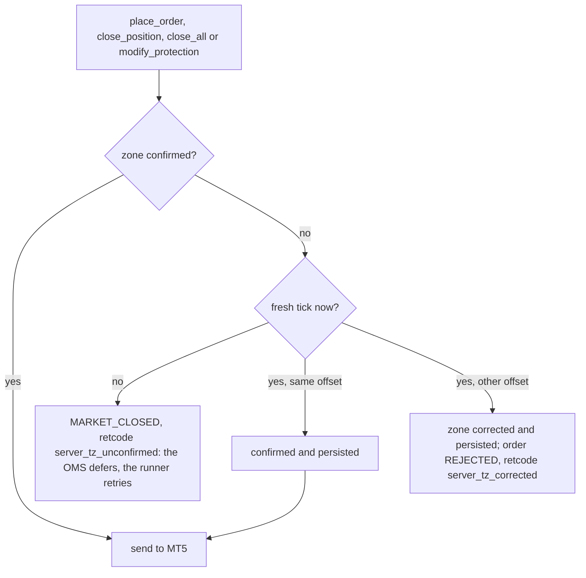

A corrected order is rejected because it was decided on mis-timed bars; the next bar decides
again on correctly converted ones. Every fresh detection is written to `tz_state_path`
(default `<state_dir>/mt5_server_tz.json`: zone, offset in seconds, detection time, account
server, symbol), and a saved zone is ignored when the terminal is connected to a different
account server. The runner's `start` record carries `venue_tz` (the `tz_status` dict), an
unconfirmed zone raises a `server_tz_unconfirmed` warning alert, and each decision record has
`venue_tz_confirmed`. The forming bar (close time in the future) is always dropped, and MT5
bid bars are converted to mid (`+spread/2`) with `price_basis: bid`.

**Order filling.** Candidate filling modes are tried in the order FOK, IOC, RETURN, skipping
modes the symbol does not advertise. The mode that last worked goes first. Retcode 10030
(unsupported filling) moves to the next mode.

**Retcodes** are normalised to venue-independent statuses:

| MT5 retcode(s) | Status | Handling |
|---|---|---|
| 10009 | `filled` | |
| 10010 | `partial` | |
| 10004, 10015, 10020 (requote, invalid price, price changed) | `requote` | Retried with a fresh tick (`requote_retries`, default 3), then reported |
| 10021 (price off) | `market_closed` after fresh-tick retries | OMS defers |
| 10018 | `market_closed` | OMS defers (the runner retries later) |
| `server_tz_unconfirmed` (adapter) | `market_closed` | OMS defers until a fresh tick confirms the clock |
| `server_tz_corrected` (adapter) | `rejected` | Not resent; the next bar decides again |
| 10019 | `no_money` | Rejected |
| 10014, 10034, 10038 | `invalid_volume` | Rejected |
| 10016 | `invalid_stops` | Rejected |
| 10017, 10026, 10027, 10032, 10042 to 10045 | `trade_disabled` | Rejected |
| 10028, 10029 | `rejected` | |
| 10024 | `too_many_requests` | Retryable with backoff |
| 10008 (placed but not confirmed), 10011, 10012 (timeout), 10031 (connection), `order_send` returned `None` | `unknown` | **Verified, never blindly resent** (see [OMS](#order-management-oms)) |
| 10030 after all filling modes | `rejected` | |
| any other code | `rejected` | |

**Broker-side protection.** SL/TP levels travel with the order. Aurum uses mid levels
everywhere. The adapter converts them to MT5's trigger side (longs trigger on the bid, shorts
on the ask) using the current half spread, and converts back when reading positions.

**Demo and account-mode detection** (inputs to the real-money guard and the OMS):

| Question | Rule |
|---|---|
| Is this a demo account? | Only when `account_info().trade_mode == ACCOUNT_TRADE_MODE_DEMO`. Contest, real, missing, non-integer or otherwise garbled modes all count as **real money**. |
| Is it a hedging account? | Only when `margin_mode == ACCOUNT_MARGIN_MODE_RETAIL_HEDGING`. Anything else is treated as **netting**, which is the conservative side. |

`quote()` returns nothing for a tick older than 10 minutes, and the runner treats that as a
closed market when it retries deferred orders. The account holder's name is never exported.

`live.options.mt5` passes keyword arguments to `MT5Broker`:

| Key | Default | Meaning |
|---|---|---|
| `server_tz` | `auto` | `auto`, `NY+7`, `UTC`, `UTC+02:00`, or an IANA zone. |
| `server_tz_fallback` | none | With `auto` only: the zone assumed, unconfirmed, when no fresh tick arrives and no zone was saved (for example `NY+7`). Rejected with an explicit `server_tz`. |
| `tz_state_path` | `<state_dir>/mt5_server_tz.json` | Where fresh detections are saved and read back as the first fallback. |
| `tz_reprobe_seconds` | 60 | Minimum wall time between `latest_bars` re-probes while unconfirmed. |
| `tz_probe_seconds` | 5.0 | How long to watch for a tick arriving when detecting the offset. |
| `deviation_points` | 20 | Maximum accepted slippage for market orders, in points. |
| `price_basis` | `bid` | `bid` (convert bars to mid) or `mid`. |
| `requote_retries` | 3 | Fresh-tick retries on requote-type codes. |
| `requote_delay_s` | 0.25 | Delay between those retries. |

Credential-like keys (`password`, `login`, `token` and so on) are rejected in any config file.

## Trading artifacts

An artifact is a directory with everything the runner needs from research.

**Build it with `aurum train-final`** (recommended). It fits the feature pipeline and
trainable strategies on the training window that ends at `--cutoff` (default: the last bar),
and takes **combiner weights from stitched out-of-sample walk-forward forecasts**: either
from `--from-run WF_DIR`, which must have the same config hash unless
`--allow-config-mismatch` is given, or from a walk-forward it runs on the spot, including a
holdout evaluation that is recorded in the ledger. It refuses configs whose `sizing.method`
is not `vol_target`, because the live runner only implements volatility targeting. See
[research.md](research.md) and [cli.md](cli.md). A config mismatch is refused like this:

```text
aurum: --from-run runs/protocol/trend_core_holdout was produced by config 119941494ce8, this config is 06a2fca027fc: its OOS forecasts validate a different protocol (pass --allow-config-mismatch to use them anyway)
```

`aurum live artifact -c CONFIG [--out DIR] [--at TS] [--from-run WF_DIR] [--overwrite]` is the
older, simpler path. It fits the book on the latest data, and its combiner weights come from
`--from-run`'s OOS forecasts when given. Without it they follow `walkforward.combiner_fit`,
which gives equal weights when there is no OOS history, and the command prints `WARNING: ...
the combiner fell back to EQUAL weights`. An existing `--out` without `--overwrite` is refused
with exit 2 before any data is loaded. Prefer `train-final`.

**Contents** (`save_artifact` writes a temporary sibling directory and swaps it in, so a crash
never leaves a half-written artifact):

| File | Content |
|---|---|
| `manifest.json` | Format and version, symbol, timeframe, strategy names, combiner class, `max_lookback`, `n_features`, sizer kwargs, training metadata (for `train-final`: cutoff, fit window, config and data hashes, full config, provenance, OOS source), package versions, git SHA, the **sha256 of every file**, and an optional `hmac`. |
| `strategies.pkl` | `{name: fitted Strategy}` (pickle). |
| `strategies.json` | Human-readable classes, params, warm-up, trainable flag. |
| `combiner.pkl` | Fitted `ForecastCombiner` (optional; without it the runner uses an equal-weight mean). |
| `pipeline.json` | Fitted feature pipeline with its TRAIN scaler statistics (only when a strategy uses features). |
| `feature_reference.json` | PSI reference bins of the TRAIN features, for [drift monitoring](#feature-drift-psi) (only with a pipeline). |
| `backtest.json` | OOS statistics, used by the PnL band monitor. |

**Load checks** (`load_artifact`, run by the runner at start):

1. `manifest.json` exists, has format `aurum.live.artifact`, and a supported version.
2. The aurum **major** version matches, or the load is refused. A different Python minor
   version only logs a warning, because pickle compatibility is not guaranteed.
3. If `AURUM_ARTIFACT_KEY` is set, the manifest's HMAC-SHA256 must verify. An unsigned
   artifact is refused.
4. Every file listed in the manifest exists with the recorded sha256. `strategies.pkl`,
   `combiner.pkl` and `pipeline.json` must be covered by the manifest. All of this is
   checked **before anything is unpickled**.
5. The strategies match the manifest's list and have `generate()`. The combiner has
   `combine()`. The pipeline is fitted.

The runner then refuses an artifact built for another timeframe, and only warns when the
symbol differs (broker suffixes such as `XAUUSD.a`).

**HMAC signing.** Set `AURUM_ARTIFACT_KEY` when saving to sign the manifest. The manifest
holds every file's hash, so the signature covers the whole artifact. Keep the same key in the
environment of the runner. Offline example:

```python
import json, os, tempfile
from pathlib import Path

from aurum.live import ArtifactError, load_artifact, save_artifact
from aurum.strategies.base import get_strategy

os.environ["AURUM_ARTIFACT_KEY"] = "example-only-key"      # use a real secret in practice
path = save_artifact(Path(tempfile.mkdtemp()) / "art", strategies={"donchian": get_strategy("donchian")})
print("signed:", "hmac" in json.loads((path / "manifest.json").read_text()))
print("loaded:", sorted(load_artifact(path).strategies))

(path / "strategies.json").write_text("{}")                 # tamper with any listed file
try:
    load_artifact(path)
except ArtifactError as exc:
    print("refused:", exc)
```

```text
signed: True
loaded: ['donchian']
refused: <tmp>/art: sha256 mismatch for strategies.json (modified or corrupt)
```

**Portability and trust.** Pickles execute code when loaded: **only load artifacts you
produced yourself** (see [SECURITY.md](../SECURITY.md)). The directory can be moved, because
files are referenced relative to it. The strategy classes must be importable in the runner's
environment, with the same aurum major version and ideally the same Python minor version. RL
strategies embed their policy files in the pickle, so the original RL run directory is not
needed ([ml-and-rl.md](ml-and-rl.md)). The sizer settings in the manifest are overridden by
the config's `sizing` section when the runner is started through `aurum live run`.

## Order management (OMS)

**Intuition.** The runner never sends "buy 0.1 lots"; it says "this strategy should hold
+0.1 lots now". The order manager reads what the venue actually holds for this strategy and
sends only the difference. Because the venue is the source of truth, a restart, a manual
intervention or a broker-side stop cannot make it double up, and because every order carries
an id derived from the bar it belongs to, the same bar can never be executed twice.

**The rule.** For the decision at time $t$ with target $q^\star_t$ and venue position $q_t$
(own magic, own symbol):

```math
\Delta_t = \operatorname{grid}\left(q^\star_t\right) - q_t
```

where grid rounds toward zero on the 0.01 lot step (without the `max_lot` clip: position caps
belong to the risk manager), and legs larger than `max_order_lots` are split. A reversal on a
netting account is a close leg followed by an open leg. `OrderManager.reconcile` sends nothing
when $\Delta_t$ is zero (`noop`).

**Idempotent client ids.** Each order carries `client_id = "{magic}-{decision_time:%Y%m%d%H%M}-{seq}"`
(for example `20260926-202411041400-0`), sent as the MT5 order comment. MT5 truncates
comments beyond 31 characters, so the OMS refuses magic numbers that would not fit.

**The state machine** of one decision record in `oms_state.json`:

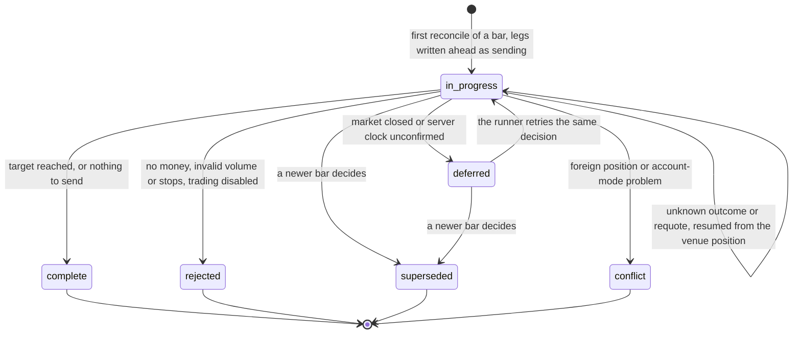

`complete`, `rejected`, `superseded` and `conflict` are terminal: reconciling the same bar
again returns `duplicate` without sending, even if the position has changed since (a stop
fired, say: re-entering on the same bar would be a double send). A decision older than the
newest one is `stale`.

- A **write-ahead** leg record (`status: "sending"`) is persisted before each send.
- **Crash recovery.** When an unfinished decision is reconciled again (for example the same
  bar after a restart), legs left in `sending` are first looked up in the venue's deal
  history by client id (`find_deals`). If the lookup fails, nothing new is sent for that
  decision (`unknown`) until it succeeds. The decision then resumes by recomputing the delta
  against the venue position, with fresh `seq` numbers. A newer bar's decision plans from the
  venue's positions, which already reflect any order that executed.
- **Unknown outcomes** (timeout, lost connection) are verified: first by client id in the deal
  history, then by the change in net position. The order is resent **only** if it provably did
  not execute: both lookups succeeded, no deal carries the id, and the position did not move.
  Anything inconclusive is *not* resent, the report says `unknown`, and the next reconcile
  re-plans from the venue. Requotes and throttling are retried with exponential backoff.
- `OrderManager.flatten` (shutdown, operator) always reconciles to zero, even when its minute
  key collides with a completed decision; its legs continue the record's `seq` numbers.

| Report status | Meaning |
|---|---|
| `noop` | Already at target |
| `filled` / `partial` | Executed fully or partly |
| `deferred` | Market closed (or MT5 clock unconfirmed); the runner retries later |
| `rejected` | Venue refused the order |
| `unknown` | Outcome could not be verified. **Not resent**: inspect the venue |
| `duplicate` | This bar was already executed |
| `stale` | Older than the newest decision |
| `conflict` | Foreign position on a netting account, or an unreliable position list |
| `dry_run` | Planned only |
| `error` | Adapter or programming error |

**Netting and hedging accounts.**

| | Netting (one position per symbol, shared by every EA) | Hedging (one ticket per entry) |
|---|---|---|
| Foreign positions on our symbol | The OMS **refuses to trade** (`conflict`), because magic isolation is impossible | Ignored: only our magic's tickets are touched |
| Reversal | Split into a close leg and an open leg (a failed open leaves us flat, not half-reversed) | Opposite-side tickets are closed first |
| Reduction | Close quantity FIFO | Close our tickets by opposite deals, oldest first (FIFO-compatible) |
| Account mode | From the venue, strictly: only a genuine `True` is hedging. Forcing `hedging=True` on a venue that reports netting is refused. | |

A venue answer that contains positions of another magic or symbol for a filtered query (a buggy
adapter) makes the OMS refuse to trade instead of acting on it. `live.options.oms` accepts
`max_retries` (3), `backoff_seconds` (0.5), `backoff_max` (8.0), `max_order_lots` and
`keep_decisions` (200, at least 1).

**Pitfalls and design choices.** An internal position counter drifts the first time a stop
fires at the broker or someone closes a trade by hand; reconciling against the venue cannot.
Resending on an inconclusive check is how a flaky connection turns one order into two, so the
OMS prefers `unknown` (and an alert) to a guess.

## LLM desk in the loop

With `live.use_desk: true` (runner key `desk.enabled`, which must be a real boolean) the runner
builds a `TradingDesk`. Its policy comes from `agents.policy`, and its `DeskConfig` is the full
`agents.desk` mapping (runner key `desk_config`, with nested `chief`, `specialist`,
`role_models` and `prices`) merged over the flat `desk.config` keys kept for backward
compatibility. A key given in both with different values is a configuration error, and an
unknown key or invalid value fails when the config is loaded, not at the first desk cycle.
`live.options.desk_config` and `live.options.desk.config` are rejected: set them in
`agents.desk`. Journals go to `<state_dir>/desk_journal`. The desk's data provider is
re-pointed every cycle at the runner's current point-in-time window, the live risk-manager
snapshot, and the current positions. It is not anonymised. See [llm-desk.md](llm-desk.md).

```python
from aurum.live import LiveConfig

for kw in ({"desk": {"on_error": "skip"}}, {"desk": {"enabled": "yes"}},
           {"desk": {"config": {"max_specialists_per_cycle": 4}}, "desk_config": {"max_specialists_per_cycle": 6}}):
    try:
        LiveConfig(**kw)
    except ValueError as exc:
        print("rejected:", exc)
cfg = LiveConfig(desk={"config": {"max_specialists_per_cycle": 4}},
                 desk_config={"max_cost_usd_per_cycle": 1.5, "max_cycle_seconds": 90})
dc = cfg.build_desk_config()
print(dc.max_specialists_per_cycle, dc.max_cost_usd_per_cycle, dc.max_cycle_seconds, dc.chief.model)
```

```text
rejected: desk.on_error must be one of ['follow_quant', 'flat', 'hold'], got 'skip'
rejected: desk.enabled must be true or false (a YAML boolean), got str 'yes'
rejected: DeskConfig keys ['max_specialists_per_cycle'] are set to different values in desk.config and desk_config; give each setting once (desk_config is the full DeskConfig)
4 1.5 90 claude-opus-5
```

- **Prerequisites are checked before anything happens.** With the desk enabled and no desk or
  client injected, the runner refuses to start with `RunnerConfigError` when the `anthropic`
  package cannot be imported or `ANTHROPIC_API_KEY` is empty (`python -m aurum.live.runner`
  prints `CONFIG ERROR: ...` and exits with code 2). `LiveRunner.start` checks this before it takes the lock or
  calls the broker, and `aurum live run` checks it even earlier, before it writes
  `aurum_live_config.yaml`. Real output with the key unset:

  ```text
  $ aurum live run -c configs/live_paper.yaml --set live.use_desk=true --set agents.enabled=true --set live.artifact_dir=<scratch>/art --set live.state_dir=<scratch>/st_desk --max-cycles 1
  live: broker=paper dry_run=True allow_live_real=False magic=20260926 artifact=<scratch>/art desk=on
  aurum: live runner cannot start: the LLM desk is enabled (live.use_desk / desk.enabled) but ANTHROPIC_API_KEY is not set; export it in the runner's environment or disable the desk
  ```

  The exit status was 2 and the state directory was not created. `live.use_desk` also
  requires `agents.enabled: true` in the config.
- **Halted book.** The desk is **not called**. Recorded as `skipped_halted`.
- **Previous forecast.** The last final forecast is persisted (`prev_final_forecast`) and
  passed as `previous_forecast`, so a `hold` decision or `on_failure: hold` keeps the
  standing forecast across restarts.
- **Re-bound.** The returned forecast is clipped to [-1, 1] and re-bounded by both the desk's
  own policy mode and the configured `desk.mode` (the stricter wins; `overlay` if neither is
  known). A violation raises a critical `desk_policy_violation` alert.
- **Failures.** A cycle that ends `failed` uses the policy's `on_failure` and raises a
  `desk_failed` warning. If the desk *raises*, the runner applies `desk.on_error`, which must
  be exactly one of `follow_quant` (default), `flat` or `hold` (bounded so it cannot flip or
  exceed the quant forecast); any other value is a configuration error. It also raises a
  `desk_error` warning. Set it with `live.options.desk.on_error`.
- **Heartbeat.** No heartbeat is written while a desk cycle runs, so the watchdog's grace
  must cover the desk's `max_cycle_seconds` ([Heartbeat](#heartbeat-and-watchdog)).

## The state directory

Everything the runner must remember lives in `state_dir` (`runs/live/paper` in
`live_paper.yaml`, `runs/live` by default). JSON state files are written atomically: temp
file, fsync, then `os.replace`. Logs are append-only JSONL.

| File | Content | Written |
|---|---|---|
| `runner.lock` | OS lock (`fcntl.flock` or `msvcrt.locking`) and the holder's PID | At start, before the venue is queried |
| `risk_state.json` | Kill switch and equity state: `halted`, `halt_kind`, `halt_reason`, `halted_at`, `peak_equity`, `day_key`, `day_start_equity`, `trades_today`, `last_time`, `last_equity`, `version` | Every decision, **before** the runner and OMS state |
| `runner_state.json` | `last_bar`, `last_avail`, `n_decisions`, `prev_final_forecast`, cooldown, `last_exec`, PnL-band state, `pending` deferred intent | Every decision |
| `oms_state.json` | Per-decision records and legs (client id, status, retcode, price, ticket) | On sends (not in dry-run) |
| `decisions.jsonl` | One record per event: `start`, `decision`, `stop`, `shutdown_flatten`, `deferred_execution`, `deferred_expired`, `deferred_halted`, and `halt_reset` (written by `aurum live reset-halt`) | Append |
| `alerts.jsonl` | Every alert, redacted | Append, when alerts fire |
| `heartbeat.json` | See [Heartbeat](#heartbeat-and-watchdog) | Every loop iteration and every `heartbeat_seconds` while sleeping |
| `paper_broker.json` | Paper book: balance, positions, deals | Paper broker built by the CLI, on changes |
| `mt5_server_tz.json` | Last fresh MT5 server-zone detection (zone, offset, time, account server, symbol) | MT5, on every fresh detection |
| `desk_journal/` | LLM desk journals | When the desk is enabled |
| `aurum_live_config.yaml` | The resolved runner config, with no secrets | By `aurum live run` |

A `decision` record contains the decision time, bar time, mode, price and spread, data age,
per-strategy forecasts, the combined and final forecasts, the `attribution` block, equity and
positions, the full sizing breakdown, requested, order and approved lots, the risk decision
with a risk-manager snapshot, the protective parameters, the full OMS execution report, a
monitor snapshot, and on MT5 `venue_tz_confirmed`. The `start` record carries the mode, the
artifact, `heartbeat_every_s` and, on MT5, `venue_tz`.

**Locking.** Only one runner can use a `state_dir`. A second process fails at start with
`RunnerLockedError` (`... is locked by another running LiveRunner`). The OS releases the lock
when the process dies, so a crash never leaves a stale lock. `aurum live status` probes the
lock read-only and `aurum live reset-halt` takes it.

**Restart.** Start the same command again. The runner resumes after `last_bar`, restores a
deferred intent and the previous forecast, and the OMS's idempotency records prevent
re-executing a bar. To start over, use a **new** `state_dir`, and understand that this also
starts a new kill-switch history (see [residual risks](#known-residual-risks)).

**Missing or damaged files:**

| Situation | Result |
|---|---|
| `risk_state.json` unreadable | Starts **HALTED** (`halt_kind: state_file`) |
| `risk_state.json` missing while `runner_state.json` or `oms_state.json` exists | Starts **HALTED**. Deleting the file is not a reset. |
| `oms_state.json` unreadable, or belonging to another magic or symbol | `StateCorruptError`: the runner refuses to start |
| `paper_broker.json` invalid | `StateCorruptError`: refuses to start |
| `runner_state.json` unreadable | Logged and ignored (OMS idempotency still applies) |
| `mt5_server_tz.json` unreadable, not a zone, or from another account server | Ignored with a warning (the fallback or a fresh detection is used) |

## Kill switch

**Intuition.** The kill switch is the last line of defence against a strategy, a bug or a
market that loses money faster than anyone expected. When equity falls too far below its peak,
or loses too much in one day, the risk manager stops approving any exposure and the book is
flattened. The halt is written to disk, survives restarts and new trading days, and only a
deliberate, logged human action clears it.

**The math.** At every bar close (`risk.on_bar`), with equity $E_t$, running peak $P_t$ and
the day's starting equity $E^{\mathrm{day}}$:

```math
\text{halt if}\quad 1 - \frac{E_t}{P_t} \ge \mathrm{DD}_{\max} \quad\text{or}\quad
1 - \frac{E_t}{E^{\mathrm{day}}} \ge \mathrm{L}_{\max} \quad\text{or}\quad E_t \le 0
```

where $\mathrm{DD}_{\max}$ = `max_drawdown` and $\mathrm{L}_{\max}$ = `max_daily_loss` (the
live values in `configs/default.yaml` are 0.20 and 0.03; with `daily_loss_persistent: true`
the daily-loss halt does **not** clear at the next day). A manual `halt()` and the state-file
fail-safes above also halt. `reset_halt(confirm="RESET")` sets $P_t$ and $E^{\mathrm{day}}$
to the last equity, otherwise the same drawdown would trip the switch again at once.

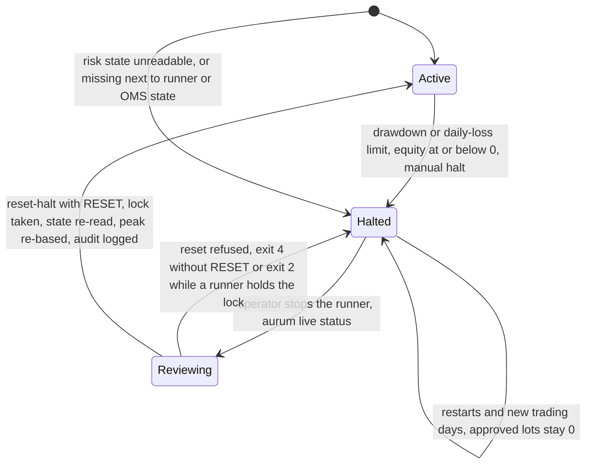

**The picture.**

<picture>
  <source media="(prefers-color-scheme: dark)" srcset="_assets/figures/live-trading/kill-switch-rebase-dark.png">
  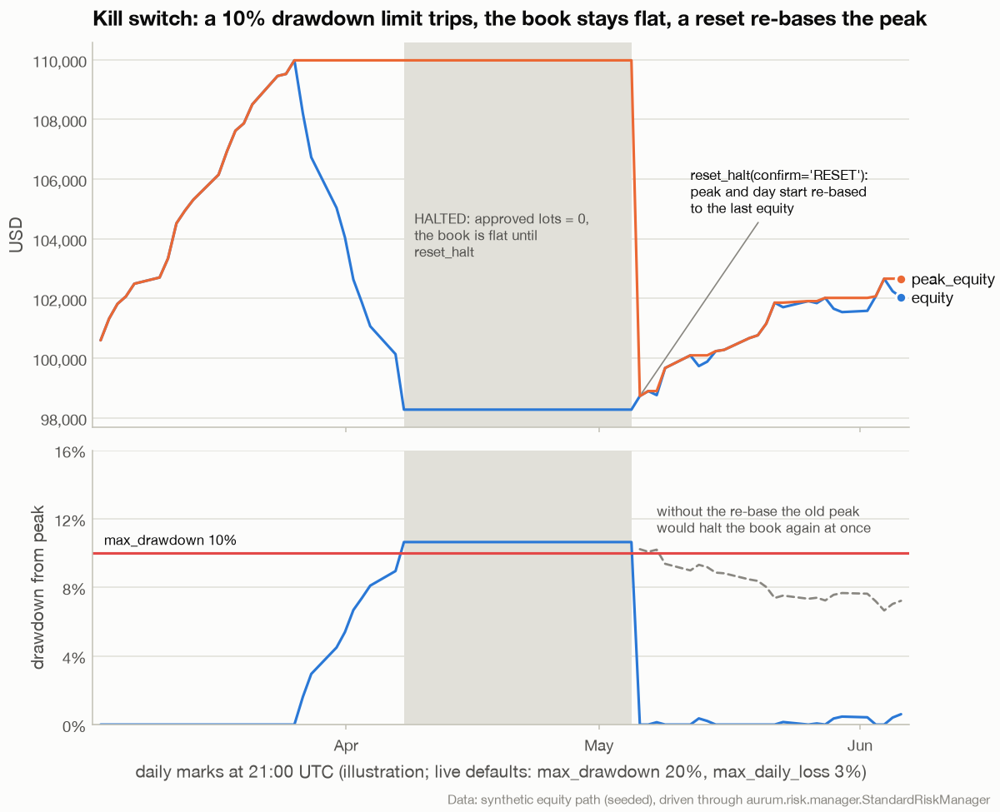
</picture>

*The halt trips at a 10.6% drawdown, the book stays flat until the reset, and the reset re-bases the peak; without the re-base the old peak would leave the drawdown at the limit and halt the book again at once. Data: synthetic equity path (seeded) driven through aurum.risk.manager.StandardRiskManager, with a 10% limit for readability, not market data.*

**Effects.** Approved lots are 0, so the book is flattened. The desk is not called. A
deferred intent becomes a flatten. Flattening also happens on bars skipped for stale data or
insufficient history. A critical `risk_halt` alert fires once per episode. The heartbeat shows
`"halted": true`.

### Inspect: `aurum live status`

`aurum live status -c CONFIG [--json]` is read-only: it never writes, and it reports unreadable
files together with what the runner will do about them. It shows the lock (RUNNING / not
running / unknown, last pid), the heartbeat (status, age, mode, last bar, decisions, pending),
the risk state (active or HALTED with kind, reason and time, equity / peak / drawdown, day
return, trades today, and the reset command when halted), the OMS (decision count, last
decision and status and target, unfinished entries), the paper book, the last bar and previous
final forecast, the last decision, the last halt reset and the last 5 alerts. The JSON keys
are `config`, `state_dir`, `state_dir_exists`, `live`, `now`, `runner_lock`, `heartbeat`,
`risk`, `runner`, `oms`, `paper_broker`, `last_decision`, `last_halt_reset` and
`recent_alerts`. On the 6-bar paper replay above:

```text
$ aurum live status -c configs/live_paper.yaml --set live.state_dir=<scratch>/st_paper --set live.dry_run=false --set live.artifact_dir=<scratch>/art
live status: <scratch>/st_paper  (config configs/live_paper.yaml)
  config:      broker=paper dry_run=False allow_live_real=False magic=20260926 symbol=XAUUSD desk=off
  runner:      not running, last pid 16108
  heartbeat:   stopped at 2026-11-09T15:01:45.402455+00:00 (age 520.6 s), mode PAPER, last bar 2024-11-04T18:00:00+00:00, 6 decisions
  risk:        active
               equity 99,893 / peak 100,000 (drawdown 0.001), day return -0.001, trades today 4, as of 2024-11-04T19:00:00+00:00
  oms:         6 decisions, last 202411041900 -> complete (target 0.090)
  paper:       balance 99,965, net 0.09 lots in 1 position(s), 4 orders
  last bar:    2024-11-04T18:00:00+00:00 (6 decisions), previous final forecast 0.320
  decision:    2024-11-04T19:00:00+00:00 status=filled combined 0.320 final 0.320 -> approved 0.090 lots (current 0.100), equity 99,893
```

The heartbeat `time` is the wall clock (a watchdog measures real time), while the bar times
come from the replay's simulated clock.

### Reset: `aurum live reset-halt`

`aurum live reset-halt -c CONFIG [--confirm RESET] [--reason TEXT]` is the only CLI path that
clears the kill switch. In order, it shows the halt state; refuses with exit 2 while a runner
holds `runner.lock` (a running runner keeps the halt in memory and rewrites the file every
bar); exits 4 and changes nothing without the literal `--confirm RESET`; takes the runner lock
so no runner can start mid-reset; re-reads the state under the lock; calls
`StandardRiskManager.reset_halt(confirm="RESET")`; writes a `halt_reset` record (`user`,
`host`, `pid`, `reason`, `config`, `previous` halt and equity, `rebased_equity`) to
`decisions.jsonl` and a critical `halt_reset` alert to `alerts.jsonl`, both fsynced; and
releases the lock. It exits 0 when the book is not halted (nothing logged) and 2 when there is
no state directory or no `risk_state.json`. It sends no webhook. A scratch state directory with
a real daily-loss halt (3.5% loss against the 3% limit; user and host shortened):

```text
$ aurum live status -c configs/live_paper.yaml --set live.state_dir=<scratch>/st_halt
live status: <scratch>/st_halt  (config configs/live_paper.yaml)
  config:      broker=paper dry_run=True allow_live_real=False magic=20260926 symbol=XAUUSD desk=off
  runner:      not running
  risk:        HALTED [daily_loss] daily loss 3.50% vs day start 100,000.00 reached max_daily_loss 3.00% since 2024-11-05T11:00:00+00:00
               equity 96,500 / peak 100,000 (drawdown 0.035), day return -0.035, trades today 0, as of 2024-11-05T11:00:00+00:00
               clear it (runner stopped) with: aurum live reset-halt -c CONFIG --confirm RESET --reason '...'
  oms:         no OMS state file

$ aurum live reset-halt -c configs/live_paper.yaml --set live.state_dir=<scratch>/st_halt
risk state <scratch>/st_halt/risk_state.json:
  halted:      True [daily_loss]
  reason:      daily loss 3.50% vs day start 100,000.00 reached max_daily_loss 3.00%
  halted at:   2024-11-05T11:00:00+00:00
  equity:      last 96,500, peak 100,000, drawdown 0.035
refusing to reset without the literal confirmation: re-run with --confirm RESET (and --reason '...' for the log)
[exit 4]

$ aurum live reset-halt -c configs/live_paper.yaml --set live.state_dir=<scratch>/st_halt --confirm RESET --reason "reviewed: test halt"
2026-11-09 15:02:26,391 WARNING aurum.risk.manager: Risk state restored HALTED from <scratch>/st_halt/risk_state.json: daily loss 3.50% vs day start 100,000.00 reached max_daily_loss 3.00%
2026-11-09 15:02:26,391 WARNING aurum.risk.manager: Risk halt reset by operator (was: daily loss 3.50% vs day start 100,000.00 reached max_daily_loss 3.00%); peak/day start re-based to 96500.0
risk state <scratch>/st_halt/risk_state.json:
  halted:      True [daily_loss]
  reason:      daily loss 3.50% vs day start 100,000.00 reached max_daily_loss 3.00%
  halted at:   2024-11-05T11:00:00+00:00
  equity:      last 96,500, peak 100,000, drawdown 0.035
kill switch RESET by <user>: reviewed: test halt
  peak / day-start equity re-based to 96,500; logged to <scratch>/st_halt/decisions.jsonl and <scratch>/st_halt/alerts.jsonl
  the runner resumes trading at its next start (still dry-run unless the config says otherwise)
[exit 0]

$ aurum live status -c configs/live_paper.yaml --set live.state_dir=<scratch>/st_halt
live status: <scratch>/st_halt  (config configs/live_paper.yaml)
  config:      broker=paper dry_run=True allow_live_real=False magic=20260926 symbol=XAUUSD desk=off
  runner:      not running, last pid 16547
  risk:        active
               equity 96,500 / peak 96,500 (drawdown 0.000), day return 0.000, trades today 0, as of 2024-11-05T11:00:00+00:00
  oms:         no OMS state file
  last reset:  2026-11-09T15:02:26.392135+00:00 by <user>@<host>: reviewed: test halt
  alert:       2026-11-09T15:02:26.392135+00:00 critical halt_reset: kill switch reset by <user>@<host>: reviewed: test halt (was: daily loss 3.50% vs day start 100,000.00 reached max_daily_loss 3.00%)
```

The `halt_reset` record it appended to `decisions.jsonl`:

```json
{"type": "halt_reset", "time": "2026-11-09T15:02:26.392135+00:00", "user": "<user>", "host": "<host>", "pid": 16547, "reason": "reviewed: test halt", "config": "configs/live_paper.yaml", "previous": {"halt_kind": "daily_loss", "halt_reason": "daily loss 3.50% vs day start 100,000.00 reached max_daily_loss 3.00%", "halted_at": "2024-11-05T11:00:00+00:00", "peak_equity": 100000.0, "last_equity": 96500.0, "drawdown": 0.035}, "rebased_equity": 96500.0}
```

The safe procedure: stop the runner, find out why it halted (decision log, venue statement)
and decide whether trading should resume at all, run `reset-halt` with a reason, and restart,
preferably in dry-run first. The same reset from Python (the CLI wraps this call with the lock
and the audit records):

```python
import json, tempfile
from pathlib import Path

import pandas as pd
from aurum.risk.manager import RiskLimits, StandardRiskManager

state = Path(tempfile.mkdtemp()) / "risk_state.json"

# Simulate a live session that breaches the daily-loss limit (3% by default).
rm = StandardRiskManager(RiskLimits(), state_path=state)
t0 = pd.Timestamp("2026-03-02 10:00", tz="UTC")
rm.on_bar(t0, 100_000.0)
rm.on_bar(t0 + pd.Timedelta(hours=1), 96_500.0)

# --- operator: inspect (runner STOPPED) -------------------------------------------------
print(json.loads(state.read_text())["halt_reason"])

# --- operator: reset, deliberately --------------------------------------------------------
ops = StandardRiskManager(state_path=state)   # limits are not stored in the file
print("halted after reload:", ops.halted)
ops.reset_halt(confirm="RESET")                # peak / day start re-based to the last equity
print("halted after reset:", StandardRiskManager(state_path=state).halted)
```

```text
daily loss 3.50% vs day start 100,000.00 reached max_daily_loss 3.00%
halted after reload: True
halted after reset: False
```

`reset_halt` without `confirm="RESET"` raises `ValueError`. The halt and the reset are also
logged at CRITICAL and WARNING level.

**Emergency flatten.** Stop the runner, halt it by hand, and restart. The runner starts halted
and flattens at the next bar close. It stays halted until reset.

```python
from aurum.risk.manager import StandardRiskManager

StandardRiskManager(state_path="runs/live/paper/risk_state.json").halt("operator: manual flatten")
```

Tested offline: a paper position of +0.32 lots was flattened on the first bar after the
restart (`status=filled, approved 0.00, halted=True`). The alternatives are closing the
position in the MT5 terminal, or running with `flatten_on_shutdown: true` and stopping the
runner.

## Monitoring and alerts

**Sinks.** Every alert goes to the Python log and to `<state_dir>/alerts.jsonl` (redacted).
It also goes to a **webhook** when `AURUM_ALERT_WEBHOOK_URL` is set and the alert is at least
`webhook_min_level` (default `warning`). `monitor.webhook: false` turns the webhook off even
when the variable is set.

- `webhook_style: generic` posts `{"text", "content", "level", "kind", "time", "data"}`.
  Slack reads `text` and Discord reads `content`.
- `webhook_style: telegram` posts `{"chat_id", "text"}`, with `chat_id` from
  `AURUM_ALERT_TELEGRAM_CHAT_ID`. Point `AURUM_ALERT_WEBHOOK_URL` at your bot's `sendMessage`
  endpoint.
- The URL is never logged, and payloads are scrubbed of credential-like keys and secret
  values. Delivery failures are logged and swallowed, so alerting never stops trading.
- The same alert kind and level is re-sent at most once per `alert_cooldown_seconds`
  (default 900).

| Monitor | How it works | Defaults (`live.options.monitor`) |
|---|---|---|
| **Feature drift (PSI)** | [Below](#feature-drift-psi). Needs a feature pipeline in the artifact. | `psi_warn` 0.10, `psi_alert` 0.25, `drift_every` 24, `drift_window` 500, `drift_min_obs` 100 |
| **Slippage** | [Below](#slippage-and-the-pnl-band) | fixed in code |
| **PnL band** | [Below](#slippage-and-the-pnl-band). Needs OOS stats in `backtest.json`: `train-final` artifacts have them, `live artifact` only with `--from-run`. | `z_warn` -2.0, `z_alert` -3.0 |
| **Heartbeat** | The runner rewrites `heartbeat.json`; an **external** watchdog checks it ([below](#heartbeat-and-watchdog)). | `heartbeat_seconds` = `live.poll_seconds` (30) |
| **Macro staleness** | `macro_stale` when the newest macro row is older than `macro_max_age_days`. | 7 days (runner key) |

### Feature drift (PSI)

**Intuition.** Models and the feature scaler were fitted on a training window. If the live
features stop looking like the training features, the forecasts may silently degrade. The
Population Stability Index compares two histograms: the training distribution of a feature,
cut into ten equally populated bins, and the share of recent live values in each bin. Zero
means identical; the credit-scoring rule of thumb calls below 0.10 stable, 0.10 to 0.25 a
moderate shift and above 0.25 a significant one.

**The math** ([`psi`](../aurum/live/monitor.py), [`DriftMonitor`](../aurum/live/monitor.py)):

```math
\mathrm{PSI} = \sum_{i=1}^{B} \left(a_i - e_i\right)\ln\frac{a_i}{e_i}, \qquad
e_i \leftarrow \frac{\max(e_i, \varepsilon)}{\sum_j \max(e_j, \varepsilon)}, \quad
a_i \leftarrow \frac{\max(a_i, \varepsilon)}{\sum_j \max(a_j, \varepsilon)}
```

where

- the bins are the interior training deciles of the feature **after** the train-fitted scaling
  (`FeatureReference.from_frame`, `n_bins` = 10, so $B \le 10$; a feature with at most 10
  distinct values gets one bin per value, and features with fewer than 50 finite training
  values are skipped);
- $e_i$ is the training share of bin $i$ (0.1 for decile bins) and $a_i$ the share of the last
  `drift_window` = 500 live rows (finite values only);
- $\varepsilon$ = 1e-4 keeps an empty bin from producing $\ln 0$; an empty live bin facing a
  10% training bin adds $(0.1 - \varepsilon)\ln(0.1/\varepsilon) \approx 0.69$, and all live
  mass in one of ten bins gives the maximum, 8.28;
- the check runs every `drift_every` = 24 decisions once at least `drift_min_obs` = 100 rows
  exist; a feature at or above `psi_warn` (0.10) is listed as a warning and one at or above
  `psi_alert` (0.25) triggers a `feature_drift` alert; referenced features missing from the
  live frame trigger `feature_missing`.

Without `feature_reference.json`, `FeatureReference.from_pipeline` builds a cruder Gaussian
reference from the scaler statistics (scaled training features are roughly N(0, 1)), labelled
`gaussian_approx`.

**The picture.** The real default feature pipeline (every group, robust scaler, clip 5),
fitted on 2015-2019 H1 bars, with the reference built on the transformed 2015-2019 features
and the PSI evaluated exactly like the runner does over 2020-2024:

<picture>
  <source media="(prefers-color-scheme: dark)" srcset="_assets/figures/live-trading/psi-drift-dark.png">
  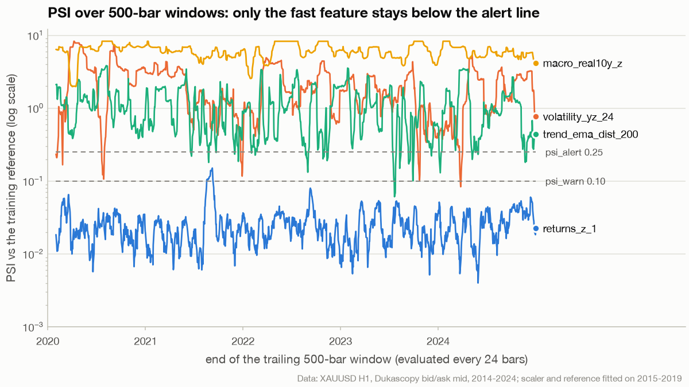
</picture>

*The fast 1-bar return z-score never reaches psi_alert (it crosses psi_warn in 17 of 1,212 windows, peaking at 0.15 in September 2021), while volatility_yz_24, trend_ema_dist_200 and macro_real10y_z are above psi_alert in 97%, 94% and 100% of the windows. Data: XAUUSD H1, Dukascopy bid/ask mid, 2014-2024; scaler and reference fitted on 2015-2019.*

<picture>
  <source media="(prefers-color-scheme: dark)" srcset="_assets/figures/live-trading/psi-bins-dark.png">
  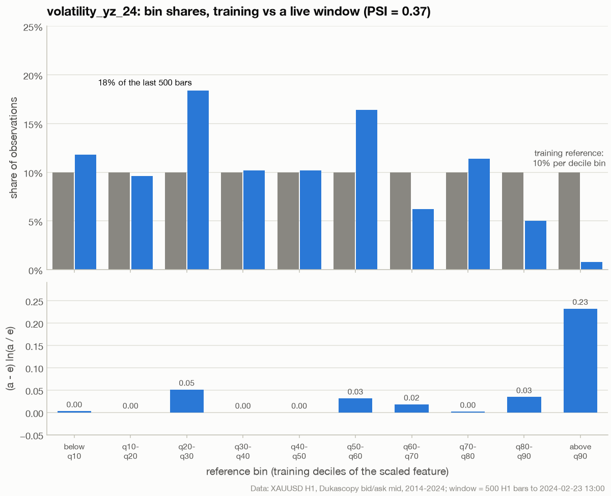
</picture>

*In the 500 bars to 2024-02-23 13:00 only 0.8% of volatility_yz_24 values fell in the training top decile instead of 10%, and that one bin contributes 0.23 of the total PSI of 0.37. Data: XAUUSD H1, Dukascopy bid/ask mid, 2014-2024; window = 500 H1 bars to 2024-02-23 13:00.*

**In code.**

```python
import numpy as np
import pandas as pd

from aurum.live.monitor import DriftMonitor, FeatureReference, psi

e = [0.1] * 10                                          # training deciles: 10% each
print(round(psi(e, [10] * 10), 4))                      # same distribution
print(round(psi(e, [12, 10, 18, 10, 10, 16, 6, 11, 5, 2]), 3))   # a moderate shift
print(round(psi(e, [0] * 9 + [100]), 2))                # everything in the top bin (empty bins -> 1e-4)

rng = np.random.default_rng(0)
train = pd.DataFrame({"fast": rng.normal(size=5000), "slow": rng.normal(size=5000)})
live = pd.DataFrame({"fast": rng.normal(size=500), "slow": rng.normal(1.0, 0.5, size=500)})
ref = FeatureReference.from_frame(train)                # quantile bins of the TRAIN features
rep = DriftMonitor(ref).evaluate(live)                  # psi_warn 0.10, psi_alert 0.25, min_obs 100
print({k: round(v, 3) for k, v in rep.psi.items()}, rep.warn, rep.alert)
```

```text
0.0
0.264
8.28
{'fast': 0.014, 'slow': 2.8} [] ['slow']
```

**Pitfalls and design choices.**

- *A month is a narrow window.* 500 H1 bars cover about a month, while the training window
  covers five years. A persistent feature (a volatility regime, a trend, a macro level) sits in
  a few bins for a whole month, so its PSI exceeds 0.25 even when nothing is broken. With the
  full default pipeline on real data, 85 to 125 of the 193 referenced features (median 53%)
  were above `psi_alert` in every one of 122 windows sampled every 240 bars over 2020-2024, so
  `feature_drift` would fire at every check. Treat the alert as a prompt to look at *which*
  features moved, raise `drift_window`, or tune `psi_alert` per artifact; it is not a stop
  signal.
- *Drift is not failure.* A feature can leave its training range while the strategy still
  works, and a strategy can fail with no drift at all. The [PnL band](#slippage-and-the-pnl-band)
  watches the outcome directly.
- *No pipeline, no drift check.* An artifact of rule strategies without shared features (such
  as the demo above or `live_paper.yaml`'s) has no drift monitoring.

### Slippage and the PnL band

**Slippage.** For every live fill the tracker compares the implementation shortfall with what
the backtest cost model charges for the same order:

```math
\text{realised} = \operatorname{side}\cdot\left(P^{\mathrm{fill}} - M^{\mathrm{decision}}\right), \qquad
\text{expected} = \tfrac{1}{2}s^{\mathrm{eff}} + \mathrm{slip}(H - L,\ q)
```

and alerts `slippage` when, over the last 50 fills and after at least 10, the mean realised
cost exceeds 2 × the mean expected cost + 0.05 USD/oz. Both are in USD/oz, with
$s^{\mathrm{eff}}$ and slip from [execution-and-costs.md](execution-and-costs.md),
$M^{\mathrm{decision}}$ the mid close of the decision bar, and $s$ and $H - L$ the spread and
range of that same closed bar (the execution bar's range is not known when the fill arrives;
a deferred order retried later uses $H - L = 0$). See `SlippageTracker` in
[aurum/live/monitor.py](../aurum/live/monitor.py) and `LiveRunner._after_execution`.

**PnL band.** Under the backtest, daily log returns are roughly independent with mean $\mu$ and
standard deviation $\sigma$, so after $n$ live days the cumulative log return should be close to
$n\mu$:

```math
z_n = \frac{\ln\left(E_n / E_0\right) - n\,\mu}{\sigma\sqrt{n}}, \qquad
\sigma = \frac{v}{\sqrt{252}}, \qquad \mu = \frac{\mathrm{SR}\cdot v}{252} - \frac{\sigma^2}{2}
```

where $E_0$ is the first live equity, $E_n$ the last close, $n$ the number of UTC trading days
since the start (Saturday and Sunday folded into Monday, the convention that produced the
backtest's daily statistics), and $\mu, \sigma$ come from `backtest.json` (`daily_mean` /
`daily_std`, or derived from the OOS `sharpe` SR and `ann_vol` $v$ as shown). After at least 5
days, `pnl_band` warns at $z_n \le -2$ and is critical at $z_n \le -3$; the critical level has a
false-alarm rate of about 0.1% per check under normality.

### Heartbeat and watchdog

**Intuition.** A crashed or hung runner cannot report its own death. The runner therefore
rewrites a small heartbeat file, and something outside it (cron, a systemd timer) checks how
old that file is. The runner writes the heartbeat after every loop iteration and, while it
sleeps until the next bar, every `heartbeat_seconds`. A watchdog can then alert within a few
minutes instead of waiting longer than a bar. The one gap is the decision cycle itself, which
writes nothing, so the threshold needs a grace period longer than the slowest cycle (an LLM
desk cycle in particular).

**The math** ([`heartbeat_max_age`](../aurum/live/monitor.py)):

```math
\tau = p\,h + g, \qquad
\text{age}_{\max} \approx h + C \quad\Rightarrow\quad \text{no false alarm while } C < (p - 1)\,h + g
```

where $h$ = `heartbeat_every_s` (the runner's `heartbeat_seconds`, default `retry_poll_seconds`
= `live.poll_seconds` = 30 s), $p$ = `periods` (3), $g$ = `grace_seconds` (120), so the default
threshold is $\tau$ = 210 s; $C$ is the longest decision cycle. At the wake-up the last
in-sleep heartbeat is at most $h$ old, and nothing is written for the $C$ seconds of the cycle,
so with the defaults any cycle shorter than about 180 s stays below the threshold.

<picture>
  <source media="(prefers-color-scheme: dark)" srcset="_assets/figures/live-trading/heartbeat-watchdog-dark.png">
  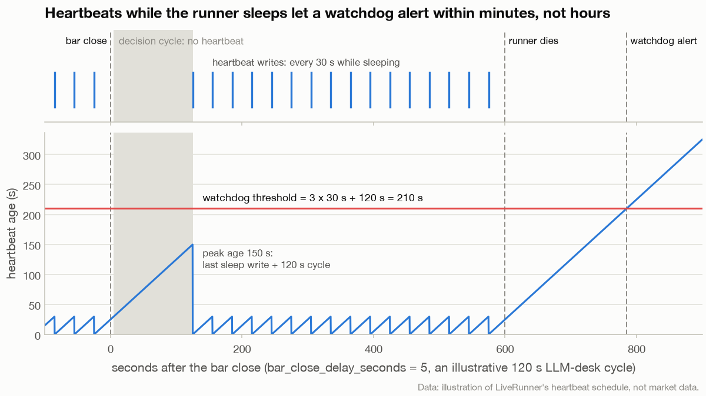
</picture>

*With 30-second heartbeats the age peaks at 150 s during a 120 s decision cycle, safely under the 210 s threshold; after the runner dies at 600 s, the watchdog sees the age cross 210 s at 785 s. Data: illustration of LiveRunner's heartbeat schedule (heartbeat_seconds 30, bar_close_delay_seconds 5), not market data.*

`heartbeat.json` fields:

| Field | Meaning |
|---|---|
| `time` | Wall-clock UTC time of the write (what a watchdog measures) |
| `pid` | Runner process id |
| `status` | `running`, `degraded` (during a venue-error back-off), `stopped`, or `error: <Exception>` at a crash shutdown |
| `mode` | `DRY-RUN PAPER`, `PAPER`, `DEMO`, `REAL`, ... |
| `broker_time` | Venue time at the write, or `null` when the venue clock is unavailable |
| `last_bar`, `n_decisions`, `pending`, `halted` | Runner state (`pending` = the deferred decision time, if any) |
| `heartbeat_every_s` | The in-sleep interval, so a watchdog can derive its threshold |
| `next_wake` | Only on in-sleep writes: when the runner will wake next |

Writes are throttled to one per 5 s of wall time unless the status changes. Simulated-clock
replays do not write in-sleep heartbeats (they would mean nothing to a wall-clock watchdog).
`check_heartbeat(path)` returns `None` while the file is fresh and an `Alert` otherwise; with
no `max_age_seconds` it derives $\tau$ from the file's own `heartbeat_every_s`:

```python
import tempfile
from pathlib import Path

import pandas as pd

from aurum.live import check_heartbeat
from aurum.live.monitor import heartbeat_max_age
from aurum.live.state import write_heartbeat

print(heartbeat_max_age(30.0))                       # 3 * 30 + 120
with tempfile.TemporaryDirectory() as tmp:
    hb = Path(tmp) / "heartbeat.json"
    # what a sleeping runner writes every heartbeat_seconds (fixed time for a reproducible example)
    write_heartbeat(hb, time=pd.Timestamp("2026-09-28 10:00:30", tz="UTC"), status="running",
                    heartbeat_every_s=30.0, next_wake=pd.Timestamp("2026-09-28 11:00:05", tz="UTC"))
    for now in ("2026-09-28 10:02:00", "2026-09-28 10:04:30"):
        alert = check_heartbeat(hb, now=pd.Timestamp(now, tz="UTC"))   # threshold derived from the file
        print(now, "->", None if alert is None else (alert.level, alert.message))
    old = Path(tmp) / "old.json"                    # a heartbeat without heartbeat_every_s
    write_heartbeat(old, time=pd.Timestamp("2026-09-28 10:00", tz="UTC"), status="running")
    print("old runner ->", check_heartbeat(old, now=pd.Timestamp("2026-09-28 10:01", tz="UTC")).message)
    print("missing ->", check_heartbeat(Path(tmp) / "missing.json", max_age_seconds=210).message)
```

```text
210.0
2026-09-28 10:02:00 -> None
2026-09-28 10:04:30 -> ('critical', 'runner heartbeat is 240s old (status running)')
old runner -> heartbeat does not advertise a valid heartbeat_every_s (older runner?): pass max_age_seconds
missing -> heartbeat file missing
```

In production run `check_heartbeat("runs/live/paper/heartbeat.json")` from cron or a systemd
timer every minute or two, and alert through your own channel. With the desk enabled, pass
`grace_seconds` above the desk's `max_cycle_seconds` (for example `check_heartbeat(path,
grace_seconds=300)`). A heartbeat written by an older runner has no `heartbeat_every_s`: pass
`max_age_seconds` explicitly for it.

### Alert kinds

| Kind | Level | Meaning |
|---|---|---|
| `risk_halt` | critical | Kill switch engaged |
| `halt_reset` | critical | Kill switch cleared by `aurum live reset-halt` (written to `alerts.jsonl` only; no webhook) |
| `real_money_guard` | critical | Account turned non-demo mid-run; runner stopped |
| `execution_unknown`, `execution_conflict` | critical | Order outcome unverifiable, or ownership conflict |
| `execution_rejected`, `execution_partial`, `execution_error` | warning | Order not (fully) executed |
| `broker_error` | warning, then critical from the 5th in a row | Venue or transport failure |
| `server_tz_unconfirmed` | warning | MT5 `server_tz: auto` started on a saved or fallback zone; orders deferred until a fresh tick confirms it |
| `runner_crash` | critical | Unhandled exception stopped the runner |
| `forming_bar` | critical | Adapter returned an unclosed bar (dropped) |
| `stale_data`, `insufficient_history` | warning | Bar skipped |
| `strategy_error`, `signal_error`, `sizing_error` | critical | Pipeline failure (`on_error` applies) |
| `desk_policy_violation` | critical | Desk forecast outside its policy (re-bounded) |
| `desk_failed`, `desk_error` | warning | Desk fell back |
| `macro_stale` | warning | Macro data old |
| `feature_drift`, `feature_missing`, `slippage` | warning | Model or execution drift |
| `pnl_band` | warning or critical | Live PnL below the backtest band |

## Explaining a live decision

`aurum explain --live STATE_DIR [--at TS] [--out DIR]` reads the runner's `decisions.jsonl`
(read-only) and explains one live or paper decision: the forecast waterfall from the logged
attribution (including the LLM-desk step), the runner's logged sizing breakdown, the risk
manager's verdict, and a per-strategy summary over the whole log. `--at` picks the decision on
the last bar opening at or before that time (default: the latest decision with an
attribution). Output goes to `runs/analysis/explain_live` unless
`--out` is given: `decision_live_<ts>.json`, `.csv` and `.png`, and `live_decisions.csv`. The
research version (`aurum explain --run`), the attribution of P&L and the waterfall chart are in
[analytics.md](analytics.md). On the 6-bar paper replay above:

```text
$ aurum explain --live <scratch>/st_paper --out <scratch>/expl
== explain (live log): <scratch>/st_paper [PAPER] decision at the close of 2024-11-04 18:00:00+00:00, decided 2024-11-04 19:00:00+00:00

 strategy  forecast  weight    fdm  contribution    share
---------------------------------------------------------
    tsmom     0.847   0.500  1.069         0.453  +141.7%
ema_cross    -0.249   0.500  1.069        -0.133   -41.7%

raw sum +0.3197  clip +0.0000  -> combined +0.3197  -> desk off +0.0000 -> final +0.3197
sizing: vol 11.8%, price 2,738, equity 99,893, drawdown +0.1% -> notional 27,118 -> caps none, drawdown x1.000 -> 0.099 lots -> target 0.090
position 0.100 -> target 0.090 -> risk-approved 0.090 lots (orders: filled)

== live log summary: 6 decisions, 6 with an attribution (2024-11-04 14:00:00+00:00 -> 2024-11-04 19:00:00+00:00)
 strategy  mean_contribution  mean_abs_contribution  share_of_abs
-----------------------------------------------------------------
    tsmom              0.472                  0.472        +79.1%
ema_cross             -0.125                  0.125        +20.9%
LLM desk changed the forecast on 0 of 6 decisions (mean |delta| 0.000)

outputs: <scratch>/expl/decision_live_20241104T1800.json, decision_live_20241104T1800.csv, decision_live_20241104T1800.png, live_decisions.csv
```

Read it top to bottom: tsmom's +0.453 outweighed ema_cross's −0.133 (shares are signed
fractions of the raw sum), the sum stayed inside [-1, 1], the desk was off, and the sizer
turned the forecast into 27,118 USD of notional at 11.8% volatility, 0.099 lots before rounding
toward zero on the 0.01 grid (0.09), which the risk manager approved. The sizing line is the
`SizingBreakdown` the runner logged at the time, not a recomputation, so it is exactly what was
sized. A decision whose MT5 server clock was unconfirmed gets a note saying its orders were
deferred.

## Operations runbook

### Before the first start

- Unit tests pass on the target machine (`pytest -m "not network"`, see
  [development.md](development.md)).
- Artifact built with `train-final` from a reviewed config. `AURUM_ARTIFACT_KEY` is set for
  both signing and loading.
- **A unique `magic` and a unique `state_dir` per runner.** One runner per account and symbol
  is simplest.
- The machine clock is NTP-synchronised. For MT5, either set `server_tz` explicitly, or keep
  `auto` and set `server_tz_fallback` (for example `NY+7`) so a start while the market is
  closed runs unconfirmed (orders deferred) instead of failing.
- `risk.live` is reviewed: `max_drawdown` and `max_daily_loss` set, sensible `max_spread` and
  `stale_data_seconds`.
- Webhook configured and tested. External heartbeat watchdog scheduled with a grace above
  the desk's `max_cycle_seconds` when the desk is on.
- With the desk on: `agents.enabled: true`, `anthropic` installed, `ANTHROPIC_API_KEY` in the
  runner's environment (the runner refuses to start otherwise).
- Decide whether you want broker-side stops (`backtest.stop_atr_mult`,
  `take_profit_atr_mult`). They are off in the shipped configs.
- Run dry-run, then paper fills, then an MT5 **demo**, each long enough to see weekends,
  rollovers and news events.

### Daily checks

1. `aurum live status -c CONFIG`: the heartbeat is fresh and `running`, risk is `active` (or
   halted for a known reason), the OMS has no unfinished entries.
2. `alerts.jsonl` (the last 5 are in `live status`): no new critical alerts.
3. `decisions.jsonl` or the INFO lines: statuses are `noop`, `filled` or `dry_run`. No
   `unknown`, `conflict`, `rejected` or `error_*`.
4. Venue positions for your magic match the last decision's `execution.actual_after`.
5. Monitor snapshot in the latest decision record: PnL-band `z`, slippage ratio, drift.
6. If the desk is on: `desk.status` and `desk.cost_usd` per decision, journals in
   `<state_dir>/desk_journal`, and `aurum explain --live` for any decision it changed.
7. On MT5: `venue_tz_confirmed` is true in recent decision records.

### Restart

1. Send SIGINT or SIGTERM **once** and wait for the `stop` record and the final heartbeat.
   A second signal forces an immediate exit.
2. Start the same command again. `RunnerLockedError` means another process still holds the
   state directory.
3. Check that the `start` record shows the expected mode, `risk_halted` value and, on MT5,
   `venue_tz`.

### Incident response

| Symptom | Action |
|---|---|
| `risk_halt` | The book is being flattened. Find the cause with `aurum live status` and the decision log. Reset only after review, with the runner stopped (`aurum live reset-halt --confirm RESET --reason ...`, [Kill switch](#kill-switch)). |
| `execution_unknown` | An order may or may not be at the venue, and it was not resent. Check the terminal's positions and deal history for the client id. The next reconcile re-plans from the venue. |
| `execution_conflict` | A foreign position on a netting account, a hedging mismatch, or an adapter returning foreign positions. The runner will not trade until it is resolved: move the other EA or use a separate or hedging account. |
| `execution_rejected` | Check the retcode: margin (`no_money`), volume grid, stops distance, trading disabled or AutoTrading off. |
| `server_tz_unconfirmed` | Expected after a start while the market is closed: orders wait for the first fresh tick. If it persists while the market is open, check the terminal's connection; a `server_tz_corrected` rejection means the saved or fallback zone was wrong and has been replaced. |
| `real_money_guard` | The terminal logged into a non-demo account. The runner stopped and sent nothing. Fix the terminal before restarting. |
| `CONFIG ERROR` / exit 2 at start | A configuration or environment problem (for example the desk without `ANTHROPIC_API_KEY`). Nothing was started. |
| Repeated `broker_error` | Terminal disconnected or credentials wrong. The runner backs off and reconnects by itself. Check the terminal and network. |
| `stale_data`, `forming_bar` | Feed or clock problem. Check NTP, `server_tz` and the terminal's connection. |
| `strategy_error`, `signal_error` | Artifact or environment mismatch (package versions, missing macro data). With `on_error: hold` the position is held. |
| `pnl_band`, `feature_drift`, `slippage` | Live behaviour differs from research. Consider stopping, re-validating and retraining. These are not handled automatically. |
| Stale heartbeat | The runner died or hung. Check the process and logs, then restart. Positions stay open while it is down. |
| `StateCorruptError` at start | Inspect the named file. Do **not** delete state files to get going: a missing risk state starts halted, and a lost OMS state loses the in-flight order record. |

## Known residual risks

These gaps remain after the adversarial safety audit (`tests/test_final_live_safety.py`).
Treat them as operating rules:

1. **Same magic on two runners.** The lock is per `state_dir`. Two runners with different
   state directories but the **same magic** on one account would both reconcile the same
   book and fight over it or double it. Give every runner its own magic and its own
   `state_dir`.
2. **Deleting the whole state directory.** The missing-file fail-safe only triggers when some
   state remains. A deleted (or new) `state_dir` starts **un-halted**, with the equity peak
   and day start re-based to the current equity: effectively an unreviewed kill-switch reset.
   The OMS plans from the venue's positions, so losing its state does not double the position
   (the audit tests this for lost OMS and runner state), but the halt history is gone. Protect
   the directory with permissions and backups.
3. **Clock skew.** The MT5 adapter treats the local clock as "now". Once the server zone is
   confirmed, it only switches to the tick time when a tick is more than 30 s *ahead* of the
   local clock (while unconfirmed it never does). A local clock running **fast** is not
   detected, and could make a forming bar look closed or distort the stale checks. Keep the
   machine NTP-synchronised.
4. **Discretionary desk mode.** With the desk in `discretionary` mode, the LLM chooses the
   direction and size up to `max_abs_forecast`, including against the quant book. The risk
   manager still caps exposure, but it cannot judge the call. Prompt injection through data
   feeds could steer it within those bounds. Use `overlay` (the default) or `advisory`.

Also worth knowing:

- **No broker-side stops by default.** The shipped configs set `stop_atr_mult: null`, so
  while the runner is down (crash, reboot, network) open positions have no protection and the
  kill switch cannot act.
- The webhook is best-effort, and the heartbeat needs an external watchdog.
- Artifacts are pickles: only load your own.

## Configuration reference

`aurum live run` validates the config strictly before loading anything, builds the runner
config from the typed `live` section **plus** the same instrument, costs, sizing and
live-risk settings the research runs use (`risk.live`, `sizing`, `costs`, the `backtest.*`
stop settings, `data.macro`, `data.events`, `agents.policy` and `agents.desk`), checks it with
the runner's own `LiveConfig` and the desk prerequisites, and only then writes
`aurum_live_config.yaml`. The `live` section (see [configuration.md](configuration.md)):

| Key | Default | Meaning |
|---|---|---|
| `broker` | `paper` | `paper` or `mt5` |
| `dry_run` | `true` | Plan and log only |
| `allow_live_real` | `false` | First real-money opt-in (invalid with `paper`) |
| `magic` | `20260926` | Positive 32-bit MT5 magic number |
| `poll_seconds` | `30.0` | Retry poll (runner `retry_poll_seconds`), and the default heartbeat interval |
| `symbol` | `instrument.symbol` | Venue symbol (suffixes allowed) |
| `history_bars` | `null` | `null` means 3x the artifact's look-back |
| `state_dir` | `runs/live` | [State directory](#the-state-directory) |
| `artifact_dir` | `artifacts/live` | [Artifact](#trading-artifacts) |
| `use_desk` | `false` | Enable the [LLM desk](#llm-desk-in-the-loop); requires `agents.enabled: true` |
| `options` | `{}` | Extra runner keys and sections (below). They may add settings but never override a typed one, and never hold credentials; unknown keys are errors. |

Runner keys you can add through `live.options`, with their runner defaults:

| Key | Default | Meaning |
|---|---|---|
| `bar_close_delay_seconds` | 5.0 | Wait after each bar close (0 to 600) |
| `history_multiple`, `min_history_bars` | 3.0, 300 | History sizing |
| `max_bar_age_seconds` | timeframe + delay + 120 s | Stale-bar guard |
| `retry_poll_max_seconds` | 300 | Backoff ceiling |
| `heartbeat_seconds` | `null` (= `retry_poll_seconds`) | Heartbeat interval while sleeping between bars |
| `max_defer_seconds` | 1.5 bars | Expiry for deferred risk-adding orders |
| `spread_source` | `bar` | `bar` or `quote`: the spread the risk manager sees |
| `on_error` | `hold` | Signal errors: `hold` or `flatten` |
| `flatten_on_shutdown` | `false` | Flatten on a clean stop (not in dry-run) |
| `macro_refresh_hours`, `macro_max_age_days` | 24, 7 | Macro reload cadence and staleness alert |
| `paper`, `mt5`, `oms`, `monitor` | `{}` | Sections described above |
| `desk.on_error` | `follow_quant` | Desk exception fallback: exactly `follow_quant`, `flat` or `hold` |

The runner can also be started directly with its own flags:
`python -m aurum.live.runner --config RESOLVED.yaml [--no-dry-run] [--i-understand-real-money] [--max-cycles N] [--until TS] [--log-level LEVEL]`.
It takes the resolved runner config, like the `aurum_live_config.yaml` that `aurum live run`
writes. `aurum live run` itself accepts `--i-understand-real-money`, `--max-cycles` and
`--until`, and returns exit code 2 on a refusal. `aurum live status` and `aurum live
reset-halt` take the same `-c CONFIG [--set KEY=VALUE]` options. See [cli.md](cli.md) for every
command and exit code, [getting-started.md](getting-started.md) for installation, and
[index.md](index.md) for the map of the documentation.
