# Machine learning and reinforcement learning

Aurum has three learned strategies next to the rule-based catalogue in
[strategies.md](strategies.md). `ml_gbm` is a calibrated gradient-boosted direction
classifier. `meta_label` lets a second classifier size the bets of a primary rule. `rl_ppo` is
a PPO policy trained on the same simulator, sizer and risk manager that every backtest uses.
All three share one set of defences against the usual ways machine learning fools itself on
financial data: forward-looking labels that stay inside the training slice, overlap-aware
sample weights, a purged, time-ordered validation tail, and a **skill gate** that keeps a
model flat unless it beats a coin flip on that tail. Know the outcome before you start. In
the pre-registered walk-forward `ml_gbm` failed its skill gate in every fold and never traded,
`meta_label` traded in 5 of 18 folds and showed no demonstrated edge, and `rl_ppo` has not
been evaluated under the protocol at all (see [RESULTS.md](RESULTS.md)). This page explains
every algorithm involved, with the maths as the code implements it and figures drawn by the
code on real XAUUSD data.

**On this page**

- [The learning pipeline at a glance](#the-learning-pipeline-at-a-glance)
- [Triple-barrier labels](#triple-barrier-labels)
- [Overlapping labels and sample uniqueness](#overlapping-labels-and-sample-uniqueness)
- [Purged and embargoed validation](#purged-and-embargoed-validation)
- [`ml_gbm`: direction classifier](#ml_gbm-direction-classifier) (with the
  [skill gate](#forecast-mapping-and-the-skill-gate))
- [`meta_label`: meta-labelling a primary](#meta_label-meta-labelling-a-primary)
- [Parameters of the ML strategies](#parameters-of-the-ml-strategies)
- [Warm-up history: `fit_history_bars`](#warm-up-history-fit_history_bars)
- [Stacking-leak protection for trainable primaries](#stacking-leak-protection-for-trainable-primaries)
- [The RL environment as a Markov decision process](#the-rl-environment-as-a-markov-decision-process)
- [`rl_config_from_aurum`: one contract for training and research](#rl_config_from_aurum-one-contract-for-training-and-research)
- [PPO training](#ppo-training)
- [The `rl_ppo` strategy adapter](#the-rl_ppo-strategy-adapter) (with
  [artifact reuse and the look-ahead guard](#reusing-a-pre-trained-artifact-and-the-look-ahead-guard))
- [What the evidence says](#what-the-evidence-says)
- [Tests that guard these components](#tests-that-guard-these-components)

The ML strategies need scikit-learn and SciPy, which are core dependencies. RL needs the
optional extra: `pip install -e ".[rl]"` (torch, gymnasium, stable-baselines3).
`import aurum.rl` and `import aurum.strategies.rl` import neither torch nor
stable-baselines3; they are loaded only when a policy is trained or run.

Every figure on this page is drawn by [tools/figures/fig_ml_rl.py](../tools/figures/fig_ml_rl.py)
with aurum's own functions. Real data ends at 2024-12-31: 2025 onward is the research holdout.

Related pages: [features.md](features.md) (the feature groups), [research.md](research.md)
(walk-forward, purging, statistics), [portfolio-and-risk.md](portfolio-and-risk.md) (sizer and
risk manager), [execution-and-costs.md](execution-and-costs.md) (the simulator and financing),
[models.md](models.md) (volatility models), [configuration.md](configuration.md),
[cli.md](cli.md).

---

## The learning pipeline at a glance

Every learned strategy obeys the strategy contract of [strategies.md](strategies.md): `fit`
sees a training slice only, and `generate` returns a causal forecast in [-1, 1]. The two
classifiers turn that contract into the chain below. The walk-forward engine
([research.md](research.md)) calls `fit` once per fold, then `generate` on the fold's test
bars.

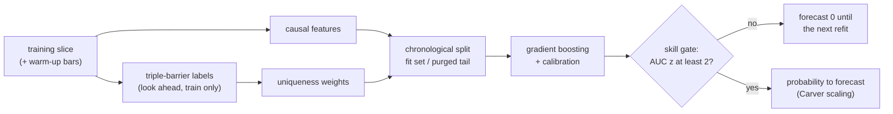

The rest of the page goes through the boxes in order, then covers reinforcement learning.

---

## Triple-barrier labels

Module [aurum/labels/triple_barrier.py](../aurum/labels/triple_barrier.py), following López
de Prado, *Advances in Financial Machine Learning* (AFML, 2018), ch. 3.

**Intuition.** A classifier needs a target: "was this a good moment to be long?" The naive
answer, the sign of the return over the next 24 bars, ignores the path. A trade that falls
3% before recovering would have been stopped out in real life. The triple-barrier method
asks what a trader with a take-profit, a stop and a time limit would have experienced. It
places an upper and a lower price barrier one volatility unit away from the entry, plus a
vertical barrier in time, and labels the event by whichever barrier the price touches first.
Because the barriers scale with volatility, a label means the same thing in a calm market
and in a crisis.

> [!WARNING]
> **Every label looks into the future by construction.** A label for the event at bar `t`
> is a function of bars `t+1 .. t1`. Labels are training targets only. They may be
> computed inside a strategy's `fit()` on the training slice it was given, and nowhere
> else. Never join a label, or anything derived from one (`ret`, `t1`, `barrier_hit`,
> uniqueness weights), onto features, forecasts, sizing or risk inputs.

### The math

For an event at the close of bar $t$ with entry price $C_t$:

```math
\sigma_t = \operatorname{EWMstd}_{\mathrm{span}=100}\left(\ln C_s - \ln C_{s-1}\right)_{s \le t},
\qquad
\mathrm{trgt}_t = \sigma_t \sqrt{h},
\qquad
U_t = C_t\, e^{\,u\,\mathrm{trgt}_t}, \qquad L_t = C_t\, e^{-d\,\mathrm{trgt}_t}
```

```math
k_U = \min\{k \in 1..h : H_{t+k} \ge U_t\}, \qquad
k_L = \min\{k \in 1..h : L^{\mathrm{low}}_{t+k} \le L_t\}, \qquad
\tau = \min(k_U, k_L, h)
```

```math
\mathrm{exit} =
\begin{cases}
\max(U_t, O_{t+\tau}) & \text{upper barrier first} \\
\min(L_t, O_{t+\tau}) & \text{lower barrier first} \\
C_{t+h} & \text{no touch (vertical barrier)}
\end{cases}
\qquad
\mathrm{ret} = s \cdot \ln\frac{\mathrm{exit}}{C_t}
```

where

- $C$, $O$, $H$ and $L^{\mathrm{low}}$ are the bar's mid close, open, high and low;
- $\sigma_t$ is `ewm_vol(close, span=100)`: the exponentially weighted standard deviation of
  one-bar log returns (pandas `ewm(span=100, adjust=True).std()`, so $\alpha = 2/101$, with
  `min_periods = max(2, span // 4)` = 25). It uses returns up to bar $t$ only and is not
  annualised;
- $h$ = `max_holding_bars` (24 for the ML strategies). With `barrier_vol="horizon"` (the
  default) the barrier unit is one sigma of an $h$-bar move, $\sigma_t\sqrt{h}$; `"bar"` uses
  $\sigma_t$;
- $u$ and $d$ are `pt_mult` and `sl_mult` (both 1.0). Without a side $s = +1$, the upper
  barrier is labelled +1 and the lower -1. With a side (meta-labelling) the profit-take
  `pt_mult` lies in the direction of the bet and the stop `sl_mult` against it. A multiplier
  of `None`, `0` or `inf` disables that barrier;
- an event whose vertical barrier is reached gets 0 with `vertical_label="zero"` or
  $\operatorname{sign}(\mathrm{ret})$ with `"sign"` (0 when the absolute return is at most
  `min_ret`). `ml_gbm` uses `"sign"`.

Touches are detected on each following bar's **high and low**. A close-only check would miss
intrabar stops and be optimistic. Because the path inside a bar is unknown, two tie rules
apply when both barriers fall inside the same bar ($k_U = k_L$):

- If the bar **opens** beyond a barrier (a gap), that barrier was hit first, at the open.
- Otherwise the conservative convention of the execution simulator applies: with a side,
  the **stop is assumed first** (label -1). Without a side there is no "stop", so the event
  is labelled 0 with `barrier_hit="ambiguous"`.

### The picture

<picture>
  <source media="(prefers-color-scheme: dark)" srcset="_assets/figures/ml-and-rl/triple-barrier-path-dark.png">
  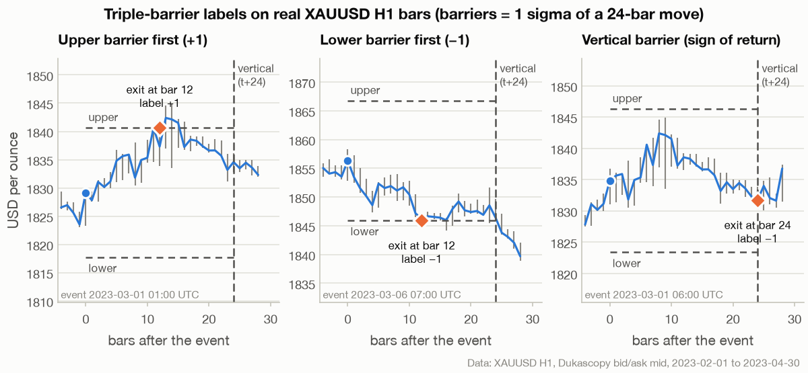
</picture>

*Three real events with `ml_gbm`'s defaults: the upper barrier is touched on bar 12 (label +1), the lower barrier on bar 12 (label −1), and in the third panel neither price barrier is touched, so the 24-bar timeout applies and the label is the sign of the return (−1). Grey whiskers are each bar's high-low range, on which touches are detected. Data: XAUUSD H1, Dukascopy bid/ask mid, 2023-02-01 to 2023-04-30.*

<picture>
  <source media="(prefers-color-scheme: dark)" srcset="_assets/figures/ml-and-rl/label-distribution-dark.png">
  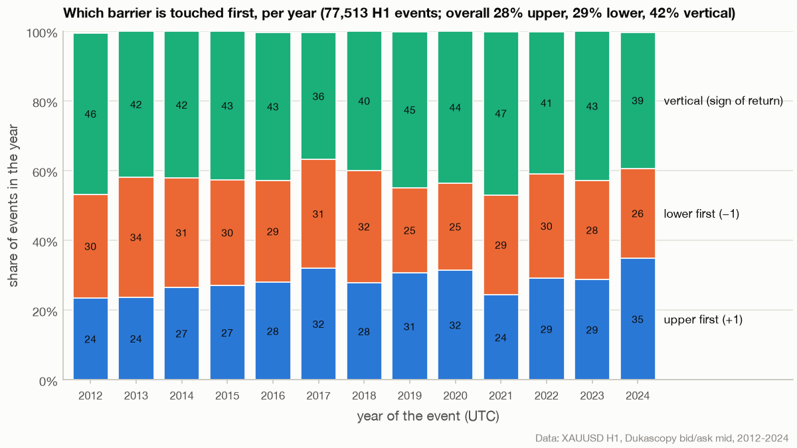
</picture>

*Labelling every H1 bar from 2012 to 2024 gives 77,513 events: 28% upper first, 29% lower first, 42% timeouts and 111 ambiguous bars (0.1%). The mix moves with the regime: timeouts range from 36% (2017) to 47% (2021), and 2024's rally pushed upper-first events to 35%. A classifier trained on one regime therefore sees a different base rate from the one it is tested on, which is why `ml_gbm` balances classes separately in its fit set and validation tail (below). Data: XAUUSD H1, Dukascopy bid/ask mid, 2012-2024.*

### The end of the data, positions and purging

An event whose vertical barrier lies beyond the last bar, and that has not touched a
horizontal barrier by then, is undecided. It is dropped by default (`drop_incomplete=True`)
or kept with a NaN label and `barrier_hit="incomplete"`. The functions never read past the
frame they are given. `drop_label_tail(labels, n_bars, max_holding_bars)` goes further and
removes **every** event that starts within `max_holding_bars` of the end, not only the
unresolved ones. Otherwise only fast barrier touches would survive near the end, a selection
bias.

`t_idx` and `t1_idx` are integer positions in the bars frame; `t_event` and `t1` are the
matching bar open times, and the label frame is indexed by `t_event`. A label's outcome is
known at `bars["available_at"].iloc[t1_idx]`. `label_end_positions(labels, n_bars)` gives the
per-bar label end used by the purged splitters in `aurum.research.splits` (see
[Purged and embargoed validation](#purged-and-embargoed-validation)).

Other helpers: `cusum_filter` (symmetric CUSUM event sampler, AFML 2.4), `get_events` and
`apply_triple_barrier` (the two-step AFML API), `fixed_horizon_labels` (sign of the
vol-normalised $h$-bar forward return, with a dead band) and `meta_labels`.

### In code

```python
import numpy as np
import pandas as pd

from aurum.data.synthetic import make_synthetic_bars
from aurum.labels import (
    average_uniqueness, drop_label_tail, ewm_vol, label_end_positions, meta_labels,
    triple_barrier_labels, uniqueness_weights,
)

bars = make_synthetic_bars(2000, "H1", seed=4)
h = 24
vol = ewm_vol(bars["close"], span=100) * np.sqrt(h)   # 1 sigma of a 24-bar move, known at t

# No side: upper barrier -> +1, lower -> -1, vertical -> sign of the return
labels = triple_barrier_labels(bars, pt_mult=1.0, sl_mult=1.0, max_holding_bars=h,
                               vol=vol, vertical_label="sign")
labels = drop_label_tail(labels, len(bars), h)        # purge events that could reach the end
cols = ["label", "ret", "barrier_hit", "t_idx", "t1_idx", "holding_bars"]
print(labels[cols].iloc[40:44].round(5).to_string())
print(labels["barrier_hit"].value_counts().to_dict())

# With a side (meta-labelling): PT in the bet's direction, SL against it
side = pd.Series(np.where(np.arange(len(bars)) % 2 == 0, 1.0, -1.0), index=bars.index)
meta = triple_barrier_labels(bars, pt_mult=1.0, sl_mult=1.0, max_holding_bars=h,
                             vol=vol, side=side)
y = meta_labels(meta, vertical="return_sign")         # 1 = PT first (or timeout in profit)
print(meta["barrier_hit"].value_counts().to_dict(), "success rate", round(y.mean(), 3))

# Overlap: average uniqueness (AFML ch. 4) and per-bar label ends for purged splits
u = average_uniqueness(labels, n_bars=len(bars))
print(f"avg uniqueness: mean {u.mean():.3f}, min {u.min():.3f}, max {u.max():.3f}")
w = uniqueness_weights(labels, n_bars=len(bars))      # same, normalised to mean 1
le = label_end_positions(labels, len(bars))
print("label_end[200:203] =", le[200:203].tolist())
```

```text
                           label      ret barrier_hit  t_idx  t1_idx  holding_bars
time                                                                              
2020-01-08 17:00:00+00:00   -1.0 -0.00904          sl     65      80            15
2020-01-08 18:00:00+00:00   -1.0 -0.00906          sl     66      90            24
2020-01-08 19:00:00+00:00   -1.0 -0.00916          sl     67      80            13
2020-01-08 20:00:00+00:00   -1.0 -0.00912          sl     68      90            22
{'pt': 719, 'vertical': 628, 'sl': 604}
{'sl': 669, 'pt': 657, 'vertical': 628} success rate 0.501
avg uniqueness: mean 0.065, min 0.042, max 0.238
label_end[200:203] = [221, 222, 208]
```

Without a side, `barrier_hit` still says `"pt"` or `"sl"`, meaning the upper or lower
barrier. A 24-bar label can resolve on its 24th bar by a barrier touch (row `t_idx=66`)
rather than at the vertical barrier.

`triple_barrier_labels(bars, *, pt_mult, sl_mult, max_holding_bars, vol, ...)`:

| Parameter | Default | Meaning |
|---|---|---|
| `pt_mult`, `sl_mult` | required | Barrier widths in units of `vol`. `None`/`0` disables a barrier. |
| `max_holding_bars` | required | Vertical barrier, in bars after the event. |
| `vol` | required | Per-bar barrier unit known at the event (for example `ewm_vol`). |
| `side` | `None` | Bet direction per bar (meta-labelling). Events with side 0 or NaN are skipped. |
| `t_events` | `None` | Which bars are events (default: every bar with a valid `vol`). |
| `vertical_label` | `"zero"` | `"zero"` or `"sign"` for timeouts. |
| `min_ret` | `0.0` | Dead band for `vertical_label="sign"`. |
| `min_target` | `0.0` | Minimum `vol` for an event (AFML `minRet`). |
| `drop_incomplete` | `True` | Drop events still undecided at the last bar. |

### Pitfalls and design choices

- **Look-ahead.** Labels are the only forward-looking objects in aurum. The walk-forward hands
  `fit` training bars only, and `drop_label_tail` guarantees no label resolves after them.
  `tests/test_strategies_ml.py` perturbs future prices and checks that past forecasts do not
  move.
- **Close-only optimism.** Checking barriers on closes would label many stopped-out trades as
  winners. Aurum uses highs and lows and resolves same-bar ties conservatively, exactly like the
  simulator's intrabar stop rule ([execution-and-costs.md](execution-and-costs.md)).
- **Fixed-percentage barriers.** A 1% barrier is a big move in 2017 and a small one in March
  2020. Volatility-scaled barriers keep the label's meaning stable across regimes.
- **Regime dependence.** The share of each outcome still drifts from year to year (figure
  above), so base rates are not stationary.

---

## Overlapping labels and sample uniqueness

**Intuition.** With an event on every bar and a 24-bar horizon, consecutive labels share most
of their future. Twenty labels that all ended on the same rally are one piece of evidence,
not twenty. Treating them as independent over-weights long, overlapping episodes and
inflates the apparent sample size. Sample uniqueness (AFML ch. 4) measures how much of each
label is its own.

### The math

```math
c_t = \#\{\, i : t_i < t \le t1_i \,\}, \qquad
\bar u_i = \frac{1}{t1_i - t_i} \sum_{t = t_i + 1}^{t1_i} \frac{1}{c_t}, \qquad
n_{\mathrm{eff}} = \sum_i \bar u_i
```

```math
w_i^{\mathrm{ret}} = \left| \sum_{t = t_i + 1}^{t1_i} \frac{r_t}{c_t} \right|, \qquad
w_i^{\mathrm{decay}} = \max\left(0,\ 1 - \beta X_N + \beta X_i\right), \quad
X_i = \sum_{j \le i} \bar u_j
```

where

- $c_t$ is the **concurrency**: the number of labels whose return span $(t_i, t1_i]$ covers
  bar $t$ (bar $t$'s return is $\ln C_t - \ln C_{t-1}$). `num_concurrent_events` computes it
  in $O(n)$ with a difference array;
- $\bar u_i \in (0, 1]$ is the **average uniqueness** of label $i$ (1 for an empty span), and
  $n_{\mathrm{eff}}$ is the effective number of independent labels;
- $w^{\mathrm{ret}}$ is AFML's return attribution (snippet 4.10): labels that span large,
  concurrency-shared moves weigh more;
- $w^{\mathrm{decay}}$ is AFML's piecewise-linear time decay (snippet 4.11) over cumulative
  uniqueness: the newest label gets 1 and the oldest about $c$ = `time_decay`. The slope is
  $\beta = (1 - c)/X_N$ for $c \ge 0$ and $\beta = 1/((c + 1) X_N)$ for $-1 < c < 0$, which
  zeroes the oldest $\lvert c \rvert$ fraction;
- every weight vector is normalised to mean 1.

`sample_weight` in the ML strategies chooses the weighting: `"uniqueness"` (default,
$\bar u_i$), `"return_attribution"`, `"uniqueness_x_return"` (the product) or `"none"`.
`time_decay` below 1 multiplies in the decay weights.

### The picture

<picture>
  <source media="(prefers-color-scheme: dark)" srcset="_assets/figures/ml-and-rl/label-overlap-dark.png">
  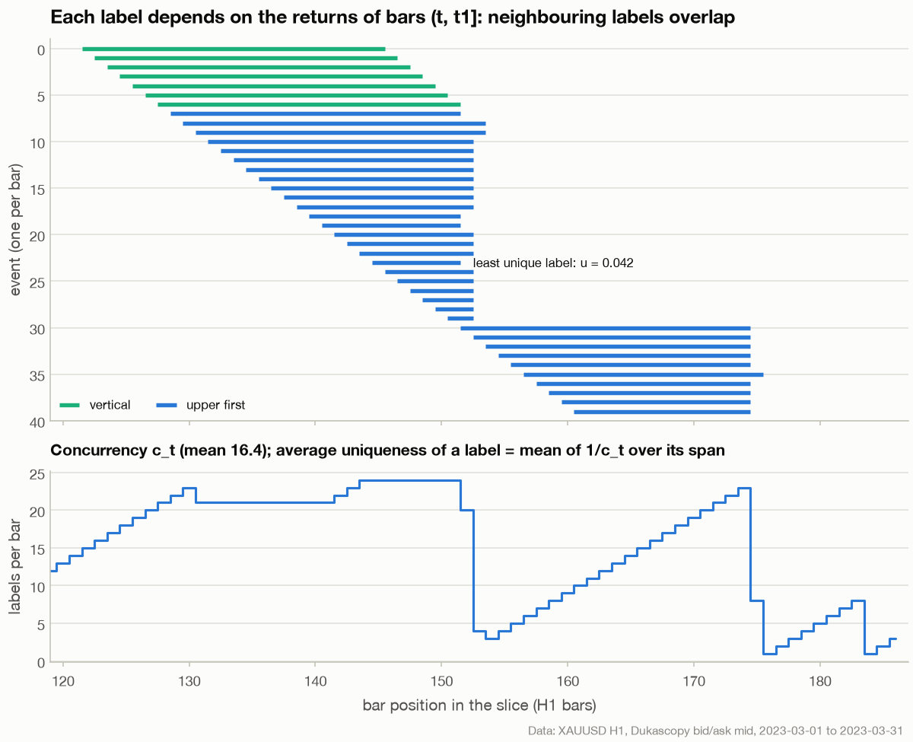
</picture>

*Forty consecutive H1 labels in March 2023 (top) and the concurrency $c_t$ (bottom). When a strong move resolves many labels on the same bar, up to 24 labels overlap and the least unique label has $\bar u$ = 0.042, about one twenty-fourth of an independent observation. Over the whole 2012-2024 sample the mean uniqueness is 0.062: the 77,513 labels are worth about 4,808 independent ones. Data: XAUUSD H1, Dukascopy bid/ask mid, 2023-03-01 to 2023-03-31.*

### In code and pitfalls

The snippet above prints `average_uniqueness` and `uniqueness_weights` on synthetic bars
(mean 0.065). The functions are `num_concurrent_events(n_bars, labels)`,
`average_uniqueness(labels, n_bars=...)`, `uniqueness_weights(labels, n_bars=...)`,
`return_attribution_weights(labels, close)` and `time_decay_weights(u, last_weight)`.

- Uniqueness weights do not remove the overlap. They stop the classifier from treating it as
  extra evidence. The validation tail still contains overlapping labels, which is why the skill
  gate measures its sample size in $n_{\mathrm{eff}}$, not in events.
- `"return_attribution"` focuses the model on large moves, which are also the noisiest. Keep
  the default unless you have a reason.

---

## Purged and embargoed validation

**Intuition.** Ordinary k-fold cross-validation shuffles or splits rows without regard to
time. With forward-looking labels that leaks: a training label that ends inside the test
block has "seen" test prices, and training rows just after a test block are correlated with
its tail. **Purging** removes training observations whose label reaches into the test block.
An **embargo** removes a margin of training observations after it (AFML ch. 7). Aurum uses
the same idea in three places: the walk-forward gap between each fold's training and test
windows, the `purged_kfold` and CPCV splitters, and the validation tail inside every ML fit.

### The math

For a contiguous test block $[a, b]$ with label ends $\ell_i$ (inclusive, $\ell_i \ge i$):

```math
\text{span}(a, b) = \left[\, a,\ \max_{a \le j \le b} \ell_j + E \,\right], \qquad
i \text{ is removed from training} \iff i \le \max_{a \le j \le b} \ell_j + E \ \text{ and } \ \ell_i \ge a
```

```math
\text{ml\_gbm tail:}\quad
\mathcal{V} = \{\, n - n_v, \dots, n - 1 \,\}, \quad n_v = \operatorname{round}(0.2\, n), \qquad
\mathcal{F} = \{\, i < n - n_v : t1_i < t_{n - n_v} - E_{\mathrm{ml}} \,\}
```

where

- $\ell_i = \max(i + \mathrm{purge}, \texttt{label\_end}[i])$, with `label_end` from
  `label_end_positions` (triple-barrier first-touch positions);
- $E$ = `embargo` bars. In the walk-forward the test block always follows the training window,
  so the gap is a single pre-test gap of `purge + embargo` bars, and `purge` is raised to the
  largest `label_horizon` of any trainable strategy (24 for `ml_gbm` and `meta_label`);
- $\mathcal{V}$ is `CalibratedGBM`'s validation tail (the last `val_frac` = 20% of the events in
  time order) and $\mathcal{F}$ the fit set after purging; $E_{\mathrm{ml}}$ = `embargo_bars`
  (default 0).

### The picture

<picture>
  <source media="(prefers-color-scheme: dark)" srcset="_assets/figures/ml-and-rl/purged-cv-dark.png">
  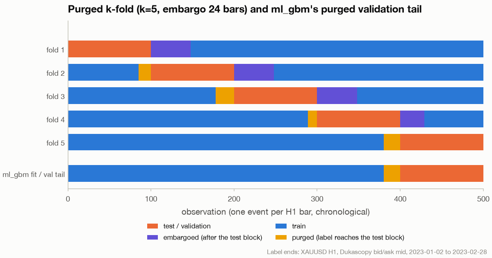
</picture>

*Purged 5-fold splits over 500 real H1 events with their triple-barrier label ends and a 24-bar embargo, plus `ml_gbm`'s own validation tail. Purged zones vary in length (up to 24 bars) because each label ends at its first touch. Fold 1 needs no purge and fold 5 no embargo. The `ml_gbm` row shows the same rule applied to its chronological tail: the events whose labels end inside the tail are dropped from the fit set. Data: XAUUSD H1, Dukascopy bid/ask mid, 2023-01-02 to 2023-02-28 (label ends).*

### In code

```python
import numpy as np

from aurum.data.synthetic import make_synthetic_bars
from aurum.labels import drop_label_tail, ewm_vol, label_end_positions, triple_barrier_labels
from aurum.research.splits import purged_kfold

bars = make_synthetic_bars(700, "H1", seed=4)
h = 24
labels = triple_barrier_labels(bars, pt_mult=1.0, sl_mult=1.0, max_holding_bars=h,
                               vol=ewm_vol(bars["close"], span=100) * np.sqrt(h), vertical_label="sign")
labels = drop_label_tail(labels, len(bars), h)
le = label_end_positions(labels, len(bars))           # inclusive label end per bar

n = 500
for j, (tr, te) in enumerate(purged_kfold(n, k=5, purge=0, embargo=24, label_end=le[:n])):
    gone = np.setdiff1d(np.arange(n), np.r_[tr, te])
    a, b = te.min(), te.max()
    print(f"fold {j + 1}: test [{a}, {b}]  train {len(tr)}  purged before {int((gone < a).sum()):2d}"
          f"  removed after {int((gone > b).sum()):2d}")
```

```text
fold 1: test [0, 99]  train 358  purged before  0  removed after 42
fold 2: test [100, 199]  train 338  purged before 16  removed after 46
fold 3: test [200, 299]  train 329  purged before 24  removed after 47
fold 4: test [300, 399]  train 344  purged before  8  removed after 48
fold 5: test [400, 499]  train 388  purged before 12  removed after  0
```

"Removed after" is the test labels' own reach plus the 24-bar embargo. The splitters
(`walk_forward_splits`, `purged_kfold`, `cpcv_splits`, `purge_train`) are documented in
[research.md](research.md), together with the fold geometry of the walk-forward.

### Pitfalls and design choices

- Purging by the **maximum** horizon is always safe but wastes data. Passing the real
  `label_end` purges exactly the contaminated rows.
- Aurum never uses shuffled CV for model selection. The ML strategies validate on a
  chronological tail, so the tail plays the role of the "most recent future" the model will
  face.
- The tail chooses the tree count, the calibration and the gate decision. It is therefore not
  a clean test set, and the walk-forward test block (never seen by `fit`) is what
  [RESULTS.md](RESULTS.md) reports.

---

## `ml_gbm`: direction classifier

Module [aurum/strategies/ml.py](../aurum/strategies/ml.py), class `MLGBMStrategy`, registered
as `ml_gbm` (trainable).

**Intuition.** Gold's short-horizon direction is close to a random walk, but weak,
state-dependent regularities may exist: trend persistence in calm regimes, reversal after
stretched moves, session and event effects, macro co-movement. A tree ensemble can combine
many such weak, non-linear effects that single rules express one at a time. Whether it finds
anything real is decided by the validation tail and the skill gate, not assumed.

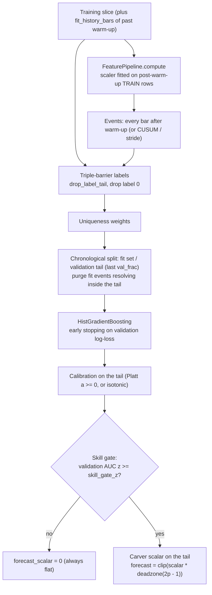

### Features

`ml_gbm` builds and fits its **own** `FeaturePipeline` on every training slice (the
`features.enabled: auto` default in the configs). Groups default to `DEFAULT_PRICE_GROUPS`:
`returns`, `trend`, `momentum`, `meanrev`, `range`, `volatility`, `microstructure`,
`session`, `mtf` and `regime`. `macro` is added when the fit-time `MarketData` has macro
frames (and `include_macro` is true), and `calendar` when it has events (and
`include_calendar` is true). The robust scaler is fitted on post-warm-up training rows only.
The groups and their look-backs are documented in [features.md](features.md).

- `feature_groups` replaces the group list; `feature_overrides` passes group parameters.
- `drop_features` is a list of regex patterns of columns to exclude. Use it for level-type
  features (for example long-window z-scores of macro levels) that can act as time stamps
  and let the trees memorise regimes of overlapping labels.
- `primary_features` adds other strategies' forecasts as feature columns
  `primary_<name>`.
- A strategy fitted on externally supplied `features` must be given them at `generate`
  time too; leading NaNs of external features are treated as warm-up, and such rows are
  never events and forecast 0.

### Target and events

- `target="triple_barrier"` (default): symmetric barriers of `pt_mult` = `sl_mult` = 1.0
  times the barrier unit, `max_holding_bars` = 24, `vertical_label="sign"`. With
  `barrier_vol="horizon"` the unit is `ewm_vol(span=vol_span) * sqrt(max_holding_bars)`
  (one sigma of the full horizon); `"bar"` uses the per-bar sigma.
- `target="fixed_horizon"`: the sign of the vol-normalised `max_holding_bars` forward return,
  with a dead band `fixed_threshold`.
- Labels equal to 0 (ambiguous bars, dead band) are dropped. The target is binary: up vs
  down.
- Events are every bar after the warm-up whose features are all defined
  (`event_filter="all"`), or bars picked by a CUSUM filter at `cusum_mult` × `ewm_vol`
  (`"cusum"`), thinned by `event_stride`.
- `drop_label_tail` removes every event that starts within `max_holding_bars` bars of the
  end of the training slice, so no label resolves after the slice ends. `label_horizon`
  (= `max_holding_bars`) is read by the walk-forward engine, whose purge between train and
  test is never shorter than it.

### Classifier, validation tail and calibration

`CalibratedGBM` wraps scikit-learn's `HistGradientBoostingClassifier`.

1. Events are kept in chronological order. The last `val_frac` (20%) form the **validation
   tail**, never shuffled. Fit-set events whose label resolves at or after the first
   validation event minus `embargo_bars` are **purged** (the rule $\mathcal{F}$ above), so the
   tail is a genuine pseudo-out-of-sample block.
2. **Class balance** (`class_weight="balanced"` for `ml_gbm`) is applied separately within
   the fit set and within the tail, so $p = 0.5$ means "no conditional information" and
   neither the model nor the calibrator can simply bet on a period's drift.
3. **Early stopping.** The model is fitted with `max_iter` trees; the iteration with the
   lowest weighted validation log-loss is chosen, and the model is refitted with that many
   trees (same seed, identical trees).
4. **Calibration** on the tail: Platt scaling, `"isotonic"` (non-decreasing) or `"none"`.
5. At least `min_train_events` (200) events before the tail and a tail of at least
   `max(20, min_train_events // 10)` events are required, with both classes present in the
   fit set and in the tail. Otherwise `fit` raises `ValueError`.

The weights and the Platt map are:

```math
\omega_i = w_i \cdot \frac{0.5}{\pi_{y_i}^{(P)}}, \quad
\pi_c^{(P)} = \frac{\sum_{j \in P,\, y_j = c} w_j}{\sum_{j \in P} w_j}, \qquad
p = \operatorname{sigmoid}\left(a \operatorname{logit}(p_{\mathrm{raw}}) + b\right),\
a \in [0, 50],\ b \in [-20, 20]
```

where $P$ is the part (fit set or tail) that contains event $i$, $w_i$ the sample weight from
the previous section, $\omega$ is renormalised to mean 1 within each part, and $(a, b)$
minimise the $\omega$-weighted log-loss on the tail. Constraining $a \ge 0$ means calibration
can shrink a signal but never flip its ranking.

Model defaults (`CalibratedGBM.DEFAULT_MODEL`, override any of them through the `model`
parameter):

| Key | Default |
|---|---|
| `max_iter` | 300 |
| `learning_rate` | 0.05 |
| `max_leaf_nodes` | 15 |
| `max_depth` | 4 |
| `min_samples_leaf` | 200 |
| `l2_regularization` | 1.0 |
| `max_features` | 0.5 |
| `max_bins` | 255 |

`class_weight`, `early_stopping`, `random_state`, `validation_fraction` and
`n_iter_no_change` are managed by `CalibratedGBM` and are rejected inside `model`.

### Forecast mapping and the skill gate

**Intuition.** A calibrated probability of "up" becomes a forecast by centring it
($2p - 1$), silencing coin flips with a small dead zone, and scaling so that the average
absolute forecast on the validation tail is 0.5, Carver's convention for every aurum strategy
([strategies.md](strategies.md)). That scaling has a dangerous side effect: it would blow a
model of pure noise up to the same average size as a good one. The **skill gate** prevents
that. It asks whether the validation AUC (the probability that a random "up" event is ranked
above a random "down" event) is significantly above 0.5, measured against the *effective*
size of the tail. If not, the strategy stays flat until its next refit.

```math
f = 2p - 1, \qquad
g = \operatorname{sign}(f)\, \frac{\max(\lvert f \rvert - \delta,\ 0)}{1 - \delta}, \qquad
\kappa = \min\!\left(\kappa_{\max},\ \frac{0.5}{\operatorname{mean}_{\mathcal{V}} \lvert g \rvert}\right), \qquad
\text{forecast} = \operatorname{clip}(\kappa\, g,\ -1,\ 1)
```

```math
n_{\mathrm{eff}} = \sum_{i \in \mathcal{V}} \bar u_i, \quad
n_1 = \bar y_{\mathcal{V}}\, n_{\mathrm{eff}}, \quad n_0 = (1 - \bar y_{\mathcal{V}})\, n_{\mathrm{eff}}, \qquad
\mathrm{se} = \sqrt{\frac{n_{\mathrm{eff}} + 1}{12\, n_1 n_0}}, \qquad
z = \frac{\mathrm{AUC}_{\mathcal{V}} - 0.5}{\mathrm{se}}
```

where

- $p$ is the calibrated probability and $\delta$ = `dead_zone` (0.02). The dead zone is
  continuous: it maps $\pm 1$ to $\pm 1$ and has no jump at the threshold;
- $\kappa$ is the Carver scalar, fixed at fit time from the tail's $g$ values, with target
  `target_abs_forecast` (0.5) and cap $\kappa_{\max}$ = `max_forecast_scalar` (20). It is 0
  when $g$ is identically 0 on the tail;
- $\bar u_i$ is the average uniqueness of tail label $i$ (computed over all training labels),
  $\bar y_{\mathcal{V}}$ the share of "up" labels in the tail and $\mathrm{AUC}_{\mathcal{V}}$
  the weighted validation AUC of the raw model;
- se is the Hanley and McNeil (1982) standard error of an AUC under "no skill",
  $\operatorname{Var} = (n_1 + n_0 + 1)/(12\, n_1 n_0)$, with the effective counts;
- the gate passes when $z \ge$ `skill_gate_z` (2.0). If it fails, $\kappa := 0$, a WARNING is
  logged and every forecast is 0 until the next `fit`. `skill_gate_z=None` disables the gate.

The same tail also chose the iteration count and the calibration, so the test is mildly
optimistic: it is a guard against sizing up noise, not a proof of skill.

<picture>
  <source media="(prefers-color-scheme: dark)" srcset="_assets/figures/ml-and-rl/skill-gate-dark.png">
  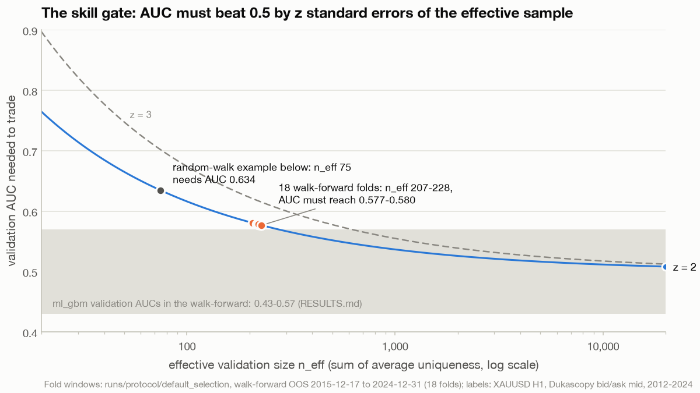
</picture>

*The AUC a model needs before it may trade falls with the effective validation size. On the real 3-year training windows of the 18 walk-forward folds the tail holds about 3,550 events but only 207 to 228 effective ones, so `ml_gbm` needed an AUC of 0.577 to 0.580; its fold AUCs were 0.43 to 0.57 (shaded, from [RESULTS.md](RESULTS.md)), so it never passed. The effective sizes come from the real labels of each fold (no model is refitted for the figure). Data: fold windows from runs/protocol/default_selection, walk-forward OOS 2015-12-17 to 2024-12-31 (18 folds); labels on XAUUSD H1, Dukascopy bid/ask mid, 2012-2024.*

<picture>
  <source media="(prefers-color-scheme: dark)" srcset="_assets/figures/ml-and-rl/ml-active-folds-dark.png">
  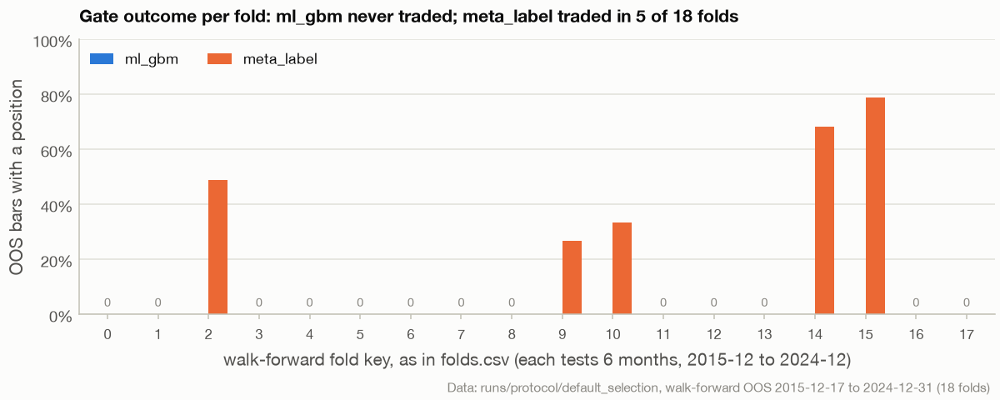
</picture>

*What the gate did in the real walk-forward: `ml_gbm` held no position in any fold, and `meta_label` was active in 5 of 18 folds (folds 2, 9, 10, 14 and 15, numbered as in `folds.csv`; between 27% and 79% of their bars) and flat in the other 13. A gated-off fold costs nothing, which is the point: the gate converts "no evidence of skill" into "no risk". Data: runs/protocol/default_selection, walk-forward OOS 2015-12-17 to 2024-12-31 (18 folds).*

This is why the model abstains so often. On a driftless random walk:

```python
import logging

from aurum.core.types import MarketData
from aurum.data.synthetic import make_synthetic_bars
from aurum.strategies import get_strategy

logging.basicConfig(level=logging.WARNING, format="%(levelname)s %(name)s: %(message)s")

bars = make_synthetic_bars(8000, "H1", seed=11)            # driftless random walk: no edge
train = MarketData(bars=bars.iloc[:6000])
full = MarketData(bars=bars)

gbm = get_strategy("ml_gbm", feature_groups=("returns", "momentum", "volatility"),
                   importance_repeats=2)
gbm.fit(train)                                             # TRAINING slice only
rep = gbm.fit_report_
for k in ("n_labels", "n_fit", "n_val", "n_purged_before_val", "best_iter", "val_auc",
          "val_n_eff", "val_auc_z", "skill_gate_passed", "forecast_scalar"):
    v = rep[k]
    print(f"{k:22s} {round(v, 4) if isinstance(v, float) else v}")
f = gbm.generate(full)
print("non-zero forecasts:", int((f != 0).sum()))
print(gbm.importance_by_group().round(4).to_dict())
```

```text
WARNING aurum.strategies.ml: ml_gbm: validation AUC 0.5003 (z=0.00, n_eff=75) below the skill gate z >= 2.0 - forecasts will be zero
n_labels               5495
n_fit                  4373
n_val                  1099
n_purged_before_val    23
best_iter              2
val_auc                0.5003
val_n_eff              74.7402
val_auc_z              0.0049
skill_gate_passed      False
forecast_scalar        0.0
non-zero forecasts: 0
{'volatility': 0.0001, 'returns': 0.0, 'momentum': -0.0254}
```

The validation tail holds 1,099 events but only about 75 effectively independent ones, so
the AUC would have to reach 0.634 to pass (the grey point in the figure). The three small
feature groups keep the example fast; the default groups include `regime`, whose 5,820-bar
look-back needs about a year of H1 history before the first event.

### Feature importances and reports

With `importance="permutation"` (default), `fit` computes the mean drop in validation AUC
when each feature is permuted (Breiman 2001), on up to `importance_max_rows` rows of the
tail with `importance_repeats` repeats. On noise these values hover around zero and can be
negative, as above.

| Attribute / method | Content |
|---|---|
| `feature_importances_` | Per-column permutation importance, sorted. |
| `importance_by_group()` | Importances summed by column prefix (feature family). |
| `fit_report_` | Label counts, `barrier_counts`, `mean_holding_bars`, `n_fit` / `n_val` / `n_purged_before_val`, `best_iter`, `fit_auc` / `val_auc`, log-losses (base, model, calibrated), calibration parameters, gate statistics (`val_n_eff`, `val_auc_se`, `val_auc_z`, `skill_gate_passed`), `forecast_scalar`, `val_abs_forecast`, `val_frac_active`, `first_event_bar`. |
| `explain(top=15)` | JSON-serialisable summary: params, model, fit report, top features and group importances. |
| `predict_proba(md)` | Calibrated `P(up)` per bar (NaN in the warm-up), for diagnostics. |

A large gap between `fit_auc` and `val_auc` is the usual sign of memorisation. Features
that dominate the importances while `val_auc` stays near 0.5 are candidates for
`drop_features`.

`fit` is **transactional**: it runs on a fresh instance and commits only on success, so a
failed refit leaves the previous model intact and self-consistent. In a walk-forward run a
fit that raises follows `walkforward.on_strategy_error` (`raise` by default, or `drop`).

### Pitfalls and design choices

- **Carver scaling without a gate sizes noise up.** The `meta_label` example below shows a
  constant probability turned into a 0.5 bet on every signal when the gate is off.
- **Memorisation through level features.** Trees can learn "which month is this" from slowly
  moving features and the overlap of labels. Use `drop_features` and watch the
  `fit_auc`/`val_auc` gap.
- **Drift in the base rate.** Balancing classes separately in the fit set and the tail stops
  the calibrator's intercept from re-learning the tail's drift and calling it skill.

---

## `meta_label`: meta-labelling a primary

Class `MetaLabelStrategy`, registered as `meta_label` (trainable). AFML 3.6 and ch. 10.

**Intuition.** A simple primary model decides the **side**; a secondary classifier learns
**when** the primary is likely to be right (for example trend signals in calm, trending
regimes) and sizes the bet. The meta-model never reverses the primary: the worst it can do
is stand aside.

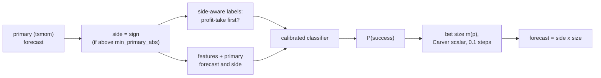

**Labels.** Events are bars where the primary takes a side (`|forecast| > min_primary_abs`)
after the warm-up (`event_filter`: `"all"`, `"cusum"`, or `"flip"` = only bars where the
side changes). Each event gets a side-aware triple-barrier label. The target is 1 if the
profit-take was hit first and 0 if the stop was. Timeouts count as a success when the bet's
return is positive (`meta_vertical="return_sign"`, AFML `getBins`, the default). The strict
alternative `"fail"` (timeout = 0) is available, but it makes the label partly a
"barrier-touch" indicator that is predictable from the volatility state and weekend gaps
even on a random walk, without any directional edge. Events without a usable label are dropped.

**Features** are the same own-pipeline features as `ml_gbm`, plus `meta_primary_forecast`
and `meta_primary_side`. `class_weight` defaults to `None` here, because bet sizing needs
true success probabilities.

### The math of bet sizing

```math
z = \frac{p - \tfrac{1}{2}}{\sqrt{p(1 - p)}}, \qquad
m = 2\,\Phi(z) - 1, \qquad
m^{+} = \max(m, 0)\cdot \mathbf{1}[p \ge p^{*}]
```

```math
b = \operatorname{round}_{0.1}\!\left(\operatorname{clip}(\kappa\, m^{+},\ 0,\ 1)\right), \qquad
\text{forecast} = \operatorname{side} \cdot b \ \left(\cdot \min(\lvert f_{\mathrm{primary}} \rvert, 1)
\text{ if scale\_by\_primary}\right)
```

where

- $p$ is the calibrated probability that the primary's bet succeeds (clipped to
  $[10^{-6}, 1 - 10^{-6}]$) and $\Phi$ the standard normal CDF (AFML snippet 10.1, with two
  classes);
- $p^{*}$ = `p_threshold` (0.5): no bet below it;
- $\kappa$ is the Carver scalar fitted on the un-discretised tail bets $m^{+}$ to target an
  average size of `target_abs_forecast` (0.5), capped at `max_forecast_scalar`, and set to 0
  when the skill gate fails (same gate as `ml_gbm`);
- $\operatorname{round}_{0.1}$ rounds to multiples of `step_size` (0.1, AFML snippet 10.3) so
  that tiny probability changes do not trade.

<picture>
  <source media="(prefers-color-scheme: dark)" srcset="_assets/figures/ml-and-rl/bet-size-dark.png">
  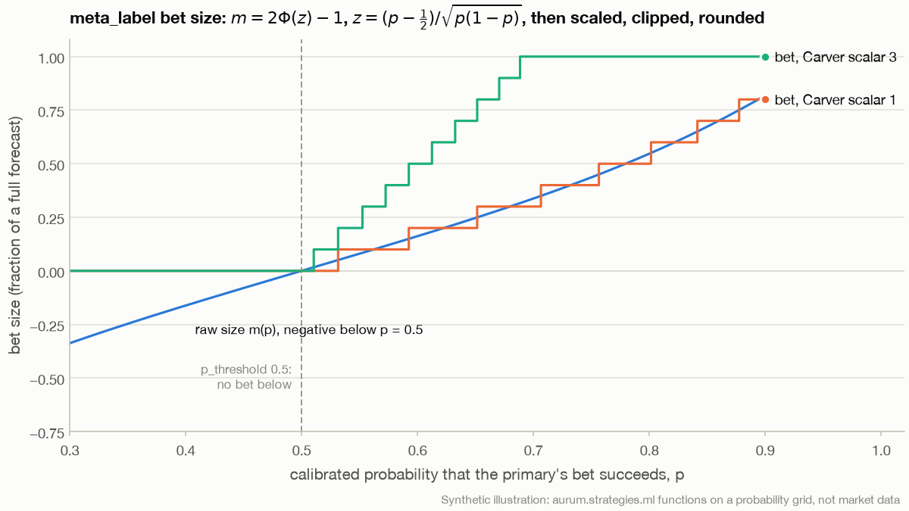
</picture>

*The raw size $m(p)$ is negative below 0.5, but meta-labelling never bets against the primary, so the bet is 0 there. Above 0.5 the Carver scalar stretches the curve (a scalar of 3 reaches a full bet at $p \approx 0.69$) and the 0.1 steps turn it into a staircase. Data: synthetic illustration (aurum.strategies.ml functions on a probability grid), not market data.*

<picture>
  <source media="(prefers-color-scheme: dark)" srcset="_assets/figures/ml-and-rl/meta-label-oos-dark.png">
  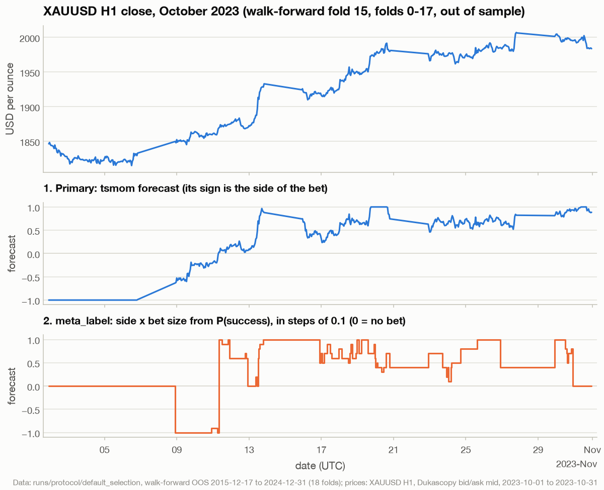
</picture>

*Out-of-sample forecasts from the real walk-forward in October 2023 (fold 15, one of the 5 folds where the gate passed). The primary decides the side; `meta_label` stays out early in the month, follows the short side briefly, then sizes the long side between 0.1 and 1.0 as its success probability changes. It never takes the opposite side of `tsmom`. This is the standalone `meta_label` book: the combiner gave every strategy zero weight in fold 15, so the combined book stayed flat (see [RESULTS.md](RESULTS.md#fold-by-fold)). Data: runs/protocol/default_selection, walk-forward OOS 2015-12-17 to 2024-12-31 (18 folds); prices XAUUSD H1, Dukascopy bid/ask mid, 2023-10-01 to 2023-10-31.*

`primary` accepts a registered name, a `(name, params)` pair, a `Strategy` class or an
instance; `primary_params` are merged in. The default is `tsmom`.

### In code

The next example shows the gate doing its job. The Platt slope collapses to 0 on noise, so
the calibrated probability is a constant. With the gate on, the forecast is 0. With it off,
the Carver scalar inflates that constant into a 0.5 bet on every primary signal:

```python
import logging

from aurum.core.types import MarketData
from aurum.data.synthetic import make_synthetic_bars
from aurum.strategies import get_strategy
from aurum.strategies.ml import bet_size_from_probability, discretize_bet

logging.basicConfig(level=logging.WARNING, format="%(levelname)s %(name)s: %(message)s")

bars = make_synthetic_bars(8000, "H1", seed=11)            # driftless random walk: no edge
train, full = MarketData(bars=bars.iloc[:6000]), MarketData(bars=bars)
common = dict(primary="ema_cross", feature_groups=("returns", "momentum", "volatility"),
              importance="none")

for gate in (2.0, None):                                   # default gate, then gate OFF
    meta = get_strategy("meta_label", skill_gate_z=gate, **common).fit(train)
    r = meta.fit_report_
    cal = r["calibration_params"]
    f = meta.generate(full).iloc[6000:]
    print(f"skill_gate_z={gate}: val_auc={r['val_auc']:.3f} z={r['val_auc_z']:.2f} "
          f"best_iter={r['best_iter']} platt_a={cal['a']:.2f} scalar={r['forecast_scalar']:.2f} "
          f"mean|f| after train={f.abs().mean():.3f}")

for p in (0.50, 0.55, 0.60, 0.70):                        # AFML bet size, then 0.1 steps
    m = float(bet_size_from_probability(p))
    print(f"p={p:.2f} -> m={m:.3f} -> {float(discretize_bet(m, 0.1)):.1f}")
```

```text
WARNING aurum.strategies.ml: meta_label: validation AUC 0.4607 (z=-0.58, n_eff=75) below the skill gate z >= 2.0 - forecasts will be zero
skill_gate_z=2.0: val_auc=0.461 z=-0.58 best_iter=1 platt_a=0.00 scalar=0.00 mean|f| after train=0.000
skill_gate_z=None: val_auc=0.461 z=-0.58 best_iter=1 platt_a=0.00 scalar=5.38 mean|f| after train=0.500
p=0.50 -> m=0.000 -> 0.0
p=0.55 -> m=0.080 -> 0.1
p=0.60 -> m=0.162 -> 0.2
p=0.70 -> m=0.337 -> 0.3
```

Do not switch the gate off for real research. The tests do so only to exercise code paths on
synthetic data.

### Pitfalls and design choices

- **A trainable primary fitted on the labelled bars** leaks its in-sample fit into the
  meta-model (see [Stacking-leak protection](#stacking-leak-protection-for-trainable-primaries)).
- **`meta_vertical="fail"`** looks attractive (strict "profit-take before stop") but rewards
  predicting volatility rather than direction.
- **Bet sizing amplifies calibration errors.** That is why `class_weight` is `None` here: a
  re-balanced probability would not be a success probability.

---

## Parameters of the ML strategies

Shared by `ml_gbm` and `meta_label` (from `_MLStrategyBase.default_params()`):

| Parameter | Default | Meaning |
|---|---|---|
| `primary_oos_frac` | `0.5` | Trainable primaries are fitted on this leading fraction of the training slice; see [below](#stacking-leak-protection-for-trainable-primaries). Must be in `[0, 1)`. |
| `feature_groups` | `None` | `None` = `DEFAULT_PRICE_GROUPS` (+ `macro` / `calendar` when available). |
| `feature_overrides` | `{}` | Per-group parameter overrides for the pipeline. |
| `drop_features` | `()` | Regex patterns of raw feature columns to exclude. |
| `include_macro` | `True` | Add the `macro` group when `md.macro` is present. |
| `include_calendar` | `True` | Add the `calendar` group when `md.events` is present. |
| `scaler` | `"robust"` | Pipeline scaler. |
| `max_holding_bars` | `24` | Vertical barrier / label horizon (bars). Also the walk-forward purge floor. |
| `pt_mult` | `1.0` | Profit-take (upper) barrier width in barrier units. |
| `sl_mult` | `1.0` | Stop (lower) barrier width in barrier units. |
| `barrier_vol` | `"horizon"` | Barrier unit: per-bar sigma × `sqrt(max_holding_bars)` (`"horizon"`) or per-bar sigma (`"bar"`). |
| `vol_span` | `100` | Span of `ewm_vol`. |
| `event_filter` | `"all"` | `"all"`, `"cusum"`; `meta_label` also accepts `"flip"`. |
| `cusum_mult` | `2.0` | CUSUM threshold in multiples of `ewm_vol`. |
| `event_stride` | `1` | Keep every n-th event. |
| `sample_weight` | `"uniqueness"` | `"uniqueness"`, `"return_attribution"`, `"uniqueness_x_return"` or `"none"`. |
| `time_decay` | `1.0` | AFML 4.11 `last_weight`, in `(-1, 1]`; 1 = no decay. |
| `model` | `{}` | Overrides of `CalibratedGBM.DEFAULT_MODEL`. |
| `val_frac` | `0.2` | Size of the chronological validation tail. |
| `embargo_bars` | `0` | Extra purge between fit set and tail. |
| `early_stopping` | `True` | Choose the tree count on the tail. |
| `calibration` | `"platt"` | `"platt"`, `"isotonic"` or `"none"`. |
| `min_train_events` | `200` | Minimum fit-set events. |
| `importance` | `"permutation"` | `"permutation"` or `"none"`. |
| `importance_repeats` | `3` | Permutation repeats. |
| `importance_max_rows` | `5000` | Row cap for permutation importance. |
| `target_abs_forecast` | `0.5` | Carver target for the average absolute forecast or bet. |
| `max_forecast_scalar` | `20.0` | Cap on the Carver scalar. |
| `skill_gate_z` | `2.0` | Minimum validation-AUC z-score; `None` disables the gate. |
| `seed` | `0` | Model seed. In a config run it is set to the config's top-level `seed` unless you give one. |
| `n_threads` | `None` | OpenMP thread cap for the model (via `threadpoolctl`). |

`ml_gbm` only:

| Parameter | Default | Meaning |
|---|---|---|
| `target` | `"triple_barrier"` | Or `"fixed_horizon"`. |
| `fixed_threshold` | `0.0` | Dead band on the normalised return for `fixed_horizon`. |
| `primary_features` | `()` | Strategies whose forecasts become feature columns. |
| `class_weight` | `"balanced"` | Or `None`. |
| `dead_zone` | `0.02` | Continuous dead zone on `2p - 1`, in `[0, 1)`. |

`meta_label` only:

| Parameter | Default | Meaning |
|---|---|---|
| `primary` | `"tsmom"` | Name, `(name, params)`, class or instance. |
| `primary_params` | `{}` | Merged into the primary's parameters. |
| `min_primary_abs` | `0.0` | The absolute primary forecast must exceed this to count as a bet. |
| `meta_vertical` | `"return_sign"` | Or `"fail"` (timeouts are failures). |
| `p_threshold` | `0.5` | No bet when `P(success)` is below this. |
| `step_size` | `0.1` | Bet discretisation; 0 disables it. |
| `scale_by_primary` | `False` | Also multiply the bet size by the absolute primary forecast (capped at 1). |
| `class_weight` | `None` | Keep true success probabilities. |

Like every rule-based strategy, `ml_gbm`, `meta_label` and `rl_ppo` **reject unknown
parameter names** at construction, so a misspelt key cannot silently fall back to a default
(`aurum config validate` reports it before any data is loaded). Option values (for example
`event_filter`, `calibration`) are validated at the start of `fit`, before any expensive
work:

```python
from aurum.strategies import get_strategy

try:
    get_strategy("rl_ppo", artifact="runs/rl/ppo")
except ValueError as exc:
    print(exc)
```

```text
rl_ppo: unknown parameter(s) ['artifact']; valid: ['artifact_dir', 'artifact_sha256', 'config', 'device', 'episode_anchor', 'min_val_bars', 'out_dir', 'retrain', 'val_fraction']
```

## Warm-up history: `fit_history_bars`

The default feature groups need 5,820 H1 bars (about a year, set by the `regime` group)
before every column is defined. Without help, a rolling 3-year training window would lose a
third of itself to warm-up.

`Strategy.fit_history_bars` (default 0) declares how many bars **before** the training
window `fit` may receive purely for feature warm-up. The ML strategies return their
`warmup_bars` when they compute their own features (0 when they are given external
features, which arrive warmed up). The walk-forward engine prepends that many past bars to
the fit slice, and `train-final` does the same. Events still start only once every feature
is defined, which is then the start of the training window, and every label still resolves
inside the fit slice.

<picture>
  <source media="(prefers-color-scheme: dark)" srcset="_assets/figures/ml-and-rl/ml-fold-anatomy-dark.png">
  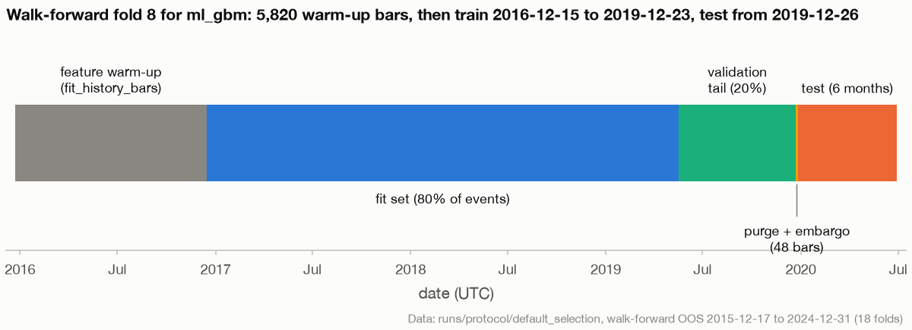
</picture>

*Walk-forward fold 8 (key in `folds.csv`) as `ml_gbm` sees it: 5,820 bars of warm-up from before the training window only feed the features, the 3-year training window splits into fit set and validation tail (about 80/20 by events), and the 48-bar gap (purge 24 plus embargo 24) separates the training labels from the test window. Data: runs/protocol/default_selection, walk-forward OOS 2015-12-17 to 2024-12-31 (18 folds).*

This is not leakage: the extra bars are strictly older than every test row.
`tests/test_fit_history.py` checks that the fit slice can reach back but never includes a
bar at or after the fold's test start. The purge between the training and test blocks is
described in [research.md](research.md).

## Stacking-leak protection for trainable primaries

A trainable primary (`meta_label`'s `primary`, or an entry in `ml_gbm`'s
`primary_features`, for example `intraday_seasonality`) would otherwise be fitted on the very
bars being labelled. Its in-sample forecasts are over-fitted, and the second-stage model
would learn to trust them far more than their out-of-sample quality warrants. This is the
stacking leak of Wolpert (1992).

With `primary_oos_frac=0.5` (default) such a primary is fitted on the first half of the
training slice only, and the ML model learns only from events after that point, where the
primary's forecasts are out of sample. `primary_oos_frac=0` restores in-sample fitting and
logs a warning. Non-trainable primaries such as `tsmom` are unaffected.

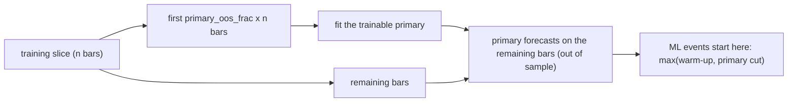

In code, `_fit_primary` moves `_primary_oos_start` to the end of the primary's fit window,
and the first event of the ML model is at `max(warmup_bars, _primary_oos_start)`
([aurum/strategies/ml.py](../aurum/strategies/ml.py)). The price is fewer training events:
with the default half, the second-stage model learns from at most half of the window.

---

## The RL environment as a Markov decision process

Module [aurum/rl/env.py](../aurum/rl/env.py), a gymnasium environment built on the shared
execution stack. The module docstring explains why it replaced the legacy environment, which
let observations see bar $t+1$, compounded shaped rewards into "equity", and only ever
sampled the first 20k bars.

**Intuition.** Reinforcement learning skips the label. An agent observes the market state and
its own account, picks a target exposure, and is rewarded by what that exposure earned over
the next bar, after costs. Over many episodes PPO adjusts the policy towards actions with
higher long-run reward. Because the agent sees its own position and unrealised PnL, it can in
principle learn cost-aware holding behaviour that a stateless forecast cannot express. The
environment's job is to make that game identical to real trading: same sizer, same risk
manager, same simulator, same timing, same costs.

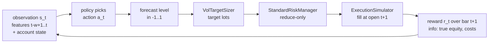

### The MDP

```math
s_t = \left(x_{t-w+1}, \dots, x_t,\ \text{pos}_t,\ \text{upnl}_t,\ \text{tit}_t,\ \text{dd}_t\right),
\qquad a_t \in \{0, \dots, K - 1\} \mapsto f_t = \lambda_{a_t}
```

```math
r_t = \kappa \ln\frac{E_{t+1}}{E_t}
\;-\; \lambda_{\mathrm{dd}}\,\kappa\,\max\!\left(0,\ DD_{t+1} - DD_t\right)
\;-\; \lambda_{\mathrm{to}}\, \frac{\lvert \mathrm{lots}^{\mathrm{appr}}_t - \mathrm{lots}_t \rvert}{\mathrm{lots}^{\mathrm{full}}_t}
```

where

- $x_t$ is row $t$ of a transformed `FeaturePipeline` frame (scaler fitted on training rows
  only) and $w$ = `window` (4). Warm-up rows are never observed; later NaNs become 0, the
  neutral scaled median. The whole vector is clipped to $\pm$ `obs_clip` (10);
- the four account-state entries are computed at the close of $t$ (table below);
- $\lambda$ = `action_levels`, default $(-1, -0.5, 0, 0.5, 1)$ with $K = 5$ (`"discrete"`), or
  a `Box[-1, 1]` forecast in `"continuous"` mode (non-finite actions become 0);
- the **transition** is the simulator: the action decided on the observation at the close of
  $t$ is sized, approved by the risk manager (which may only reduce it), filled at the **open
  of $t+1$**, and marked at the close of $t+1$ with spread, slippage, commission and financing
  charged as in the backtest engine;
- $E$ is the true account equity, $DD$ the drawdown from the episode's equity peak,
  $\kappa$ = `reward_scale` (100: a 1% gain is 1.0), $\lambda_{\mathrm{dd}}$ = `dd_penalty` and
  $\lambda_{\mathrm{to}}$ = `turnover_penalty` (both 0 by default);
- $\mathrm{lots}^{\mathrm{full}}_t$ is the size a +1 forecast would get from flat at the
  current vol, equity and price (the position unit).

The log-growth term sums to the episode's log return, the growth-optimal (Kelly) criterion,
and is scale-free across equity levels. The drawdown term penalises only *increases* in
drawdown, so losses while underwater weigh $1 + \lambda_{\mathrm{dd}}$ times as much as gains.
The turnover term is a cost prior on top of the simulated costs. Shaping never touches the
simulator: `info` carries the true equity, PnL, cost breakdown and each reward component
separately.

| Account state | Meaning |
|---|---|
| `state_position` | Current lots divided by the lots a +1 forecast would get now (clipped to ±1.5). |
| `state_upnl_vol` | Unrealised log return of the open position vs its lot-weighted average entry mid, in daily-vol units ($\sigma_{\mathrm{ann}}/\sqrt{252}$, clipped to ±5). |
| `state_time_in_trade` | `log1p(bars held) / log1p(trade_time_norm)` (capped at 2). |
| `state_drawdown` | Drawdown from the episode's equity peak × 10 (capped at 5). |

**Episodes.** In training mode (`random_start=True`) each episode starts uniformly at random
over the whole eligible range, after the feature warm-up, using the env's seeded
`np_random`, and lasts `episode_length` decisions. An episode **terminates** on ruin
(bankruptcy, or equity at or below `min_equity_frac` of the episode's starting equity) or on
a risk-manager kill switch when `terminate_on_halt=True`. A transient daily-loss halt
(`daily_loss_persistent=False`) does not end it. An episode is **truncated** at the end of the
range or after `episode_length` steps.

**Risk limits.** A bare `EnvConfig()` uses `RiskLimits` defaults with
`daily_loss_persistent=False`, so the 20% max-drawdown kill switch is active and ends the
episode. `aurum rl train` instead builds the environment with
[`rl_config_from_aurum`](#rl_config_from_aurum-one-contract-for-training-and-research), which
uses the research limits of the config (`max_drawdown: null`): training episodes then end only
on ruin or at their length.

**Financing** uses the config's cost model (or `CostModel` defaults): rate-based, Fed funds
plus markup, read point in time at each rollover from `rates=` (the training code passes
`md.macro`). Without a `fedfunds` series every rollover uses the 3% fallback and the simulator
logs a warning, as in the example below.

### Action to position

The action is a forecast, not a number of lots. The environment converts it with the
backtest's `VolTargetSizer` ([portfolio-and-risk.md](portfolio-and-risk.md)):

```math
N_t = f_t\, \frac{\sigma^{*}}{\max(\hat\sigma_t,\ \sigma_{\min})}\, E_t, \qquad
\lvert N_t \rvert \le \ell_{\max} E_t, \qquad
\mathrm{lots}_t = \operatorname{round}_{\downarrow}\!\left(\frac{N_t \cdot m(DD_t)}{100\, P_t}\right)
```

where $\sigma^{*}$ = `target_vol` (0.10), $\hat\sigma_t$ the causal EWMA volatility with
half-life `vol_halflife` = 48 bars, $\sigma_{\min}$ = `min_vol` (0.02), $\ell_{\max}$ =
`max_leverage` (2.0), $m(DD)$ the drawdown de-risking multiplier (0.5 from a 10% drawdown,
0.25 from 15%), $P_t$ the close, 100 the contract size in ounces, and
$\operatorname{round}_{\downarrow}$ rounds toward zero on the 0.01-lot grid. A rebalance band
(`rebalance_band` = 0.10) keeps the current position when the change is smaller than 10% of
the larger of the two sizes and the sign does not change.

<picture>
  <source media="(prefers-color-scheme: dark)" srcset="_assets/figures/ml-and-rl/rl-action-mapping-dark.png">
  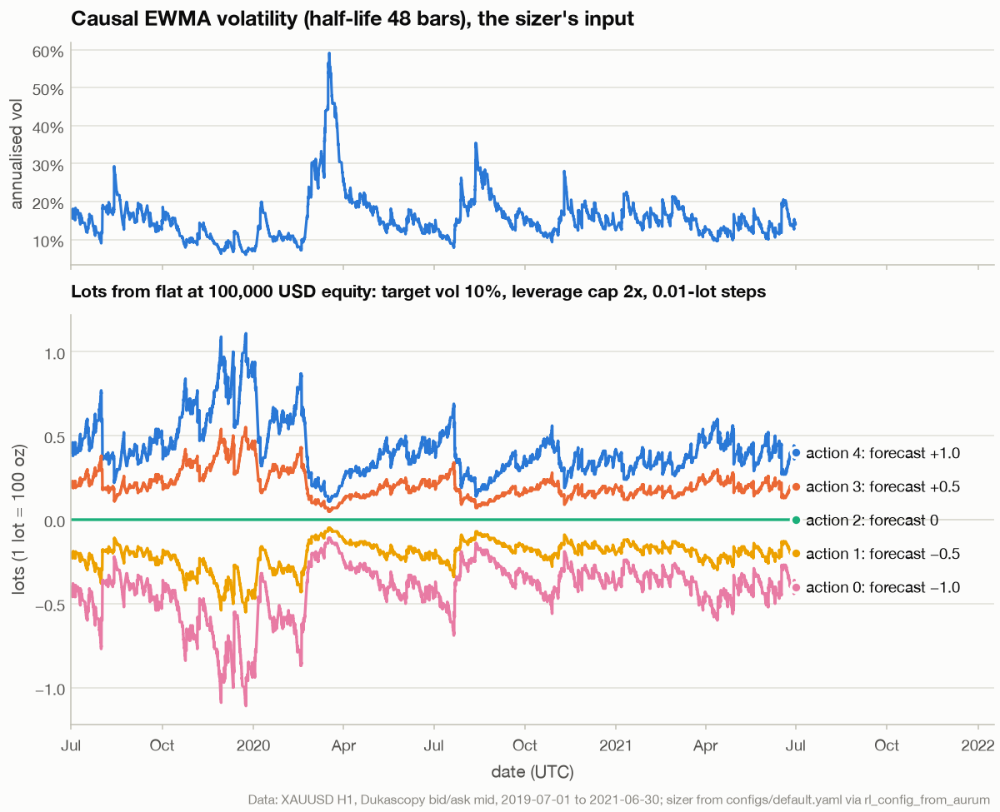
</picture>

*The same action means a different position as volatility changes. A +1 forecast is about 1.0 lot (100 oz) at 100,000 USD of equity when gold's volatility sits near 6-7% in late 2019, and falls to roughly 0.1 lot when it spikes to 59% on 2020-03-17. The 2x leverage cap never binds here, because it would need a volatility below 5% (the window's minimum is 6.0%). Data: XAUUSD H1, Dukascopy bid/ask mid, 2019-07-01 to 2021-06-30; sizer from configs/default.yaml via `rl_config_from_aurum`.*

<picture>
  <source media="(prefers-color-scheme: dark)" srcset="_assets/figures/ml-and-rl/rl-episode-dark.png">
  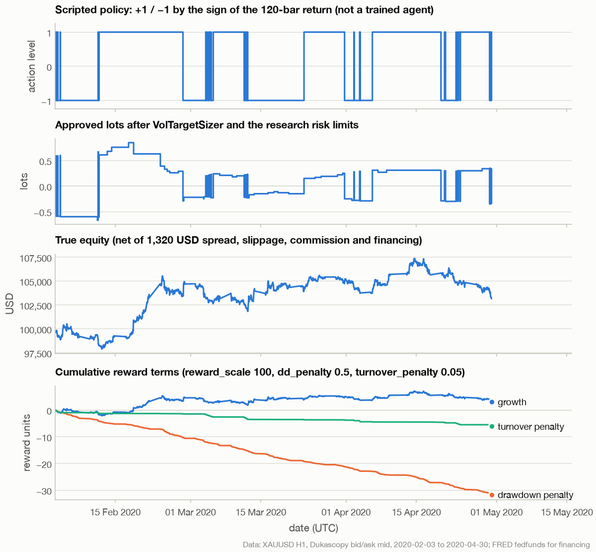
</picture>

*The environment driven by a scripted rule (long or short by the sign of the 120-bar return), not a trained agent, through the COVID sell-off with `dd_penalty` 0.5 and `turnover_penalty` 0.05. True equity ends at 103,164 USD (+3.12% log growth, the growth term's +3.12) after 1,320 USD of net costs, while the maximum drawdown is only 3.9%. Yet the drawdown penalty sums to −31.7, because it charges every uptick of the drawdown while underwater (they add up to 63%), and the turnover penalty to −6.1. Shaping changes what the agent is taught, never the money. Data: XAUUSD H1, Dukascopy bid/ask mid, 2020-02-03 to 2020-04-30; FRED fedfunds for financing.*

### In code

```python
from aurum.core.types import MarketData
from aurum.data.synthetic import make_synthetic_bars
from aurum.features.pipeline import FeaturePipeline
from aurum.rl.env import STATE_NAMES, EnvConfig, GoldTradingEnv

bars = make_synthetic_bars(3000, "H1", seed=0)
md = MarketData(bars=bars)
n_train = 2000

pipe = FeaturePipeline(groups=["returns", "volatility"])
raw = pipe.compute(md)
pipe.fit(raw.iloc[pipe.max_lookback:n_train])             # scaler statistics: TRAIN rows only
x = pipe.transform(raw)

cfg = EnvConfig(window=4, episode_length=256)
env = GoldTradingEnv(bars, x, cfg, end=n_train - 1, random_start=True)
print("obs:", env.observation_space.shape, "=", cfg.window, "x", env.n_features, "+", len(STATE_NAMES))
print("actions:", env.action_space, "->", cfg.action_levels)

obs, info = env.reset(seed=42)                            # random start inside the train range
print("episode starts at bar", info["bar"], "with equity", info["equity"])
for action in (4, 4, 2):                                  # +1, +1, then flat
    obs, reward, terminated, truncated, info = env.step(action)
    print(f"decide@{info['decision_bar']} fill@{info['bar']}: forecast {info['forecast']:+.1f} "
          f"lots {info['approved_lots']:+.2f} equity {info['equity']:,.2f} "
          f"reward {reward:+.4f} growth {info['reward_components']['growth']:+.4f}")
print("cost keys:", sorted(info["costs"]))
print("agent state:", {k: round(float(v), 3) for k, v in zip(STATE_NAMES, obs[-4:])})
```

```text
rate financing: no 'fedfunds' series supplied (md.macro / rates=); every rollover uses fallback_rate=0.0300
obs: (120,) = 4 x 29 + 4
actions: Discrete(5) -> (-1.0, -0.5, 0.0, 0.5, 1.0)
episode starts at bar 595 with equity 100000.0
decide@595 fill@596: forecast +1.0 lots +0.40 equity 99,851.00 reward -0.1491 growth -0.1491
decide@596 fill@597: forecast +1.0 lots +0.40 equity 99,634.37 reward -0.2172 growth -0.2172
decide@597 fill@598: forecast +0.0 lots +0.00 equity 99,624.73 reward -0.0097 growth -0.0097
cost keys: ['commission', 'slippage', 'spread', 'swap']
agent state: {'state_position': 0.0, 'state_upnl_vol': 0.0, 'state_time_in_trade': 0.0, 'state_drawdown': 0.038}
```

`EnvConfig` (JSON round-trippable via `to_dict` / `from_dict`; unknown keys are rejected):

| Field | Default | Meaning |
|---|---|---|
| `window` | `4` | Feature rows per observation. |
| `action_mode` | `"discrete"` | `"discrete"` or `"continuous"`. |
| `action_levels` | `(-1.0, -0.5, 0.0, 0.5, 1.0)` | Forecast levels of the discrete action space (at least 2, within `[-1, 1]`). |
| `episode_length` | `1024` | Decisions per training episode. |
| `reward_scale` | `100.0` | Multiplier of the per-step log growth (1% = 1.0). |
| `dd_penalty` | `0.0` | Weight of drawdown increases. |
| `turnover_penalty` | `0.0` | Reward units per full position traded. |
| `initial_equity` | `100000.0` | Equity at every episode start (USD). |
| `sizer` | `{"target_vol": 0.10, "max_leverage": 2.0, "rebalance_band": 0.10}` | `VolTargetSizer` keyword arguments. |
| `risk` | `{"daily_loss_persistent": False}` | `RiskLimits` keyword arguments, or `None` for no risk manager. |
| `costs` | `{}` | `CostModel` keyword arguments (`{}` = defaults, including rate-based financing). |
| `vol_halflife` | `48.0` | Half-life (bars) of the causal EWMA vol used by the sizer (the engine's default). |
| `min_equity_frac` | `0.5` | Ruin threshold as a fraction of the episode's starting equity. |
| `terminate_on_halt` | `True` | End the episode on a kill switch. |
| `obs_clip` | `10.0` | Observation clip. |
| `trade_time_norm` | `240` | Bars at which `state_time_in_trade` reaches 1. |
| `episode_anchor` | `"M"` | For deterministic rollouts (validation, `rl_ppo`): start a fresh episode at the first bar of each `"W"`, `"M"` or `"Q"` period; `None` = one continuous account. |
| `instrument` | `None` | `Instrument` keyword arguments (contract size, lot step, commission, swaps, rollover hour); `None` = `XAUUSD`. Keeps env and engine on the same contract. |

### Pitfalls and design choices

- **Off-by-one look-ahead.** The legacy environment let the observation at $t$ see bar $t+1$.
  Here observations use rows up to $t$, fills happen at the open of $t+1$, and
  `tests/test_rl_env.py` checks both.
- **Reward is not money.** Never report cumulative reward as performance. The equity in `info`
  is what `run_backtest` would produce for the same forecasts (tested to the cent).
- **Training-state distribution.** Episodes end at kill switches, so the policy never sees very
  deep drawdowns. The `rl_ppo` adapter therefore restarts its simulated account in place after
  a simulated kill instead of feeding it states it never trained on.

---

## `rl_config_from_aurum`: one contract for training and research

**Intuition.** A policy is only as good as the game it was trained on. If training used
different costs, a different sizer or a different contract from the backtests that evaluate
it, a "good" policy may simply have learned to exploit the difference.
`aurum.rl.train.rl_config_from_aurum(cfg)` builds the `RLTrainConfig` of `aurum rl train` from
the same top-level config sections that the research backtests use.

| `EnvConfig` entry | Built from | Notes |
|---|---|---|
| `costs` | `costs` | All fields, including `costs.financing`. |
| `sizer` | `sizing` | `vol_target` only: `target_vol`, `max_leverage`, `max_lots`, `rebalance_band`, `kelly_cap`, `drawdown_derisk`, `min_vol`. Another `sizing.method` is accepted only when `rl.params.env.sizer` is given. |
| `risk` | `{**RESEARCH_RISK_DEFAULTS, **risk.research}` | The limits the walk-forward books use. `RESEARCH_RISK_DEFAULTS` sets `daily_loss_persistent: false` and `max_drawdown: null`, so there is no drawdown kill. `None` when `risk.enabled` is false. |
| `instrument` | `instrument` | All contract fields. |
| `initial_equity` | `backtest.initial_equity` | |

Then `rl.params` (any `RLTrainConfig` field) is applied on top. Keys of `rl.params.env`
**replace** a mapped entry as a whole, one key at a time (`env.costs` replaces the whole cost
section; it is not merged field by field). `seed` defaults to the config's top-level `seed`.
`backtest.stop_atr_mult` and `take_profit_atr_mult` have no counterpart in the environment,
and a WARNING says so. Unknown keys raise `ValueError`.

```python
from aurum.core.config import load_config
from aurum.rl.train import AURUM_MAPPED_ENV_KEYS, rl_config_from_aurum

cfg = load_config("configs/default.yaml")
rl = rl_config_from_aurum(cfg)
env = rl.env
print("mapped keys:", AURUM_MAPPED_ENV_KEYS)
print("sizer:", env.sizer)
print("risk:", env.risk)
print("financing:", env.costs["financing"]["mode"], env.costs["financing"]["rate_series"],
      "markup", env.costs["financing"]["markup_long"])
print("instrument:", {k: env.instrument[k] for k in ("symbol", "contract_size", "lot_step", "triple_swap_weekday")})
print("initial_equity:", env.initial_equity, "| seed:", rl.seed, "| timesteps:", rl.total_timesteps)

# rl.params.env keys replace a mapped entry as a whole (not merged field by field)
cfg2 = load_config("configs/default.yaml", overrides=["rl.params.env.risk={max_drawdown: 0.2}"])
print("override risk:", rl_config_from_aurum(cfg2).env.risk)
```

```text
mapped keys: ('sizer', 'costs', 'risk', 'instrument', 'initial_equity')
sizer: {'target_vol': 0.1, 'max_leverage': 2.0, 'max_lots': None, 'rebalance_band': 0.1, 'kelly_cap': None, 'drawdown_derisk': [[0.1, 0.5], [0.15, 0.25]], 'min_vol': 0.02}
risk: {'daily_loss_persistent': False, 'max_drawdown': None, 'max_daily_loss': 0.03, 'max_leverage': 3.0, 'max_spread': 2.0, 'blackout_mode': 'no_new_risk'}
financing: rate fedfunds markup 0.025
instrument: {'symbol': 'XAUUSD', 'contract_size': 100.0, 'lot_step': 0.01, 'triple_swap_weekday': 2}
initial_equity: 100000.0 | seed: 7 | timesteps: 200000
override risk: {'max_drawdown': 0.2}
```

`aurum config validate` runs the same mapping (it is skipped and listed when the RL stack is
not installed), and `aurum rl train` builds its config before loading any data, so a bad key
stops it with exit code 2:

```text
$ aurum rl train -c configs/default.yaml --set rl.params.env.bogus=1
aurum: configuration error: rl.params: unknown EnvConfig keys: ['bogus']
```

When it runs, the command prints where each part of the environment came from:
`env: sizer from config|rl.params.env (target_vol ..., max_leverage ...), risk limits from
config|rl.params.env (or off), costs from ...; rl.params.env overrides [...]`.

---

## PPO training

Module [aurum/rl/train.py](../aurum/rl/train.py), using stable-baselines3 PPO (Schulman et
al. 2017) with an `MlpPolicy`.

**Intuition.** Policy-gradient methods nudge the policy towards actions that turned out
better than expected (positive advantage) and away from worse ones. Plain policy gradients
are unstable: one large step can wreck a policy that took hours to learn. PPO (Proximal Policy
Optimisation) makes each update conservative by clipping the probability ratio between the
new and the old policy, so an update gains nothing from moving any action's probability by
more than about ±20%.

### The math

```math
\rho_t(\theta) = \frac{\pi_\theta(a_t \mid s_t)}{\pi_{\theta_{\mathrm{old}}}(a_t \mid s_t)}, \qquad
L^{\mathrm{CLIP}}(\theta) = \hat{\mathbb{E}}_t\!\left[\min\!\left(\rho_t \hat A_t,\
\operatorname{clip}(\rho_t,\ 1 - \epsilon,\ 1 + \epsilon)\, \hat A_t\right)\right]
```

```math
\hat A_t = \sum_{l \ge 0} (\gamma \lambda)^l\, \delta_{t+l}, \quad
\delta_t = \tilde r_t + \gamma V_\phi(s_{t+1}) - V_\phi(s_t), \qquad
\mathcal{L} = -L^{\mathrm{CLIP}} + c_v\, \hat{\mathbb{E}}_t\!\left[\left(V_\phi(s_t) - \hat R_t\right)^2\right] - c_e\, \hat{\mathbb{E}}_t\!\left[\mathcal{H}\!\left(\pi_\theta(\cdot \mid s_t)\right)\right]
```

where

- $\epsilon$ = `clip_range` (0.2), $\gamma$ = `gamma` (0.99), $\lambda$ = `gae_lambda` (0.95),
  $c_v$ = `vf_coef` (0.5) and $c_e$ = `ent_coef` (0.01);
- $\hat A_t$ is the generalised advantage estimate (normalised per minibatch, the SB3 default),
  $\hat R_t = \hat A_t + V_\phi(s_t)$ the value target and $\mathcal{H}$ the policy entropy,
  which keeps exploration alive;
- $\tilde r_t$ is the environment reward after `VecNormalize` (with `normalize_reward=True`
  rewards are divided by a running standard deviation of the discounted return and clipped to
  ±10; observations are already scaled by the pipeline);
- each update collects `n_steps` (512) steps from each of `n_envs` (4) environments, then runs
  `n_epochs` (10) passes of minibatches of `batch_size` (256) with Adam at `learning_rate`
  (3e-4) and gradient-norm clipping at `max_grad_norm` (0.5). Policy and value networks are
  separate MLPs with `net_arch` (128, 128) and `tanh` activations.

<picture>
  <source media="(prefers-color-scheme: dark)" srcset="_assets/figures/ml-and-rl/ppo-clip-dark.png">
  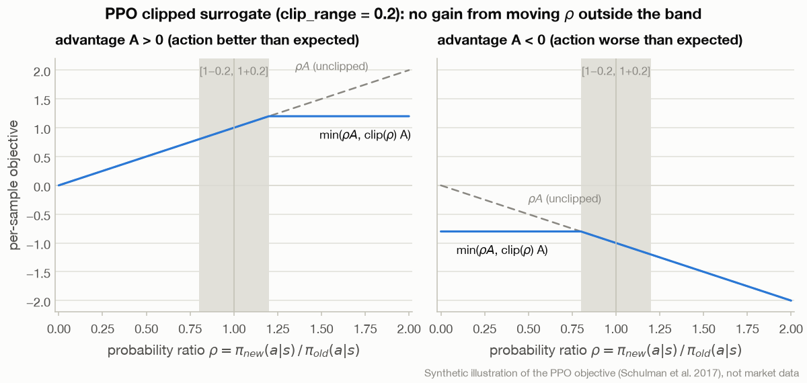
</picture>

*The clipped surrogate for one sample. With a positive advantage (left) raising the action's probability helps only up to $\rho = 1.2$; with a negative advantage (right) lowering it helps only down to 0.8. The dashed line is the unclipped objective, which would reward arbitrarily large steps. Data: synthetic illustration of the PPO objective (Schulman et al. 2017), not market data.*

### The training loop

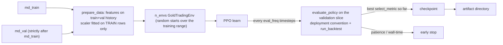

1. `md_train` and `md_val` must be time-ordered and non-overlapping. They are concatenated
   only to give the validation slice its feature and volatility warm-up. The pipeline's
   scaler is fitted on training rows only.
2. `n_envs` training environments (`DummyVecEnv`) sample random fixed-length episodes over
   the whole training range. `VecNormalize` normalises rewards only
   (`normalize_reward=True`).
3. Every `eval_freq` environment timesteps, `evaluate_policy` rolls the **deterministic**
   policy through the validation slice with the same convention the deployed `rl_ppo`
   strategy uses (fresh episodes at `episode_anchor`, kill switches restart the simulated
   account). It starts one anchor period early so the forecasts match exactly. The forecast
   series is then backtested with the real engine (same sizer, risk limits, costs and vol)
   and scored with the standard metrics. A parity diagnostic checks that the engine
   reproduces the simulated account to the cent.
4. The checkpoint with the best `select_metric` (default `"sharpe"`, the validation daily
   Sharpe) is kept. Training stops after `patience` evaluations without an improvement of
   more than `min_delta`, or when `max_wall_time_s` is reached.

> [!CAUTION]
> **Selection bias.** Choosing the best of `K` validation evaluations inflates the
> validation Sharpe (Bailey & López de Prado 2014). `metrics.json` records `n_evals` so the
> figure can be deflated (`aurum.research.stats.sharpe_summary(..., n_trials=n_evals)`), and
> it carries a note saying so. A clean out-of-sample test needs data after the validation
> slice.

### `aurum rl train`

```bash
aurum rl train --help
```

```text
usage: aurum rl train [-h] --config PATH [--set KEY=VALUE]

options:
  -h, --help            show this help message and exit
  --config PATH, -c PATH
                        YAML config file (see configs/; `extends:` inheritance
                        allowed)
  --set KEY=VALUE       override a config value by dotted path, YAML-parsed,
                        e.g. --set walkforward.test=3M (repeatable; secrets
                        cannot be set)
```

It reads the `rl` section of the config, builds the environment with
[`rl_config_from_aurum`](#rl_config_from_aurum-one-contract-for-training-and-research), and
loads the data from the `data` section (bars, macro and events):

| Key | `default.yaml` | Meaning |
|---|---|---|
| `rl.train_start` | `"2013-01-01"` | First training bar (`null` = start of the data). |
| `rl.train_end` | `"2019-12-31"` | Last training day (inclusive). |
| `rl.val_end` | `"2021-12-31"` | Validation runs from the day after `train_end` to this day (inclusive). |
| `rl.out_dir` | `runs/rl/ppo` | Artifact directory. |
| `rl.params` | `{total_timesteps: 200000, n_envs: 4}` | `RLTrainConfig` fields; `env` takes `EnvConfig` fields and overrides the mapped entries. `seed` defaults to the config's top-level `seed`. |

```bash
aurum rl train -c configs/default.yaml \
  --set rl.params.total_timesteps=50000 --set rl.params.env.dd_penalty=0.5
```

The command refuses to start with fewer than 1,000 training or 100 validation bars. It
prints the environment's sources, the split and the artifact path, then the numeric
validation metrics as JSON. Without the `[rl]` extra it exits with code 3 and tells you to
install it.

This command is not part of the pre-registered protocol. With the default dates the policy is
trained on 2013-2019 and selected on 2020-2021, so only data from 2022 on is out of sample
for it, and that overlaps the protocol's walk-forward period and holdout. A standalone
experiment script with a train / validation / optional untouched test split and simple
baselines is also available: `python -m aurum.rl.train --help`.

### `RLTrainConfig`

| Field | Default | Field | Default |
|---|---|---|---|
| `feature_groups` | `("returns", "trend", "momentum", "volatility", "regime", "session", "mtf")` | `n_epochs` | `10` |
| `feature_overrides` | `{}` | `learning_rate` | `3e-4` |
| `scaler` | `"robust"` | `gamma` | `0.99` |
| `feature_clip` | `5.0` | `gae_lambda` | `0.95` |
| `env` | `EnvConfig()` | `clip_range` | `0.2` |
| `total_timesteps` | `200000` | `ent_coef` | `0.01` |
| `n_envs` | `4` | `vf_coef` | `0.5` |
| `n_steps` | `512` | `max_grad_norm` | `0.5` |
| `batch_size` | `256` | `net_arch` | `(128, 128)` |
| `activation` | `"tanh"` | `normalize_reward` | `True` |
| `eval_freq` | `20000` | `patience` | `5` (`None` = no early stopping) |
| `min_delta` | `0.0` | `select_metric` | `"sharpe"` |
| `max_wall_time_s` | `None` | `seed` | `0` |
| `device` | `"cpu"` (`"auto"` picks CUDA, then Apple MPS, then CPU) | `torch_threads` | `None` |
| `verbose` | `0` | | |

CPU training is seeded and deterministic; GPU kernels may not be bit-reproducible.

### Artifacts

| File | Content |
|---|---|
| `policy.zip` | The selected SB3 policy. |
| `pipeline.json` | The fitted `FeaturePipeline` (groups, scaler statistics, bar size). |
| `config.json` | The full `RLTrainConfig`, including `EnvConfig`, plus `data_ranges`: `{"train": [first, last], "val": [first, last], "timeframe": ...}` (UTC bar open times). |
| `metrics.json` | `val` metrics of the selected checkpoint, `selected_timesteps`, `select_metric`, `n_evals`, `timesteps_trained`, `early_stopped`, `wall_time_s`, `device`, `n_features`, `obs_dim`, the evaluation `history`, the data hashes, `git_sha`, package `versions` and the selection-bias `note`. |
| `data_hash.json` | SHA-256 of the train and validation bars, their ranges and bar counts, timeframe, macro series names and whether events were used. |
| `history.csv` | One row per validation evaluation (written when there was at least one). |

`policy.zip`, `pipeline.json` and `config.json` define the policy's behaviour and form its
SHA-256 **fingerprint**. Because `data_ranges` lives in `config.json`, the recorded training
period cannot be edited without changing the fingerprint. `artifact_data_ranges(dir)` reads it
back (falling back to `metrics.json` for older artifacts, which is reported as
`source: "metrics.json"`). `load_artifact` and `load_artifact_bytes` rebuild the policy;
`rollout_artifact` runs it over new data with its own simulated account; `backtest_forecast`
backtests any forecast series with the policy's sizer, risk limits and costs, for
like-for-like comparisons. A policy refuses bars of a different size than it was trained on
(`check_bar_size` raises `ValueError`).

---

## The `rl_ppo` strategy adapter

Module [aurum/strategies/rl.py](../aurum/strategies/rl.py), class `RLPolicyStrategy`,
registered as `rl_ppo` (trainable).

**Forecast semantics.** The policy observes its own position, unrealised PnL, time in trade
and drawdown, so `generate` rolls the deterministic policy forward bar by bar with its
**own simulated account**, using the training sizer, costs and risk limits. The forecast at
$t$ is the policy's action at the close of $t$ (the discrete levels by default).

- **Episode anchors.** With `episode_anchor="auto"` (default) the adapter uses the
  artifact's validated convention (`"M"` unless changed in training): a fresh, flat episode
  starts at the first bar of every month. A forecast then depends only on the bars since the
  last anchor, plus the feature warm-up, and not on where the history window starts, so a
  live runner fed a sliding window reproduces the backtest.
  `warmup_bars` = pipeline look-back + `window` - 1 + one conservative anchor period
  (10 / 34 / 95 calendar days for W / M / Q, converted to bars). Earlier forecasts are 0.
- **Simulated kill switches restart in place.** When a kill switch or ruin would end a
  training episode, it fires and flattens as in training, then the simulated account starts
  a new episode in place (drawdown peak and risk state re-based). Forecasts keep flowing, and
  the policy never sees a drawdown deeper than the ones that ended its training episodes. The
  real risk manager downstream still decides what is actually traded.
- `features` passed to `fit` or `generate` are ignored. The artifact's own pipeline
  recomputes exactly the columns and scaling the policy was trained with.

**Portable artifacts.** Attaching an artifact (`load(artifact_dir)`, `from_artifact`, or the
`artifact_dir` parameter) reads `policy.zip`, `pipeline.json`, `config.json` (and
`metrics.json`) once, and embeds their bytes plus a SHA-256 fingerprint in the strategy.
Clones and pickles, including the live trading artifact and walk-forward worker processes,
are self-contained: the directory is provenance only and may be moved or deleted.
Overwriting it later has no effect, and embedded bytes that no longer match the fingerprint
are refused. The torch network is rebuilt lazily and never pickled.

| Parameter | Default | Meaning |
|---|---|---|
| `artifact_dir` | `None` | Attach a trained artifact at construction. |
| `retrain` | `None` | `None` resolves once, in `__init__`: `False` when `artifact_dir` is given, else `True`. `False`: `fit` verifies the attached artifact and does not train (below). `True`: `fit` trains a new policy on the data it is given. `False` without `artifact_dir` is an error. |
| `artifact_sha256` | `None` | Pin: the full SHA-256 fingerprint or a prefix of at least 8 hex digits. Any other policy is refused at construction and at `fit`. |
| `config` | `None` | `RLTrainConfig` or its dict form, used by a training `fit`. `None` = `RLTrainConfig()` defaults. |
| `val_fraction` | `0.25` | Trailing fraction of the `fit` data used for validation, in `(0, 1)`. |
| `min_val_bars` | `500` | A training `fit` raises if the split leaves fewer validation bars. |
| `out_dir` | `None` | Parent of the per-fit artifact directories (default: a new temporary directory). |
| `device` | `"cpu"` | Torch device for inference. |
| `episode_anchor` | `"auto"` | `"auto"`, `"W"`, `"M"`, `"Q"` or `None`. Overriding the validated convention changes the policy's behaviour. |

**A training `fit(md)`** (`retrain=True`) holds out the trailing `val_fraction` of `md` for
validation, trains with `train_ppo`, and writes each fit into a **new** subdirectory of
`out_dir` (`rl_ppo_<last bar>_<random>`), so clones fitted on different folds never overwrite
each other's policy. Either kind of `fit` records the last bar of `md` as `fit_cutoff_`.

The example trains a deliberately tiny policy, attaches it, deletes the directory, and
backtests the forecasts on bars **after** the validation slice only:

```python
import json
import pickle
import shutil
import tempfile
from pathlib import Path

from aurum.core.types import MarketData
from aurum.data.synthetic import make_synthetic_bars
from aurum.rl.train import RLTrainConfig, backtest_forecast, train_ppo
from aurum.strategies.rl import RLPolicyStrategy

bars = make_synthetic_bars(5000, "H1", seed=0)
md_train, md_val = MarketData(bars=bars.iloc[:3000]), MarketData(bars=bars.iloc[3000:4000])

cfg = RLTrainConfig.from_dict({                  # deliberately tiny: a smoke run, not a model
    "feature_groups": ["returns", "volatility"], "total_timesteps": 2048, "n_envs": 1,
    "n_steps": 256, "batch_size": 64, "n_epochs": 1, "eval_freq": 512, "patience": 2,
    "net_arch": [32], "env": {"episode_length": 256}, "seed": 0,
})
out = Path(tempfile.mkdtemp()) / "ppo_demo"
res = train_ppo(md_train, md_val, config=cfg, out_dir=out)

print(sorted(p.name for p in out.iterdir()))
m = json.loads((out / "metrics.json").read_text())
print({k: m[k] for k in ("n_evals", "selected_timesteps", "timesteps_trained", "early_stopped")})

strat = RLPolicyStrategy.from_artifact(out)      # files embedded + SHA-256 fingerprint
print("warmup_bars:", strat.warmup_bars, "| episode_anchor:", strat.episode_anchor)
clone = pickle.loads(pickle.dumps(strat))
shutil.rmtree(out)                               # the directory is provenance only now
md_all = MarketData(bars=bars)
f = clone.generate(md_all)
print("embedded:", clone.has_embedded_policy, "| levels used:", sorted(f.unique().tolist()))

# score bars AFTER the validation slice only, with the policy's own sizer/risk/costs
bt = backtest_forecast(md_all, f, res.config.env, start=4000)
print({k: round(float(bt.metrics[k]), 3) for k in ("sharpe", "total_return", "n_trades")})
```

```text
rate financing: no 'fedfunds' series supplied (md.macro / rates=); every rollover uses fallback_rate=0.0300
['config.json', 'data_hash.json', 'history.csv', 'metrics.json', 'pipeline.json', 'policy.zip']
{'n_evals': 4, 'selected_timesteps': 1024, 'timesteps_trained': 2048, 'early_stopped': True}
warmup_bars: 1300 | episode_anchor: M
embedded: True | levels used: [-1.0, -0.5, 0.0, 0.5, 1.0]
{'sharpe': -5.523, 'total_return': -0.056, 'n_trades': 224.0}
```

A 2,048-step policy on a random walk trades often and pays for it; the negative result is
the expected outcome, not a benchmark. The 1,300-bar warm-up is 484 bars of features and
window plus 816 bars (34 days) of monthly anchor span.

### Reusing a pre-trained artifact and the look-ahead guard

**Intuition.** Training PPO inside every walk-forward fold takes hours, so it is tempting to
train one policy with `aurum rl train` and walk it forward. That is only honest on test bars
the policy has never seen. A policy trained on 2013-2019 and checkpoint-selected on 2020-2021
"knows" 2020-2021, so forecasting those bars as out-of-sample would be look-ahead. Aurum
therefore records the training period in the artifact and refuses any fold that would test
inside it.

With `artifact_dir` set (and `retrain` left unset, so it resolves to `False`), `fit` does not
train. It re-verifies the attached policy: the embedded bytes against their fingerprint, the
directory (when it still exists) against the same fingerprint, the optional
`artifact_sha256` pin and the bar size. Then it applies the guard:

```math
\text{fit}(md) \text{ is allowed} \iff T^{\mathrm{art}}_{\mathrm{end}} \le T^{\mathrm{fit}}_{\mathrm{cut}},
\qquad
\text{generate refuses bar } t \iff T^{\mathrm{fit}}_{\mathrm{cut}} < t \le T^{\mathrm{art}}_{\mathrm{end}}
```

where $T^{\mathrm{art}}_{\mathrm{end}}$ is the artifact's last training or validation bar
(`artifact_data_ranges(...)["end"]`) and $T^{\mathrm{fit}}_{\mathrm{cut}}$ = `fit_cutoff_`, the
last bar of the data given to `fit`. Every walk-forward test row lies after its fold's
training cutoff, so a pre-trained policy can only be evaluated on folds whose training window
ends at or after its validation end; earlier folds raise `ValueError` at build time (a fold,
`aurum train-final` or a desk replay), never later in a live loop. The second rule is defence
in depth, for example against hand-edited state. An artifact with no recorded period is
refused. `retrain=True` restores per-fold training.

<picture>
  <source media="(prefers-color-scheme: dark)" srcset="_assets/figures/ml-and-rl/rl-artifact-guard-dark.png">
  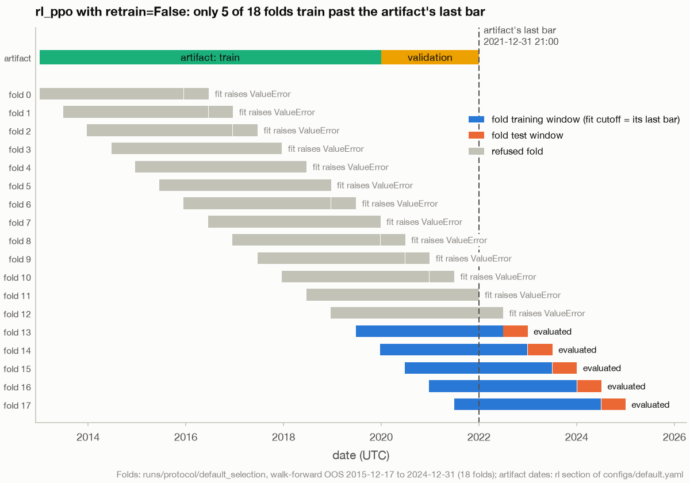
</picture>

*An artifact trained with the dates of configs/default.yaml's `rl` section (train 2013-2019, validation 2020-2021) against the real fold windows of the default walk-forward: 13 of the 18 folds end their training before 2021-12-31 21:00 and would raise at `fit`, and only folds 13 to 17 (fold keys as in `folds.csv`, test windows from July 2022) may evaluate it. Data: folds from runs/protocol/default_selection, walk-forward OOS 2015-12-17 to 2024-12-31 (18 folds); artifact dates from configs/default.yaml.*

The guard on a tiny policy (synthetic bars, which start in January 2020):

```python
import tempfile
import textwrap
from pathlib import Path

from aurum.core.types import MarketData
from aurum.data.synthetic import make_synthetic_bars
from aurum.rl.train import RLTrainConfig, artifact_data_ranges, train_ppo
from aurum.strategies.rl import RLPolicyStrategy

bars = make_synthetic_bars(5000, "H1", seed=0)
cfg = RLTrainConfig.from_dict({                  # deliberately tiny: a smoke run, not a model
    "feature_groups": ["returns", "volatility"], "total_timesteps": 2048, "n_envs": 1,
    "n_steps": 256, "batch_size": 64, "n_epochs": 1, "eval_freq": 512, "patience": 2,
    "net_arch": [32], "env": {"episode_length": 256}, "seed": 0,
})
out = Path(tempfile.mkdtemp()) / "ppo_demo"
train_ppo(MarketData(bars=bars.iloc[:3000]), MarketData(bars=bars.iloc[3000:4000]), config=cfg, out_dir=out)
r = artifact_data_ranges(out)
print("artifact saw:", r["start"], "->", r["end"], "| source:", r["source"])

strat = RLPolicyStrategy(artifact_dir=str(out))            # retrain=None -> False: load, do not train
print("retrain:", strat.params["retrain"], "| fingerprint:", strat.artifact_fingerprint_[:12])
try:                                                       # a fold whose training ends before the val end
    strat.clone().fit(MarketData(bars=bars.iloc[:3500]))
except ValueError as exc:
    print(textwrap.fill(str(exc).replace(str(out), "<artifact>"), 100))
ok = strat.clone().fit(MarketData(bars=bars.iloc[:4200]))  # training ends after the val end: allowed
f = ok.generate(MarketData(bars=bars))
print("fit_cutoff_:", ok.fit_cutoff_, "| OOS bars:", len(f) - 4200, "| non-zero:", int((f.iloc[4200:] != 0).sum()))
try:
    RLPolicyStrategy(artifact_dir=str(out), artifact_sha256="deadbeef")
except RuntimeError as exc:
    print(str(exc).replace(str(out), "<artifact>"))
```

```text
artifact saw: 2020-01-06 00:00:00+00:00 -> 2020-08-27 00:00:00+00:00 | source: config.json
retrain: False | fingerprint: 88cf74b9ae62
rl_ppo look-ahead guard: the attached policy (<artifact>) was trained/validated on bars 2020-01-06
00:00:00+00:00 -> 2020-08-27 00:00:00+00:00 (recorded in config.json), AFTER this fit's training
cutoff 2020-07-29 00:00:00+00:00: it would forecast out-of-sample bars it has seen. Use it only
where the training window ends at or after 2020-08-27 00:00:00+00:00, use an artifact trained before
2020-07-29 00:00:00+00:00, or set retrain=True.
fit_cutoff_: 2020-09-08 10:00:00+00:00 | OOS bars: 800 | non-zero: 579
RL artifact <artifact> has fingerprint 88cf74b9ae62c237..., not the pinned artifact_sha256=deadbeef; refusing to run a different policy
```

The fingerprint identifies one trained artifact file set, and a new training run gives a new
one even when the policy is the same: two runs of the tiny training above wrote byte-identical
network weights (`policy.pth` inside `policy.zip`), `pipeline.json` and `config.json`, but
stable-baselines3 also stores the wall-clock `start_time`, the episode timing buffer and zip
timestamps in `policy.zip`, so their fingerprints differ (your run prints a different value
from the one above). In a config, pin the
policy you evaluated so that a later retrain into the same directory cannot silently replace
it (use your artifact's `artifact_fingerprint_`, or a prefix of at least 8 hex digits):

```yaml
strategies:
  - {name: rl_ppo, params: {artifact_dir: runs/rl/ppo, artifact_sha256: 88cf74b9ae62}}
```

### Pitfalls and design choices

- **Checkpoint selection is training.** The guard counts the validation period as seen,
  because the checkpoint was chosen on it.
- **Fit-time failure.** The guard raises in `fit`, so a mis-dated artifact fails when the
  walk-forward or the live artifact is built, not during live trading.
- **Fewer folds.** With the default dates only 5 folds are evaluable. Train the artifact on an
  earlier window if you want more out-of-sample folds, and count every artifact you try as a
  trial in the Deflated Sharpe Ratio ([RESEARCH_PROTOCOL.md](RESEARCH_PROTOCOL.md)).

## What the evidence says

- **`ml_gbm`** failed its validation skill gate in every walk-forward fold (validation AUC
  0.43-0.57 against a required 0.577-0.580) and made no trades. That is the gate working as
  designed: it shows zero rather than a loss.
- **`meta_label`** passed its gate in 5 of 18 folds and traded 434 times, with a Sharpe of
  −0.28 (95% CI [−1.02, 0.40]) after costs: no statistically demonstrated edge.
- **`rl_ppo`** was not part of either pre-registered configuration, so there is **no**
  out-of-sample evidence for it. Its own module warns that financial rewards have a very low
  signal-to-noise ratio and that PPO readily overfits the training period, and its
  validation metrics are selection-biased by construction.

The numbers are in [RESULTS.md](RESULTS.md). Any new ML or RL configuration you evaluate is
another trial and must be counted in the Deflated Sharpe Ratio (see
[RESEARCH_PROTOCOL.md](RESEARCH_PROTOCOL.md) and [research.md](research.md)). The
[analytics.md](analytics.md) page shows how to attribute a combined book's PnL to each
strategy, including the learned ones.

## Tests that guard these components

| Test file | What it checks |
|---|---|
| `tests/test_labels_triple_barrier.py` | Barrier order, gaps, both-touched rule, side-aware labels, undecided tail, never reading past the data end, vectorised vs reference implementation, uniqueness vs brute force, CUSUM and `ewm_vol` causality. |
| `tests/test_strategies_ml.py` | Positive controls on planted signals, no edge on a random walk, future-perturbation leakage, labels ending inside the training slice, calibration not re-learning the validation drift, out-of-sample fitting of trainable primaries, transactional refits. |
| `tests/test_strategies_leakage.py` | Output contract and point-in-time checks for every registered strategy, including `ml_gbm`, `meta_label` and `rl_ppo` (with small test-only parameters). |
| `tests/test_fit_history.py` | `fit_history_bars` reaches back but never into a test block. |
| `tests/test_rl_env.py` | Observation layout, warm-up never observed, no future bars in observations, reward realised over the next bar, shaping never touching equity, random starts covering the range, kill-switch termination, rollout equity equal to `run_backtest`, episode anchors. |
| `tests/test_rl_train.py` | Scaler fitted on training rows only, deterministic training, early stopping, validated forecasts equal to the deployed strategy's forecasts, bar-size checks. |
| `tests/test_rl_strategy.py`, `tests/test_stability_rl_artifact.py` | Torch-free import, causality, history-start independence, per-fit artifact directories, tamper refusal, self-contained pickles that survive a deleted artifact directory. |
| `tests/test_v21_core_fixes_rl_artifact.py` | `config.json` records the training period, a loading `fit` instead of retraining, refusal of artifacts trained after the cutoff, the `generate` guard, guards surviving pickles, fingerprint and bar-size checks, old artifacts, `retrain=True`, a walk-forward with a pre-trained artifact. |
| `tests/test_v21_core_fixes_rl_config.py` | Misspelt `ml_gbm` / `meta_label` / `rl_ppo` parameters rejected, `retrain` resolution and pin validation, `rl_config_from_aurum` mapping and defaults, `rl.params.env` overrides, disabled risk, unknown keys, and env/backtest parity on the configured instrument. |

How to run the suite is described in [development.md](development.md).
