# Volatility and regime models

`aurum.models` holds the statistical models that describe gold's risk rather than its
direction. There are four volatility forecasters: EWMA, GARCH(1,1), HAR-RV and a variance
blend. There is also a Gaussian hidden Markov model (HMM) that labels calm and turbulent
regimes. Only EWMA is wired into every decision path: the backtest engine, the live runner
and the RL environment size positions with it, and the combiner scores strategies with the
same recursion. GARCH, HAR-RV and the blend are research tools. The HMM drives one strategy, `regime_switch`. This page explains each
model from the intuition to the exact formula the code evaluates. It shows each model on real
gold data from 2012 to 2024 and lists what can go wrong. Every number on this page was produced
by the code and data named next to it. Every figure is drawn by
[tools/figures/fig_models.py](../tools/figures/fig_models.py).

**On this page**

- [Where the models are used](#where-the-models-are-used)
- [Why volatility can be forecast](#why-volatility-can-be-forecast)
- [Annualisation: the nominal constant](#annualisation-the-nominal-constant)
- [EWMA volatility (the default)](#ewma-volatility-the-default)
- [GARCH(1,1)](#garch11)
- [Realised variance and HAR-RV](#realised-variance-and-har-rv)
- [The three forecasts on gold](#the-three-forecasts-on-gold)
- [Blending forecasts](#blending-forecasts)
- [Gaussian hidden Markov model](#gaussian-hidden-markov-model)
- [Pitfalls and design choices](#pitfalls-and-design-choices)
- [See also](#see-also)

## Where the models are used

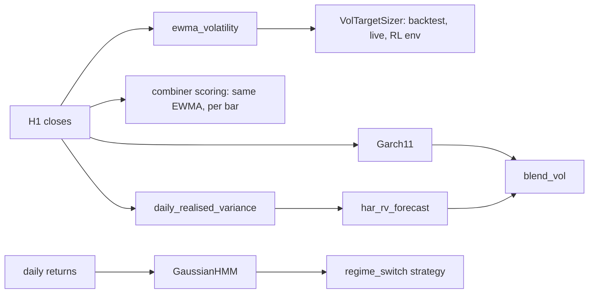

| Model | Code | Used by |
|---|---|---|
| EWMA volatility | `ewma_volatility` in [aurum/models/volatility.py](../aurum/models/volatility.py) | the backtest engine's default `vol` ([aurum/backtest/engine.py](../aurum/backtest/engine.py)), the live runner, the RL environment (`halflife_bars=env.vol_halflife`), the LLM desk's snapshot (`bars_per_year=252 * 23.0`), `aurum explain`. The combiner computes the same recursion per bar, without annualisation ([portfolio-and-risk.md](portfolio-and-risk.md#forecast-combiner)). |
| GARCH(1,1) | `Garch11`, `GarchParams`, `simulate_garch11` | research only; pass its forecast as `run_backtest(..., vol=...)` |
| Realised variance, HAR-RV | `daily_realised_variance`, `HarRV`, `har_rv_forecast` | research only |
| Variance blend | `blend_vol` | research only |
| Gaussian HMM | `GaussianHMM` in [aurum/models/regime.py](../aurum/models/regime.py) | the `regime_switch` strategy ([aurum/strategies/regime.py](../aurum/strategies/regime.py), see [strategies.md](strategies.md)) |

Every forecaster keeps one causal contract. The value at row `t` uses returns up to and
including `t`, and it is the forecast for the next period. That is exactly what the sizer
needs at the decision time `available_at[t]` ([data.md](data.md) explains the timing). Fitted
models (`Garch11`, `HarRV`, `GaussianHMM`) estimate their parameters with `fit` on training
data only. After that, the recursions only run forward.

## Why volatility can be forecast

**Intuition.** Gold's direction is close to unpredictable, but the *size* of its moves is not.
Big days cluster, and quiet weeks follow quiet weeks. A volatility model is a way to measure
"how big have the moves been lately" and to project that into the next bar. Position sizing
depends entirely on that projection.

<picture>
  <source media="(prefers-color-scheme: dark)" srcset="_assets/figures/models/vol-clustering-dark.png">
  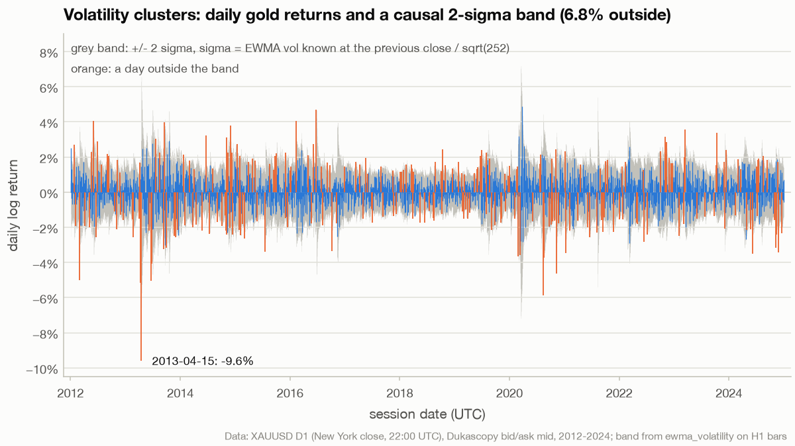
</picture>

*The band, computed from information available at the previous close, widens and narrows with the clusters, so returns stay inside it on 93.2% of days. That is still below the Gaussian 95.4%: gold has fat tails. The −9.6% day is 2013-04-15. Data: XAUUSD D1 (New York close, 22:00 UTC), Dukascopy bid/ask mid, 2012-2024; band from `ewma_volatility` on H1 bars.*

The autocorrelation function makes the same point with numbers. The autocorrelation of
returns at lag $k$ is close to zero. The autocorrelation of absolute or squared returns
stays positive for weeks:

```math
\rho_k(x) = \frac{\sum_{t=k+1}^{n} (x_t - \bar x)(x_{t-k} - \bar x)}{\sum_{t=1}^{n} (x_t - \bar x)^2},
\qquad x \in \lbrace r_t,\ \lvert r_t \rvert,\ r_t^2 \rbrace
```

where $r_t$ is the daily log return, $n$ the number of sessions and $\bar x$ the sample mean.
Under white noise, $\rho_k$ lies within $\pm 1.96/\sqrt{n}$ about 95% of the time.

<picture>
  <source media="(prefers-color-scheme: dark)" srcset="_assets/figures/models/acf-returns-dark.png">
  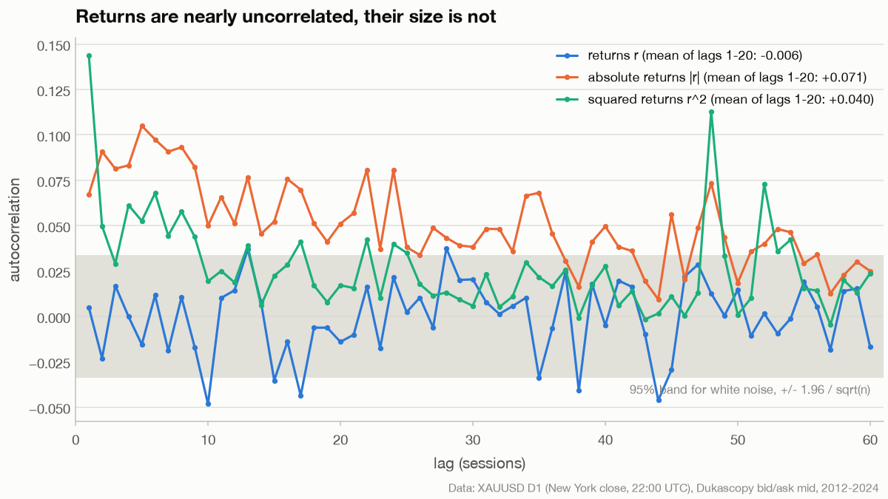
</picture>

*Returns average −0.006 over lags 1-20 and mostly stay inside the white-noise band. Absolute returns average +0.071 and sit above it for more than a month, which is volatility clustering. The single lag-48 spike in squared returns comes from a few outlier days. Data: XAUUSD D1 (New York close, 22:00 UTC), Dukascopy bid/ask mid, 2012-2024.*

## Annualisation: the nominal constant

**Intuition.** Every volatility on this page is reported per year. A per-bar variance is
multiplied by "bars per year". aurum uses a fixed, calendar-based constant for this, not the
number of bars that happen to be in the data. The data-based number depends on the whole
sample, including bars that arrive after the decision. It also changes with holidays and
gaps.

**The math.** `nominal_bars_per_year` in [aurum/core/timeframes.py](../aurum/core/timeframes.py):

```math
B(m) = \begin{cases}
252 \cdot \dfrac{23 \cdot 60}{m} = \dfrac{252 \cdot 1380}{m}, & m < 1440 \\[2ex]
252 \cdot \dfrac{1440}{m}, & m \ge 1440
\end{cases}
\qquad
\sigma_{\text{ann}} = \sqrt{B \, \sigma_{\text{bar}}^2}
```

where

- $m$ is the bar length in minutes, from `index_bar_minutes(index)`: the median spacing of the
  **first** 200 timestamps, so the answer never changes as data is appended;
- 252 is `TRADING_DAYS_PER_YEAR` and $23 \cdot 60 = 1380$ is `TRADING_MINUTES_PER_DAY` (spot
  gold trades about 23 hours per weekday);
- $B$ is 23,184 on M15, 5,796 on H1, 1,449 on H4 and 252 on D1.

The alternative, `infer_bars_per_year(index)`, is $(n - 1)$ divided by the span of the index in
years of 365.25 days. That is a *realised density*. It needs the last timestamp of the
sample, so it is not causal. It also varies from year to year.

<picture>
  <source media="(prefers-color-scheme: dark)" srcset="_assets/figures/models/bars-per-year-dark.png">
  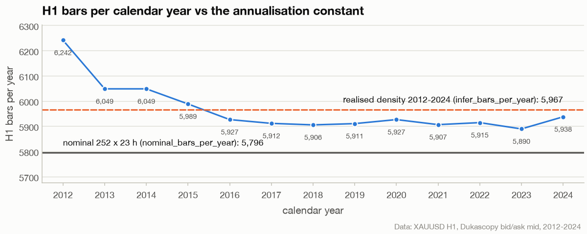
</picture>

*Each calendar year has 5,890 to 6,242 H1 bars. The 2012-2024 realised density is 5,967, about 3% above the nominal 5,796. A model annualised with the density would print a vol about 1.5% higher, and the gap would depend on which years are in the sample. Data: XAUUSD H1, Dukascopy bid/ask mid, 2012-2024.*

```python
import numpy as np
import pandas as pd

from aurum.core.timeframes import index_bar_minutes, infer_bars_per_year, nominal_bars_per_year
from aurum.data.store import load_bars

for minutes in (15, 60, 240, 1440):
    print(f"{minutes:>5} min bars: nominal {nominal_bars_per_year(minutes):8.1f} bars/year")

# real H1 bars, cut at the end of 2024 like every figure on this page
h1 = load_bars("data_store/xauusd_H1.parquet")
h1 = h1[h1["available_at"] <= pd.Timestamp("2025-01-01", tz="UTC")]
train = h1.loc["2014":"2019"]
nominal = nominal_bars_per_year(index_bar_minutes(train.index))
realised = infer_bars_per_year(train.index)
print(f"H1 2014-2019: nominal {nominal:.0f}, realised density {realised:.1f}, "
      f"vol ratio sqrt(realised/nominal) = {np.sqrt(realised / nominal):.4f}")
```

Output (the real-data line needs the Dukascopy store in `data_store/`, see [data.md](data.md)):

```text
   15 min bars: nominal  23184.0 bars/year
   60 min bars: nominal   5796.0 bars/year
  240 min bars: nominal   1449.0 bars/year
 1440 min bars: nominal    252.0 bars/year
H1 2014-2019: nominal 5796, realised density 5953.1, vol ratio sqrt(realised/nominal) = 1.0135
```

> [!NOTE]
> **Fixed in v2.1.** `Garch11` used to annualise with the realised density of its training
> index. On H1 data from 2014 to 2019 that is 5,953 bars per year instead of 5,796, so every
> GARCH vol came out 1.35% higher than EWMA's for the same variance. It now uses
> `nominal_bars_per_year(index_bar_minutes(train_index))` unless you pass `bars_per_year`.
> GARCH and EWMA can therefore be blended or swapped in the sizer without a level shift
> ([CHANGELOG.md](../CHANGELOG.md)).

The combiner's reported `train_sharpe` still annualises with the realised density of its
training window. It is a report, not a sizing input. The weights only use per-bar Sharpe
ratios, so the constant does not affect them.

## EWMA volatility (the default)

**Intuition.** Average the recent squared returns, giving the latest ones the most weight and
letting old ones fade away geometrically. One number, the half-life, sets how fast the
estimate forgets. With the default half-life of 48 H1 bars (about two trading days), half of
the estimate comes from the last 48 hours. This is the RiskMetrics model (J.P. Morgan, 1996)
with a zero mean.

**The math.** `ewma_volatility(close, *, halflife_bars=48.0, bars_per_year=None, min_periods=20, floor=0.03, cap=2.0)`:

```math
r_t = \ln C_t - \ln C_{t-1}, \qquad
v_t = (1-\alpha)\, v_{t-1} + \alpha\, r_t^2, \qquad
\alpha = 1 - 2^{-1/H}, \qquad
\sigma_t = \operatorname{clip}\left(\sqrt{B\, v_t},\ 0.03,\ 2.0\right)
```

where

- $C_t$ is the close of bar $t$ and $r_t$ its log return. The mean is taken as zero: hourly
  mean returns are tiny next to their noise;
- $H$ = `halflife_bars` (48), so $\alpha = 0.014337$ on the default. The weight on the squared
  return $k$ bars ago is $\alpha (1-\alpha)^k$, and the last $H$ returns carry exactly half of it;
- $v$ starts at the first squared return (pandas `ewm(..., adjust=False)`), and rows with fewer
  than `min_periods` = 20 squared returns, which are the first 20 bars, get the constant **0.20**.
  Warm-up rows are never back-filled from later estimates;
- $B$ = `bars_per_year`, or the nominal constant above (5,796 on H1);
- `floor` 0.03 and `cap` 2.0 clip the annualised value. The sizer's own `min_vol` (0.02) is
  therefore only reached by custom vol series.

<picture>
  <source media="(prefers-color-scheme: dark)" srcset="_assets/figures/models/ewma-kernel-dark.png">
  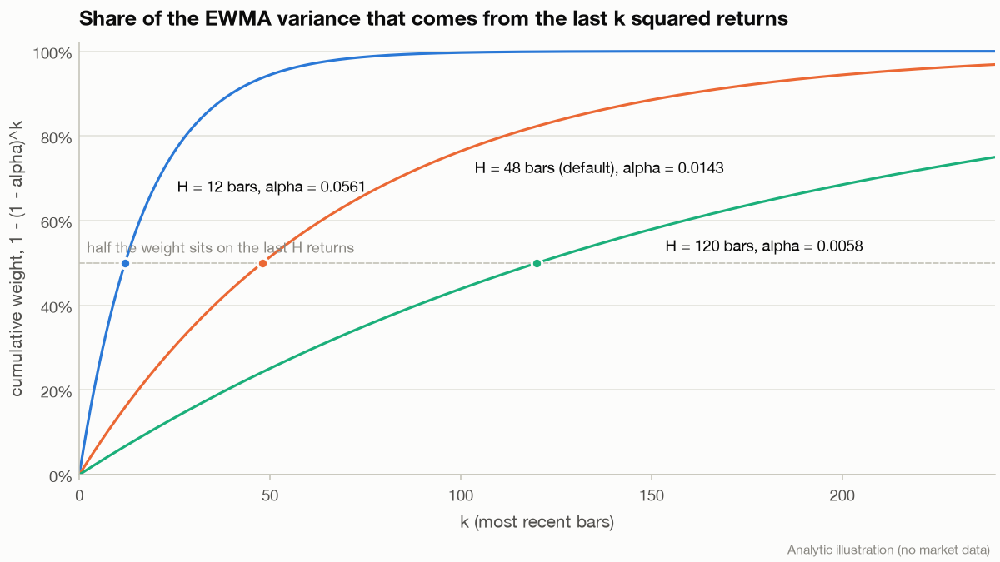
</picture>

*Each curve crosses 50% at its own half-life. With H = 48, the last 100 bars carry 76% of the weight and anything older than 240 bars carries 3%. Data: analytic illustration, no market data.*

**In code.** On synthetic bars (a GBM series, not market data), the function and the
recursion written out by hand agree:

```python
import numpy as np

from aurum.data.synthetic import make_synthetic_bars
from aurum.models.volatility import ewma_volatility

bars = make_synthetic_bars(2000, "H1", seed=1)      # GBM, not market data
close = bars["close"]
vol = ewma_volatility(close)                        # halflife 48 bars, nominal 5,796 bars/year
print(vol.iloc[[0, 19, 20, -1]].round(4).tolist())  # rows 0-19 are the 0.20 warm-up

# the same number by hand: v_t = (1 - a) v_{t-1} + a r_t^2, started at the first squared return
a = 1 - 0.5 ** (1 / 48)
r2 = np.log(close).diff().pow(2).to_numpy()[1:]
v = r2[0]
for x in r2[1:]:
    v = (1 - a) * v + a * x
print(round(a, 6), round(float(np.sqrt(v * 5796)), 4))
```

```text
[0.2, 0.2, 0.1172, 0.1399]
0.014337 0.1399
```

| Argument | Default | Meaning |
|---|---|---|
| `halflife_bars` | 48.0 | Half-life $H$ in bars. The RL environment passes `env.vol_halflife`. |
| `bars_per_year` | `None` | Annualisation constant. `None` uses `nominal_bars_per_year(index_bar_minutes(close.index))`. `run_backtest(..., bars_per_year=)` passes it through. |
| `min_periods` | 20 | Squared returns needed before an estimate is emitted |
| `floor`, `cap` | 0.03, 2.0 | Clip of the annualised vol |

The output is a Series named `vol_ann` (annualised fraction, 0.15 means 15%).

**Pitfalls.** EWMA reacts *after* a shock and cannot anticipate a weekend or news gap. Its
forecast for every horizon is the same number: it has no mean reversion, so after a spike it
over-forecasts until the spike fades out of the window. A short half-life tracks regime
changes quickly but is noisy. A long one is smooth but late. The 48-bar default was not tuned
on gold returns.

## GARCH(1,1)

**Intuition.** GARCH adds one idea to EWMA: volatility reverts to a long-run level. Tomorrow's
variance is a weighted sum of a constant, today's squared shock and today's variance. Because
of the constant, a forecast many steps ahead drifts back to the long-run average instead of
staying where it is. Its three parameters are estimated by maximum likelihood on training
data (Bollerslev, 1986).

**The math.** `Garch11(*, mean="zero", bars_per_year=None, floor=None, cap=None, max_iter=500, min_obs=250)`
models

```math
r_t = \mu + \varepsilon_t, \qquad \varepsilon_t = \sigma_t z_t, \quad z_t \sim N(0, 1), \qquad
\sigma_t^2 = \omega + \alpha\, \varepsilon_{t-1}^2 + \beta\, \sigma_{t-1}^2
```

and `fit(train_returns)` minimises the Gaussian negative log-likelihood of the standardised
returns:

```math
\min_{\omega, \alpha, \beta}\ \frac{1}{2n} \sum_{t=1}^{n} \left( \ln 2\pi + \ln h_t + \frac{\tilde z_t^2}{h_t} \right),
\qquad h_1 = h_0, \quad h_t = \omega + \alpha \tilde z_{t-1}^2 + \beta h_{t-1}
```

subject to

```math
10^{-8} \le \omega \le 10\, h_0, \qquad 0 \le \alpha \le 1, \qquad 0 \le \beta \le 1, \qquad \alpha + \beta \le 1 - 10^{-6}
```

where

- $\mu = 0$ with `mean="zero"` (the default), or the training mean with `mean="constant"`;
- $\tilde z_t = \varepsilon_t / s$ with $s = \sqrt{\tfrac{1}{n}\sum \varepsilon_t^2}$, so the problem is
  well scaled and $h_0 = \overline{\tilde z^2} = 1$, the "backcast" start. $\omega$ is mapped back
  as $\omega s^2$, while $\alpha$ and $\beta$ are scale-free. The start variance $h_0 s^2$ is
  stored as `h0_` and reused when forecasting later data, so later data never move the start;
- the optimiser is SLSQP from five starts $(\alpha_0, \beta_0)$ = (0.05, 0.90), (0.10, 0.85),
  (0.03, 0.95), (0.15, 0.70) and (0.10, 0.40), with $\omega_0 = h_0 (1 - \alpha_0 - \beta_0)$.
  The best likelihood wins. Non-finite returns are dropped, which joins returns across gaps,
  and at least `min_obs` = 250 must remain;
- because the likelihood is Gaussian but returns are fat-tailed, this is quasi-maximum
  likelihood (QMLE). The estimates stay consistent (Bollerslev and Wooldridge, 1992), but no
  standard errors are reported.

Derived quantities (`GarchParams.persistence`, `.unconditional_variance`, `.half_life`) and the
forecast:

```math
p = \alpha + \beta, \qquad V_L = \frac{\omega}{1-p}, \qquad
t_{1/2} = \frac{\ln 0.5}{\ln p}, \qquad
\mathbb{E}_t\left[\sigma_{t+k}^2\right] = V_L + p^{\,k-1} \left(h_{t+1} - V_L\right)
```

where

- $p$ is the **persistence**: each bar, the gap between the variance forecast and $V_L$ shrinks by the factor $p$;
- $V_L$ is the long-run (unconditional) variance per bar, and $t_{1/2}$ is the number of bars
  for a shock to decay by half;
- $h_{t+1} = \omega + \alpha \varepsilon_t^2 + \beta h_t$ is the one-step forecast that
  `forecast(returns)` returns at row $t$. A missing return is replaced by its expectation,
  so $h_{t+1} = \omega + p\, h_t$;
- `forecast(returns, horizon=H)` returns the *average* variance over bars $t+1 \ldots t+H$,
  which is $V_L + (h_{t+1} - V_L)(1 - p^H) / ((1-p) H)$;
- annualisation multiplies by $\sqrt{B}$ with $B$ = `bars_per_year`, or the nominal constant of
  the training index (`bars_per_year_`). `floor` and `cap` then clip annualised values only.
  `annualise=False` returns per-bar vols.

`aic` is $2k - 2 \ln L$ and `bic` is $k \ln n - 2 \ln L$, with $k = 3$ (4 with a constant mean).

<picture>
  <source media="(prefers-color-scheme: dark)" srcset="_assets/figures/models/garch-term-structure-dark.png">
  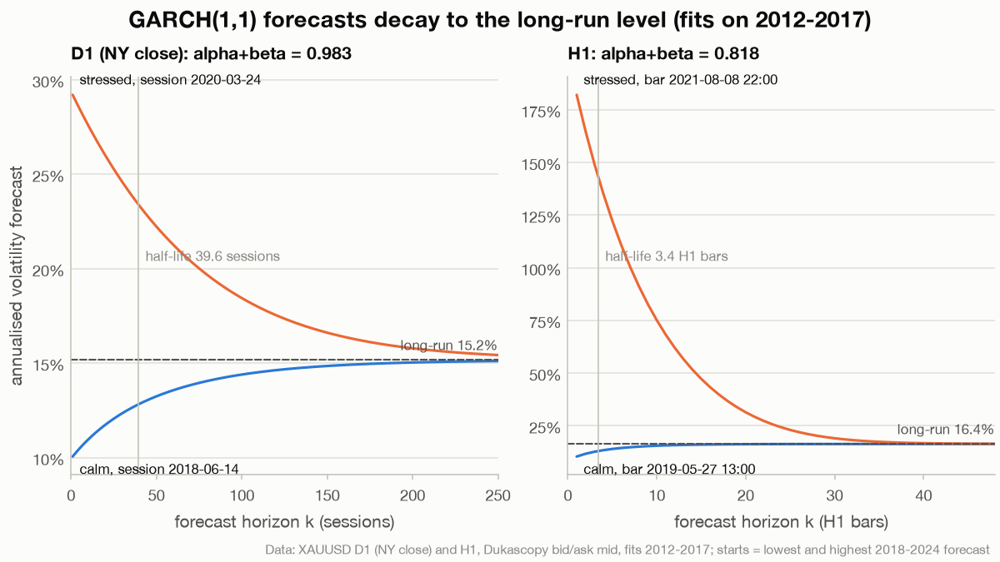
</picture>

*The same model fitted to the same years behaves very differently by timeframe. On daily New York close returns, persistence is 0.983 and a shock takes 39.6 sessions to halve. On H1 returns, persistence is 0.818 and the half-life is 3.4 bars. The H1 fit mostly reacts to single-hour spikes, such as the −4.6% hour at the Sunday reopening (bar opening 2021-08-08 22:00 UTC), and to the intraday activity pattern. Data: XAUUSD D1 (NY close) and H1, Dukascopy bid/ask mid, fits on 2012-2017; start dates are the lowest and highest 2018-2024 forecast.*

**In code.** First a sanity check on a simulated GARCH process, then the two real-data fits from
the figure:

```python
import numpy as np
import pandas as pd

from aurum.data.store import load_bars
from aurum.models.volatility import Garch11, simulate_garch11

# 1. parameter recovery on a simulated GARCH(1,1) (true alpha 0.08, beta 0.90)
r, _ = simulate_garch11(20_000, omega=2e-6, alpha=0.08, beta=0.90, seed=3)
g = Garch11(bars_per_year=252).fit(r)
s = g.summary()
print({k: round(s[k], 4) for k in ("alpha", "beta", "persistence", "half_life_bars")}, s["converged"])

# 2. real gold: fit on 2012-2017 only, then forecast causally
def gold(tf):
    b = load_bars(f"data_store/xauusd_{tf}.parquet")
    return b[b["available_at"] <= pd.Timestamp("2025-01-01", tz="UTC")]

for tf in ("D1_nyclose", "H1"):
    ret = np.log(gold(tf)["close"]).diff()
    g = Garch11().fit(ret.loc[:"2017-12-31"])
    s = g.summary()
    print(tf, {k: round(s[k], 4) for k in ("alpha", "beta", "persistence", "half_life_bars",
                                            "unconditional_vol_ann")}, "bars/year", g.bars_per_year_)
    f = g.forecast(ret)                       # row t: vol of bar t+1 from returns up to t
    print("   2018-2024 median forecast", round(float(f.loc["2018":].median()), 4))
```

```text
{'alpha': 0.0812, 'beta': 0.899, 'persistence': 0.9801, 'half_life_bars': 34.5658} True
D1_nyclose {'alpha': 0.0393, 'beta': 0.9433, 'persistence': 0.9827, 'half_life_bars': 39.618, 'unconditional_vol_ann': 0.1517} bars/year 252.0
   2018-2024 median forecast 0.1364
H1 {'alpha': 0.2688, 'beta': 0.549, 'persistence': 0.8178, 'half_life_bars': 3.447, 'unconditional_vol_ann': 0.1638} bars/year 5796.0
   2018-2024 median forecast 0.1239
```

| Argument / attribute | Default | Meaning |
|---|---|---|
| `mean` | `"zero"` | `"zero"` or `"constant"` (two-step: the training mean, then the variance) |
| `bars_per_year` | `None` | Annualisation. `None` uses the nominal constant of the training index. |
| `floor`, `cap` | `None` | Clip of annualised forecasts (fractions) |
| `max_iter` | 500 | SLSQP iterations per start |
| `min_obs` | 250 | Minimum finite training returns |
| `params_` | after `fit` | `GarchParams(mu, omega, alpha, beta)` in per-bar units, plus `persistence`, `unconditional_variance`, `half_life`, `to_dict()` |
| `h0_`, `loglik_`, `n_obs_`, `converged_`, `bars_per_year_` | after `fit` | Start variance, log-likelihood in the original units, sample size, optimiser status, annualisation used |

Also available: `conditional_variance(returns)` (in-sample $\sigma_t^2$, where row $t$ uses
returns before $t$), `summary()` (the parameters plus `loglik`, `aic`, `bic`, `n_obs`,
`converged` and `unconditional_vol_ann`), and `simulate_garch11(n, *, omega, alpha, beta, mu=0, seed=0, burn=1000)`.

**Pitfalls.** Persistence near 1 makes the long-run level poorly determined. Small changes in
the sample move $V_L$ a lot. On intraday bars GARCH is misspecified: the deterministic
intraday pattern of quiet and busy hours looks like a series of short-lived volatility
shocks. Gaussian QMLE has no fat-tail parameter, so the model
understates the probability of the biggest moves.

## Realised variance and HAR-RV

**Intuition.** With hourly bars you can *measure* each day's variance directly: add up the
day's squared hourly returns. That "realised variance" is a much less noisy daily risk measure
than one squared daily return. HAR-RV (Corsi, 2009) then forecasts tomorrow's realised
variance from three averages: yesterday's, last week's and last month's. Short-horizon traders
react to the daily term and slower investors to the monthly one, so a simple linear regression
captures the long memory of volatility.

**The math.** `daily_realised_variance(bars, *, anchor_hour_utc=0, complete_only=True, fold_weekends=True)`:

```math
RV_D = \sum_{t \in D} r_t^2
```

where

- $r_t$ is the close-to-close log return of bar $t$, and $t \in D$ means the bar *opens*
  inside session $D$, from `anchor_hour_utc` to the same hour the next day;
- with `anchor_hour_utc > 0`, a session is labelled by the date it ends (the session opening
  Sunday 21:00 UTC is Monday's). With the midnight anchor it carries its own date;
- the first return of a session spans the overnight or weekend gap, so $RV$ includes gap risk;
- `fold_weekends` merges Saturday and Sunday sessions into Monday. Without it, gold's
  Sunday-evening reopening hours form a stub day whose tiny RV would pull a daily model down;
- `complete_only` drops the last session if it has not finished. The result has columns `rv`,
  `n_obs` and `available_at` (the latest bar's `available_at`), ready for
  `aurum.data.pit.asof_join`.

`HarRV(lags=(1, 5, 22), *, log=False)` is the regression

```math
RV_{t+1} = b_0 + b_d\, RV_t + b_w\, RV_t^{(5)} + b_m\, RV_t^{(22)} + e_{t+1},
\qquad RV_t^{(k)} = \frac{1}{k} \sum_{j=0}^{k-1} RV_{t-j}
```

where

- the three trailing means use `lags` (1, 5, 22 sessions), are causal and need full windows;
- `fit` runs OLS on pairs $(X_t, RV_{t+1})$ that both lie inside the training sample. It
  stores `coef_`, `resid_var_` ($s^2$), `r2_`, `n_obs_` and `floor_`;
- `log=True` regresses $\ln RV_{t+1}$ on the logs of the means (Andersen et al., 2007: a
  better fit, and it cannot predict negative variance). Predictions are mapped back with the
  log-normal correction $\exp(\hat y + s^2/2)$;
- `floor_` = $10^{-6}$ times the median positive training RV. It floors zero-RV holidays
  before logs, and floors level forecasts. It is estimated on the training sample only.

`har_rv_forecast(daily_rv, *, lags=(1, 5, 22), log=False, min_train=250, refit_every=21, window=None, output="vol", periods_per_year=252.0)`
refits the model walk-forward. At each origin $t_0$ (every 21 rows from
$\max(250, 22 + 1)$), it fits on the pairs $(X_s, RV_{s+1})$ with $s + 1 \le t_0$ (expanding,
or the last `window` pairs). It needs at least $\max(3(k+1), 30)$ valid pairs. The fit then
predicts rows $t_0$ to $t_0 + 20$. Even the positivity floor is re-estimated from
`daily_rv[:t0+1]`. The output is $\sqrt{252\, \widehat{RV}}$, or the daily variance with
`output="variance"`, and NaN before the first fit.

```python
import pandas as pd

from aurum.data.store import load_bars
from aurum.models.volatility import HarRV, daily_realised_variance, har_rv_forecast

h1 = load_bars("data_store/xauusd_H1.parquet")
h1 = h1[h1["available_at"] <= pd.Timestamp("2025-01-01", tz="UTC")]

rv = daily_realised_variance(h1, anchor_hour_utc=22)   # New York close sessions
print(rv.tail(2))

for log in (False, True):
    m = HarRV(log=log).fit(rv["rv"].loc[:"2017-12-31"])  # TRAIN only
    print("log" if log else "level", {k: float(f"{v:.3g}") for k, v in m.coef_.items()}, "R2", round(m.r2_, 3), "n", m.n_obs_)

har = har_rv_forecast(rv["rv"])                         # walk-forward: min_train 250, refit every 21
print(har.first_valid_index().date(), round(float(har.loc["2018":].median()), 4))
```

```text
                                 rv  n_obs              available_at
date                                                                
2024-12-30 00:00:00+00:00  0.000079     23 2024-12-30 22:00:00+00:00
2024-12-31 00:00:00+00:00  0.000036     23 2024-12-31 22:00:00+00:00
level {'const': 3.16e-05, 'rv_1': 0.218, 'rv_5': 0.0981, 'rv_22': 0.322} R2 0.11 n 1529
log {'const': -2.31, 'rv_1': 0.0478, 'rv_5': 0.256, 'rv_22': 0.481} R2 0.223 n 1529
2012-12-17 0.1312
```

On 2012-2017 gold, the monthly term carries the most weight in both forms, which is the long
memory the model was built for. A daily RV is still noisy: the level regression explains 11%
of next-day RV and the log regression 22%.

**Pitfalls.** The RV of one session is a noisy estimate of that day's true variance, and
large outlier days dominate a level OLS fit. Daily realised variance from H1 bars has only
about 23 terms per day; finer bars would measure it better but pick up microstructure noise.
HAR forecasts are daily. Mapping them onto H1 bars needs `asof_join` on `available_at`, and
the forecast then stays constant for a whole session.

## The three forecasts on gold

The figure puts the three models side by side in their natural habitat, one value per New
York close session. EWMA runs on H1 closes, as in the pipeline. GARCH runs on daily returns
and is fitted on 2012-2017 only, so 2018 onward is out of sample. HAR-RV is refitted
walk-forward on daily realised variance from H1 bars. The grey line is what actually happened
over the next five sessions. It is not known at decision time.

<picture>
  <source media="(prefers-color-scheme: dark)" srcset="_assets/figures/models/vol-estimators-dark.png">
  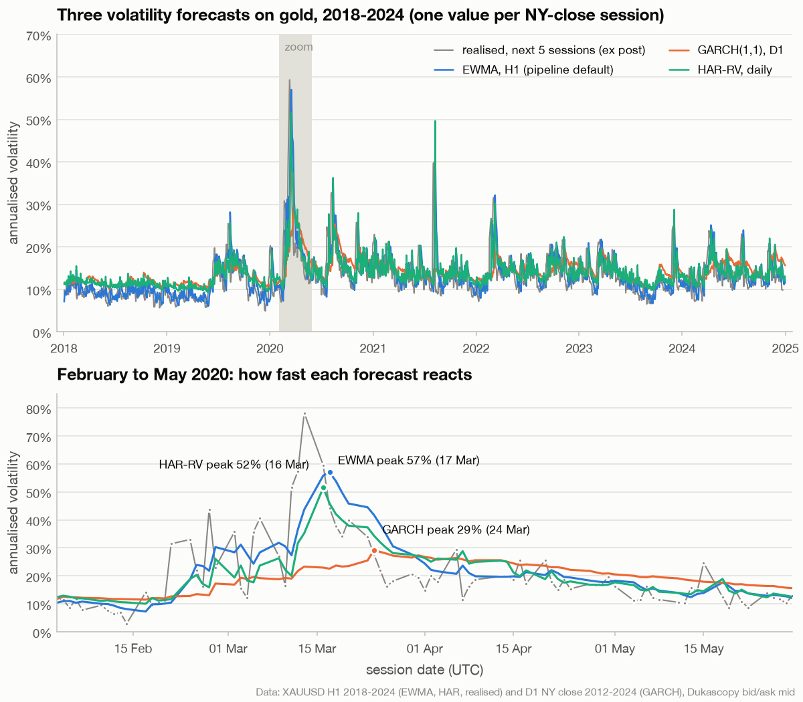
</picture>

*In March 2020, EWMA peaks at 57% on 17 March and HAR-RV at 52% on 16 March, while the daily GARCH only reaches 29% on 24 March and then stays above the others for weeks. Calm years show the opposite bias: GARCH sits near its long-run level while realised vol is lower. Data: XAUUSD H1 2018-2024 (EWMA, HAR, realised) and D1 NY close 2012-2024 (GARCH fit 2012-2017), Dukascopy bid/ask mid.*

A simple scorecard on the same table, 2018 to 2024, uses the QLIKE loss against the next
session's realised variance (lower is better; it stays a fair ranking when the variance proxy
is noisy, Patton, 2011):

```math
\mathrm{QLIKE} = \frac{1}{n} \sum_t \left( \frac{RV_{t+1}}{\hat\sigma_t^2} - \ln \frac{RV_{t+1}}{\hat\sigma_t^2} - 1 \right)
```

where $\hat\sigma_t$ is the annualised forecast made at the close of session $t$ and
$RV_{t+1}$ is $252$ times the next session's realised variance. It is reproducible from the
figure module:

```python
import sys

import numpy as np

sys.path.insert(0, "tools/figures")
from fig_models import _daily_forecasts  # the table behind the vol-estimators figure

df = _daily_forecasts().loc["2018-01-01":"2024-12-31"].dropna()
rv = df["rv_next"] ** 2                              # next session's realised variance (annualised)
print(f"{'model':6s} {'median':>7s} {'QLIKE':>7s} {'corr(log, log rv5)':>19s}")
for col in ("ewma", "garch", "har"):
    s2 = df[col] ** 2
    qlike = float(np.mean(rv / s2 - np.log(rv / s2) - 1))
    corr = float(np.corrcoef(np.log(df[col]), np.log(df["rv5"]))[0, 1])
    print(f"{col:6s} {df[col].median():7.4f} {qlike:7.4f} {corr:19.3f}")
print("realised next 5 sessions, median", round(float(df["rv5"].median()), 4), "| sessions:", len(df))
```

```text
model   median   QLIKE  corr(log, log rv5)
ewma    0.1261  0.2962               0.640
garch   0.1363  0.3255               0.598
har     0.1313  0.2940               0.613
realised next 5 sessions, median 0.1218 | sessions: 1802
```

HAR-RV has the lowest QLIKE by a small margin, EWMA tracks the following week best, and the
daily GARCH is the most biased upward. The differences are small, and this is one asset and
one period, so it is not a reason to change the pipeline's default. It is a reason not to
expect much from swapping estimators.

## Blending forecasts

`blend_vol(*series, weights=None, name="vol_blend")` combines forecasts by averaging
**variances**:

```math
\sigma_{\text{blend},t} = \sqrt{ \frac{\sum_i w_i\, \sigma_{i,t}^2\, \mathbf{1}[\sigma_{i,t} \text{ present}]}{\sum_i w_i\, \mathbf{1}[\sigma_{i,t} \text{ present}]} }
```

where the $w_i$ default to $1/k$ for $k$ series, must be non-negative with a positive sum, and
are renormalised over the inputs present at each row (series are outer-aligned). Averaging
variances is the natural pooling for second moments. Averaging square roots instead would bias
the blend downward (Jensen's inequality).

<picture>
  <source media="(prefers-color-scheme: dark)" srcset="_assets/figures/models/blend-vol-dark.png">
  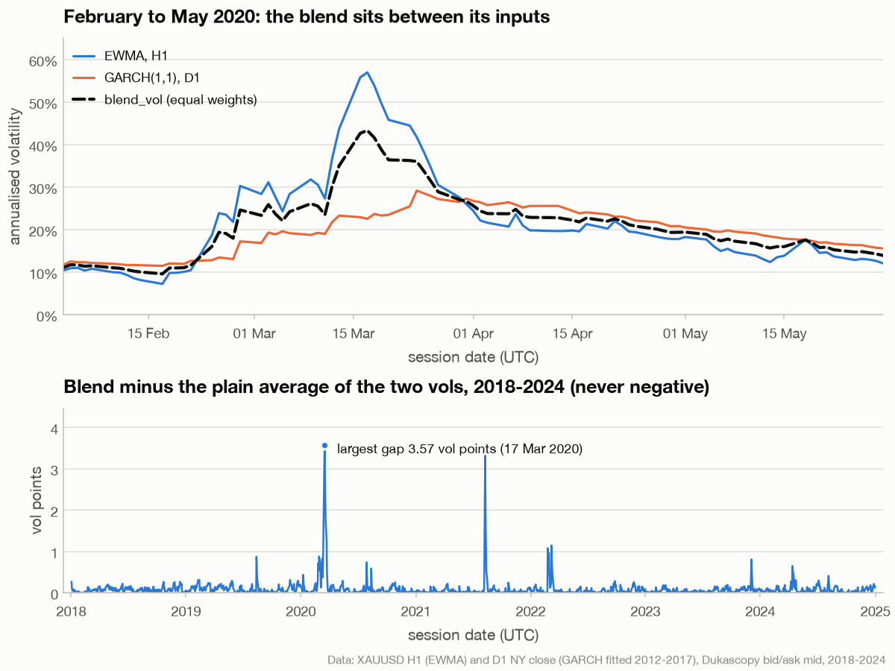
</picture>

*On 2020-03-17 the EWMA forecast stood at 57.0% and GARCH at 22.6%: their variance blend is 43.3%, 3.6 vol points above the plain average of 39.8%. The gap is never negative and is below 0.1 vol points on 76% of sessions, so the choice only matters when the inputs disagree strongly (March 2020, the August 2021 flash crash). Data: XAUUSD H1 (EWMA) and D1 New York close (GARCH fitted 2012-2017), Dukascopy bid/ask mid, 2018-2024.*

```python
import numpy as np
import pandas as pd

from aurum.models.volatility import blend_vol

idx = pd.date_range("2024-01-01", periods=3, freq="D", tz="UTC")
a = pd.Series([0.10, 0.10, 0.10], index=idx)
b = pd.Series([0.30, np.nan, 0.30], index=idx)
print(blend_vol(a, b).round(4).tolist())                       # sqrt((0.01 + 0.09) / 2), then a alone
print(blend_vol(a, b, weights=[3, 1]).round(4).tolist())       # weights renormalised to 0.75 / 0.25
```

```text
[0.2236, 0.1, 0.2236]
[0.1732, 0.1, 0.1732]
```

To size a backtest with a blend or with GARCH, pass it as `run_backtest(..., vol=series)`
([execution-and-costs.md](execution-and-costs.md)). The live runner always sizes with EWMA, so
this creates a research/live mismatch that you have to accept knowingly.

## Gaussian hidden Markov model

**Intuition.** Suppose the market is always in one of a few hidden "moods", say calm or
turbulent. Each mood has its own return distribution, and moods persist: today's mood is
usually tomorrow's. You never see the mood, only returns. An HMM learns the moods' return
distributions and their switching probabilities from history. Then, day by day, it
updates the probability of each mood from the latest return (Hamilton, 1989). The
*filtered* probability uses only returns up to today, so a strategy can act on it.

**The math.** `GaussianHMM(n_states=2, seed=0, *, n_iter=200, tol=1e-4, n_init=3, var_floor=1e-3, init_stay=0.95)`
in [aurum/models/regime.py](../aurum/models/regime.py) models

```math
P(s_t = k \mid s_{t-1} = j) = A_{jk}, \qquad P(s_0 = k) = \pi_k, \qquad
x_t \mid s_t = k \ \sim\ N\left(\mu_k,\ \operatorname{diag}(\sigma_k^2)\right)
```

where $s_t \in \lbrace 0, \ldots, K-1 \rbrace$ is the hidden state, $A$ the $K \times K$ transition
matrix (`transmat_`), $\pi$ the start distribution (`startprob_`), and $x_t$ the observation:
a scalar or a $D$-vector with diagonal covariance (`means_`, `vars_`). Missing components of
$x_t$ are marginalised out, which is exact for diagonal Gaussians. A fully missing row
contributes no likelihood.

The forward filter (`filter(x)`) is a predict-update loop, scaled so it never underflows
(Rabiner, 1989):

```math
\hat\alpha_0 \propto \pi \odot b_0, \qquad
\hat\alpha_t \propto \left(\hat\alpha_{t-1} A\right) \odot b_t, \qquad
c_t = \sum_k \left[\left(\hat\alpha_{t-1} A\right) \odot b_t\right]_k, \qquad
\ln L = \sum_t \ln c_t + \sum_t m_t
```

where

- $b_t(k) = \exp(\ln N(x_t; \mu_k, \sigma_k^2) - m_t)$ with $m_t = \max_k \ln N(x_t; \mu_k, \sigma_k^2)$.
  The shift keeps extreme observations from overflowing;
- $\hat\alpha_t(k) = P(s_t = k \mid x_0, \ldots, x_t)$ is the filtered probability, column
  `p_state_k`. Row $t$ depends only on `x[:t+1]`;
- `predict_next(x)` returns $\hat\alpha_t A = P(s_{t+1} \mid x_0, \ldots, x_t)$, and
  `filtered_state(x)` the most likely current state.


`fit(x)` runs Baum-Welch EM on the training data. The E-step adds a backward pass,
$\hat\beta_T = 1$ and $\hat\beta_t = A (b_{t+1} \odot \hat\beta_{t+1}) / c_{t+1}$, and forms the
posteriors:

```math
\gamma_t(k) \propto \hat\alpha_t(k)\, \hat\beta_t(k), \qquad
\Xi = A \odot \sum_{t} \hat\alpha_t^{\top} \left(\frac{b_{t+1} \odot \hat\beta_{t+1}}{c_{t+1}}\right)
```

and the M-step re-estimates

```math
\pi = \gamma_0, \qquad A_{jk} = \frac{\Xi_{jk}}{\sum_{k'} \Xi_{jk'}}, \qquad
\mu_k = \frac{\sum_t \gamma_t(k)\, x_t}{\sum_t \gamma_t(k)}, \qquad
\sigma_k^2 = \max\left( \frac{\sum_t \gamma_t(k)\, (x_t - \mu_k)^2}{\sum_t \gamma_t(k)},\ \varphi\, \operatorname{Var}(x) \right)
```

where $\gamma_t(k)$ is the smoothed probability of state $k$ at $t$ (it uses the *whole*
training window, which is fine for estimation and never used for decisions), $\Xi$ sums the
expected transition counts, and $\varphi$ = `var_floor` (0.001) keeps a state from collapsing
onto a single observation. Tiny constants (1e-8 on $\pi$, 1e-10 on $A$) keep every probability
positive.

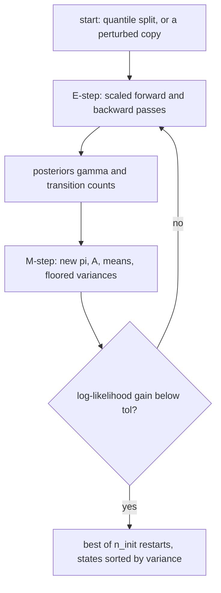

Details that matter in practice:

- **Restarts.** Restart 0 splits the observations into $K$ equal groups by "energy"
  ($\sum_d z_{t,d}^2$ of the standardised data), so low energy starts as the calm state, and
  starts $A$ with `init_stay` (0.95) on the diagonal. Restarts 1 and up mix those
  responsibilities with seeded Dirichlet noise (weight $\min(0.3 + 0.2 r, 0.9)$ for restart
  $r$) and perturb means and variances. EM stops when the log-likelihood gains less than `tol`
  or after `n_iter` iterations. The restart with the best final likelihood wins.
- **State order.** States are sorted by scale-free variance $\sum_d \sigma_{k,d}^2 / \operatorname{Var}(x_d)$,
  so **state 0 is always the calmest**. Labels are stable across fits, but what "calm" means is
  not (see the figure below).
- **Durations.** `expected_durations_` is $1/(1 - A_{kk})$ observations, the mean length of a
  stay in state $k$. `stationary_distribution_` is the left eigenvector of $A$ for eigenvalue 1,
  the long-run share of time in each state.
- **No look-ahead API.** There is deliberately no public smoother or Viterbi path: both use
  future observations.

**The picture.** Fitted to daily gold returns, the same two-state model finds very
different "regimes" depending on the training window:

<picture>
  <source media="(prefers-color-scheme: dark)" srcset="_assets/figures/models/hmm-emissions-dark.png">
  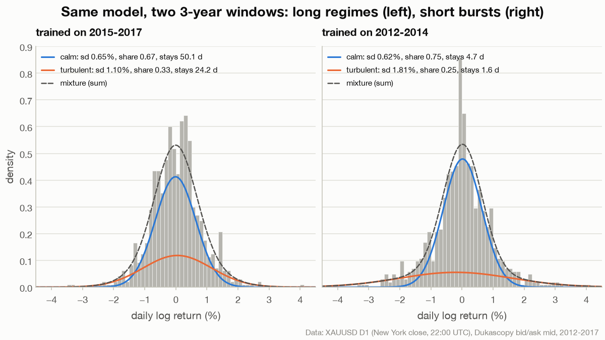
</picture>

*Left (2015-2017): two persistent regimes, staying 50 and 24 sessions on average. Right (2012-2014): the "turbulent" state is a fat-tail component that lasts 1.6 sessions, closer to a mixture model for jump days than to a regime. "share" is each state's stationary (long-run) probability, and the dashed line is the mixture of the two weighted components. Data: XAUUSD D1 (New York close, 22:00 UTC), Dukascopy bid/ask mid, 2012-2017.*

Refitting every year on the previous three years and filtering forward gives the regime
probability a strategy would actually have seen:

<picture>
  <source media="(prefers-color-scheme: dark)" srcset="_assets/figures/models/hmm-filtered-dark.png">
  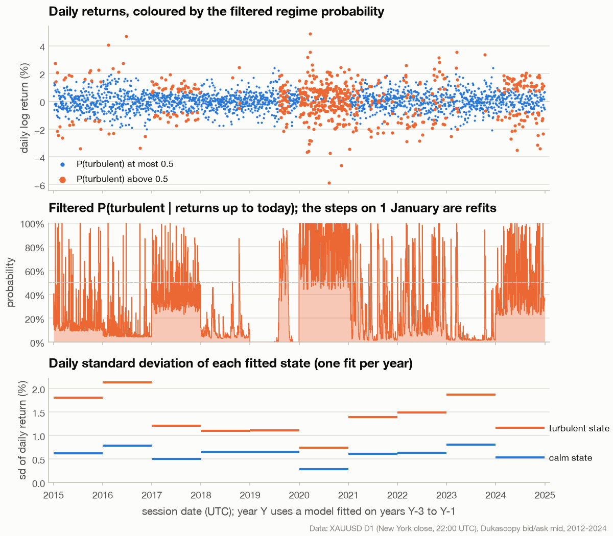
</picture>

*The filtered probability jumps at every 1 January, when the model is refitted. The 2020 model, trained on the quiet 2017-2019 window, has a calm state with a 0.28% daily sd and a "turbulent" state with 0.74%, inside the 0.50-0.81% range of the other fits' calm states. It flags 91% of 2020's sessions as turbulent. Data: XAUUSD D1 (New York close, 22:00 UTC), Dukascopy bid/ask mid, 2012-2024 (each year filtered with a model fitted on the previous three).*

**In code.** The left panel's fit, its filter and the first years of the yearly refits:

```python
import numpy as np
import pandas as pd

from aurum.data.store import load_bars
from aurum.models.regime import GaussianHMM

d1 = load_bars("data_store/xauusd_D1_nyclose.parquet")
d1 = d1[d1["available_at"] <= pd.Timestamp("2025-01-01", tz="UTC")]
r = (100 * np.log(d1["close"]).diff()).dropna()        # daily log returns in percent

hmm = GaussianHMM(n_states=2, seed=0).fit(r.loc["2015":"2017"])   # TRAIN only
s = hmm.summary()
print("sd (%)     ", np.sqrt(np.ravel(s["vars"])).round(3).tolist())
print("transmat   ", np.round(s["transmat"], 4).tolist())
print("durations  ", np.round(s["expected_durations"], 1).tolist(), " stationary",
      np.round(s["stationary"], 3).tolist(), " iters", s["n_iter"], s["converged"])

p = hmm.filter(r.loc[:"2018-01-05"])                   # causal: row t uses r[:t+1]
print(p.tail(3).round(3).to_string())
print(hmm.predict_next(r.loc[:"2018-01-05"]).tail(1).round(3).to_string(header=False))

# refit every year on the previous three years (the setup of the figures on this page)
print("year  train      sd calm/turb   stays calm/turb   days with P(turb) > 0.5")
for year in (2018, 2019, 2020, 2021):
    m = GaussianHMM(n_states=2, seed=0).fit(r.loc[str(year - 3):str(year - 1)])
    share = float((m.filter(r.loc[:str(year)])["p_state_1"].loc[str(year)] > 0.5).mean())
    sd = np.sqrt(np.ravel(m.vars_))
    print(f"{year}  {year - 3}-{year - 1}  {sd[0]:.2f} / {sd[1]:.2f}    "
          f"{m.expected_durations_[0]:9.3g} / {m.expected_durations_[1]:<6.3g}  {share:6.0%}")
```

```text
sd (%)      [0.652, 1.097]
transmat    [[0.98, 0.02], [0.0414, 0.9586]]
durations   [50.1, 24.2]  stationary [0.674, 0.326]  iters 28 True
                           p_state_0  p_state_1
time                                           
2018-01-02 22:00:00+00:00      0.909      0.091
2018-01-03 22:00:00+00:00      0.902      0.098
2018-01-04 22:00:00+00:00      0.928      0.072
time                                   
2018-01-04 22:00:00+00:00  0.913  0.087
year  train      sd calm/turb   stays calm/turb   days with P(turb) > 0.5
2018  2015-2017  0.65 / 1.10         50.1 / 24.2        2%
2019  2016-2018  0.65 / 1.11     1.09e+07 / 138        17%
2020  2017-2019  0.28 / 0.74         1.08 / 3.07       91%
2021  2018-2020  0.61 / 1.39         58.4 / 20.7       22%
```

The index is the bar open time: the D1 bar opening 22:00 UTC on 2018-01-04 is the session
that closes on 2018-01-05. The 2019 fit made the calm state almost absorbing
($1/(1 - A_{00}) \approx 10^7$ sessions).

| Argument | Default | Meaning |
|---|---|---|
| `n_states` | 2 | Number of hidden states $K$ |
| `seed` | 0 | Seed of the random restarts (deterministic) |
| `n_iter` | 200 | Maximum EM iterations per restart |
| `tol` | 1e-4 | Stop when the log-likelihood gains less than this |
| `n_init` | 3 | Restarts (the first is the deterministic quantile split) |
| `var_floor` | 1e-3 | Minimum variance as a fraction of each feature's training variance |
| `init_stay` | 0.95 | Initial diagonal of $A$ |

Fitted attributes: `startprob_`, `transmat_`, `means_`, `vars_`, `loglik_`, `n_iter_`,
`converged_`, `columns_`. Methods: `fit`, `filter`, `predict_next`, `filtered_state`,
`score(x)` (log-likelihood), `summary()` (JSON-friendly), and the properties
`stationary_distribution_` and `expected_durations_`. A DataFrame passed after fitting is
re-ordered by the fitted column names, and a width mismatch raises.

**How `regime_switch` uses it.** The strategy fits a 2-state HMM per walk-forward fold on daily
log returns in percent: D1 bars resampled point-in-time from intraday bars at the 22:00 UTC
anchor, or the bars themselves on D1. It then scales a base trend forecast (`tsmom` by
default) by the filtered probability of *not* being in the most volatile state:

```math
p^{\text{ok}}_t = 1 - P(s_t = K-1 \mid r_0, \ldots, r_t), \qquad
f_t = f^{\text{base}}_t \cdot \operatorname{clip}\left(\frac{p^{\text{ok}}_t - p_{\text{flat}}}{p_{\text{full}} - p_{\text{flat}}},\ 0,\ 1\right)
```

with `p_flat` 0.5 and `p_full` 0.9 (`regime_scale` in
[aurum/strategies/regime.py](../aurum/strategies/regime.py); parameters in
[strategies.md](strategies.md)). Each daily probability becomes usable at that day's
`available_at` and is joined onto the trading bars with `asof_join`. In the exploratory D1 run
`runs/v21_managed_gold` (OOS 2016-01-03 to 2024-12-30, data to 2024 only), `regime_switch` had
a Sharpe of 0.141 (95% CI −0.594 to 0.836) against −0.366 for plain daily `tsmom`. Its maximum
drawdown was −9.7% against −17.1%, and it paid 7,021 against 2,979 in costs. Read
[RESULTS.md](RESULTS.md) before drawing any conclusion: no confidence interval excludes zero.

## Pitfalls and design choices

- **Look-ahead through annualisation.** A realised bar density uses future timestamps. aurum
  annualises every causal estimate with the nominal constant and measures the bar length from
  the first 200 timestamps only.
- **Look-ahead through fitting.** `Garch11.fit`, `HarRV.fit` and `GaussianHMM.fit` must see
  training data only. `har_rv_forecast` refits walk-forward by itself. The HMM smoother is
  used inside `fit` only, and the public API exposes the causal filter alone.
- **Warm-up.** EWMA's first 20 rows are a conservative constant 0.20, never back-filled.
  `har_rv_forecast` is NaN before its first fit. A filter started on a short history forgets
  its starting point geometrically, so the live runner's shorter window agrees with research
  after a few expected durations.
- **Timeframe matters.** The same GARCH is a slow mean-reverting model on daily data and a
  3-bar shock absorber on H1 data. Intraday seasonality is not modelled anywhere on this page.
- **Regimes are relative, not absolute.** An HMM's "turbulent" state is turbulent *relative to
  its training window*. Refits can relabel 2% or 91% of a year, and they can turn a regime model
  into a jump-day detector. Treat HMM output as a noisy feature, not as ground truth.
- **Gaussian everywhere.** GARCH, HAR-RV and the HMM all assume Gaussian errors. Gold's
  daily New York close returns have an excess kurtosis of 5.9 (simple returns) to 6.5 (log returns)
  over 2012-2024, so tail events are more common
  than these models imply ([portfolio-and-risk.md](portfolio-and-risk.md#var-es-and-stress-tests)).
- **Estimators do not create an edge.** Better volatility forecasts make risk steadier. They do
  not make a losing strategy win ([RESULTS.md](RESULTS.md)).

## See also

- [portfolio-and-risk.md](portfolio-and-risk.md): how the vol forecast becomes a position, and VaR/ES
- [features.md](features.md): the window-bounded volatility and regime *features* (Yang-Zhang, Parkinson, efficiency ratio)
- [strategies.md](strategies.md): `regime_switch` and the other strategies
- [ml-and-rl.md](ml-and-rl.md): learned models and the RL environment, which sizes with EWMA
- [execution-and-costs.md](execution-and-costs.md): `run_backtest(..., vol=...)` and the backtest engine
- [data.md](data.md): bars, `available_at` and point-in-time joins
- [research.md](research.md) and [analytics.md](analytics.md): walk-forward evaluation and the analytics tools
- [architecture.md](architecture.md), [configuration.md](configuration.md), [cli.md](cli.md), [index.md](index.md)
- [live-trading.md](live-trading.md): the live runner, which always sizes with EWMA
