# Portfolio construction and risk

This page covers everything between the strategies and the execution simulator. The
**forecast combiner** blends strategy forecasts into one forecast in [-1, 1]. It scores each
strategy net of estimated trading costs, gives losers no weight and holds back risk it cannot
place. The **sizer** turns that forecast into signed lots by volatility targeting. The **risk
manager** is the last gate: it can only *reduce* the requested position, and it owns the
kill switch, which survives restarts. The page ends with drawdown arithmetic, VaR and
Expected Shortfall, and stress tests. The volatility forecast the sizer divides by has its own
page, [models.md](models.md). Every formula, default and behaviour below is taken from
[aurum/portfolio/](../aurum/portfolio/), [aurum/risk/](../aurum/risk/) and
[aurum/core/config.py](../aurum/core/config.py). Every example was run against the current
code, and every figure is drawn by [tools/figures/fig_portfolio.py](../tools/figures/fig_portfolio.py)
from real run outputs and real gold data cut at 2024-12-31.

**On this page**

- [The decision chain](#the-decision-chain)
- [Forecast combiner](#forecast-combiner)
- [Position sizing](#position-sizing)
- [Risk manager](#risk-manager)
- [Drawdowns](#drawdowns)
- [VaR, ES and stress tests](#var-es-and-stress-tests)
- [Volatility and regime models](#volatility-and-regime-models)
- [Limitations](#limitations)
- [See also](#see-also)

## The decision chain

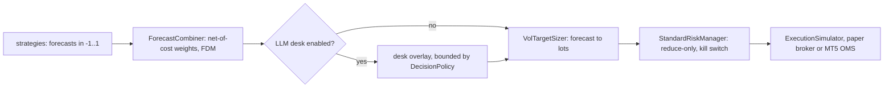

Three rules hold along this chain (SPEC §0.3):

- Strategies only emit forecasts. They never size positions.
- The sizer is the only place where a forecast becomes lots.
- The risk manager can only move the requested position toward zero, or halt. Nothing after it
  can add exposure. The backtest engine also clamps any approval that exceeds the request
  and logs it (see [execution-and-costs.md](execution-and-costs.md#backtest-engine)).

The research backtests, the RL environment, paper trading and the live runner use the same
sizer and risk manager classes. The LLM desk sits between the combiner and the sizer, and
its output goes through the same sizer and risk manager ([llm-desk.md](llm-desk.md)).

## Forecast combiner

**Intuition.** Several strategies each say how bullish or bearish they are. The combiner
decides how much to listen to each, using only past data. It measures what each strategy
would have earned *after trading costs* at a constant risk level. Strategies that lost money
after costs get nothing. The noisy track records of the rest are pulled toward their
average. When the strategies disagree often, their average is weaker than any one of them, so
the result is scaled back up by a diversification multiplier.

`aurum.portfolio.combiner.ForecastCombiner` learns one weight per strategy and a forecast
diversification multiplier (FDM) on **training data only**, then combines row by row:

```math
F_t = \operatorname{clip}\left( \mathrm{FDM} \cdot \sum_i w_i\, f_{i,t},\ -1,\ 1 \right)
```

where $f_{i,t}$ is strategy $i$'s forecast at bar $t$ (clipped to [-1, 1], missing values set to
0), $w_i \ge 0$ its weight, and $\sum_i w_i \le 1$. `combine()` uses only row $t$, so it is
causal on any later window. `fit()` restricts `close` (and `bars`) to the forecasts' own
index, so passing a longer price series cannot leak.

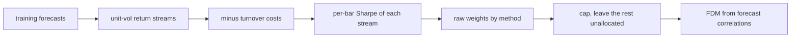

### Scoring each strategy net of costs

Each strategy is scored on its **unit-volatility return stream**:

```math
u_{i,t} = \frac{f_{i,t}\, r_{t+1}}{v_t}, \qquad
v_t = \sqrt{\operatorname{EWM}_{H}\left(r^2\right)_t}
```

where $r_{t+1}$ is the next bar's log return and $v_t$ is a causal per-bar EWMA volatility
with half-life $H$ = `vol_halflife` (48 bars) and `min_periods` = 20. It is the recursion of
[EWMA volatility](models.md#ewma-volatility-the-default), not annualised. $u$ is the return a
vol-targeted position earns per unit of target volatility, so calm and turbulent periods are
comparable. The first 20 rows of the window (no $v_t$ yet: the first return is undefined, then
`min_periods` applies) and the last row, which has no forward return, are dropped.

When cost information is passed to `fit()`, the stream is charged for forecast turnover:

```math
n_{i,t} = u_{i,t} - c_t \left| f_{i,t} - f_{i,t-1} \right|, \qquad
c_t = \frac{\tfrac{1}{2}\, s^{\mathrm{eff}}_t + \mathrm{slip}_t + \kappa}{C_t\, v_t} \cdot m_c
```

```math
s^{\mathrm{eff}}_t = \max\left(\text{spread}_t \cdot \text{spread\_multiplier},\ \text{min\_spread}\right), \qquad
\mathrm{slip}_t = \text{slippage\_fixed} + \text{slippage\_range\_frac} \cdot (H_t - L_t)
```

where

- $s^{\mathrm{eff}}_t$ is the effective spread (the quoted spread of bar $t$, scaled, with a floor),
- $\mathrm{slip}_t$ is the slippage, which grows with the bar's high-low range $H_t - L_t$,
- $\kappa$ is the commission per ounce (the commission on 1 lot divided by `contract_size`),
- $C_t$ is the close and $m_c$ = `cost_multiplier` (default 1),
- the first row of the window has no previous forecast, so its turnover is 0.

How $c_t$ is derived, in short: with $\sigma_b$ the per-bar target vol, the vol-target sizer
holds $f \sigma_b / v_t$ of equity, so a forecast change of size $\Delta f$ trades
$\sigma_b \Delta f / v_t$ of equity. Each unit of notional crossed costs $k_t / C_t$, where
$k_t$ is the per-ounce concession of one fill (half the effective spread plus slippage plus
commission per ounce). Dividing the cost by $\sigma_b$ puts it in the same units as $u$, and the
target vol cancels. The spread, slippage and commission terms come from the same
[`CostModel`](execution-and-costs.md#cost-model) the simulator charges.

The estimate is deliberately simple, and it errs on the conservative side:

- Bar $t$'s spread and range stand in for the execution bar $t+1$.
- The `sqrt(lots)` impact term is ignored (lots are unknown here).
- Trades caused by volatility changes at a constant forecast are ignored.
- The sizer's rebalance band suppresses small trades, so jittery forecasts are over-charged.
- Each strategy pays for its own turnover, whereas opposite trades of different strategies
  net out in the blend.
- Overnight financing is a holding cost, not a turnover cost, and is not included.

Cost inputs to `fit()`:

| Argument | Effect |
|---|---|
| `bars=` (with a `spread` column, ideally `high`/`low`) or `spread=` | Estimate $c_t$ from `costs` (default `CostModel()`) and `instrument` (default XAUUSD) |
| `cost_per_turnover=` (scalar or Series, unit-vol units) | Use this $c_t$ instead of the estimate. Takes precedence. |
| nothing | Score **gross** streams. `explain()["cost_basis"]` and `notes` say so. |

`cost_multiplier` scales the estimated $c_t$ (1 = the cost model's estimate, above 1
stress-tests, 0 = score gross). It does not apply to an explicit `cost_per_turnover`. Rows
without a cost estimate are charged the window's median $c_t$, never zero. The walk-forward
always passes the bars, the configured cost model and the instrument, so research weights are
net of costs.

### sharpe_shrink (the default)

**Intuition.** Weight each strategy by its risk-adjusted track record, but do not trust the
track record fully: three years of hourly data cannot tell a 0.3 Sharpe from a 0.1 Sharpe.
So each Sharpe ratio is pulled halfway toward the average of the strategies that made money.
A strategy that lost money after costs is dropped, and it does not drag the average down.

**The math.** With per-bar statistics of the net streams,

```math
\mathrm{SR}_i = \frac{\overline{n_i}}{\operatorname{sd}(n_i)}, \qquad
\mathcal{E} = \lbrace i \text{ active} : \mathrm{SR}_i > 0 \rbrace, \qquad
\widetilde{\mathrm{SR}}_i = (1-\lambda)\, \mathrm{SR}_i + \lambda\, \frac{1}{\lvert \mathcal{E} \rvert} \sum_{j \in \mathcal{E}} \mathrm{SR}_j, \qquad
\text{raw}_i = \begin{cases} \widetilde{\mathrm{SR}}_i / \operatorname{sd}(n_i), & i \in \mathcal{E} \\ 0, & \text{otherwise} \end{cases}
```

where

- $\lambda$ = `shrinkage` (0.5). $\lambda = 1$ ignores Sharpe differences, and $\lambda = 0$ trusts them fully;
- `sd` uses `ddof=1`. A strategy is *active* when its stream and its forecast both vary over the window
  (sd above 1e-12). A constant forecast carries no information and gets zero weight;
- dividing the shrunk Sharpe by the stream's standard deviation is diagonal mean-variance: a
  James-Stein style shrinkage of the Sharpe ratios (cf. Jorion, 1986) with correlations ignored;
- if $\mathcal{E}$ is empty, every weight is 0 and the combined book is **flat** (the notes say so);
- the reported `train_sharpe` is $\mathrm{SR}_i \sqrt{B}$, with $B$ the realised bar density of the window
  (or `bars_per_year`, or 252 without a DatetimeIndex). Annualisation does not change the weights.

The figure redoes one real fit step by step: fold 17 of the protocol's `trend_core` run, whose
combiner was fitted on the stitched out-of-sample forecasts of folds 0 to 16.

<picture>
  <source media="(prefers-color-scheme: dark)" srcset="_assets/figures/portfolio-and-risk/sharpe-shrink-steps-dark.png">
  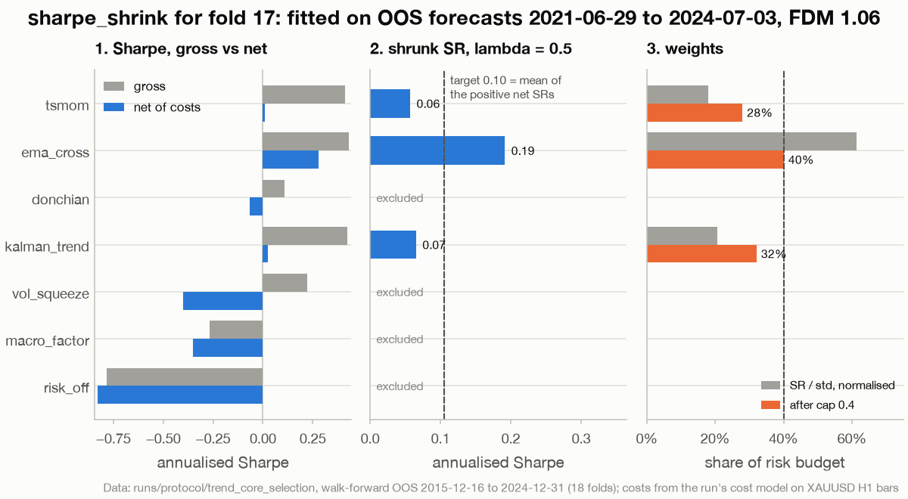
</picture>

*Costs push donchian and vol_squeeze below zero (vol_squeeze goes from +0.22 gross to −0.40 net), so only three of the seven strategies stay positive. Shrinkage then lifts tsmom's 0.01 net Sharpe to 0.06. After the 0.4 cap, ema_cross holds 40% and the excess flows to tsmom (28%) and kalman_trend (32%). These are exactly the weights stored in `weights.csv`. Data: runs/protocol/trend_core_selection, walk-forward OOS 2015-12-16 to 2024-12-31 (18 folds); combiner fit window 2021-06-29 to 2024-07-03 on XAUUSD H1 bars.*

```python
import numpy as np
import pandas as pd

from aurum.core.config import load_config
from aurum.data.store import load_bars
from aurum.portfolio.combiner import ForecastCombiner

run = "runs/protocol/trend_core_selection"                 # a walk-forward output directory
cfg = load_config(f"{run}/config.yaml", validate=False)
fc = pd.read_parquet(f"{run}/oos_forecasts.parquet")
fc["fold"] = fc["fold"].astype(int)
keys = [c for c in fc.columns if c not in ("combined", "fold")]

h1 = load_bars("data_store/xauusd_H1.parquet")
h1 = h1[h1["available_at"] <= pd.Timestamp("2025-01-01", tz="UTC")]

# fold 17 was fitted on the OOS forecasts of folds 0-16, the last walkforward.train bars
hist = fc.loc[fc["fold"] < 17, keys].iloc[-17834:]
c = cfg.combiner
comb = ForecastCombiner(method=c.method, shrinkage=c.shrinkage, max_weight=c.max_weight, fdm_cap=c.fdm_cap,
                        vol_halflife=c.vol_halflife, min_periods=c.min_periods, corr_floor=c.corr_floor,
                        allow_unallocated=c.allow_unallocated, cost_multiplier=c.cost_multiplier)
comb.fit(hist, h1["close"].reindex(hist.index), bars=h1.loc[hist.index], costs=cfg.costs.build(),
         instrument=cfg.instrument.build())
stored = pd.read_csv(f"{run}/weights.csv", index_col=0).loc[17]
print(pd.DataFrame({"refit": comb.weights_, "weights.csv": stored[keys]}).round(3).T.to_string())
print("fdm refit", round(comb.fdm_, 4), "| weights.csv", round(stored["fdm"], 4))

# the FDM by hand: sum(w) / sqrt(w' H w), H = training forecast correlations floored at 0
w = comb.weights_.to_numpy()
h = np.maximum(comb.corr_.to_numpy(), c.corr_floor)
print("by hand  ", round(w.sum() / np.sqrt(w @ h @ w), 4))
```

Output (this reads a walk-forward run directory and the Dukascopy store; both are local and
gitignored, see [research.md](research.md)):

```text
             tsmom  ema_cross  donchian  kalman_trend  vol_squeeze  macro_factor  risk_off
refit        0.279        0.4       0.0         0.321          0.0           0.0       0.0
weights.csv  0.279        0.4       0.0         0.321          0.0           0.0       0.0
fdm refit 1.0596 | weights.csv 1.0596
by hand   1.0596
```

`allow_unallocated=False` restores the older rule: it shrinks toward the mean over *all*
active strategies, zeroes non-positive *shrunk* Sharpes, and falls back to inverse-vol when
none is positive.

### Weight cap and unallocated risk

**Intuition.** No strategy may take more than 40% of the risk budget. If the winners cannot
absorb the whole budget under that cap, the rest is simply not spent. The book runs smaller
instead of handing risk to strategies that are expected to lose.

**The math.** `cap_weights(raw, max_weight, allow_unallocated=True)` water-fills under the
cap. The excess above the cap is repeatedly redistributed pro rata to the uncapped positive
entries, which is the same as

```math
w_i = \min\left(w_{\max},\ \kappa\, \text{raw}_i\right) \ \text{ for } \text{raw}_i > 0, \qquad
\kappa \text{ such that } \sum_i w_i = \min\left(1,\ m\, w_{\max}\right), \qquad
\text{unallocated} = 1 - \sum_i w_i
```

where $w_{\max}$ = `max_weight` (0.4) and $m$ is the number of positively scored strategies.
If the cap is infeasible for the configured set (`max_weight` times the number of active
strategies is below 1), it is relaxed to one over that number and a note is recorded. With `allow_unallocated=True` (the
default), zero-scored strategies never receive weight. `equal`, `inverse_vol` and `hrp` score
every active strategy positively, so their weights always sum to 1.

<picture>
  <source media="(prefers-color-scheme: dark)" srcset="_assets/figures/portfolio-and-risk/combiner-fold-weights-dark.png">
  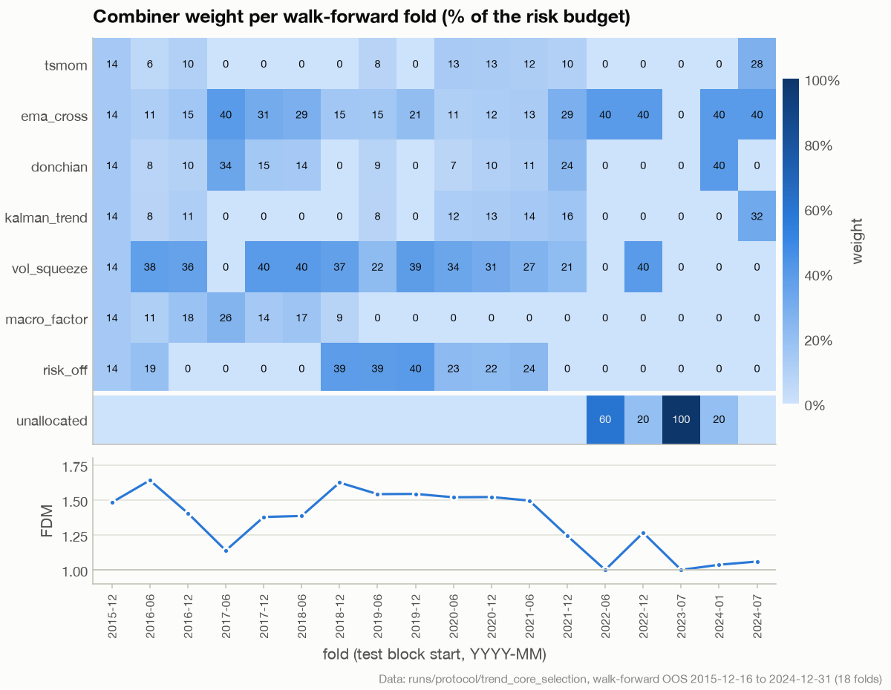
</picture>

*Fold 0 uses equal weights because no out-of-sample history exists yet. From 2022 the cost-adjusted Sharpe ratios turn negative: 60% of the budget is unallocated in the fold starting 2022-06, and the fold starting 2023-07 holds the book completely flat. The FDM falls toward 1.0 as fewer strategies are allocated, and is exactly 1.0 with one or none. Data: runs/protocol/trend_core_selection, walk-forward OOS 2015-12-16 to 2024-12-31 (18 folds).*

### Other weighting methods

| Method | Raw weight | Notes |
|---|---|---|
| `sharpe_shrink` (default) | $\widetilde{\mathrm{SR}}_i / \operatorname{sd}(n_i)$ on the positive net Sharpes | See above |
| `equal` | 1 for each active strategy | $1/N$, hard to beat out of sample (DeMiguel, Garlappi and Uppal, 2009) |
| `inverse_vol` | $1 / \operatorname{sd}(n_i)$ | Naive risk parity |
| `hrp` | Hierarchical Risk Parity, below | López de Prado (2016) |
| `fixed` (config only) | `strategies[].weight`, normalised to sum to 1 | Not a `ForecastCombiner` method. `aurum.research.walkforward` builds it from the config. A strategy without `weight` counts as 1.0, and setting `weight` with any other method is a config error. Its FDM is $\max(1, 1/\sqrt{w^\top H w})$, capped at `fdm_cap`. |

#### Hierarchical Risk Parity

**Intuition.** Group strategies that behave alike, then split capital between the groups
before splitting it inside them. Five trend-following variants then count roughly as one bet
instead of five. At every split, the less volatile group gets more.

**The math.** On the covariance $\Sigma$ of the active net streams:

```math
d_{ij} = \sqrt{\tfrac{1}{2}\left(1 - \rho_{ij}\right)}, \qquad
V(\mathcal{C}) = \tilde w_{\mathcal{C}}^{\top} \Sigma_{\mathcal{C}}\, \tilde w_{\mathcal{C}}, \quad
\tilde w_{\mathcal{C}} \propto \frac{1}{\operatorname{diag}(\Sigma_{\mathcal{C}})}, \qquad
a = 1 - \frac{V(\mathcal{L})}{V(\mathcal{L}) + V(\mathcal{R})}
```

where

- $\rho_{ij}$ is the correlation of streams $i$ and $j$ and $d_{ij}$ their distance (clipped to [0, 1]);
- single-linkage clustering on $d$ builds a binary tree. Its leaf order is the *quasi-diagonal*
  order, which places similar strategies next to each other;
- walking the tree from the root, each node with children $\mathcal{L}$ and $\mathcal{R}$ multiplies the weights
  in $\mathcal{L}$ by $a$ and those in $\mathcal{R}$ by $1 - a$, where $V$ is the variance of a cluster held at
  inverse-variance weights. The weights are normalised at the end;
- `_hrp_weights` follows the tree (Pfitzinger and Katzke, 2019) instead of the original recursive
  bisection, which halves the quasi-diagonal list. That way a natural cluster is never cut in two.

<picture>
  <source media="(prefers-color-scheme: dark)" srcset="_assets/figures/portfolio-and-risk/hrp-correlation-dark.png">
  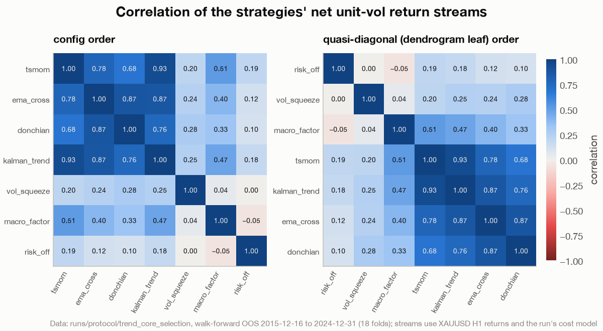
</picture>

*Re-ordered by the tree, the four trend rules form one block with correlations of 0.68 to 0.93. macro_factor joins them loosely, and vol_squeeze and risk_off correlate 0.28 or less with every other stream. Data: runs/protocol/trend_core_selection, walk-forward OOS 2015-12-16 to 2024-12-31 (18 folds); net unit-vol streams on XAUUSD H1 returns and the run's cost model.*

<picture>
  <source media="(prefers-color-scheme: dark)" srcset="_assets/figures/portfolio-and-risk/hrp-bisection-dark.png">
  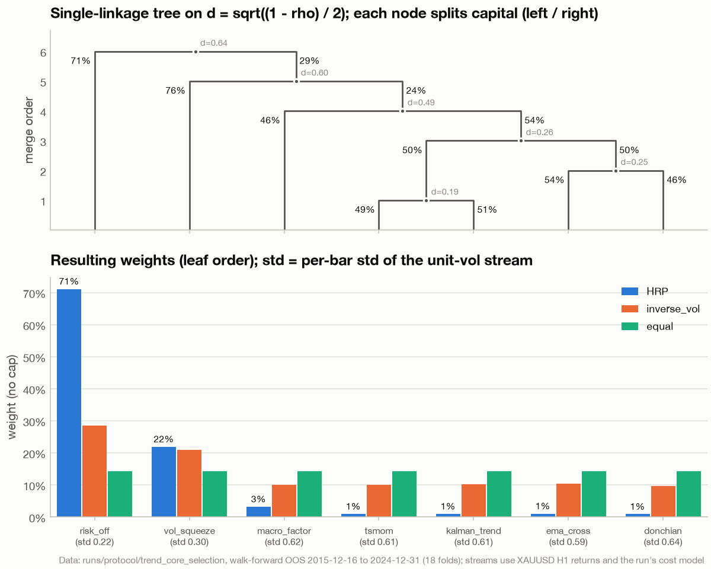
</picture>

*The root split gives risk_off 71%, because its stream has the lowest variance. Every later split repeats the pattern, so HRP ends with 71% risk_off, 22% vol_squeeze and about 1% for each trend rule. The stream sd is about 0.6 for the trend rules and 0.22 for risk_off: risk_off's forecasts average 0.06 in absolute value, against about 0.46 for the trend rules. Data: runs/protocol/trend_core_selection, walk-forward OOS 2015-12-16 to 2024-12-31 (18 folds); fit on all of it, an illustration rather than a walk-forward result.*

The same numbers from code, continuing the snippet above:

```python
# continues the snippet above: every method on all stored OOS forecasts, no weight cap
f, close = fc[keys], h1["close"].reindex(fc.index)
kw = {"bars": h1.loc[fc.index], "costs": cfg.costs.build(), "instrument": cfg.instrument.build()}
out = {m: ForecastCombiner(method=m, max_weight=1.0).fit(f, close, **kw) for m in ("hrp", "inverse_vol", "equal")}
table = pd.DataFrame({m: x.weights_ for m, x in out.items()})
table["stream_std"] = out["hrp"].train_vol_
table["avg_abs_forecast"] = out["hrp"].avg_abs_forecast_
print(table.round(3).to_string())
```

```text
                hrp  inverse_vol  equal  stream_std  avg_abs_forecast
tsmom         0.009        0.101  0.143       0.612             0.471
ema_cross     0.010        0.104  0.143       0.593             0.457
donchian      0.009        0.097  0.143       0.640             0.451
kalman_trend  0.009        0.102  0.143       0.606             0.463
vol_squeeze   0.219        0.210  0.143       0.295             0.102
macro_factor  0.032        0.100  0.143       0.618             0.495
risk_off      0.711        0.286  0.143       0.217             0.064
```

> [!WARNING]
> `inverse_vol` and `hrp` weight by the inverse variance of the unit-vol stream, and that
> variance scales with the *size* of a strategy's forecasts. A strategy that is mostly flat
> looks low-risk and receives most of the budget. On the 14-strategy `default_selection` run,
> `intraday_seasonality` (average |forecast| 0.006) receives 98% of an uncapped HRP
> allocation. The default 0.4 cap limits the damage. Check `avg_abs_forecast` in `explain()`
> before using these methods.

### Forecast diversification multiplier

**Intuition.** Averaging forecasts that disagree produces a weaker forecast than any of its
parts, so a blend of uncorrelated strategies would trade too small. The FDM (Carver, 2015,
*Systematic Trading*, ch. 8) scales the blend back to the typical size of one forecast.

```math
\mathrm{FDM} = \min\left( \text{fdm\_cap},\ \max\left(1,\ \frac{\sum_i w_i}{\sqrt{w^\top H\, w}}\right) \right),
\qquad H_{ij} = \max\left(\rho^{f}_{ij},\ \text{corr\_floor}\right), \quad H_{ii} = 1
```

where $\rho^{f}_{ij}$ is the correlation of the (clipped) *training forecasts* of active
strategies (not of their returns), `corr_floor` is 0, as Carver recommends, and `fdm_cap` is
2.5. Normalising by $\sum_i w_i$ makes the FDM a property of the allocated sub-portfolio, so
unallocated weight still reduces the combined forecast instead of being scaled back up. For
$N$ equal weights and a common correlation $\rho$, it reduces to
$1/\sqrt{\rho + (1-\rho)/N}$:

<picture>
  <source media="(prefers-color-scheme: dark)" srcset="_assets/figures/portfolio-and-risk/fdm-correlation-dark.png">
  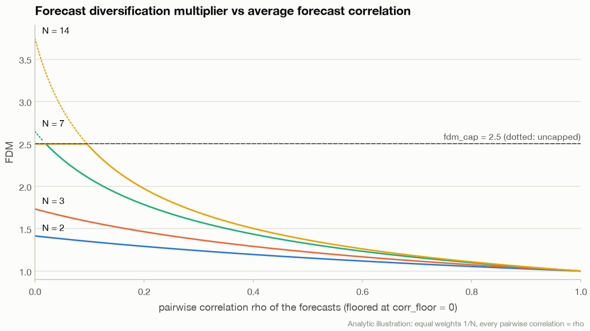
</picture>

*At zero correlation the FDM is the square root of N, and it falls to 1 as forecasts become identical. The 2.5 cap binds only for 7 strategies below a correlation of about 0.02, and for 14 below about 0.10. In the trend_core run the per-fold FDM ranged from 1.00 to 1.64. Data: analytic illustration with equal weights 1/N and a common pairwise correlation.*

Carver's derivation assumes forecasts share a common scale. The combiner does not rescale
strategies whose typical magnitude differs. It reports `avg_abs_forecast` instead.

### Attribution of the combined forecast

Because the blend is linear before the clip, each strategy's contribution at bar $t$ is exact:

```math
c_{i,t} = \mathrm{FDM}_k\, w_{k,i}\, f_{i,t}, \qquad
\sum_i c_{i,t} = \text{pre-clip forecast}, \qquad
\text{clip\_adjustment}_t = F_t - \sum_i c_{i,t}
```

where $k$ is the fold (or the live artifact) that produced the weights. The live runner writes
these numbers into each decision record, together with `unallocated` $= \max(0, 1 - \sum_i w_i)$ and
`desk_delta` (the desk's final forecast minus $F_t$). `aurum explain` reads them back
([analytics.md](analytics.md), [live-trading.md](live-trading.md)).

### Parameters

| Constructor argument | Config key (`combiner.*`) | Default | Meaning |
|---|---|---|---|
| `method` | `method` | `"sharpe_shrink"` | `sharpe_shrink`, `equal`, `inverse_vol`, `hrp` (config also accepts `fixed`) |
| `shrinkage` | `shrinkage` | 0.5 | λ in [0, 1]. 1 ignores Sharpe differences. |
| `max_weight` | `max_weight` | 0.4 | Per-strategy cap, in (0, 1] |
| `fdm_cap` | `fdm_cap` | 2.5 | Cap on the FDM (must be ≥ 1) |
| `vol_halflife` | `vol_halflife` | 48.0 | Half-life (bars) of the per-bar EWMA vol in $u$ |
| `min_periods` | `min_periods` | 20 | Warm-up bars for that vol |
| `corr_floor` | `corr_floor` | 0.0 | Floor on pairwise forecast correlations in the FDM |
| `bars_per_year` | (not exposed) | `None` | Annualisation of reported Sharpes. `None` infers it from the index. |
| `allow_unallocated` | `allow_unallocated` | `True` | See above |
| `cost_multiplier` | `cost_multiplier` | 1.0 | Scales the estimated $c_t$ (≥ 0) |

`fit()` needs at least 30 valid rows.

### Example

A runnable example on synthetic data: three toy forecasts, one of which has a real (built-in)
edge after costs.

```python
import numpy as np
import pandas as pd

from aurum.data.synthetic import make_synthetic_bars
from aurum.execution.costs import CostModel
from aurum.portfolio.combiner import ForecastCombiner

# synthetic H1 bars with mild return autocorrelation (a toy trend process)
bars = make_synthetic_bars(4000, "H1", seed=3, model="trend", regime_params={"phi": 0.1})
close = bars["close"]
ret = np.log(close).diff()

# three toy forecasts in [-1, 1]; each row uses bars <= t only
forecasts = pd.DataFrame({
    "fast_trend": np.sign(ret.rolling(24).sum()).fillna(0.0),
    "slow_trend": np.tanh(ret.rolling(240).sum() / 0.02).fillna(0.0),
    "fade": -np.sign(ret.rolling(6).sum()).fillna(0.0),
})
train, test = forecasts.iloc[:3000], forecasts.iloc[3000:]

comb = ForecastCombiner()                             # sharpe_shrink, shrinkage 0.5, max_weight 0.4
comb.fit(train, close, bars=bars, costs=CostModel())  # net of estimated trading costs
info = comb.explain()
print("net Sharpe  :", {k: round(v, 2) for k, v in info["train_sharpe"].items()})
print("gross Sharpe:", {k: round(v, 2) for k, v in info["train_sharpe_gross"].items()})
print("weights     :", {k: round(v, 3) for k, v in info["weights"].items()})
print("unallocated :", round(info["unallocated"], 3), "| fdm:", round(info["fdm"], 3))

legacy = ForecastCombiner(allow_unallocated=False).fit(train, close, bars=bars, costs=CostModel())
print("legacy sum-to-1 weights:", {k: round(v, 3) for k, v in legacy.weights_.items()})

combined = comb.combine(test)                         # clip(fdm * sum(w_i f_i), -1, 1), row-wise
print("combined range:", round(combined.min(), 3), round(combined.max(), 3))
print("avg c_t:", round(info["avg_cost_per_turnover"], 4))
```

Output (printed lines; the legacy fit also logs a WARNING about forced weight):

```text
net Sharpe  : {'fast_trend': -0.25, 'slow_trend': 1.77, 'fade': -5.24}
gross Sharpe: {'fast_trend': 0.81, 'slow_trend': 2.06, 'fade': -3.13}
weights     : {'fast_trend': 0.0, 'slow_trend': 0.4, 'fade': 0.0}
unallocated : 0.6 | fdm: 1.0
legacy sum-to-1 weights: {'fast_trend': 0.3, 'slow_trend': 0.4, 'fade': 0.3}
combined range: -0.398 0.397
avg c_t: 0.077
```

`fast_trend` looks profitable gross, but its turnover costs make it a net loser, so it gets
no weight. Only `slow_trend` is positive after costs. With a 0.4 cap it takes 40% of the risk
budget and 60% stays unallocated. The legacy mode would have put 60% on the two net losers.
These numbers come from synthetic data built with an edge; they say nothing about real gold.

### How research fits the combiner

In the walk-forward ([research.md](research.md)), `walkforward.combiner_fit` chooses what each
fold's combiner is fitted on:

| Mode | Fitted on | Notes |
|---|---|---|
| `oos` (default) | The stitched **out-of-sample** forecasts of earlier folds, strictly before this fold's test block, limited to the last `walkforward.train` bars (all of them when `anchored`) | Until `walkforward.combiner_min_obs` (default 500) such rows exist, or if that fit fails, the fold uses **equal** weights. Activity flags and the FDM then come from training-window forecast correlations (no returns). |
| `train` | The fold's training-window forecasts | In-sample for trainable strategies, so the weights are biased toward them. The report notes this. |
| `fixed` method | The training window, for correlations only | Weights come from the config, so returns never enter. |

`aurum train-final` always fits the production combiner in `oos` mode on the stitched OOS
forecasts of a walk-forward run (plus its holdout forecasts, if any). It prints a note when
the config says `combiner_fit: train`, and a WARNING when the OOS history is too short and
it falls back to equal weights.

### Inspecting a fitted combiner

`explain()` returns a JSON-friendly dict for reports and the LLM desk: `weights`,
`weights_sum`, `unallocated`, `allow_unallocated`, `train_sharpe` (net),
`train_sharpe_gross`, `sharpe_basis`, `cost_basis`, `avg_cost_per_turnover`,
`train_turnover`, `train_cost_per_bar`, `train_stream_std`, `avg_abs_forecast`, `fdm`,
`fdm_raw`, `fdm_cap`, `avg_forecast_correlation`, `shrinkage`, `max_weight`, `n_obs`,
`train_start`, `train_end` and `notes`. Always read `notes`: that is where unallocated risk,
inactive strategies, a relaxed cap, a capped FDM and gross scoring are reported.

Other methods: `fit_combine()` (fit and combine the same data, for in-sample diagnostics
only), `unit_vol_streams()` and `turnover_cost()`.

### Pitfalls and design choices

- **Cost blindness.** Gross Sharpe ratios flatter fast strategies. In fold 17 above, tsmom, ema_cross and
  kalman_trend had gross Sharpe ratios of 0.41 to 0.43 but net ones of 0.01 to 0.28. Always fit with
  `bars=`.
- **Overfitting the weights.** In-sample Sharpe ratios are noisy, which is why they are shrunk
  and capped. `combiner_fit: oos` keeps trainable strategies from grading their own homework.
- **Weights are static within a fold.** A regime change inside a six-month test block is not
  seen until the next refit.
- **Scale differences** distort `inverse_vol` and `hrp` (see the warning above) and the FDM.
- **Unallocated is a feature.** A flat book in a fold like 2023-07 is the combiner saying that
  nothing was expected to beat its costs. Read it before overriding it.

## Position sizing

Both sizers live in `aurum.portfolio.sizing` and implement
`aurum.core.interfaces.PositionSizer`:

```text
target_lots(forecast, vol_ann, equity, price, instrument, *, current_lots=0.0, drawdown=0.0) -> float
```

`drawdown` is a positive fraction below the equity peak (the backtest engine tracks the peak
from the equity at each close). Sizes are always rounded **toward zero** onto the
instrument's lot grid, and anything below `min_lot` becomes 0, so rounding never adds risk.

### VolTargetSizer

**Intuition.** Hold a position whose expected volatility is a fixed share of equity: the
target (10% a year) times the strength of the forecast. When gold is calm the position grows,
and when it is wild the position shrinks. Volatility is far more predictable than direction, so
this keeps risk roughly constant and cuts the worst tails (Moreira and Muir, 2017; Carver,
2015).

**The math.** `VolTargetSizer.breakdown()` records each step:

```math
\hat\sigma = \max(\sigma_{\mathrm{ann}},\ \sigma_{\min}), \qquad
N^{\mathrm{raw}} = f\, \frac{\sigma_{\mathrm{tgt}}}{\hat\sigma}\, E, \qquad
N = \operatorname{sign}\left(N^{\mathrm{raw}}\right) \min\left( \lvert N^{\mathrm{raw}} \rvert,\ L E,\ \frac{\kappa_{K} E}{\hat\sigma} \right) \cdot m(\mathrm{DD})
```

```math
q_{\mathrm{tgt}} = \operatorname{round}_0\left( \operatorname{clip}\left( \frac{N}{\text{contract\_size} \cdot P},\ \pm q_{\max} \right) \right), \qquad
m(\mathrm{DD}) = \min\left( \lbrace 1 \rbrace \cup \lbrace m_j : \mathrm{DD} \ge \theta_j \rbrace \right)
```

where

- $f$ is the forecast clipped to [-1, 1]. A zero or non-finite forecast, or an invalid equity, price
  or vol, gives 0 lots, and the invalid inputs also log a warning;
- $\sigma_{\mathrm{ann}}$ is the annualised vol forecast (`ewma_volatility` by default, [models.md](models.md)) and
  $\sigma_{\min}$ = `min_vol` (0.02);
- $\sigma_{\mathrm{tgt}}$ = `target_vol` (0.10), $E$ the equity and $P$ the price;
- $L$ = `max_leverage` (2.0). The Kelly term applies only when `kelly_cap` $\kappa_K$ is set;
- $m(\mathrm{DD})$ applies the `drawdown_derisk` steps $(\theta_j, m_j)$, default (0.10, 0.5) and
  (0.15, 0.25). It depends on the current drawdown, so full size returns once equity recovers;
- $q_{\max}$ is the smaller of `max_lots` and the instrument's `max_lot` (50 lots), and
  $\operatorname{round}_0$ rounds toward zero onto the lot grid, giving 0 below `min_lot`.

Last comes the **rebalance band**. The current position $q$ is kept when both positions are
non-zero and on the same side, $q$ is within the caps, and

```math
\lvert q_{\mathrm{tgt}} - q \rvert < b \cdot \max\left( \lvert q_{\mathrm{tgt}} \rvert, \lvert q \rvert \right)
```

with $b$ = `rebalance_band` (0.10). Reversals and moves to or from flat always trade. Without
caps, the position's ex-ante volatility is the intended one:

```math
\frac{\lvert q_{\mathrm{tgt}} \rvert \cdot \text{contract\_size} \cdot P \cdot \hat\sigma}{E} \approx \lvert f \rvert\, \sigma_{\mathrm{tgt}}\, m(\mathrm{DD})
```

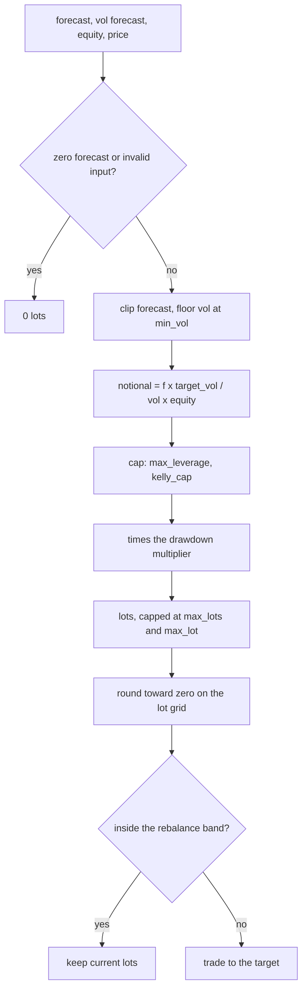

<picture>
  <source media="(prefers-color-scheme: dark)" srcset="_assets/figures/portfolio-and-risk/sizing-curves-dark.png">
  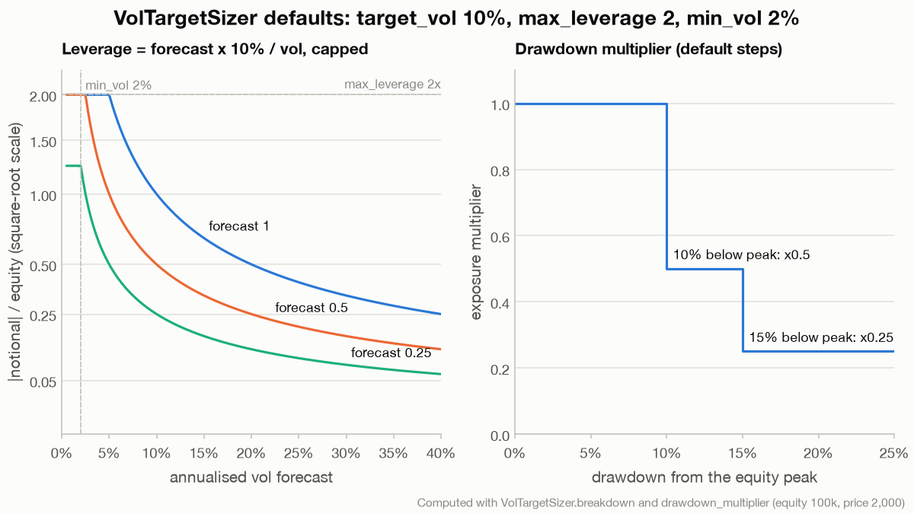
</picture>

*With a forecast of 1, leverage is 10% divided by the vol forecast until it hits 2x below a 5% vol. A forecast of 0.25 is capped by the 2% `min_vol` floor at 1.25x. The drawdown steps halve exposure at 10% below the peak and quarter it at 15%. Data: computed with `VolTargetSizer.breakdown` and `drawdown_multiplier` at 100k equity and a price of 2,000.*

**In practice the book runs well below the target.** The intended vol is $\lvert f \rvert \sigma_{\mathrm{tgt}} m(\mathrm{DD})$,
and real forecasts are rarely 1: the `tsmom` book's average |forecast| is 0.47 and the
combined book's 0.33. Drawdown steps then cut further.

<picture>
  <source media="(prefers-color-scheme: dark)" srcset="_assets/figures/portfolio-and-risk/realised-vs-target-vol-dark.png">
  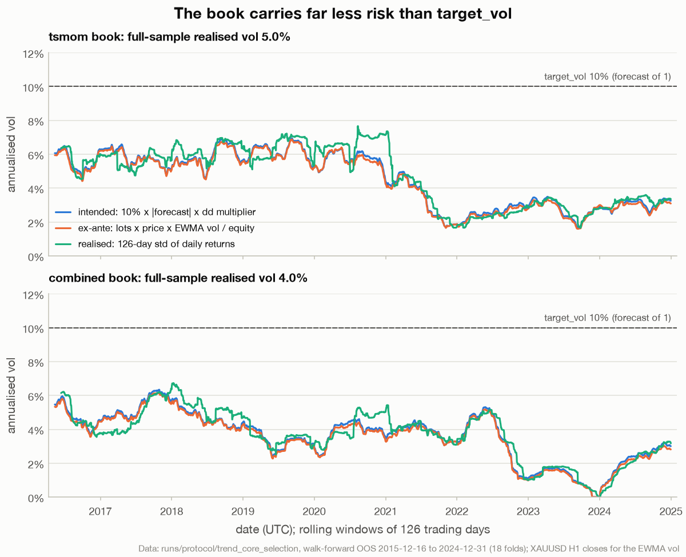
</picture>

*Intended (10% x |forecast| x drawdown multiplier) and ex-ante volatility lie on top of each other, so rounding, caps and the band barely matter. Realised volatility follows the ex-ante line, so the EWMA forecast does its job. All three sit far below 10%: full-sample realised vol is 5.0% for tsmom and 4.0% for the combined book, which also spent 28% of its bars at least 10% under water with exposure halved. Data: runs/protocol/trend_core_selection, walk-forward OOS 2015-12-16 to 2024-12-31 (18 folds); XAUUSD H1 closes for the EWMA vol.*

| Constructor argument | Config key (`sizing.*`) | Default | Meaning |
|---|---|---|---|
| `target_vol` | `target_vol` | 0.10 | Annualised vol for a forecast of ±1 |
| `max_leverage` | `max_leverage` | 2.0 | Cap on `\|notional\| / equity` |
| `max_lots` | `max_lots` | `None` | Absolute lot cap (the instrument's `max_lot`, 50, always applies) |
| `rebalance_band` | `rebalance_band` | 0.10 | Relative no-trade band, in [0, 1) |
| `kelly_cap` | `kelly_cap` | `None` | Cap on the position's ex-ante annualised vol as a fraction of equity |
| `drawdown_derisk` | `drawdown_derisk` | `[[0.10, 0.5], [0.15, 0.25]]` | `(threshold, multiplier)` steps. `null` disables them. |
| `min_vol` | `min_vol` | 0.02 | Floor on the vol forecast used for sizing |

`sizing.method: vol_target` (the default) selects this sizer. The default vol forecast is
`ewma_volatility`, which is already clipped at 0.03, so `min_vol` only matters for custom vol
series ([models.md](models.md#ewma-volatility-the-default)).

```python
from aurum.core.instrument import XAUUSD
from aurum.portfolio.sizing import FixedFractionalSizer, VolTargetSizer

sizer = VolTargetSizer()      # target_vol 0.10, max_leverage 2.0, band 0.10, dd steps (0.10, 0.5), (0.15, 0.25)

# forecast 0.8, 15% annualised vol, $100k equity, gold at $2,000
bd = sizer.breakdown(0.8, 0.15, 100_000, 2_000.0, XAUUSD)
print(bd.raw_notional, bd.final_lots)

# same inputs 12% below the equity peak: the 0.10 step halves exposure
print(sizer.target_lots(0.8, 0.15, 100_000, 2_000.0, XAUUSD, drawdown=0.12))

# already holding 0.25 lots: 0.26 is inside the 10% no-trade band, so the position is kept
print(sizer.target_lots(0.8, 0.15, 100_000, 2_000.0, XAUUSD, current_lots=0.25))

# a very low vol forecast hits the leverage cap (2x equity = 1.00 lot at $2,000)
bd = sizer.breakdown(1.0, 0.03, 100_000, 2_000.0, XAUUSD)
print(bd.caps_hit, bd.final_lots)

ff = FixedFractionalSizer()   # risk 0.5% of equity per trade, stop 2 x ATR
print(ff.stop_distance(0.15, 2_000.0), ff.target_lots(1.0, 0.15, 100_000, 2_000.0, XAUUSD))
```

Output:

```text
53333.33333333334 0.26
0.13
0.25
['max_leverage 2.00'] 1.0
37.79644730092272 0.13
```

`breakdown()` returns a `SizingBreakdown` (`raw_notional`, `capped_notional`,
`drawdown_mult`, `raw_lots`, `rounded_lots`, `final_lots`, `kept_current`, `caps_hit`,
`note`, and `to_dict()`), the audit trail the live runner logs and the LLM desk can read.

### The Kelly cap

For Gaussian returns with mean $\mu$ and volatility $\sigma$, the growth-optimal (Kelly) leverage
and the volatility of the resulting position are

```math
\ell^{*} = \frac{\mu}{\sigma^2}, \qquad \ell^{*} \sigma = \frac{\mu}{\sigma} = \mathrm{SR}
```

so the Kelly position's volatility equals the strategy's Sharpe ratio (Thorp, 2006). Both
follow from the expected log growth per year of a position run at volatility $v = \ell\sigma$:

```math
g(v) = \mathrm{SR}\, v - \tfrac{1}{2} v^2
```

where $\mathrm{SR} = \mu/\sigma$ is the annualised Sharpe ratio (excess over cash) and $v$ is the
position's annualised volatility. $g$ peaks at $v = \mathrm{SR}$, half Kelly ($v = \mathrm{SR}/2$)
keeps 75% of the peak growth at half the volatility, and at $v = 2\,\mathrm{SR}$ the growth is
back to zero: running a strategy too large destroys growth even when its edge is real.
`kelly_cap` bounds $\lvert N \rvert\, \hat\sigma / E$, the same $v$. A half-Kelly policy for an
expected Sharpe of 0.6 means `kelly_cap = 0.30`.

<picture>
  <source media="(prefers-color-scheme: dark)" srcset="_assets/figures/portfolio-and-risk/kelly-growth-dark.png">
  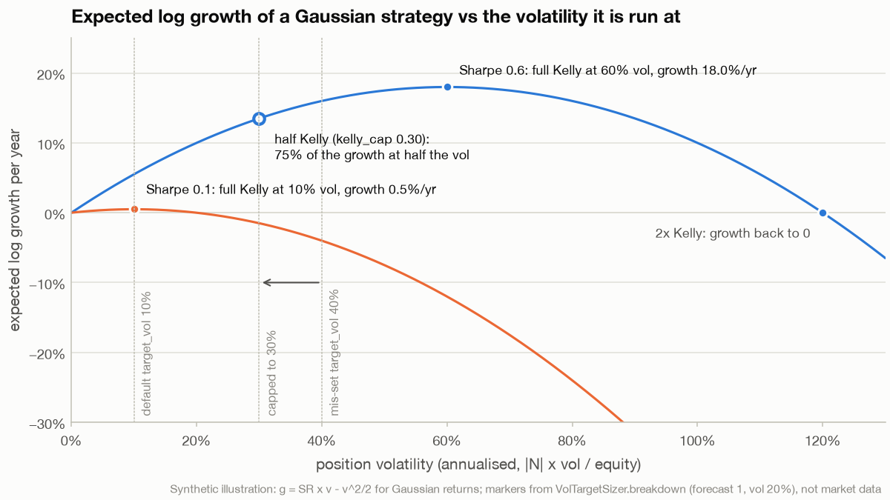
</picture>

*At a Sharpe ratio of 0.6, full Kelly runs at 60% volatility for 18.0% a year of expected log growth; the half-Kelly cap of 0.30 keeps 13.5% of it. At a Sharpe ratio of 0.1, roughly what the trend books earned in [RESULTS.md](RESULTS.md), the default 10% `target_vol` is already full Kelly, and anything larger lowers growth. The vertical lines come from `VolTargetSizer.breakdown` (forecast 1, vol 20%): the mis-set 40% target is cut to 30% by `kelly_cap`. Data: synthetic illustration of the Gaussian growth formula, not market data.*

Its job is to catch a mis-set `target_vol`:

```python
import math

from aurum.core.instrument import XAUUSD
from aurum.portfolio.sizing import FixedFractionalSizer, VolTargetSizer

# a mis-set target_vol of 40%: the half-Kelly cap (expected Sharpe 0.6 -> kelly_cap 0.30) binds first
bd = VolTargetSizer(target_vol=0.40, kelly_cap=0.30).breakdown(1.0, 0.20, 100_000, 2_000.0, XAUUSD)
print(bd.raw_notional, bd.capped_notional, bd.caps_hit, bd.final_lots)

# FixedFractionalSizer: the stop it ASSUMES vs the stop the backtest engine places
ff = FixedFractionalSizer()                                   # risk 0.5% of equity, stop 2 x ATR
print(round(ff.stop_distance(0.15, 2_000.0), 2))              # 2 x daily price sd = 2 x 2000 x 0.15 / sqrt(252)
print("stop_atr_mult for H1 bars ~", round(ff.stop_atr * math.sqrt(23), 2))
```

```text
200000.0 150000.0 ['kelly_cap 0.300'] 0.75
37.8
stop_atr_mult for H1 bars ~ 9.59
```

### FixedFractionalSizer

**Intuition.** Risk a fixed share of equity on each trade: place a protective stop a few ATRs
away and size the position so that hitting the stop loses, say, 0.5% of equity (Vince, 1990).

```math
q = \operatorname{sign}(f)\, \frac{\lvert f \rvert \cdot \rho \cdot E \cdot m(\mathrm{DD})}{k \cdot \mathrm{ATR} \cdot \text{contract\_size}},
\qquad \mathrm{ATR} = \frac{P\, \sigma_{\mathrm{ann}}}{\sqrt{A}} \ \text{ unless } \texttt{atr=} \text{ is passed}
```

where $\rho$ = `risk_per_trade` (0.005, must be in (0, 0.2)), $k$ = `stop_atr` (2.0) and $A$ =
`atr_periods_per_year` (252), so the proxy ATR is a *daily* price standard deviation. Lots are
capped by `max_leverage`, `max_lots` and the instrument's `max_lot`, rounded toward zero, then
passed through the same rebalance band (`sizing.method: fixed_fractional`).

| Argument | Config key | Default |
|---|---|---|
| `risk_per_trade` | `sizing.risk_per_trade` | 0.005 (must be in (0, 0.2)) |
| `stop_atr` | `sizing.stop_atr` | 2.0 |
| `max_leverage`, `max_lots`, `rebalance_band`, `drawdown_derisk` | `sizing.*` | as for `VolTargetSizer` |
| `atr_periods_per_year` | (not exposed) | 252.0 |

> [!IMPORTANT]
> **The stop is external.** The sizer only computes lots and *assumes* a stop sits
> `stop_atr` x ATR from the entry. It never places one. A backtest only gets a stop from
> `backtest.stop_atr_mult`, at that multiple of the engine's Wilder ATR(`atr_period`) **of the bar
> timeframe**, and the engine calls `target_lots()` without `atr=`. So:
>
> - without `backtest.stop_atr_mult` there is no stop, and the loss per trade is not bounded by
>   `risk_per_trade`: the sizer is then a volatility-scaled sizer with a different constant;
> - to make the assumed stop real on H1 bars, set `stop_atr_mult` to about
>   `stop_atr` x ATR_daily / ATR_bar, roughly `stop_atr` x sqrt(23) (about 4.8 x `stop_atr`, so
>   9.6 for the default; this ignores the gap between range and sigma), or pass `atr=` (the bar ATR)
>   yourself and use `stop_atr_mult = stop_atr`.
>
> **The live runner only implements `vol_target`.** A config with `sizing.method: fixed_fractional`
> is refused for live trading, because live positions would not match the backtests.

### Pitfalls and design choices

- **The vol forecast is the whole game.** Volatility targeting is only as good as $\sigma_{\mathrm{ann}}$.
  EWMA reacts after a shock, and weekend or news gaps are not forecast ([models.md](models.md)).
- **Target vol is not realised vol.** Forecasts below 1, the drawdown steps and unallocated
  combiner weight keep the book well under `target_vol` (see the figure above). Do not raise
  `target_vol` to "fix" that without reading [RESULTS.md](RESULTS.md).
- **Drawdown de-risking is path-dependent.** It cuts risk after losses and restores it after
  gains. It limits ruin, but it also slows recovery: the combined book spent 2022 to 2024 at
  half size.
- **Rounding is toward zero** everywhere. A small account rounds many targets to 0 lots.

## Risk manager

**Intuition.** The risk manager is a list of hard rules that every proposed position must
pass, whatever produced it: a strategy, the RL policy or the LLM desk. It can shrink a
position or close it, but it can never enlarge it. Its most serious rule, the kill switch,
flattens the book and refuses to trade again until a human resets it.

`aurum.risk.manager.StandardRiskManager(limits=None, instrument=XAUUSD, state_path=None, *, events=None)`
implements `aurum.core.interfaces.RiskManager`. At every bar close the engine (and the live
runner) calls `on_bar(time, equity)` and then `evaluate(RiskContext(...))`, which returns a
`RiskDecision(approved_lots, halted, reasons)`.

### The reduce-only invariant

The approved position $a$ always lies between 0 and the requested target $q_{\mathrm{tgt}}$ (same sign,
equal or smaller size). When a "no new risk" rule fires, it also never exceeds the current
position $q$ in the risk-increasing direction:

```math
a \in \left[ \min(0, q_{\mathrm{tgt}}),\ \max(0, q_{\mathrm{tgt}}) \right], \qquad
\text{no\_new\_risk}(a, q) = \begin{cases} \operatorname{sign}(a) \min(\lvert a \rvert, \lvert q \rvert), & a\,q > 0 \\ 0, & \text{otherwise} \end{cases}
```

So a reversal, or a new position from flat, becomes 0, while existing positions can always be
reduced or closed. A final guard (`toward_zero`) clamps any violation of the invariant and logs
an error. Every intervention appends a readable reason to `RiskDecision.reasons`.

### Evaluation order

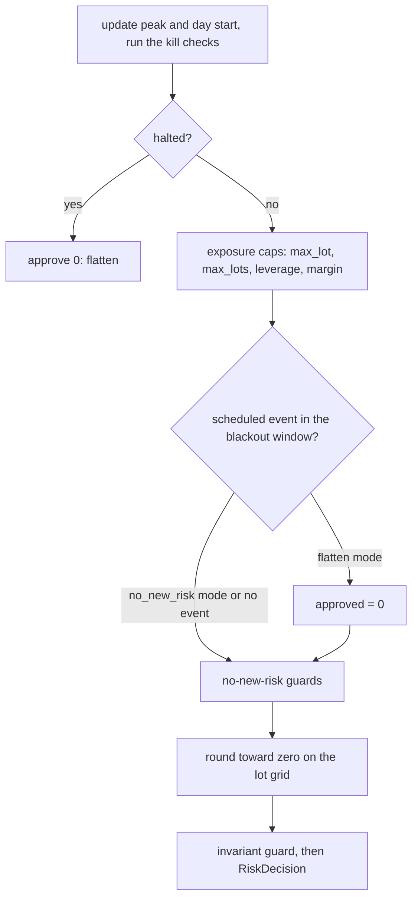

1. **Equity update and kill switch.** The peak and the day-start equity are updated, and the
   hard kills are checked (see [Kill switch](#kill-switch)). A halted manager approves 0
   (flatten) with the reason "HALTED (...)". A non-finite target is treated as 0 (flatten).
2. **Exposure caps.** The target is shrunk toward 0 to the tightest of: instrument
   `max_lot`, `max_lots`, `max_leverage * equity / (contract_size * price)` and
   `max_margin_utilisation * equity / (contract_size * price * margin_rate)`.
3. **Event blackout** around scheduled high-importance releases.
   `blackout_mode="flatten"` sets the position to 0, `"no_new_risk"` only blocks new exposure.
4. **No-new-risk guards**: spread above `max_spread` (or unknown while `max_spread` is set),
   stale data (`ctx.data_age_seconds` above `stale_data_seconds`, or non-finite),
   `max_trades_per_day` reached, invalid price, invalid equity.
5. **Rounding** toward zero on the lot grid.

A committed decision that changes the position counts toward `max_trades_per_day`.

### RiskLimits

All fields of `RiskLimits`, with the dataclass default and the effective values for research
and live runs under `configs/default.yaml`. Research limits are
`RESEARCH_RISK_DEFAULTS` (`daily_loss_persistent: false`, `max_drawdown: null`) with
`risk.research` layered on top. Live limits are `risk.live` layered over the `RiskLimits`
defaults.

| Field | Meaning | `RiskLimits` default | Research (`default.yaml`) | Live (`default.yaml`) |
|---|---|---|---|---|
| `max_lots` | Absolute cap on the position in lots (`None` = instrument cap only) | `None` | `None` | `None` |
| `max_leverage` | Cap on `\|notional\| / equity` | 3.0 | 3.0 | 3.0 |
| `max_daily_loss` | Kill when equity falls this fraction below the day's start | 0.03 | 0.03 | 0.03 |
| `max_drawdown` | Kill when equity falls this fraction below its peak | 0.20 | `None` (off) | 0.20 |
| `max_spread` | Block new risk above this spread (USD/oz) | `None` | 2.0 | 1.5 |
| `event_blackout_before_min` | Minutes before an event | 30 | 30 | 30 |
| `event_blackout_after_min` | Minutes after an event | 30 | 30 | 30 |
| `event_min_importance` | Events with importance ≥ this trigger a blackout | 3 | 3 | 3 |
| `blackout_mode` | `"no_new_risk"` or `"flatten"` | `"no_new_risk"` | `"no_new_risk"` | `"no_new_risk"` |
| `max_trades_per_day` | After this many position changes in a day, only reductions | `None` | `None` | `None` |
| `stale_data_seconds` | Block new risk when the latest bar is older than this | `None` | `None` | 7200 |
| `max_margin_utilisation` | Cap on required margin / equity | 0.5 | 0.5 | 0.5 |
| `daily_reset` | Day boundary: `"utc"` (midnight) or `"rollover"` (`instrument.rollover_hour_utc`, 21 UTC) | `"utc"` | `"utc"` | `"utc"` |
| `daily_loss_persistent` | `True`: a daily-loss halt needs a manual reset. `False`: it clears at the next day. | `True` | `False` | `True` |
| `event_lookahead_min` | Extra minutes added before each event (set to the bar length on coarse timeframes) | 0.0 | 0.0 | 0.0 |

Notes on these values:

- The sizer's own `max_leverage` (2.0) is tighter than the risk manager's (3.0), so with
  default settings the leverage cap binds in the sizer first.
- `stale_data_seconds` only acts when `RiskContext.data_age_seconds` is set, which only the
  live runner does. If `risk.live` leaves it unset, the runner uses
  `max(120, bar_seconds / 2) + bar_close_delay_seconds` (1805 s on H1).
- Research runs switch off the permanent drawdown kill and make daily-loss halts
  non-persistent. A research backtest measures the *strategy*, and one −3% day must not flatten
  a 14-year sample. The sizer's drawdown de-risking still applies and every halt is reported.
- `risk.enabled: false` removes the risk manager from research backtests entirely.
- Real-money order sending requires both `max_drawdown` and `max_daily_loss` in `risk.live`.
  The runner refuses to start otherwise ([live-trading.md](live-trading.md)).

Validation: `max_daily_loss` and `max_drawdown` must be in (0, 1) or `None`. The other numeric
caps must be positive or `None`, and blackout windows must be non-negative. Unknown keys under
`risk.research` / `risk.live` are reported with the list of valid ones
([configuration.md](configuration.md)).

### Kill switch

The kill switch sets `halted=True`. From then on every decision approves 0 lots, so the book is
flattened and stays flat. With $E_t$ the equity mark, $E^{\mathrm{day}}$ the day-start equity
and $E^{\mathrm{peak}}$ the running maximum of every mark, it fires on:

```math
1 - \frac{E_t}{E^{\mathrm{day}}} \ge \text{max\_daily\_loss}
\quad \text{or} \quad
1 - \frac{E_t}{E^{\mathrm{peak}}} \ge \text{max\_drawdown}
\quad \text{or} \quad
E_t \le 0
```

(with a 1e-12 tolerance on the two ratios), or on a manual or state-file halt:

| `halt_kind` | Trigger |
|---|---|
| `daily_loss` | The daily-loss ratio above reaches `max_daily_loss` |
| `drawdown` | The drawdown from the running peak reaches `max_drawdown` |
| `equity` | Equity ≤ 0 |
| `manual` | `halt(reason)`, called from your own code (`kind="manual"` is the default) |
| `state_file` | Unreadable state file at start-up, or (live runner) a missing one, see below |

The day-start equity is the equity at the day boundary when a decision falls exactly on it.
Otherwise it is the last equity observed before the boundary, i.e. the equity at the open of
the day's first bar. A mark exactly on the boundary is also the close of the previous day's
last bar, so it is first settled against the previous day's start. This way the final bar of a
day (all of it on D1) cannot escape the daily-loss limit. A mark with a timestamp earlier
than the last one never rolls the day over (so it cannot re-base the day-start equity), but
the kill checks still run on it.

With `daily_loss_persistent=False` a daily-loss halt clears automatically at the next trading
day. A drawdown, equity, manual or state-file halt never clears by itself.

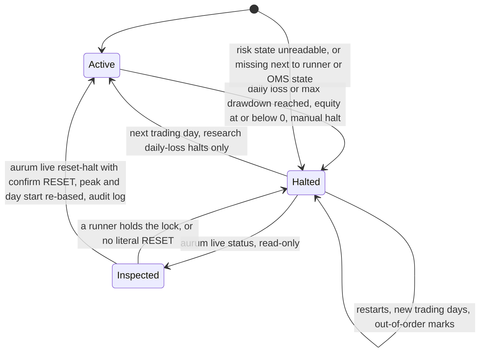

### Persistence and restarts

With `state_path` set (the live runner uses `<live.state_dir>/risk_state.json`), the state
(halt flag, kind, reason, peak, day key, day-start equity, trades today, last time and equity)
is written as JSON after every change. The write is atomic: a temporary file is flushed,
fsynced and then renamed over the old one. The file is read back strictly: any unexpected
type (for example `"halted": "false"` as a string), a missing `halted` key or invalid JSON
makes the manager **start HALTED** with `halt_kind="state_file"`.

The live runner adds one more rule. Every decision persists the risk state before the runner
and OMS state, so if `runner_state.json` or `oms_state.json` exists in the state directory but
`risk_state.json` does not, the file was deleted or lost. The runner then starts **HALTED**
(`halt_kind="state_file"`). Deleting the file is not a way to reset the kill switch.

### Resetting a halt

`reset_halt(confirm="RESET", *, equity=None)` is the only call that clears a halt. Anything
other than the literal `"RESET"` raises `ValueError`. It clears the flag and re-bases the
equity peak and the day-start equity to `equity` (default: the last observed equity).
Otherwise the same drawdown would trigger the kill again at once. The reset is logged, recorded
in `events_frame()` and persisted.

For a live or paper state directory, use the CLI. `aurum live status` is read-only, and
`aurum live reset-halt` wraps `reset_halt` in a guarded, audited procedure:

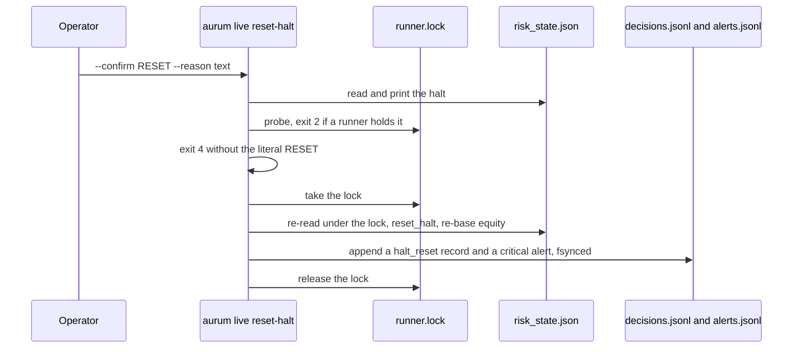

On a scratch state directory with a recorded daily-loss halt (the output of
`aurum live status` and of the reset; the reset also logs two WARNING lines from
`aurum.risk.manager` to stderr):

```console
$ aurum live status -c configs/default.yaml --set live.state_dir=state
live status: state  (config configs/default.yaml)
  config:      broker=paper dry_run=True allow_live_real=False magic=20260926 symbol=XAUUSD desk=off
  runner:      not running
  risk:        HALTED [daily_loss] daily loss 3.10% vs day start 100,000.00 reached max_daily_loss 3.00% since 2024-03-04T13:00:00+00:00
               equity 96,900 / peak 100,000 (drawdown 0.031), day return -0.031, trades today 0, as of 2024-03-04T13:00:00+00:00
               clear it (runner stopped) with: aurum live reset-halt -c CONFIG --confirm RESET --reason '...'
  oms:         no OMS state file
$ aurum live reset-halt -c configs/default.yaml --set live.state_dir=state --confirm RESET --reason "post-mortem done"
risk state state/risk_state.json:
  halted:      True [daily_loss]
  reason:      daily loss 3.10% vs day start 100,000.00 reached max_daily_loss 3.00%
  halted at:   2024-03-04T13:00:00+00:00
  equity:      last 96,900, peak 100,000, drawdown 0.031
kill switch RESET by MAC: post-mortem done
  peak / day-start equity re-based to 96,900; logged to state/decisions.jsonl and state/alerts.jsonl
  the runner resumes trading at its next start (still dry-run unless the config says otherwise)
```

Without `--confirm RESET` the command prints the same state block and exits with code 4. It
exits 0 without logging anything when the manager is not halted, and 2 when the state
directory or `risk_state.json` is missing. It sends no webhook. Stop the runner first: a
running runner keeps its own in-memory (halted) state and would write it back on its next
decision. The full operator runbook is in [live-trading.md](live-trading.md) and the command
reference in [cli.md](cli.md).

### Event blackouts

A decision at time `t` is in a blackout when an eligible event lies in
`[t - event_blackout_after_min, t + event_blackout_before_min + event_lookahead_min]`.
Events come from the `events=` frame given to the constructor (or `set_events()`) and from
`RiskContext.upcoming_events` / `recent_events`. Frames need a `time` column (UTC) and ideally
`importance`. A missing or non-numeric importance counts as high (fail safe). Scheduled release
times are public in advance, so using future event times is point-in-time safe. The backtest
engine passes `md.events` windows of `event_horizon_hours` (24 by default) before and after
each decision, and strips outcome columns such as `actual` from the upcoming window. With
`data.events: rule_based`, the configs in `configs/` block new risk around NFP and FOMC
(both importance 3), see [data.md](data.md).

### Example

```python
import tempfile
from pathlib import Path

import pandas as pd

from aurum.core.interfaces import RiskContext
from aurum.risk.manager import RiskLimits, StandardRiskManager

state = Path(tempfile.mkdtemp()) / "risk_state.json"
rm = StandardRiskManager(RiskLimits(max_spread=1.5), state_path=state)   # otherwise the live defaults


def ctx(t, equity, current, target, spread=0.3):
    return RiskContext(time=pd.Timestamp(t, tz="UTC"), equity=equity, current_lots=current,
                       target_lots=target, price=2000.0, spread=spread, vol_ann=0.15)


# 1. exposure cap: 3x leverage at $100k equity and $2,000/oz = 1.50 lots
d = rm.evaluate(ctx("2024-03-04 10:00", 100_000, 0.0, 2.0))
print(d.approved_lots, d.reasons)

# 2. wide spread: new risk is blocked, the position can still be reduced
print(rm.evaluate(ctx("2024-03-04 11:00", 100_000, 0.5, 0.8, spread=2.0)).approved_lots)
print(rm.evaluate(ctx("2024-03-04 12:00", 100_000, 0.5, 0.2, spread=2.0)).approved_lots)

# 3. a 3% loss versus the day's starting equity trips the daily-loss kill switch
d = rm.evaluate(ctx("2024-03-04 13:00", 96_900, 0.5, 0.5))
print(d.approved_lots, d.halted, rm.state.halt_kind)

# 4. the halt is persisted: a new manager on the same file starts HALTED
rm2 = StandardRiskManager(RiskLimits(max_spread=1.5), state_path=state)
print(rm2.halted, rm2.evaluate(ctx("2024-03-05 10:00", 96_900, 0.0, 0.3)).approved_lots)

# 5. only an explicit operator reset clears it (peak and day start are re-based)
rm2.reset_halt(confirm="RESET")
print(rm2.halted, rm2.evaluate(ctx("2024-03-05 11:00", 96_900, 0.0, 0.3)).approved_lots)

# 6. an unreadable state file fails safe
state.write_text("{not json")
print(StandardRiskManager(state_path=state).state.halt_kind)
```

Output (stdout; the manager also logs the kill switch and the reset):

```text
1.5 ['max_leverage 3x: +2.00 -> +1.50 lots']
0.5
0.2
0.0 True daily_loss
True 0.0
False 0.3
state_file
```

### Other methods

| Method | Purpose |
|---|---|
| `evaluate(ctx, *, commit=True)` | Approve or reduce `ctx.target_lots`. `commit=False` is a side-effect-free preview: state and intervention log are restored afterwards. |
| `on_bar(time, equity)` | Update the peak, day start and kill checks. Call once per bar close. |
| `halt(reason, *, time=None, kind="manual")` | Manual kill switch, persisted. |
| `reset_halt(confirm="", *, equity=None)` | Clear the kill switch; needs `confirm="RESET"`. |
| `set_events(df)` | Register a calendar for blackouts (O(log n) lookups). |
| `events_frame()` | All interventions: `time`, `requested`, `current`, `approved`, `halted`, `reasons`. |
| `snapshot()` | JSON-friendly state: halt fields, peak, last equity, drawdown, day start, day return, trades today, limits. |
| `halted`, `halt_reason` | Properties. |

In backtests, `BacktestResult.risk_events` records every bar where risk changed the request,
halted, or gave a reason ([execution-and-costs.md](execution-and-costs.md#backtestresult)).
The walk-forward reports the number of risk events, halt bars and halt episodes per book.

### Pitfalls and design choices

- **Fail closed.** An unreadable or missing state file halts, and a reset needs the literal
  word `RESET` plus a stopped runner. Inconvenience is the price of never trading on a
  half-trusted kill-switch state.
- **Gap risk.** The kill switch acts at the next decision. A weekend or news gap can take the
  loss past `max_daily_loss` or `max_drawdown` before any order can be sent.
- **Scheduled events only.** Blackouts use published release times; unscheduled news is not
  covered.
- **Research is not live.** Research runs turn off the drawdown kill on purpose, so a
  backtest's drawdown can exceed the live `max_drawdown` of 20%. Compare a book's drawdown with
  the live limit before going live.

## Drawdowns

**Intuition.** A drawdown is how far equity sits below its best level so far. It is the
number that decides whether a strategy survives, because the sizer's de-risking steps and the
live kill switch both act on it.

```math
\mathrm{DD}_t = 1 - \frac{E_t}{\max_{s \le t} E_s}, \qquad
\mathrm{MDD} = \max_t \mathrm{DD}_t
```

where $E_t$ is the equity at the close of bar $t$. `risk_report` reports `max_drawdown` and
`current_drawdown` as positive fractions. The backtest metrics (`stats.csv`,
[execution-and-costs.md](execution-and-costs.md#metrics)) report the same maximum as a negative
number.

<picture>
  <source media="(prefers-color-scheme: dark)" srcset="_assets/figures/portfolio-and-risk/underwater-dark.png">
  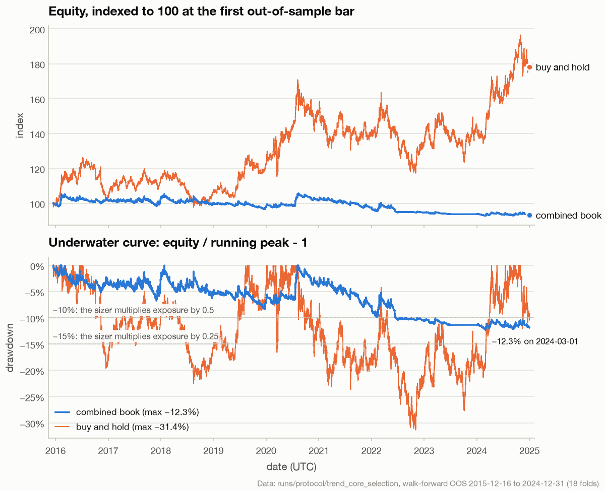
</picture>

*Buy-and-hold ends near 178 with a −31.4% worst drawdown. The combined book stays near 100 and bottoms at −12.3% on 2024-03-01. From mid-2022 it sits just under the −10% line, where the sizer halves exposure, which is why its equity barely moves. Data: runs/protocol/trend_core_selection, walk-forward OOS 2015-12-16 to 2024-12-31 (18 folds).*

The Monte Carlo view of drawdowns (bootstrapped equity paths, drawdown exceedance, risk of
ruin) is `aurum stress`, in [analytics.md](analytics.md).

## VaR, ES and stress tests

`aurum.risk.var` is a set of library tools for your own analysis and reports. The backtest
engine, walk-forward, LLM desk and live runner do not call it, and it enforces nothing. (The
`var_95_daily` / `cvar_95_daily` backtest metrics are computed separately, see
[execution-and-costs.md](execution-and-costs.md#metrics).) Inputs are simple returns. VaR and
ES are positive loss fractions: `var = 0.02` means a 2% loss is not exceeded with probability
`level`. ES is always at least VaR.

**Intuition.** VaR answers "how bad is a bad day": the loss exceeded on only 1 day in 100 (at
99%). It says nothing about how bad the worst days are. Expected Shortfall answers that: the
average loss *on* those worst days. Gold's daily returns have fat tails, so the method used to
estimate the tail matters a lot.

### The estimators

With the tail probability $\alpha$ = 1 − `level`:

```math
\text{historical:}\quad \mathrm{VaR} = -q_\alpha, \qquad \mathrm{ES} = -\mathbb{E}\left[ r \mid r \le q_\alpha \right]
```

```math
\text{Gaussian:}\quad \mathrm{VaR} = -(\mu + \sigma z_\alpha), \qquad \mathrm{ES} = -\left(\mu - \sigma\, \frac{\phi(z_\alpha)}{\alpha}\right)
```

```math
\text{Cornish-Fisher:}\quad z_{cf} = z + \frac{(z^2 - 1) S}{6} + \frac{(z^3 - 3z) K}{24} - \frac{(2z^3 - 5z) S^2}{36}, \qquad
\mathrm{VaR} = -(\mu + \sigma z_{cf})
```

```math
\mathrm{ES}_{cf} = -\left( \mu + \sigma \left[ e_1 + \frac{(e_2 - 1) S}{6} + \frac{(e_3 - 3 e_1) K}{24} - \frac{(2 e_3 - 5 e_1) S^2}{36} \right] \right),
\qquad e_1 = -\frac{\phi}{\alpha}, \quad e_2 = 1 - \frac{z \phi}{\alpha}, \quad e_3 = -\frac{(z^2 + 2)\, \phi}{\alpha}
```

where

- $q_\alpha$ is the empirical $\alpha$-quantile of the returns (`numpy.quantile`);
- $\mu$ and $\sigma$ are the sample mean and standard deviation (`ddof=1`), $z = z_\alpha$ is the standard normal
  $\alpha$-quantile and $\phi = \phi(z_\alpha)$ its density;
- $S$ and $K$ are the sample skewness and excess kurtosis (bias-corrected);
- $e_1, e_2, e_3$ are the first three moments of a standard normal truncated below $z_\alpha$, which gives the
  closed-form modified ES of Boudt, Peterson and Croux (2008);
- historical and Cornish-Fisher ES are floored at VaR.

Over a horizon of $h$ periods, `var_es(..., horizon=h)` aggregates the parametric moments
($\mu h$, $\sigma\sqrt{h}$, $S/\sqrt{h}$, $K/h$) and scales historical results by $\sqrt{h}$. That
rule is approximate: it ignores drift and serial dependence.

<picture>
  <source media="(prefers-color-scheme: dark)" srcset="_assets/figures/portfolio-and-risk/var-es-gold-dark.png">
  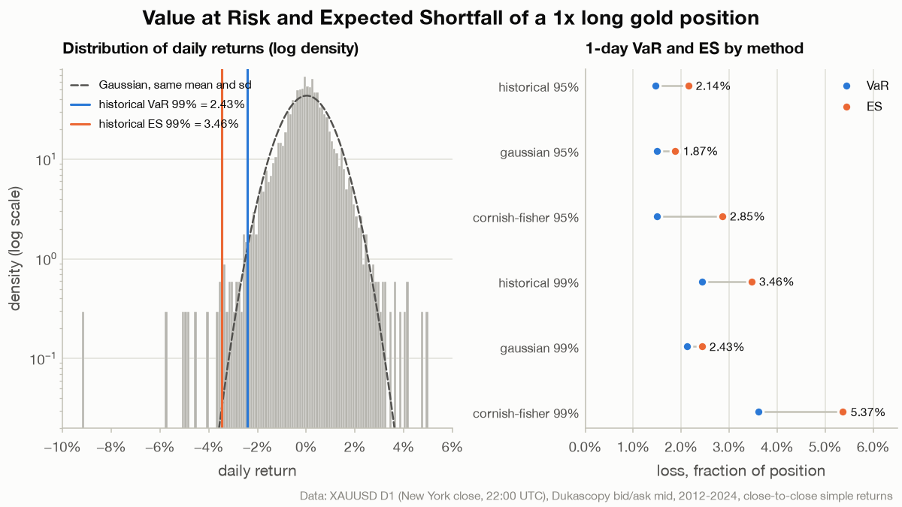
</picture>

*On a log scale the fat left tail is obvious: the fitted Gaussian has almost no mass beyond −4%, yet gold fell more than 4% on 7 days (and more than 3% on 19). At 99% the Gaussian ES (2.43%) understates the historical ES (3.46%) by about 30%, while Cornish-Fisher overshoots to 5.37%. Data: XAUUSD D1 (New York close, 22:00 UTC), Dukascopy bid/ask mid, 2012-2024, close-to-close simple returns.*

### Back-testing VaR

`rolling_var_backtest(returns, level, *, window=250, method)` estimates each day's VaR from the
`window` days *before* it and counts breaches. The VaR is
`r.rolling(window).quantile(alpha).shift(1)` for `historical`, or the rolling mean plus
$z_\alpha$ times the rolling standard deviation, shifted one day, for `gaussian`. `kupiec_pof`
then tests whether the breach rate matches $\alpha$ (Kupiec, 1995):

```math
\mathrm{LR} = -2 \left[ (n - x) \ln(1 - \alpha) + x \ln \alpha - (n - x) \ln(1 - \hat p) - x \ln \hat p \right] \sim \chi^2_1,
\qquad \hat p = \frac{x}{n}
```

where $n$ is the number of days tested and $x$ the number of breaches. A small p-value means
the VaR model is wrong about the tail frequency.

<picture>
  <source media="(prefers-color-scheme: dark)" srcset="_assets/figures/portfolio-and-risk/var-backtest-dark.png">
  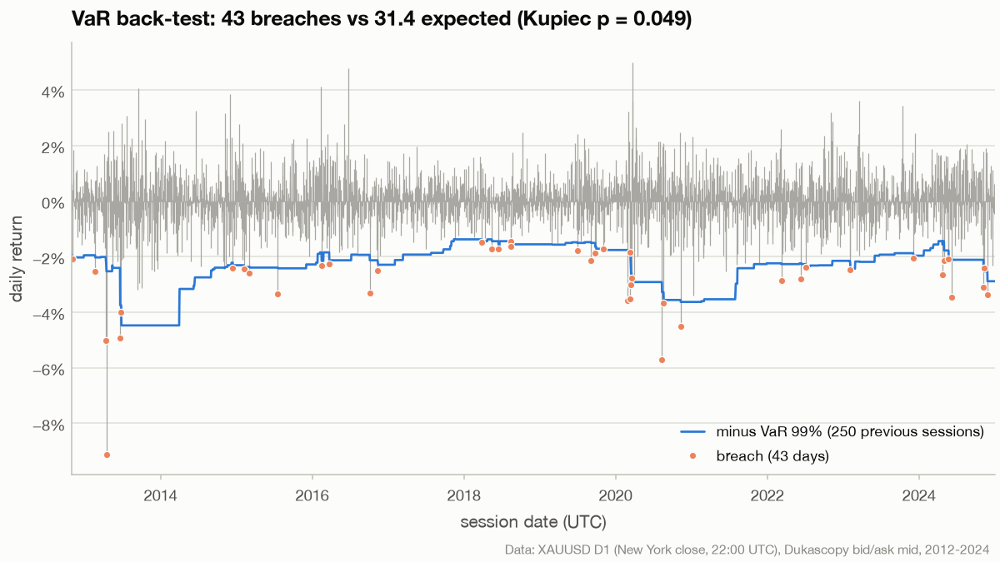
</picture>

*The 250-day historical VaR adapts in steps and is late after regime changes: breaches cluster in 2013, March 2020 and 2024. That gives 43 breaches against 31.4 expected (Kupiec p = 0.049). A Gaussian VaR does worse: 62 breaches, p = 1.3e-6. Data: XAUUSD D1 (New York close, 22:00 UTC), Dukascopy bid/ask mid, 2012-2024.*

```python
import pandas as pd

from aurum.data.store import load_bars
from aurum.risk.var import VAR_METHODS, rolling_var_backtest, var_es

d1 = load_bars("data_store/xauusd_D1_nyclose.parquet")
d1 = d1[d1["available_at"] <= pd.Timestamp("2025-01-01", tz="UTC")]
r = d1["close"].pct_change().dropna()               # daily simple returns of a 1x long position

for level in (0.95, 0.99):
    for m in VAR_METHODS:
        x = var_es(r, level, m)
        print(f"{level:.0%} {m:15s} VaR {x['var']:.4f}  ES {x['es']:.4f}")
for m in ("historical", "gaussian"):
    bt = rolling_var_backtest(r, 0.99, window=250, method=m)
    print(f"{m:10s} n {bt['n']}  breaches {bt['breaches']} (expected {bt['expected']:.1f})  "
          f"rate {bt['breach_rate']:.4f}  Kupiec p {bt['p_value']:.2g}")
```

```text
95% historical      VaR 0.0146  ES 0.0214
95% gaussian        VaR 0.0149  ES 0.0187
95% cornish_fisher  VaR 0.0150  ES 0.0285
99% historical      VaR 0.0243  ES 0.0346
99% gaussian        VaR 0.0212  ES 0.0243
99% cornish_fisher  VaR 0.0361  ES 0.0537
historical n 3142  breaches 43 (expected 31.4)  rate 0.0137  Kupiec p 0.049
gaussian   n 3142  breaches 62 (expected 31.4)  rate 0.0197  Kupiec p 1.3e-06
```

### Position risk and stress tests

`position_var` gives the USD VaR and ES of a position from an annualised vol with zero drift.
`gap_shock` gives the USD P&L of an instant gap, including the cost of getting out at a
(widened) spread:

```math
\sigma_h = \sigma_{\mathrm{ann}} \sqrt{\frac{h}{252}}, \qquad
\mathrm{VaR}_{\text{USD}} = \left| q \cdot \text{contract\_size} \cdot P \right| \cdot \mathrm{VaR}_{\text{Gauss}}(0, \sigma_h), \qquad
\text{gap\_shock} = q \cdot \text{contract\_size} \cdot P\, \delta - \lvert q \rvert \cdot \text{contract\_size} \cdot \frac{\max(s, 0)}{2}
```

where $q$ is the signed position in lots, $P$ the price, $h$ = `horizon_days` (1),
$\delta$ the shock (for example −0.05) and $s$ the exit spread in USD/oz. `stress_test` applies
every scenario of `DEFAULT_STRESS_SCENARIOS` (or your own mapping) and sorts the rows worst
first:

| Scenario | Shock |
|---|---|
| `gap_down_3pct`, `gap_up_3pct` | −3%, +3% |
| `gap_down_5pct`, `gap_up_5pct` | −5%, +5% |
| `gap_down_10pct`, `gap_up_10pct` | −10%, +10% |
| `2013-04-15 crash (approx -9%)` | −9% |
| `2011-09-23 selloff (approx -6%)` | −6% |
| `2016-06-24 Brexit spike (approx +5%)` | +5% |

The named episodes are rounded, approximate magnitudes, not verified data. The worst
close-to-close day in the 2012-2024 store is 2013-04-15 (−9.6% log return, see
[models.md](models.md#why-volatility-can-be-forecast)). Override them where precision matters.

<picture>
  <source media="(prefers-color-scheme: dark)" srcset="_assets/figures/portfolio-and-risk/stress-scenarios-dark.png">
  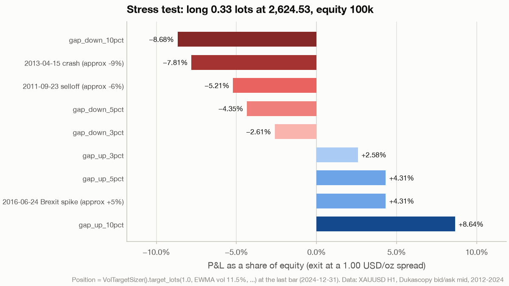
</picture>

*A full-forecast long sized by `VolTargetSizer` at the end of 2024 (0.33 lots at 2,624.53 with an EWMA vol of 11.5%, about 0.87x leverage on 100k) loses 8.68% of equity on a 10% gap. The exit spread makes losses slightly bigger than the matching gains. Data: XAUUSD H1, Dukascopy bid/ask mid, 2012-2024; position at the last bar, 2024-12-31.*

### risk_report

`risk_report(result, *, level=0.95, price=None, last_price=None, bars=None, instrument=XAUUSD, var_window=250, scenarios=None)`
summarises a `BacktestResult` (or a bare equity Series) as a JSON-friendly dict. It contains:

- per-bar and daily VaR/ES by all three methods (daily returns fold weekend bars into Monday,
  like the backtest metrics);
- return moments, `max_drawdown` and `current_drawdown`;
- a rolling out-of-sample VaR back-test with Kupiec's test (window
  `min(var_window, max(20, n_days // 2))`);
- USD figures at the last equity;
- a stress test of the final position, taken from `position_close` so that a stop hit in the
  last bar does not stress a phantom position.

The **stress price** is the first available of:

1. `last_price` (or its older alias `price`; passing both with different values raises), `"argument"`;
2. `result.meta["last_price"]`, `"meta"`;
3. the last `close` of `bars` (a bars frame or `MarketData`) at or before the last equity mark, `"bars_close"`;
4. the price of the last fill, `"last_fill"`, with a note: it can be stale by the whole holding period.

`report["position"]["price_source"]` records which one was used. The backtest engine sets no
`meta["last_price"]`, so pass `bars=` or `last_price=` for a stress test at the current price:

```python
import numpy as np

from aurum.backtest.engine import run_backtest
from aurum.data.synthetic import make_synthetic_bars
from aurum.portfolio.sizing import VolTargetSizer
from aurum.risk.var import risk_report

bars = make_synthetic_bars(3000, "H1", seed=4)                     # synthetic, not market data
ret = np.log(bars["close"]).diff()
forecast = np.sign(ret.rolling(48).sum()).fillna(0.0)              # toy causal trend forecast
res = run_backtest(bars, forecast, sizer=VolTargetSizer())

calls = {"no price": {}, "bars=": {"bars": bars}, "last_price=": {"last_price": 1650.0}}
reports = {name: risk_report(res, level=0.99, **kw) for name, kw in calls.items()}
for name, rep in reports.items():
    pos, worst = rep["position"], rep["position"]["stress"][0]
    print(f"{name:12s} {pos['price_source']:10s} price {pos['price']:8.2f}  lots {pos['lots']:+.2f}  "
          f"{worst['scenario']}: {worst['pnl_usd']:,.0f} USD")
print(reports["no price"]["notes"])
rep = reports["no price"]
print({m: round(v["var"], 5) for m, v in rep["daily"].items()}, "breaches", rep["var_backtest"]["breaches"])
```

Output (stdout; the engine also logs that no `fedfunds` series was supplied for financing):

```text
no price     last_fill  price  1818.40  lots +0.17  gap_down_10pct: -3,091 USD
bars=        bars_close price  1818.86  lots +0.17  gap_down_10pct: -3,092 USD
last_price=  argument   price  1650.00  lots +0.17  gap_down_10pct: -2,805 USD
['stress price taken from the last fill (pass bars= or last_price= for the current price)']
{'historical': 0.01488, 'gaussian': 0.01363, 'cornish_fisher': 0.01418} breaches 1
```

### All functions

| Function | What it does |
|---|---|
| `var_es(returns, level=0.95, method="historical", *, horizon=1)` | VaR and ES by `historical`, `gaussian` or `cornish_fisher`, with `level`, `horizon`, `method` and `n_obs` |
| `historical_var_es`, `gaussian_var_es`, `cornish_fisher_var_es`, `cornish_fisher_quantile` | The estimators above |
| `kupiec_pof(n_obs, n_breaches, level)` | Kupiec (1995) proportion-of-failures test |
| `rolling_var_backtest(returns, level, *, window=250, method)` | Strictly out-of-sample VaR back-test (`historical` or `gaussian`) |
| `position_var(lots, price, vol_ann, *, level=0.99, horizon_days=1.0, ...)` | Gaussian USD VaR/ES of a position (zero drift) |
| `gap_shock(lots, price, pct, *, spread=0.0)` | USD P&L of an instant gap, plus the exit cost at a (widened) spread |
| `stress_test(lots, price, equity, *, scenarios=None, spread=0.0)` | Applies each scenario, sorted worst first |
| `daily_returns_from_equity(equity, *, fold_weekends=True)` | Daily simple returns from an equity curve, weekends folded into Monday |
| `risk_report(result, ...)` | The JSON summary above |

A small synthetic example of the library functions:

```python
import numpy as np

from aurum.risk.var import gap_shock, position_var, stress_test, var_es

rng = np.random.default_rng(0)
daily = rng.standard_t(df=4, size=1500) * 0.007          # fat-tailed toy daily returns

for method in ("historical", "gaussian", "cornish_fisher"):
    r = var_es(daily, level=0.99, method=method)
    print(f"{method:15s} VaR {r['var']:.4f}  ES {r['es']:.4f}")

# 0.5 lots long at $2,000: USD loss of a 5% gap, exiting at a widened $2.00 spread
print(gap_shock(0.5, 2_000.0, -0.05, spread=2.0))

# 1-day 99% Gaussian VaR of the same position at 15% annualised vol
print(round(position_var(0.5, 2_000.0, 0.15)["var_usd"], 2))

print(stress_test(0.5, 2_000.0, 100_000).head(3).to_string(index=False))
```

Output:

```text
historical      VaR 0.0238  ES 0.0298
gaussian        VaR 0.0217  ES 0.0249
cornish_fisher  VaR 0.0268  ES 0.0381
-5050.0
2198.19
                       scenario  shock_pct  pnl_usd  pnl_pct_equity  equity_after
                 gap_down_10pct      -0.10 -10000.0           -0.10       90000.0
  2013-04-15 crash (approx -9%)      -0.09  -9000.0           -0.09       91000.0
2011-09-23 selloff (approx -6%)      -0.06  -6000.0           -0.06       94000.0
```

### Pitfalls and design choices

- **VaR is not a worst case.** The 2013-04-15 day was roughly four times the 99% daily VaR of
  a long position. Use ES and stress tests for the tail.
- **Gaussian VaR under-counts.** On gold it breaches twice as often as it should. Cornish-Fisher
  corrects for skew and kurtosis, but it is only reliable for moderate values and can
  overshoot, as in the figure.
- **Scaling historical VaR by** $\sqrt{h}$ ignores drift, volatility clustering and serial
  dependence.
- **Nothing enforces these numbers.** VaR, ES and the stress test are reporting tools. The only
  enforced limits are the sizer's caps and the risk manager's rules.

## Volatility and regime models

The volatility forecasters (EWMA, GARCH(1,1), HAR-RV, `blend_vol`) and the Gaussian HMM regime
model now have their own page, [models.md](models.md), with the formulas, real-data figures and
the v2.1 annualisation fix for GARCH. The sizer and the combiner use `ewma_volatility`; the
other models are research tools.

## Limitations

- **Combiner.** The cost estimate $c_t$ is an approximation (see
  [Scoring each strategy net of costs](#scoring-each-strategy-net-of-costs)). In-sample
  Sharpe estimates are noisy even after shrinkage. The FDM assumes forecasts share a common
  scale. Weights are static within a fold.
- **Sizing.** Volatility targeting only works as well as the vol forecast. EWMA reacts to a
  shock after it happens, and gaps (weekends, releases) are not forecast.
- **Risk manager.** Blackouts use scheduled times only; unscheduled news is not covered. The
  stale-data check needs `data_age_seconds`, so only the live runner uses it. With a
  `state_path` the JSON state is rewritten whenever it changes (every bar when equity moves).
  Event frames passed in `RiskContext` are cached by object identity and must not be mutated
  in place.
- **Gap risk.** The kill switch acts at the next decision. A weekend or news gap can take the
  loss past `max_daily_loss` or `max_drawdown` before any order can be sent. `gap_shock` and
  `stress_test` exist to size that risk, but nothing enforces them.
- **VaR.** Scaling historical VaR by `sqrt(h)` ignores drift and serial dependence.
  Cornish–Fisher is only reliable for moderate skew and kurtosis.

None of these components creates an edge. For what the full stack achieved on real data,
read [RESULTS.md](RESULTS.md) and the pre-registered protocol in
[RESEARCH_PROTOCOL.md](RESEARCH_PROTOCOL.md).

## See also

- [models.md](models.md): EWMA, GARCH, HAR-RV and the HMM, with formulas and figures
- [execution-and-costs.md](execution-and-costs.md): the simulator, cost model, financing, backtest engine and metrics
- [strategies.md](strategies.md): where the forecasts come from
- [research.md](research.md): walk-forward, `combiner_fit`, statistics
- [analytics.md](analytics.md): `aurum explain` (attribution), `aurum stress` (Monte Carlo) and `aurum sweep`
- [configuration.md](configuration.md): the `combiner`, `sizing` and `risk` sections
- [live-trading.md](live-trading.md): the live runner, state directory and real-money guards
- [cli.md](cli.md): `aurum live status` and `aurum live reset-halt`
- [llm-desk.md](llm-desk.md): how the desk's output is bounded before sizing and risk
- [architecture.md](architecture.md), [data.md](data.md), [features.md](features.md), [ml-and-rl.md](ml-and-rl.md), [getting-started.md](getting-started.md), [development.md](development.md), [index.md](index.md)
- [INTERFACES.md](INTERFACES.md): module signatures
- [RESULTS.md](RESULTS.md): research results
