# Research: walk-forward, statistics and the holdout

This page explains how Aurum turns a configuration into an honest out-of-sample estimate,
and how it then measures whether that estimate means anything. The first half is the
**walk-forward protocol**: fold geometry, the purge and embargo gaps, per-fold refits,
combiner weights fitted on earlier out-of-sample forecasts only, and one stitched backtest
per book. The second half is the **statistics** reported on daily returns: the
stationary-bootstrap confidence interval, the Probabilistic and Deflated Sharpe Ratios, the
minimum track record length and the Probability of Backtest Overfitting. Then come the
**final holdout** and the ledger that records every look at it, the walk-forward
attribution API, every file a run writes, the HTML tearsheet, provenance, single-split
backtests, the purged k-fold and CPCV splitters, and a checklist for running your own
pre-registered study.

Everything below is taken from [`aurum/research/`](../aurum/research/),
[`aurum/cli.py`](../aurum/cli.py) and [`aurum/core/config.py`](../aurum/core/config.py).
Every command and snippet was run against the current code, and every chart is drawn by
[tools/figures/fig_research.py](../tools/figures/fig_research.py) from the real protocol
runs (`runs/protocol/`, research data up to 2024-12-31) or, where a concept is clearer that
way, from a labelled synthetic illustration. Published results live in
[RESULTS.md](RESULTS.md) and the protocol that produced them in
[RESEARCH_PROTOCOL.md](RESEARCH_PROTOCOL.md); this page does not restate them. Parameter
sweeps, Monte Carlo stress tests and decision explanations are on
[analytics.md](analytics.md).

**On this page**

- [Commands at a glance](#commands-at-a-glance)
- [A first run on synthetic data](#a-first-run-on-synthetic-data)
- [The walk-forward protocol](#the-walk-forward-protocol)
  - [Fold geometry](#fold-geometry)
  - [Purge and embargo](#purge-and-embargo)
  - [What is refit per fold](#what-is-refit-per-fold)
  - [Combiner fitting on out-of-sample forecasts only](#combiner-fitting-on-out-of-sample-forecasts-only)
  - [One stitched backtest per book](#one-stitched-backtest-per-book)
  - [Walk-forward settings](#walk-forward-settings)
- [Statistics](#statistics)
  - [Sharpe convention](#sharpe-convention)
  - [Confidence interval: stationary bootstrap](#confidence-interval-stationary-bootstrap)
  - [Probabilistic Sharpe Ratio (PSR)](#probabilistic-sharpe-ratio-psr)
  - [Deflated Sharpe Ratio (DSR) and n_trials](#deflated-sharpe-ratio-dsr-and-n_trials)
  - [Minimum track record length (MinTRL)](#minimum-track-record-length-mintrl)
  - [Probability of Backtest Overfitting (PBO, CSCV)](#probability-of-backtest-overfitting-pbo-cscv)
  - [Reading the numbers](#reading-the-numbers)
- [The holdout and the ledger](#the-holdout-and-the-ledger)
- [Walk-forward attribution](#walk-forward-attribution)
- [Output directory reference](#output-directory-reference)
- [The tearsheet](#the-tearsheet)
- [Provenance and reproducibility](#provenance-and-reproducibility)
- [Single-split backtests](#single-split-backtests)
- [Splitters: walk-forward, purged k-fold, CPCV](#splitters-walk-forward-purged-k-fold-cpcv)
- [Running your own pre-registered study](#running-your-own-pre-registered-study)
- [Limitations](#limitations)
- [See also](#see-also)

## Commands at a glance

| Command | What it does |
|---|---|
| `aurum walkforward -c C` | The full protocol: folds, per-fold refits, stitched OOS backtests, statistics and, when `walkforward.holdout_start` is inside the data, the one-time holdout evaluation. |
| `aurum backtest -c C --start S` | One train/test split: fit before `S`, evaluate from `S`. Without `--start` it is in-sample. See [Single-split backtests](#single-split-backtests). |
| `aurum report --run DIR [--json]` | Reprint the summary of a run directory from its `summary.json`. |
| `aurum config show\|validate -c C` | Print or check the resolved configuration and its hash ([configuration.md](configuration.md)). |
| `aurum train-final -c C --out DIR` | Production fit whose combiner weights come from walk-forward OOS forecasts ([live-trading.md](live-trading.md)). |
| `aurum sweep`, `aurum stress`, `aurum explain`, `aurum dashboard` | Parameter sweeps, Monte Carlo and stress tests, decision and PnL attribution, and the interactive run dashboard, all read from or built on walk-forward runs ([analytics.md](analytics.md)). |

`aurum walkforward` options (from `aurum walkforward --help`):

| Option | Meaning |
|---|---|
| `--config`, `-c` | YAML config file (required). |
| `--set KEY=VALUE` | Override a config value; repeatable ([configuration.md](configuration.md)). |
| `--out DIR` | Run directory. Default: `output.dir/walkforward_<utc>_<hash8>`. The holdout ledger then lives in the **parent** of `DIR`. |
| `--jobs N` | Parallel workers (`0` = auto). Sets `walkforward.n_jobs`. |
| `--executor auto\|process\|thread\|serial` | Sets `walkforward.executor`. |
| `--no-write` | Do not write the run directory. A holdout look is still recorded in `output.dir/holdout_ledger.jsonl`. |
| `--no-tearsheet` | Skip the HTML tearsheets. |

Every command validates the configuration strictly before it loads any data
([configuration.md](configuration.md)). Exit codes are shared by all commands: `0`
success, `1` runtime error, `2` usage or configuration error, `3` optional component
unavailable, `4` confirmation required ([cli.md](cli.md)).

## A first run on synthetic data

You do not need the downloaded data store to see the whole pipeline. The overrides below
replace the bars with 30,000 synthetic H1 bars from a driftless random walk
(`data.synthetic.model` defaults to `gbm`), move the holdout into that sample, and send the
run and its holdout ledger to their own directory so the look is not mixed with real
research:

```bash
aurum walkforward -c configs/fast.yaml \
  --set data.synthetic.n=30000 \
  --set walkforward.holdout_start=2024-01-01 \
  --set output.dir=runs/synthetic_demo
```

Standard output (stderr also carries logging warnings: synthetic macro data has no
`fedfunds` series, so rate financing uses `costs.financing.fallback_rate`, and the
bootstrap drops the non-finite Sharpe samples of `intraday_seasonality`, which never trades
here):

```text
loaded 30000 H1 bars 2020-01-06 00:00:00+00:00 -> 2024-11-04 11:00:00+00:00 (0.0s); 7 strategies
== walkforward: fast  config a43d060dbaea  data 898857d3942e
OOS 2022-01-05 18:00:00+00:00 -> 2023-12-31 23:00:00+00:00  (12310 bars, 4 fold(s), train 12418 / test 3105 bars, purge 0, embargo 24, n_trials 23)

book                  sharpe  ci_lower  ci_upper    psr    dsr    cagr  ann_vol  max_drawdown  n_trades  total_costs  n_halt_episodes
-------------------------------------------------------------------------------------------------------------------------------------
combined              -0.247    -1.424     0.930  0.362  0.010  -0.014    0.052        -0.105       139        2,045                0
tsmom                 -0.548    -1.948     0.872  0.218  0.003  -0.031    0.053        -0.127       282        3,265                0
ema_cross             -0.198    -1.490     1.091  0.389  0.013  -0.012    0.053        -0.107       113        1,626                0
donchian              -0.184    -1.657     1.211  0.396  0.013  -0.013    0.060        -0.117        88        1,419                0
zscore_fade           -0.428    -1.644     0.837  0.267  0.005  -0.012    0.026        -0.048       298        5,176                0
rsi2                  -0.783    -1.963     0.689  0.124  0.001  -0.024    0.030        -0.054       518        7,618                0
macro_factor           0.542    -0.708     1.930  0.781  0.118   0.030    0.056        -0.059        56        1,080                0
intraday_seasonality       -         -         -      -      -   0.000    0.000         0.000         0        0.000                0
benchmark             -0.064    -1.371     1.316  0.464  0.464  -0.024    0.162        -0.233         1       18.426                0

PBO (CSCV, 16 splits, 7 strategies): 0.477  prob OOS loss of IS-best 0.498

== FINAL HOLDOUT (evaluated once) 2024-01-01 00:00:00+00:00 -> 2024-11-04 11:00:00+00:00
book                  sharpe  ci_lower  ci_upper    psr    dsr    cagr  ann_vol  max_drawdown  n_trades  total_costs  n_halt_episodes
-------------------------------------------------------------------------------------------------------------------------------------
combined              -0.168    -2.514     2.093  0.438  0.017  -0.005    0.027        -0.041        27      187.038                0
tsmom                  0.613    -1.516     2.792  0.718  0.081   0.042    0.068        -0.060       155        1,331                0
ema_cross              0.900    -1.308     3.153  0.803  0.128   0.058    0.063        -0.041        58      647.378                0
donchian               0.412    -1.747     2.533  0.650  0.057   0.027    0.069        -0.057        37      593.182                0
zscore_fade           -1.472    -3.257     0.672  0.071  0.000  -0.038    0.025        -0.049       116        2,056                0
rsi2                  -1.207    -3.010     0.804  0.114  0.000  -0.039    0.031        -0.049       224        3,186                0
macro_factor          -0.188    -2.510     2.010  0.430  0.016  -0.016    0.071        -0.100        24      412.414                0
intraday_seasonality       -         -         -      -      -   0.000    0.000         0.000         0        0.000                0
benchmark             -0.287    -2.360     1.794  0.394  0.394  -0.059    0.161        -0.214         1       12.734                0

notes:
  - fold 0 combiner: inactive in train (zero weight): ['intraday_seasonality']
  - fold 1 combiner: inactive in train (zero weight): ['intraday_seasonality']
  - fold 2 combiner: inactive in train (zero weight): ['intraday_seasonality']
  - fold 3 combiner: inactive in train (zero weight): ['intraday_seasonality']
  - 1 fold(s) used equal combiner weights (not enough earlier OOS history)

timing: features 0.0s, strategies 4.1s, combine 0.0s, backtests 1.6s, holdout 1.1s, stats 0.1s, write 2.3s, wall 9.4s

report dir: runs/synthetic_demo/walkforward_20261109T145849Z_a43d060d
tearsheet:  runs/synthetic_demo/walkforward_20261109T145849Z_a43d060d/tearsheet.html
```

A random walk has no edge by construction, and the statistics say so. Every confidence
interval contains zero, every DSR is far below 0.95, and PBO is close to 0.5. Note the
holdout rows: three trend strategies show positive holdout Sharpes of 0.4 to 0.9 on pure
noise over ten months. That is what luck looks like, and it is why a single holdout number
is never read on its own. The run is deterministic: re-running it (with any executor)
reproduces these numbers exactly. Only the timestamps and timings change.

## The walk-forward protocol

**Intuition.** A backtest that fits and evaluates on the same bars measures how well a
model can memorise the past, not how it will trade. A walk-forward replays history the way
live trading would have experienced it: fit on a window of past data, trade the next block
of bars with the parameters frozen, slide forward, repeat. Only the traded blocks count.
They are stitched end to end into one continuous out-of-sample (OOS) record, and every
statistic on this page is computed on that record. The last stretch of data, the holdout,
is not touched until the very end.

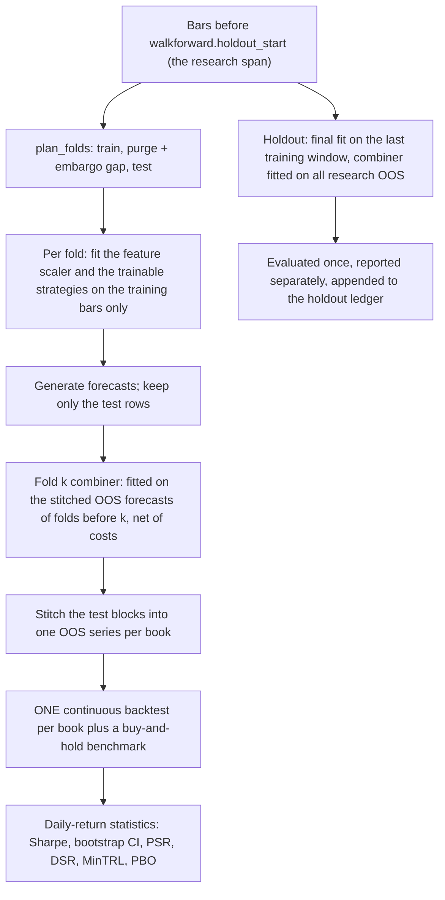

The entry points are `aurum walkforward` and
[`run_walk_forward(md, config, *, strategies=None, out_dir=None, write=None, holdout_ledger=None)`](../aurum/research/walkforward.py).

### Fold geometry

**Durations become bars.** `walkforward.train`, `test`, `step` and `embargo` accept a bar
count (`500`, `"500bars"`, `"500b"`) or a duration: `Y` (365.25 days), `M` (months of
365.25/12 days, upper case only), `W`, `D`, `h` and `min`. A duration is converted with
the **calendar density** of the research span
([`duration_to_bars`](../aurum/core/config.py)):

```math
\text{bars\_per\_day} = \frac{n_\text{research} - 1}{\text{span of the research index in days}}, \qquad
\text{bars} = \max\bigl(1,\ \operatorname{round}(\text{days} \times \text{bars\_per\_day})\bigr)
```

where

- $n_\text{research}$ is the number of bars before `walkforward.holdout_start` (all bars
  when there is no holdout), and the span is from the first to the last of them in
  calendar days;
- days is the duration in calendar days (`3Y` = 1,095.75, `6M` = 182.625).

The density counts weekends and the daily break in the span but not in the bar count, so it
depends only on the trading calendar, never on prices. On the data behind
[RESULTS.md](RESULTS.md) (H1, research span 2013-01 to 2024-12) it is 16.276 bars per
calendar day, so `3Y` resolves to 17,834 bars and `6M` to 2,972 bars; on the D1 New York
close bars of the exploratory runs it is 0.707, giving 774 and 129 bars. For the same reason
an intraday duration is **not** a count of trading hours: `"12h"` on H1 is about 8 bars,
not 12. Give short gaps such as the embargo in bars.

**Folds.** With $g$ = purge + embargo, fold $j$ tests on a block of `test` bars and trains
on the `train` bars that end $g$ bars before it:

```math
t_j = \text{train} + g + j\cdot\text{step}, \qquad
\text{test}_j = \bigl[\,t_j,\ \min(t_j + \text{test},\ n_\text{research})\bigr), \qquad
\text{train}_j = \bigl[\,\max(0,\ t_j - g - \text{train}),\ t_j - g\bigr)
```

where positions are bar indices into the research span, ends are exclusive, `step`
defaults to `test`, and with `anchored: true` the training window starts at 0 instead
(expanding window). The plot below is the real plan of the protocol run: 18 rolling folds
whose test blocks tile 2015-12-16 to 2024-12-31 without gaps or overlap, and the holdout
fold behind them.

<picture>
  <source media="(prefers-color-scheme: dark)" srcset="_assets/figures/research/wf-geometry-dark.png">
  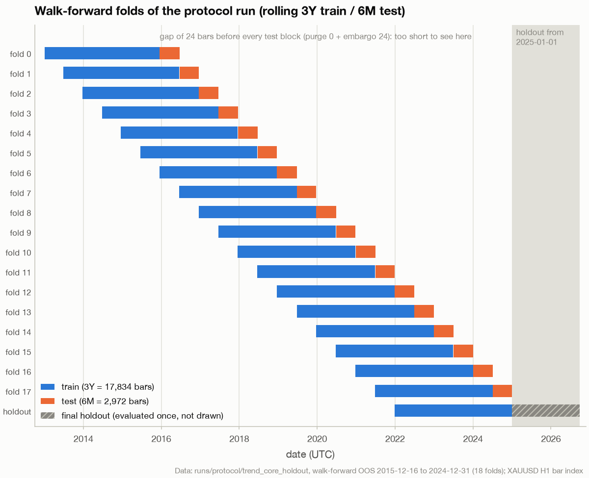
</picture>

*Every fold trains on the 17,834 bars (3 years) before its test block and trades the next 2,972 bars (6 months; the last block stops at 2024-12-31 after 2,938); the holdout fold trains on 2021-12-26 to 2024-12-30 and its 2025-26 test block is never drawn in these figures. Data: runs/protocol/trend_core_holdout, walk-forward OOS 2015-12-16 to 2024-12-31 (18 folds); XAUUSD H1 bar index.*

| Rule | Behaviour |
|---|---|
| `step` | Defaults to `test` (contiguous OOS blocks). `step < test` is an error: overlapping test blocks cannot be stitched. `step > test` is allowed; bars between test blocks are not OOS and are traded flat (the report notes it). |
| Last block | A truncated final test block is kept only if it has at least `min_test_bars` bars (default 20). |
| Minimum training | A resolved `train` below `min_train_bars` (default 500) is an error, and so is a holdout whose final training window would be shorter. |
| No fold fits | Configuration error that names the bar counts involved. |

**Holdout fold.** When `walkforward.holdout_start` falls inside the data, every bar from
that timestamp on is removed from the research span. After the research folds, one more
fit is made on the last training window ending $g$ bars before the holdout, and it is
evaluated on the holdout once.

You can inspect the plan without fitting anything. This uses `default.yaml` on synthetic
bars, so `purge: auto` resolves to the 24-bar horizon of `ml_gbm` and `meta_label`
([`plan_folds`](../aurum/research/walkforward.py)):

```python
from aurum.core.config import load_config
from aurum.research.walkforward import plan_folds

cfg = load_config("configs/default.yaml", overrides=[
    "data.synthetic.n=30000",              # synthetic H1 bars instead of data_store/
    "walkforward.holdout_start=2024-01-01",
])
md = cfg.data.load()
plans, holdout, s = plan_folds(md.bars.index, cfg, cfg.build_strategies())
print({k: s[k] for k in ("bars_per_day", "train", "test", "purge", "embargo", "n_folds")})
print("label horizons:", {k: v for k, v in s["label_horizons"].items() if v})
for p in [*plans, holdout]:
    print(f"{p.key:>7}  train [{p.train_start}, {p.train_end})  test [{p.test_start}, {p.test_end})"
          f"  gap {p.test_start - p.train_end}")
```

```text
{'bars_per_day': 16.9997996737544, 'train': 18628, 'test': 3105, 'purge': 24, 'embargo': 24, 'n_folds': 2}
label horizons: {'ml_gbm': 24, 'meta_label': 24}
      0  train [0, 18628)  test [18676, 21781)  gap 48
      1  train [3105, 21733)  test [21781, 24752)  gap 48
holdout  train [6076, 24704)  test [24752, 30000)  gap 48
```

Positions are bar indices in the loaded frame and ends are exclusive. Fold 1's test block
is the truncated last block (2,971 bars).

### Purge and embargo

**Intuition.** A supervised strategy learns from labels that look into the future: a label
"did price rise over the next 24 bars?" attached to the last training bar is only known 24
bars later, inside the next block. Training on it would let the test period leak into the
model. The **purge** is the gap that keeps every training label resolved before the test
block. The **embargo** is an extra safety margin against serial correlation (volatility
clustering, positions that span the boundary).

```math
g = \text{purge} + \text{embargo}, \qquad
\text{purge} = \max\Bigl(\text{purge}_\text{config},\ \max_{s\ \text{trainable}} h_s\Bigr), \qquad
i + h \le t_j - \text{embargo} - 1 \ \ \text{for every training row } i
```

where

- $h_s$ is the label horizon a **trainable** strategy declares (a `label_horizon`
  attribute, or one of the parameters `label_horizon`, `horizon`, `max_holding`,
  `max_holding_bars`, `vertical_barrier`, `hold_bars` or `forward_bars`;
  [`label_horizon`](../aurum/research/walkforward.py)) and $h$ the largest of them;
- `purge: auto` (the default) means purge$_\text{config}$ = 0, so the purge equals the
  largest declared horizon; an explicit purge (bars or a duration) is raised to that
  horizon when it is smaller;
- the last condition is what the gap buys: the label of the last training row ends at
  least `embargo` bars before the first test bar.

In the default strategy set `ml_gbm` and `meta_label` declare 24 bars; a set without
trainable label horizons (such as `trend_core.yaml`) gets a purge of 0. Non-trainable
strategies learn nothing, so they need no purge. All training data precede the test block
in a walk-forward, so there is no post-test data to embargo in the López de Prado sense:
the embargo is applied as an *additional* pre-test gap, so the same `(purge, embargo)`
pair is never less conservative in any splitter. `default.yaml` uses 24 bars (one trading
day on H1).

<picture>
  <source media="(prefers-color-scheme: dark)" srcset="_assets/figures/research/purge-embargo-zoom-dark.png">
  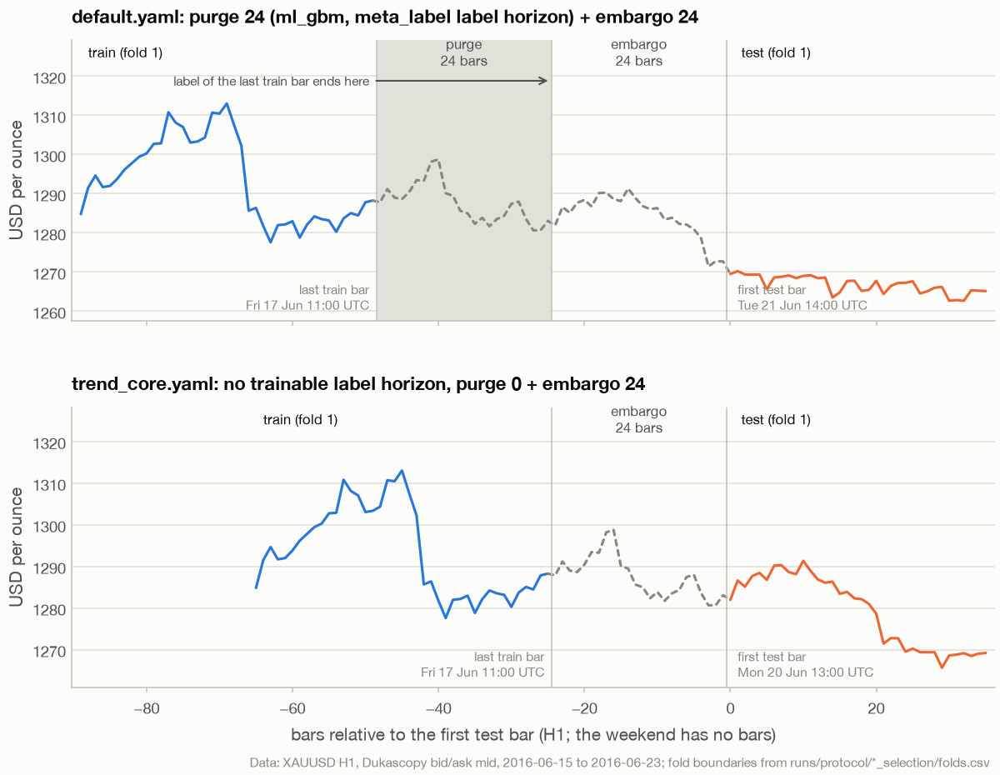
</picture>

*`default.yaml`: the 48 bars between the last training bar (Fri 17 Jun 2016 11:00 UTC) and the first test bar (Tue 21 Jun 14:00) are a 24-bar purge, where the labels of the last training rows resolve, then a 24-bar embargo; `trend_core.yaml` trains on the same window but, with no label horizon, starts testing 24 bars earlier. Data: XAUUSD H1, Dukascopy bid/ask mid, 2016-06-15 to 2016-06-23; fold boundaries from the `folds.csv` of both protocol selection runs.*

`walk_forward_splits` can also take `label_end`, an inclusive label-end position per row
(for example triple-barrier first-touch times). Training rows whose label resolves at or
after `t_j - embargo` are then dropped individually, which is tighter than a fixed purge
for variable-horizon labels ([Splitters](#splitters-walk-forward-purged-k-fold-cpcv)).

**Pitfalls and design choices.**

- *A purge that is too short* leaks: the model is graded on bars its own labels peeked at.
  Aurum derives the purge from what the strategies declare and never lowers it below that,
  so a mis-set `purge: 0` in a config with `ml_gbm` still gets 24 bars.
- *The purge depends on the strategy set.* Removing the ML strategies changes the gap, and
  with it the first OOS bar: `trend_core` starts 24 bars earlier than `default`, which is
  why identical forecasts score slightly differently in the two runs
  ([RESULTS.md](RESULTS.md)).
- *Give gaps in bars.* A duration is converted with calendar density, so `"24h"` on H1 is
  about 16 bars, not 24.

### What is refit per fold

| Component | Fitted on | Notes |
|---|---|---|
| Feature pipeline scaler | The fold's training rows | Only when some strategy consumes the shared pipeline features (`features.enabled`, see [features.md](features.md)). `ml_gbm` and `meta_label` build and fit their own pipeline inside `fit`. |
| Trainable strategies | The fold's training bars, plus `fit_history_bars` older bars for warm-up when the strategy uses no pipeline features | Each fold works on a fresh `clone()`. Macro frames passed to `fit` are truncated to rows published by the close of the last training bar (`available_at <= train end`). |
| Forecast generation | Bars from `hist_start` (bar 0, or `train_start - history_bars` when `walkforward.history_bars` is set) to the end of the test block | Warm-up uses bars before the test block, which is legitimate because they are the past. Only the test rows are kept. |
| Non-trainable strategies | Nothing to fit | Causal by contract (the strategy leakage tests enforce it), so they are generated once on the research span (and once on the full data for the holdout) and sliced. `regenerate_per_fold: true` forces the strict per-fold path; the result is identical, only slower. |
| Combiner | Earlier folds' OOS forecasts (next section) | |

Forecasts that are not finite are set to 0 and forecasts outside [-1, 1] are clipped, with
a warning. If a strategy raises, `walkforward.on_strategy_error: raise` (the default)
aborts the run; `drop` removes that strategy, lists it under `dropped` in `summary.json`
and adds a note. Two v2.1 strategies carry path-dependent state (the de-risk latch of
`managed_gold` and the HMM filter of `regime_switch`); both are causal, and the walk-forward
treats them like any other strategy ([strategies.md](strategies.md)).

### Combiner fitting on out-of-sample forecasts only

**Intuition.** Choosing how much weight each strategy gets is itself a fit, and it can
overfit just like a model. If the weights for 2020 were chosen by looking at how the
strategies did in 2020, the "OOS" record would quietly contain an in-sample decision. So
the weights used on fold $k$ are learned only from the OOS forecasts of folds that were
already finished when fold $k$ began.

With `walkforward.combiner_fit: oos` (the default) the
[`ForecastCombiner`](portfolio-and-risk.md#forecast-combiner) for fold $k$ is fitted on

```math
H_k = \text{last } W \text{ bars of } \bigcup_{j<k} \text{test}_j \ \ (\text{all of them when anchored}), \qquad
\text{weights}_k =
\begin{cases}
\text{fit}(H_k) & \lvert H_k \rvert \ge \text{combiner\_min\_obs} \\
\text{equal} & \text{otherwise}
\end{cases}
```

and the combined forecast of every bar $t$ in fold $k$ is

```math
\hat f_t = \operatorname{clip}\Bigl(\mathrm{FDM}_k \sum_i w_{k,i}\, f_{i,t},\ -1,\ 1\Bigr)
```

where

- $W$ is `walkforward.train` in bars (17,834 on the protocol data) for rolling windows;
- `combiner_min_obs` is 500 bars by default, so the first fold always uses equal weights
  (DeMiguel, Garlappi and Uppal 2009);
- $f_{i,t}$ is strategy $i$'s forecast in [-1, 1], $w_{k,i}$ its weight in fold $k$, and
  $\mathrm{FDM}_k$ the forecast diversification multiplier fitted with the weights
  ([portfolio-and-risk.md](portfolio-and-risk.md#forecast-combiner)).

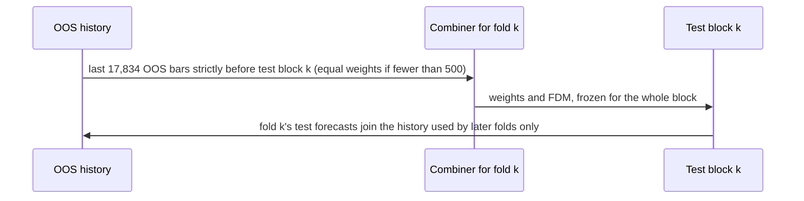

Weights therefore come from how each strategy performed out of sample in the past
(Timmermann 2006), never from in-sample fits. The details:

- When the history is too short, activity flags and the diversification multiplier come
  from the training-window forecast *correlations*; no returns are involved. A failed OOS
  fit also falls back to equal weights.
- Strategies are scored **net of estimated trading costs**. The combiner gets the bars'
  spreads and ranges plus the same `costs` and `instrument` as the backtests. Under
  `sharpe_shrink` a strategy with a non-positive net Sharpe gets zero weight, and the
  weights may sum to less than 1 (`combiner.allow_unallocated`). See
  [How research fits the combiner](portfolio-and-risk.md#how-research-fits-the-combiner).
- `combiner_fit: train` fits on the training-window forecasts instead. Those are in-sample
  for trainable strategies, so the weights are biased toward them. The OOS evaluation is
  still out of sample, and the report adds a note.
- `combiner.method: fixed` ignores returns in either mode and uses the configured
  `strategies[].weight` values.

<picture>
  <source media="(prefers-color-scheme: dark)" srcset="_assets/figures/research/combiner-oos-timeline-dark.png">
  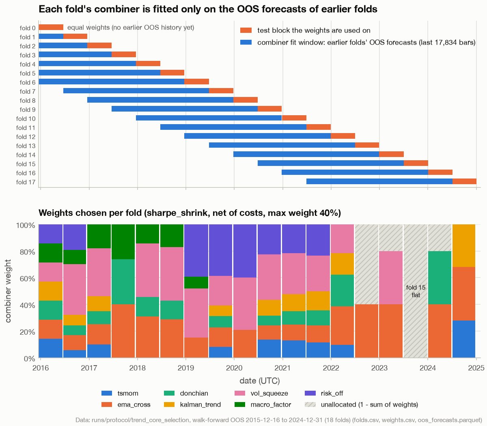
</picture>

*Fold 0 trades equal weights; from fold 1 the fit window grows with each finished fold and is capped at 17,834 bars from fold 7 on. The weights then drift toward `ema_cross` and `vol_squeeze`, and in fold 15 no strategy had a positive net Sharpe, so the whole risk budget stayed unallocated and the book was flat. Data: runs/protocol/trend_core_selection, walk-forward OOS 2015-12-16 to 2024-12-31 (18 folds).*

Each fold's basis is recorded in `folds.csv` (`combiner_basis`, for example
`equal (OOS history 0 < 500 bars)` or `oos_history(2972 bars)`) and its weights and FDM in
`weights.csv`. The holdout's combiner is fitted on the research OOS history with the same
window rule.

**Pitfalls and design choices.** Equal weights in the first fold are not a weakness: they
are the honest answer when there is no OOS evidence yet. A combiner that can leave risk
unallocated is what kept the protocol books flat when nothing cleared costs (fold 15
above); forcing weights to sum to 1 would have bought the least-bad strategy instead.

### One stitched backtest per book

Test blocks are contiguous and do not overlap, so each strategy's OOS forecasts and the
`combined` forecast form one strictly increasing series (the code asserts it). Each book is
then backtested **once**, continuously, from the first to the last OOS bar, through
[`run_backtest`](execution-and-costs.md#run_backtest) with:

- the configured sizer (`sizing`, see [portfolio-and-risk.md](portfolio-and-risk.md#position-sizing));
- a fresh risk manager with the **research** limits (`risk.research` layered over
  `RESEARCH_RISK_DEFAULTS`: the daily-loss halt clears the next day and the permanent
  max-drawdown kill switch is off; every halt is counted and reported). `risk.enabled: false`
  removes the risk manager from research backtests;
- the configured cost model and overnight financing ([execution-and-costs.md](execution-and-costs.md));
- the `backtest` section's stop/take-profit, ATR and event settings.

Equity carries across fold boundaries; it is never reset per fold. Because the sizer is
equity-dependent (rebalance band, drawdown de-risking), a different start bar can change a
book's path even when its forecasts are identical ([RESULTS.md](RESULTS.md) discusses one
such case).

<picture>
  <source media="(prefers-color-scheme: dark)" srcset="_assets/figures/research/stitched-oos-equity-dark.png">
  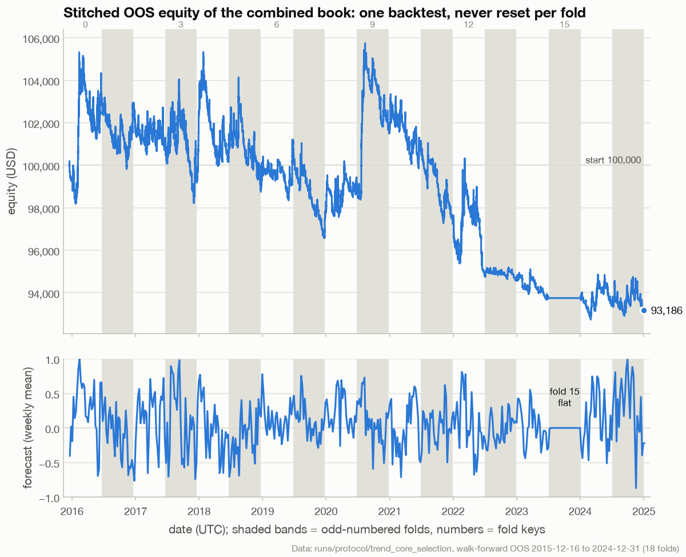
</picture>

*One equity curve runs from 100,000 to 93,186 USD across all 17 fold boundaries without a reset; in fold 15 (2023-07-03 to 2024-01-03) the combined forecast is exactly 0 and the equity line is flat. Data: runs/protocol/trend_core_selection, walk-forward OOS 2015-12-16 to 2024-12-31 (18 folds).*

With `walkforward.strategy_backtests: true` (the default) every strategy also gets its own
standalone book. These books feed the per-strategy rows of `stats.csv`, the PBO matrix and
the cross-sectional DSR.

Per-fold numbers (`folds.csv` `oos_sharpe` and `oos_return`, and `fold_sharpe.csv`) are
**slices of the stitched equity**, not separate backtests. A fold covers the decisions
taken at the closes inside its test block; their PnL runs from the equity at the close of
its first bar to the close of the bar after its last one, so consecutive folds chain
exactly. A fold with fewer than five daily returns gets a `NaN` Sharpe. A fold in which the
book was flat can still show a large Sharpe of tiny returns (financing on the position
carried in from the previous fold): fold 15 above has `oos_return` of −0.0002% and an
`oos_sharpe` of −1.38. Read per-fold Sharpes together with `oos_return`.

#### The benchmark

`backtest.benchmark: true` (the default) adds a buy-and-hold book over the same span: long
a notional equal to `backtest.initial_equity` (1x leverage) at the open after the first bar,
held to the end, through the same simulator. It pays the same spread, slippage, commission
and CFD financing as the strategies, so it is a financed CFD long, not a vault holding. It
is not vol-targeted, so it runs at gold's own volatility; compare risk-adjusted numbers. Its
DSR uses one trial. Details: [`buy_and_hold_benchmark`](execution-and-costs.md#buy_and_hold_benchmark).

#### Parallelism and determinism

Work is spread over a `concurrent.futures` pool. `walkforward.n_jobs: 0` means
`min(cpu_count, 8)`, capped at the number of tasks. `executor: auto` chooses serial for one
job; processes when the research span has at least 20,000 bars or a heavy trainable strategy
is present (`ml_gbm`, `meta_label`, `rl_ppo`, or any with `fit_history_bars > 0`); threads
otherwise. Strategies that consume the shared feature matrix always run on threads in the
parent process. Neither setting is part of the config hash, and results do not depend on
them: the demo above gives identical tables with `--executor serial`.

If you call `run_walk_forward` from a Python script, protect the entry point with
`if __name__ == "__main__":`. Worker processes are started with `spawn`, which re-imports
the main module; without the guard the script fails with a multiprocessing bootstrapping
error.

```python
from aurum.core.config import load_config
from aurum.research.walkforward import run_walk_forward


def main() -> None:
    cfg = load_config("configs/fast.yaml", overrides=[
        "data.synthetic.n=30000",                  # synthetic random-walk H1 bars
        "walkforward.holdout_start=2024-01-01",
        "output.dir=runs/api_demo",                # its own run dirs and holdout ledger
    ])
    md = cfg.data.load()
    rep = run_walk_forward(md, cfg)                # writes runs/api_demo/walkforward_<utc>_<hash8>/
    cols = ["sharpe", "ci_lower", "ci_upper", "psr", "dsr"]
    print(rep.stats.loc[["combined", "benchmark"], cols].round(3))
    print("n_trials:", rep.n_trials, "| PBO:", round(rep.pbo.pbo, 3))
    print("fold bases:", list(rep.folds["combiner_basis"]))
    print("holdout:", rep.holdout.stats.loc["combined", cols].round(3).to_dict())
    print("ledger:", rep.holdout.ledger_path, rep.holdout.prior_looks["n_prior_configs"])


if __name__ == "__main__":   # required: the default executor may start worker processes
    main()
```

```text
           sharpe  ci_lower  ci_upper    psr    dsr
combined   -0.247    -1.424     0.930  0.362  0.010
benchmark  -0.064    -1.371     1.316  0.464  0.464
n_trials: 23 | PBO: 0.477
fold bases: ['equal (OOS history 0 < 500 bars)', 'oos_history(3105 bars)', 'oos_history(6210 bars)', 'oos_history(9315 bars)']
holdout: {'sharpe': -0.168, 'ci_lower': -2.514, 'ci_upper': 2.093, 'psr': 0.438, 'dsr': 0.017}
ledger: runs/api_demo/holdout_ledger.jsonl 0
```

The returned `WalkForwardReport` holds everything the run directory contains: `stats`,
`folds`, `weights`, `fold_sharpe`, `costs`, `oos_forecasts`, `pbo`, `n_trials`, the
`combined`, `strategy_results` and `benchmark` `BacktestResult`s, `holdout`, `settings`,
`provenance`, `timing`, `notes` and `dropped`, plus the attribution accessors described in
[Walk-forward attribution](#walk-forward-attribution).

### Walk-forward settings

The `walkforward` section ([`WalkForwardConfig`](../aurum/core/config.py); every key is
described in [configuration.md](configuration.md)). Defaults are the dataclass defaults;
`configs/default.yaml` overrides the ones marked.

| Key | Default | Meaning |
|---|---|---|
| `train` | `3Y` | Training window (bars or a duration). |
| `test` | `6M` | Test block. |
| `step` | `null` (= `test`) | Distance between test starts; must be at least `test`. |
| `anchored` | `false` | Expanding training window instead of rolling. |
| `purge` | `auto` | Bars, or `auto` = the largest trainable label horizon (never lower). |
| `embargo` | `0` (`default.yaml`: 24) | Extra pre-test gap in bars. |
| `holdout_start` | `null` (`default.yaml`: `2025-01-01`) | Start of the final holdout, evaluated once. |
| `min_train_bars` / `min_test_bars` | 500 / 20 | Smallest training window and smallest final test block. |
| `history_bars` | `null` | Cap on the warm-up history before `train_start` given to trainable strategies. |
| `regenerate_per_fold` | `false` | Also regenerate non-trainable strategies per fold (identical results). |
| `combiner_fit` | `oos` | `oos` (earlier folds' OOS forecasts) or `train`. |
| `combiner_min_obs` | 500 | OOS bars needed before fitted weights replace equal weights. |
| `n_trials` | `null` (`default.yaml`: 23) | DSR trials; `null` = the number of strategies in the run. |
| `pbo_splits` | 16 | CSCV blocks for PBO. |
| `n_boot` | 1000 | Stationary-bootstrap resamples for the Sharpe CI (and the tearsheet). |
| `strategy_backtests` | `true` | Standalone book per strategy (needed for PBO and per-strategy rows). |
| `on_strategy_error` | `raise` | `raise` or `drop` a failing strategy. |
| `n_jobs` / `executor` | 0 / `auto` | Parallelism; not hashed, results do not depend on them. |

**Pitfalls and design choices for the whole protocol.**

- *One path.* A walk-forward is a single historical path. Its OOS Sharpe has wide error
  bars (next section), and a different `train`/`test` choice is another trial.
- *Regime dependence.* Eighteen six-month folds cover a few distinct regimes at most; the
  per-fold Sharpes of the protocol runs swing between −2.8 and +1.2
  ([RESULTS.md](RESULTS.md)). A full-period number averages over them.
- *Costs inside, not after.* Costs and financing are charged inside the backtest and inside
  the combiner's scoring, so a strategy that only works before costs is not selected and
  does not look good.

## Statistics

All headline statistics are computed by
[`book_statistics`](../aurum/research/walkforward.py) and
[`aurum.research.stats`](../aurum/research/stats.py) on **daily** returns, one row per book.
They answer three different questions: how uncertain is this Sharpe (bootstrap CI and PSR),
could it be the luckiest of many attempts (DSR), and does picking the in-sample winner work
at all (PBO).

### Sharpe convention

```math
r_d = \frac{E_d}{E_{d-1}} - 1, \qquad
\widehat{SR} = \frac{\bar r}{s_r}, \qquad
SR_\text{ann} = \widehat{SR}\,\sqrt{252}
```

where

- $E_d$ is the equity at the close of the last bar of trading day $d$ (the first day is
  measured against the starting equity), from
  [`aurum.backtest.metrics.daily_returns`](execution-and-costs.md#metrics): a day is the UTC
  date of the bar **open** time, Saturday and Sunday bars are folded into the following
  Monday, and days without bars are absent rather than counted as zero-return days;
- $\bar r$ and $s_r$ are the sample mean and standard deviation (`ddof=1`) of the daily
  returns, with a **zero risk-free rate**: financing is already inside the equity curve;
- $\widehat{SR}$ is the **per-period** (daily) Sharpe that every function in
  `aurum.research.stats` without a `periods` argument expects.

Kurtosis in `aurum.research.stats` is **Pearson** kurtosis (3 for a normal distribution). A
value below $1 + g_3^2$ cannot be Pearson kurtosis, so the functions warn when they receive
what looks like excess kurtosis. The per-bar Sharpe (`sharpe_bar`) is in each book's
`metrics.json`; it is not the headline number.

> [!NOTE]
> **D1 bars that open at 22:00 UTC.** The walk-forward statistics date a day by the bar's
> open time. On the New York close bars used by `configs/d1_trend.yaml` and
> `configs/managed_gold.yaml`, the Sunday 22:00 and Monday 22:00 bars both fall on Monday,
> so a week has four daily returns, one of them spanning two sessions. The annualised
> Sharpe and its interval in `stats.csv` are then about 10% larger in magnitude than with
> close-time dates, which `metrics.json` uses (buy and hold 0.514 against 0.467). PSR and
> DSR work on per-period values and are essentially unaffected. [RESULTS.md](RESULTS.md#additional-trials-exploratory-v21)
> shows both numbers. H1 bars are not affected.

Symbols used below: $\widehat{SR}$ is the per-period Sharpe, $T$ the number of daily
returns, $g_3$ the skewness, $g_4$ the Pearson kurtosis (both biased sample moments,
[`return_moments`](../aurum/research/stats.py)), $\Phi$ the standard normal CDF.

### Confidence interval: stationary bootstrap

**Intuition.** The Sharpe ratio of nine years of returns is one draw from a distribution
of Sharpes you could have observed. The bootstrap estimates that distribution by
rebuilding many alternative histories from the real one and recomputing the Sharpe on
each. Returns are not independent (volatile days cluster, positions overlap), so instead
of drawing single days at random the stationary bootstrap of Politis and Romano (1994)
copies **blocks** of consecutive days with random starts and random lengths, which keeps
that dependence. An iid bootstrap would destroy it and usually produce intervals that are
too narrow.

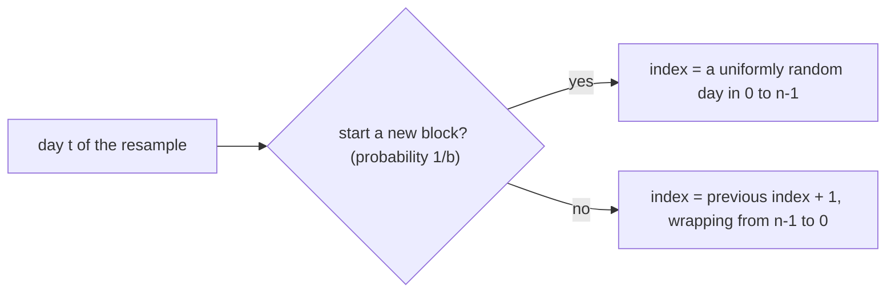

```math
I_0 \sim \mathcal U\lbrace 0,\dots,n-1\rbrace, \qquad
I_t =
\begin{cases}
U_t \sim \mathcal U\lbrace 0,\dots,n-1\rbrace & \text{with probability } p = 1/b \\
(I_{t-1} + 1) \bmod n & \text{otherwise}
\end{cases}, \qquad
\mathrm{CI}_{95} = \bigl[\,q_{0.025},\ q_{0.975}\,\bigr]\ \text{of}\ \bigl\lbrace \widehat{SR}(r_{I^{(m)}})\sqrt{252} \bigr\rbrace_{m=1}^{M}
```

where

- $n$ = $T$ is the number of daily returns and every resample has the same length;
- block lengths are therefore geometric with mean $b$, the **mean block length**;
- $M$ = `walkforward.n_boot` resamples (default 1000), drawn with the top-level `seed`
  (`default.yaml`: 7), and the interval is the percentile interval of their annualised
  Sharpes (non-finite samples are dropped with a warning).

The block length is chosen automatically by Politis and White (2004) with the Patton,
Politis and White (2009) correction ([`optimal_block_length`](../aurum/research/stats.py)):

```math
b = \Bigl(\frac{2\,G^2}{D_\text{SB}}\Bigr)^{1/3} n^{1/3},\quad D_\text{SB} = 2\,\hat g^2,\qquad
\hat g = \sum_{\lvert k\rvert \le M} \lambda(k/M)\,\hat R(k),\quad
G = \sum_{\lvert k\rvert \le M} \lambda(k/M)\,\lvert k\rvert\,\hat R(k),\qquad
b \in \bigl[\,1,\ \lceil \min(3\sqrt n,\ n/3) \rceil\,\bigr]
```

where $\hat R(k)$ is the sample autocovariance at lag $k$, $\lambda$ the flat-top lag
window (1 up to $\lvert t\rvert$ = 1/2, falling linearly to 0 at 1), and the bandwidth $M$ =
min(2 $\hat m$, $\lceil\sqrt n\rceil + K_N$) with $\hat m$ the first lag after which
$K_N$ = max(5, $\lceil\sqrt{\log_{10} n}\rceil$) consecutive autocorrelations are
insignificant. For serially uncorrelated returns $G \approx 0$ and $b$ collapses to 1, the
ordinary bootstrap; that is what happens on the protocol's daily returns.

<picture>
  <source media="(prefers-color-scheme: dark)" srcset="_assets/figures/research/stationary-bootstrap-dark.png">
  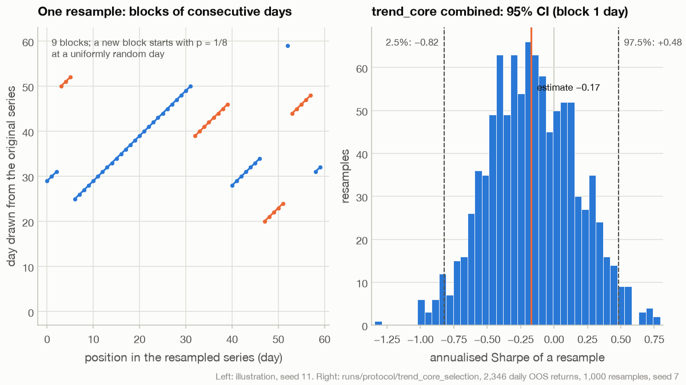
</picture>

*Left: one resample with mean block 8 is 9 runs of consecutive days (a synthetic illustration of the index rule). Right: 1,000 resamples of the `trend_core` combined book's 2,346 daily returns (block length 1 day, chosen automatically) put the 95% interval at −0.82 to +0.48 around the −0.17 estimate, exactly the `ci_lower`/`ci_upper` in its `stats.csv`. Data: runs/protocol/trend_core_selection, walk-forward OOS 2015-12-16 to 2024-12-31 (18 folds).*

In code: [`sharpe_ci(returns, periods=252.0, *, alpha=0.05, method="bootstrap", n_boot=2000, mean_block=None, seed=0)`](../aurum/research/stats.py)
(the walk-forward passes `n_boot=walkforward.n_boot` and `seed=cfg.seed`), built on
[`stationary_bootstrap`](../aurum/research/stats.py) and
[`stationary_bootstrap_indices`](../aurum/research/stats.py), which accepts any statistic.

| Parameter | Default | Meaning |
|---|---|---|
| `n_boot` | 2000 (walk-forward: `walkforward.n_boot`, 1000) | Number of resamples $M$. |
| `mean_block` | `None` = automatic | Mean block length $b$ (clipped to [1, $n$]). |
| `alpha` | 0.05 | Two-sided level of the interval. |
| `ci_method` | `percentile` | `percentile` or `basic` (2 estimate − quantile). |
| `seed` | 0 (walk-forward: top-level `seed`) | NumPy generator seed; results are bit-reproducible. |
| `method` (`sharpe_ci`) | `bootstrap` | `analytic` instead uses the Mertens standard error below (iid, non-normal). |

**Pitfalls.** An interval that contains 0 means the sign of the Sharpe is not established,
whatever the point estimate. The bootstrap resamples the observed history, so it cannot
widen for regimes that never happened; a block length of 1 means the data showed no serial
dependence, not that the strategy has none.

### Probabilistic Sharpe Ratio (PSR)

**Intuition.** The PSR turns an observed Sharpe into a probability that the true Sharpe is
above a threshold (here 0), given how long the record is and how non-normal the returns
are (Bailey and López de Prado 2012; the standard error is Mertens 2002 / Opdyke 2007). A
Sharpe of 1 over three months means little; over ten years it means a lot.

```math
\mathrm{PSR}(SR^*) = \Phi\!\left(\frac{(\widehat{SR} - SR^*)\sqrt{T-1}}{\sqrt{1 - g_3\,\widehat{SR} + \frac{g_4 - 1}{4}\,\widehat{SR}^2}}\right)
```

where $SR^*$ is the per-period benchmark Sharpe (0 in every run), and the denominator
under the square root, divided by $T-1$, is the variance of the Sharpe estimate
(`sharpe_se` in `stats.csv` is its square root, annualised). Negative skew and fat tails
widen the sampling distribution and lower the PSR of a positive Sharpe; positive skew does
the opposite.

<picture>
  <source media="(prefers-color-scheme: dark)" srcset="_assets/figures/research/psr-track-length-dark.png">
  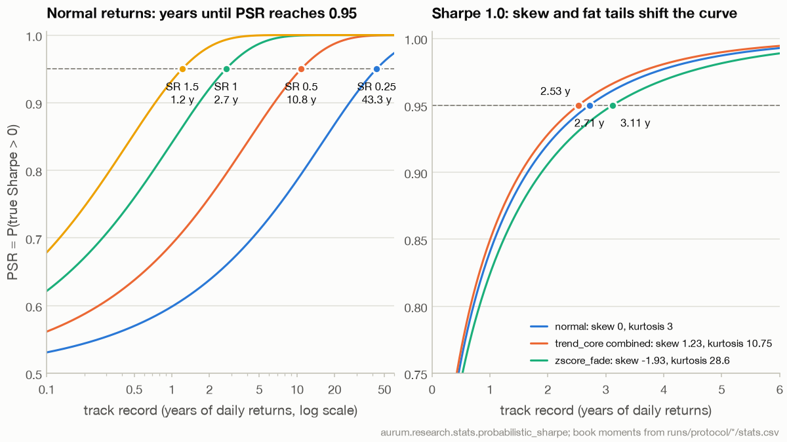
</picture>

*A Sharpe of 0.5 needs 10.8 years of daily returns before PSR(0) reaches 0.95, and a Sharpe of 0.25 needs 43; on daily data skew and kurtosis move that by tenths of a year (2.53, 2.71 and 3.11 years at Sharpe 1 for the `trend_core` combined book's shape, normal returns and `zscore_fade`'s shape). Data: computed with `aurum.research.stats.probabilistic_sharpe`; moments from the protocol runs' `stats.csv`.*

In code: [`probabilistic_sharpe(sr, n, skew=0.0, kurt=3.0, sr_star=0.0)`](../aurum/research/stats.py)
with a per-period `sr`, and [`sharpe_std(sr, n, skew=0.0, kurt=3.0)`](../aurum/research/stats.py)
for the standard error. `sharpe_pvalue` is 1 − PSR.

**Pitfall.** The PSR forgets how many strategies you tried before reporting this one. It is
an upper bound on your confidence; the DSR below removes that blind spot.

### Deflated Sharpe Ratio (DSR) and `n_trials`

**Intuition.** Try 23 strategies with no skill at all and the best of them will still show
a positive Sharpe, just by luck. The DSR (Bailey and López de Prado 2014) raises the bar
the observed Sharpe has to clear from 0 to the Sharpe you would **expect from the best of N
skill-less trials**, and then asks the PSR question against that bar.

```math
SR_0 = \sqrt{V}\left[(1-\gamma)\,\Phi^{-1}\!\left(1 - \tfrac{1}{N}\right) + \gamma\,\Phi^{-1}\!\left(1 - \tfrac{1}{N e}\right)\right],
\qquad \mathrm{DSR} = \mathrm{PSR}(SR_0)
```

where

- $N$ is the number of trials (`n_trials`, below), and with $N$ = 1 the DSR equals the PSR;
- $V$ is the variance of the trials' per-period Sharpe estimates under the null;
- $\gamma \approx 0.5772$ is the Euler–Mascheroni constant and $e$ Euler's number: the
  bracket is the extreme-value approximation of the expected maximum of $N$ standard
  normals ([`expected_max_sharpe`](../aurum/research/stats.py));
- `sr0` in `stats.csv` is $SR_0$ annualised (0.643 for $N$ = 23 and $T$ = 2,346 days).

Two variants are reported:

| Column | $V$ (variance of the trials' Sharpe) | Question it answers |
|---|---|---|
| `dsr` | $1/(T-1)$, the sampling variance of a Sharpe estimate whose true value is 0 | Could the best of N pure-noise strategies look this good? This is the right null for a set of distinct configurations and the number the protocol uses. |
| `dsr_xs` | The cross-sectional variance of this run's per-strategy OOS Sharpes, with $N$ = max(`n_trials`, number of strategies) | The paper's parameter-sweep setting. It treats genuine dispersion between strategies as noise, so it is much more conservative. Reported for completeness. |

<picture>
  <source media="(prefers-color-scheme: dark)" srcset="_assets/figures/research/dsr-null-dark.png">
  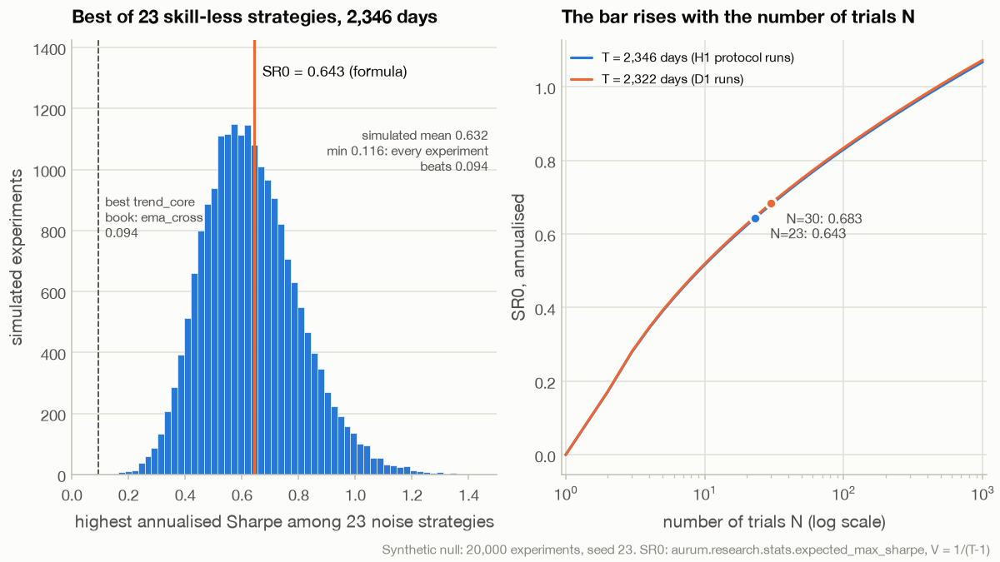
</picture>

*The best of 23 skill-less strategies over 2,346 days averages an annualised Sharpe of 0.632 (the formula gives 0.643), and every one of 20,000 simulated experiments (lowest maximum 0.116) beats the best `trend_core` strategy book, `ema_cross` at 0.094, and even the best book of the `default` run, `ema_cross` at 0.113; the bar rises with the number of trials and is higher on the shorter D1 sample (0.763 at N = 30). Data: synthetic null (exact sampling of the Sharpe of iid normal returns, seed 23), not market data.*

`N` is `n_trials` for the run:

```text
n_trials = (walkforward.n_trials, or the number of strategies in the run when it is null)
         + (distinct OTHER config hashes that evaluated an overlapping holdout window before, per the ledger)
```

The second term is explained under [How n_trials rises](#how-n_trials-rises). It applies to
every DSR of the run, the research OOS rows and the holdout rows alike. Benchmark rows
always use one trial. `n_trials` should count **every configuration you evaluated on this
data**, not only the ones in the current config: the protocol pre-registered
`n_trials: 23` (21 strategy configurations plus 2 combined books, see
[RESEARCH_PROTOCOL.md](RESEARCH_PROTOCOL.md)), and `default.yaml` carries that value, so
every config that extends it (including `fast.yaml` with its 7 strategies) inherits it.
The exploratory v2.1 configs `d1_trend.yaml` and `managed_gold.yaml` set `n_trials: 30`
(the 23, five new strategy configurations and two combined books); see the
[protocol addendum](RESEARCH_PROTOCOL.md#addendum-v21-unreleased).

In code: [`deflated_sharpe(sr, n, skew=0.0, kurt=3.0, trial_srs=None, *, n_trials=None, trial_var=None)`](../aurum/research/stats.py).
Pass `n_trials` alone for the `dsr` null, or `trial_srs` (per-period Sharpes of all trials)
for the cross-sectional variant.

**Pitfalls.** The DSR is only as honest as `n_trials`. Correlated trials count as fewer
independent ones, so a large `N` of near-identical configurations is conservative; a small
`N` that leaves out the exploratory runs is not. The ledger counts other configurations'
holdout looks automatically, but nothing counts your exploratory runs on the research span
except you.

### Minimum track record length (MinTRL)

**Intuition.** Invert the PSR: how many daily observations would this Sharpe, with these
skewness and kurtosis, need before PSR(0) reaches 95%? Compare the answer with the length
of the sample you have.

```math
\mathrm{MinTRL} = 1 + \left(1 - g_3\,\widehat{SR} + \frac{g_4 - 1}{4}\,\widehat{SR}^2\right)\left(\frac{\Phi^{-1}(0.95)}{\widehat{SR} - SR^*}\right)^2
```

where everything is per period, $\Phi^{-1}(0.95) \approx 1.645$, and the result is a count
of days. `stats.csv` reports it in years (`min_trl_years` = MinTRL / 252). It is infinite
when $\widehat{SR} \le SR^*$. Halving the Sharpe roughly quadruples the wait.

<picture>
  <source media="(prefers-color-scheme: dark)" srcset="_assets/figures/research/min-trl-dark.png">
  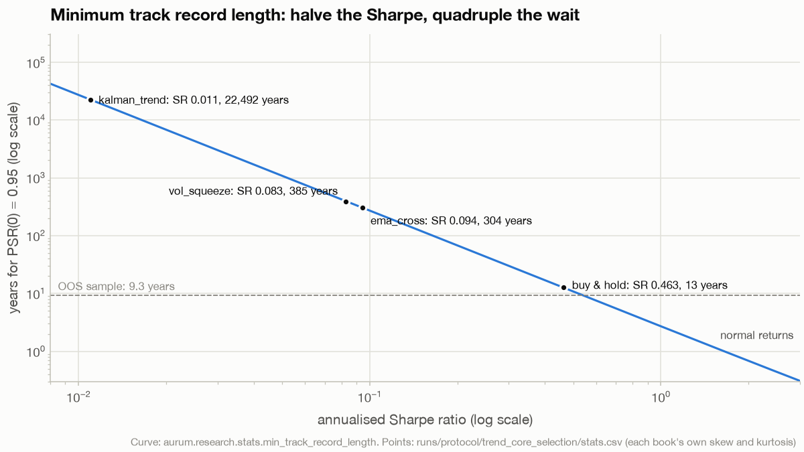
</picture>

*Buy and hold's 0.463 would need 12.7 years of daily data, more than the 9.3-year OOS sample; `ema_cross`'s 0.094 needs 304 years and `kalman_trend`'s 0.011 about 22,000. Data: curve computed with `aurum.research.stats.min_track_record_length`; points from runs/protocol/trend_core_selection `stats.csv`, walk-forward OOS 2015-12-16 to 2024-12-31 (18 folds).*

In code: [`min_track_record_length(sr, skew=0.0, kurt=3.0, sr_star=0.0, prob=0.95)`](../aurum/research/stats.py).

The building blocks are public, and [`sharpe_summary`](../aurum/research/stats.py)
computes the whole set for any return series:

```python
import numpy as np
from aurum.research.stats import (deflated_sharpe, min_track_record_length, probabilistic_sharpe,
                                  return_moments, sharpe, sharpe_summary)

rng = np.random.default_rng(0)
r = rng.standard_t(df=5, size=1260) * 0.006 + 0.0003     # ~5 years of fat-tailed daily returns

s = sharpe_summary(r, 252, n_trials=23, n_boot=1000, seed=0)
for k in ("sharpe", "ci_lower", "ci_upper", "psr", "sr0", "dsr", "min_trl_years", "bootstrap_block"):
    print(f"{k:>15}: {s[k]:.3f}")

# the same numbers from the building blocks (per-period Sharpe, Pearson kurtosis)
sr = sharpe(r, periods=1)
skew, kurt = return_moments(r)
print(round(probabilistic_sharpe(sr, len(r), skew, kurt), 3),
      round(deflated_sharpe(sr, len(r), skew, kurt, n_trials=23), 3),
      round(min_track_record_length(sr, skew, kurt) / 252, 3))
```

```text
         sharpe: 0.416
       ci_lower: -0.454
       ci_upper: 1.315
            psr: 0.825
            sr0: 0.878
            dsr: 0.150
  min_trl_years: 15.504
bootstrap_block: 1.000
0.825 0.15 15.504
```

Five years at a Sharpe of about 0.4 give a PSR of 0.83, but after deflating for 23 trials
the DSR is 0.15, and the minimum track record for 95% confidence is about 15 years. The
module also provides `haircut_sharpe` (Harvey and Liu 2015), `adjust_pvalues` (Bonferroni,
Šidák, Holm, BH, BHY), `sharpe_ci(method="analytic")` and `optimal_block_length`.

`sharpe_summary(returns, periods=252.0, *, n_trials=None, trial_sharpes_ann=None, sr_star_ann=0.0, alpha=0.05, n_boot=1000, bootstrap=True, seed=0, prob=0.95)`:

| Parameter | Default | Meaning |
|---|---|---|
| `periods` | 252 | Periods per year; inputs and Sharpe outputs are annualised with it. |
| `n_trials` | `None` (= 1, or the number of `trial_sharpes_ann`) | $N$ for the DSR and the haircut. |
| `trial_sharpes_ann` | `None` | Annualised Sharpes of all trials; sets $V$ to their variance. |
| `sr_star_ann` | 0.0 | Benchmark Sharpe of the PSR and MinTRL. |
| `n_boot`, `seed`, `alpha` | 1000, 0, 0.05 | Bootstrap interval settings; `bootstrap=False` skips it. |
| `prob` | 0.95 | Target PSR of the MinTRL. |

### Probability of Backtest Overfitting (PBO, CSCV)

**Intuition.** A research process that "picks the strategy that looked best" is only useful
if the winner keeps winning on data it was not picked on. Combinatorially symmetric
cross-validation (CSCV; Bailey, Borwein, López de Prado and Zhu 2017) tests that procedure
thousands of times on one sample: split the days into blocks, call half of them in-sample,
pick the in-sample winner, see where it ranks on the other half, and repeat for every way
of choosing the halves. PBO is how often the winner lands in the bottom half.

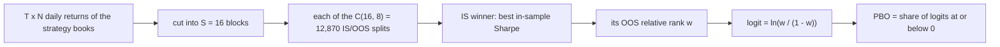

The run builds a $T \times N$ matrix of the standalone strategy books' daily OOS returns
(the combined book and the benchmark are not columns; days where any strategy lacks a
return are dropped), then:

```math
w_c = \frac{\operatorname{rank}_c(n^{\star}_c)}{N + 1}, \qquad
\lambda_c = \ln\frac{w_c}{1 - w_c}, \qquad
\mathrm{PBO} = \frac{1}{C}\sum_{c=1}^{C} \mathbf 1\bigl[\lambda_c \le 0\bigr]
```

where

- $S$ = `walkforward.pbo_splits` contiguous blocks (default 16; reduced by 2 until there are
  at least $2S$ rows) give $C = \binom{S}{S/2}$ combinations (12,870 for $S$ = 16);
- $n^{\star}_c$ is the configuration with the best in-sample **per-period Sharpe** in
  combination $c$, and $\operatorname{rank}_c$ its out-of-sample rank among the $N$
  configurations (1 = worst, $N$ = best, ties get the average rank);
- $\lambda_c \le 0$ means the in-sample winner is no better than the out-of-sample median.

<picture>
  <source media="(prefers-color-scheme: dark)" srcset="_assets/figures/research/pbo-cscv-dark.png">
  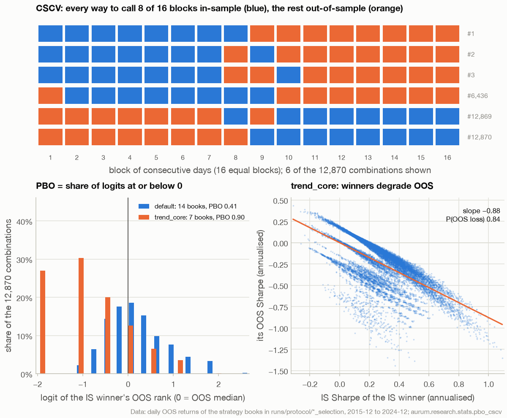
</picture>

*The logits are discrete because there are only N possible ranks. `trend_core`'s in-sample winner lands at or below the out-of-sample median in 90% of the 12,870 splits (PBO 0.90), `default`'s in 41%; the higher a `trend_core` strategy scores in-sample, the worse it does out-of-sample (slope −0.88). Data: daily OOS returns of the strategy books in runs/protocol/default_selection and runs/protocol/trend_core_selection, 2015-12 to 2024-12, recomputed with `aurum.research.stats.pbo_cscv` (identical to their `summary.json`).*

PBO needs at least two strategy books. `summary.json` stores `pbo`, `logit_mean`,
`prob_oos_loss` (the share of combinations in which the in-sample winner loses money out
of sample), `degradation_slope`/`degradation_intercept` (an OLS fit of OOS on IS
performance of the winner; a negative slope is the classic overfitting signature),
`n_combinations`, `n_splits` and `n_strategies`. The logits themselves are not stored;
[`pbo_cscv`](../aurum/research/stats.py) returns them in `PBOResult.logits`.

In code: `pbo_cscv(perf_matrix, n_splits=16, *, metric="sharpe", max_combinations=None, seed=0)`.
`metric` may be `"mean"` or a callable, and `max_combinations` samples that many distinct
combinations (seeded) when $\binom{S}{S/2}$ is too large.

PBO describes **selection among the strategies in this run**. It is not a property of the
combined book, whose combiner does not pick the in-sample winner. A single PBO estimate is
also noisy:

```python
import numpy as np
from aurum.research.stats import pbo_cscv

# 20 skill-less configurations, 2,000 days each; PBO of one noise sample is itself noisy
pbos = [pbo_cscv(np.random.default_rng(s).normal(0, 0.01, (2000, 20)), n_splits=16).pbo
        for s in range(20)]
print(f"noise: mean PBO {np.mean(pbos):.2f}, range {min(pbos):.2f}-{max(pbos):.2f} over 20 samples")

m = np.random.default_rng(0).normal(0, 0.01, (2000, 20))
m[:, 0] += 0.0015                                   # one configuration with a real edge
res = pbo_cscv(m, n_splits=16)
print(f"one real edge: PBO {res.pbo:.2f}, P[OOS loss of IS-best] {res.prob_oos_loss:.2f}, "
      f"{res.n_combinations} combinations")
```

```text
noise: mean PBO 0.54, range 0.26-0.88 over 20 samples
one real edge: PBO 0.00, P[OOS loss of IS-best] 0.00, 12870 combinations
```

**Pitfalls.** With few strategies the ranks are coarse (trend_core has 7 possible ranks),
and the in-sample and out-of-sample halves of one finite sample are negatively related, so
pure noise gives PBO somewhat above 0.5. Read PBO as a warning light, not a precise
probability.

### Reading the numbers

| Statistic | What it measures | Read it as |
|---|---|---|
| `sharpe` | Annualised daily Sharpe of the OOS book | A point estimate with wide error bars on a few years of data. |
| `ci_lower`, `ci_upper` | 95% stationary-bootstrap interval | An interval that contains 0 means the sign of the Sharpe is not established. |
| `psr` | P[true Sharpe > 0], ignoring selection | An upper bound on your confidence: it forgets how many things you tried. |
| `dsr` | P[true Sharpe > 0] after selection among `n_trials` | The protocol's bar is 0.95. It is only as honest as `n_trials`. |
| `min_trl_years` | Years of data needed for PSR >= 0.95 | Compare with the OOS length; `inf` for non-positive Sharpes. |
| PBO | How often the in-sample best strategy is below the OOS median | Near 0: selection works. Near 0.5 or above: selection has no skill. A single estimate is noisy. |
| `n_halt_episodes` | Research risk-limit halts in the book | Non-zero means the risk manager intervened; see `risk_events.csv`. |

## The holdout and the ledger

**Intuition.** A holdout is only worth something the first time it is looked at. Every
later look, by you or by a different configuration, turns it into one more piece of data
you have already seen. Aurum cannot stop you from looking twice, but it records every look
in an append-only ledger and prices the extra looks into the DSR.

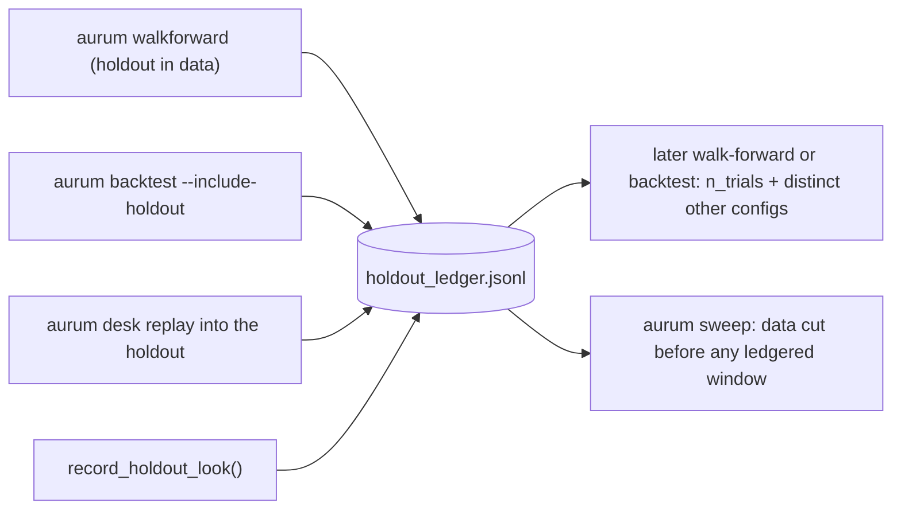

### What counts as a look

A look is an evaluation of holdout bars. `run_walk_forward` and `run_single_backtest` read
the ledger **before** the holdout is evaluated and append one JSON line **after** the
evaluation and the write:

| Action | Holdout evaluated | Recorded in the ledger (`kind`) |
|---|---|---|
| `aurum walkforward` with `holdout_start` inside the data | Yes | Yes (`walkforward`): `holdout_ledger.jsonl` in the parent of the run directory (`output.dir/` for default run directories, `DIR/../` with `--out DIR`) |
| `aurum walkforward --no-write` | Yes (printed) | Yes (`walkforward`): `output.dir/holdout_ledger.jsonl` |
| `aurum train-final` without `--from-run`, cutoff after `holdout_start` | Yes (it runs the walk-forward) | Yes (`walkforward`) |
| `aurum train-final` with a cutoff before `holdout_start` | No (runs without a holdout, and says so) | No |
| `aurum train-final --from-run DIR` | No new evaluation (reuses that run's forecasts) | No |
| `aurum backtest --include-holdout` whose window reaches `holdout_start` | Yes | Yes (`backtest`), next to the run directory; with `--no-write` only a note says it was not recorded |
| `aurum desk replay` whose window reaches `holdout_start` | Yes | Yes (`desk_replay`), in `<out>/../holdout_ledger.jsonl` (`output.dir/` by default), under the config hash plus `:desk` (`:desk-fake` with `--fake`) |
| `record_holdout_look(output_dir, entry, cfg=...)` | Whatever you looked at | Yes (`look`, or the `kind` you pass) |
| `run_walk_forward(...)` / `run_single_backtest(...)` with `write=False` and the default `holdout_ledger=None` | Yes | **No** (a note in the report says so); pass `holdout_ledger=PATH` to record it |
| `holdout_ledger=False` | Yes | **No** |
| `walkforward.holdout_start: null` | No holdout | Nothing to record |

The desk replay records its look *before* anything is shown and prints
`holdout look recorded in <path>`. Its own config hash makes it a separate trial: a later
walk-forward of the plain quant configuration counts the desk as one more selection
opportunity. The replay below (offline scripted client, synthetic bars, holdout moved into
the sample) shows the end of its output:

```text
replay done in 0.0s: 4 desk cycles, total cost $0.0400
book        sharpe  ci_lower  ci_upper    psr    dsr    cagr  ann_vol  max_drawdown  n_trades  total_costs  n_halt_episodes
---------------------------------------------------------------------------------------------------------------------------
desk        -3.142   -13.907    13.837  0.294  0.294  -0.023    0.006        -0.001        10       23.870                0
quant_only  -3.844   -14.876    11.281  0.255  0.255  -0.061    0.014        -0.003        13       52.113                0
holdout look recorded in runs/synthetic_demo/holdout_ledger.jsonl
```

(from `aurum desk replay -c configs/fast.yaml --set data.synthetic.n=30000 --set walkforward.holdout_start=2024-01-01 --set output.dir=runs/synthetic_demo --start 2024-02-01 --end 2024-02-09 --every 48 --fake --yes`; see [llm-desk.md](llm-desk.md))

### How `n_trials` rises

Before the evaluation the run collects every ledger entry that matches, and counts the
distinct other configurations among them
([`prior_holdout_looks`](../aurum/research/walkforward.py)):

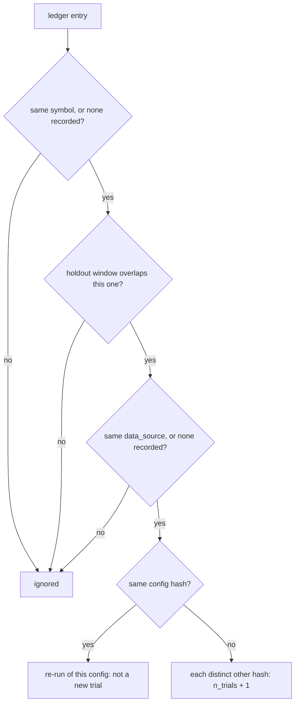

```math
\text{n\_trials} = \text{n\_trials}_\text{base} + \Bigl\lvert \bigl\lbrace h(e) : e \in \mathcal L,\ e \text{ matches},\ h(e) \ne h_\text{this run} \bigr\rbrace \Bigr\rvert
```

where $\mathcal L$ is the ledger, $h(e)$ an entry's `config_hash`, and "matches" means the
same `symbol` (entries without one match), a `holdout_start` to `holdout_end` window that
overlaps this run's, and the same `data_source` (entries without one match). Each distinct other hash logs a WARNING and adds a note to the report and to the
holdout tearsheet.

- Entries with the **same config hash** are re-runs of a deterministic configuration and
  are not new trials (`n_prior_same_config`).
- **`data_source`** (`real` or `synthetic`, [`data_source_kind`](../aurum/research/walkforward.py))
  separates smoke tests from research: a run on generated bars (`data.synthetic` set, or
  `bars.attrs["source"]` starting with `synthetic`) never spends a real holdout, and the
  other way round. Entries written before v2.1 have no `data_source` and count for both.
  The data hash itself is recorded but not compared.
- Any hashed change makes a new config hash, including changes that do not affect results
  (for example `live.state_dir`, `data.dir`, the order of `strategies`, or writing an
  embargo as `"24bars"` instead of `24`); see [the config hash](configuration.md#the-config-hash).

Running a second configuration against the ledger written by the demo above:

```bash
aurum walkforward -c configs/fast.yaml \
  --set data.synthetic.n=30000 --set walkforward.holdout_start=2024-01-01 \
  --set output.dir=runs/synthetic_demo --set costs.slippage_fixed=0.03
```

```text
2026-11-09 14:59:15,654 WARNING aurum.research.walkforward: the holdout window 2024-01-01 00:00:00+00:00 -> 2024-11-04 11:00:00+00:00 was evaluated before by 1 other config(s) (1 prior look(s) since 2026-11-09T14:58:58.539633+00:00, ledger runs/synthetic_demo/holdout_ledger.jsonl): it is no longer an untouched holdout; DSR n_trials is raised by 1
== walkforward: fast  config b39a6d0e4f5e  data 898857d3942e
OOS 2022-01-05 18:00:00+00:00 -> 2023-12-31 23:00:00+00:00  (12310 bars, 4 fold(s), train 12418 / test 3105 bars, purge 0, embargo 24, n_trials 24)
```

(The first line is the stderr warning; the other two are the start of standard output.)

A holdout-including backtest of the first configuration is the same kind of look. It
counts the second configuration (and is itself a re-run of the first), then records a
`backtest` entry:

```bash
aurum backtest -c configs/fast.yaml \
  --set data.synthetic.n=30000 --set walkforward.holdout_start=2024-01-01 \
  --set output.dir=runs/synthetic_demo --start 2023-07-01 --include-holdout
```

```text
loaded 30000 H1 bars 2020-01-06 00:00:00+00:00 -> 2024-11-04 11:00:00+00:00 (0.0s)
== backtest: fast  config a43d060dbaea  data 898857d3942e
OOS 2023-07-02 22:00:00+00:00 -> 2024-11-04 11:00:00+00:00  (8344 bars, 1 fold(s), train 21632 / test 8344 bars, purge 0, embargo 24, n_trials 24)
```

and, among its notes:

```text
  - WARNING: the evaluation includes the holdout period (from 2024-01-01); it is no longer an untouched holdout
  - WARNING: the holdout window 2024-01-01 00:00:00+00:00 -> 2024-11-04 11:00:00+00:00 was evaluated before by 1 other config(s) (2 prior look(s), ledger runs/synthetic_demo/holdout_ledger.jsonl); DSR n_trials is raised by 1
```

### Where the ledger lives

The ledger is `holdout_ledger.jsonl` in the **root of the output directory**, next to the
run directories. Each output root has its own ledger, and a ledger only knows about looks
that were written to it. In particular:

- `--out` in a different parent directory starts from an empty ledger. The protocol runs
  used `--out runs/protocol/...` and therefore `runs/protocol/holdout_ledger.jsonl`
  ([RESULTS.md](RESULTS.md) discusses the consequence).
- `runs/` is git-ignored. A fresh clone starts with an empty ledger and cannot know that
  the 2025–26 holdout has already been used.

Entries written by the commands hold `timestamp`, `kind`, `name`, `config_hash`,
`data_source`, `data_hash`, `symbol`, `timeframe`, `holdout_start` and `holdout_end` (the
evaluated bars inside the holdout), and `run_dir`; `record_holdout_look` fills these from
`cfg` and `md` when you pass them (`data_hash` needs `md`). By kind:

| `kind` | Written by | Extra fields |
|---|---|---|
| `walkforward` | `run_walk_forward` | `n_holdout_bars`, `strategies`, `n_trials`, `prior_looks`, `git_sha`, `metrics`: `combined` (sharpe, psr, dsr, total_return, cagr, ann_vol, max_drawdown, n_trades, total_costs, n_days), `strategy_sharpe` (every strategy row of the holdout stats, **without** the benchmark) and `benchmark_sharpe` |
| `backtest` | `run_single_backtest(include_holdout=True)` | as `walkforward`, plus `evaluated_start` / `evaluated_end` (the whole evaluated window, whose statistics `metrics` holds: `metrics_window: "evaluated"`) and `in_sample` |
| `desk_replay` | `aurum desk replay` | `start` / `end` and `evaluated_start` / `evaluated_end` (the replay window), `fake_client`, `n_desk_cycles`, `metrics`: `desk_sharpe`, `quant_only_sharpe` |
| `look` (default) or your own | `record_holdout_look` | whatever you pass; `evaluated_start` / `evaluated_end` when you give `start` / `end` |

Entries written before v2.1 lack `data_source` and keep the benchmark inside
`strategy_sharpe`. Lines are flushed and fsynced; unreadable lines are skipped with a
warning when the ledger is read. The helpers are public. After the demos on this page the
synthetic ledger holds four looks:

```python
from aurum.research.walkforward import prior_holdout_looks, read_holdout_ledger

entries = read_holdout_ledger("runs/synthetic_demo/holdout_ledger.jsonl")   # [] if the file is missing
for e in entries:
    print(f'{e["kind"]:<12} {e["data_source"]:<9} {e["config_hash"][:8]}{e["config_hash"][64:]:<11} '
          f'{e["holdout_start"][:10]} -> {e["holdout_end"][:10]}')

me = entries[0]["config_hash"]               # the first demo's config
for source in ("synthetic", "real"):
    looks = prior_holdout_looks(entries, start="2024-01-01", end="2024-12-31", config_hash=me,
                                symbol="XAUUSD", data_source=source)
    print(f"{source:>9}: {looks['n_prior_looks']} looks, {looks['n_prior_configs']} other configs, "
          f"{looks['n_prior_same_config']} by this config")
```

```text
walkforward  synthetic a43d060d            2024-01-01 -> 2024-11-04
walkforward  synthetic b39a6d0e            2024-01-01 -> 2024-11-04
backtest     synthetic a43d060d            2024-01-01 -> 2024-11-04
desk_replay  synthetic a43d060d:desk-fake  2024-02-01 -> 2024-02-09
synthetic: 4 looks, 2 other configs, 2 by this config
     real: 0 looks, 0 other configs, 0 by this config
```

A real-data run of the same configuration over the same dates would start with
`n_trials` unchanged: none of these looks spent a real holdout.

### Recording a look yourself

[`record_holdout_look(output_dir, entry, *, cfg=None, md=None)`](../aurum/research/walkforward.py)
appends any other look, for example a notebook that charted holdout dates. Give the window
as `holdout_start`/`holdout_end`, or as the evaluated `start`/`end`; with `cfg` the latter
is clipped to `walkforward.holdout_start`, and nothing is written (the function returns
`None`) when it ends before the holdout. Missing fields are filled from `cfg` and `md`
(`config_hash`, `name`, `symbol`, `timeframe`, `data_source`, `data_hash`). Use your own
hash suffix so the look counts as a distinct trial:

```python
from aurum.core.config import load_config
from aurum.research.walkforward import read_holdout_ledger, record_holdout_look

cfg = load_config("configs/fast.yaml", overrides=[
    "data.synthetic.n=30000", "walkforward.holdout_start=2024-01-01", "output.dir=runs/synthetic_demo"])

# a notebook that charted 2023-10-01 .. 2024-03-31 saw three months of holdout
path = record_holdout_look(cfg.output.dir, {"start": "2023-10-01", "end": "2024-03-31", "kind": "notebook",
                                            "config_hash": cfg.config_hash() + ":notebook"}, cfg=cfg)
e = read_holdout_ledger(path)[-1]
print(path, {k: e[k] for k in ("kind", "data_source", "holdout_start", "holdout_end", "evaluated_start")})

# a window that ends before walkforward.holdout_start is not a look: nothing is written
print(record_holdout_look(cfg.output.dir, {"start": "2023-01-01", "end": "2023-12-31"}, cfg=cfg))
```

```text
runs/synthetic_demo/holdout_ledger.jsonl {'kind': 'notebook', 'data_source': 'synthetic', 'holdout_start': '2024-01-01 00:00:00+00:00', 'holdout_end': '2024-03-31 00:00:00+00:00', 'evaluated_start': '2023-10-01 00:00:00+00:00'}
None
```

**Readers.** Two components read ledgers. A walk-forward (and a holdout-including
backtest) reads the one ledger it writes to and raises `n_trials` as above. `aurum sweep`
reads `holdout_ledger.jsonl` in `output.dir` and in each of its immediate subdirectories
and cuts its data before the earliest `holdout_start` among the entries for the same symbol
whose window ends after its first bar, whatever their `data_source`, so a parameter search
never sees a spent holdout ([analytics.md](analytics.md)).

**Pitfalls and design choices.** The ledger is an audit trail, not a lock: it cannot stop a
second look, it can only make it visible and expensive. Keep one output root per study, do
not delete the ledger, and keep synthetic or smoke runs in their own `output.dir` even
though `data_source` now keeps them apart (a sweep's cut does not look at `data_source`).
Looks taken outside these tools (a chart in another program) exist only if you record
them.

## Walk-forward attribution

**Intuition.** Every combined forecast is a weighted sum, so it can be split exactly into
one contribution per strategy. That answers "who put the book short on 16 March 2020?"
without re-running anything.

```math
c_{i,t} = \mathrm{FDM}_{k(t)}\; w_{k(t),i}\; f_{i,t}, \qquad
\sum_i c_{i,t} = \text{pre-clip combined forecast}, \qquad
\text{clip\_adjustment}_t = \operatorname{clip}\Bigl(\sum_i c_{i,t},\ -1,\ 1\Bigr) - \sum_i c_{i,t}
```

where $k(t)$ is the fold bar $t$ belongs to, $f_{i,t}$ is clipped to [-1, 1] with `NaN`
set to 0 (exactly as the combiner does), and with the clip column every row sums to the
saved `combined` forecast.

| API | Returns |
|---|---|
| [`forecast_contributions(forecasts, weights, *, fdm=None, residual=False)`](../aurum/research/walkforward.py) | Per-bar $c_{i,t}$, one column per strategy. Per-fold `weights` (fold x strategy with an `fdm` column, as in `weights.csv`) need a `fold` column in `forecasts`; single-fold weights (a Series or mapping) need `fdm=`. `residual=True` adds `CLIP_COLUMN` (`"clip_adjustment"`). |
| `WalkForwardReport.strategy_keys` | Strategy columns of the stitched OOS forecasts, in combiner order. |
| `WalkForwardReport.strategy_forecasts()` | The stitched OOS forecast of each strategy. |
| `WalkForwardReport.fold_weights()` / `fold_fdm()` | Weights and FDM per fold (index `fold` as text). |
| `WalkForwardReport.bar_weights(include_fdm=True)` | The weights in force on every OOS bar. |
| `WalkForwardReport.contributions(residual=False)` | `forecast_contributions` on the report. |
| `HoldoutReport.strategy_forecasts()` / `contributions(residual=False)` | The same for the holdout's single fold. |

The same split works from a run directory's files. On the protocol run at 14:00 UTC on
2020-03-16, during the COVID sell-off:

```python
import pandas as pd
from aurum.research.walkforward import forecast_contributions

run = "runs/protocol/trend_core_selection"
fc = pd.read_parquet(f"{run}/oos_forecasts.parquet")          # strategies + combined + fold
w = pd.read_csv(f"{run}/weights.csv", index_col="fold")        # fold x strategy, plus fdm
c = forecast_contributions(fc, w, residual=True)              # adds clip_adjustment

t = pd.Timestamp("2020-03-16 14:00", tz="UTC")
print("fold", fc.loc[t, "fold"], "fdm", round(w.loc[int(fc.loc[t, "fold"]), "fdm"], 3))
print({k: round(v, 3) for k, v in c.loc[t].items() if v != 0})
print("sum", round(c.loc[t].sum(), 6), "| saved combined", round(fc.loc[t, "combined"], 6))
print("worst |row sum - combined| over", len(c), "bars:", float((c.sum(axis=1) - fc["combined"]).abs().max()))
```

```text
fold 8 fdm 1.544
{'ema_cross': -0.325}
sum -0.325003 | saved combined -0.325003
worst |row sum - combined| over 53462 bars: 6.661338147750939e-16
```

`ema_cross` (forecast −1, weight 0.211) carried the whole −0.325; the other strategies had
zero weight or a zero forecast. The decision waterfall, the sizing replay and PnL
attribution built on this split (`aurum explain`) are on [analytics.md](analytics.md).

## Output directory reference

A walk-forward writes to `--out DIR`, or `output.dir/output.run_name` when `run_name` is
set, or `output.dir/walkforward_<YYYYmmddTHHMMSSZ>_<first 8 hex of the config hash>`
(`_2`, `_3`, ... are appended when two runs start in the same second). `aurum backtest`
uses the prefix `backtest_`. `output.save_results: false` or `--no-write` writes nothing
(except the ledger line described above).

| Path | Contents |
|---|---|
| `summary.json` | Everything `aurum report` prints: `kind`, `name`, `config_hash`, `data_hash`, `oos_start`, `oos_end`, `n_oos_bars`, `settings` (resolved bar counts, `bars_per_day`, `purge`, `embargo`, `anchored`, `label_horizons`, `n_folds`, `holdout_start`, `stitched_gaps`, `executor`, `n_jobs`, `n_trials_base`, `n_trials_prior_looks`), `n_folds`, `n_strategies`, `n_trials`, `combined`, `stats`, `pbo`, `folds`, `weights`, `costs`, `holdout`, `timing`, `notes`, `dropped`, `provenance`, `out_dir`. Non-finite numbers are written as `null`. |
| `config.yaml` | The resolved configuration, `--set` overrides included and secrets excluded. Loading it gives the same config hash. |
| `provenance.json` | See [Provenance](#provenance-and-reproducibility). |
| `stats.csv` | One row per book (`combined`, each strategy, `benchmark`): `sharpe`, `psr`, `dsr`, `dsr_xs`, `sr0`, `sharpe_se`, `ci_lower`, `ci_upper`, `skew`, `kurtosis` (Pearson), `min_trl_years`, `n_days`, `total_return`, `cagr`, `ann_vol`, `sortino`, `max_drawdown`, `calmar`, `n_trades`, `win_rate`, `exposure`, `turnover_lots_per_year`, `total_costs`, `cost_drag_ann`, `swap_total`, `n_risk_events`, `n_halt_bars`, `n_halt_episodes`, `n_trials`. |
| `costs.csv` | Per book, in USD: `spread`, `slippage`, `commission`, `swap` (signed, positive = received), `total_costs` (spread + slippage + commission), `gross_pnl` (mid-price PnL), `net_pnl`, `costs_pct_gross`. |
| `folds.csv` | Per fold: `train_start`, `train_end`, `test_start`, `test_end` (timestamps, inclusive), `n_train`, `n_test`, `gap_bars`, `oos_sharpe` and `oos_return` of the combined book, `fdm`, `n_active`, `top_weight`, `combiner_basis`. |
| `weights.csv` | Combiner weight of each strategy per fold, plus `fdm`. |
| `fold_sharpe.csv` | Per-fold OOS Sharpe of each standalone strategy book. |
| `oos_forecasts.parquet` | The stitched OOS forecasts in [-1, 1]: one column per strategy, `combined`, and `fold` (the fold key). `train-final --from-run` reads it. |
| `tearsheet.html` | The combined book's OOS tearsheet ([below](#the-tearsheet)). |
| `books/<book>/` | One directory per book: `combined`, each strategy id (characters outside `A-Za-z0-9_.-` become `_`) and `benchmark`. |
| `books/<book>/timeseries.parquet` | Per bar: `equity`, `returns`, `positions`, `target`, `forecast`, `position_close`, `cost_spread`, `cost_slippage`, `cost_commission`, `cost_swap`, `pnl_price`, `pnl_costs`, `pnl_swap`, `pnl_net`. |
| `books/<book>/trades.csv`, `fills.csv` | Round trips and individual fills. |
| `books/<book>/risk_events.csv` | Bars where the risk manager changed or blocked the requested position (`time`, `bar_time`, `bar`, `current`, `requested`, `approved`, `halted`, `reasons`). |
| `books/<book>/metrics.json`, `meta.json` | The full metric set ([execution-and-costs.md](execution-and-costs.md#metrics)) and the backtest's settings (costs, financing, sizer, risk limits, instrument, span). |
| `holdout/stats.csv`, `holdout/costs.csv` | As above, for the holdout evaluation. |
| `holdout/holdout.json` | `start`, `end`, `stats`, `weights`, `fdm`, `combiner_basis`, `costs`, `prior_looks`, `ledger`. |
| `holdout/oos_forecasts.parquet` | Holdout forecasts of the model fitted before the holdout (strategies and `combined`). `train-final --from-run` appends them to the combiner history. |
| `holdout/books/combined/`, `holdout/books/benchmark/` | Holdout books. Per-strategy holdout books are not written; their statistics are in `holdout/stats.csv`. |
| `holdout/tearsheet.html` | The holdout tearsheet, titled "FINAL HOLDOUT (evaluated once)". |
| `../holdout_ledger.jsonl` | The ledger, one level up ([above](#where-the-ledger-lives)). |

A single-split backtest writes the same files without `holdout/`. `aurum stress` and
`aurum explain` add `analysis/stress/` and `analysis/explain/` inside a run directory, and
`aurum dashboard` writes `dashboard.html` there ([analytics.md](analytics.md)).

## The tearsheet

`tearsheet.html` is one self-contained file: charts are PNGs rendered with matplotlib's Agg
canvas and inlined as base64, so it opens offline and can be attached anywhere. With
`output.dark_charts: true` (the default) every chart is rendered twice, for light and dark
colour schemes, and CSS shows the one matching the reader's setting (roughly twice the file
size). The generator is [`write_tearsheet`](../aurum/research/report.py), which you can also
call on any `BacktestResult`. For an interactive view of the same run, see
`aurum dashboard` on [analytics.md](analytics.md).

Sections, in order:

1. **Header and tiles**: period, bar count, timeframe, years and equity; tiles for total
   return, CAGR, daily Sharpe, max drawdown, annual volatility and PSR.
2. **Equity**: log-scale equity against the rebased buy-and-hold benchmark, with the
   benchmark's total return, Sharpe, max drawdown, and the book's daily correlation and beta
   to it.
3. **Drawdown**: the underwater curve.
4. **Rolling Sharpe**: 126-day window (shorter on short samples; needs at least 40 days).
5. **Monthly returns** table.
6. **Return distribution**: histogram of daily returns.
7. **Position & exposure**: signed lots and the combined forecast; time in market,
   long/short share, average and maximum lots, lots traded.
8. **Cost attribution**: spread, slippage, commission and net swap paid; net cost, cost drag
   per year, PnL before and after costs.
9. **Trade statistics**, overall and by exit reason.
10. **Statistical confidence**: Sharpe and its standard error, 95% bootstrap CI with the
    mean block length, bootstrap P[Sharpe <= 0], PSR, DSR with its `N`, `SR_0`, MinTRL
    against the years available, skewness and kurtosis, the Harvey–Liu haircut Sharpe (BHY
    adjustment for `N` trials) and PBO, followed by a one-line verdict on whether the Sharpe
    is significant at 95% after deflation.
11. **Walk-forward folds** (research tearsheet only): OOS Sharpe per fold as a bar chart plus
    the `folds.csv` table.
12. **Strategy weights**: per-fold weights (research) or the holdout weights.
13. **Risk-manager interventions** (when there were any): counts by rule with first and last
    time.
14. **All metrics**.
15. **Notes & provenance**: the book's backtest settings, the resolved config (research
    tearsheet), the run notes, and extra tables: per-strategy statistics, per-fold strategy
    Sharpes and costs by book (research), or holdout statistics and costs by book (holdout).
    The holdout tearsheet also carries the ledger WARNING when the window was seen before.

The CSV and JSON files are the numbers of record. The tearsheet recomputes its confidence
block from the equity curve. Since v2.1 its bootstrap uses the run's own settings:
`write_tearsheet(..., n_boot=None, seed=None)` takes explicit arguments first, then
`walkforward.n_boot` and the top-level `seed` from `extra["config"]` (a resolved
`AurumConfig.to_dict()`), and only then `DEFAULT_N_BOOT` = 1000 and `DEFAULT_SEED` = 0. A
walk-forward passes its `walkforward.n_boot` and `seed` explicitly to both tearsheets, so
the tearsheet's interval agrees with `stats.csv`.

## Provenance and reproducibility

`provenance.json` records what produced the run:

| Key | Contents |
|---|---|
| `created_utc`, `argv`, `python`, `platform` | When and how the run was started. |
| `git_sha`, `git_dirty` | The commit of the `aurum` checkout, and whether tracked files had uncommitted changes (`null` outside a git checkout). Untracked files are not considered. |
| `packages` | Installed versions of `aurum`, numpy, pandas, scipy, scikit-learn, pyarrow, matplotlib, pyyaml, anthropic, torch, stable-baselines3 and gymnasium (those present). |
| `config_hash`, `config_source` | The SHA-256 [config hash](configuration.md#the-config-hash) and the file it was loaded from. |
| `data` | `bars_hash` (SHA-256 of the bars frame's index, column names and values, independent of the pandas version), `n_bars`, `first_bar`, `last_bar`, `timeframe`, `macro_hashes` per series and `events_hash`. |

For a walk-forward the data hash covers the full loaded data, holdout included; a
single-split backtest hashes the data after removing the holdout, so the two hashes differ
on the same file.

To reproduce a run:

1. Check out the recorded `git_sha` and install the recorded package versions.
2. Make sure your data hashes match `provenance.json`. Dukascopy and FRED can revise
   history, and a later download extends the data; `aurum data info` prints the bar-file
   hashes ([data.md](data.md#storage-hashes-and-the-manifest)).
3. Re-run the saved configuration: `aurum walkforward -c runs/<run>/config.yaml`. It
   contains every `--set` override, and it loads to the same config hash (checked with
   `aurum config validate -c runs/<run>/config.yaml`).

The computation is deterministic for a given config, data and code: every stochastic
component takes a seed, and the executor does not change results. If the holdout is inside
the data, reproducing the run is itself a look at the holdout. It is recorded as a re-run of
the same config (not a new trial) as long as it writes to the same ledger.

## Single-split backtests

`aurum backtest` is the quick, single-split counterpart of the walk-forward, implemented by
[`run_single_backtest`](../aurum/research/walkforward.py):

```bash
aurum backtest -c configs/trend_core.yaml --start 2020-01-01 --end 2021-12-31
```

| Option | Meaning |
|---|---|
| `--start S` | Evaluation start. Strategies are fitted on **all** bars from the first loaded bar up to `S` minus `purge + embargo` (anchored; `walkforward.train` is not used) and need at least `walkforward.min_train_bars` of them. Defaults to `backtest.start`. |
| `--end E` | Evaluation end; a date-only value includes that whole day. Defaults to `backtest.end`. |
| no `--start` | **In-sample**: strategies and combiner are fitted on the evaluated period. The command prints an `IN-SAMPLE` banner before loading data, the report header says so, and the notes repeat it (example below). |
| `--strategy ID` | Restrict to these strategy ids or names (repeatable). |
| `--include-holdout` | Also evaluate bars from `walkforward.holdout_start` on. This spends the holdout: the ledger is read first (other configurations' looks raise `n_trials`) and a `backtest` entry is appended afterwards when the run is written. Without it, holdout bars are removed, and a `--start` inside the holdout is a configuration error (exit code 2). |
| `--out`, `--jobs`, `--no-write`, `--no-tearsheet` | As for `walkforward`. |

Without `--start` (synthetic bars, `--no-write`):

```text
== IN-SAMPLE backtest: no --start (and no backtest.start), so strategies and combiner are fitted and evaluated on the SAME bars. The numbers below are not an estimate of future performance; pass --start or run `aurum walkforward`.
loaded 30000 H1 bars 2020-01-06 00:00:00+00:00 -> 2024-11-04 11:00:00+00:00 (0.0s)
== backtest (IN-SAMPLE: fitted and evaluated on the same bars): fast  config 4b88aa41f2e0  data 898857d3942e
OOS 2020-01-06 00:00:00+00:00 -> 2024-11-04 11:00:00+00:00  (30000 bars, 1 fold(s), train 30000 / test 30000 bars, purge 0, embargo 24, n_trials 23)
```

(from `aurum backtest -c configs/fast.yaml --set data.synthetic.n=30000 --set output.dir=runs/synthetic_demo --no-write`;
the second header line still starts with `OOS` because the summary printer is shared.)

Things to know:

- There is no earlier OOS history, so with the default `walkforward.combiner_fit: oos` the
  combiner always uses **equal weights** (`combiner_basis` is `equal (OOS history 0 < 500 bars)`).
  Use `--set walkforward.combiner_fit=train` for fitted (in-sample) weights, or
  `combiner.method: fixed`.
- Statistics are the same as in a walk-forward, with `n_trials` = `walkforward.n_trials`
  (or the number of strategies run), plus the distinct other configurations in the ledger
  when the evaluation includes holdout bars.
- One split is one path through history. Use it to debug a strategy, not to estimate
  performance.

## Splitters: walk-forward, purged k-fold, CPCV

[`aurum.research.splits`](../aurum/research/splits.py) provides leak-free splitters on
integer positions `0..n-1` (López de Prado 2018, *Advances in Financial Machine Learning*,
chapters 7 and 12). All return sorted `int64` arrays, and train and test never intersect.

| Function | Use |
|---|---|
| `walk_forward_splits(n, train, test, step=None, anchored=False, purge=0, embargo=0, *, min_test=1, label_end=None)` | The splitter behind the walk-forward. `label_end` (an inclusive label-end position per observation, such as triple-barrier touch times) additionally drops training rows whose label resolves inside the embargo zone or the test block. |
| `purged_kfold(n, k=5, purge=0, embargo=0, *, label_end=None)` | K contiguous test blocks, no shuffling. Training may lie after the test block, which is acceptable for model selection (not for backtesting) because rows whose labels reach into the test block are purged and the rows after it are embargoed. |
| `cpcv_splits(n, n_groups=6, k_test=2, purge=0, embargo=0, *, label_end=None)` | Combinatorial purged CV: every combination of `k_test` of `n_groups` groups is a test set, giving `C(N, k)` splits and `C(N-1, k-1)` complete backtest paths. `assemble_paths(predictions)` stitches per-split OOS predictions into those paths, giving a distribution of OOS results instead of the single walk-forward path. |
| `purge_train(train_idx, test_idx, *, n, purge=0, embargo=0, label_end=None)` | The purge/embargo rule on its own. |

The contaminated span of a test block `[a, b]` is `[a, max(label_end[a..b]) + embargo]`,
with `label_end[i] = i + purge` by default. A training row is dropped when its label
interval intersects that span.

```python
import numpy as np
from aurum.research.splits import cpcv_splits, purged_kfold, walk_forward_splits

for tr, te in walk_forward_splits(1000, train=400, test=200, purge=10, embargo=5):
    print(f"walk-forward  train {tr[0]}..{tr[-1]}  test {te[0]}..{te[-1]}")

tr, te = purged_kfold(1000, k=5, purge=10, embargo=5)[1]
before, after = tr[tr < te[0]].max(), tr[tr > te[-1]].min()
print(f"purged k-fold test {te[0]}..{te[-1]}  last train before {before}  first train after {after}")

cv = cpcv_splits(1000, n_groups=6, k_test=2, purge=10, embargo=5)
print(f"CPCV          {cv.n_splits} splits, {cv.n_paths} paths; split 0 tests groups {cv.test_groups[0]}")
paths = cv.assemble_paths([np.ones(te.size) for _, te in cv.splits])
print("assembled paths:", paths.shape)
```

```text
walk-forward  train 0..399  test 415..614
walk-forward  train 200..599  test 615..814
walk-forward  train 400..799  test 815..999
purged k-fold test 200..399  last train before 189  first train after 415
CPCV          15 splits, 5 paths; split 0 tests groups (0, 1)
assembled paths: (5, 1000)
```

`cpcv_splits` returns a `CPCVSplits` object. Unpacking it yields `(splits, paths)`; loop
over `res.splits` for the train/test pairs. The walk-forward command does not use CPCV or
purged k-fold; they are tools for your own model-selection code (for example inside a
trainable strategy's `fit`, see [ml-and-rl.md](ml-and-rl.md)).

## Running your own pre-registered study

The value of the published results comes from the order of events: protocol first, runs
second, and the holdout exactly once. [RESEARCH_PROTOCOL.md](RESEARCH_PROTOCOL.md) is the
template and [RESULTS.md](RESULTS.md) the write-up. To run your own study:

- [ ] **Decide what is still unseen.** On this repository's data, the 2016–2024
  walk-forward OOS and the 2025-01-01 → 2026-09-25 holdout have already been evaluated and
  published, and the exploratory v2.1 trials reused the 2016–2024 span again. The only
  genuinely untouched holdout is data that arrives after you write your protocol. If you
  reuse old dates, count the published configurations in `n_trials` (at least the 30 of
  the D1 configs plus the 8 sweep points, see the
  [protocol addendum](RESEARCH_PROTOCOL.md#addendum-v21-unreleased)) and say so.
- [ ] **Write the protocol before any run** and commit it: data span and source, the
  holdout start, the exact configurations you will evaluate, the statistics you will report,
  the selection rule (for example "higher walk-forward DSR, ties by lower drawdown") and the
  pass criteria (for example "DSR > 0.95, bootstrap CI lower bound > 0, holdout Sharpe > 0").
- [ ] **Freeze the configs.** Commit the YAML files and record
  `aurum config validate -c <file>` for each; the printed hash is what the ledger and
  `train-final --from-run` compare.
- [ ] **Set `walkforward.n_trials`** to every configuration you have evaluated on this data,
  including exploratory ones, not just the ones in the file.
- [ ] **Pick one output root and keep it.** The ledger is per `output.dir` (or per parent of
  `--out`). Do not delete it, and keep synthetic or smoke runs in a different `output.dir`.
- [ ] **Run the selection without the holdout.** Exclude it from the data entirely, as the
  protocol's selection runs did:
  `--set data.end=<day before the holdout>T23:59:59Z --set walkforward.holdout_start=null`.
  With the holdout excluded this way, the research folds are the same ones the final run
  will use.
- [ ] **Apply the selection rule mechanically** to the walk-forward statistics.
- [ ] **Evaluate the holdout once**, for the selected configuration only, with
  `holdout_start` set and the same output root. Do not spend it through
  `aurum backtest --include-holdout` or a desk replay: those looks are now recorded, but
  they are still looks.
- [ ] **Report everything**, whatever it shows: every configuration's walk-forward table,
  the holdout table, PBO, the benchmark, the ledger's `prior_looks`, and the provenance
  (git SHA, data hashes, package versions). Record any deviation from the protocol and why.

## Limitations

- **Short samples.** Even a decade of daily returns gives wide Sharpe intervals, and the
  MinTRL of a modest Sharpe is often longer than the sample. The statistics quantify this;
  they cannot remove it.
- **`n_trials` is self-reported.** The DSR is only as honest as the count of configurations
  you tried. The ledger counts other configurations' holdout looks automatically, but not
  your exploratory runs on the research span.
- **Remaining gaps in the ledger.** `run_walk_forward(write=False)` and
  `run_single_backtest(write=False)` (including `aurum backtest --include-holdout --no-write`)
  evaluate holdout bars without recording a look unless you pass a ledger path, and looks
  taken outside Aurum are recorded only through `record_holdout_look`. An LLM desk replay
  is recorded, but a model may have memorised historical prices; anonymisation mitigates
  that look-ahead without removing it ([llm-desk.md](llm-desk.md)).
- **Hash granularity.** Any hashed change, including settings that do not affect research
  results (the `live`, `agents` and `rl` sections, `data.dir`), makes a new config for the
  ledger. That over-counts rather than under-counts.
- **One path.** The walk-forward is a single historical path; CPCV-style path distributions
  are available as a library but are not part of the command. `aurum stress` resamples the
  OOS returns instead ([analytics.md](analytics.md)).
- **PBO scope.** PBO covers selection among the strategy books of one run, and a single
  estimate is noisy.
- **The benchmark is not risk-matched.** Buy-and-hold runs at 1x notional and gold's own
  volatility; compare risk-adjusted numbers.
- **Daily dating of 22:00 UTC bars.** On D1 New York close bars the reported annualised
  Sharpe is about 10% larger in magnitude than the close-date convention would give (see
  the note under [Sharpe convention](#sharpe-convention)).
- **Synthetic data proves plumbing, not edge.** Synthetic runs use fallback financing
  rates and generated macro series.

## See also

- [RESEARCH_PROTOCOL.md](RESEARCH_PROTOCOL.md) and [RESULTS.md](RESULTS.md): the
  pre-registered study, its results and the exploratory v2.1 trials.
- [analytics.md](analytics.md): parameter sweeps, Monte Carlo and stress, decision and PnL
  attribution, the dashboard.
- [configuration.md](configuration.md): every `walkforward`, `backtest` and `output` key,
  `--set` syntax and the config hash.
- [strategies.md](strategies.md), [models.md](models.md) and [ml-and-rl.md](ml-and-rl.md):
  what is trainable and which label horizons drive the purge.
- [portfolio-and-risk.md](portfolio-and-risk.md): the combiner, the sizer and the research
  risk limits.
- [execution-and-costs.md](execution-and-costs.md): the simulator, costs, financing and
  metric definitions.
- [data.md](data.md) and [features.md](features.md): point-in-time data and features.
- [live-trading.md](live-trading.md): `aurum train-final` and how OOS forecasts become
  production weights; [llm-desk.md](llm-desk.md): desk replays.
- [architecture.md](architecture.md), [getting-started.md](getting-started.md),
  [cli.md](cli.md) and [development.md](development.md); back to the [index](index.md).
