# Strategies

A strategy (an "alpha model") turns point-in-time market data into a **forecast**: one
number per bar in `[-1, 1]`, decided at the close of that bar. `+1` means "as long as I am
ever willing to be", `-1` "as short as I am ever willing to be", `0` "no view". Aurum
registers **17 strategies**: twelve fixed rules (trend, mean reversion, breakout, macro and the
long-biased `managed_gold` allocation) and five that learn from training data
(`intraday_seasonality`, the regime overlay `regime_switch`, `ml_gbm`, `meta_label` and
`rl_ppo`). A forecast is a statement of conviction, not a position size: the combiner, the
volatility-targeting sizer and the risk manager downstream
([portfolio-and-risk.md](portfolio-and-risk.md)) turn it into lots. This page explains every
strategy the same way: the idea in plain words, the exact formula the code implements, a
picture drawn by the real code on real gold data, how to call it, and what can go wrong. None
of the rationales below is evidence that a rule works on gold. The out-of-sample evidence is in
[RESULTS.md](RESULTS.md), and the short answer is that no strategy showed a demonstrated edge.

**On this page**

- [The forecast contract](#the-forecast-contract)
- [The family tree and the catalogue](#the-family-tree-and-the-catalogue)
- [Forecast scaling: one convention for every rule](#forecast-scaling-one-convention-for-every-rule)
- [Trend](#trend): [`tsmom`](#tsmom-time-series-momentum), [`ema_cross`](#ema_cross-ewmac-crossover), [`kalman_trend`](#kalman_trend-local-linear-trend-kalman-slope), [`donchian`](#donchian-turtle-style-channel-breakout)
- [Mean reversion](#mean-reversion): [`zscore_fade`](#zscore_fade-z-score-fade-in-non-trending-regimes), [`rsi2`](#rsi2-connors-rsi2-pullback), [`bollinger_revert`](#bollinger_revert-bollinger-band-reversion)
- [Breakout](#breakout): [`vol_squeeze`](#vol_squeeze-bollinger-inside-keltner-squeeze-release), [`orb`](#orb-london-and-new-york-opening-range-breakout)
- [Macro](#macro): [`macro_factor`](#macro_factor-dollar-and-real-yield-momentum), [`risk_off`](#risk_off-vix-spike-safe-haven-regime-long-only)
- [Learned seasonality: `intraday_seasonality`](#learned-seasonality-intraday_seasonality)
- [Machine learning and RL: the forecast contract of `ml_gbm`, `meta_label`, `rl_ppo`](#machine-learning-and-rl-the-forecast-contract-of-ml_gbm-meta_label-rl_ppo)
- [Managed exposure: `managed_gold` (v2.1)](#managed-exposure-managed_gold-v21)
- [Regime conditioning: `regime_switch` (v2.1)](#regime-conditioning-regime_switch-v21)
- [How the strategies relate: forecast correlations](#how-the-strategies-relate-forecast-correlations)
- [Which configuration runs which strategy](#which-configuration-runs-which-strategy)
- [Configuring strategies in YAML](#configuring-strategies-in-yaml)
- [Writing and registering a custom strategy](#writing-and-registering-a-custom-strategy)
- [Evidence](#evidence)
- [See also](#see-also)

Every chart on this page is drawn by [tools/figures/fig_strategies.py](../tools/figures/fig_strategies.py)
with the strategies' own code, on Dukascopy XAUUSD bid/ask data cut at 2024-12-31 (2025 onward
was the research holdout and is never drawn). Strategies are always generated on the full
2012-2024 history and only then sliced to the window shown, so warm-ups and path-dependent
states are exactly what a long research run sees.

---

## The forecast contract

**Intuition.** Every strategy, however simple or clever, answers the same question at the
close of every bar: "how much of my maximum risk would I like to hold until the next
decision, and in which direction?" Fixing that one interface is what lets 17 very different
ideas be blended, sized, risk-checked and tested for look-ahead by the same machinery.

The contract is defined in [aurum/strategies/base.py](../aurum/strategies/base.py) and
enforced by the test suite.

| Rule | What it means |
|---|---|
| Range | `forecast[t]` is a float in `[-1, +1]`. `+1` is maximum long conviction, `-1` maximum short, `0` flat. |
| Timing | `forecast[t]` is decided at the **close** of bar `t`, i.e. at `bars["available_at"][t]`. The simulator executes it at the **open** of bar `t+1`. |
| Causality | `forecast[t]` may depend only on bars `0..t` and on macro rows whose `available_at` is at or before `available_at[t]`. |
| Warm-up | The first `warmup_bars` rows are exactly `0.0`, never NaN. |
| Clean output | No NaN or inf. The index equals `md.bars.index`. |
| Magnitude | Conviction, **not lots**. Volatility targeting happens in `aurum.portfolio`. |
| Training | `fit(md, features)` receives training data only (the walk-forward engine guarantees this). Anything learned is stored on `self`. |
| Cloning | Strategies are cheap to deep-copy. The walk-forward engine clones one per fold. |

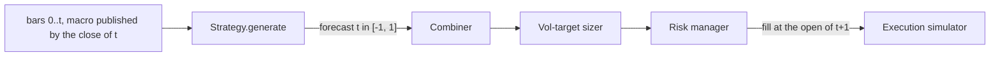

Every strategy class declares:

| Attribute | Meaning |
|---|---|
| `name` | Registry key, e.g. `"tsmom"`. It is also the default forecast-column id in configs. |
| `description` | One-line summary, printed by `aurum strategies list`. |
| `trainable` | `True` if `fit` learns from data. Trainable strategies are refit on every walk-forward fold. |
| `default_params()` | Class method returning every parameter and its default. |
| `warmup_bars` | Property: bars of history needed before the forecast is meaningful. |
| `fit_history_bars` | Property (default 0): extra bars *before* the training window that `fit` may receive purely for feature warm-up. See [ml-and-rl.md](ml-and-rl.md#warm-up-history-fit_history_bars). |

`Strategy._finalize(forecast, index)` implements the output rules in one place: it aligns to
the index, maps inf and NaN to 0, clips to `[-1, 1]` and zeroes the warm-up. Every built-in
strategy calls it at the end of `generate`.

Example on synthetic data (`aurum.data.synthetic` builds valid bars offline):

```python
from aurum.core.types import MarketData
from aurum.data.synthetic import make_synthetic_bars
from aurum.strategies import get_strategy

bars = make_synthetic_bars(5000, "H1", seed=1)          # driftless GBM, H1, with spreads
md = MarketData(bars=bars)

strat = get_strategy("tsmom")                            # defaults: horizons (120, 480, 1440)
f = strat.generate(md)

print(strat)
print("warmup_bars:", strat.warmup_bars)
print("zeros in warm-up:", bool((f.iloc[: strat.warmup_bars] == 0).all()))
print("range:", round(f.min(), 3), round(f.max(), 3))
print("mean |f| after warm-up:", round(f.iloc[strat.warmup_bars:].abs().mean(), 3))
print(f.tail(3))
```

```text
TimeSeriesMomentum({'horizons': (120, 480, 1440), 'weights': None, 'response': 'linear', 'vol_halflife': 240.0, 'vol_min_periods': 120})
warmup_bars: 1441
zeros in warm-up: True
range: -1.0 1.0
mean |f| after warm-up: 0.439
time
2020-10-25 23:00:00+00:00   -1.0
2020-10-26 00:00:00+00:00   -1.0
2020-10-26 01:00:00+00:00   -1.0
Name: tsmom, dtype: float64
```

**Causality is tested, not trusted.** For several cutoffs,
[tests/test_strategies_leakage.py](../tests/test_strategies_leakage.py) builds two alternative
histories: one where every bar after the cutoff comes from an unrelated random path (and
unpublished macro rows are scrambled), and one truncated at the cutoff. A causal strategy must
return a bit-identical forecast up to the cutoff in the original and in both alternatives. All
14 rule-based and learned non-ML strategies, including `managed_gold` and `regime_switch`, are
in that harness's `OWNED` set, so a failure there fails the build. How the timing of
`available_at` is built for bars and macro series is explained in [data.md](data.md), and the
causal feature contract in [features.md](features.md).

## The family tree and the catalogue

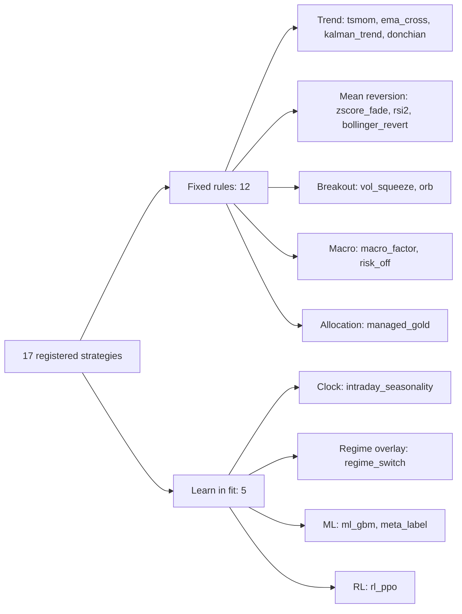

`warmup_bars` is for the default parameters (bar counts, so it scales with the timeframe you
run). "Stateful" means the forecast depends on a position state machine or a filter, not only
on a trailing window: a run that starts later can disagree with a full-history run until the
state converges, which is why some warm-ups are longer than their longest window.

| Strategy | Family | Trainable | Stateful | Long/short | `warmup_bars` | Needs beyond OHLC bars |
|---|---|---|---|---|---|---|
| `tsmom` | Trend | no | no | both | 1441 | – |
| `ema_cross` | Trend | no | no | both | 385 | – |
| `kalman_trend` | Trend | no | no | both | 721 | – |
| `donchian` | Trend / breakout | no | **yes** | both | 241 | – |
| `zscore_fade` | Mean reversion | no | **yes** | both | 50 | – |
| `rsi2` | Mean reversion | no | **yes** | both | 201 | – |
| `bollinger_revert` | Mean reversion | no | **yes** | both | 49 | – |
| `vol_squeeze` | Breakout | no | **yes** | both | 67 | – |
| `orb` | Breakout | no | **yes** | both | 0 | H1 or faster bars |
| `macro_factor` | Macro | no | no | both | 0 | `md.macro["dxy"]`, `md.macro["real10y"]` |
| `risk_off` | Macro | no | **yes** | **long only** | 0 | `md.macro["vix"]` (`"dxy"` optional) |
| `managed_gold` | Allocation | no | **yes** | **long only** (default) | 5797 | – |
| `intraday_seasonality` | Learned clock | **yes** | no | both | 0 | – (its cost estimate uses the bars' `spread` column) |
| `regime_switch` | Regime overlay | **yes** | **yes** (filter) | follows its base | 1441 (the base's) | – |
| `ml_gbm` | ML | **yes** | no | both | 5820 | see [ml-and-rl.md](ml-and-rl.md#ml_gbm-direction-classifier) |
| `meta_label` | ML | **yes** | no | follows primary | 5820 | see [ml-and-rl.md](ml-and-rl.md#meta_label-meta-labelling-a-primary) |
| `rl_ppo` | RL | **yes** | **yes** | both | 0 until an artifact is attached | `pip install -e ".[rl]"`, see [ml-and-rl.md](ml-and-rl.md#the-rl_ppo-strategy-adapter) |

The registry itself, from `aurum strategies list` (description column truncated by the CLI):

```bash
aurum strategies list
```

```text
strategy              trainable  warmup_bars                                                                                 description
----------------------------------------------------------------------------------------------------------------------------------------
bollinger_revert          False           49  Bollinger(48, 2) reversion: enter when price closes back inside a band, target the middle 
donchian                  False          241  Turtle-style Donchian breakout (120-bar entry, 60-bar exit channel, 2.5 ATR stop on H1); s
ema_cross                 False          385  EWMAC fast/slow EMA crossover (32/128 H1 bars); continuous forecast = EMA spread normalise
intraday_seasonality       True            0  Hour-of-week (New York clock) drift learned on training data with empirical-Bayes shrinkag
kalman_trend              False          721  Local-linear-trend Kalman filter on log price (≈240-bar memory on H1); forecast = filtered
macro_factor              False            0  Macro momentum: long gold when the dollar (DXY) and 10y real yields have been falling over
managed_gold              False         5797  Managed gold exposure: long-biased base weight 0.5 + multi-horizon trend tilt, cut to a fl
meta_label                 True         5820  Meta-labelling: an ML classifier predicts whether the primary strategy's bet (default tsmo
ml_gbm                     True         5820  HistGradientBoosting classifier on causal features predicting the triple-barrier (or vol-n
orb                       False            0  Opening-range breakout for the London and New York opens (60-min range, DST-aware local ti
regime_switch              True         1441  Trend forecast (tsmom) scaled by a 2-state Gaussian HMM's causal filtered P(calm) on daily
risk_off                  False            0  Safe-haven regime: long gold (only) after a VIX spike vs its 60-day EWMA baseline, standin
rl_ppo                     True            0  PPO policy (stable-baselines3) trained on the shared simulator with vol-targeted sizing an
rsi2                      False          201  Connors RSI(2) pullback: buy RSI2<10 above the 200-bar SMA (sell RSI2>90 below it), exit o
tsmom                     False         1441  Multi-horizon time-series momentum (1w/1m/3m on H1): vol-normalised past returns, Carver-s
vol_squeeze               False           67  TTM-style squeeze: when Bollinger(20,2) exits Keltner(20,1.5 ATR) after a compression, tra
zscore_fade               False           50  Fade |z| > 2 of log price vs its 48-bar mean, only when Kaufman's efficiency ratio says th
```

Every strategy, rule-based or learned, rejects unknown parameter names with a `ValueError` (a
typo such as `horizon` instead of `horizons` would otherwise be silently ignored). The
defaults were chosen for H1 bars (about 23 bars per trading day). Window parameters are in
**bars**, so running another timeframe changes their meaning in calendar time: the daily
configs ([configs/d1_trend.yaml](../configs/d1_trend.yaml),
[configs/managed_gold.yaml](../configs/managed_gold.yaml)) restate the windows in trading days.

---

## Forecast scaling: one convention for every rule

**Intuition.** A combiner can only average forecasts that speak the same language. If one rule
outputs ±1 all the time and another rarely leaves ±0.1, the first silently dominates. Aurum
therefore builds every rule's raw signal as a *dimensionless* number that is roughly standard
normal when the market is a driftless random walk, and multiplies it by a fixed constant so its
average size is half the cap. This is Robert Carver's convention (*Systematic Trading*, 2015,
ch. 7): an average absolute forecast of 10 on his ±20 scale, which is **0.5** on Aurum's
`[-1, 1]` scale. The helpers live in [aurum/strategies/trend.py](../aurum/strategies/trend.py)
and are imported by every other rule module.

**The math.**

```math
f_t = \operatorname{clip}\left(c\, Z_t,\ -1,\ 1\right), \qquad
c = \frac{0.5}{\mathbb{E}\lvert Z\rvert} = \frac{0.5}{\sqrt{2/\pi}} = 0.6267
```

where

- $Z_t$ is the rule's raw statistic, built so that $Z_t \sim N(0, 1)$ under a driftless random
  walk (a volatility-normalised return, a volatility-normalised EMA spread, a Kalman slope
  t-statistic),
- $c$ is `Z_FORECAST_SCALAR`: before the cap, $\mathbb{E}\lvert f\rvert = 0.5$ exactly under the
  null. It is analytic, so nothing is estimated from the sample (no look-ahead, no sample
  dependence),
- `clip` is the cap: it trims the realised average below 0.5.

The volatility used for normalising is a zero-mean exponentially weighted RMS of log returns
(`bar_volatility`, the RiskMetrics form) in its *normalised* version:

```math
r_t = \ln C_t - \ln C_{t-1}, \qquad
\sigma_t = \sqrt{\frac{\sum_{k=0}^{t-1} \lambda^{k}\, r_{t-k}^{2}}{\sum_{k=0}^{t-1} \lambda^{k}}}, \qquad
\lambda = 2^{-1/H}
```

where $C_t$ is the close of bar $t$, $H$ is `vol_halflife` (240 bars for most rules), the
estimate is undefined (so the forecast is 0) before `vol_min_periods` returns (120), and a zero
volatility (frozen holiday quotes) is mapped to NaN. The normalised form (`adjust=True`) means
a short live window and a long research history agree once both span a few half-lives; the
recursive form seeded with the first squared return would let a single weekend gap at the
start of a live window move the forecast by up to 0.6 (the review finding recorded in
`ewma_mean`'s docstring).

**Averaging correlated sub-signals.** When a rule averages several sub-forecasts (several
horizons, several macro series), the average is smaller than its parts because they are
imperfectly correlated. Carver's forecast diversification multiplier restores the size:

```math
\mathrm{FDM} = \min\left(2.5,\ \frac{1}{\sqrt{w^{\top} C\, w}}\right), \qquad
C_{ij} = \sqrt{\frac{\min(h_i, h_j)}{\max(h_i, h_j)}}, \qquad
C^{\mathrm{sign}}_{ij} = \frac{2}{\pi} \arcsin C_{ij}
```

where

- $w$ are the (normalised) sub-signal weights,
- $C$ is the correlation *under the null*, computed analytically: two volatility-normalised
  returns over overlapping horizons $h_i \le h_j$ ending at the same bar share $h_i$ of their
  $h_j$ increments, so their correlation is $\sqrt{h_i/h_j}$ (`overlap_correlation`),
- $C^{\mathrm{sign}}$ is the arcsine law for the correlation of the signs of two correlated
  normals (`sign_correlation`), used when the response is `sign`,
- negative correlations are floored at 0 and the multiplier is capped at `MAX_FDM = 2.5`.

For `tsmom`'s default horizons (120, 480, 1440) the correlations are 0.5, 0.289 and 0.577, and
the FDM is 1.253 (1.366 for the `sign` response).

**Fixed-size and learned rules.** State-machine rules pick a level instead: `donchian` holds
`±0.8` while in a position, chosen so the long-run average is near 0.5 on a random walk where
it is in the market a bit more than half the time. Learned strategies set their scalar at fit
time: `intraday_seasonality` scales its table to an average absolute forecast of 0.5 on
training data, and `ml_gbm` and `meta_label` fit a Carver scalar on their validation tail
behind a skill gate ([ml-and-rl.md](ml-and-rl.md#forecast-mapping-and-the-skill-gate)).

**The picture.**

<picture>
  <source media="(prefers-color-scheme: dark)" srcset="_assets/figures/strategies/forecast-contract-dark.png">
  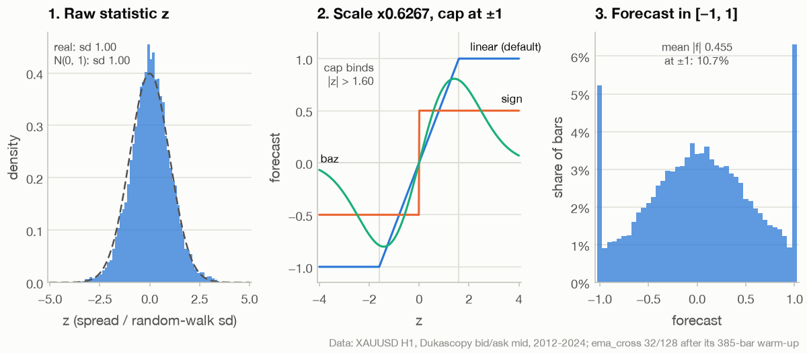
</picture>

*Left: on 2012-2024 hourly gold the raw `ema_cross` statistic has standard deviation 1.00 as designed, with fatter tails than a normal (excess kurtosis 0.54). Middle: the scale-and-cap map; the cap binds beyond $\lvert z\rvert$ = 1.60. Right: after the cap, 10.7% of bars sit at ±1 and the mean absolute forecast is 0.455, a little under the 0.5 target. Data: XAUUSD H1, Dukascopy bid/ask mid, 2012-2024.*

**In code.** On a synthetic random walk the scaling does what it claims (the cap trims the
average below 0.5; `vol_squeeze` is low because it is flat most of the time):

```python
from aurum.core.types import MarketData
from aurum.data.synthetic import make_synthetic_bars, make_synthetic_macro
from aurum.strategies import get_strategy
from aurum.strategies.trend import Z_FORECAST_SCALAR

bars = make_synthetic_bars(20_000, "H1", seed=3)         # driftless random walk
md = MarketData(bars=bars, macro=make_synthetic_macro(bars, seed=3))
print(f"Z_FORECAST_SCALAR = {Z_FORECAST_SCALAR:.4f}")
for name in ("tsmom", "ema_cross", "kalman_trend", "donchian", "vol_squeeze", "macro_factor"):
    s = get_strategy(name)
    f = s.generate(md).iloc[s.warmup_bars:]
    print(f"{name:13s} mean|f| = {f.abs().mean():.3f}   share at +/-1 = {(f.abs() == 1).mean():.3f}")
```

```text
Z_FORECAST_SCALAR = 0.6267
tsmom         mean|f| = 0.414   share at +/-1 = 0.084
ema_cross     mean|f| = 0.465   share at +/-1 = 0.118
kalman_trend  mean|f| = 0.432   share at +/-1 = 0.087
donchian      mean|f| = 0.465   share at +/-1 = 0.000
vol_squeeze   mean|f| = 0.114   share at +/-1 = 0.024
macro_factor  mean|f| = 0.507   share at +/-1 = 0.170
```

On real gold (this needs the dataset in `data_store/`, see [data.md](data.md); the override
stops the data before the 2025 holdout):

```python
from aurum.core.config import load_config
from aurum.strategies import get_strategy

cfg = load_config("configs/default.yaml", overrides=["data.end=2024-12-31"])   # stop before the holdout
md = cfg.data.load()                                    # real XAUUSD H1 bars + macro + event calendar
print(md.bars.index[0], "->", md.bars.index[-1], f"({len(md.bars):,} bars)")
print(f"{'strategy':17s} {'mean|f|':>7s} {'active':>7s} {'at +/-1':>8s}")
for name in ("tsmom", "ema_cross", "donchian", "kalman_trend", "zscore_fade", "rsi2",
             "bollinger_revert", "vol_squeeze", "orb", "macro_factor", "risk_off", "managed_gold"):
    s = get_strategy(name)
    f = s.generate(md).iloc[s.warmup_bars:]
    print(f"{name:17s} {f.abs().mean():7.3f} {(f != 0).mean():7.1%} {(f.abs() == 1).mean():8.1%}")
```

```text
2013-01-01 23:00:00+00:00 -> 2024-12-31 21:00:00+00:00 (71,320 bars)
strategy          mean|f|  active  at +/-1
tsmom               0.462  100.0%    10.9%
ema_cross           0.456  100.0%    10.8%
donchian            0.447   55.8%     0.0%
kalman_trend        0.463  100.0%    11.0%
zscore_fade         0.127   28.6%     0.3%
rsi2                0.136   18.3%     0.0%
bollinger_revert    0.324   52.9%     5.5%
vol_squeeze         0.107   20.5%     2.6%
orb                 0.170   32.9%     1.1%
macro_factor        0.489  100.0%    15.2%
risk_off            0.069   13.7%     1.6%
managed_gold        0.573   95.4%     6.5%
```

**Pitfalls and design choices.**

- *Fitted scalars leak.* Carver estimates his forecast scalars from data; doing that on the
  full sample would leak the future's volatility into the past. The analytic scalar has no
  such dependence, which is also why the trend, macro and breakout rules need no `fit`.
- *Real returns are not normal.* The real statistic's tails are fatter than N(0, 1). On H1
  gold the share at the cap (10.8% to 11.0% for the continuous trend rules) still matches the
  normal-theory 11.05%, but on other assets or timeframes check the "at ±1" column before
  trusting the 0.5 convention.
- *The convention is about size, not skill.* Equal average size makes forecasts comparable;
  it says nothing about which one predicts anything. The combiner's weights decide that,
  net of costs ([portfolio-and-risk.md](portfolio-and-risk.md)).

---

## Trend

Module [aurum/strategies/trend.py](../aurum/strategies/trend.py). Time-series momentum, where
an asset's own past return predicts its future return, is one of the best documented
anomalies across asset classes (Moskowitz, Ooi & Pedersen 2012; Hurst, Ooi & Pedersen 2017).
Proposed mechanisms are behavioural under-reaction followed by delayed over-reaction, and
slow-moving capital. Gold's drivers (real rates, the dollar, reserve demand) move in persistent
regimes. At intraday horizons the edge is thinner and costs matter more, so the defaults
favour multi-day horizons.

**Three of the four trend rules are the same kind of object.** `tsmom`, `ema_cross` and
`kalman_trend` are all *linear filters of past returns*: each forecast (before the cap) is a
weighted sum of the last returns, each divided by the current volatility. They differ only in
the shape of the weights (Levine & Pedersen 2016 make this point for moving averages and
momentum). Because each rule is scaled to unit variance under the null, the three weight
vectors have exactly the same energy, $\sum_k w_k^2 = 0.6267^2$:

<picture>
  <source media="(prefers-color-scheme: dark)" srcset="_assets/figures/strategies/trend-kernels-dark.png">
  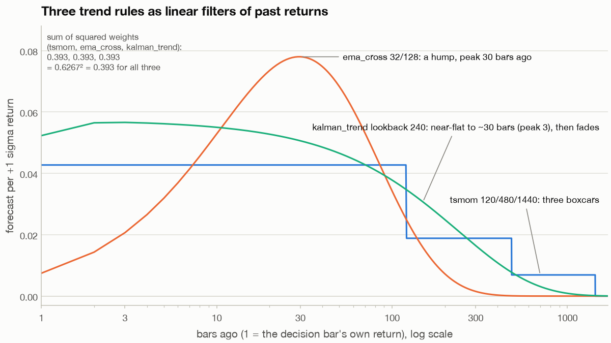
</picture>

*The weight each rule puts on a +1 sigma return k bars ago, with default parameters. `ema_cross` puts little weight on the latest few bars and peaks 30 bars back; `kalman_trend` weighs the latest ~30 bars almost equally; `tsmom` is three boxcars. All three have the same total energy 0.393 = 0.6267², which is why they share a mean absolute forecast near 0.5. Data: none; the weights are computed from the strategies' default parameters.*

### `tsmom`: time-series momentum

**Intuition.** If gold has risen over the last week, month and quarter, bet that it keeps
rising; if it has fallen, bet that it keeps falling. Each lookback's return is measured in
units of current volatility, so a 2% move in a calm market counts for more than a 2% move in a
storm. Blends of short and long lookbacks have been the most robust historically (Hurst et
al. 2017). On H1 the defaults are about 1 week, 1 month and 3 months.

**The math.**

```math
z_{h,t} = \frac{\ln C_t - \ln C_{t-h}}{\sigma_t \sqrt{h}}, \qquad
f_t = \operatorname{clip}\Big(\mathrm{FDM} \sum_{h \in \mathcal{H}} w_h\, \phi(z_{h,t}),\ -1,\ 1\Big)
```

where

- $\mathcal{H}$ is `horizons` (120, 480, 1440 bars) and $w_h$ the normalised `weights` (equal by
  default),
- $\sigma_t$ is `bar_volatility` with half-life `vol_halflife` = 240 and `vol_min_periods` = 120,
  so $z_{h,t}$ is N(0, 1) under a random walk (`momentum_z`),
- $\phi$ is the `response`: `linear` $\phi(z) = 0.6267\,z$; `sign` $\phi(z) = 0.5\,\mathrm{sign}(z)$
  (Moskowitz et al.); `baz` $\phi(z) = 0.8366\; z\, e^{-z^2/4}/0.89$ (Baz et al. 2015, which fades
  very stretched trends; 0.8366 = 0.5 / 0.5977 rescales it to an average of 0.5),
- FDM is the null-correlation multiplier above: 1.253 for `linear` and `baz`, 1.366 for `sign`.

**The picture.** 2020 is the clearest year of the sample for a trend rule: a sharp liquidity
sell-off in March, then a steady rally to the August all-time high.

<picture>
  <source media="(prefers-color-scheme: dark)" srcset="_assets/figures/strategies/tsmom-dark.png">
  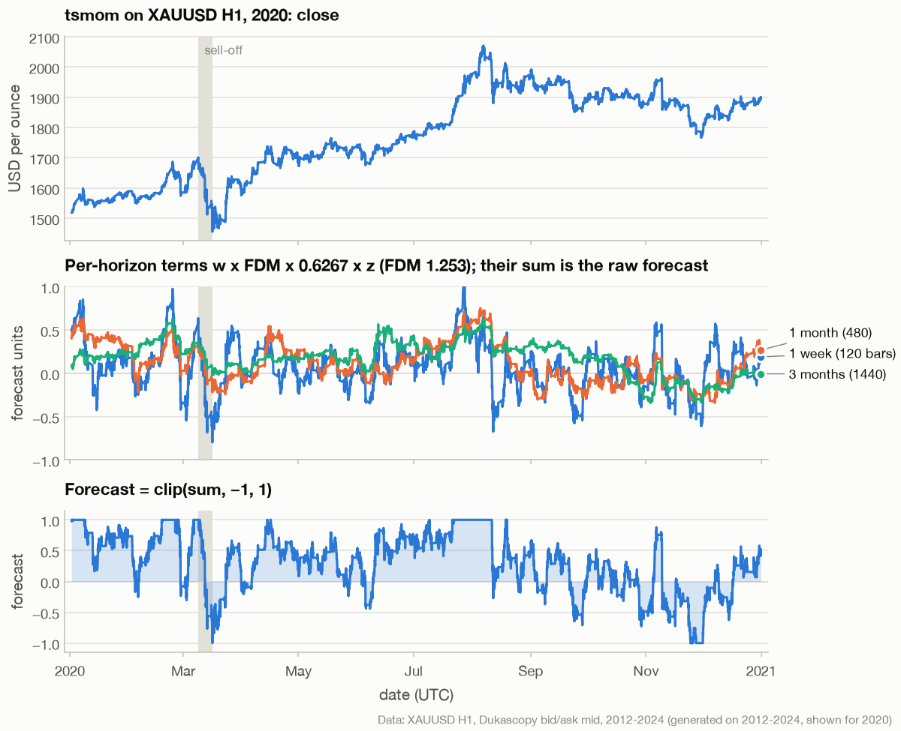
</picture>

*The 1-week term reacts first: in the shaded sell-off it drags the forecast from +1 at the 9 March 2020 high to −1 at the 16 March low (1,456), while the 3-month term stays positive. The forecast is then at +1 for 71% of the hours between 15 July and the 6 August high (2,071), the kind of move trend rules are built for. Data: XAUUSD H1, Dukascopy bid/ask mid, 2012-2024 (shown: 2020).*

**In code.** [`TimeSeriesMomentum`](../aurum/strategies/trend.py) (`get_strategy("tsmom")`);
`combination()` returns the weights and the FDM.

```python
import numpy as np
from aurum.strategies import get_strategy
from aurum.strategies.trend import ema_spread_variance, llt_steady_state

w, fdm = get_strategy("tsmom").combination()                  # equal weights, FDM under the null
print("tsmom weights", np.round(w, 3), "FDM", round(fdm, 3))
print("tsmom sign-response FDM", round(get_strategy("tsmom", response="sign").combination()[1], 3))
print("EMA spread sd per unit return sd, 32/128:", round(ema_spread_variance(32, 128) ** 0.5, 3))
K, A, P = llt_steady_state(level_noise=1.0, slope_noise=1 / 240**2, obs_noise=0.1)
print("Kalman gain K =", np.round(K.ravel(), 5))
print("||g|| =", round(get_strategy("kalman_trend").filter_coefficients()[2], 5))
```

```text
tsmom weights [0.333 0.333 0.333] FDM 1.253
tsmom sign-response FDM 1.366
EMA spread sd per unit return sd, 32/128: 3.795
Kalman gain K = [0.91643 0.00381]
||g|| = 0.04563
```

| Parameter | Default | Meaning |
|---|---|---|
| `horizons` | `(120, 480, 1440)` | Lookbacks in bars. |
| `weights` | `None` | Horizon weights (non-negative, normalised). `None` = equal. |
| `response` | `"linear"` | `"linear"`, `"sign"` or `"baz"`. |
| `vol_halflife` | `240.0` | EWMA half-life (bars) of the volatility normaliser. |
| `vol_min_periods` | `120` | Bars before the volatility estimate is defined. |

**Warm-up:** `max(max(horizons), vol_min_periods) + 1` (1441). **Stateful:** no.

**Pitfalls and design choices.**

- *Regime dependence.* Trend rules earn in persistent moves and pay in ranges: the 2020 panel
  is the good case; the whipsaw in the second half of 2020 is the usual one. Under the
  protocol the H1 trend rules were regime dependent and not significant
  ([RESULTS.md](RESULTS.md)).
- *Costs.* The 1-week term turns over the most. Sizing is downstream (`VolTargetSizer`), as in
  Moskowitz et al., who scale positions by $1/\sigma$; the combiner charges each rule its
  estimated cost per unit change of forecast.
- *Why volatility-normalise the signal and not only the position?* So that the forecast means
  the same thing in calm and turbulent periods, and so the 0.6267 scalar holds.

**References:** Moskowitz, Ooi & Pedersen (2012), "Time series momentum", *JFE* 104(2);
Hurst, Ooi & Pedersen (2017), *JPM* 44(1); Baz et al. (2015), SSRN 2695101; Carver (2015).

### `ema_cross`: EWMAC crossover

**Intuition.** Compare a fast and a slow moving average of price: when the fast one is above,
the recent past is stronger than the older past, so the trend is up. The gap between the two
is a smoothed momentum measure that reacts to persistent moves but ignores single-bar noise,
the "EWMAC" rule of Carver's book. Aurum replaces Carver's fitted scalar with the exact
standard deviation of the gap on a random walk.

**The math.**

```math
d_t = \mathrm{EMA}_{n_f}(\ln C)_t - \mathrm{EMA}_{n_s}(\ln C)_t
    = \sum_{k \ge 1} \left(a^{k} - b^{k}\right) r_{t-k+1}, \qquad
f_t = \operatorname{clip}\left(0.6267\, \frac{d_t}{\sigma_t \sqrt{V}},\ -1,\ 1\right)
```

```math
V = \frac{a^2}{1-a^2} + \frac{b^2}{1-b^2} - \frac{2ab}{1-ab}, \qquad
a = 1 - \frac{2}{n_s+1}, \quad b = 1 - \frac{2}{n_f+1}
```

where

- $n_f$, $n_s$ are `fast` and `slow` (32 and 128 bars), with `1 <= fast < slow`,
- the EMAs are the recursive form $E_t = \alpha y_t + (1-\alpha) E_{t-1}$ with $\alpha = 2/(n+1)$,
  seeded with the first log price (`adjust=False`),
- $V$ is `ema_spread_variance(fast, slow)`, the variance of $d_t$ per unit return variance on a
  random walk ($\sqrt{V}$ = 2.685, 3.795 and 5.367 for 16/64, 32/128 and 64/256),
- the second expression for $d_t$ is the linear-filter form drawn in the kernel figure.

**The picture.** The COVID turn of February-May 2020 shows the trade-off between speeds.

<picture>
  <source media="(prefers-color-scheme: dark)" srcset="_assets/figures/strategies/ema-cross-dark.png">
  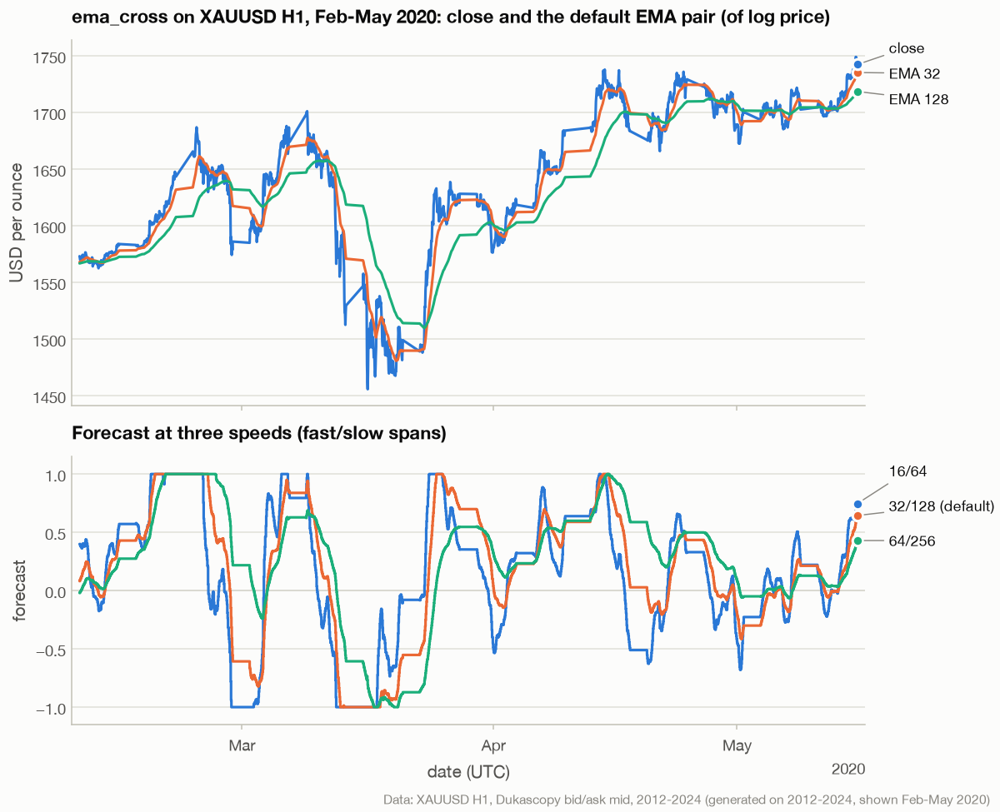
</picture>

*All three speeds go short into the mid-March 2020 low and long again in April; the 16/64 rule turns days earlier than 64/256 but also flips on every wiggle, which is what costs pay for. Data: XAUUSD H1, Dukascopy bid/ask mid, 2012-2024 (shown: Feb-May 2020).*

**In code.** [`EMACrossover`](../aurum/strategies/trend.py) (`get_strategy("ema_cross",
fast=32, slow=128)`). Run several speeds by listing the strategy several times with different
`id`s in a config ([Configuring strategies in YAML](#configuring-strategies-in-yaml)); the
combiner then weights them.

| Parameter | Default | Meaning |
|---|---|---|
| `fast` | `32` | Fast EMA span (bars). Must satisfy `1 <= fast < slow`. |
| `slow` | `128` | Slow EMA span (bars). |
| `vol_halflife` | `240.0` | EWMA half-life of the volatility normaliser. |
| `vol_min_periods` | `120` | Bars before volatility is defined. |

**Warm-up:** `max(3 * slow, vol_min_periods) + 1` (385). The EMAs are seeded with the first
price; after three slow spans the seed's weight is below 0.3%. **Stateful:** no.

**Pitfalls and design choices.** The speed is a parameter you can overfit: the v2.1 sweep of
`fast` x `slow` on trend_core found the best cell on the edge of the grid with a knife-edge
plateau, and the default 32/128 cell scoring close to zero (see [analytics.md](analytics.md)
and [RESULTS.md](RESULTS.md)). Treat each speed you try as a trial for the deflated Sharpe
ratio ([research.md](research.md)).

**References:** Carver (2015), ch. 7 and App. B; Levine & Pedersen (2016), "Which Trend Is
Your Friend?", *FAJ* 72(3).

### `kalman_trend`: local-linear-trend Kalman slope

**Intuition.** Picture log price as a slowly drifting line hidden under noise. Every bar we
get one noisy observation and update our belief about two numbers: where the line is (the
level) and how steeply it is moving (the slope). The Kalman filter is the optimal linear way
to do that update (Harvey 1989); its slope estimate is a trend filter whose weights come from
an explicit signal-to-noise model rather than hand-picked spans. The forecast is that slope
divided by how big it would typically be on a pure random walk, a t-statistic.

**The math.** The local linear trend model (all variances in units of the per-bar return
variance $s^2$, which cancels out of the gain):

```math
y_t = \mu_t + \varepsilon_t, \qquad
\mu_{t+1} = \mu_t + \nu_t + \eta_t, \qquad
\nu_{t+1} = \nu_t + \zeta_t
```

```math
x_t = \begin{pmatrix} \mu_t \\ \nu_t \end{pmatrix}, \quad
F = \begin{pmatrix} 1 & 1 \\ 0 & 1 \end{pmatrix}, \quad
H = \begin{pmatrix} 1 & 0 \end{pmatrix}, \quad
Q = \begin{pmatrix} q_\mu & 0 \\ 0 & 1/L^2 \end{pmatrix}, \quad
R = q_\varepsilon
```

The steady-state prior covariance $P$ solves the discrete algebraic Riccati equation, and the
filter is then a fixed linear recursion:

```math
P = F P F^{\top} - F P H^{\top} \left(H P H^{\top} + R\right)^{-1} H P F^{\top} + Q, \qquad
K = \frac{P H^{\top}}{H P H^{\top} + R}
```

```math
\hat{x}_{t \mid t} = A\, \hat{x}_{t-1 \mid t-1} + K y_t, \quad A = (I - K H) F, \qquad
f_t = \operatorname{clip}\left(0.6267\, \frac{\hat{\nu}_{t \mid t}}{\sigma_t \lVert g \rVert},\ -1,\ 1\right)
```

where

- $y_t = \ln C_t - \ln C_0$ (the filter starts at the first price with zero slope),
- $q_\mu$ is `level_noise` (1.0), $q_\varepsilon$ is `obs_noise` (0.1), and $L$ is `lookback`
  (240): the slope's random walk moves by one return-sigma over $L$ bars,
- with the defaults $K$ = (0.91643, 0.00381): the level follows the price almost one-for-one,
  the slope updates by 0.4% of each surprise,
- $g$ is the slope's response to a unit step in log price (a single +1 return), and
  $\sigma_t \lVert g \rVert$ (with $\lVert g \rVert$ = 0.04563) is the exact standard deviation of
  $\hat{\nu}$ on a random walk, so the ratio is N(0, 1) under the null,
- the recursion is converted to an ARMA filter once (`scipy.signal.ss2tf`) and run with
  `scipy.signal.lfilter` (`filter_coefficients`, `slope`).

**The picture.**

<picture>
  <source media="(prefers-color-scheme: dark)" srcset="_assets/figures/strategies/kalman-trend-dark.png">
  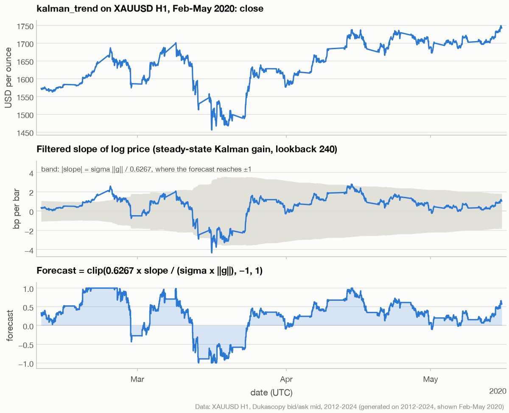
</picture>

*The shaded band is the slope at which the forecast caps, $\sigma_t \lVert g \rVert / 0.6267$. When volatility doubled in March 2020 the band widened with it, so a slope of −4 basis points per bar produced about the same −1 forecast as a much smaller slope would have in a calm February. Data: XAUUSD H1, Dukascopy bid/ask mid, 2012-2024 (shown: Feb-May 2020).*

**In code.** [`KalmanTrend`](../aurum/strategies/trend.py) and
[`llt_steady_state`](../aurum/strategies/trend.py) (the gain printed in the `tsmom` snippet
above).

| Parameter | Default | Meaning |
|---|---|---|
| `lookback` | `240` | Filter memory in bars (sets `slope_noise = 1 / lookback^2`). Must be `>= 2`. |
| `level_noise` | `1.0` | Level process variance, as a multiple of the per-bar return variance. |
| `obs_noise` | `0.1` | Observation noise variance, same units. |
| `vol_halflife` | `240.0` | EWMA half-life of the volatility normaliser. |
| `vol_min_periods` | `120` | Bars before volatility is defined. |

**Warm-up:** `max(3 * lookback, vol_min_periods) + 1` (721). **Stateful:** no in practice: the
filter starts at the first price with zero slope and forgets that seed geometrically; the
warm-up covers it.

**Pitfalls and design choices.** The steady-state gain is used from the first bar (no
time-varying covariance), which is what makes the filter a fixed linear kernel and keeps
research and live identical; the cost is a slightly wrong estimate during the warm-up, which is
zeroed. `obs_noise` is small, so the "level" is close to the price itself and the rule is
effectively a slope estimator with the near-flat kernel in the kernel figure.

**References:** Harvey (1989), *Forecasting, Structural Time Series Models and the Kalman
Filter*; Durbin & Koopman (2012); Benhamou (2016), SSRN 2747102.

### `donchian`: Turtle-style channel breakout

**Intuition.** A close above the highest high of the last week says that supply at the old
resistance has been absorbed: go long and stay long until the price breaks back below a
shorter channel or hits a stop set when you entered. Breakouts enter late, after a move is
established, but cut losers quickly, which gives positively skewed returns. They were the core
of the Turtle system (Faith 2007).

**The math.** With $h_t$, $\ell_t$ the high and low of bar $t$:

```math
U_t = \max_{1 \le k \le N_e} h_{t-k}, \quad
D_t = \min_{1 \le k \le N_e} \ell_{t-k}, \quad
U^{x}_t = \max_{1 \le k \le N_x} h_{t-k}, \quad
D^{x}_t = \min_{1 \le k \le N_x} \ell_{t-k}
```

```math
\text{stop}_{\text{long}} = C_e - k\, \mathrm{ATR}_e, \qquad
\text{stop}_{\text{short}} = C_e + k\, \mathrm{ATR}_e, \qquad
f_t = \text{level} \times \text{state}_t
```

where

- $N_e$ = `entry_n` (120) and $N_x$ = `exit_n` (60); the channels exclude the current bar,
- $C_e$ and $\mathrm{ATR}_e$ are the close and the Wilder ATR (`atr_n` = 48) at the entry bar,
  $k$ = `stop_atr` (2.5); the stop is fixed at entry, as in the Turtle "2N" stop,
- the state machine below runs on every close; a stop-out can reverse on the same bar if the
  opposite breakout fires, and no entry is taken while the ATR is undefined or zero,
- `level` = 0.8.

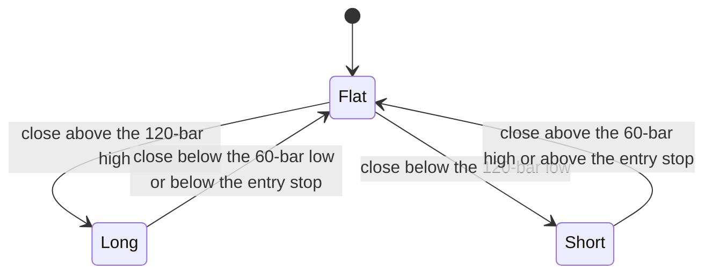

**The picture.** Summer 2020 contains the breakout to the all-time high and the sharp reversal
of 11 August.

<picture>
  <source media="(prefers-color-scheme: dark)" srcset="_assets/figures/strategies/donchian-dark.png">
  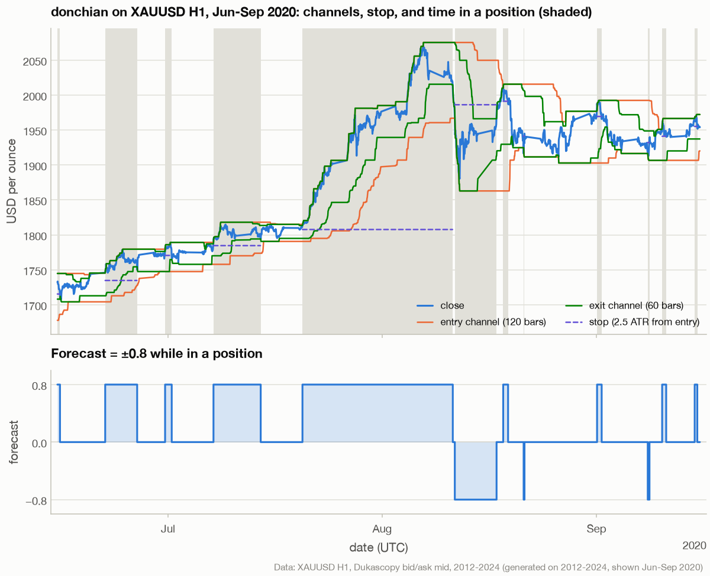
</picture>

*The long opened on 20 July 2020 (close above the 120-bar high) rode the rally to 2,071 and was closed on 11 August at 05:00 UTC, when the close (2,009) fell below the 60-bar low (2,015); seven hours later the close (1,963) broke the 120-bar low and the rule went short. The stop, 2.5 ATR below the entry, was never touched. Data: XAUUSD H1, Dukascopy bid/ask mid, 2012-2024 (shown: Jun-Sep 2020).*

**In code.** [`DonchianBreakout`](../aurum/strategies/trend.py); `positions(bars)` returns the
raw state in {-1, 0, +1}.

```python
import numpy as np
from aurum.core.types import MarketData
from aurum.data.synthetic import make_synthetic_bars
from aurum.strategies import get_strategy

md = MarketData(bars=make_synthetic_bars(20_000, "H1", seed=3))   # driftless random walk
s = get_strategy("donchian")
pos = s.positions(md.bars)[s.warmup_bars:]
print("time in the market:", f"{(pos != 0).mean():.1%}", "| mean |f|:",
      round(float(np.abs(pos * s.params['level']).mean()), 3))
print("trades:", int(((pos != 0) & (np.r_[0, pos[:-1]] != pos)).sum()))
```

```text
time in the market: 58.2% | mean |f|: 0.465
trades: 136
```

| Parameter | Default | Meaning |
|---|---|---|
| `entry_n` | `120` | Entry channel length (bars). |
| `exit_n` | `60` | Exit channel length (bars). |
| `atr_n` | `48` | ATR period (Wilder smoothing). |
| `stop_atr` | `2.5` | Stop distance in ATRs at entry. `None` disables the stop. |
| `level` | `0.8` | Forecast magnitude while in a position, in `(0, 1]`. |

**Warm-up:** `2 * max(entry_n, exit_n, atr_n) + 1` (241). **Stateful:** yes. A trade opened
long ago stays open while the exit channel and stop hold, so a run that starts later can be
flat while the full-history run is long. The doubled warm-up lets a shorter history converge:
on 2012-19 H1 gold a history of 363 bars disagreed with the full-history position on 0.56% of
bars and 484 or more bars never did (the check is recorded in the class docstring).

**Pitfalls and design choices.** The forecast is a constant ±0.8, so the rule carries no
information about conviction; its positive skew comes from many small losses and a few large
winners, which makes short samples look worse than they are and long samples look better
than any one regime deserves. It is highly correlated with the continuous trend rules (0.64 to
0.87 out of sample, see [the correlation heatmap](#how-the-strategies-relate-forecast-correlations)).

**References:** Donchian (1960), *FAJ* 16(6); Faith (2007), *Way of the Turtle*; Hurst, Ooi
& Pedersen (2017).

---

## Mean reversion

Module [aurum/strategies/mean_reversion.py](../aurum/strategies/mean_reversion.py). At short
horizons, price moves driven by order-flow imbalance rather than information tend to partially
reverse: liquidity providers absorb the imbalance, demand a premium and lay the inventory off
(Grossman & Miller 1988; Nagel 2012). The effect is regime dependent, because fading a move in
an information-driven trend is ruinous, so each rule here has a regime or trend filter.

**The latch.** All three are long/short and stateful through one vectorised state machine,
`latch` in [aurum/strategies/trend.py](../aurum/strategies/trend.py). A long opens on an entry
signal and is held until its exit or an opposite entry. When an entry and an exit fire on the
same bar the entry wins, and simultaneous long and short entries cancel (flat). The magnitude
is continuous and decays as the trade works.

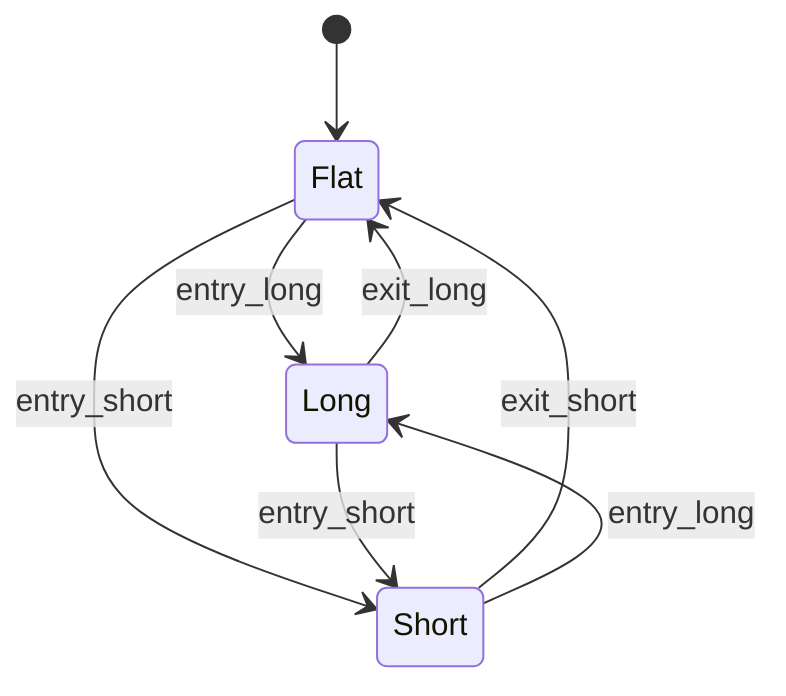

```python
import numpy as np
from aurum.strategies.trend import latch

T, F = True, False
entry_long  = np.array([F, T, F, F, F, F, F, T, F])
entry_short = np.array([F, F, F, F, T, F, F, T, F])   # bar 7: both fire -> they cancel
exit_long   = np.array([F, F, F, T, F, F, F, F, F])
exit_short  = np.array([F, F, F, F, F, F, T, F, F])
print(latch(entry_long, entry_short, exit_long, exit_short))
```

```text
[ 0.  1.  1.  0. -1. -1.  0.  0.  0.]
```

It is implemented with forward-filled event markers, so row $t$ depends on rows up to $t$ only,
and it is tested to be identical to the obvious loop. The three figures below share one window,
17 to 28 July 2023: a quiet two-week range around 1,960, the environment these rules are
designed for. The x axis counts H1 bars, so the weekend does not take up space.

On a random walk the three rules (and the breakout rule `vol_squeeze`) are in the market a
fraction of the time:

```python
from aurum.core.types import MarketData
from aurum.data.synthetic import make_synthetic_bars
from aurum.strategies import get_strategy

md = MarketData(bars=make_synthetic_bars(20_000, "H1", seed=3))   # driftless random walk
for name in ("zscore_fade", "rsi2", "bollinger_revert", "vol_squeeze"):
    s = get_strategy(name)
    f = s.generate(md).iloc[s.warmup_bars:]
    print(f"{name:17s} active {(f != 0).mean():6.1%}   mean|f| when active {f[f != 0].abs().mean():.3f}")
```

```text
zscore_fade       active  32.3%   mean|f| when active 0.435
rsi2              active  18.9%   mean|f| when active 0.745
bollinger_revert  active  51.3%   mean|f| when active 0.642
vol_squeeze       active  21.5%   mean|f| when active 0.532
```

### `zscore_fade`: z-score fade in non-trending regimes

**Intuition.** When the price wanders back and forth without getting anywhere, a large
deviation from its recent average is more likely a liquidity overshoot than news, so bet on
the way back. Kaufman's efficiency ratio measures "getting anywhere": net progress divided by
the total distance travelled. When it is high the market is trending, so the rule stops fading
and closes open fades.

**The math.**

```math
z_t = \frac{\ln C_t - m_t}{s_t}, \qquad
\mathrm{ER}_t = \frac{\lvert C_t - C_{t-n_e} \rvert}{\sum_{k=0}^{n_e - 1} \lvert C_{t-k} - C_{t-k-1} \rvert}, \qquad
G_t = \left[\mathrm{ER}_{t-1} < \mathrm{ER}_{\max}\right]
```

```math
\text{entry long: } z_t < -z_{\mathrm{in}} \wedge G_t, \quad
\text{exit long: } z_t \ge -z_{\mathrm{out}} \vee \neg G_t, \qquad
\lvert f_t \rvert = \min\left(1,\ \frac{\lvert z_t \rvert}{2 z_{\mathrm{in}}}\right)
```

where

- $m_t$, $s_t$ are the rolling mean and sample standard deviation (ddof 1) of $\ln C$ over the
  last $n$ = 48 bars (`rolling_zscore`),
- $n_e$ = `er_n` (48) and $\mathrm{ER}_{\max}$ = `er_max` (0.3); a flat window has ER 0,
- the gate uses the ratio measured on the window ending at the **previous** bar, so the shock
  being faded cannot itself make the path look efficient and close the gate,
- $z_{\mathrm{in}}$ = `entry_z` (2.0), $z_{\mathrm{out}}$ = `exit_z` (0.5); shorts are
  symmetric; the size is 0.5 at entry and fades as $z$ reverts.

<picture>
  <source media="(prefers-color-scheme: dark)" srcset="_assets/figures/strategies/zscore-fade-dark.png">
  
</picture>

*The two short fades of 18 July 2023 and the long fade opened on 20 July are closed by the efficiency gate (shaded), not by reversion: those moves were persistent enough to lift ER above 0.3. The other fades (17, 24, 26 and 27 July) close the textbook way, when $z$ crosses back inside ±0.5. Data: XAUUSD H1, Dukascopy bid/ask mid, 2012-2024 (shown: 17-28 Jul 2023).*

| Parameter | Default | Meaning |
|---|---|---|
| `n` | `48` | z-score window (bars), `>= 3`. |
| `entry_z` | `2.0` | Entry threshold. |
| `exit_z` | `0.5` | Exit band. Must satisfy `0 <= exit_z < entry_z`. |
| `er_n` | `48` | Efficiency-ratio window (bars), `>= 2`. |
| `er_max` | `0.3` | Gate: trade only when `ER < er_max`. `None` disables the gate. |

**Warm-up:** `max(n, er_n + 1) + 1` (50; without the gate, `n + 1`). **Stateful:** yes.

**Pitfalls.** On H1 the fade's expected gain per trade is small relative to the spread; under
the protocol the hourly mean-reversion rules lost reliably after costs ([RESULTS.md](RESULTS.md)).
The gate threshold is a regime classifier with one parameter and is easy to tune to a sample.

**References:** Kaufman (1995), *Smarter Trading*; Lo & MacKinlay (1990), *RFS* 3(2); Nagel
(2012), *RFS* 25(7).

### `rsi2`: Connors RSI(2) pullback

**Intuition.** Buy short, sharp dips *inside* an uptrend and sell short, sharp rallies inside a
downtrend. A two-bar RSI below 10 is an extreme short-term pullback; the 200-bar average says
which way the bigger trend points. The entry exploits short-horizon reversal while the filter
keeps the trade on the side of slower momentum (Connors & Alvarez 2008 document it on equity
indices).

**The math.**

```math
\mathrm{RSI}_t = 100\, \frac{\mathrm{RMA}_n(u)_t}{\mathrm{RMA}_n(u)_t + \mathrm{RMA}_n(d)_t}, \qquad
u_t = \max(\Delta C_t, 0), \quad d_t = \max(-\Delta C_t, 0)
```

```math
\text{entry long: } \mathrm{RSI}_t < \ell \wedge C_t > \mathrm{SMA}_{N}(C)_t, \quad
\text{exit long: } C_t > \mathrm{SMA}_{n_x}(C)_t, \qquad
\lvert f \rvert = 0.5 + 0.5\, \frac{\ell - \mathrm{RSI}_e}{\ell}
```

where

- RMA is Wilder's running average, an EWM with $\alpha = 1/n$ seeded with the first value
  (`wilder_smooth`), $n$ = `rsi_n` = 2; a perfectly flat window gives RSI 50,
- $\ell$ = `lower` (10), `upper` = 90, $N$ = `trend_n` (200, `None` disables the filter), $n_x$ =
  `exit_n` (5),
- shorts mirror this: RSI above 90 and the close below the 200-bar SMA, exit below the 5-bar
  SMA, size $0.5 + 0.5(\mathrm{RSI}_e - 90)/10$,
- the size is set from the RSI depth on each entry signal ($\mathrm{RSI}_e$) and held: 0.5 at the
  threshold, 1.0 at RSI 0.

<picture>
  <source media="(prefers-color-scheme: dark)" srcset="_assets/figures/strategies/rsi2-dark.png">
  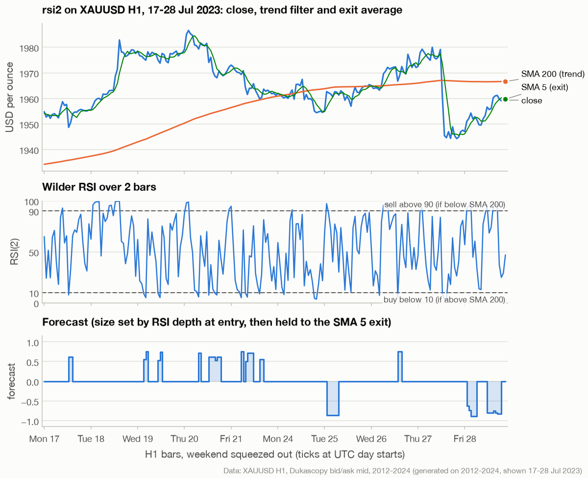
</picture>

*While the close is above the rising 200-bar SMA (to 24 July 2023) only RSI dips below 10 are bought, and each long lasts a few bars until the close regains the 5-bar SMA. Once the close sits below the trend line, spikes above 90 are sold instead. Data: XAUUSD H1, Dukascopy bid/ask mid, 2012-2024 (shown: 17-28 Jul 2023).*

| Parameter | Default | Meaning |
|---|---|---|
| `rsi_n` | `2` | Wilder RSI period. |
| `lower` | `10.0` | Long entry threshold. Must satisfy `0 < lower < upper < 100`. |
| `upper` | `90.0` | Short entry threshold. |
| `trend_n` | `200` | Trend-filter SMA (bars). `None` disables the filter. |
| `exit_n` | `5` | Exit SMA (bars). |

**Warm-up:** `max(trend_n or 0, exit_n, 5 * rsi_n) + 1` (201). **Stateful:** yes.

**Pitfalls.** The daily-bar rule of Connors is applied here to hourly bars with the same bar
counts, so "200" is about nine trading days, not ten months. Trades are short and many, so the
cost per trade dominates.

**References:** Connors & Alvarez (2008), *Short Term Trading Strategies That Work*; Wilder
(1978), *New Concepts in Technical Trading Systems*.

### `bollinger_revert`: Bollinger-band reversion

**Intuition.** Bollinger bands measure how far price has stretched in units of its recent
dispersion. A close outside the ±2 sd band is stretched; the rule waits until the close comes
back *inside* (Bollinger's own advice for avoiding a "walk up the band", which is a genuine
breakout) and then trades the return to the middle band. A wider stop band caps the loss when
the excursion turns into a trend.

**The math.**

```math
\mathrm{mid}_t = \mathrm{SMA}_n(C)_t, \quad
\mathrm{sd}_t = \mathrm{SD}_n(C)_t, \qquad
\text{below}_t = \left[C_t < \mathrm{mid}_t - k\, \mathrm{sd}_t\right]
```

```math
\text{entry long: } \text{below}_{t-1} \wedge \neg\,\text{below}_t \wedge C_t < \mathrm{mid}_t, \quad
\text{exit long: } C_t \ge \mathrm{mid}_t \vee C_t < \mathrm{mid}_t - k_s\, \mathrm{sd}_t, \qquad
\lvert f_t \rvert = \min\left(1,\ \frac{\lvert C_t - \mathrm{mid}_t \rvert}{k\, \mathrm{sd}_t}\right)
```

where

- SD is the population standard deviation (ddof 0) over $n$ = 48 bars,
- $k$ = 2.0 and $k_s$ = `stop_k` = 3.5, with `0 < k < stop_k`; shorts are symmetric,
- with `confirm=False` the entry is a close outside the band (but not beyond the stop band),
- the size is about 1 at the band and falls to 0 at the middle.

<picture>
  <source media="(prefers-color-scheme: dark)" srcset="_assets/figures/strategies/bollinger-revert-dark.png">
  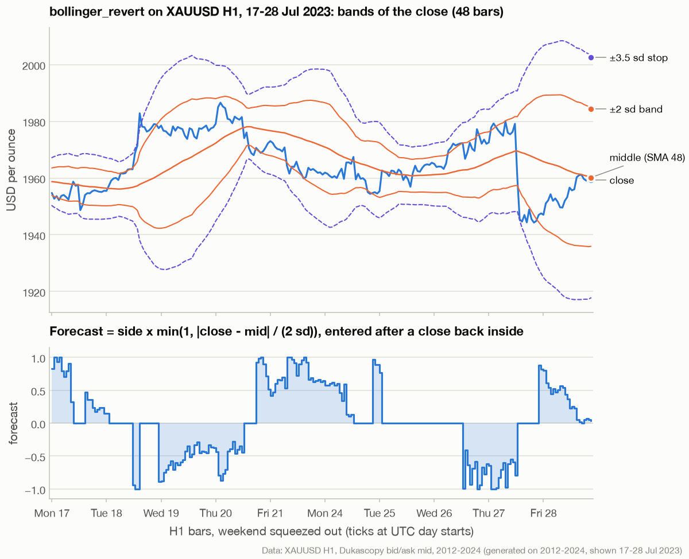
</picture>

*Each trade starts near full size, right after a close back inside the band, and decays toward 0 as the close approaches the middle. The long entered late on 20 July 2023 is held over the weekend because the close stays below the middle band until 24 July. Data: XAUUSD H1, Dukascopy bid/ask mid, 2012-2024 (shown: 17-28 Jul 2023).*

| Parameter | Default | Meaning |
|---|---|---|
| `n` | `48` | SMA and standard-deviation window (bars), `>= 3`. |
| `k` | `2.0` | Band width in standard deviations. Must satisfy `0 < k < stop_k`. |
| `stop_k` | `3.5` | Protective exit distance in standard deviations. |
| `confirm` | `True` | Wait for a close back inside the band before entering. |

**Warm-up:** `n + 1` (49). **Stateful:** yes.

**Pitfalls.** It is the strategy most opposed to the trend book (correlation −0.36 to −0.54 out
of sample), which makes it look like a diversifier; diversification of a rule that loses after
costs still loses.

**References:** Bollinger (2001), *Bollinger on Bollinger Bands*; Lo & MacKinlay (1990).

---

## Breakout

Module [aurum/strategies/breakout.py](../aurum/strategies/breakout.py). Volatility clusters and
mean-reverts, so unusually low realised ranges tend to be followed by expansion. When a
compressed range resolves, the first move often carries, because resting stop orders cluster
just outside the range (Osler 2003, 2005). Both rules are stateful loops over bars, evaluated
at each close with data up to that close only.

### `vol_squeeze`: Bollinger-inside-Keltner squeeze release

**Intuition.** Bollinger bands use close-to-close dispersion; Keltner channels use bar ranges
(ATR). When the Bollinger bands fit *inside* the Keltner channel, closes are unusually quiet
relative to the bars' ranges: the market is coiled. When that squeeze ends after lasting a
while, trade in the direction the price was already drifting (Carter 2005's "TTM squeeze").

**The math.**

```math
\text{on}_t = \left[\mathrm{mid}_t + k_b\, \mathrm{sd}_t < E_t + m\, \mathrm{ATR}_t\right] \wedge
             \left[\mathrm{mid}_t - k_b\, \mathrm{sd}_t > E_t - m\, \mathrm{ATR}_t\right]
```

```math
\text{release at } t: \neg\,\text{on}_t \wedge \text{run}_{t-1} \ge q, \qquad
\text{side} = \mathrm{sign}(z_t), \qquad
f = \text{side} \times \min\left(1,\ 0.6267\, \lvert z_t \rvert\right)
```

where

- mid and sd are the SMA and population sd of the close over $n$ = 20 bars, $E$ is an EMA of the
  close with span 20, $k_b$ = `bb_k` (2.0), $m$ = `kc_mult` (1.5), ATR over `atr_n` = 20,
- $\text{run}_{t-1}$ counts the consecutive squeeze-on bars before $t$; $q$ = `min_squeeze` (6),
- $z_t$ is the 20-bar `momentum_z` with its own volatility (half-life 120, 60 minimum periods);
  no trade starts while it is undefined or exactly 0,
- a trade is held for at most `hold` = 36 bars and exits early if $z$ changes sign or becomes
  undefined.

<picture>
  <source media="(prefers-color-scheme: dark)" srcset="_assets/figures/strategies/vol-squeeze-dark.png">
  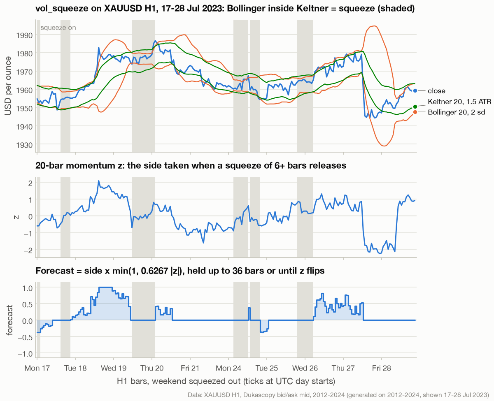
</picture>

*Trades start on the bar a squeeze of at least 6 bars ends, on the side of the 20-bar momentum. The long from the evening of 17 July 2023 ran into the 36-bar limit; the long from 26 July was closed when momentum flipped in the 27 July sell-off. Shorter squeezes are ignored. Data: XAUUSD H1, Dukascopy bid/ask mid, 2012-2024 (shown: 17-28 Jul 2023).*

| Parameter | Default | Meaning |
|---|---|---|
| `n` | `20` | Bollinger/Keltner window (bars), `>= 2`. |
| `bb_k` | `2.0` | Bollinger width (standard deviations). |
| `kc_mult` | `1.5` | Keltner width (ATRs). |
| `atr_n` | `20` | ATR period. |
| `min_squeeze` | `6` | Minimum consecutive squeeze bars before a release counts. |
| `mom_n` | `20` | Momentum horizon (bars). |
| `hold` | `36` | Maximum holding period (bars). |
| `vol_halflife` | `120.0` | EWMA half-life of the momentum normaliser. |
| `vol_min_periods` | `60` | Bars before volatility is defined. |

**Warm-up:** `max(n, atr_n, mom_n, vol_min_periods) + min_squeeze + 1` (67).
**Stateful:** yes.

**References:** Carter (2005), *Mastering the Trade*, ch. 11; Osler (2005), *JIMF* 24(2);
Bollinger (2001).

### `orb`: London and New York opening-range breakout

**Intuition.** The first hour after a major session opens prices in the overnight news and
order flow. A later close outside that first hour's range suggests one side has won the
auction and the session's liquidity may extend the move (Crabel 1990; Zarattini & Aziz 2023).
Gold has two such windows: the London open and the New York open (COMEX, 08:30 ET US data).

**The rules**, per session and per local trading day (weekdays only):

- The opening range (OR) is the high/low of bars whose **open** lies in
  `[open, open + range_minutes)` local time and that **end** by the OR end. Bars longer than
  the range cannot form one: on H4 or D1 the strategy logs a warning and returns 0.
- From the OR end until the local session end, at each close: go long on the first close
  above the OR high, short on the first close below the OR low. At most one entry per session.
- Exit on a close back beyond the opposite side of the OR (or flip, with
  `allow_reversal=True`). Always flat from the session end.
- Optional width filter: skip the session when the OR width is outside
  `[min_range_atr, max_range_atr] × ATR(atr_n)`.
- Each active session contributes `±level`; overlapping sessions add and are capped at ±1:

```math
f_t = \operatorname{clip}\Big(\text{level} \sum_{s \in \text{sessions}} \text{state}_{s,t},\ -1,\ 1\Big)
```

Session times are converted from local wall-clock time with `zoneinfo`, so London and New York
daylight saving time are handled independently. Defaults (`DEFAULT_SESSIONS`): `london` =
`Europe/London` 08:00-16:00 and `new_york` = `America/New_York` 08:00-16:00.

<picture>
  <source media="(prefers-color-scheme: dark)" srcset="_assets/figures/strategies/orb-dark.png">
  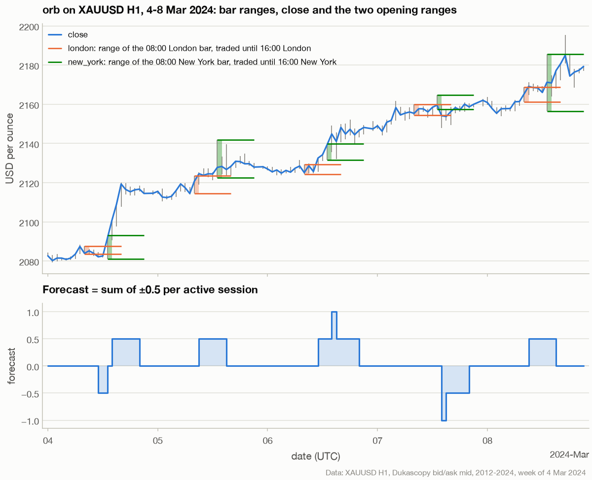
</picture>

*In an ordinary week each session's range is the 08:00 local bar (London 08:00 UTC, New York 13:00 UTC in early March). On 6 March 2024 both sessions were long for one hour (forecast +1); on 7 March both were short (−1). Data: XAUUSD H1, Dukascopy bid/ask mid, 2012-2024 (shown: week of 4 Mar 2024).*

```python
import logging
from aurum.core.types import MarketData
from aurum.data.synthetic import make_synthetic_bars
from aurum.strategies import get_strategy

logging.basicConfig(level=logging.WARNING, format="%(levelname)s %(name)s: %(message)s")
s = get_strategy("orb")
print(s.session_table())
f = s.generate(MarketData(bars=make_synthetic_bars(2_000, "H1", seed=1)))
print("H1: active", f"{(f != 0).mean():.1%}", "| values", sorted(float(v) for v in f.unique()))
f4 = s.generate(MarketData(bars=make_synthetic_bars(500, "H4", seed=1)))
print("H4: all zero?", bool((f4 == 0).all()))
```

```text
{'london': ('Europe/London', '08:00', '16:00'), 'new_york': ('America/New_York', '08:00', '16:00')}
H1: active 33.1% | values [-1.0, -0.5, 0.0, 0.5, 1.0]
WARNING aurum.strategies.breakout: orb: 240-minute bars are longer than the 60-minute opening range; no opening range can form and the forecast is 0 (use H1 or faster bars)
H4: all zero? True
```

| Parameter | Default | Meaning |
|---|---|---|
| `sessions` | `("london", "new_york")` | Sessions to trade (a single string is accepted). |
| `session_times` | `None` | Mapping `name -> (tz, "HH:MM" open, "HH:MM" end)` that overrides or extends the defaults. |
| `range_minutes` | `60` | Opening-range length. Must end before the session end. |
| `level` | `0.5` | Forecast per active session, in `(0, 1]`. |
| `allow_reversal` | `False` | Flip instead of exiting on a close beyond the opposite side. |
| `min_range_atr` | `0.0` | Width filter lower bound (ATRs). |
| `max_range_atr` | `None` | Width filter upper bound (ATRs). `None` = no upper bound. |
| `atr_n` | `24` | ATR period for the width filter. |

**Warm-up:** 0, or `atr_n + 1` when the width filter is enabled. **Stateful:** yes (resets every
session).

**Pitfalls.** On H1 the "opening range" is a single bar, a coarse version of Crabel's 5- to
30-minute ranges; on M15 it is four bars. If no bar fits the opening range over a week or more
of data (for example H1 bars stamped at :30), the rule logs a warning instead of silently
returning zeros. Under the protocol it lost reliably after costs ([RESULTS.md](RESULTS.md)).

**References:** Crabel (1990), *Day Trading with Short Term Price Patterns and Opening Range
Breakout*; Zarattini & Aziz (2023), SSRN 4416622; Osler (2005).

---

## Macro

Module [aurum/strategies/macro.py](../aurum/strategies/macro.py). Gold is a non-yielding,
dollar-denominated asset. Its best documented macro drivers are US real interest rates (the
opportunity cost of holding it; Erb & Harvey 2013) and the US dollar (Capie, Mills & Wood
2005). Gold has also been a short-lived safe haven in equity stress (Baur & Lucey 2010), except
in "dash for cash" squeezes such as March 2020.

**Point-in-time handling.** Each macro series is transformed on its own daily observation
sequence (`clean_macro`: sorted, duplicates keep the last print, non-positive prints dropped
for log series). A derived row is available at the running maximum of its inputs'
`available_at`, and is mapped onto bars with `aurum.data.pit.asof_join` against
`bars["available_at"]`, with a staleness tolerance (`stale_days`). A dead feed therefore
decays to "no signal" instead of being carried forever. A configured series that is missing,
or that has no usable value at the latest bar, is logged once as a WARNING. Warm-up is governed
by the macro history, not by bar counts, so `warmup_bars` is 0 and rows without enough macro
history are 0. Macro sources and their publication lags are in [data.md](data.md).

```python
from aurum.core.types import MarketData
from aurum.data.synthetic import make_synthetic_bars, make_synthetic_macro
from aurum.strategies import get_strategy

bars = make_synthetic_bars(5_000, "H1", seed=3)
md = MarketData(bars=bars, macro=make_synthetic_macro(bars, seed=3))   # dxy, spx, vix, us10y, real10y
mf = get_strategy("macro_factor")
z = mf.series_z(md)                       # signed (x -1) momentum z per series, as of each bar
print(z.dropna().tail(2).round(3))
print("forecast:", mf.generate(md).tail(2).round(3).tolist())
ro = get_strategy("risk_off")
daily = ro.daily_signal(md.macro["vix"])  # on the VIX's own daily observations
print(daily[["z", "forecast", "available_at"]].dropna().tail(2).round({"z": 3, "forecast": 3}))
```

```text
                             dxy  real10y
time                                     
2020-10-26 00:00:00+00:00  0.792   -0.201
2020-10-26 01:00:00+00:00  0.792   -0.201
forecast: [0.262, 0.262]
                               z  forecast              available_at
date                                                                
2020-10-23 00:00:00+00:00  1.173     0.337 2020-10-23 21:30:00+00:00
2020-10-26 00:00:00+00:00  0.422     0.000 2020-10-26 21:30:00+00:00
```

The `macro_factor` line checks by hand: 0.6267 x (0.792 − 0.201) / √2 = 0.262. The `risk_off`
lines show the hysteresis: on 23 October the regime is on and $z$ = 1.173 gives
0.5 x (1.173 − 0.5) = 0.337; on the next print $z$ falls below the 0.5 exit and the forecast is 0.

### `macro_factor`: dollar and real-yield momentum

**Intuition.** Real yields and the dollar move in persistent, policy-driven trends. If both have
been falling over the last week, month and quarter, the opportunity cost of holding gold and
its numeraire are both easing: lean long. If both have been rising, lean short. Using the
drivers' *momentum*, rather than same-day changes, keeps the rule strictly point-in-time.

**The math.** For each series $i$ with configured sign and weight $s_i$:

```math
z_{i,k} = \frac{\mathrm{FDM}}{\lvert \mathcal{H} \rvert} \sum_{h \in \mathcal{H}} \frac{x_{i,k} - x_{i,k-h}}{\sigma_{i,k} \sqrt{h}}, \qquad
\sigma_{i,k} = \sqrt{\mathrm{EWMA}_{H}\left[(x_{i,k} - x_{i,k-1})^2\right]}
```

```math
Z_t = \frac{\sum_{i \in A_t} \lvert s_i \rvert\, \mathrm{sign}(s_i)\, z_{i,k(t)}}{\sqrt{\sum_{i \in A_t} s_i^2}}, \qquad
f_t = \operatorname{clip}\left(0.6267\, Z_t,\ -1,\ 1\right)
```

where

- $x_{i,k}$ is observation $k$ of series $i$: the log value for prices (DXY) and the level for
  yields (names in `DEFAULT_YIELD_SERIES` such as `real10y`, or `attrs["kind"]` of `"yield"`
  or `"rate"`); the choice is made from the name, never from the values,
- $\mathcal{H}$ = `horizons` (5, 20, 60 observations, about a week, a month and a quarter), FDM =
  1.253, the EWMA is the normalised form with half-life $H$ = `vol_halflife` (60 observations)
  and `vol_min_obs` = 20,
- $k(t)$ is the latest observation with `available_at` at or before the bar's `available_at`,
  and $A_t$ is the set of series with such an observation no older than `stale_days` (10),
- the default `series` is `{"dxy": -1.0, "real10y": -1.0}`, so both z's enter with a minus
  sign; with no series available the forecast is 0. DXY and real-yield momentum are positively
  correlated, so $Z_t$ is somewhat more dispersed than N(0, 1).

**The picture.** The 2022 hiking cycle is the textbook macro episode for gold.

<picture>
  <source media="(prefers-color-scheme: dark)" srcset="_assets/figures/strategies/macro-factor-dark.png">
  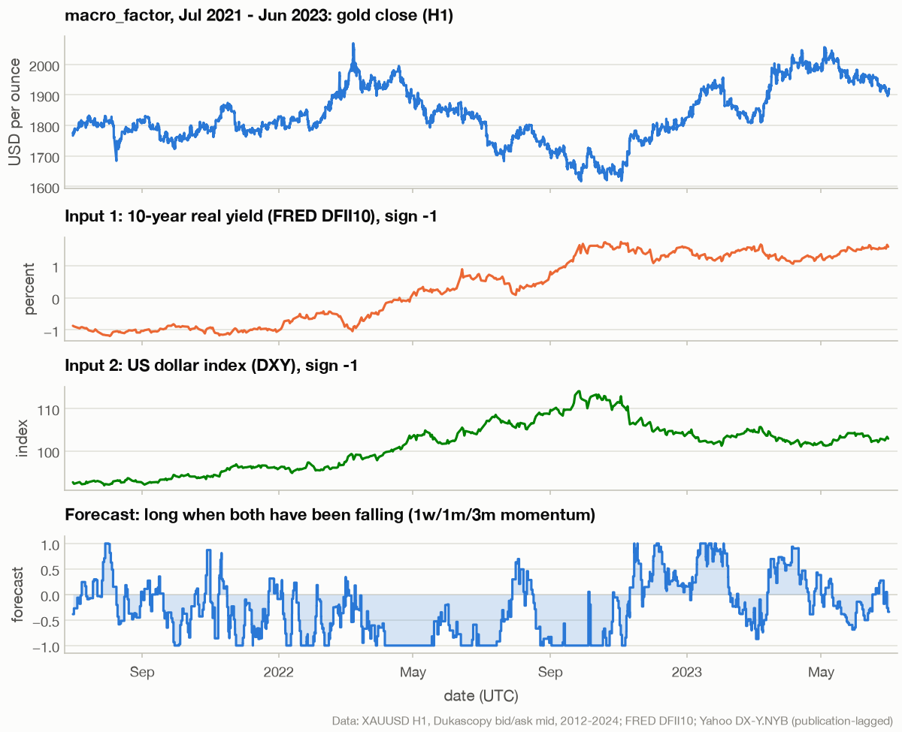
</picture>

*From the start of 2022 to their autumn peaks the real yield rose from −0.97% to 1.74% (3 November) and the dollar index from 96.2 to 114.1 (27 September): the forecast was below zero on 79% of 2022's hours, with long stretches at −1. It turned long in mid-November 2022 (first above +0.5 on 14 November) as both came off their peaks. Data: XAUUSD H1, Dukascopy bid/ask mid, 2012-2024; FRED DFII10; Yahoo DX-Y.NYB (publication-lagged), shown Jul 2021-Jun 2023.*

| Parameter | Default | Meaning |
|---|---|---|
| `series` | `{"dxy": -1.0, "real10y": -1.0}` | Macro series name → sign (and weight) of gold's exposure. |
| `horizons` | `(5, 20, 60)` | Momentum horizons in **observations**. |
| `vol_halflife` | `60.0` | EWMA half-life (observations) of the change volatility. |
| `vol_min_obs` | `20` | Observations before volatility is defined. |
| `stale_days` | `10.0` | Staleness tolerance of the as-of join (days). |

**Warm-up:** 0 (see above). **Stateful:** no.

**Pitfalls.** The relationship between gold and real yields is famous and unstable: in 2023
gold rallied back above 2,000 while real yields stayed near their highs (visible in the
figure), which a fixed sign cannot follow. The publication lag matters: FRED series are available about a US business
day later, so using same-day values would be look-ahead.

**References:** Erb & Harvey (2013), "The Golden Dilemma", *FAJ* 69(4); Capie, Mills & Wood
(2005), *JIFMIM* 15(4); Barsky & Summers (1988), *JPE* 96(3).

### `risk_off`: VIX-spike safe-haven regime (long only)

**Intuition.** After acute equity stress gold tends to gain for days to weeks as investors
rotate into perceived safety (Baur & Lucey 2010). A jump of the VIX far above its own recent
baseline marks the onset. But in a "dash for cash", leveraged holders sell gold for dollars,
so the rule stands aside while the dollar itself is spiking. It is long only by design: calm
markets carry no symmetric short signal.

**The math** (daily, on the VIX's own observations):

```math
z_k = \frac{\ln V_k - m_{k-1}}{s_{k-1}}, \qquad
\text{on: } z_k > z_{\mathrm{in}}, \quad \text{off: } z_k < z_{\mathrm{out}}, \qquad
f_k = \text{on}_k \times \operatorname{clip}\left(0.5\, \frac{z_k - z_{\mathrm{out}}}{z_{\mathrm{in}} - z_{\mathrm{out}}},\ 0,\ 1\right)
```

```math
f_t = 0 \quad \text{whenever} \quad z^{\mathrm{DXY}}_{k(t)} > z_{\max}
```

where

- $V_k$ is the VIX print, $m$ and $s$ are its exponentially weighted mean and standard
  deviation of log VIX (pandas `ewm(halflife=60, adjust=True)` `.mean()` and `.std()`,
  `min_obs` = 40) up to the **previous** print,
- $z_{\mathrm{in}}$ = `entry_z` (1.5), $z_{\mathrm{out}}$ = `exit_z` (0.5), latched with the same
  `latch` as the mean-reversion rules (an undefined $z$ also exits): the forecast is 0.5 at the
  entry threshold, larger for bigger spikes, and decays as fear subsides,
- $z^{\mathrm{DXY}}$ is the 5-observation (`dxy_horizon`) vol-normalised DXY momentum, with the
  same half-life and minimum observations, and $z_{\max}$ = `dxy_z_max` (2.0); the filter is off
  with `None` or when DXY is missing,
- both daily series are mapped to bars as of `available_at` with the `stale_days` tolerance.

<picture>
  <source media="(prefers-color-scheme: dark)" srcset="_assets/figures/strategies/risk-off-dark.png">
  
</picture>

*The VIX spike switched the regime on at the 24 February 2020 print (forecast +1, gold at 1,660), and the long rode the sell-off down to 1,530 by 13 March: in a dash for cash the safe haven fell too. From 15 to 24 March the dollar's 5-day momentum exceeded 2 sigma and the forecast was forced to 0 (shaded), through the 16 March low (1,456) and most of the rebound to 1,632; it resumed at 0.84 and decayed to 0 by 29 April. Data: XAUUSD H1, Dukascopy bid/ask mid, 2012-2024; Yahoo ^VIX, DX-Y.NYB (publication-lagged), shown Jan-May 2020.*

| Parameter | Default | Meaning |
|---|---|---|
| `vix_series` | `"vix"` | Name of the VIX series in `md.macro`. |
| `dxy_series` | `"dxy"` | Name of the dollar-index series. |
| `halflife` | `60.0` | EWMA half-life (observations) of the VIX baseline. |
| `min_obs` | `40` | Observations before the baseline is defined. |
| `entry_z` | `1.5` | Regime-on threshold. Must be `> exit_z`. |
| `exit_z` | `0.5` | Regime-off threshold. |
| `dxy_z_max` | `2.0` | Dollar-squeeze filter threshold. `None` disables it. |
| `dxy_horizon` | `5` | DXY momentum horizon (observations). |
| `stale_days` | `10.0` | Staleness tolerance of the as-of join (days). |

**Warm-up:** 0. **Stateful:** yes (hysteresis on daily observations).

**Pitfalls.** Episodes are rare (the rule is active 13.7% of 2013-2024 hours, see the table in
[Forecast scaling](#forecast-scaling-one-convention-for-every-rule)), so any performance
number rests on a handful of events. The filter's 2.0 threshold was not fitted to March 2020,
but anyone extending the rule after looking at this chart would be fitting to it.

**References:** Baur & Lucey (2010), *Financial Review* 45(2); Baur & McDermott (2010), *JBF*
34(8); Whaley (2000), *JPM* 26(3).

---

## Learned seasonality: `intraday_seasonality`

Module [aurum/strategies/seasonal.py](../aurum/strategies/seasonal.py). The only trainable
strategy among the rules.

**Intuition.** Gold's order flow runs on a clock: Asian physical buying, the London open and
LBMA auctions, the COMEX open and 08:30 ET US data, the 17:00 ET rollover, Friday de-risking.
Recurring liquidity demand can produce small, repeatable return patterns by hour of the week
(Heston, Korajczyk & Sadka 2010; Cai, Cheung & Wong 2001 for COMEX gold). They are small
relative to noise, so the estimates must be shrunk hard, and small relative to a CFD's spread,
so positions must be chosen net of costs. The strategy learns a table "hour of the week →
position" on the training data and then simply reads the clock.

<picture>
  <source media="(prefers-color-scheme: dark)" srcset="_assets/figures/strategies/seasonal-profile-dark.png">
  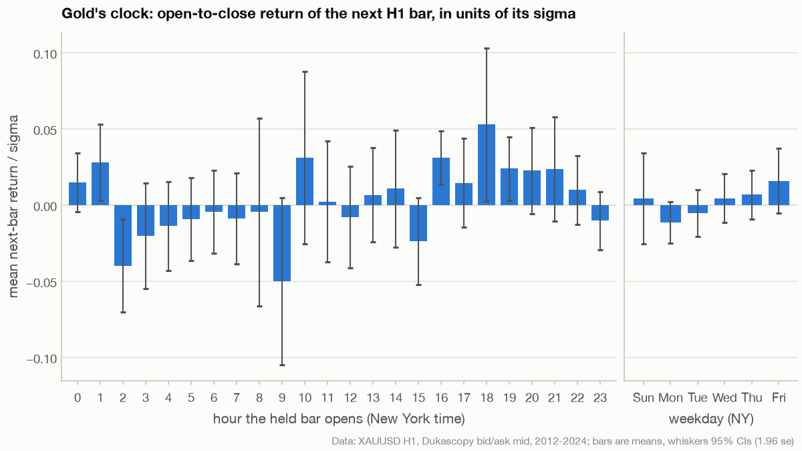
</picture>

*The raw material, on all 2012-2024 hours: the open-to-close return of the bar held after each decision, by the New York hour it opens and by weekday, in units of that bar's volatility. Five of the 24 hourly intervals exclude zero (01, 02, 16, 18 and 19 NY), against about 1.2 expected by chance at 95%; the 08:00-10:00 intervals are wide because US data hours are volatile. Data: XAUUSD H1, Dukascopy bid/ask mid, 2012-2024.*

**The math of `fit`** (training bars only):

```math
y_t = \frac{\ln\left(C_{t+1} / O_{t+1}\right)}{\sigma_t}, \qquad
b(t) = 1440\, \mathrm{wd}(\tau_t) + B \left\lfloor \frac{\mathrm{minute}(\tau_t)}{B} \right\rfloor
```

where $y_t$ is the vol-normalised open-to-close return of the bar the position will actually
hold, $\tau_t$ is `available_at[t]` on the New York clock (DST-aware), wd its weekday and minute
its minute of the day, and $B$ = `bucket_minutes` (60). Buckets seen fewer than `min_obs` (30)
times are dropped. With $n_b$, $m_b$, $v_b$ the count, mean and variance of bucket $b$:

```math
\mathrm{se}_b^2 = \frac{v_b}{n_b}, \quad w_b = \frac{1}{\mathrm{se}_b^2}, \quad
\hat{\mu} = \frac{\sum_b w_b m_b}{\sum_b w_b}, \quad
Q = \sum_b w_b (m_b - \hat{\mu})^2
```

```math
F = \frac{Q / (K-1)}{1 + \frac{2(K-2)}{K^2 - 1} \lambda}, \quad
\lambda = \sum_b \frac{(1 - w_b / \sum w)^2}{n_b - 1}, \qquad
p = 1 - F_{K-1,\ (K^2-1)/(3\lambda)}(F)
```

```math
\tau^2 = \max\left(0,\ \frac{Q - (K-1)}{\sum w_b - \sum w_b^2 / \sum w_b}\right), \quad
B_b = \frac{\tau^2}{\tau^2 + \mathrm{se}_b^2}, \quad
e_b = B_b (m_b - \hat{\mu}), \quad
c = \frac{0.5\, \sum_b n_b}{\sum_b n_b \lvert e_b \rvert}
```

where

- the per-bucket variance is used (gold's hourly volatility varies about 3x across the week; a
  pooled variance made volatile hours look like mean effects and rejected 15% of the time at a
  nominal 5% on real 2012-15 labels, as recorded in the code), with the pooled variance as a
  fallback for a degenerate bucket,
- $F$ and $p$ are Welch's heteroskedastic one-way ANOVA of "all bucket means equal" over the
  $K$ buckets; unless $p$ < `significance` (0.05) the table is flat ($B_b$ = 0). With
  `demean=False` the null is "all means zero" and $Q \sim \chi^2_K$,
- $\tau^2$ is the DerSimonian & Laird moment estimator of the between-bucket variance and $B_b$
  the empirical-Bayes shrinkage (noisy buckets are shrunk harder); a numeric `shrinkage`
  $\Lambda$ uses $B_b = n_b / (n_b + \Lambda)$ instead,
- $c$ scales the effects so their average absolute forecast is 0.5; the frictionless table is
  $\operatorname{clip}(c\, e_b, -1, 1)$.

**Cost-aware positions** (`cost_aware=True`). The per-bucket cost $\kappa_b$ is the training
average of half the effective spread plus slippage and commission per ounce of the bar the
position would be filled on, divided by the close and by $\sigma_t$ (the same volatility units
as the edge). Positions then solve a periodic mean-variance problem over the weekly cycle by
dynamic programming on an 81-point grid in $[-1, 1]$:

```math
\max_{f_b \in \lbrace -1, -0.975, \dots, 1 \rbrace} \sum_{b} \left[ f_b e_b - \frac{\gamma}{2} f_b^2 - \Lambda_c \kappa_b \lvert f_b - f_{b-1} \rvert \right], \qquad \gamma = 1 / c
```

where $\Lambda_c$ = `cost_multiplier` (2.0) and the sum wraps around the week. Without costs
the optimum is $f_b = e_b / \gamma = c\, e_b$, the frictionless table; with costs the solution
is a no-trade band: a position change must earn $\Lambda_c$ times its cost, adjacent same-sign
buckets are held as one position, and a lone bucket only trades if its edge clears the
round-trip cost by the margin.

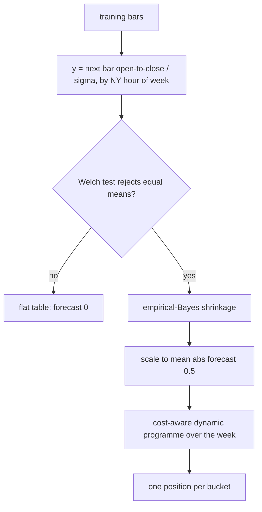

<picture>
  <source media="(prefers-color-scheme: dark)" srcset="_assets/figures/strategies/seasonal-table-dark.png">
  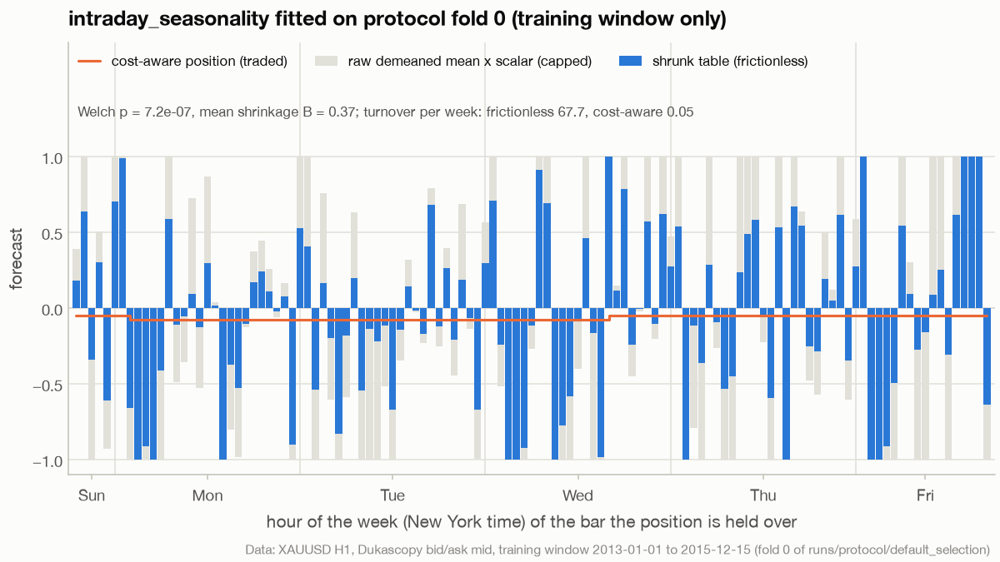
</picture>

*Fitted on the training window of protocol fold 0 (2013-01-01 to 2015-12-15): the Welch test rejects equal means (p = 7.2e-07) and the shrunk table still swings between ±1 from hour to hour, but after costs the dynamic programme holds an almost constant small short (−0.05 to −0.075) and weekly turnover drops from 67.7 to 0.05. Data: XAUUSD H1, Dukascopy bid/ask mid, training window 2013-01-01 to 2015-12-15 (fold 0 of `runs/protocol/default_selection`).*

**`generate`** is a pure function of the bar timestamps and the fitted table, so it is
trivially point-in-time. A bucket not seen in training holds the preceding bucket's position.
Financing is **not** modelled in the fit. The diagnostics are in `fit_summary_` (test statistic
and p-value, `tau2`, mean shrinkage, active buckets, expected turnover, gross edge and cost per
week, and the frictionless turnover for comparison).

```python
from aurum.core.types import MarketData
from aurum.data.synthetic import make_synthetic_bars
from aurum.strategies import get_strategy

md = MarketData(bars=make_synthetic_bars(20_000, "H1", seed=3))   # no clock effects by construction
s = get_strategy("intraday_seasonality").fit(md)
fs = s.fit_summary_
print({k: fs[k] for k in ("n_buckets", "test", "heterogeneous", "n_active")}, "p =", round(fs["q_pvalue"], 3))
print("forecast values:", sorted(set(s.generate(md).round(3))))
```

```text
{'n_buckets': 120, 'test': 'welch', 'heterogeneous': False, 'n_active': 0} p = 0.838
forecast values: [0.0]
```

| Parameter | Default | Meaning |
|---|---|---|
| `tz` | `"America/New_York"` | Clock used for the buckets. |
| `bucket_minutes` | `60` | Bucket width, in `[1, 1440]`. |
| `shrinkage` | `"empirical_bayes"` | Or a non-negative prior strength in observations. |
| `demean` | `True` | Remove the training-period average drift (pure timing signal). |
| `min_obs` | `30` | Buckets seen fewer times forecast 0 / are held through. |
| `significance` | `0.05` | Level of the homogeneity pre-test. `None` disables the test. |
| `cost_aware` | `True` | Choose positions net of costs. `False` = the frictionless table. |
| `costs` | `None` | `CostModel` or its keyword arguments. `None` = `CostModel()` defaults. |
| `cost_multiplier` | `2.0` | Required edge/cost margin. `0` = frictionless. |
| `dead_zone` | `"auto"` | `"auto"` = the cost-implied threshold only. A number in `[0, 1)` also zeroes every forecast whose absolute value is below it. |
| `vol_halflife` | `240.0` | EWMA half-life of the volatility normaliser. |
| `vol_min_periods` | `120` | Bars before volatility is defined. |

**Warm-up:** 0 (the forecast is a function of the clock). **Stateful:** no. `generate` raises
`RuntimeError` if called before `fit`.

**Pitfalls and design choices.** Testing 24 or 120 buckets invites false discoveries, hence
the pre-test and the shrinkage; the profile figure shows how wide the honest intervals are.
Even a statistically real pattern can be worth nothing after costs: out of sample the strategy
traded in only 3 of 18 protocol folds (see the [ML figure](#machine-learning-and-rl-the-forecast-contract-of-ml_gbm-meta_label-rl_ppo)).
Costs come from [execution-and-costs.md](execution-and-costs.md).

**References:** Heston, Korajczyk & Sadka (2010), *JF* 65(4); Cai, Cheung & Wong (2001),
*JFM* 21(3); Efron & Morris (1975), *JASA* 70; DerSimonian & Laird (1986); Welch (1951),
*Biometrika* 38; Garleanu & Pedersen (2013), *JF* 68(6); McLean & Pontiff (2016), *JF*
71(1); Carver (2015).

---

## Machine learning and RL: the forecast contract of `ml_gbm`, `meta_label`, `rl_ppo`

These three have their own page, [ml-and-rl.md](ml-and-rl.md), which covers the labels,
weights, validation, calibration and training. Here is only how each one turns its model
output into a forecast that obeys the contract above.

**Intuition.** A classifier outputs a probability, not a position. `ml_gbm` turns "probability
that the next move is up" into a signed forecast; `meta_label` lets a simple primary rule
(default `tsmom`) choose the side and uses the classifier's "probability that this bet works"
only to size it; `rl_ppo` outputs one of a few discrete exposure levels directly. Both
classifiers are scaled on a validation tail and stay **flat** unless the validation AUC beats
0.5 by a margin (the skill gate), because Carver scaling would otherwise blow pure noise up to
full size.

**The math.**

```math
\text{ml\_gbm:}\quad f = \operatorname{clip}\left(c \cdot \mathrm{DZ}(2p - 1),\ -1,\ 1\right), \qquad
\mathrm{DZ}(x) = \mathrm{sign}(x)\, \frac{\max(\lvert x \rvert - \delta,\ 0)}{1 - \delta}
```

```math
\text{meta\_label:}\quad z = \frac{p - 1/2}{\sqrt{p(1-p)}}, \quad m = 2\Phi(z) - 1, \quad
f = \mathrm{sign}(f^{\mathrm{primary}}) \cdot \mathrm{round}_{0.1}\left(\operatorname{clip}(c\, m\, [p \ge p^{*}],\ 0,\ 1)\right)
```

where

- $p$ is the calibrated probability (Platt by default), $\delta$ = `dead_zone` (0.02 for
  `ml_gbm`) so coin flips give exactly 0 and the map stays continuous,
- $c$ is the Carver scalar fixed at fit time so that the mean absolute forecast on the
  validation tail is `target_abs_forecast` (0.5), capped at `max_forecast_scalar` (20), and set
  to **0** unless the validation AUC exceeds 0.5 by `skill_gate_z` = 2 standard errors
  (uniqueness-adjusted, Hanley & McNeil 1982),
- $\Phi$ is the normal CDF (AFML snippet 10.1), $p^{*}$ = `p_threshold` (0.5; the bet never
  reverses the primary), and $\mathrm{round}_{0.1}$ is `step_size` discretisation (AFML 10.3),
- `rl_ppo`'s forecast at $t$ is the deterministic policy's action on the observation at the
  close of $t$, one of the discrete levels {−1, −0.5, 0, 0.5, 1} by default, computed by rolling
  the policy forward with its own simulated account.

<picture>
  <source media="(prefers-color-scheme: dark)" srcset="_assets/figures/strategies/ml-forecast-maps-dark.png">
  
</picture>

*Top: the mapping functions exactly as coded. Bottom: what the gates did in the pre-registered run. `ml_gbm` was flat in all 18 folds, `meta_label` traded in 5 folds and `intraday_seasonality`'s cost-aware table was non-zero in 3. Data: top panels computed from the code; bottom panel `runs/protocol/default_selection`, walk-forward OOS 2015-12-17 to 2024-12-31 (18 folds).*

```python
import numpy as np
from aurum.strategies.ml import apply_dead_zone, bet_size_from_probability, discretize_bet

p = np.array([0.45, 0.50, 0.52, 0.55, 0.60, 0.70])
print("ml_gbm   2p-1 after dead zone 0.02:", np.round(apply_dead_zone(2 * p - 1, 0.02), 3))
m = np.where(p >= 0.5, np.maximum(bet_size_from_probability(p), 0.0), 0.0)
print("meta_label m = 2 Phi(z) - 1:      ", np.round(m, 3))
print("meta_label after step 0.1:        ", discretize_bet(m, 0.1))
```

```text
ml_gbm   2p-1 after dead zone 0.02: [-0.082  0.     0.02   0.082  0.184  0.388]
meta_label m = 2 Phi(z) - 1:       [0.    0.    0.032 0.08  0.162 0.337]
meta_label after step 0.1:         [0.  0.  0.  0.1 0.2 0.3]
```

(These are before the fitted scalar $c$; the strategies multiply by it.) `rl_ppo` has no
policy until one is trained or attached, and v2.1 refuses a pre-trained policy without
`artifact_dir`:

```python
from aurum.strategies import get_strategy

s = get_strategy("rl_ppo")
print(s.params, "| warmup_bars:", s.warmup_bars, "| trainable:", s.trainable)
try:
    get_strategy("rl_ppo", retrain=False)
except ValueError as exc:
    print("ValueError:", exc)
```

```text
{'artifact_dir': None, 'retrain': True, 'artifact_sha256': None, 'config': None, 'val_fraction': 0.25, 'min_val_bars': 500, 'out_dir': None, 'device': 'cpu', 'episode_anchor': 'auto'} | warmup_bars: 0 | trainable: True
ValueError: rl_ppo: retrain=False needs params.artifact_dir (there is no policy to load)
```

New in v2.1 for `rl_ppo`: `retrain` (unset means `False` when `artifact_dir` is given at
construction, else `True`) and `artifact_sha256` (a pin of 8 or more hex digits). With
`retrain=False`, `fit` verifies the attached artifact and does not train, and a look-ahead
guard refuses any fold whose training window ends before the artifact's recorded
training/validation end. Details, the parameter tables and the evidence are in
[ml-and-rl.md](ml-and-rl.md#parameters-of-the-ml-strategies) and
[ml-and-rl.md](ml-and-rl.md#the-rl_ppo-strategy-adapter).

---

## Managed exposure: `managed_gold` (v2.1)

Module [aurum/strategies/allocation.py](../aurum/strategies/allocation.py). Long-only by
default, not trainable, exploratory (it is not one of the pre-registered configurations).

**Intuition.** The pre-registered run found no demonstrated *alpha* in the long/short rules,
while gold's own drift dominated the sample. The institutional answer to "I want gold, but not
all of its drawdowns" is not an alpha model but a **managed exposure**: hold a strategic long
allocation, tilt it with the trend, and cut it to cash when price is in a downtrend *and*
volatility is unusually high, the regime where staying invested has historically paid the least
(Faber 2007's moving-average timing; the volatility-managed portfolios of Moreira & Muir 2017;
the trend overlays of Hurst, Ooi & Pedersen 2017). A latch with two different thresholds keeps
the switch from flickering.

**The math.**

```math
\text{trend}_t = \operatorname{clip}\Big(\mathrm{FDM} \sum_{h \in \mathcal{H}} \tfrac{1}{\lvert \mathcal{H} \rvert}\, 0.6267\, z_{h,t},\ -1,\ 1\Big), \qquad
\text{raw}_t = \beta + \theta\, \text{trend}_t
```

```math
\rho_t = \frac{\sigma^{\mathrm{fast}}_t}{\sigma^{\mathrm{slow}}_t}, \qquad
\text{enter}_t = \left[\ln C_t < \mathrm{EMA}_t\right] \wedge \left[\rho_t \ge v_{\mathrm{in}}\right], \qquad
\text{exit}_t = \left[\ln C_t \ge \mathrm{EMA}_t\right] \vee \left[\rho_t < v_{\mathrm{out}}\right]
```

```math
d_t = \mathrm{latch}(\text{enter}, \text{exit})_t, \qquad
\text{raw}'_t = \begin{cases} \min(\text{raw}_t,\ \text{floor}) & d_t = 1 \\ \text{raw}_t & d_t = 0 \end{cases}, \qquad
f_t = \operatorname{clip}\left(\text{raw}'_t,\ L,\ 1\right)
```

where

- $z_{h,t}$ is the `tsmom` statistic (`momentum_z` with `bar_volatility`, half-life
  `vol_halflife`), $\mathcal{H}$ = `horizons`, equally weighted; FDM = 1.242 for the default
  four horizons (the same for H1 and daily horizons),
- $\beta$ = `base_weight` (0.5) and $\theta$ = `tilt_weight` (0.5), so without a de-risk the
  forecast spans $[0, 1]$; an undefined trend counts as 0,
- EMA is the normalised exponential moving average of $\ln C$ with half-life `trend_halflife`
  (`ewma_mean`, minimum periods one half-life), roughly a "200-day" average,
- $\sigma^{\mathrm{fast}}$, $\sigma^{\mathrm{slow}}$ are `bar_volatility` with half-lives
  `vol_fast_halflife` and `vol_slow_halflife`, so $\rho \approx 1$ in a stationary market,
- $v_{\mathrm{in}}$ = `vol_enter` (1.25) and $v_{\mathrm{out}}$ = `vol_exit` (1.0), with
  `0 < vol_exit <= vol_enter`; enter and exit cannot both fire on one bar, and while the
  inputs are undefined the state is held,
- `floor` = 0 (cash) and $L$ is 0, or −1 with `allow_short=True`.

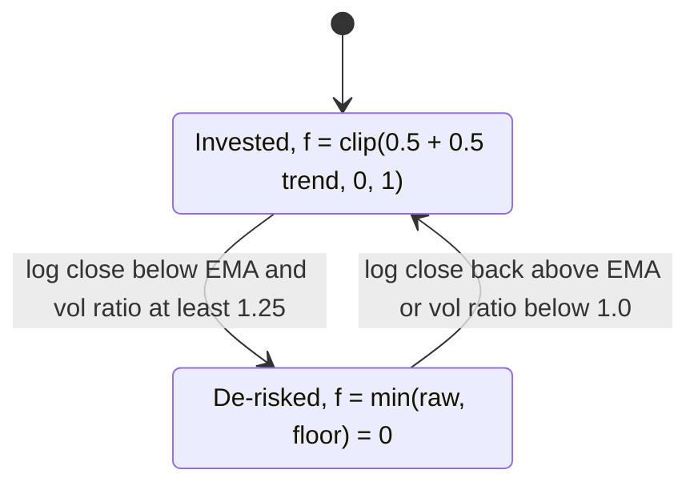

The gap between the two thresholds is the hysteresis: once de-risked, volatility has to fall
all the way back to its long-run level (ratio below 1.0), or price has to recover its EMA,
before the allocation comes back; a ratio hovering around 1.25 cannot toggle it every bar.

**The picture.** Defaults are for H1 bars (5,796 a year); the daily configuration
[configs/managed_gold.yaml](../configs/managed_gold.yaml) restates them in trading days
(horizons 21/63/126/252, EMA half-life 69, vol half-lives 5 and 126, momentum volatility
half-life 30 with 20 minimum periods). The figure uses that configuration on New York close
daily bars.

<picture>
  <source media="(prefers-color-scheme: dark)" srcset="_assets/figures/strategies/managed-gold-dark.png">
  
</picture>

*De-risked on 8.1% of days in 2013-2024 (251 days), 176 of them in the 2013-2015 bear market, when price was below its EMA and volatility spiked; in 2016-2024 the share is 3.2%. With these parameters the full-history forecast matches the walk-forward run's stored out-of-sample forecast on all 2,322 OOS days (largest difference 1.0e-9). Data: XAUUSD D1 (New York close, 22:00 UTC), Dukascopy bid/ask mid, 2013-2024; parameters of `configs/managed_gold.yaml`.*

**In code.** [`ManagedGold`](../aurum/strategies/allocation.py); `components(md)` returns every
intermediate series of the rule (for reports, docs and the dashboard).

```python
from aurum.core.types import MarketData
from aurum.data.synthetic import make_synthetic_bars
from aurum.strategies import get_strategy

md = MarketData(bars=make_synthetic_bars(3_000, "D1", seed=5))
mg = get_strategy("managed_gold", horizons=(21, 63, 126, 252), trend_halflife=69,   # configs/managed_gold.yaml
                  vol_fast_halflife=5, vol_slow_halflife=126, vol_halflife=30, vol_min_periods=20)
print("warmup_bars:", mg.warmup_bars, "| FDM:", round(mg.combination()[1], 3))
c = mg.components(md).iloc[mg.warmup_bars:]
print(c.columns.tolist())
print(f"de-risked {c['derisk'].mean():.1%} of bars | mean forecast {c['forecast'].mean():.3f}")
print(c[["trend", "vol_ratio", "derisk", "raw", "forecast"]].tail(3).round(3))
```

```text
warmup_bars: 253 | FDM: 1.242
['trend', 'tilt', 'ema', 'below_ema', 'vol_ratio', 'derisk', 'raw', 'forecast']
de-risked 8.2% of bars | mean forecast 0.567
                           trend  vol_ratio  derisk    raw  forecast
time                                                                
2031-07-02 00:00:00+00:00  0.998      0.652     0.0  0.999     0.999
2031-07-03 00:00:00+00:00  1.000      0.658     0.0  1.000     1.000
2031-07-04 00:00:00+00:00  1.000      0.797     0.0  1.000     1.000
```

| Parameter | Default (H1) | Daily config | Meaning |
|---|---|---|---|
| `base_weight` | `0.5` | `0.5` | Strategic forecast when the trend is flat. In `[0, 1]` (`[-1, 1]` with `allow_short`). |
| `tilt_weight` | `0.5` | `0.5` | Multiplier of the Carver-scaled trend in `[-1, 1]`, in `[0, 2]`. |
| `horizons` | `(480, 1440, 2880, 5796)` | `[21, 63, 126, 252]` | Momentum lookbacks (about 1, 3, 6, 12 months). |
| `trend_halflife` | `1600.0` | `69` | Half-life of the EMA of log price defining the downtrend (about 70 trading days). |
| `vol_fast_halflife` | `120.0` | `5` | Fast volatility half-life (about 1 week). Must be below the slow one. |
| `vol_slow_halflife` | `2880.0` | `126` | Slow volatility half-life (about 6 months). |
| `vol_enter` | `1.25` | `1.25` | De-risk when the vol ratio is at least this (and price is below the EMA). |
| `vol_exit` | `1.0` | `1.0` | Re-risk when the ratio falls below this (or price regains the EMA). |
| `floor` | `0.0` | `0.0` | Cap on the forecast while de-risked (0 = cash). |
| `allow_short` | `False` | – | Lower bound −1 instead of 0. |
| `vol_halflife` | `240.0` | `30` | EWMA half-life of the momentum normaliser. |
| `vol_min_periods` | `120` | `20` | Bars before that volatility is defined. |

**Warm-up:** the longest horizon, one EMA half-life, one slow-vol half-life and
`vol_min_periods`, plus one: `max(5796, 1600, 2880, 120) + 1` = 5797 on the H1 defaults, 253 with
the daily configuration. **Stateful:** yes (the de-risk latch).

**Pitfalls and design choices.**

- *Path dependence is not look-ahead.* The latch state and the normalised EMAs depend on where
  the history window starts: a short live window can disagree with the full-history state until
  the first latch exit, or until the EMAs have seen a few half-lives. Every value still uses
  closes up to $t$ only, and the leakage harness checks exactly that. The figure's agreement
  with the walk-forward (largest difference 1.0e-9) shows the convergence on real data.
- *It is an allocation, not an alpha claim.* With the default 10% volatility target a forecast
  of 0.5 holds about 5% annualised volatility of gold, a third of a fully invested position.
  It should be judged against buy-and-hold, not against zero.
- *Result.* In the exploratory daily walk-forward (2016-2024, 18 folds, costs and financing
  included) `managed_gold` had a Sharpe ratio of 0.19 (95% CI −0.54 to 0.88, DSR 0.061) with a
  −14.5% maximum drawdown and an average forecast of 0.62, against 0.51 and −30.5% for
  buy-and-hold over the same days: shallower drawdowns, but no better risk-adjusted return. See
  [RESULTS.md](RESULTS.md); every configuration of it evaluated on real data is a new trial.

**References:** Faber (2007), *J. Wealth Management* 9(4); Moreira & Muir (2017), *JF* 72(4);
Harvey et al. (2018), "The Impact of Volatility Targeting", *JPM* 45(1); Clare et al. (2016);
Moskowitz, Ooi & Pedersen (2012); Hurst, Ooi & Pedersen (2017); Baur & Lucey (2010); Erb &
Harvey (2013); Carver (2015).

---

## Regime conditioning: `regime_switch` (v2.1)

Module [aurum/strategies/regime.py](../aurum/strategies/regime.py). Trainable, exploratory. The
hidden Markov model itself is [aurum/models/regime.py](../aurum/models/regime.py), described
with the other statistical models in [models.md](models.md).

**Intuition.** Trend following makes its money when moves are orderly and loses it in violent,
whipsawing markets where stops and reversals pile up (Daniel & Moskowitz 2016). Markets seem
to alternate between calm and turbulent phases whose volatility differs by a factor of two to
four (Hamilton 1989). A two-state hidden Markov model learns those two phases from the training
returns without hand-picked thresholds; every day it updates the probability that the market
is now in the turbulent ("chaotic") state, using only returns up to that day. The strategy
passes the base trend forecast through in full when calm is likely, scales it down as chaos
becomes likely, and is flat once chaos is at least as likely as calm.

**The model.** Daily log returns in percent, $r_k = 100\,(\ln C_k - \ln C_{k-1})$, are generated
by a hidden state $s_k \in \lbrace 0, 1\rbrace$ that follows a Markov chain:

```math
P(s_k = j \mid s_{k-1} = i) = A_{ij}, \qquad
r_k \mid s_k = j \ \sim\ N(\mu_j, \sigma_j^2), \qquad
b_j(r) = \frac{1}{\sqrt{2\pi\sigma_j^2}} \exp\left(-\frac{(r - \mu_j)^2}{2\sigma_j^2}\right)
```

**The forward filter** (causal: no smoother, no Viterbi):

```math
\hat{\alpha}_0 \propto \pi \odot b(r_0), \qquad
\hat{\alpha}_k \propto \left(A^{\top} \hat{\alpha}_{k-1}\right) \odot b(r_k), \qquad
\hat{\alpha}_k = P(s_k \mid r_0, \dots, r_k)
```

```math
p^{\mathrm{ok}}_k = 1 - \hat{\alpha}_k[\text{chaotic}], \qquad
\text{scale}_k = \operatorname{clip}\left(\frac{p^{\mathrm{ok}}_k - p_{\mathrm{flat}}}{p_{\mathrm{full}} - p_{\mathrm{flat}}},\ 0,\ 1\right), \qquad
f_t = f^{\mathrm{base}}_t \times \text{scale}_{k(t)}
```

where

- $\pi$ is the fitted initial distribution and $\odot$ is element-wise multiplication; each step
  is normalised to sum to 1 (Rabiner's scaling, so nothing underflows), and a missing return
  contributes no likelihood ($b = 1$: the prior is only propagated),
- the states are sorted by variance after fitting, so state 0 is calm and the highest-variance
  state is "chaotic"; with two states $p^{\mathrm{ok}}$ = P(calm),
- $p_{\mathrm{flat}}$ = `p_flat` (0.5) and $p_{\mathrm{full}}$ = `p_full` (0.9), with
  `0 <= p_flat < p_full <= 1` (`regime_scale`),
- $k(t)$ is the latest return observation whose `available_at` is at or before the bar's
  `available_at` (`asof_join`): a day's probability becomes usable at that day's close, and
  intraday bars only ever see completed days,
- $f^{\mathrm{base}}$ is the base strategy's forecast, `tsmom` with its own defaults unless
  `base` / `base_params` say otherwise (any registered strategy except `regime_switch`; a
  trainable base is fitted on the same slice).

**Fitting** is Baum-Welch EM on the TRAINING returns only (`GaussianHMM(n_states=2, seed=0,
n_init=3)`). The E-step runs the scaled forward-backward recursions to get the smoothed state
probabilities $\gamma_k(j)$ and the expected transition counts $\xi_k(i,j)$; the M-step sets

```math
A_{ij} = \frac{\sum_k \xi_k(i,j)}{\sum_{j'} \sum_k \xi_k(i,j')}, \qquad
\mu_j = \frac{\sum_k \gamma_k(j)\, r_k}{\sum_k \gamma_k(j)}, \qquad
\sigma_j^2 = \max\left(\frac{\sum_k \gamma_k(j)\, (r_k - \mu_j)^2}{\sum_k \gamma_k(j)},\ 10^{-3}\, \mathrm{Var}(r)\right)
```

with $\pi = \gamma_0$ and $\mathrm{Var}(r)$ the training variance. It stops when the log-likelihood improves by less than $10^{-4}$ (at most 200 iterations), and
keeps the best of 3 restarts (the first starts from a deterministic quantile split on squared standardised returns, the others perturb it). The smoother
is used only inside the training window, for estimation, never for decisions. With fewer than
`min_train_obs` (60) finite training returns, or if every restart fails, the strategy abstains
(forecast 0) and logs a warning. The expected time in a state is $1/(1 - A_{jj})$ observations.

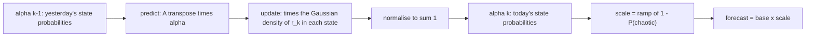

For intraday bars (`returns="auto"` below D1, or `"daily"`) the returns come from complete daily
bars built point-in-time by `resample_bars` with the bucket boundary at
`daily_anchor_hour_utc` = 22 (the New York close); for daily bars (or `returns="bar"`) the bar
returns are used.

<picture>
  <source media="(prefers-color-scheme: dark)" srcset="_assets/figures/strategies/regime-ramp-dark.png">
  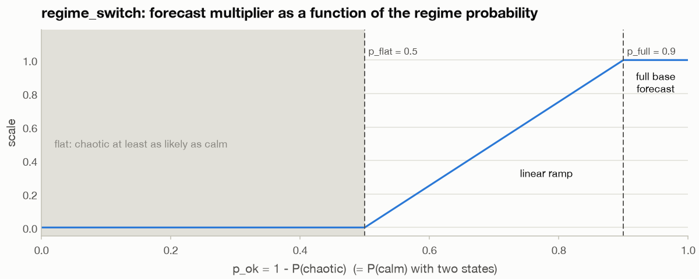
</picture>

*The forecast multiplier as a function of $p^{\mathrm{ok}}$: flat while chaos is at least as likely as calm, linear in between (no jump at a threshold), the full base forecast once calm has probability 0.9 or more. Data: none; this is `regime_scale` with the default thresholds.*

**The picture.** The figure re-fits the HMM on each fold's 3-year training window of the
exploratory daily run (`runs/v21_managed_gold/folds.csv`), exactly as the walk-forward does,
and filters each 6-month test block from the start of the data.

<picture>
  <source media="(prefers-color-scheme: dark)" srcset="_assets/figures/strategies/regime-switch-dark.png">
  
</picture>

*Out of sample the chaotic state was more likely than not on 22.5% of days, and on those days the forecast was 0. The filter cut much of the 2020 exposure and, in 2024, repeatedly flattened a base forecast pinned at +1 during a strong but volatile rally. The figure's forecasts match the run's stored ones exactly on 6 of 18 folds and to within 0.12 on the rest. Data: XAUUSD D1 NY close, Dukascopy, 2016-2024; folds of `runs/v21_managed_gold`, walk-forward OOS 2016-01-03 to 2024-12-30.*

**In code.** [`RegimeSwitch`](../aurum/strategies/regime.py); `regime_probabilities(md)` gives
the per-bar columns, `filtered_probabilities(md)` the per-observation ones, and `summary()`
the fitted HMM.

```python
from aurum.core.types import MarketData
from aurum.data.synthetic import make_synthetic_bars
from aurum.strategies import get_strategy

bars = make_synthetic_bars(3_000, "D1", seed=5)
train, full = MarketData(bars=bars.iloc[:1500]), MarketData(bars=bars)
rs = get_strategy("regime_switch", returns="bar",
                  base_params={"horizons": (21, 63, 126, 252), "vol_halflife": 30, "vol_min_periods": 20})
rs.fit(train)                                   # Baum-Welch on the first 1,500 daily returns only
h = rs.summary()["hmm"]
print(rs.fit_note_)
print("sd per state (%/day):", [round(v[0] ** 0.5, 3) for v in h["vars"]],
      "| stay probabilities:", [round(h["transmat"][i][i], 3) for i in range(2)],
      "| expected durations (days):", [round(d, 1) for d in h["expected_durations"]])
rp = rs.regime_probabilities(full)
print(rp.columns.tolist())
print(rp[["p_chaotic", "p_ok", "scale"]].tail(3).round(3))
oos = rp.iloc[1500:]
print(f"out of sample: scale = 0 on {(oos['scale'] == 0).mean():.0%} of days, mean scale {oos['scale'].mean():.2f}")
```

```text
HMM fitted on 1499 bar returns
sd per state (%/day): [0.859, 0.98] | stay probabilities: [0.721, 0.849] | expected durations (days): [3.6, 6.6]
['p_state_0', 'p_state_1', 'p_calm', 'p_chaotic', 'p_ok', 'scale']
                           p_chaotic   p_ok  scale
time                                              
2031-07-02 00:00:00+00:00      0.668  0.332  0.000
2031-07-03 00:00:00+00:00      0.566  0.434  0.000
2031-07-04 00:00:00+00:00      0.453  0.547  0.117
```

```text
out of sample: scale = 0 on 84% of days, mean scale 0.02
```

That last line is the most important pitfall of this strategy (see below): the synthetic data
has **one** constant-volatility regime, yet the two-state model still splits it into two
nearly identical states (0.86% and 0.98% a day), and because the slightly more volatile one is
also the more persistent, it is "chaotic" most of the time and the forecast is cut to zero.

| Parameter | Default | Meaning |
|---|---|---|
| `base` | `"tsmom"` | Registry name of the base forecast (not `regime_switch` itself). |
| `base_params` | `{}` | Parameters of the base strategy. |
| `returns` | `"auto"` | `"daily"` (resample to D1 point-in-time), `"bar"` (per-bar returns) or `"auto"` (daily below D1, bar otherwise). |
| `daily_anchor_hour_utc` | `22` | D1 bucket boundary for daily returns (22 = New York close). |
| `n_states` | `2` | HMM states; the highest-variance state is "chaotic". |
| `p_flat` | `0.5` | Scale is 0 at or below this `p_ok`. |
| `p_full` | `0.9` | Scale is 1 at or above this `p_ok`. |
| `min_train_obs` | `60` | Minimum finite training returns; fewer means abstain (forecast 0). At least 5 per state. |
| `seed` | `0` | Seed of the HMM restarts (deterministic). |
| `n_init` | `3` | Number of EM restarts. |
| `warmup` | `None` | Warm-up in bars; `None` = the base strategy's (1441 for default `tsmom`). |

**Warm-up:** the base strategy's, unless `warmup` is set. **Stateful:** yes (the filter).
`generate` raises `RuntimeError` before `fit`. A trainable base's label horizon is declared as
`label_horizon`, so the walk-forward purge covers it.

**Pitfalls and design choices.**

- *An HMM always finds two states.* Whether or not there are two regimes, EM returns two
  Gaussians; the synthetic example above shows the result can be a near-permanent "chaotic"
  label. Check `summary()` (the variance ratio and the expected durations) before trusting a
  fit; fitted on 2013-2015 daily gold returns (about fold 0's training window), the chaotic
  state has a standard deviation of 2.1% a day against 0.78% and an expected duration of only
  1.55 days, a jump state more than a regime.
- *Path dependence is not look-ahead.* The filter forgets its starting point geometrically
  (at the rate of the second eigenvalue of $A$), so a short live window converges to the
  full-history probabilities after a few dozen observations; each value still uses returns up
  to the decision only. `warmup` (the base's 1,441 H1 bars, about 3 months) is far longer.
- *Costs.* Switching between full size and zero is turnover. In the exploratory daily run the
  filter turned daily `tsmom` from a Sharpe ratio of −0.37 to +0.14 (95% CI −0.59 to 0.84, DSR
  0.045) and cut its maximum drawdown from −17.1% to −9.7%, at 2.4 times the trading costs (about
  7,020 versus 2,980 USD on the same capital). Neither is significant; see
  [RESULTS.md](RESULTS.md).

**References:** Hamilton (1989), *Econometrica* 57(2); Rabiner (1989), *Proc. IEEE* 77(2); Ang
& Timmermann (2012), *Annual Review of Financial Economics* 4; Nystrup, Madsen & Lindström
(2017), *J. Forecasting* 36(8); Daniel & Moskowitz (2016), *JFE* 122(2); Garg, Goulding,
Harvey & Mazzoleni (2021), *JFE* 141(3).

---

## How the strategies relate: forecast correlations

**Intuition.** A combiner can only diversify across strategies that disagree. If two rules
are 0.9 correlated, the second adds cost but little new information. The out-of-sample
forecasts of the pre-registered run show the structure directly.

<picture>
  <source media="(prefers-color-scheme: dark)" srcset="_assets/figures/strategies/forecast-correlation-dark.png">
  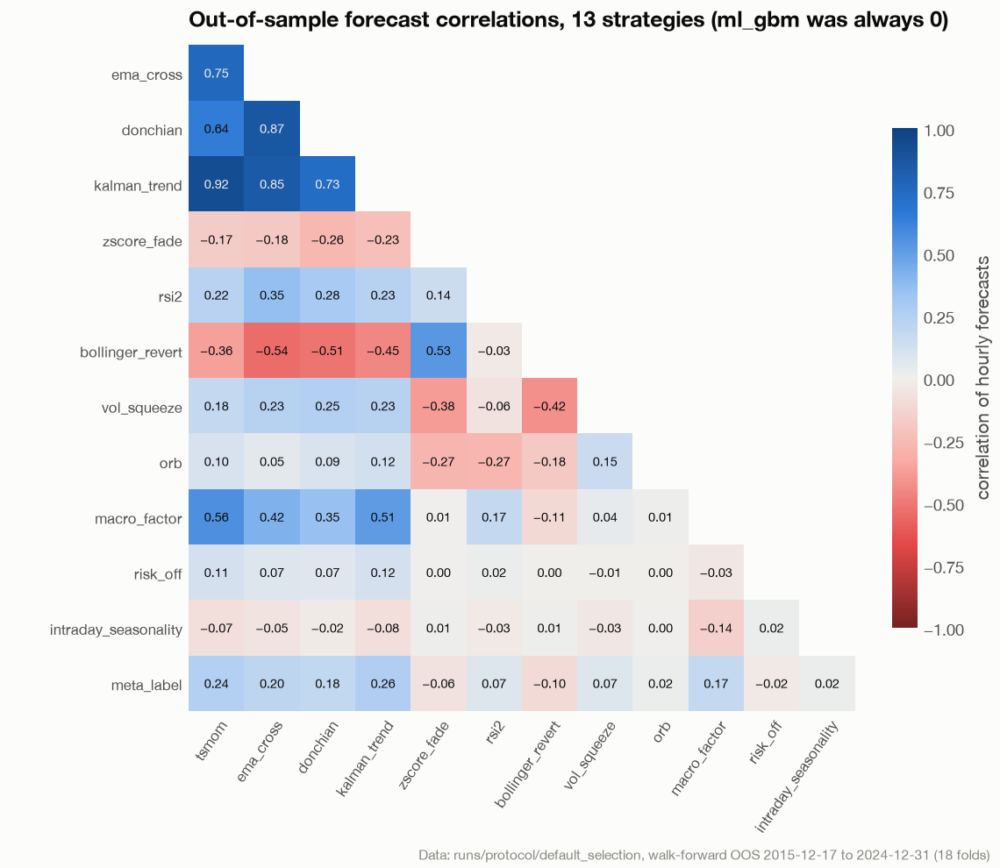
</picture>

*Hourly OOS forecasts, Dec 2015 to Dec 2024. The four trend rules are largely one bet (0.64 to 0.92; `tsmom` and `kalman_trend` 0.92), `macro_factor` overlaps with them (0.35 to 0.56) because the dollar and real yields drive gold's trends, `bollinger_revert` is their mirror image (−0.36 to −0.54), and the event-driven rules are nearly independent. The mean pairwise correlation is 0.08. `ml_gbm` is omitted: its forecast was 0 throughout. Data: `runs/protocol/default_selection`, walk-forward OOS 2015-12-17 to 2024-12-31 (18 folds).*

The combiner's forecast diversification multiplier is computed from the realised correlations
of the strategies it weights, not from these null-hypothesis formulas; see
[portfolio-and-risk.md](portfolio-and-risk.md). How each strategy's forecast contributed to the
combined position on a given day is shown by `aurum explain` ([analytics.md](analytics.md)).

---

## Which configuration runs which strategy

Checked with `load_config(...).enabled_strategies()` on the files in `configs/`.
`live_paper.yaml` and `desk_overlay.yaml` extend `default.yaml` without changing its strategy
list. `d1_trend.yaml` and `managed_gold.yaml` run on New York close daily bars with the windows
restated in trading days, stop at 2024-12-31 and have no holdout.

| Strategy | `default` / `live_paper` / `desk_overlay` | `trend_core` | `fast` | `d1_trend` | `managed_gold` |
|---|:-:|:-:|:-:|:-:|:-:|
| `tsmom` | ✓ | ✓ | ✓ | ✓ (daily) | ✓ (daily) |
| `ema_cross` | ✓ | ✓ | ✓ | ✓ (16/64) | |
| `donchian` | ✓ | ✓ | ✓ | ✓ (55/20) | |
| `kalman_trend` | ✓ | ✓ | | | |
| `zscore_fade` | ✓ | | ✓ | | |
| `rsi2` | ✓ | | ✓ | | |
| `bollinger_revert` | ✓ | | | | |
| `vol_squeeze` | ✓ | ✓ | | | |
| `orb` | ✓ | | | | |
| `macro_factor` | ✓ | ✓ | ✓ | | |
| `risk_off` | ✓ | ✓ | | | |
| `intraday_seasonality` | ✓ | | ✓ | | |
| `ml_gbm` | ✓ | | | | |
| `meta_label` | ✓ | | | | |
| `managed_gold` | | | | | ✓ |
| `regime_switch` | | | | | ✓ |
| `rl_ppo` | | | | | |
| **Count** | 14 | 7 | 7 | 3 | 3 |

`rl_ppo` is in no shipped configuration because it trains a PPO policy inside every fold. See
[ml-and-rl.md](ml-and-rl.md#the-rl_ppo-strategy-adapter) before adding it. `default` and
`trend_core` are the two pre-registered configurations of
[RESEARCH_PROTOCOL.md](RESEARCH_PROTOCOL.md). `fast` is a smoke/CI configuration and is never
evidence. `d1_trend` and `managed_gold` are exploratory additional trials, counted in
`walkforward.n_trials` = 30 ([configuration.md](configuration.md)).

## Configuring strategies in YAML

Each entry of the `strategies:` list is a `StrategyConfig`:

| Key | Default | Meaning |
|---|---|---|
| `name` | required | Registry name. |
| `params` | `{}` | Keyword arguments, merged over `default_params()`. |
| `id` | `name` | Forecast-column id. Must be unique, so the same strategy can appear twice with different parameters. |
| `enabled` | `true` | `false` keeps the entry but skips it. |
| `weight` | `null` | Only used when `combiner.method: fixed`. |

A config that extends the default and runs two `tsmom` variants (lists replace, they are not
merged, so the whole strategy list is restated):

```yaml
# configs/my_trend.yaml
extends: default.yaml
name: my_trend
strategies:
  - {name: tsmom}
  - {name: tsmom, id: tsmom_fast, params: {horizons: [24, 120, 480]}}
  - {name: donchian, params: {entry_n: 240, exit_n: 120}}
  - {name: rsi2, enabled: false}
```

Since v2.1, `aurum config validate` (and every other command, before it loads any data)
**builds every `strategies[]` entry, enabled or not**, and reports all problems at once:
unknown parameters (with a did-you-mean hint and the valid list), constructor errors, and
unknown strategy names (an error under the CLI's strict mode). The same file with a typo and an
unregistered name:

```yaml
strategies:
  - {name: tsmom, params: {horizon: [24, 120, 480]}}
  - {name: sma_distance}
```

```text
aurum: configuration error: 2 configuration problems:
  - strategies[0].params (tsmom): unknown parameter(s) ['horizon'] for strategy 'tsmom' (did you mean 'horizon' -> 'horizons'?); valid: ['horizons', 'response', 'vol_halflife', 'vol_min_periods', 'weights']
  - strategies[1].name: unknown strategy 'sma_distance' (registered: ['bollinger_revert', 'donchian', 'ema_cross', 'intraday_seasonality', 'kalman_trend', 'macro_factor', 'managed_gold', 'meta_label', 'ml_gbm', 'orb', 'regime_switch', 'risk_off', 'rl_ppo', 'rsi2', 'tsmom', 'vol_squeeze', 'zscore_fade'])
```

The command exits with code 2. A valid file prints a `# checked:` line that includes
`strategies (4 of 4 built from the registry)` and ends with `# config OK: <file> hash <sha>`. A
missing `rl_ppo` artifact is reported as a warning rather than an error. `ml_gbm`, `meta_label`
and `rl_ppo` reject unknown parameter names like every other strategy. A strategy whose
`default_params()` contains `seed` gets the config's top-level `seed` unless you set one. For
how configs are layered and overridden (`extends:`, `--set`), see
[configuration.md](configuration.md); the CLI commands are in [cli.md](cli.md).

Every strategy you add to a configuration and evaluate is a new trial. Under the research
protocol it must be counted in the deflated Sharpe ratio's `n_trials`
(`walkforward.n_trials`); see [research.md](research.md). The v2.1 `aurum sweep` command
records every grid point it evaluates as a trial too ([analytics.md](analytics.md)).

## Writing and registering a custom strategy

A strategy is a subclass of `aurum.strategies.Strategy` with a unique `name`, decorated with
`@register_strategy`. The minimum is `generate()`. Override `default_params()` and
`warmup_bars` whenever your rule has parameters or needs history. The helpers in
`aurum.strategies.trend` (`log_close`, `bar_volatility`, `z_to_forecast`, `check_params`,
`latch`, `momentum_z`, `diversification_multiplier`) give you the shared scaling convention
for free.

```python
from typing import Any

import numpy as np
import pandas as pd

from aurum.core.types import MarketData
from aurum.data.synthetic import make_synthetic_bars
from aurum.strategies import Strategy, get_strategy, list_strategies, register_strategy
from aurum.strategies.trend import bar_volatility, check_params, log_close, z_to_forecast


@register_strategy
class SMADistance(Strategy):
    """Distance of log price above its n-bar SMA, in units of per-bar volatility.

    Rationale: a (crude) trend filter; long when price sits above its moving average.
    """

    name = "sma_distance"
    description = "Log price minus its n-bar SMA, vol-normalised and Carver-scaled."

    @classmethod
    def default_params(cls) -> dict[str, Any]:
        return {"n": 200, "vol_halflife": 240.0, "vol_min_periods": 120}

    def __init__(self, **params: Any) -> None:
        super().__init__(**params)
        check_params(self)                       # reject typos in parameter names
        self.params["n"] = int(self.params["n"])
        if self.params["n"] < 2:
            raise ValueError("n must be >= 2")

    @property
    def warmup_bars(self) -> int:
        p = self.params
        return max(p["n"], p["vol_min_periods"]) + 1

    def generate(self, md: MarketData, features: pd.DataFrame | None = None) -> pd.Series:
        p = self.params
        lc = log_close(md.bars)                                  # causal: rows <= t only
        sigma = bar_volatility(lc, p["vol_halflife"], p["vol_min_periods"])
        dist = lc - lc.rolling(p["n"], min_periods=p["n"]).mean()
        # ~N(0,1)-ish statistic -> Carver scaling -> clip to [-1, 1]
        z = dist / (sigma * np.sqrt(p["n"] / 3.0))
        return self._finalize(pd.Series(z_to_forecast(z), index=md.bars.index), md.bars.index)


md = MarketData(bars=make_synthetic_bars(3000, "H1", seed=2))
s = get_strategy("sma_distance", n=100)
f = s.generate(md)
print("registered:", "sma_distance" in list_strategies())
print("warmup_bars:", s.warmup_bars, "| zeros in warm-up:", bool((f.iloc[: s.warmup_bars] == 0).all()))
print("finite and in [-1, 1]:", bool(np.isfinite(f).all() and f.abs().max() <= 1))

# causality check: truncating the future must not change the past
t = 2000
f_trunc = s.generate(MarketData(bars=md.bars.iloc[: t + 1]))
print("causal at t=2000:", bool((f.iloc[: t + 1].to_numpy() == f_trunc.to_numpy()).all()))

try:
    get_strategy("sma_distance", lenght=50)
except ValueError as exc:
    print("ValueError:", exc)
```

```text
registered: True
warmup_bars: 121 | zeros in warm-up: True
finite and in [-1, 1]: True
causal at t=2000: True
ValueError: sma_distance: unknown parameter(s) ['lenght']; valid: ['n', 'vol_halflife', 'vol_min_periods']
```

(`sqrt(n/3)` is the approximate random-walk standard deviation of the distance, in units of
the per-bar volatility, so the statistic is roughly N(0, 1) under the null.)

For a **trainable** strategy, also set `trainable = True`, implement `fit(md, features)`
using only the data passed in, store what you learn on `self`, and set
`self.is_fitted = True`. Raise in `generate` if it is called before `fit`. If the targets
look forward in time, see the label and purging rules in [ml-and-rl.md](ml-and-rl.md).
`regime_switch` is a compact example of a trainable strategy that wraps another one.

### How a new strategy is picked up

Registration happens when the module that defines the class is imported. The registry is
populated lazily by `_ensure_loaded()` in [aurum/strategies/base.py](../aurum/strategies/base.py),
which imports a **fixed list** of modules (`trend`, `mean_reversion`, `breakout`, `macro`,
`seasonal`, `ml`, `rl`, `allocation`, `regime`). Configs, the CLI and `get_strategy` all go
through it.

| You want | What happens automatically | What you must add by hand |
|---|---|---|
| Use it from a Python script | `@register_strategy` registers it when your module is imported. | Import your module before calling `get_strategy`. |
| Use it from a YAML config or the CLI | Nothing, unless its module is in the fixed list. | Put the class in an existing `aurum/strategies/*.py` module, or add your new module to the tuple in `_ensure_loaded()` in `aurum/strategies/base.py`. Config validation then builds it. |
| Leakage and output-contract tests | `tests/test_strategies_leakage.py` parametrises over **every registered strategy** from the modules it imports: output contract, determinism, clone equality, point-in-time at four cutoffs (perturbed and truncated futures), a non-vacuous check, and, for trainable strategies, that `fit` ignores macro rows not yet published. | A new module must be added to `OWNED_MODULES` (rule-based; `allocation` and `regime` are there) or `OTHER_MODULES` in that test file. Add the name to `OWNED` so build failures and all-zero forecasts **fail** instead of being skipped (it also enables the M15 variant). Add `TEST_PARAMS` overrides if the defaults are flat on synthetic data, and `TIME_ONLY` if the forecast depends only on the clock. |
| Random-walk no-edge test | Nothing. | Add the name to `RULES` in `tests/test_strategies_rules_randomwalk.py` (and a positive control if your rule should earn on a synthetic trend or mean-reverting market). |
| Walk-forward refits and purge | Trainable strategies are cloned, fitted per fold on training bars only, and generated on history before the test block. | If `fit` uses forward-looking labels, declare the horizon (a `label_horizon` property, or a parameter such as `max_holding_bars` or `horizon`) so the engine's purge is at least that long. Override `fit_history_bars` if `fit` needs warm-up bars before the training window. |
| Walk-forward worker processes | The process executor uses `spawn`, so strategies are pickled into workers. | Define the class in an importable module, not in a notebook cell. Use `--executor thread` or `serial` while experimenting. |

The development workflow (tests, linting, the figure build) is in
[development.md](development.md).

## Evidence

The catalogue above describes what each rule does and why someone might expect it to work.
It is not evidence that it does. Under the pre-registered protocol, on real XAUUSD H1 data
with realistic costs, **no strategy or book showed a statistically demonstrated edge**. The
hourly mean-reversion rules and the opening-range breakout lost reliably after costs, and the
trend rules were regime dependent. The exploratory v2.1 trials on daily bars did not change
that: daily trend following lost after costs over 2016-2024, `managed_gold` reduced drawdowns
without beating buy-and-hold on a risk-adjusted basis, and the `regime_switch` filter improved
daily `tsmom` without reaching significance (every deflated Sharpe ratio far below 0.95 and
every confidence-interval lower bound below 0). All numbers, the holdout and the verdict are in
[RESULTS.md](RESULTS.md), and the protocol is in [RESEARCH_PROTOCOL.md](RESEARCH_PROTOCOL.md).
To reproduce or extend the research, see [research.md](research.md); to stress-test or explain
a run, [analytics.md](analytics.md).

## See also

- [index.md](index.md): the documentation map and the glossary.
- [architecture.md](architecture.md): where strategies sit in the stack.
- [getting-started.md](getting-started.md): a first run on synthetic data.
- [data.md](data.md): bars, `available_at`, macro publication lags.
- [features.md](features.md): the causal feature library the ML strategies use.
- [models.md](models.md): the volatility models and the Gaussian HMM behind `regime_switch`.
- [ml-and-rl.md](ml-and-rl.md): `ml_gbm`, `meta_label`, `rl_ppo` in depth.
- [portfolio-and-risk.md](portfolio-and-risk.md): combiner, sizer and risk manager.
- [execution-and-costs.md](execution-and-costs.md): the costs the cost-aware rules estimate.
- [llm-desk.md](llm-desk.md): how the LLM desk reads strategy forecasts.
- [live-trading.md](live-trading.md): running strategies on a live or paper feed.
- [research.md](research.md) and [analytics.md](analytics.md): walk-forward, sweeps, stress tests, attribution.
- [RESEARCH_PROTOCOL.md](RESEARCH_PROTOCOL.md) and [RESULTS.md](RESULTS.md): the pre-registered study and its results.
- [cli.md](cli.md), [configuration.md](configuration.md), [development.md](development.md).
