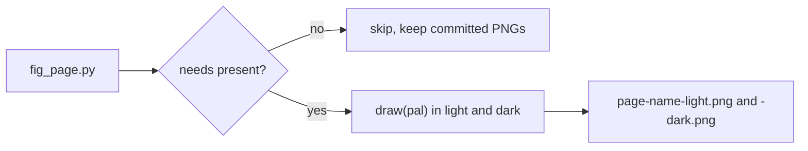

# Documentation figures: writer guide

Every chart in `docs/` is drawn by the real aurum code from a Python function in
`tools/figures/fig_<page>.py`. It is rendered twice, once per theme, into
`docs/_assets/figures/<page>/<name>-light.png` and `<name>-dark.png`. The page embeds both
images in one theme-aware block that works on GitHub and on the MkDocs site.

```bash
.venv/bin/python tools/figures/build.py --only strategies     # render one page's figures
.venv/bin/python tools/figures/build.py --list                # registered figures, PNG status
.venv/bin/python tools/figures/build.py --check --only strategies   # PNGs, embeds, orphans
.venv/bin/python -m pytest tests/test_docs_assets.py -q       # the same checks plus links
.venv/bin/mkdocs build --strict --site-dir /tmp/aurum-site    # the site, warnings are errors
.venv/bin/ruff check tools
```

## 1. Rules

1. **Cutoff: 2024-12-31.** Every loader in `_common` keeps only rows with
   `available_at <= 2025-01-01 00:00 UTC` (bars and macro) or a bar-open index before it
   (run tables). `bars(..., end=...)` past the cutoff raises `FigureDataError`, and so does
   any `runs/.../holdout/...` path. Do not work around this: 2025 onward is the research
   holdout. Never run a walk-forward or backtest inside a figure. Read the run outputs instead.
2. **One module per page, one page per directory.** The page slug is the docs file stem in
   lowercase with `_` replaced by `-` (`ml-and-rl`, `research-protocol`, `results`). The
   module is `tools/figures/fig_<slug with - as _>.py` (`fig_ml_and_rl.py`). Figure names are
   lowercase slugs (`managed-gold-latch`). `register` refuses anything else.
3. **Importing a module must not load data.** Load inside `draw(pal)` only. `build.py`
   imports modules under a guard that raises if `bars()`, `macro()` or `run_dir()` is
   called at import time. The loaders cache, so the figures of a page share one read.
4. **Declare what you need.** Use `needs=("data_store",)` for real bars or macro, and
   `needs=("runs/protocol/trend_core_selection",)` for a run, one entry per run. When an entry
   is missing (for example on a fresh clone) the figure is **skipped and the committed PNGs
   are kept**. A figure that reads real data without declaring it is refused if
   `data_store/` is missing, rather than silently drawing synthetic data under a real caption.
5. **Deterministic.** `build.py` reseeds `random` and `numpy.random` (seed 7) before each
   mode. Still use `np.random.default_rng(<seed>)` for anything random. `save_figure` pins
   the PNG metadata, and a re-render that is byte-identical is not rewritten (`[same]`). Bytes
   depend on the local matplotlib and fonts, so commit renders made on this machine.
6. **Under about 30 s per figure** (both modes). `build.py` prints a note above 30 s.
7. **Look at both PNGs** (Read the `-light.png` and the `-dark.png`) before you embed them.
   Check for overlapping or clipped labels, unreadable legends, empty panels and wrong scales.
8. **Never commit synthetic renders over real ones.** `--synthetic` (forces the synthetic
   fallback everywhere) only works with `--out DIR` outside `docs/_assets/figures`.

## 2. Module template (complete, two figures)

Copy `tools/figures/_template.py` (not discovered: it does not match `fig_*.py`) to
`fig_<page>.py` and set `PAGE`. Both figures below were rendered and inspected in both modes.
`ruff check tools` accepts the import layout as written.

```python
"""Figures for docs/example.md -- TEMPLATE (copy to fig_<page>.py; this file is not discovered).

Each ``@register``-ed ``draw(pal)`` becomes docs/_assets/figures/<PAGE>/<name>-{light,dark}.png.
Render with:  python tools/figures/build.py --only <PAGE>
"""

from __future__ import annotations

import numpy as np
from _common import (
    FIGSIZE_SQUARE,
    FIGSIZE_TALL,
    bars,
    ink_on,
    panels,
    register,
    signed,
    source_label,
    source_note,
)

from aurum.models.volatility import ewma_volatility
from aurum.viz.style import (
    diverging_cmap,
    figure,
    label_line_end,
    percent_axis,
    shade_span,
    style_axes,
)

PAGE = "example"


@register(PAGE, "price-and-vol", needs=("data_store",))
def price_and_vol(pal):
    """Gold close with its 200-day EMA (top) and annualised EWMA volatility (bottom)."""
    close_all = bars("D1_nyclose")["close"]            # real data, already cut at 2024-12-31
    ema_all = close_all.ewm(span=200, adjust=False).mean()
    vol_all = ewma_volatility(close_all, halflife_bars=20)   # aurum's own estimator
    show = slice("2015-01-01", None)                   # warm up on history, then display
    close, ema, vol = close_all.loc[show], ema_all.loc[show], vol_all.loc[show]
    lo = close.loc["2020-03"].idxmin()                 # spans come from the data, not by hand
    hi = close.loc["2020-07":"2020-08"].idxmax()

    fig, (ax0, ax1) = panels(2, heights=(3, 2), figsize=FIGSIZE_TALL)
    blue, orange = pal["categorical"][0], pal["categorical"][1]
    shade_span(ax0, lo, hi, "Mar-Aug 2020 rally")    # recessive band, muted label
    shade_span(ax1, lo, hi)
    line_close, = ax0.plot(close.index, close.values, color=blue, label="close")
    line_ema, = ax0.plot(ema.index, ema.values, color=orange, label="200-day EMA")
    label_line_end(ax0, line_close, fmt="{:,.0f}")   # direct labels instead of a legend
    label_line_end(ax0, line_ema, fmt="{:,.0f}")
    ax0.set_title("XAUUSD daily close and its 200-day EMA")
    ax0.set_ylabel("USD per ounce")

    ax1.plot(vol.index, vol.values, color=blue)
    percent_axis(ax1)                                  # 0.15 -> 15%
    ax1.set_title("Annualised EWMA volatility (half-life 20 days)")
    ax1.set_ylabel("volatility")
    ax1.set_xlabel("date (UTC)")
    source_note(fig, "Data: " + source_label("D1_nyclose", start="2015-01-01"), pal)
    return fig


@register(PAGE, "toy-sharpe-grid")
def toy_sharpe_grid(pal):
    """Synthetic illustration: a smooth Sharpe surface on a fast/slow grid (diverging map)."""
    rng = np.random.default_rng(3)                      # seed everything you draw
    fast = np.array([8, 16, 32, 64])
    slow = np.array([64, 128, 256, 512])
    f, s = np.meshgrid(np.log2(fast), np.log2(slow), indexing="ij")
    z = 0.4 * np.exp(-((f - 4.2) ** 2 + (s - 7.4) ** 2) / 2.0) - 0.15 + 0.03 * rng.standard_normal(f.shape)

    fig, ax = figure(figsize=FIGSIZE_SQUARE)
    style_axes(ax, grid=None)                           # heatmaps: no grid
    lim = float(np.abs(z).max())                        # symmetric limits around 0
    im = ax.imshow(z, cmap=diverging_cmap(pal["mode"]), vmin=-lim, vmax=lim, origin="lower")
    for i in range(z.shape[0]):
        for j in range(z.shape[1]):
            ax.text(j, i, signed(z[i, j]), ha="center", va="center", fontsize=9,
                    color=ink_on(im.cmap(im.norm(z[i, j]))))   # readable on any cell
    ax.set_xticks(range(len(slow)), [str(v) for v in slow])
    ax.set_yticks(range(len(fast)), [str(v) for v in fast])
    ax.set_xlabel("slow window (bars)")
    ax.set_ylabel("fast window (bars)")
    ax.set_title("Toy Sharpe ratio surface (synthetic)")
    cbar = fig.colorbar(im, ax=ax, shrink=0.85)
    cbar.set_label("Sharpe ratio", color=pal["text_secondary"])
    cbar.outline.set_visible(False)
    cbar.ax.tick_params(colors=pal["axis"], labelcolor=pal["text_secondary"])
    return fig
```

`draw(pal)` must create and return its figure (a `Figure`, an `Axes` or an array of axes).
It is called once per mode inside `aurum.viz.style.use_style`, and `pal` is that mode's
palette dict. Do not name the decorator `figure`, because that is the
`aurum.viz.style.figure()` you use to create axes.

## 3. `_common` API (import from `_common`)

| Name | What it does |
|---|---|
| `bars(tf="H1", *, start=None, end=None, synthetic=False)` | Canonical XAUUSD bars (`open high low close volume spread available_at`, UTC bar-open index). `tf` is one of `M15`, `H1`, `H4`, `D1` (UTC days), `D1_nyclose` (22:00 UTC days). Real data comes from `aurum.data.store.load_bars` (hash verified) and is cut at the cutoff. `start`/`end` filter the open time, and a bare-date `end` is inclusive. Returns a copy. |
| `bars(tf, synthetic=True)` | Always the deterministic synthetic series: GBM, 16% annual vol, start 1600, spread 0.30, seed 7, 2012 to 2024 (`aurum.data.synthetic.make_synthetic_bars`). Use it for concept illustrations. |
| `macro(names=None, *, synthetic=False)` | `{name: frame}` daily macro frames (`value` [+ OHLC], `available_at`), kept only when `available_at <= cutoff`. Align them with `aurum.data.pit.asof_join` on each bar's `available_at`. |
| `market_data(tf="H1", *, macro=True, events=True, start=None, end=None, synthetic=False)` | An `aurum.core.types.MarketData`, assembled like `DataConfig.load`: bars, macro, and the rule-based NFP/FOMC calendar from the first bar to 14 days after the last (scheduled times are public in advance). Feed it to features, strategies and models. |
| `events_for(bars_frame)` | The calendar `DataConfig.load` would attach to these bars. |
| `data_available(tf)`, `macro_available()`, `is_synthetic(tf)` | What exists, and what `bars()` would return right now. |
| `source_label(tf, *, start=None, end=None, synthetic=False, years=True)` | Credit string, for example `XAUUSD H1, Dukascopy bid/ask mid, 2012-2024`. With `years=False` you get full dates (`2012-01-01 to 2024-12-31`). For synthetic data: `synthetic GBM H1 bars (aurum.data.synthetic, seed 7), not market data`. |
| `macro_label(names=None)` | For example `FRED DFII10; Yahoo DX-Y.NYB (publication-lagged)`. |
| `run_label(name)` | For example `runs/protocol/trend_core_selection, walk-forward OOS 2015-12-16 to 2024-12-31 (18 folds)`. |
| `run_dir(name)` / `run_file(name, rel)` | `runs/<name>` or `runs/<name>/<rel>` as a `Path`, or `None` when missing. Paths under `holdout/` raise. |
| `run_table(name, rel, *, cut=True, **read_kw)` | Reads `.parquet` or `.csv` (a datetime first CSV column becomes a UTC index) and cuts the index at the cutoff. Returns `None` when missing. |
| `run_json(name, rel)` | Parsed JSON (`summary.json`, `stress.json`, `sweep.json`) or `None`. Check any dates in it yourself. |
| `panels(n, *, heights=None, figsize=None, sharex=True, hspace=None)` | `(fig, [ax0, ...])`: stacked panels sharing x, with relative heights, no pyplot. Use them instead of twin axes. |
| `source_note(fig, text, pal)` | Small muted credit at the bottom right (uses `fig.supxlabel`, so label the bottom axis with `ax.set_xlabel`). Recommended for every data figure: `source_note(fig, "Data: " + source_label("H1"), pal)`. |
| `ink_on(fill)` | Primary ink (light-mode or dark-mode text colour) that stays readable on a filled cell. Use it for numbers inside heatmap cells or bars. |
| `signed(x, fmt="{:+.2f}")` | A number with a true minus sign (U+2212), matching the tick labels. |
| `FIGSIZE` (8, 4.5), `FIGSIZE_SHORT` (8, 3.2), `FIGSIZE_TALL` (8, 6.5), `FIGSIZE_SQUARE` (6.4, 5.6), `FIGSIZE_GRID` (8, 6), `DPI` 150 | Keep widths at or below 8 in so text stays readable at 100% page width. |
| `FIGURE_CUTOFF` `"2024-12-31"`, `CUTOFF_END` (2025-01-01 00:00 UTC), `SYNTHETIC_SEED` 7 | Constants. |
| `register(page, name, *, needs=())` | The decorator. It returns the function unchanged. |

## 4. `aurum.viz.style` helpers and chart rules

Read the docstring of [aurum/viz/style.py](../../aurum/viz/style.py). The helpers:

- `figure(nrows=1, ncols=1, *, figsize=None, sharex=False, sharey=False, squeeze=True)`: a
  styled `Figure` and its axes, without pyplot.
- `add_legend(ax, *, min_series=2, **kw)`: draws a legend only when there are at least 2
  labelled series.
- `label_line_end(ax, line, text=None, *, dx_points=6.0, fmt="{:,.2f}", dot=True)`: a direct
  label in ink with a coloured end-dot. Prefer it to a legend for up to 4 series.
- `zero_line(ax, *, axis="y")`, `shade_span(ax, start, end, label=None, *, axis="x")`
  (recessive band for folds, holdouts and regimes), and
  `percent_axis(ax, axis="y", *, decimals=0, xmax=1.0)`.
- `style_axes(ax, *, grid="y"|"x"|"both"|None)`: use `grid=None` for heatmaps.
- `categorical(n)` (n <= 8, fixed order: blue, orange, aqua, yellow, magenta, green, violet,
  red), `series_color(i)`, `sequential(n=None)`, `diverging(n=7)`, `sequential_cmap(mode)`
  and `diverging_cmap(mode)`. Inside `draw` the mode defaults to the one being rendered.
- `pal` keys: `mode surface page text text_secondary text_muted grid axis border delta_good
  categorical(8) sequential(13, near zero first) diverging(7, red to gray to blue)
  diverging_mid status{good,warning,serious,critical}`.

Rules:

- Take categorical colours in the fixed order and never cycle them (8 at most). Use lines of
  2 px (the default). Keep the y-grid recessive and draw no top or right spines.
- Write text in `pal["text"]`, `pal["text_secondary"]` or `pal["text_muted"]`, never in a
  series colour.
- **Never use twin y-axes** (`twinx`). Use stacked `panels()`, or index both series to a
  common base.
- Draw a legend only for 2 or more series, and prefer direct labels when there are 4 or fewer.
  In light mode the aqua, yellow and magenta slots are below 3:1 contrast, so label those
  series directly.
- A sequential scale uses one hue (in dark mode it runs dark to light). A diverging scale is
  blue (positive) and red (negative) with a gray midpoint and symmetric limits
  (`vmin = -vmax`). Use status colours only for good, warning, serious and critical, always
  with a word.
- Every figure needs a title, axis labels with units (`USD per ounce`, `annualised
  volatility`, `date (UTC)`, `bars`), alt text and a caption.
- aurum's own analytics plots draw with these helpers and take `mode="light"` or `"dark"`
  (default: the active `use_style` mode, light outside one): `plot_sweep` and
  `SweepResult.plot` (`aurum.research.sweep`), `plot_fan` and `plot_distributions`
  (`aurum.research.montecarlo`), `plot_waterfall`, `plot_attribution` and the `.plot()` of
  `DecisionExplanation` / `PnLAttribution` (`aurum.research.attribution`). Inside `draw(pal)`
  call them with `mode=pal["mode"]` and return the figure, after relabelling axes or adding a
  `source_note` if needed (see [fig_analytics.py](fig_analytics.py)), or redraw from the data
  they return. The tearsheet charts of `research/report.py` use the same palette and chrome.
  Never copy a PNG from `runs/` or a tearsheet into `docs/_assets/figures/`: `--check` refuses
  files that no registered figure produces.

## 5. Embedding a figure

Paste this block into the page. Paths are relative to the page: `docs/*.md` uses
`_assets/figures/<page>/...`, and `README.md` uses `docs/_assets/figures/<page>/...`. Leave
one blank line before `<picture>`, keep the four lines as shown, leave one blank line, then
write the caption **on a single line** wrapped in `*...*`:

```html
<picture>
  <source media="(prefers-color-scheme: dark)" srcset="_assets/figures/example/price-and-vol-dark.png">
  
</picture>

*Volatility peaks at 28% on 2020-03-23, five days after gold's March low, and by the August 2020 high the close stands 23% above its 200-day EMA. Data: XAUUSD D1 (New York close, 22:00 UTC), Dukascopy bid/ask mid, 2015-2024.*
```

- **Alt text** is plain words describing what is drawn: no `$`, no math, no Markdown.
- **Caption** says what to look at, then `Data: <source>, <period>.` (copy the credit from
  `source_label()` / `run_label()`, or write `Data: synthetic illustration (aurum.data.synthetic,
  seed 7), not market data.`). The caption may contain inline `$math$`, `code` and links.
- On **GitHub** the `<picture>` follows the reader's OS theme. On the **site**,
  `docs/_hooks/mkdocs_hooks.py` turns the block into
  `<figure class="aurum-figure">` holding `` and
  ``, plus the caption as `<figcaption>`, so Material's toggle
  picks the image. Inside alerts, `<details>` or indented blocks the hook emits the two images
  and the caption as plain paragraphs instead. A malformed block (missing dark `<source>`,
  `` or alt text) is a warning, so `mkdocs build --strict` fails on it.
- Link the code that draws a figure: `[figure code](../tools/figures/fig_strategies.py)`, in
  the paragraph before the figure or in the caption. On the site, the hook rewrites every link
  that leaves `docs/` to a GitHub URL, the caption's included, so the link works on GitHub and
  passes `mkdocs build --strict` on the site (`tests/test_docs_assets.py` checks the rewrite).
- Images that cannot be drawn (a screenshot) go in `docs/_assets/static/` and are embedded
  the same way when both variants exist. Everything under `docs/_assets/figures/` must come
  from a registered figure.

## 6. Math

Verified on the site build (pymdownx.arithmatex in generic mode plus `docs/_assets/mathjax.js`):
a ` ```math ` fence becomes `<div class="arithmatex">\[...\]</div>`, inline `$...$` becomes
`<span class="arithmatex">\(...\)</span>`, and both work in paragraphs, list items, table
cells and figure captions. Conventions that work on GitHub and on the site:

- **Display equations in ` ```math ` fences**, one equation or aligned block per fence.
  Fences are raw, so `\{`, `_`, `*`, `|` and `\\` are safe inside. Do not use `$$`.

  ````markdown
  ```math
  r_t = \ln C_t - \ln C_{t-1}, \qquad
  v_t = (1-\alpha)\, v_{t-1} + \alpha\, r_t^2, \qquad
  \sigma_t = \operatorname{clip}\left(\sqrt{B\, v_t},\ 0.03,\ 2.0\right)
  ```

  where

  - $C_t$ is the close of bar $t$ and $r_t$ its log return,
  - $\alpha = 1 - 2^{-1/H}$ with $H$ = `halflife_bars` (default 48),
  - $B$ is the nominal bars per year, 252 x 23 h / bar length (5,796 on H1, 252 on D1),
  - the first 20 bars (the first return is undefined, then `min_periods=20`) get the
    constant 0.20.
  ````

  (This is `ewma_volatility` in [aurum/models/volatility.py](../../aurum/models/volatility.py).)

- **Inline `$...$` only for short symbols** ($\sigma_t$, $w_i$, $h$), on one line, with no
  space after the opening `$` or before the closing `$`. Anything with `\{ \}`, `\\`, `|`,
  `*` or more than a short term goes in a fence. GitHub can drop the backslash before `{`/`}`
  in inline math, and a `|` in a table row is a column break on both renderers. Use
  `\lbrace`/`\rbrace`, `\lvert x \rvert` and `\mid` if you must.
- **Never write a `$` amount in prose.** Write `USD 5`, `100k USD`, `2,000 USD/oz`. Two `$`
  on one line can pair up as math: `+$22.9k gross on $100k ... -$0.7k` in docs/RESULTS.md
  was typeset as math on the site until the hook began escaping stray dollars (pandoc rule:
  a closing `$` must follow a non-space and must not be followed by a digit). GitHub
  applies no such fix; its documentation asks for `<span>$</span>` around a literal `$` on a
  line that also has math.
- `\text{}` needs escaped underscores: `\text{bars\_per\_day}`. Use `\mathrm{DSR}`,
  `\operatorname{clip}`, `\tfrac{1}{N}`.
- Symbols must match the code exactly: same windows, clipping, annualisation and defaults.
  Define every symbol in a "where" list right below the fence.

## 7. Mermaid

Use ` ```mermaid ` fences with `flowchart LR|TD`, `sequenceDiagram`, `stateDiagram-v2` or
`timeline`. Material themes them for light and dark, and GitHub renders them natively.

- No `style`, `classDef`, `class` or `fill`/colour directives, and no `%%{init}%%` theme
  blocks: they break dark mode.
- Keep node labels short. Quote a flowchart label that has punctuation:
  `A["walk-forward (OOS)"]`, `B{"needs present?"}`. State and sequence labels after `:` are
  plain text: no quotes, and avoid `<`, `>` and `;` (write "at least", "below"). Do not use
  `end` as a node id.
- One idea per diagram. Split anything wider than about 6 nodes per rank.



## 8. What data exists (pre-flight, measured 2026-11-09)

All figures are cut at 2024-12-31. Rows below are **after** the cut. `data_store/` and
`runs/` are gitignored, so declare `needs`.

**Bars** (`bars(tf)`, Dukascopy bid/ask mid, `spread` in USD/oz, median about 0.32):

| `tf` | rows (to 2024-12-31) | first bar open | last bar open | notes |
|---|---|---|---|---|
| `M15` | 308,614 | 2012-01-01 22:45 | 2024-12-31 21:45 | |
| `H1` | 77,562 | 2012-01-01 22:00 | 2024-12-31 21:00 | the research timeframe |
| `H4` | 20,805 | 2012-01-01 20:00 | 2024-12-31 20:00 | anchored at 00:00 UTC |
| `D1` | 4,044 | 2012-01-01 00:00 | 2024-12-31 00:00 | UTC-midnight days |
| `D1_nyclose` | 3,393 | 2012-01-01 22:00 | 2024-12-30 22:00 | New York close (22:00 UTC) days, used by configs/d1_trend.yaml and configs/managed_gold.yaml |

Load time in a fresh process (hash-verified read plus cut): `bars("H1")` 0.09 s,
`bars("M15")` 0.07 s, cached repeats about 1 ms, and `market_data("H1")` after that 0.03 s.
Importing `_common` takes about 0.2 to 0.4 s. Synthetic `bars("H1", synthetic=True)` takes
0.01 s and `M15` 0.05 s.

**Macro** (`macro()`, daily, the last usable row is the one published by 2024-12-31):

| name | source | publication lag (`available_at` minus date) | rows | last date |
|---|---|---|---|---|
| `fedfunds` | FRED DFF | 1 US business day + 21:30 | 5,113 | 2024-12-30 |
| `real10y` | FRED DFII10 | 1 US business day + 21:30 | 3,500 | 2024-12-30 |
| `breakeven10y` | FRED T10YIE | 1 US business day + 21:30 | 3,500 | 2024-12-30 |
| `dxy` | Yahoo DX-Y.NYB | 22:30 | 3,521 | 2024-12-31 |
| `gold_fut` | Yahoo GC=F | 22:30 | 3,520 | 2024-12-31 |
| `oil` | Yahoo CL=F | 22:30 | 3,520 | 2024-12-31 |
| `silver` | Yahoo SI=F | 22:30 | 3,519 | 2024-12-31 |
| `spx` | Yahoo ^GSPC | 21:30 | 3,522 | 2024-12-31 |
| `us10y` | Yahoo ^TNX | 21:30 | 3,521 | 2024-12-31 |
| `vix` | Yahoo ^VIX | 21:30 | 3,522 | 2024-12-31 |

All series start in 2011 (2011-01-01 for `fedfunds`, 2011-01-03 for the rest). The synthetic
fallback has only `dxy, spx, vix, us10y, real10y`.

**Walk-forward runs** (`run_dir(name)`, read-only; never write into `runs/protocol/`). Each
has `summary.json`, `config.yaml`, `stats.csv` (per book: sharpe, psr, dsr, ci_lower/upper,
cagr, max_drawdown, n_trades, total_costs, ...), `folds.csv` (train/test windows, fdm,
oos_sharpe, combiner_basis), `weights.csv` (fold x strategy, plus fdm), `fold_sharpe.csv`,
`costs.csv`, `oos_forecasts.parquet` (per-strategy forecasts plus `combined` and `fold`) and
`books/<book>/{timeseries.parquet, trades.csv, fills.csv, risk_events.csv, metrics.json,
meta.json}`. `timeseries.parquet` has the columns `equity returns positions target
[forecast] position_close cost_spread cost_slippage cost_commission cost_swap pnl_price
pnl_costs pnl_swap pnl_net`.

| `name` | data | OOS (research) | folds | strategies (books) |
|---|---|---|---|---|
| `protocol/default_selection` | H1 | 2015-12-17 to 2024-12-31 | 18 | 14: tsmom, ema_cross, donchian, kalman_trend, zscore_fade, rsi2, bollinger_revert, vol_squeeze, orb, macro_factor, risk_off, intraday_seasonality, ml_gbm, meta_label (+combined, benchmark) |
| `protocol/trend_core_selection` | H1 | 2015-12-16 to 2024-12-31 | 18 | 7: tsmom, ema_cross, donchian, kalman_trend, vol_squeeze, macro_factor, risk_off (+combined, benchmark) |
| `protocol/trend_core_holdout` | H1 | same research part as above | 18 | same. Its `holdout/` (2025 onward) is refused by the loaders. |
| `v21_d1_trend` | D1_nyclose | 2016-01-03 to 2024-12-30 | 18 | tsmom, ema_cross, donchian. EXPLORATORY additional trial. |
| `v21_managed_gold` | D1_nyclose | 2016-01-03 to 2024-12-30 | 18 | managed_gold, regime_switch, tsmom. EXPLORATORY. |
| `walkforward_20260927T042509Z_a47989d0` | H1 | 2021-2025 smoke run (configs/fast.yaml) | 10 | **do not use** (cut to 2024 anyway) |

**Analytics outputs** (`runs/v21_demo/`, EXPLORATORY, all on data up to 2024-12-31):

| `name` | files |
|---|---|
| `v21_demo/sweep_ema_cross` | `sweep.csv` (fast, slow, status, sharpe, ci_lower, ci_upper, psr, cagr, max_drawdown, n_trades, total_costs, ...), `returns.csv` (daily OOS returns per grid point), `sweep.json`. The 3x3 grid fast 16/32/64 x slow 64/128/256 on trend_core, OOS 2019-2024 |
| `v21_demo/stress_trend_core` | `stress.json`, `fan_bands.csv` (day, q05, q25, q50, q75, q95), `distribution.csv` (cagr, max_drawdown, final_equity, total_return, longest_underwater_days per path), `drawdown_exceedance.csv`, `risk_of_ruin.csv`, `worst_windows.csv`, `gap_shocks.csv`, `gold_moves.csv`. 10,000 paths x 504 days from trend_core_selection |
| `v21_demo/explain_trend_core` | `decision_20200316T1400.{csv,json}` (strategy, forecast, weight, fdm, contribution, share), `attribution_daily.csv` (time x strategy, plus unattributed), `attribution_by_year.csv`, `attribution_totals.csv`, `attribution.json`, `desk_summary.json`, `desk_cycles.csv` |

**Desk journals:** `runs/desk_demo/20200210T050000Z_43771b5c321f.jsonl` (one demo cycle, 51
events) and `runs/desk_journal/*.jsonl` (45 cycle files, 2020-05-19 to 2020-06-11). Read them
with `run_file()` and `json.loads` per line. `runs/live/paper/` holds only
`aurum_live_config.yaml`.

## 9. Checks

`build.py --check [--only PAGE ...]` exits 1 on any of these:

- a registered figure without both PNGs;
- a missing image referenced from `docs/*.md` or `README.md`;
- a `<picture>` block that does not match section 5 (dark `<source>`, `` with alt, the
  light/dark pair, a one-line italic caption after one blank line);
- a PNG under `docs/_assets/figures/` that no registered figure produces;
- a PNG that no page references (an orphan).

`tests/test_docs_assets.py` runs the same checks, adds every relative link (with `#anchor`
for `.md` targets, using GitHub heading slugs) from `docs/*.md` and `README.md`, and needs
no `data_store/`. Before you finish a page, run `build.py --only <page>`, look at every PNG
in both modes, then run `build.py --check --only <page>`, the pytest file and
`mkdocs build --strict`.

## 10. Build output and troubleshooting

```
[ok  ] example/price-and-vol            0.8s  updated      new or changed PNGs written
[same] example/toy-sharpe-grid          0.1s  unchanged    byte-identical, file untouched
[skip] example/price-and-vol                  needs data_store (missing); committed PNGs kept
[FAIL] fig_x.py failed to import: FigureDataError: bars('H1') was loaded while a figure module was being imported; ...
```

- `note: UserWarning: Glyph ... missing`: the font lacks that character. Use ASCII or
  `\N{MINUS SIGN}`, and avoid emoji.
- `note: reads data_store/ but does not declare needs`: add `needs=("data_store",)`.
- `used the synthetic fallback ...`: as above. Nothing was installed.
- Figure-level layout uses constrained layout (on by default). Do not call `tight_layout`.
  Use `panels(..., hspace=...)` to adjust the spacing of stacked panels.
